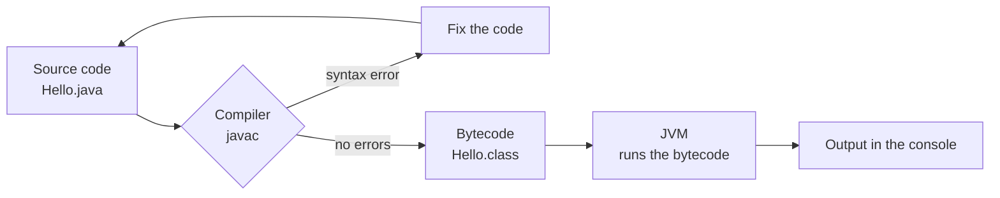

# Lecture 1 — Introduction to Programming and Java

**Module:** 4300COMP Introduction to Programming · **Language:** Java

## Start here

This lecture takes you from "what is a program?" to writing, running and fixing your first Java program in Eclipse. It rebuilds the official **Lecture 01** slides in plain English and adds the beginner explanations the slides skip. After it, do **Lab 1** (`../Labs/Lab-01-Hands-on-Practical-Workbook.md`).

**By the end you should be able to:**

1. Explain what a program, source code, a compiler, bytecode and the JVM are.
2. Describe the three levels of programming language and why Java is used.
3. Read every word of `HelloWorld` and say what it does.
4. Write a program that prints any text you choose, on as many lines as you choose.
5. Tell a syntax error from a runtime error and a logic error, and read a compiler message.
6. Find your way around Eclipse.

**Links to the module:** this lecture covers syllabus topic 1 (*Language and IDE basic elements*) and supports **MLO2** (investigate IDEs and APIs) and **MLO1** (apply programming constructs).

**How to study this (about 90 minutes):**

1. Read one section at a time. Don't skim the code — read it slowly, word by word.
2. Type every example into Eclipse and run it. Typing teaches your fingers the syntax; copy-pasting teaches nothing.
3. Where a section says **Try it**, change the code and predict what will happen *before* you run it.
4. Do the **Test yourself** questions near the end without looking back. Then check your answers.
5. Move on to Lab 1.

**Labels used in these notes:**

- **Official** — taken from the LJMU Lecture 01 slides or Tutorial 1 sheet.
- **Extra** — my additional explanation to help you understand. Useful, but not taken from the slides, so don't assume it's examined.
- Code blocks marked *Output* show what the program really printed — every program here was compiled and run with Java 21 before being written down.

**Module facts from the slides (Official):** 20 credits, semester 1, pass mark 40%. Lectures plus practical labs; aim for **4–5 hours of private study a week**. Lab solutions are released at the end of each week. The slides state that **generative AI tools are not allowed for any assignment** — use material like this to learn, then write your coursework yourself. For extra help: the **Mathematics and Programming Centre, lab 710, Byrom Street**.

## 1. Programs and programming

**The point:** a computer can't do anything by itself. It follows a **program** — a precise list of instructions written by a person.

### 1.1 What a computer actually does (Official)

Computers do useful jobs for us: checking spelling in Word, downloading a web page, playing a music file. Every one of those jobs is really thousands of tiny steps — "read this letter", "compare it with this word", "draw this pixel". The computer is extremely fast at those steps, but it has **no common sense**. It does exactly what it's told, in exactly the order it's told.

**Analogy (with its limits):** a program is like a recipe. A recipe lists steps in order, and the cook follows them. But a human cook can guess what "a pinch of salt" means; a computer can't guess anything. Every instruction must be exact. That's why one missing semicolon stops a Java program completely.

### 1.2 Key definitions (Official, explained)

| Term | Official meaning | In plain English |
| --- | --- | --- |
| **Program** | A set of instructions to be executed by a computer | The list of exact steps |
| **Programming** | Writing those instructions | Your job in this module |
| **Program execution** | The act of the instructions being carried out (fed to the CPU) | "Running" the program |
| **CPU** | Central Processing Unit (named on the slides) | The chip that carries out instructions |
| **Programming language** | A systematic set of symbols and rules used to describe computations, in a form humans can edit | A language with strict grammar that both you and the computer's tools understand |
| **Source code** (or **code**) | The sequence of instructions you write for a program | The text you type into Eclipse |
| **Console** | The text box or window where a program's output is printed | The panel at the bottom of Eclipse showing your output |

### 1.3 Three ideas that matter from day one

1. **Exactness.** `System.out.println` works; `system.out.println` and `System.out.printn` don't. Java is **case-sensitive** — capital and lower-case letters are different characters.
2. **Order (sequential execution).** Statements run one after another, top to bottom. Swap two lines and the output order swaps. (Tutorial 1's supplementary task asks you to notice this.)
3. **The computer checks grammar, not meaning.** If your program's grammar is right but your instructions are wrong, the computer will happily do the wrong thing. That's a **logic error** (section 6).

### Try it

Think of a task you do daily — making a cup of tea. Write it as numbered steps so exact that someone who has never seen a kettle could follow them. How many steps did you need? What did you assume they'd "just know"? That gap between what *you* know and what *you wrote down* is exactly where bugs come from.

## 2. Levels of programming language, and why Java

**The point:** the CPU only understands binary. Higher-level languages let humans write instructions in readable form, and tools translate them down.

### 2.1 The three levels (Official examples from the slides)

**Level 1 — Binary (machine code).** Only 0s and 1s:

```
1110001100000000 0101011011100000 0110100001000000
0000100000001000
0001011011000100
```

Perfect for the electronics of a computer. Almost impossible for a person to read, write or check.

**Level 2 — Assembly language.** Short **mnemonic** codes stand for machine instructions — `LD` means LOAD, `BR` means BRANCH (jump), `ADD` means add:

```
ORIG x3001
LD R1, x3100
AND R3, R3 #0
LD R4, R1
BRn x3008
ADD R3, R3, R4
```

Better than binary, but you still have to think like the hardware (registers `R1`, `R3`, memory addresses `x3100`).

**Level 3 — High-level language** (Java, Python, C, C#, C++). Reads almost like English and maths:

```java
int sum = 0;
int count = 0;
int done = -1;
int[] list = new int[10];
while (list[count] != done) {
    sum += list[count];
    count++;
}
```

You don't need to understand this yet — it adds up numbers in a list. Notice two things: it's far more readable, and it's far **shorter** — the binary or assembly version would need many more instructions.

| Level | Example | Readable by people? | Run directly by the CPU? |
| --- | --- | --- | --- |
| Binary / machine code | `1110001100000000` | Almost never | Yes |
| Assembly | `ADD R3, R3, R4` | With effort | No — translated by an assembler |
| High-level (Java) | `sum += list[count];` | Yes | No — translated by a compiler |

### 2.2 What every high-level language must do (Official)

Languages differ, but they all need ways to write three fundamental kinds of statement. You'll learn them over the coming weeks:

| Kind of statement | What it does | Java example | Where you learn it |
| --- | --- | --- | --- |
| **Declarative** | Creates variables to hold data | `int count = 0;` | Lectures 2–3 |
| **Conditional** | Makes a decision | `if (mark >= 40) { … } else { … }` | Lectures 6–7 |
| **Iterative** (repetition, loops) | Repeats instructions | `while (…) { … }` | after Lecture 7 |

### 2.3 Why Java? (Official)

- **Platform independence:** a Java program runs on Windows, Linux or Mac without being rewritten. Section 4 shows exactly how.
- **Android:** Java is one of the two official languages for Android apps (the other is Kotlin).

**Extra — why it suits Cyber Security students:** Java is strongly **typed** (it checks that you use data correctly before the program runs), which teaches careful habits. Many security tools and enterprise systems you'll meet are written in Java, so being able to read it helps you analyse them.

## 3. Your first program, every word explained

**The point:** every runnable Java program is a **class** containing a **main method** containing **statements**. Learn this shape and you can read any program in the first half of the module.

### 3.1 The program (Official)

Saved in a file called `HelloWorld.java`:

```java
public class HelloWorld {
    public static void main(String[] args) {
        System.out.println("Hello World!");
    }
}
```

*Output:*

```
Hello World!
```

### 3.2 The shape: boxes inside boxes

Think of it as three nested containers:

```
class HelloWorld            ← the outer box (the program)
└── method main             ← where running starts
    └── statement           ← one instruction: print "Hello World!"
```

The slides' general template — use it for every program until Lecture 4:

```java
public class <Name> {
    public static void main(String[] args) {
        <statements>;
    }
}
```

### 3.3 Line 1: `public class HelloWorld {`

| Word | What it means | Can you change it? |
| --- | --- | --- |
| `public` | **Access modifier**: this class can be used from anywhere. | Keep it for now. |
| `class` | Reserved word: "a class starts here". | Must stay exactly `class`. |
| `HelloWorld` | The class's **name** — chosen by you. Must match the file name `HelloWorld.java` exactly, capitals included. | Yes — but rename the file to match. |
| `{` | Opens the class body. Everything up to the matching `}` belongs to the class. | Must stay. |

A **class** (Official): (a) a module that can contain executable code; (b) a description of a type of object — you'll meet meaning (b) later in the module, for object-oriented programming.

**Naming convention:** class names are nouns in **UpperCamelCase** — every word starts with a capital, no spaces: `HelloWorldApp`, `ShapePrinter`, `PasswordChecker`. (Tutorial 1 calls this an important professional convention.)

### 3.4 Line 2: `public static void main(String[] args) {`

This is the **main method** — the **entry point**: Java always starts running your program at the first statement inside `main`. The slides say you don't need to understand every word yet, but here is what each part does, so it isn't magic:

| Part | What it means (beginner level) | Change it? |
| --- | --- | --- |
| `public` | Java itself (from outside your class) must be allowed to call `main`. | No |
| `static` | `main` can run without first creating an object of the class. Objects come later; for now, every method you write will be `static`. | No |
| `void` | `main` gives no answer back when it finishes. (`void` = "returns nothing".) | No |
| `main` | The special name Java looks for. Spell it exactly. | No |
| `(String[] args)` | A **parameter**: a list of text values that could be passed in when the program starts. You won't use it yet, but it must be there. | Only the name `args` could change — leave it. |
| `{` | Opens the method body. | No |

**What happens if it's wrong?** Misspell `main` as `mian` and the program still **compiles** — the grammar is fine, it's just a method with a different name — but when you run it, Java can't find its starting point. Real output:

```
Error: Main method not found in class HelloWorld, please define the main method as:
   public static void main(String[] args)
```

In Eclipse, tick **"public static void main(String[] args)"** when creating a class and it writes this line for you.

### 3.5 Line 3: `System.out.println("Hello World!");`

This is a **statement** — one complete command to the computer. Read it right to left:

| Part | What it means |
| --- | --- |
| `"Hello World!"` | A **String** — a piece of text. The double quotes mark where the text starts and ends; they aren't printed. |
| `( … )` | Round brackets hold what you're giving to the method — here, the text to print. |
| `println` | The **method** that prints, then moves to a new line ("print line"). |
| `System.out` | The **standard output** — by default, the console. `System` must have a capital S. |
| `.` | The dot means "belonging to": `out` belongs to `System`, `println` belongs to `out`. |
| `;` | Ends the statement — like a full stop ends a sentence. |

**Statement** (Official): an executable piece of code that represents a complete command. Every basic statement ends with `;` — **but not every line does**. Lines that open or close a block (`{` or `}`) and the class/method headers have no semicolon.

**Method** (Official): a named sequence of statements executed together to perform an action. `main` is a method *you* write; `println` is a method someone else wrote that you *call*.

### 3.6 Lines 4–5: `}` and `}`

The first `}` closes `main`; the second closes the class. **Every `{` must have a matching `}`.** Indenting the code inside each pair makes the matching easy to see — Eclipse does this automatically (Ctrl+Shift+F tidies it).

### 3.7 How it runs, step by step

| Step | What Java does |
| --- | --- |
| 1 | Loads the class `HelloWorld`. |
| 2 | Looks for `public static void main(String[] args)`. Found it. |
| 3 | Runs the first statement inside `main`: prints `Hello World!` and a new line. |
| 4 | Reaches the `}` that closes `main` — no more statements. |
| 5 | The program ends. |

With three `println` statements, step 3 happens three times, **in the order they're written**. That's sequential execution.

### 3.8 Try it

Predict first, then run:

1. Change `"Hello World!"` to your name. What prints?
2. Copy the println line so it appears twice. What prints?
3. Change `println` to `Println`. What happens? (Hint: case-sensitive.)
4. Delete the `;`. Read the error Eclipse shows. Put it back.
5. Rename the class to `Hello` but leave the file name as `HelloWorld.java`. Real error: `class Hello is public, should be declared in a file named Hello.java`.

## 4. How Java runs your code

**The point:** your code goes through two stages — **compile** (check and translate to bytecode) and **run** (the JVM turns bytecode into real machine instructions). This two-stage design is what makes Java platform independent.



You write and compile once; the same `.class` file runs on any computer with a JVM. A syntax error stops everything at the compiler until you fix it.

### 4.1 The steps (Official definitions, explained)

| Step | Tool | Input → Output | Plain English |
| --- | --- | --- | --- |
| 1. Write | You, in Eclipse | — → `HelloWorld.java` | Type the **source code** |
| 2. Compile | **Compiler** (`javac`) | `.java` → `.class` | Reads your program, **checks its syntax and semantics** (grammar and meaning). If all is well, outputs **bytecode**. If not, reports syntax errors and makes nothing. |
| 3. Run | **Interpreter** / Java Virtual Machine (JVM) | `.class` → actions | Converts the bytecode, one instruction at a time, into machine code for *this* CPU (on the lab PCs, an Intel Core CPU) and executes it. |

- **Bytecode** (Official): a language format for an *imaginary* CPU. It isn't any real computer's machine code — that's the trick.
- **Interpreter** (Official): a program that converts one instruction from one language to another and then executes it.
- The slides' reassurance: **you don't need to worry about the compiler, bytecode or interpreter** in practice — Eclipse does all of it when you click Run. But you do need to understand them for the test and to make sense of error messages.

### 4.2 Why this gives platform independence

A program compiled straight to Windows machine code only runs on Windows. Java compiles to bytecode instead, and **each operating system has its own JVM** that understands bytecode. So the same `HelloWorld.class` runs on Windows, Mac and Linux unchanged.

### 4.3 Compile errors versus run errors

Because there are two stages, errors appear at two different times:

- **Compile time** — the compiler rejects bad grammar. No `.class` file is made, so nothing runs. (Syntax errors.)
- **Run time** — the program compiled fine but something goes wrong while running. (Runtime errors — section 6.)

### 4.4 What Eclipse hides from you (Extra)

Without an IDE you'd type two commands in a terminal:

```
javac HelloWorld.java      <- compile: creates HelloWorld.class
java HelloWorld            <- run: the JVM loads the class and calls main
```

Eclipse compiles **every time you save** (that's how it can underline errors instantly) and runs the `.class` when you press the green button. You'll find the compiled `.class` files in your project's `bin` folder.

## 5. Output, comments and layout

**The point:** with only `println` you can already produce any text layout you want. Comments and indentation don't change what the program does — they make it readable for people.

### 5.1 println, print and blank lines

`System.out.println(...)` is the **Official** Lecture 1 statement. `System.out.print(...)` is officially taught in Lecture 4, but it's simple and you'll see it in examples, so here it is now (**Extra**):

| Statement | What it does |
| --- | --- |
| `System.out.println("Hi");` | prints `Hi`, then moves to a new line |
| `System.out.print("Hi");` | prints `Hi` and **stays** on the same line |
| `System.out.println();` | prints nothing, just ends the line — a **blank line** if you were already at the start of one |
| `System.out.println("");` | the same as above: an empty String, then a new line |

Example:

```java
System.out.print("Cyber ");
System.out.print("Security");
System.out.println();
System.out.println("Line two");
System.out.println("");
System.out.println("Line four");
```

*Output:*

```
Cyber Security
Line two

Line four
```

Note the space inside `"Cyber "` — without it you'd get `CyberSecurity`. Spaces inside quotes are printed exactly.

### 5.2 Text versus numbers, and joining with + (Tutorial 1 supplementary)

Inside quotes is **text**, printed exactly as typed. Outside quotes, Java **works things out**. The `+` operator joins (concatenates) pieces of text:

| Statement | Output | Why |
| --- | --- | --- |
| `println("Hello" + "World")` | `HelloWorld` | joined with no space |
| `println("Hello " + "World")` | `Hello World` | the space is inside the first String |
| `println("2 + 3")` | `2 + 3` | it's text — not calculated |
| `println(2 + 3)` | `5` | numbers outside quotes are added |
| `println("2 + 3 = " + (2 + 3))` | `2 + 3 = 5` | brackets: add first, then join |
| `println("2 + 3 = " + 2 + 3)` | `2 + 3 = 23` | no brackets: Java joins left to right, text first |

(I've shortened `System.out.println` to `println` in the table to fit.) Lecture 2 explains *why* the last row happens. For now: **put a calculation inside brackets when joining it to text.**

### 5.3 Comments (Extra — officially Lecture 2)

Comments are notes for humans. The compiler ignores them completely, so they never print and never cause errors.

```java
// single-line comment: everything after // to the end of the line is ignored

/* multi-line comment:
   everything between slash-star and star-slash is ignored */

System.out.println("Done"); // a comment can sit at the end of a line
// System.out.println("This never runs");   ← "commented out" code
```

- Eclipse's new classes include `// TODO Auto-generated method stub` — a comment you can delete.
- **Commenting out** a line (putting `//` in front) is a handy way to switch it off while testing. Eclipse: **Ctrl+/** toggles it.
- Good comments say **why** or **what a section is for**, e.g. `// print the box shape`, not `// prints a star`.

### 5.4 Indentation and layout

Java doesn't care about spaces and new lines between tokens. This compiles and runs fine:

```java
public class Messy{public static void main(String[] args){System.out.println("Works");System.out.println("but hard to read");}}
```

*Output:* `Works` / `but hard to read`. But try finding a missing `}` in that! Rules for readable code:

1. One statement per line.
2. Indent everything inside `{ }` by one level (4 spaces or one tab).
3. Line each `}` up with the line that opened its block.
4. In Eclipse, **Ctrl+Shift+F** formats the whole file for you.

### Try it

Without running it, write down the exact output (including blank lines). Then run it and compare.

```java
System.out.print("A");
System.out.println("B");
System.out.println();
System.out.print("C");
System.out.print("D");
System.out.println("");
System.out.println("1 + 1 = " + (1 + 1));
```

## 6. Errors: syntax, runtime and logic

**The point:** errors are normal — every programmer makes them every day. What matters is recognising *which kind* of error you have, because each kind is found and fixed differently.

### 6.1 The three kinds at a glance

| Kind | When it shows up | Who finds it | Example |
| --- | --- | --- | --- |
| **Syntax error** (compile-time error) — *Official* | Before the program runs, when it compiles | The compiler (and Eclipse's red underline) | Missing `;` |
| **Runtime error** (exception) — *Extra* | While the program is running; it crashes part-way | Java, at run time | Dividing by zero; `main` misspelt |
| **Logic error** — *Extra* | Never reported — the program runs "successfully" | Only **you**, by testing | Address lines printed in the wrong order |

### 6.2 Syntax errors (Official)

**Syntax** = the set of legal structures and commands of a language — its grammar. Break the grammar and the compiler refuses to build your program. The slides' example has three mistakes:

```java
public class HelloWorldApp
{ pooblic static void main(String[] args)
 {
   System.owt.println("Hello World!")
 }
}
```

The compiler reports (as on the slides):

```
HelloWorldApp.java:2: error: <identifier> expected
{ pooblic static void main(String[] args)
         ^
HelloWorldApp.java:4: error: ';' expected
   System.owt.println("Hello World!")
                                     ^
2 errors
```

**How to read a compiler message:**

1. `HelloWorldApp.java:2` → **file and line number**. Go there first.
2. `error: <identifier> expected` → the compiler's description. Often cryptic: here it really means "you misspelt `public`" — the slides admit they'd prefer a friendlier message!
3. The `^` points to roughly where the compiler got confused. The real mistake is often **just before** the `^` — or at the end of the **previous** line.
4. `2 errors` → the count. But notice `owt` (should be `out`) **isn't reported yet**. The compiler stops understanding the code after the first problems. **Fix the first error, recompile, and new errors may appear.** That's normal, not a step backwards.

**Common syntax errors and their real messages (all tested):**

| Mistake | Real compiler message |
| --- | --- |
| Missing `;` | `';' expected` |
| `prinltn` instead of `println` | `cannot find symbol` … `symbol: method prinltn(String)` |
| Missing final `}` | `reached end of file while parsing` |
| Class name doesn't match file | `class Hello is public, should be declared in a file named Hello.java` |
| Text without quotes: `println(Hello World!)` | `')' or ',' expected` and `not a statement` |
| Curly “smart quotes” pasted from Word | `illegal character: '“'` |

`cannot find symbol` is the one you'll see most: it means "I don't recognise this name" — usually a typo or wrong capitals.

### 6.3 Runtime errors (Extra — exceptions come later in the module)

The program compiles, starts, then crashes. Real example:

```java
public class Divide {
    public static void main(String[] args) {
        System.out.println("Starting...");
        System.out.println(10 / 0);
        System.out.println("This line never runs");
    }
}
```

*Output:*

```
Starting...
Exception in thread "main" java.lang.ArithmeticException: / by zero
	at Divide.main(Divide.java:4)
```

Notice: the first line **did** run; the program stopped at line 4; line 5 never ran. The message names the problem (`/ by zero`) and the line (`Divide.java:4`). The `Main method not found` error from section 3.4 is another error you only see at run time.

### 6.4 Logic errors (Extra)

The program compiles and runs with no message — but the result is **wrong**. Say you're asked to print an address as street, city, postcode:

```java
System.out.println("Liverpool");
System.out.println("Byrom Street");
System.out.println("L3 3AF");
```

It runs perfectly and prints the city first. No tool will warn you. The only defence is to **know the expected output before you run**, then compare. This habit — predict, run, compare — is the most valuable one you can build in Lab 1.

### 6.5 A calm debugging routine

1. Read the **first** error message fully.
2. Go to its line (and the line above).
3. Ask: what was this code meant to do? What did Java understand?
4. Make **one** small fix.
5. Save and run again.
6. Repeat until it compiles. Then check the output against what you expected.

In Eclipse, errors are **underlined in red** as you type, listed in the **Problems** tab, and a **light bulb** in the margin offers fixes — read the suggestion before clicking it; it isn't always right.

## 7. The Eclipse IDE

**The point:** an IDE puts writing, compiling, running and debugging into one program, and catches many mistakes while you type. All module labs use **Eclipse IDE for Java Developers** (the version named on the Tutorial 1 sheet is 2026-06).

### 7.1 Why use an IDE? (Official)

Traditionally, software was written in a plain text editor and compiled separately on a command line. As software grew more complicated, developers needed tools to organise and manage projects. An **IDE** (Integrated Development Environment) combines those jobs. For a learner, Eclipse helps by:

- **colour-coding** the language (reserved words, Strings and comments each get their own colour)
- **underlining errors in red** as you type
- **suggesting fixes** (the light bulb)
- compiling and running in **one click** (green Run button)
- managing where files are saved

The slides' advice: make full use of Eclipse to help you learn programming.

### 7.2 How Eclipse organises your work

```
Workspace  (a folder, e.g. M:\Eclipse-2026-06 on uni PCs)
└── Project  hello
    ├── JRE System Library   (Java's built-in code — leave it alone)
    └── src                  ("source" — your code lives here)
        └── Package  hello
            └── HelloWorldApp.java   (one class per file)
```

| Level | What it is | Rule of thumb |
| --- | --- | --- |
| **Workspace** | The top folder holding all your projects | Pick it once; on uni PCs use the **M: drive** so your work is saved to your account |
| **Project** | One program (or one lab) | e.g. `hello`, `shape`, `Lab01` |
| **Package** | A folder that groups related classes | Tutorial 1 uses the project name, e.g. `hello` — packages come later |
| **Class / .java file** | Your source code | Name = UpperCamelCase, matches the file |

When a package is used, Eclipse adds `package hello;` as the first line of the file. That's normal — leave it there.

### 7.3 The main panes (Official)

| Pane | Where | Used for |
| --- | --- | --- |
| **Menu bar** | Top | Full menus plus quick-access buttons (Run, Debug, New) |
| **Package Explorer** | Left | Your projects and files — expand with the small arrows |
| **Editor** | Centre | Where you type code; one tab per open file |
| **Outline** | Right | A tree of the current file (class → methods) |
| **Console / Problems** | Bottom | Program output, and the list of compiler errors |

**Perspectives:** Eclipse has different layouts for different jobs. Always use the **Java** perspective (top-right corner). If Eclipse opens in another (e.g. Java EE), click **Open Perspective → Java → Open** — you only need to do this the first time.

### 7.4 Creating and running a program (Tutorial 1 summary)

1. **File → New → Java Project.** Name it. **Untick "Create module-info.java"**. Finish.
2. Right-click the project → **New → Class**. Package: e.g. `hello`. Name: e.g. `HelloWorldApp`. **Tick `public static void main(String[] args)`**. Finish.
3. Eclipse writes the class and an empty `main` for you. Type your statements inside `main`.
4. Click the green **Run** button (white arrow in a green circle). If asked to save, click OK.
5. Output appears in the **Console**.

The Setup section of Lab 1 walks through this in full detail, with fixes for common problems.

### 7.5 Shortcuts worth learning now

| Keys | What they do |
| --- | --- |
| **Ctrl+S** | Save |
| **Ctrl+F11** | Run the program (Official, Tutorial 4) |
| type `sysout` then **Ctrl+Space** | Expands to `System.out.println();` — saves typing *and* typos |
| **Ctrl+Space** | Content assist: suggests completions for what you're typing |
| **Ctrl+Shift+F** | Format (tidy indentation) of the whole file |
| **Ctrl+/** | Comment / uncomment the selected lines |
| **Ctrl+1** | Quick fix (same as clicking the light bulb) |

(Extra: these are standard Eclipse shortcuts on Windows; on a Mac use Cmd instead of Ctrl.)

### 7.6 Errors in Eclipse

- A **red wavy underline** = a syntax error on that line. Hover over it to read the message.
- A **red cross** in the left margin marks the line; the **Problems** tab lists every error with its line number.
- Running a file with errors makes Eclipse ask "Errors exist in required project(s). Proceed with launch?" — click **Cancel** and fix them first. Proceeding can run an *older* version of your code and confuse you.
- A **yellow** underline is a **warning** — the code will run, but something may be unwise (e.g. an unused variable).

### Try it

In the Eclipse you're using, find: the Package Explorer, the Console, the Problems tab and the perspective switcher. Create a class, type `sysout`, press Ctrl+Space and watch it expand.

## 8. Common mistakes, and the cyber security connection

### 8.1 Beginner mistakes to watch for

| Mistake | What you'll see | Fix |
| --- | --- | --- |
| `system.out.println` (lower-case s) | `package system does not exist` | `System` — capital S |
| `System.out.printIn` (capital i, not l) | `cannot find symbol` | It's a lower-case **L**: print**l**n = print line |
| Missing `;` at the end of a statement | `';' expected` | Add it; check the line above the error too |
| Missing `}` | `reached end of file while parsing` | Count your `{` and `}` — Ctrl+Shift+F shows the mismatch |
| Class name ≠ file name | `class X is public, should be declared in a file named X.java` | Make them identical, capitals included |
| Typing the line numbers from a worksheet | lots of strange errors | Tutorial 1 warns: line numbers are for reference only |
| Code outside `main` | `<identifier> expected` and others | Statements go **between** `main`'s `{` and `}` |
| Smart quotes `“ ”` from Word/PDF | `illegal character` | Retype the quotes in Eclipse |
| Forgetting the space inside quotes | `HelloWorld` instead of `Hello World` | Put the space *inside* the text |
| Running the wrong class | old output, or `Main method not found` | Right-click the class you want → **Run As → Java Application** |
| "Proceed with launch?" despite errors | runs an old version | Click Cancel; fix errors first |

### 8.2 Cyber security connection (Extra)

The slides' "elephant in the room" lists what goes wrong when code is written carelessly — including copying generated code without understanding it: **unmaintainable code, scalability issues, bugs and security flaws, inconsistent quality.** Three links to your degree:

1. **The compiler checks grammar, not safety.** Many real vulnerabilities are logic errors in code that compiled perfectly. Security testing exists because "it runs" doesn't mean "it's right".
2. **Exactness matters in security.** A single wrong character in a firewall rule, a file path or a password check changes behaviour completely — the same precision Java demands of you now.
3. **Error messages reveal information.** You've seen how much an exception message tells *you* (class names, line numbers). Shown to a real user, the same message can help an attacker understand a system. Later in the module you'll learn to handle errors properly instead of letting programs crash.

Keep this in proportion: in this module the priority is programming fundamentals; security links are there to show *why* careful habits matter.

## 9. Test yourself (exam-style)

The in-class test (20%) is multiple choice under exam conditions, so practise in that format. These are **practice questions I wrote** — not real test questions. Allow 15 minutes, no Eclipse, no looking back. Write your answers down, then check them below.

**Q1.** A public class is called `PortScanner`. What must its file be called? A) `portscanner.java`  B) `PortScanner.class`  C) `PortScanner.java`  D) `Main.java`

**Q2.** What does the Java compiler produce from your source code? A) Machine code for every type of CPU  B) Bytecode  C) The console output  D) An assembly language file

**Q3.** When you run a Java application, where does execution start? A) The first line of the file  B) The first statement inside `main`  C) The last method in the class  D) Wherever the cursor is in Eclipse

**Q4.** What is the output?

```java
System.out.println("Hi");
System.out.println();
System.out.println("There");
```

A) `Hi There`  B) `HiThere`  C) `Hi`, then `There` on the next line  D) `Hi`, a blank line, then `There`

**Q5.** Which of these is a **syntax** error? A) Printing an address in the wrong order  B) A missing semicolon  C) Dividing by zero while running  D) A spelling mistake inside quotes

**Q6.** What does `System.out.println("7 + 3");` print? A) `10`  B) `7 + 3`  C) `"7 + 3"`  D) Nothing — it's an error

**Q7.** What does `System.out.println("Total: " + 5 + 5);` print? A) `Total: 10`  B) `Total: 55`  C) `Total: 5 + 5`  D) A compile error

**Q8.** In `public static void main(String[] args)`, what does `void` mean? A) The method is empty  B) The method returns no value  C) The method can't be called  D) The program has no output

**Q9.** Which `main` header will Java accept as the entry point? A) `public static void Main(String[] args)`  B) `public static void main(String[] args)`  C) `public void static main(String[] args)`  D) `public static void main()`

**Q10.** The compiler reports `reached end of file while parsing`. What is the most likely cause? A) A missing semicolon  B) A missing closing `}`  C) A misspelt `println`  D) The file is too long

**Q11.** What is the job of the Java Virtual Machine (JVM) / interpreter? A) To check your spelling  B) To convert bytecode into instructions for the actual CPU and run them  C) To write your source code  D) To format your code

**Q12.** In Eclipse, where does the output of `System.out.println` appear? A) Package Explorer  B) Outline  C) Console  D) Problems

**Q13.** Which kind of language uses mnemonics such as `LD`, `BR` and `ADD`? A) Binary  B) Assembly language  C) Java  D) Bytecode

**Q14.** A program compiles, runs without crashing, but prints the wrong answer. What kind of error is this? A) Syntax error  B) Compile-time error  C) Logic error  D) Runtime exception

**Q15.** How many lines of **output** does this produce?

```java
// System.out.println("One");
System.out.println("Two");
System.out.print("Three");
System.out.println("Four");
```

A) 1  B) 2  C) 3  D) 4

### Answers and explanations

| Q | Answer | Why |
| --- | --- | --- |
| 1 | **C** | A public class must be in a file with exactly the same name plus `.java`. `.class` is the compiled bytecode file. Capitals matter. |
| 2 | **B** | The compiler outputs bytecode (for Java's "imaginary CPU"). The interpreter turns it into real machine code later. |
| 3 | **B** | `main` is the entry point. |
| 4 | **D** | The empty `println()` ends a line with nothing on it — a blank line. |
| 5 | **B** | Syntax = grammar. A is a logic error; C is a runtime error; D is just text — the compiler doesn't check spelling inside quotes. |
| 6 | **B** | Inside quotes is text, printed exactly. The quotes themselves aren't printed. |
| 7 | **B** | Java works left to right: text + 5 = `Total: 5`, then + 5 joins again. Use `(5 + 5)` to get 10. |
| 8 | **B** | `void` = returns nothing. |
| 9 | **B** | A: capital M (wrong name). C: wrong word order. D: missing the `String[] args` parameter. A, C and D won't be recognised as the entry point. |
| 10 | **B** | Java reached the end of the file still waiting for a `}`. |
| 11 | **B** | That is what makes Java platform independent. |
| 12 | **C** | Problems lists errors; Package Explorer lists files; Outline shows the file's structure. |
| 13 | **B** | Assembly language. |
| 14 | **C** | No message at all = logic error. Only testing finds it. |
| 15 | **B** | Line 1 is commented out. Output: `Two` on line 1, then `ThreeFour` on line 2 (`print` doesn't end the line). |

**Scoring:** 13–15 — ready for Lab 1. 10–12 — reread the sections for the ones you missed. Under 10 — reread sections 3, 5 and 6 slowly, then try again tomorrow.

## 10. Summary and glossary

### Summary (what the slides end with, plus the essentials)

- A **program** is a precise list of instructions; the computer follows it exactly and in order.
- Languages range from **binary** to **assembly** to **high-level** (Java). All high-level languages need declarations, conditions and loops.
- Java is **platform independent**: the compiler makes **bytecode**, and each computer's **JVM/interpreter** runs it.
- Every program here is a **class** (file name = class name) with a **`main` method** (the entry point) containing **statements** that end in `;`.
- `System.out.println("text");` prints text and a new line. Statements run **top to bottom**.
- **Syntax errors** stop compilation — read the line number, fix the first one, recompile. **Runtime errors** crash a running program. **Logic errors** give wrong results silently — only testing against expected output finds them.
- **Eclipse**: workspace → project → package → class. Red underline = error; Console = output; green button = run.

**Next:** do **Lab 1** (`../Labs/Lab-01-Hands-on-Practical-Workbook.md`). Then Lecture 2 (variables, data types and operators).

### Glossary

| Term | Meaning |
| --- | --- |
| Assembly language | Low-level language using mnemonics like `LD`, `ADD` |
| Binary / machine code | Instructions as 0s and 1s, run directly by the CPU |
| Block | Statements grouped between `{` and `}` |
| Bytecode | What the Java compiler produces: instructions for an imaginary CPU, stored in `.class` files |
| Case-sensitive | Capitals matter: `System` ≠ `system` |
| Class | A container for code (later: a blueprint for objects). Named in UpperCamelCase; file name must match |
| Comment | Note for humans, ignored by the compiler: `// …` or `/* … */` |
| Compiler | Checks the syntax and meaning of source code and outputs bytecode |
| Console | Text window where output appears |
| CPU | The processor that executes machine instructions |
| Entry point | Where a program starts running: `main` |
| Execution | Carrying out the program's instructions |
| IDE | Integrated Development Environment — e.g. Eclipse |
| Interpreter / JVM | Converts bytecode into machine code for this computer's CPU and runs it |
| Logic error | Program runs but gives the wrong result |
| `main` method | `public static void main(String[] args)` — the entry point |
| Method | A named group of statements that performs one job (`main`, `println`) |
| Platform independent | The same compiled program runs on Windows, Linux and Mac |
| Program | A set of instructions executed by a computer |
| Runtime error / exception | Error that happens while the program is running and stops it |
| Sequential execution | Statements run one after another, in order |
| Source code | The instructions you write |
| Statement | One complete command, usually ending in `;` |
| String | Text in double quotes, e.g. `"Hello"` |
| Syntax | The grammar rules of a language |
| Syntax error | Breaking those rules; reported by the compiler (compile-time error) |
| UpperCamelCase | `EachWordCapitalised` — used for class names |
| `void` | The method returns no value |
| Workspace | Eclipse's top folder for all your projects |
