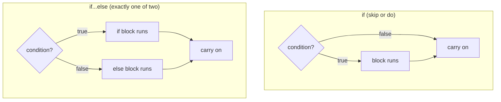

# Lecture 6 — Selection in Java #1: Conditions and if-else

**Module:** 4300COMP Introduction to Programming · **Language:** Java

## Overview

Until now every program ran straight down, line by line. Lecture 6 lets a program **make decisions**: test whether something is true, and choose which block of code to run. You will learn the **relational operators** (`==`, `!=`, `<`, `<=`, `>`, `>=`), the **logical (Boolean) operators** (`&&`, `||`, `!`), the `if` and `if...else` statements, and the classic pitfalls. These notes rewrite the official Lecture 6 slides in plain English; every result shown was run with Java 21.

**By the end you should be able to:**

1. Explain what a **condition** (Boolean expression) is: something that is either `true` or `false`.
2. Use the six relational operators with numbers, `char`s and variables, and predict the result.
3. Compare Strings with `.equals()` instead of `==`, and explain why.
4. Combine conditions with `&&`, `||` and `!`, including precedence.
5. Write `if` and `if...else` statements with correct braces.
6. Trace which branch runs for given values.
7. Spot the pitfalls: `=` vs `==`, missing braces, a stray `;` after `if (...)`, and overlapping conditions.

**Learning outcomes:** MLO1 (constructs and basic algorithms), MLO3 (turning a specification such as the bus-capacity rule into a condition).

**Matching lab:** Lab 6 (official Tutorial 6: Simple if-else).

**What you need from earlier lectures:** the `boolean` type (Lecture 2), Scanner input (Lecture 4), and operator precedence (Lecture 2).

**Note:** the slides say this topic runs over two sessions. This lecture covers `if` and `if...else`; the next session (Selection #2) continues the topic.

## 1. Decision making and true/false

Not every problem is a straight list of steps. Catching a bus or ordering a drink involves looking at the situation and deciding what to do. Programs need the same ability.

Computers decide using statements that are either **true** or **false**:

- “It’s October now” → true (when this was written)
- “The moon is square” → false

In Java such a statement is a **condition** (or **Boolean expression**): it evaluates to a `boolean` value, `true` or `false`. The program **first evaluates the condition**, then chooses which path to follow.

## 2. Relational operators

Relational operators compare two values. They are **binary** operators (one operand on each side) and always produce `true` or `false`. They work with all primitive types: `int`, `short`, `long`, `float`, `double`, `char`, `byte` (and `==`/`!=` with `boolean`).

| Operator | Meaning | Example | Result (verified) |
| --- | --- | --- | --- |
| `==` | equal to | `6 == 6` | `true` |
| `!=` | not equal to | `6 != 6` | `false` |
| `<` | less than | `8 < 15` | `true` |
| `<=` | less than or equal to | `15 <= 15` | `true` |
| `>` | greater than | `2.5 > 5.8` | `false` |
| `>=` | greater than or equal to | `5.9 >= 7.5` | `false` |

**Two characters, no spaces:** `<=` not `=<`; `>=` not `=>`; `==` is two equals signs.

### With characters

Each `char` is stored as a number, its **Unicode** value. Comparing chars compares those numbers. `'A'` is 65 and `'a'` is 97 (verified), so capitals are “less than” lower case.

| Expression | Result | Why |
| --- | --- | --- |
| `'A' == 'a'` | `false` | 65 is not 97 |
| `'a' == 'a'` | `true` | same character |
| `'b' > 'a'` | `true` | 98 \> 97 |
| `'A' != 'a'` | `true` | different values |
| `!('A' > 'a')` | `true` | 65 \> 97 is false; `!` flips it |

**Slide check:** the slide shows `'♷' > ' '` as `false`. Running it in Java with an ordinary space gives `true` (U+2677 is far above the space, 32). The slide may be using a different invisible character; it is worth asking your lecturer.

### With variables

Either side can be a variable or an expression. The slide example:

```java
int a = 10;
float b = 3.149f;
```

| Expression | Result |
| --- | --- |
| `a >= b` | `true` (10 ≥ 3.149) |
| `b == a` | `false` |
| `b > (b / 2)` | `true` |
| `a == 10` | `true` |

Arithmetic happens **before** comparison (precedence), so `b > b / 2` works even without brackets. Brackets still make it clearer.

**Warning about decimals:** `0.1 + 0.2 == 0.3` is `false` (verified), because decimals are stored with tiny binary errors (Lab 2, Task 16). Avoid `==` with `double` results of calculations.

## 3. Comparing Strings: use equals()

Strings are **objects**, not primitives. `==` on objects asks “are these the **same object** in memory?”, not “do they contain the same text?”.

```java
String str1 = new String("Cat");
String str2 = new String("Cat");
str1 == str2;          // false: two different objects
str1.equals(str2);     // true: same characters
```

**Always compare String contents with** **`.equals()`****.** (Sometimes `==` happens to give `true` for two identical literals because Java reuses them, which makes the bug harder to spot. Don’t rely on it.)

The slide’s password check:

```java
System.out.print("Enter your password: ");
String password = console.nextLine();
System.out.println("letmein".equals(password));
```

```text
Enter your password: letmein
true
```

`.equals()` is case-sensitive: `"letmein".equals("LetMeIn")` is `false`. `.equalsIgnoreCase()` ignores capitals. Writing the literal first (`"letmein".equals(password)`) is a good habit.

**Cyber security note (learning example only):** real systems never store or compare passwords in plain text like this; they compare secure hashes. `letmein` is also one of the most commonly guessed passwords.

## 4. Logical (Boolean) operators

To test several things at once (“username correct **and** password correct”) you combine conditions. You will also meet these operators in the Computer Systems module.

| Operator | Name | True when | Example | Result |
| --- | --- | --- | --- | --- |
| `&&` | AND | **both** sides are true | `(10 < 20) && (20 < 30)` | `true` |
| `\|\|` | OR | **at least one** side is true | `(20 < 10) \|\| (20 < 30)` | `true` |
| `!` | NOT | its operand is false (it flips it) | `!(10 > 20)` | `true` |

**Truth table**

| A | B | `A && B` | `A \|\| B` | `!A` |
| --- | --- | --- | --- | --- |
| true | true | true | true | false |
| true | false | false | true | false |
| false | true | false | true | true |
| false | false | false | false | true |

`!` is **unary** (one operand, on its right). `&&` and `||` are binary.

**Write it in words first**, then translate:

```text
if (username is CORRECT AND password is CORRECT) { let the user in }
```

```java
if ("admin".equals(user) && "s3cret".equals(pass)) { ... }
```

### Precedence: ! before && before \|\|

Java evaluates `!` first, then arithmetic, then relational operators, then `&&`, then `||`. Example from Tutorial 6 (`c = 13.2`, `d = 'D'`, `a = 10`, `b = 15`):

```java
(c / 2 < 10) || (d == 'd') && (a + b == 25)
```

`&&` binds tighter, so it means `(c / 2 < 10) || ((d == 'd') && (a + b == 25))` → `true || (false && true)` → `true`. Add your own brackets whenever you mix `&&` and `||`.

### Short-circuit evaluation

`&&` stops as soon as the left side is `false` (the answer must be false). `||` stops as soon as the left side is `true`. This matters later, e.g. `(count != 0) && (total / count > 5)` never divides by zero.

### You cannot chain comparisons

Maths writes 16 ≤ age ≤ 20. Java cannot: `3 < x < 10` is a compile error (`bad operand types for binary operator '<'`). Write `(age >= 16) && (age <= 20)`.

## 5. Selection: if and if...else

**Selection statements** choose between alternative blocks of code, so the program follows different paths depending on whether a condition is true.

### Blocks

A **block** is a group of statements inside `{ }`. You have used blocks all along: the class body and `main` are blocks. Selection statements control a block.

### if — do something, or skip it

```java
if (condition) {
    statements;     // run only when condition is true
}
// carries on here either way
```

### if...else — choose one of two

```java
if (condition) {
    statements;     // condition true
} else {
    statements;     // condition false
}
// carries on here either way
```

Exactly **one** of the two blocks runs, never both, never neither. `else` has no condition of its own and must follow an `if`.



*if versus if...else: the paths a program can take.*

With `if`, a false condition skips the block. With `if...else`, one of the two blocks always runs, then both paths meet again.

The slide example uses Java’s `Random` class (from `java.util`) to roll a number from 0 to 10:

```java
Random rand = new Random();
int number = rand.nextInt(11);      // 0 to 10 inclusive
if (number > 7) {
    System.out.println("Congratulations!");
} else {
    System.out.println("Loser.");
}
```

`nextInt(11)` gives a whole number from 0 up to, but **not** including, 11. Numbers 8, 9 and 10 win.

### The three forms

| Form | Paths | Use when |
| --- | --- | --- |
| `if` | do it or skip it | an optional extra action |
| `if...else` | exactly one of two | two alternatives |
| `if...else if...else` | exactly one of several | several alternatives (e.g. grade bands); continued next session |

## 6. Worked programs

### Program A — Guessing Game (lecture worked example)

**Brief:** generate a random number from 0 to 10, ask the user to guess, and say whether they were correct, too low or too high.

The slides show only the sample runs, so this is one implementation that produces them. It needs three outcomes, so it uses an `else if` (the third form of selection):

```java
import java.util.Random;
import java.util.Scanner;

public class GuessingGame {
    static Scanner console = new Scanner(System.in);

    public static void main(String[] args) {
        Random rand = new Random();
        int number = rand.nextInt(11);          // 0 to 10

        System.out.print("Guess a number between 0-10: ");
        int guess = console.nextInt();

        if (guess == number) {
            System.out.println("You guessed correctly!");
        } else if (guess < number) {
            System.out.println("Your answer was below the random number.");
        } else {
            System.out.println("Your answer was above the random number.");
        }
    }
}
```

**Sample runs (verified with the random number fixed at 7 for testing):**

```text
Guess a number between 0-10: 5
Your answer was below the random number.

Guess a number between 0-10: 10
Your answer was above the random number.

Guess a number between 0-10: 7
You guessed correctly!
```

**Tracing for guess 5, number 7:**

| Step | Condition | Result | Action |
| --- | --- | --- | --- |
| 1 | `guess == number` → `5 == 7` | false | skip first block |
| 2 | `guess < number` → `5 < 7` | true | print “below”; skip the rest |

**Testing tip:** random numbers make testing hard. While testing, temporarily replace the random line with `int number = 7;` so you know the answer. Put it back afterwards.

### Program B — Login check (combining && with equals)

```java
System.out.print("Username: ");
String user = console.nextLine();
System.out.print("Password: ");
String pass = console.nextLine();

if ("admin".equals(user) && "letmein".equals(pass)) {
    System.out.println("Access granted.");
} else {
    System.out.println("Access denied.");
}
```

| Username | Password | Output (verified) |
| --- | --- | --- |
| `admin` | `letmein` | Access granted. |
| `admin` | `LetMeIn` | Access denied. |
| `Admin` | `letmein` | Access denied. |

**Security point:** the message does not say *which* part was wrong. Telling an attacker “username correct, password wrong” helps them guess. (Learning example only: real systems never hard-code passwords.)

### Program C — Voting age (Tutorial 6, Exercise 1 pattern)

```java
System.out.print("Enter your age: ");
int age = console.nextInt();
if (age >= 16) {
    System.out.println("You can vote in the UK.");
} else {
    System.out.println("You cannot vote yet.");
}
```

This uses the UK voting age given in Tutorial 6 (16 or over). Testing the **boundary** matters most: 16 must print “can vote”, 15 must not. Test values from the tutorial: 25, 20, 16, 15.

## 7. Common pitfalls

The slides list four pitfalls; all were tested with Java 21.

### Pitfall 1 — confusing = and ==

```java
if (thing = 1) { ... }    // won't compile
if (thing == 1) { ... }   // correct
```

With an `int`, `if (thing = 1)` gives: `incompatible types: int cannot be converted to boolean`. The slide says this is caught “in almost all cases”. The exception is a **boolean** variable: `if (ok = false)` **compiles** (it assigns `false`, then tests it) and silently never runs its block. Write `if (!ok)` instead of comparing booleans to `true`/`false`.

### Pitfall 2 — indentation is not nesting (missing braces)

```java
if (score > 70)
    grade = 'A';
    System.out.println("The grade is A");   // NOT controlled by the if!
```

Without braces, an `if` controls only the **one statement** after it. With `score = 50`, this still prints `The grade is A` (verified). Indentation means nothing to Java. **Always use braces**, even for one statement.

### Pitfall 3 — premature termination (a stray semicolon)

```java
float hours = 20.0f;
if (hours > 40.0f); {
    System.out.println("Too long!");
}
```

The `;` straight after the condition is an **empty statement**: the `if` controls nothing. The `{ ... }` that follows is just an ordinary block that always runs. Prints `Too long!` even though 20 is not more than 40 (verified). It compiles with no error, so it is easy to miss.

### Pitfall 4 — unhelpful ambiguity (overlapping conditions)

```java
if (age >= 16) {
    System.out.println("Eligible to vote.");
    System.out.println("No longer a minor.");
}
if (age <= 16) {
    System.out.println("Not eligible to vote.");
    System.out.println("Still a minor.");
}
```

- **age 18:** only the first block runs. Correct.
- **age 16:** **both** blocks run, printing all four contradictory lines (verified), because 16 satisfies `>=` **and** `<=`.

The fix: these are two alternatives, so use **one** `if...else` (the else covers “everything else” with no overlap). Two separate `if`s are only right for independent checks.

**Tip:** before writing two separate `if`s, ask: can both conditions be true at the same time? If they shouldn’t be, use `if...else`.

### More mistakes (javac messages, Java 21)

| Mistake | Example | Message |
| --- | --- | --- |
| No brackets round the condition | `if x > 3 { }` | `'(' expected` |
| Chained comparison | `if (3 < x < 10)` | `bad operand types for binary operator '<'` |
| Wrong operator order | `if (x => 3)` | `illegal start of expression` |
| Condition after `else` | `else (x < 3) { }` | `not a statement` |
| Two `else`s for one `if` | `if ... else ... else ...` | `'else' without 'if'` |
| `==` on Strings | `if (input == "yes")` | compiles, but may be `false` for equal text |
| Variable set only inside an `if` | `int y; if (x > 3) { y = 1; } println(y);` | `variable y might not have been initialized` |
| `==` with calculated doubles | `if (0.1 + 0.2 == 0.3)` | compiles, but is `false` |

## Check yourself: 15 multiple-choice questions

Allow **15 minutes**, no Eclipse. Practice questions written for this module, not real test questions.

1. What is the value of `7 >= 7`? (A) `true` (B) `false` (C) `7` (D) compile error
2. What is the value of `'a' < 'B'`? (A) `true` (B) `false` (C) compile error (D) depends on the computer
3. What is the value of `!(5 > 3) || (2 == 2)`? (A) `true` (B) `false` (C) compile error (D) `2`
4. What is the value of `true || false && false`? (A) `true` (B) `false` (C) compile error (D) depends on brackets only
5. What is printed? `int x = 4; if (x > 5) { System.out.println("A"); } System.out.println("B");` (A) `A` (B) `B` (C) `A` then `B` (D) nothing
6. With `x = 8`, what does `if (x > 5) { print A } else { print B }` print? (A) `A` (B) `B` (C) both (D) neither
7. What is printed? `int x = 3; if (x > 10); { System.out.println("Big"); }` (A) nothing (B) `Big` (C) compile error (D) runtime error
8. With `score = 40`: `if (score > 50) grade = 'P'; System.out.println("Pass");` What is printed? (A) nothing (B) `Pass` (C) `P` (D) compile error
9. How should you test whether the String `answer` holds the text `yes`? (A) `answer == "yes"` (B) `answer = "yes"` (C) `"yes".equals(answer)` (D) `answer.equals = "yes"`
10. Which condition is true when `age` is from 18 to 30 inclusive? (A) `18 <= age <= 30` (B) `age >= 18 || age <= 30` (C) `age >= 18 && age <= 30` (D) `age > 18 && age < 30`
11. `int n = 0; if (n = 5) { ... }` gives: (A) runs the block (B) skips the block (C) a compile error (D) a runtime error
12. What is `(10 < 20) && (20 < 10)`? (A) `true` (B) `false` (C) compile error (D) `10`
13. `rand.nextInt(11)` can produce: (A) 1 to 11 (B) 0 to 11 (C) 0 to 10 (D) 1 to 10
14. With the slide’s two separate `if`s (`age >= 16` and `age <= 16`, two lines each), how many lines print when `age` is 16? (A) 0 (B) 2 (C) 4 (D) compile error
15. Which condition is true when `x` is **outside** 1 to 9 (inclusive)? (A) `x < 1 && x > 9` (B) `x < 1 || x > 9` (C) `x >= 1 && x <= 9` (D) `!(x < 1 || x > 9)`

### Answers and explanations

| Q | Answer | Why |
| --- | --- | --- |
| 1 | A | `>=` includes equal |
| 2 | B | `'a'` is 97, `'B'` is 66 |
| 3 | A | `false \|\| true` |
| 4 | A | `&&` first: `true \|\| false` |
| 5 | B | The `if` block is skipped; the next line always runs |
| 6 | A | Condition true, so the if block runs; else is skipped |
| 7 | B | The `;` ends the `if`; the block always runs |
| 8 | B | Without braces only `grade = 'P'` is controlled |
| 9 | C | `.equals()` compares text; `==` compares objects |
| 10 | C | Both limits must hold, inclusive |
| 11 | C | An `int` assignment is not a boolean |
| 12 | B | The right side is false |
| 13 | C | Up to, but not including, 11 |
| 14 | C | 16 satisfies both conditions |
| 15 | B | Too small OR too big (D is the opposite) |

Questions 1–8, 12, 14 and 15 were checked by running the code with Java 21. **Score:** 13–15 go to Lab 6; 10–12 re-read the matching sections; under 10, rework the truth table and the pitfalls first.

## Quick reference and glossary

```java
// Relational: ==  !=  <  <=  >  >=      (result: true or false)
// Logical:    &&  ||  !                  (precedence: !  then &&  then ||)

if (age >= 16) {                          // if: do it or skip it
    System.out.println("Can vote");
}

if (mark >= 40) {                         // if...else: exactly one runs
    System.out.println("Pass");
} else {
    System.out.println("Fail");
}

if ((age >= 16) && (age <= 20)) { ... }   // a range: two comparisons joined
if ("yes".equals(answer)) { ... }         // Strings: equals, never ==
if (!finished) { ... }                    // booleans: no == true / == false
```

**Golden rules:** always use braces · never put `;` after `if (...)` · `==` compares, `=` assigns · `.equals()` for Strings · test the boundary values.

| Term | Meaning |
| --- | --- |
| Condition / Boolean expression | An expression that evaluates to `true` or `false` |
| Relational operator | Compares two values: `==`, `!=`, `<`, `<=`, `>`, `>=` |
| Logical (Boolean) operator | Combines conditions: `&&` (and), `\|\|` (or), `!` (not) |
| Unary / binary | One operand (`!`) / two operands (`&&`, `<` ...) |
| Truth table | Lists the result of an operator for every combination of true/false |
| Short-circuit evaluation | `&&`/`\|\|` skip the right side when the left side already decides the answer |
| Unicode | The numbering system for characters; `char` comparisons use these numbers |
| `.equals()` | String method that compares contents |
| Selection statement | Chooses which block runs: `if`, `if...else`, `if...else if...else` |
| Block | Statements grouped inside `{ }` |
| Branch / path | One of the alternative routes through the code |
| Empty statement | A lone `;` — does nothing (the cause of premature termination) |
| Boundary value | A value at the edge of a condition (e.g. exactly 16), the best place to test |
| `Random` | `java.util` class that generates random numbers; `nextInt(n)` gives 0 to n−1 |

**Recommended reading (from the slides):** [The if-then and if-then-else Statements](https://docs.oracle.com/javase/tutorial/java/nutsandbolts/if.html).

**Next:** work through Lab 6.
