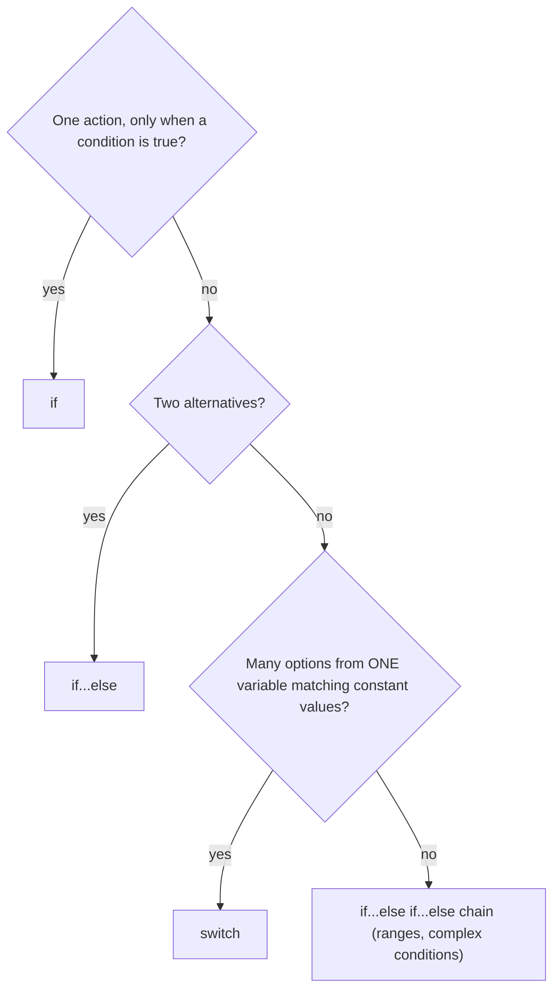

# Lecture 7 — Selection in Java #2: else if, Nesting and switch

**Module:** 4300COMP Introduction to Programming · **Language:** Java

## Overview

Lecture 6 chose between **two** paths. Lecture 7 chooses between **many**: separate `if`s, **nested** `if`s, the tidier **`if...else if...else`** chain, and the **`switch`** statement for menus and fixed values. It also shows how to compare decimal numbers safely and how to choose the right selection statement. These notes rewrite the official Lecture 7 slides in plain English; every result shown was run with Java 21.

**By the end you should be able to:**

1. Explain why separate `if`s can run several blocks, but nested `if`s and `else if` chains run exactly one.
2. Rewrite deeply nested `if...else` as an `if...else if...else` chain, and order the conditions correctly.
3. Compare `double` values with a tolerance using `Math.abs`, not `==`.
4. Write a `switch` statement with `case`, `break` and `default`, and predict **fall-through** when a `break` is missing.
5. List what a `switch` can and cannot switch on, and the rules for case labels.
6. Recognise a modern **switch expression** (`case X -> ...`).
7. Choose between `if`, `if...else`, `if...else if...else` and `switch` for a problem.

**Learning outcomes:** MLO1 (constructs), MLO2 (`Math.abs` from the Java API), MLO3 (menus and multi-way rules from specifications).

**Matching lab:** Lab 7 (official Tutorial 7: Selection in Java #2).

**What you need from Lecture 6:** relational and logical operators, `if`/`if...else`, braces, `.equals()` for Strings. From Lecture 5: reading files (used in the PayCalculator example).

## 1. Recap: if and if...else

- `if` — if the condition is true, run the block; otherwise carry on.
- `if...else` — run one block or the other, then carry on.

The slides reuse the dice game: `if (number > 7)` congratulates; with `else` the player is told they lost.

## 2. Choosing between many paths

### Option 1: several separate ifs

```java
if (condition1) { statements1; }
if (condition2) { statements2; }
if (condition3) { statements3; }
```

Every condition is checked, so **all three** blocks could run. The conditions need not be **mutually exclusive** (able to be true at the same time). Use this only for independent checks, e.g. “add the student discount” and separately “add free delivery”.

### Option 2: nested ifs

An `if` statement inside another `if` or `else` block:

```java
if (condition1) {
    statements1;
} else {
    if (condition2) {
        statements2;
    } else {
        statements3;
    }
}
```

Now exactly **one** block runs: condition 1 is true, or condition 2 is true, or neither. The outcomes are **mutually exclusive**.

The slides’ bank example chooses an interest rate:

```java
if (balance >= 50000.0) {
    interestRate = 0.05;
} else {
    if (balance >= 25000.0) {
        interestRate = 0.04;
    } else {
        if (balance >= 10000.0) {
            interestRate = 0.03;
        } else {
            interestRate = 0.01;
        }
    }
}
```

It works, but each level adds indentation and braces. Deep nesting is messy and hard to read; the slides advise avoiding it where possible.

### Option 3: if...else if...else (the chain)

The same logic, written flat:

```java
if (balance >= 50000.0) {
    interestRate = 0.05;
} else if (balance >= 25000.0) {
    interestRate = 0.04;
} else if (balance >= 10000.0) {
    interestRate = 0.03;
} else {
    interestRate = 0.01;
}
```

**How it runs:** Java tests the conditions **top to bottom**. The **first** true condition wins: its block runs and the rest of the chain is skipped. If none is true, the final `else` runs. The chain “always branches on the false side”.

| Balance | Tests made | Rate (verified) |
| --- | --- | --- |
| 60000 | ≥ 50000 true | 0.05 |
| 50000 | ≥ 50000 true (boundary) | 0.05 |
| 30000 | ≥ 50000 false, ≥ 25000 true | 0.04 |
| 10000 | false, false, ≥ 10000 true | 0.03 |
| 9999.99 | false, false, false → else | 0.01 |

**Order matters.** Because the first true condition wins, a later test can rely on the earlier ones being false: `else if (balance >= 25000.0)` really means “between 25000 and 49999.99”. If you put `>= 10000` first, a balance of 60000 would get 0.03.

The dice game with three outcomes:

```java
if (number > 7) {
    System.out.println("Congratulations!");
} else if (number > 5) {
    System.out.println("Nearly.");          // only 6 or 7 reach here
} else {
    System.out.println("Loser.");
}
```

Verified: 9 → Congratulations!, 6 → Nearly., 3 → Loser.

You can still nest an `if` **inside** a block of the chain when a decision depends on an earlier one (branching on the true side).

## 3. Comparing decimal numbers

Decimal fractions are hard to store exactly in binary, so calculations produce tiny errors. The slide’s `RoundingError` program:

```java
double x = 1.0;
double y = (3.0 / 7.0) + (2.0 / 7.0) + (2.0 / 7.0);
System.out.println("x = " + x + " y = " + y);
if (x == y) {
    System.out.println("x and y are equal");
} else {
    System.out.println("x and y are not equal");
}
```

```text
x = 1.0 y = 0.9999999999999999
x and y are not equal
```

**The fix (****`RoundingFix`****):** check whether the values are **close enough**. Choose a **tolerance** (e.g. 0.000001) and compare the **absolute difference** using `Math.abs` (a static method of Java’s `Math` class, no import needed):

```java
if (Math.abs(x - y) < 0.000001) {
    System.out.println("x and y are equivalent");
}
```

```text
x = 1.0 y = 0.9999999999999999
x and y are equivalent
```

`Math.abs` returns the size of a number without its sign: `Math.abs(-3.5)` is 3.5. Make the tolerance a named constant.

## 4. The switch statement

When one variable or expression is checked against **many fixed values**, a long `else if` chain gets complicated. Java’s **`switch`** statement is clearer, especially for **menus**, and can be slightly faster for many options (the compiler can build a jump table).

```java
switch (expression) {
    case constant1:
        statements;
        break;
    case constant2:
        statements;
        break;
    default:
        statements;
}
```

**How it runs:**

1. The expression is evaluated once.
2. Java jumps to the `case` whose constant **equals** it.
3. It runs every statement from there **until it reaches a** **`break`** (or the end of the switch).
4. If no case matches, the optional `default` section runs.

The slide example:

```java
char grade = 'B';
switch (grade) {
    case 'A':
        System.out.println("The grade is 'A'!");
        break;
    case 'B':
        System.out.println("The grade is 'B'!");
        break;
    case 'C':
        System.out.println("The grade is 'C'!");
        break;
    default:
        System.out.println("The grade is invalid.");
}
```

Output (verified): `The grade is 'B'!`

### Rules of switch

| Rule | Detail |
| --- | --- |
| The expression must be | `int`, `short`, `char`, `byte`, `String` or an `enum` type (plus their wrapper classes) |
| Not allowed | `double`, `float`, `long`, `boolean` (error: `selector type double is not allowed`) |
| Each case label must | be a **constant or literal**, appear **at most once**, match the expression’s type |
| Each case may | be followed by statements, or by nothing (to share the next case’s code) |
| `default` | optional; runs when nothing matches; usually last |

Strings in a switch are compared like `.equals()`, so `case "stop":` works correctly.

### Fall-through: forgetting the breaks

Without `break`, execution **falls through** into the next case’s statements, regardless of its label. The slides’ broken grade program:

```java
switch (score) {
    case 0:
    case 1:
    case 2:
        System.out.println("The grade is 'F'!");
    case 3:
        System.out.println("The grade is 'C'!");
    case 4:
        System.out.println("The grade is 'B'!");
    case 5:
        System.out.println("The grade is 'A'!");
    default:
        System.out.println("Invalid score.");
}
```

| score | Output (verified) |
| --- | --- |
| 4 | `B`, then `A`, then `Invalid score.` |
| 1 | `F`, `C`, `B`, `A`, then `Invalid score.` |
| 7 | `Invalid score.` only |

Fix: add `break;` after each group’s `println`. (The slide also has a typo, `'B!'`, which only changes the text printed.)

**Deliberate fall-through is useful** for grouping: `case 0: case 1: case 2:` share one block. Tutorial 7 also uses it on purpose to build a label: weight 1 → `**A`, 2 → `*A`, 3 → `A`.

### Switch expressions (Java 12/13 onwards)

Newer Java has **switch expressions** with arrows, which never fall through and produce a value:

```java
int numLetters = switch (day) {
    case MONDAY, FRIDAY, SUNDAY -> 6;
    case TUESDAY -> 7;
    case THURSDAY, SATURDAY -> 8;
    case WEDNESDAY -> 9;
};
```

For `WEDNESDAY` both the traditional and the arrow versions give 9 (verified). The module focuses on the **traditional** `switch` for now, so use that in your work unless told otherwise. (`day` here is an **enum**, a type with a fixed list of named values; enums are not covered yet.)

## 5. Choosing the right selection statement

- One action if true, otherwise carry on → `if`.
- One action if true, a different one if false → `if...else`.
- Several mutually exclusive options, based on ranges or complex conditions → `if...else if...else`.
- Several options based on **one variable** matching **constant values** (menu choices, codes, months) → `switch`.



*Choosing a selection statement (a redrawn guide, not the slide itself).*

Answer the questions left to right: only three “yes” answers lead to `switch`; ranges such as `balance >= 25000` always need an `if` chain.

Tutorial 7’s point: the same logic can often be written several ways that compile to similar instructions. Choose the one that is **clearest for the next programmer**, and put a comment above every condition explaining what it is meant to check — conditions are where most logic errors hide.

## 6. Worked programs

### Program A — Conditional file processing: PayCalculator

**Brief (from the slides):** read a wage file. Each record has a name (String), pay rate (float), hours (int) and bonus (boolean). If bonus is true, add 10% to the wage.

**Schema and data file** `wages.txt`:

```text
<Name>
<Pay> <Hours> <Bonus>
```

```text
Keir
15.0 8 true
Rachel
13.0 8 false
```

The slides show only the output, so this is one implementation that reproduces it. Loops are not taught yet, so each record is read with its own lines of code:

```java
import java.io.FileNotFoundException;
import java.io.FileReader;
import java.util.Scanner;

public class PayCalculator {
    public static void main(String[] args) throws FileNotFoundException {
        final float BONUS_RATE = 0.10f;
        Scanner in = new Scanner(new FileReader("wages.txt"));

        // Record 1
        String name1 = in.nextLine();
        float pay1 = in.nextFloat();
        int hours1 = in.nextInt();
        boolean bonus1 = in.nextBoolean();
        in.nextLine();                         // finish line 2 before the next name

        // Record 2
        String name2 = in.nextLine();
        float pay2 = in.nextFloat();
        int hours2 = in.nextInt();
        boolean bonus2 = in.nextBoolean();
        in.close();

        float wage1 = pay1 * hours1;
        if (bonus1) {                          // bonus earned: add 10%
            wage1 = wage1 + wage1 * BONUS_RATE;
        }
        float wage2 = pay2 * hours2;
        if (bonus2) {
            wage2 = wage2 + wage2 * BONUS_RATE;
        }

        System.out.println(name1 + " worked " + hours1 + " hours for £" + wage1);
        System.out.println(name2 + " worked " + hours2 + " hours for £" + wage2);
    }
}
```

**Output (verified, matches the slide):**

```text
Keir worked 8 hours for £132.0
Rachel worked 8 hours for £104.0
```

Keir: 15.0 × 8 = 120.0, bonus true → 120.0 + 12.0 = 132.0. Rachel: 13.0 × 8 = 104.0, no bonus.

Points to notice: `if (bonus1)` needs no `== true` (the variable already is true/false); `in.nextLine()` after `nextBoolean()` avoids the Lecture 4 trap before reading the next name; the slide’s output uses `println`, so it shows `132.0` rather than `132.00` (use `printf("%.2f")` for money in your own work).

### Program B — An interactive menu with switch

The slides build a menu-driven program. One implementation:

```java
import java.util.Scanner;

public class Menu {
    static Scanner console = new Scanner(System.in);

    public static void main(String[] args) {
        System.out.println("1. Update Roles");
        System.out.println("2. Assign Workers");
        System.out.println("3. Release Bees");
        System.out.print("Please select an option: ");
        int option = console.nextInt();

        switch (option) {
            case 1:
                System.out.println("You selected 'Update Roles'");
                break;
            case 2:
                System.out.println("You selected 'Assign Workers'");
                break;
            case 3:
                System.out.println("You selected 'Release Bees'");
                break;
            default:
                System.out.println("Sorry, " + option + " is not an option.");
        }
    }
}
```

| Input | Output (verified) |
| --- | --- |
| `1` | You selected 'Update Roles' |
| `3` | You selected 'Release Bees' |
| `9` | Sorry, 9 is not an option. |
| `abc` | crashes: InputMismatchException |

The slides ask two questions:

- **An option that doesn’t exist?** The `default` case handles it.
- **Invalid input (not a number)?** `nextInt()` crashes. One fix with what you know: read the choice as text with `nextLine()` and switch on the **String**: `case "1":`, `case "2":` ... Then `abc` simply reaches `default`. (Proper exception handling comes later in the module.)

The slides also show the menu leading into Task A, B or C. Repeating the menu until the user quits needs a **loop** (iteration), which is on the module syllabus after selection.

## 7. Common mistakes

Compile messages are from `javac` (Java 21). The slides label the first three as “Syntax Error”.

| Mistake | Example | What happens |
| --- | --- | --- |
| Switching on a `double` or `float` | `double gpa = 4.2; switch (gpa) { case 4.2: ... }` | Compile error: `selector type double is not allowed` |
| The same case value twice | `case 1: ... case 1:` | Compile error: `duplicate case label` |
| A variable as a case label | `char quitOption = 'q'; ... case quitOption:` | Compile error: `constant expression required` (a `final` constant works) |
| Switching on `long` or `boolean` | `switch (flag)` | Compile error: `selector type boolean is not allowed` |
| Case label of the wrong type | `int x; ... case "2":` | Compile error: `incompatible types: String cannot be converted to int` |
| Forgetting `break` | see section 4 | Compiles; falls through into the next cases (logic error) |
| Forgetting `default` | `switch (x) { case 1: ... }` with x = 2 | Compiles; nothing happens and the user gets no message |
| Ranges in a switch | wanting `case >= 70:` | Not possible in a traditional switch; use an `if...else if` chain |
| Wrong order in an `else if` chain | `>= 10000` tested before `>= 50000` | Compiles; large balances get the wrong rate (logic error) |
| Separate `if`s instead of a chain | three independent `if`s for grade bands | Several messages print for one value |
| `==` with calculated doubles | `if (x == y)` after division | Compiles; often false. Use `Math.abs(x - y) < TOLERANCE` |
| Deep nesting | `else { if { ... } else { if ...` | Works, but hard to read and easy to mis-brace |

## Check yourself: 15 multiple-choice questions

Allow **15 minutes**, no Eclipse. Practice questions written for this module, not real test questions.

1. With `mark = 75`, what does this print? `if (mark >= 70) {"First"} else if (mark >= 60) {"2:1"} else if (mark >= 40) {"Pass"} else {"Fail"}` (A) First (B) First, 2:1, Pass (C) Pass (D) Fail
2. The same grades are tested in the order `>= 40`, then `>= 60`, then `>= 70`. What prints for 75? (A) First (B) Pass (C) 2:1 (D) nothing
3. `int n = 2;` with `case 1:` One/break, `case 2:` Two/break, `case 3:` Three/break. Output? (A) Two (B) Two Three (C) One Two (D) nothing
4. The same switch but **no** `break` after `case 1` or `case 2` (only after case 3). Output for `n = 2`? (A) Two (B) Two, Three (C) One, Two, Three (D) Two, Three, Other
5. Which type **cannot** be used as a switch selector? (A) `int` (B) `char` (C) `String` (D) `double`
6. When does the `default` section of a switch run? (A) always (B) when no case matches (C) only after a `break` (D) when the first case matches
7. What does `(3.0/7.0 + 2.0/7.0 + 2.0/7.0) == 1.0` give? (A) `true` (B) `false` (C) compile error (D) depends on the computer
8. What is `Math.abs(-4.5)`? (A) −4.5 (B) 4 (C) 4.5 (D) 5
9. With `v = 80`, three **separate** ifs add `"A"` if `v > 50`, `"B"` if `v > 70`, `"C"` if `v > 90`. The result? (A) `A` (B) `AB` (C) `ABC` (D) `B`
10. The same tests written as `if ... else if ... else if`. The result for 80? (A) `A` (B) `AB` (C) `B` (D) `ABC`
11. `String cmd = "stop"; switch (cmd) { case "start": ... case "stop": ... }` (A) compile error: Strings not allowed (B) matches `case "stop"` (C) always runs default (D) runtime error
12. `char quitOption = 'q'; switch (input) { case quitOption: ... }` (A) works (B) compile error: constant expression required (C) runtime error (D) matches every value
13. `a = 5, b = 10`: `if (a > 3) { if (b < 5) {X} else {Y} } else {Z}`. Output? (A) X (B) Y (C) Z (D) X and Y
14. Best construct for a menu where the user types 1, 2, 3 or 4? (A) four separate ifs (B) switch (C) nested if...else only (D) `Math.abs`
15. In a switch **expression** `case 1 -> "one"; case 3 -> "three"; default -> "other";` with value 3, the result is: (A) "three" then "other" (B) "three" (C) "one" (D) compile error

### Answers and explanations

| Q | Answer | Why |
| --- | --- | --- |
| 1 | A | The first true condition wins; the rest are skipped |
| 2 | B | `75 >= 40` is true first: wrong order gives the wrong band |
| 3 | A | `break` jumps out after Two |
| 4 | B | Falls through from case 2 into case 3, then breaks |
| 5 | D | Floating-point types are not allowed |
| 6 | B | It is the “none of the above” section |
| 7 | B | The sum is 0.9999999999999999 |
| 8 | C | Absolute value removes the sign |
| 9 | B | Each `if` is checked independently |
| 10 | A | Only the first true branch runs |
| 11 | B | Switch supports String since Java 7 |
| 12 | B | Case labels must be constants (`final`) or literals |
| 13 | B | Outer true, inner false → inner else |
| 14 | B | One variable against constant values |
| 15 | B | Arrow cases never fall through |

All answers except 5, 6 and 14 (rules, not outputs) were checked by running the code with Java 21; 5 and 12 were also confirmed as compile errors. **Score:** 13–15 go to Lab 7; 10–12 re-read the matching sections; under 10, rework the fall-through table and the bank example first.

## Quick reference and glossary

```java
// Many options, ranges: first true wins, top to bottom
if (balance >= 50000.0) {
    interestRate = 0.05;
} else if (balance >= 25000.0) {
    interestRate = 0.04;
} else {
    interestRate = 0.01;
}

// One value against constants: switch
switch (option) {
    case 1:                 // label: constant or literal, used once
        doA();
        break;              // without break -> falls through
    case 2:
    case 3:                 // grouped cases share code
        doB();
        break;
    default:                // nothing matched
        System.out.println("Invalid option");
}

// Comparing doubles
final double TOLERANCE = 0.000001;
if (Math.abs(x - y) < TOLERANCE) { ... }
```

**switch selectors allowed:** `int`, `short`, `char`, `byte`, `String`, enum (and wrappers). **Not allowed:** `double`, `float`, `long`, `boolean`.

| Term | Meaning |
| --- | --- |
| Multiple selection | Choosing between more than two paths |
| Mutually exclusive | Outcomes where only one can happen |
| Nested if | An `if` statement inside another `if` or `else` block |
| `else if` chain | Flat form of nested ifs; first true condition wins |
| Tolerance | A small allowed difference when comparing decimals |
| `Math.abs` | Static method giving the absolute (unsigned) value |
| `switch` statement | Jumps to the case whose constant matches the expression |
| `case` label | A constant value to match; must be unique |
| `break` | Leaves the switch immediately |
| Fall-through | Running into the next case’s statements because there was no `break` |
| `default` | Optional section run when no case matches |
| Switch expression | Newer arrow form (`case X -> value`) that produces a value and never falls through |
| enum | A type with a fixed set of named constants (e.g. days); covered later |

**Recommended reading (from the slides):** [The switch Statement](https://docs.oracle.com/javase/tutorial/java/nutsandbolts/switch.html) · [Switch Expressions](https://docs.oracle.com/en/java/javase/13/language/switch-expressions.html).

**Next:** work through Lab 7.
