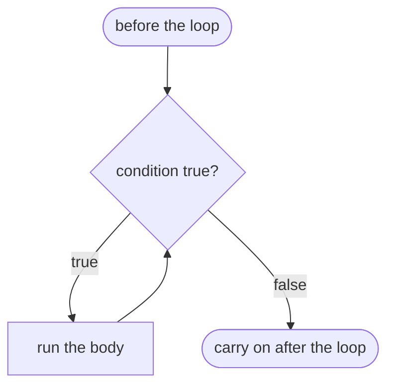
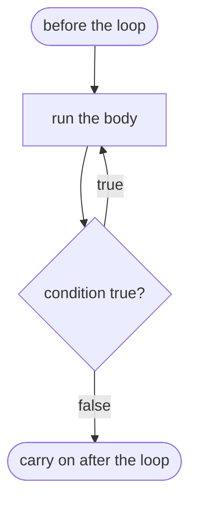

# Lecture 8 — Looping #1: Repetition and the while Statement

**Module:** 4300COMP Introduction to Programming · **Language:** Java

## Overview

Lectures 6 and 7 let a program **choose** which block of code to run. Lecture 8 lets a program **repeat** a block of code. You will learn the `while` loop and the `do...while` loop, and four standard ways of controlling when a loop stops: **counter-controlled**, **sentinel-controlled**, **flag-controlled** and **end-of-file (EOF) controlled**. These notes rewrite the official Lecture 8 slides in plain English. Every program and output shown was compiled and run with Java 21 (javac on the command line, not Eclipse).

**By the end you should be able to:**

1. Explain why programs need repetition, and name Java's three loop statements.
2. Write a `while` loop with correct syntax, and explain why it can run **zero** times.
3. Identify the three parts every loop needs: **initialise**, **test**, **update**.
4. Trace a loop with a trace table and predict its output.
5. Write counter-, sentinel-, flag- and EOF-controlled loops, and choose the right one for a task.
6. Write a `do...while` loop, and explain why it always runs **at least once**.
7. Validate user input with a loop, and explain when a flag-controlled `while` is better than `do...while`.
8. Recognise infinite loops and off-by-one errors, and fix them.

**Learning outcomes:** MLO1 (programming constructs and basic algorithms such as running totals, counting and finding a maximum), MLO3 (turning a specification such as "accept marks for any number of students" into a loop).

**Matching lab:** Lab 8 (official Tutorial 8: Repetition — while and do-while loops).

**What you need from earlier lectures:** `int`, `double` and `boolean` (Lecture 2), constants with `final` (Lecture 3), `Scanner` and `printf` (Lecture 4), reading files with `FileReader` and `Scanner` (Lecture 5), conditions and logical operators (Lecture 6), `if...else if...else` (Lecture 7).

## 1. Where we are: controlling the flow of a program

So far you have seen three ways to control which statements run:

| Construct | What it does |
| --- | --- |
| `if` | Runs an **optional** block only when a condition is true |
| `if...else` | Runs **one of two** alternative blocks |
| `if...else if...else` and `switch` | Runs **one of many** alternative blocks |

All of these run each statement **at most once**. Today's new construct, the loop, can run the same statements **many times**.

## 2. Why programs need repetition

Suppose you want the average mark of a class.

- With 3 students you could write `total = mark1 + mark2 + mark3;`.
- With 50 or 100 students that becomes absurd, and with **n** students (you do not know how many until the program runs) it is impossible.

Instead, you notice that the job is the **same few steps repeated**:

1. Read the next mark.
2. Add it to a running total.
3. Repeat until there are no more marks.
4. Divide the total by the number of marks.

Steps 1–3 are a loop. Writing the steps in plain English like this is called an **algorithm**, and it is the first thing to do before you write any loop.

**Java's three repetition structures:**

| Loop | Covered |
| --- | --- |
| `while` | This lecture |
| `do...while` | This lecture |
| `for` | Lecture 9 |

All three are called **loops** or **iteration statements**. One pass through the loop body is called an **iteration**.

## 3. The while loop: syntax

```java
while (expression) {
    statement;
    statement;
}
```

- `while` is a Java keyword.
- `expression` is a **condition**: a Boolean expression that is either `true` or `false`, exactly like the condition in an `if`.
- The **brackets** around the condition are required.
- The statements between the curly braces are the **body** of the loop.
- Always use curly braces, even for a single statement (the same advice as for `if`).
- There is **no semicolon** after `while (expression)`. Section 9 shows what happens if you add one.

## 4. The while loop: what happens when it runs

1. Java tests the condition.
2. If it is `true`, Java runs the whole body, then **goes back to step 1**.
3. If it is `false`, Java skips the body and carries on with the first statement after the closing brace.



Two important consequences:

- The condition is tested **before** the body, so the body runs **zero or more** times. If the condition is false the very first time, the body never runs.
- Something inside the body must eventually make the condition **false**. If nothing does, the loop never ends. This is called an **infinite loop**.

### Comparing if and while

| `if` | `while` |
| --- | --- |
| Runs the block **once** if the condition is true | Runs the block **again and again while** the condition is true |
| Tests the condition once | Tests the condition before every iteration |

A useful way to read them aloud: "**if** it is raining, take an umbrella" versus "**while** it is raining, stay inside".

## 5. The three parts every loop needs

Almost every working loop has these three parts. If one is missing or wrong, the loop is broken.

| Part | Question it answers | In the example below |
| --- | --- | --- |
| **Initialise** | What does the loop control variable start at? | `int x = 0;` |
| **Test** | When should the loop keep going? | `x < 10` |
| **Update** | How does the variable move towards the stopping point? | `x = x + 1;` |

The variable that the condition depends on (`x` here) is called the **loop control variable**.

### Shorthand you will see

`x = x + 1;` can also be written `x += 1;` or `x++;`. All three add 1 to `x`. Similarly `x = x - 1;` can be written `x -= 1;` or `x--;`. The slides use the long form, and so do these notes, because it makes the update obvious.

## 6. Counter-controlled while loops

Use a counter-controlled loop when you **know how many times** the body must run (10 times, once per student in a class of 6, once for each number from 1 to 12).

**Pattern:**

```text
declare and initialise a counter variable
while (counter < target) {
    process
    update the counter
}
```

Remember to initialise the counter and work out the stopping condition carefully. Lecture 9 shows the `for` loop, which is a more compact way to write exactly this pattern.

### Program A — CountDemo (from the slides)

```java
public class CountDemo {
    public static void main(String[] args) {
        int x = 0;                 // 1. initialise the loop control variable
        while (x < 10) {           // 2. test it
            System.out.println(x); //    do something
            x = x + 1;             // 3. update it
        }
        System.out.println("Loop finished, x is now " + x);
    }
}
```

**Output (verified):**

```text
0
1
2
3
4
5
6
7
8
9
Loop finished, x is now 10
```

The slide writes the output as `0 1 2 3 4 5 6 7 8 9` on one line to save space. Because the code uses `println`, each number actually appears on its own line. Change it to `System.out.print(x + " ");` if you want one line.

**Trace table (first few and last iterations):**

| Step | `x` before test | `x < 10`? | Printed | `x` after update |
| --- | ---: | --- | --- | ---: |
| 1 | 0 | true | `0` | 1 |
| 2 | 1 | true | `1` | 2 |
| 3 | 2 | true | `2` | 3 |
| … | … | … | … | … |
| 10 | 9 | true | `9` | 10 |
| 11 | 10 | **false** → loop ends | | |

Notice: the condition was tested **11** times but the body ran **10** times, and after the loop `x` is 10, not 9.

**The slide's questions:**

- **If `x` starts at 10:** `10 < 10` is false at the very first test, so the body runs **zero** times and nothing is printed except the final line.
- **If `x` starts at −10:** the loop prints −10, −9, … , 9: that is **20** numbers.

### Program B — Sum of 0 to 99 (from Tutorial 8)

```java
public class SumTo99 {
    public static void main(String[] args) {
        int sum = 0;
        int num = 0;
        while (num < 100) {
            sum = sum + num;
            num = num + 1;
        }
        System.out.println("The sum is = " + sum);
    }
}
```

**Output (verified):** `The sum is = 4950`

`sum` is a **running total** (also called an **accumulator**). It must start at 0 **before** the loop. If you declared `int sum;` without a value, Java would refuse to compile `sum = sum + num;` with `variable sum might not have been initialized`.

## 7. Sentinel-controlled while loops

Use a sentinel-controlled loop when you **do not know how many** values there will be, but you know a special value marks the end. That special value is the **sentinel**. Examples: "enter marks, −1 to finish", "enter numbers, 0 to stop".

The sentinel must be a value that can never be real data. A mark can never be −1, so −1 works for marks. For temperatures −1 would be a bad sentinel, because −1 °C is a real temperature.

**Pattern (memorise the shape):**

```text
define the sentinel value
read the FIRST value                  <- the "priming read", before the loop
while (value != sentinel) {
    process the value
    read the NEXT value               <- last statement in the body
}
```

The read appears **twice**: once before the loop and once at the end of the body. This ensures the sentinel is tested **before** it is processed, so it is never added to the total.

### Program C — SentinelSum (from the slides)

```java
import java.util.Scanner;

public class SentinelSum {
    public static void main(String[] args) {
        Scanner console = new Scanner(System.in);
        System.out.print("Enter a sequence of integers terminated by 0: ");
        int sum = 0;
        int current = console.nextInt();   // priming read: get the FIRST value before the loop
        while (current != 0) {             // 0 is the sentinel
            sum = sum + current;           // process the value
            current = console.nextInt();   // read the NEXT value (last line of the body)
        }
        System.out.printf("The sum of the numbers is: %d\n", sum);
        console.close();
    }
}
```

**Run (verified), input `50 100 -30 0`:**

```text
Enter a sequence of integers terminated by 0: The sum of the numbers is: 120
```

(When you type the input yourself, it appears after the prompt and you press Enter. The numbers can be typed on one line separated by spaces, or one per line: `nextInt()` reads one whole number at a time either way.)

| Iteration | `current` tested | `!= 0`? | `sum` after | Next `current` read |
| --- | ---: | --- | ---: | ---: |
| 1 | 50 | true | 50 | 100 |
| 2 | 100 | true | 150 | −30 |
| 3 | −30 | true | 120 | 0 |
| – | 0 | **false** → loop ends | 120 | |

## 8. Flag-controlled while loops

A **flag** is a `boolean` variable that records whether something has happened yet. A flag-controlled loop keeps going until the flag changes. Use it when the reason for stopping is decided **inside** the body, often by an `if`.

**Pattern:**

```text
boolean found = false;          // initialise the flag
while (!found) {                // read as "while not found"
    process data
    if (stopping condition) {
        found = true;           // the loop will end at the next test
    }
}
```

### Program D — GuessingGame (from the slides)

```java
import java.util.Random;
import java.util.Scanner;

public class GuessingGame {
    public static void main(String[] args) {
        Scanner console = new Scanner(System.in);
        Random ran = new Random();
        int randomNumber = ran.nextInt(11);   // 0 to 10 inclusive

        boolean flag = false;                 // initialise the flag
        while (!flag) {                       // keep going while the flag is false
            System.out.println("Guess the number:");
            int guessNumber = console.nextInt();
            if (guessNumber > randomNumber) {
                System.out.println("Wrong! your number is above the random number.");
            } else if (guessNumber < randomNumber) {
                System.out.println("Wrong! your number is below the random number.");
            } else {
                System.out.println("Bingo!");
                flag = true;                  // change the flag so the loop ends
            }
        }
        console.close();
    }
}
```

The slide leaves out the `Scanner` and the `import` lines to save space; the version above is complete and compiles. `ran.nextInt(11)` gives a whole number from 0 to 10 (Lecture 6). Because the number is random, every run is different. While testing, it is easier to replace the random number with a fixed one such as `int randomNumber = 7;`, then put `Random` back when the logic works.

## 9. End-of-file (EOF) controlled while loops

When you read a file, you usually do not know how many lines or values it contains. You could put a special last line in the file as a sentinel, but that is risky: the slide's example file contains the line `This is the last line.` **twice**, and a loop looking for that text would stop early at the first one.

The safer approach is to keep reading **until there is nothing left**. `Scanner` provides methods that tell you whether more input exists:

| Method | Returns `true` when |
| --- | --- |
| `hasNext()` | there is another token (a word or number) to read |
| `hasNextLine()` | there is another line to read |
| `hasNextInt()` | the next token can be read as an `int` |

Each of these returns `false` at the end of the input, so it makes a natural loop condition.

### Program E — ReadLines (from the slides)

```java
import java.io.FileNotFoundException;
import java.io.FileReader;
import java.util.Scanner;

public class ReadLines {
    public static void main(String[] args) throws FileNotFoundException {
        String fileName = "prog.txt";
        FileReader file = new FileReader(fileName);
        Scanner read = new Scanner(file);
        while (read.hasNext()) {            // true while there is still something to read
            String line = read.nextLine();  // read and process the next line
            System.out.println(line);
        }
        read.close();                       // finished with the file
    }
}
```

With `prog.txt` in the project folder (Lecture 5) containing:

```text
This is a sample text file.
It contains some data.
This is the last line.
Really?
This is the last line.
```

**Output (verified):** the five lines are printed exactly as they appear in the file. That answers the slide's "What is the output?" question: every line, including both copies of `This is the last line.`, because the loop does not care what the lines say.

**A detail worth knowing:** the slide pairs `hasNext()` (which checks for a **token**) with `nextLine()` (which reads a **line**). It works for normal files. The exact pairing is `hasNextLine()` with `nextLine()`, and `hasNextInt()` with `nextInt()`. Lab 8 uses the exact pairs.

### EOF from the keyboard

The console is also a stream (Lecture 4), so the same idea works for typed input:

```java
import java.util.Scanner;

public class EofSum {
    public static void main(String[] args) {
        Scanner console = new Scanner(System.in);
        System.out.print("Enter a sequence of numbers terminated by EOF: ");
        int sum = 0;
        while (console.hasNext()) {
            sum = sum + console.nextInt();
        }
        System.out.printf("The sum of the numbers is: %d\n", sum);
        console.close();
    }
}
```

**Run (verified), input `50 100 -30` then end of input:** `The sum of the numbers is: 120`

To signal end of input from the keyboard, the slides say:

- **Windows:** press **Ctrl+Z** (then Enter if nothing happens).
- **macOS / GNU/Linux:** press **Ctrl+D**.

In Eclipse, click inside the Console view first so it has focus. The verified run above supplied the input from a file rather than the keyboard, so the key presses themselves were not tested here; if they do not work in your Eclipse set-up, ask in your lab.

Notice there is no priming read: `hasNext()` looks ahead **without** reading, so the loop can test first and read inside the body.

## 10. The do...while loop

`do...while` is a variation of `while` that tests the condition **after** the body instead of before.

```java
do {
    statement;
    statement;
} while (expression);
```

- The body comes **first**, so it always runs **at least once**.
- The condition is tested at the end. If it is `true`, Java goes back to `do`.
- There **is** a semicolon after `while (expression)` in this form. Forgetting it gives `error: ';' expected`.



| `while` | `do...while` |
| --- | --- |
| Tests **before** the body (an **entry condition**) | Tests **after** the body (an **exit condition**) |
| Body runs **zero** or more times | Body runs **one** or more times |
| No semicolon after the condition | Semicolon after the condition |

### Program F — DoWhileDemo (from the slides)

```java
public class DoWhileDemo {
    public static void main(String[] args) {
        int i = 0;
        do {
            System.out.print(i + " ");
            i = i + 5;
        } while (i <= 20);
        System.out.println();
    }
}
```

**Output (verified):** `0 5 10 15 20`

**The slide's question: what if the first line were `int i = 21;`?** The body runs once before any test, so it prints `21`, then `26 <= 20` is false and the loop ends. A `while` loop with the same start value prints **nothing**, because `21 <= 20` is false at the first test. Both results were verified.

### Program G — Validating input with do...while (from the slides)

Input validation is a common use: keep asking until the user enters something acceptable. You must ask at least once, so `do...while` fits.

```java
import java.util.Scanner;

public class ScoreDoWhile {
    public static void main(String[] args) {
        Scanner console = new Scanner(System.in);
        int score;
        do {
            System.out.print("Enter a score between 0 and 10: ");
            score = console.nextInt();
            System.out.println();
        } while (score < 0 || score > 10);
        System.out.println("You entered a valid score: " + score);
        console.close();
    }
}
```

**Run (verified), inputs `15`, `-2`, `7`:** the prompt appears three times, then `You entered a valid score: 7`.

Read the condition carefully: the loop **repeats** while the score is **invalid** (`score < 0 || score > 10`). It stops when the score is valid.

### do...while shortcomings

The program above just repeats the same question. A good program tells the user **what was wrong**. With `do...while` you would need an extra `if` inside the body that tests the same condition again. The slides suggest a flag-controlled `while` instead:

```java
import java.util.Scanner;

public class ScoreFlag {
    public static void main(String[] args) {
        Scanner console = new Scanner(System.in);
        int score = 0;
        boolean valid = false;
        while (!valid) {
            System.out.print("Enter a score between 0 and 10: ");
            score = console.nextInt();
            if (score >= 0 && score <= 10) {
                valid = true;
            } else {
                System.out.println("Error: " + score + " is not between 0 and 10. Try again.");
            }
        }
        System.out.println("You entered a valid score: " + score);
        console.close();
    }
}
```

**Run (verified), inputs `15`, `-2`, `7`:**

```text
Enter a score between 0 and 10: Error: 15 is not between 0 and 10. Try again.
Enter a score between 0 and 10: Error: -2 is not between 0 and 10. Try again.
Enter a score between 0 and 10: You entered a valid score: 7
```

`score` is given a starting value (`0`) because Java cannot prove the loop body will run, and it will not let you print a variable that might not have a value.

**Scope of validation here:** these loops check the **range** of a number. If the user types text such as `seven`, `nextInt()` still throws `InputMismatchException` (Lecture 4). Handling that properly needs exceptions, which come later in the module.

**Cyber security link:** input validation is one of the most important habits in secure programming. Many real vulnerabilities come from programs that trust whatever the user types. A loop that refuses out-of-range values is a small, real example of "never trust input".

## 11. Choosing a loop control method

| Situation | Control method | Typical condition |
| --- | --- | --- |
| You know the number of repetitions (6 students, 12 rows) | Counter | `count < target` |
| Unknown number of values, but a special end value | Sentinel | `value != SENTINEL` |
| Stop when something happens inside the body (guessed correctly, found, valid) | Flag | `!found` |
| Read until the file or input runs out | EOF | `read.hasNext()` |
| The body must run at least once (ask, then check) | `do...while` | tested at the end |

## 12. Common loop patterns

These small algorithms appear again and again. Each one is a loop plus one or two variables.

| Pattern | Variables | Key rule |
| --- | --- | --- |
| **Running total** | `total = 0` before the loop; `total = total + value` inside | Start at 0, not inside the loop |
| **Counting** | `count = 0` before; `count = count + 1` inside | Count only real values, never the sentinel |
| **Average** | total and count | Cast to `double` before dividing, and check `count > 0` first |
| **Maximum / minimum** | `max` and `min` | Start them at the **first** value read, not at 0 |
| **Counting by category** | one counter per category | Use `if...else if` inside the loop |

### Program H — Average of marks with a sentinel

```java
import java.util.Scanner;

public class AverageMarks {
    public static void main(String[] args) {
        Scanner console = new Scanner(System.in);
        final int SENTINEL = -1;
        int total = 0;
        int count = 0;

        System.out.print("Enter marks, -1 to finish: ");
        int mark = console.nextInt();          // priming read
        while (mark != SENTINEL) {
            total = total + mark;              // running total
            count = count + 1;                 // counter
            mark = console.nextInt();          // next value
        }

        if (count > 0) {
            double average = (double) total / count;   // avoid integer division
            System.out.printf("%d marks, average %.2f\n", count, average);
        } else {
            System.out.println("No marks entered.");    // avoid dividing by zero
        }
        console.close();
    }
}
```

**Runs (verified):**

- Input `72 65 48 -1` → `3 marks, average 61.67`
- Input `-1` → `No marks entered.`

This brings together a constant (Lecture 3), casting (Lecture 2), `printf` (Lecture 4) and `if...else` (Lecture 6) with today's loop.

## 13. Infinite loops and off-by-one errors

### Infinite loops

| Cause | Example | Fix |
| --- | --- | --- |
| No update | `while (i < 5) { System.out.println(i); }` | Add `i = i + 1;` |
| Update goes the wrong way | `while (i > 0) { i = i + 1; }` | Should be `i = i - 1;` |
| Stray semicolon | `while (i < 5); { ... }` | Remove the `;` |
| Testing decimals with `!=` | `while (d != 1.0) { d = d + 0.1; }` | Use `<` or a tolerance (Lecture 7) |

Notes on these, all verified:

- **Stray semicolon:** `while (i < 5);` compiles without error. The `;` is an empty body, so Java tests the condition forever and never reaches the block underneath. The program appears to freeze and prints nothing.
- **Wrong direction:** with `int i = 10; while (i > 0) { i = i + 1; }` the loop runs about 2.1 billion times, until `i` passes the largest `int` and overflows to a negative number (Lab 2's overflow task). For practical purposes it is an infinite loop.
- **Decimals:** adding 0.1 ten times gives `0.9999999999999999`, not `1.0`, so `d != 1.0` stays true and the loop never ends.

**To stop a runaway program in Eclipse,** press the red square **Terminate** button on the Console view.

### Off-by-one errors

An off-by-one error makes a loop run **once too many** or **once too few** times. They come from `<` versus `<=`, or from the starting value.

| Intention | Buggy code | What happens (verified) | Fix |
| --- | --- | --- | --- |
| Print 1 to 10 | `i = 1; while (i < 10)` | Prints 1 to 9 | `i <= 10` |
| Print exactly 5 stars | `i = 0; while (i <= 5)` | Prints 6 stars | `i < 5` |
| Count down 5 to 1, then "Lift off!" | `i = 5; while (i >= 0)` | Prints 0 as well | `i >= 1` or `i > 0` |

**How to check:** test the **boundaries**. Work out the first value and the last value the body sees, and count the iterations (last − first + 1 for steps of 1).

## 14. Debugging loops

1. **Trace by hand** with a table: one row per iteration, one column per variable, plus the condition.
2. **Add a temporary print** at the top of the body, for example `System.out.println("DEBUG i=" + i + " sum=" + sum);`. Remove it when the bug is fixed.
3. **Use the Eclipse debugger** (Lecture 4 / Lab 4): put a breakpoint inside the loop, then use **Step Over** and watch the variables change in the Variables view on every iteration.
4. **Test with small inputs** where you know the answer: 0 values, 1 value, and a few values.

## 15. Common mistakes

| Mistake | Symptom | Fix |
| --- | --- | --- |
| Forgetting to initialise a total: `int sum;` | `error: variable sum might not have been initialized` | `int sum = 0;` before the loop |
| Putting `int total = 0;` **inside** the loop | Total resets every iteration; using it after the loop gives `error: cannot find symbol` | Declare it before the loop |
| `while x < 10` (no brackets) | `error: '(' expected` and `error: ')' expected` | `while (x < 10)` |
| Missing `;` after `do...while` | `error: ';' expected` | `} while (i < 5);` |
| `;` straight after `while (...)` | Compiles, then freezes (infinite loop) | Remove it |
| No priming read in a sentinel loop | The sentinel gets processed, or the first value is skipped | Read before the loop and at the end of the body |
| Counting the sentinel | Count is one too high | Count inside the loop only after the test |
| `max` and `min` started at 0 | Wrong result when all values are negative (max) or positive (min) | Start them at the first value |
| `total / count` with two `int`s | Average loses its decimal part | `(double) total / count` |
| Dividing when `count` is 0 | Integer division by zero throws `ArithmeticException` | Check `count > 0` first |
| Using `==` or `!=` with decimals as a loop condition | Infinite loop | Use `<`, `<=` or a tolerance |

## 16. Check yourself — 15 multiple-choice questions

1. How many times does the body run? `int x = 10; while (x < 10) { x = x + 1; }` (A) 0 (B) 1 (C) 10 (D) forever
2. What is the minimum number of times a `do...while` body runs? (A) 0 (B) 1 (C) 2 (D) it depends on the condition
3. What does this print? `int n = 10; while (n > 0) { System.out.print(n + " "); n = n - 3; }` (A) `10 7 4 1` (B) `10 7 4 1 -2` (C) `10 7 4` (D) `7 4 1`
4. A program reads marks until the user types −1. What kind of loop is this? (A) counter-controlled (B) sentinel-controlled (C) flag-controlled (D) EOF-controlled
5. What does `read.hasNext()` return when the file has nothing left to read? (A) `null` (B) `""` (C) `false` (D) it throws an exception
6. What happens when you compile `do { i = i + 1; } while (i < 5)` followed by another statement? (A) it compiles (B) `error: ';' expected` (C) infinite loop (D) runtime exception
7. What does this do? `int i = 0; while (i < 5); { System.out.println(i); i = i + 1; }` (A) prints 0 to 4 (B) compile error (C) runs forever and prints nothing (D) prints 0 once
8. What is the last number printed? `int n = 1; while (n < 100) { System.out.print(n + " "); n = n * 2; }` (A) 32 (B) 64 (C) 128 (D) 100
9. What does Tutorial 8's example print? `int sum = 0; int num = 0; while (num < 100) { sum = sum + num; num = num + 1; }` then print `sum` (A) 4950 (B) 5050 (C) 4851 (D) 100
10. According to the slides, which keys signal end of input in a Windows console? (A) Ctrl+C (B) Ctrl+D (C) Ctrl+Z (D) Esc
11. A variable is declared **inside** a while body and printed **after** the loop. What happens? (A) prints its last value (B) prints 0 (C) `error: cannot find symbol` (D) runtime exception
12. When does a `while` loop test its condition? (A) after each iteration (B) before each iteration (C) only once (D) only at the end
13. What type of variable controls a flag-controlled loop? (A) `int` (B) `char` (C) `boolean` (D) `String`
14. What is printed? `int n = 0; int total = 0; while (n < 5) { total = total + n; n = n + 1; } System.out.println(total);` (A) 15 (B) 10 (C) 5 (D) 4
15. Why does a sentinel loop read the first value **before** the loop? (A) to make the program faster (B) so the first value can be tested against the sentinel before it is processed (C) because `Scanner` requires it (D) to count the sentinel

### Answers

| Q | Answer | Why |
| --- | --- | --- |
| 1 | A | `10 < 10` is false at the first test (verified) |
| 2 | B | The condition is tested after the body |
| 3 | A | Next value would be −2, which fails `n > 0` (verified) |
| 4 | B | −1 is a special end value: a sentinel |
| 5 | C | `hasNext()` returns `false` when no input remains |
| 6 | B | `do...while` needs a semicolon after the condition (verified) |
| 7 | C | The `;` is an empty body; it compiles and loops forever (verified) |
| 8 | B | After 64, `n` becomes 128 and `128 < 100` is false (verified) |
| 9 | A | 0 + 1 + … + 99 = 4950 (verified) |
| 10 | C | Ctrl+Z on Windows, Ctrl+D on macOS/Linux |
| 11 | C | The variable only exists inside the braces (verified) |
| 12 | B | `while` has an entry condition |
| 13 | C | A flag is a `boolean` |
| 14 | B | 0 + 1 + 2 + 3 + 4 = 10 (verified) |
| 15 | B | Otherwise the sentinel could be processed as data |

**Score:** 13–15 go to Lab 8; 10–12 re-read the sections for the ones you missed; under 10, re-run Programs A to H in Eclipse and trace each one before starting the lab.

## 17. Quick reference

```java
// while: zero or more times
int i = 0;                  // initialise
while (i < 10) {            // test
    // body
    i = i + 1;              // update
}

// sentinel
int value = console.nextInt();          // priming read
while (value != SENTINEL) {
    // process value
    value = console.nextInt();          // next read
}

// flag
boolean done = false;
while (!done) {
    // work
    if (/* finished */) { done = true; }
}

// EOF
while (read.hasNextLine()) {
    String line = read.nextLine();
}

// do...while: one or more times (note the semicolon)
do {
    // body
} while (condition);
```

## 18. Glossary

| Term | Meaning |
| --- | --- |
| Loop / iteration statement | A statement that repeats a block of code |
| Iteration | One pass through the loop body |
| Body | The statements inside the loop's braces |
| Loop control variable | The variable the loop condition depends on |
| Entry condition | A test made before the body (`while`) |
| Exit condition | A test made after the body (`do...while`) |
| Counter-controlled loop | Runs a known number of times, using a counter |
| Sentinel | A special value that marks the end of the data |
| Priming read | Reading the first value before a sentinel loop starts |
| Flag | A `boolean` variable recording whether something has happened |
| EOF (end of file) | The point where no more input remains |
| `hasNext()` / `hasNextLine()` / `hasNextInt()` | `Scanner` methods that look ahead and return `true` if more input of that kind exists |
| Running total / accumulator | A variable that adds up values across iterations |
| Infinite loop | A loop whose condition never becomes false |
| Off-by-one error | A loop that runs one time too many or too few |
| Input validation | Checking input is acceptable before using it |

## 19. Summary

- Loops repeat a block of statements; Java has `while`, `do...while` and `for` (next lecture).
- `while` tests first and may run zero times; `do...while` tests last and always runs at least once.
- Every loop needs a correct **initialise**, **test** and **update**.
- Choose the control method from the problem: **counter** (known count), **sentinel** (special end value), **flag** (decided inside the body), **EOF** (until the input runs out).
- Validate input with a loop; use a flag-controlled `while` when the user needs an error message.
- Watch for infinite loops and off-by-one errors, and test the boundaries.

**Next:** work through Lab 8. Lecture 9 covers the `for` loop, how to choose the right loop, nested control structures, avoiding "patches", and debugging loops.
