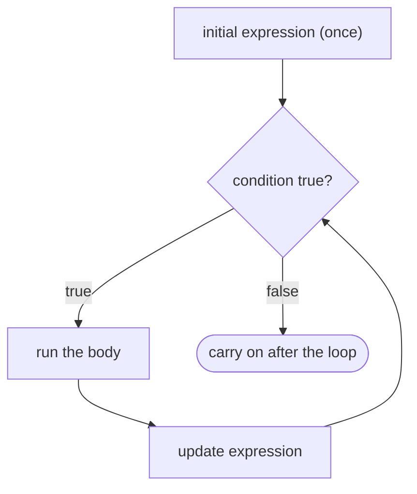

# Lecture 9 — Looping #2: Repetition and the for Loop

**Module:** 4300COMP Introduction to Programming · **Language:** Java

## Overview

Lecture 8 introduced repetition with `while` and `do...while`. Lecture 9 adds the third loop, the **`for` loop**, which packs a counter-controlled loop into one line. You will also learn how to **choose the right loop**, how to leave a loop early with **`break`**, how to put loops and decisions **inside other loops** (nesting), and how to **debug loops** by hand and with print statements. These notes rewrite the official Lecture 9 slides in plain English. Every program and output shown was compiled and run with Java 21 (javac on the command line, not Eclipse).

**By the end you should be able to:**

1. Write a `for` loop and name its three parts: initial expression, logical expression (condition) and update expression.
2. Describe the exact order in which a `for` loop runs, and trace it with a table.
3. Convert a counter-controlled `while` loop into a `for` loop and back.
4. Explain the scope of a loop variable declared in the `for` header.
5. Spot and fix `for` loop pitfalls: missing braces, a stray `;`, off-by-one counts and "patching".
6. Choose between `for`, `while` and `do...while` for a given problem.
7. Use `break` to leave a loop early, and explain why its position matters.
8. Write nested loops (a loop inside a loop) and predict how many times the inner body runs.
9. Debug a loop with a hand-trace table and temporary print statements.

**Learning outcomes:** MLO1 (loop constructs and basic algorithms), MLO2 (using the IDE debugger and reading the official Java tutorial on `for`), MLO3 (turning written specifications such as "read at most ten numbers, stop at a negative" into code).

**Matching lab:** Lab 9 (official Tutorial 9: Repetition — for loop).

**What you need from earlier lectures:** `int`, `char` and Unicode codes (Lectures 2 and 6), `Scanner` and `printf` (Lecture 4), reading files (Lecture 5), `if` and `switch` with `break` (Lectures 6 and 7), and counter-controlled `while` loops (Lecture 8).

## 1. From counter-controlled while to for

In Lecture 8, a counter-controlled `while` loop needed three separate pieces, spread over several lines:

```java
int counter = 0;              // initialise
while (counter < 10) {        // test
    // ... body ...
    counter++;                // update
}
```

The `for` loop is a **specialised form of counter-controlled loop**. It puts all three pieces in one place, so the loop control variable is easier to manage and harder to forget.

### Increment and decrement shorthand

The slides now use the shorthand you met briefly in Lecture 8:

| Shorthand | Means |
| --- | --- |
| `counter++` | `counter = counter + 1` |
| `counter--` | `counter = counter - 1` |
| `counter += 3` | `counter = counter + 3` |
| `counter -= 2` | `counter = counter - 2` |
| `counter *= 2` | `counter = counter * 2` |

## 2. Syntax of the for loop

```java
for (initial expression; logical expression; update expression) {
    statement;
    statement;
}
```

| Part | Job | Typical example |
| --- | --- | --- |
| Initial expression | Runs **once**, before anything else. Usually declares and sets the counter. | `int i = 0` |
| Logical expression | The **condition**, tested before every iteration. | `i < 10` |
| Update expression | Runs **after** every iteration of the body. | `i++` |

Rules:

- The three parts are separated by **semicolons**, not commas. `for (int i = 0, i < 5, i++)` gives `error: ';' expected`.
- There is **no semicolon** after the closing bracket of the header (section 6 shows what happens if you add one).
- Always use curly braces for the body, even for one statement.

## 3. How a for loop runs

1. The **initial expression** runs once.
2. The **condition** is evaluated.
3. If it is **false**, the body is skipped and the loop ends.
4. If it is **true**, the body runs, then the **update expression** runs, then Java goes back to step 2.



Because the condition is tested first, a `for` loop, like a `while` loop, can run **zero** times.

### Program A — The first ten non-negative integers (from the slides)

```java
public class ForDemo {
    public static void main(String[] args) {
        for (int i = 0; i < 10; i++) {
            System.out.print(i + " ");
        }
        System.out.println();
    }
}
```

**Output (verified):** `0 1 2 3 4 5 6 7 8 9`

| Step | What runs | `i` | Condition `i < 10` | Printed |
| --- | --- | ---: | --- | --- |
| 1 | `int i = 0` | 0 | | |
| 2 | test | 0 | true | |
| 3 | body | 0 | | `0 ` |
| 4 | `i++` | 1 | | |
| 5 | test | 1 | true | |
| … | … | … | … | … |
| | body | 9 | | `9 ` |
| | `i++` | 10 | | |
| | test | 10 | **false** → loop ends | |

### Other shapes of for loop

```java
for (int n = 10; n >= 0; n -= 2) {               // count down in steps of 2
    System.out.print(n + " ");                    // 10 8 6 4 2 0
}

for (char letter = 'A'; letter <= 'E'; letter++) { // a char counter
    System.out.print(letter + " ");               // A B C D E
}
```

Both outputs were verified. A `char` works as a counter because each character has a number code (Lecture 6), and `letter++` moves to the next code.

## 4. Braces matter (from the slides)

```java
int i;
for (i = 1; i <= 5; i++) {
    System.out.println("Hello");
    System.out.println("*");
}
```

prints `Hello` and `*` on separate lines **five times** (ten lines). Without braces:

```java
for (i = 1; i <= 5; i++)
    System.out.println("Hello");
    System.out.println("*");
```

prints `Hello` **five** times and `*` only **once** (verified). Without braces, only the **first** statement after the header belongs to the loop. The indentation of the second line is misleading: Java ignores indentation.

The slide's version uses `i` without declaring it. It only compiles if `int i;` appears earlier, as above.

## 5. Sum and average of five numbers (from the slides)

```java
import java.util.Scanner;

public class SumAverage {
    public static void main(String[] args) {
        Scanner console = new Scanner(System.in);
        System.out.print("Enter five whole numbers: ");
        int sum = 0;
        for (int i = 0; i < 5; i++) {
            int newNum = console.nextInt();
            sum = sum + newNum;
        }
        int average = sum / 5;
        System.out.println("The sum is " + sum);
        System.out.println("The average is " + average);
        System.out.println("The exact average is " + (sum / 5.0));
        console.close();
    }
}
```

**Run (verified), input `10 20 30 40 47`:**

```text
Enter five whole numbers: The sum is 147
The average is 29
The exact average is 29.4
```

Points from the slide:

- `sum` is set to 0 **before** the loop. **If the loop did not execute** (for example if the condition were `i < 0`), `sum` would still have a sensible value: 0. Without `= 0`, Java would refuse to compile the program (`variable sum might not have been initialized`).
- `int average = sum / 5;` is **integer division** (Lecture 2), so 29.4 becomes 29. The extra line divides by `5.0` to keep the decimal part.
- `newNum` is declared inside the body, so it only exists during one iteration.

## 6. Points to be aware of

**A for loop does not execute if the condition is false at the start.** `for (int i = 0; i < 0; i++)` runs zero times.

**A semicolon straight after the header makes an empty loop:**

```java
int x = 0;
for (int i = 0; i < 5; i++); {
    x++;
}
System.out.println(x);   // prints 1, not 5
```

Verified: it compiles, the loop runs five times doing nothing, and then the block runs **once**.

**If the condition is always true, the loop is infinite.** If the condition is **left out**, Java treats it as `true`:

```java
for (int i = 0; ; i++) {   // no condition: runs forever unless something stops it
```

The only ways out of such a loop are `break` (section 10) or stopping the program.

## 7. Scope of the loop variable

When the counter is declared in the header, as in `for (int i = 0; ...)`, it is a **local variable of the loop**: it exists only inside the loop.

```java
for (int i = 0; i < 5; i++) {
    System.out.print(i);
}
System.out.println(i);     // error: cannot find symbol (variable i)
```

This is usually what you want. If you need the final value after the loop, declare the variable **before** the loop and leave the type out of the header: `int i; for (i = 0; i < 5; i++)`.

A useful side effect: once one `for` loop has finished, a later loop can declare its own `int i` again. But a loop **inside** another loop must use a different name: reusing `i` gives `error: variable i is already defined in method main(String[])`.

## 8. Careful with the counter: off by one (from the slides)

A file `numbers.txt` contains five numbers: `54 40 90 68 75`. This loop tries to read and print them:

```java
for (int i = 0; i <= 5; i++) {      // runs 6 times: 0,1,2,3,4,5
    int number = read.nextInt();
    System.out.print(number + " ");
}
```

**Run (verified):** it prints all five numbers, then crashes on the sixth read:

```text
54 40 90 68 75 Exception in thread "main" java.util.NoSuchElementException
```

This is the classic **off-by-one** error: the loop runs one time too many (or, in other cases, one too few). It is especially common with arrays, which come next lecture.

**Correct fixes** change the control values so the loop runs exactly five times:

```java
for (int i = 0; i < 5; i++)     // 0,1,2,3,4
for (int i = 1; i <= 5; i++)    // 1,2,3,4,5
```

Both were verified to print the five numbers with no exception.

### Avoid patching your code

This version also prints the right output:

```java
for (int i = 0; i <= 5; i++) {
    if (i != 5) {
        int number = read.nextInt();
        System.out.print(number + " ");
    }
}
```

The slides call this **very poor programming habit**. It is a **patch**: instead of fixing the cause (the wrong loop bounds), it adds extra code to hide the symptom. Patches make code harder to read, waste an iteration, and the next person who changes the loop will probably break it. **Fix the cause, not the symptom.**

## 9. for and while are equivalent

```java
for (initial expression; logical expression; update expression) {
    statement;
}
```

does the same as:

```java
initial expression;
while (logical expression) {
    statement;
    update expression;
}
```

Example (both verified to print ` 0 1 2 3 4 5 6 7 8 9`):

```java
for (int i = 0; i < 10; i++) {
    System.out.print(" " + i);
}
System.out.println();

int i = 0;
while (i < 10) {
    System.out.print(" " + i);
    i++;
}
System.out.println();
```

The second loop can declare `int i` because the first loop's `i` no longer exists (section 7).

**Typing note:** the slide shows this code with curly "smart" quotes (`“ “`). If you copy those into Eclipse you get `error: illegal character: '“'`. Always type straight quotes `" "` in code.

## 10. Choosing the right loop

All three loops have a place in Java:

| Situation | Loop |
| --- | --- |
| You know, or the program can work out, the **number of repetitions in advance** (5 numbers, 26 letters, `n` stars) | `for` |
| You **don't know** the number of repetitions, and it **could be zero** (read until a sentinel, until end of file) | `while` |
| You **don't know** the number of repetitions, but it is **at least one** (ask, then check the answer) | `do...while` |

"Work out in advance" includes values the user types: once you have read `n`, a loop that runs `n` times is a `for` loop.

## 11. Leaving a loop early with break

You met `break` in `switch` (Lecture 7), where it ends a case. `break` has two uses:

1. Skip the rest of a `switch` statement.
2. **Exit a loop immediately**, usually from inside an `if`.

When `break` runs, Java leaves the loop **at once**, in the middle of the iteration, and carries on after the loop. Statements after the `break` in that iteration are skipped, and the update expression does not run. So **where you put it matters**.

### Program B — Stop when the sum passes 100 (from the slides)

```java
import java.io.FileNotFoundException;
import java.io.FileReader;
import java.util.Scanner;

public class BreakSum {
    public static void main(String[] args) throws FileNotFoundException {
        Scanner read = new Scanner(new FileReader("numbers.txt"));
        int sum = 0;
        for (int i = 0; i < 5; i++) {
            int number = read.nextInt();
            System.out.print(number + " ");
            sum = sum + number;
            if (sum > 100) {
                break;                 // leave the loop immediately
            }
        }
        System.out.println();
        System.out.println("Sum: " + sum);
        read.close();
    }
}
```

**Output (verified)** with `numbers.txt` = `54 40 90 68 75`:

```text
54 40 90
Sum: 184
```

| Iteration | `number` | `sum` after | `sum > 100`? |
| --- | ---: | ---: | --- |
| 1 | 54 | 54 | no |
| 2 | 40 | 94 | no |
| 3 | 90 | 184 | **yes** → `break` |

**Slide note:** the slide describes this as "stop if the sum **reaches** 100", but the code tests `sum > 100`. A sum of exactly 100 would **not** stop it. To match "reaches 100", use `sum >= 100`. Lab 9 Task 12 tests the difference.

**Watch out:** `break` leaves only the **innermost** loop it is in. In nested loops (section 12), a `break` in the inner loop ends that inner loop, and the outer loop carries on.

## 12. Nesting: control structures inside control structures

You can place any control structure inside another:

- `if`, `if...else` and `switch` **inside loops**, when each iteration needs a decision (input validation, counting categories, breaking out early). You did this in Lab 8.
- **Loops inside loops**, when each iteration needs its own repetition (each row of a pattern, each line of a file, each digit of a code).

In a nested loop, the **inner loop runs completely for every single iteration of the outer loop**. If the outer loop runs 3 times and the inner loop 4 times, the inner body runs 3 × 4 = **12** times.

### Program C — Star pyramid (from the slides)

```java
public class StarPyramid {
    public static void main(String[] args) {
        int i, j;
        for (i = 1; i <= 5; i++) {          // per line
            for (j = 1; j <= i; j++) {      // per star
                System.out.print(" *");
            }
            System.out.println();
        }
    }
}
```

**Output (verified):**

```text
 *
 * *
 * * *
 * * * *
 * * * * *
```

**Slide note:** the slide shows the output as `*`, `**`, `***` with no spaces. Because the code prints `" *"` (a space then a star), every star actually has a space in front of it. Print `"*"` instead to get the slide's picture.

How it works:

| Outer `i` | Inner `j` runs | Stars on the line |
| ---: | --- | ---: |
| 1 | 1 | 1 |
| 2 | 1, 2 | 2 |
| 3 | 1, 2, 3 | 3 |
| 4 | 1 to 4 | 4 |
| 5 | 1 to 5 | 5 |

The trick is that the **inner condition depends on the outer counter** (`j <= i`). The `println()` comes **after** the inner loop, inside the outer loop, so it ends each line.

### Program D — A small multiplication grid

```java
public class TimesGrid {
    public static void main(String[] args) {
        for (int row = 1; row <= 4; row++) {
            for (int col = 1; col <= 5; col++) {
                System.out.printf("%4d", row * col);
            }
            System.out.println();
        }
    }
}
```

**Output (verified):**

```text
   1   2   3   4   5
   2   4   6   8  10
   3   6   9  12  15
   4   8  12  16  20
```

Outer loop = rows, inner loop = columns. This "rows and columns" pattern is the basis of tables, grids, game boards and, next lecture, two-dimensional data.

## 13. Debugging loops

The compiler finds **syntax errors** for you. **Logic errors** (the program runs but gives the wrong answer) you must find yourself, by reading the code carefully and sometimes by going back to the design.

Errors must be fixed **before** software reaches users. Once an algorithm is written, the next step is always to check that it works. Straight-line code and simple branches can be hand-traced or stepped through in the IDE debugger. **Loops are harder**, because the same lines run many times with different values.

**Common loop faults:**

- **Off by one** (section 8): the most common.
- **Infinite loop:** the fault is almost always in the **condition** or the **update**.

**Tips from the slides:**

1. Check the condition carefully for: a **reversed inequality** (`<` instead of `>`), `=` where you meant `==`, or `&&` where you meant `||` (or the other way round).
2. If the loop changes variables, **print their values** before and/or after each iteration and watch them change.

Note that `while (i = 5)` with an `int` does not compile in Java (`error: incompatible types: int cannot be converted to boolean`), so the `=` mistake is caught for you with numbers. With a `boolean` variable it compiles silently (Lecture 6).

### Debugging by hand (from the slides)

```java
int a = 0;
int b = 1;
for (int i = 2; i < 10; i++) {
    int c = a + b;
    a = b;
    b = c;
}
System.out.println(b);
```

Trace it with one row per iteration (values **after** the body):

| `i` | `a` | `b` | `c` |
| ---: | ---: | ---: | ---: |
| start | 0 | 1 | – |
| 2 | 1 | 1 | 1 |
| 3 | 1 | 2 | 2 |
| 4 | 2 | 3 | 3 |
| 5 | 3 | 5 | 5 |
| 6 | 5 | 8 | 8 |
| 7 | 8 | 13 | 13 |
| 8 | 13 | 21 | 21 |
| 9 | 21 | 34 | 34 |

The program prints **34** (verified). These are the **Fibonacci numbers**: each is the sum of the two before it.

**Debugging with prints:** adding

```java
System.out.println("i=" + i + " a=" + a + " b=" + b + " c=" + c);   // debug print
```

as the last line of the body prints exactly the table above, one row per iteration (verified). Remove debug prints once the bug is found.

**Debugging with Eclipse:** set a breakpoint on the first line of the body, run in Debug mode, and press **Step Over** repeatedly. The Variables view shows `i`, `a`, `b` and `c` changing each time round.

Debugging can be slow and tiresome. A careful trace table is usually the fastest way to find a loop bug.

## 14. Common mistakes

| Mistake | Symptom (verified with javac) | Fix |
| --- | --- | --- |
| Commas in the header: `for (int i = 0, i < 5, i++)` | `error: ';' expected` | Use semicolons |
| `;` after the header | Compiles; body runs once after an empty loop | Remove the `;` |
| No braces with two statements | Only the first statement repeats | Always use braces |
| Using the loop variable after the loop | `error: cannot find symbol` | Declare it before the loop if you need it |
| Same name for inner and outer counter | `error: variable i is already defined in method main(String[])` | Use `i` and `j` (or `row` and `col`) |
| `i <= 5` when you need 5 iterations from 0 | One extra iteration; reading a file gives `NoSuchElementException` | `i < 5` or start at 1 |
| Patching with `if (i != 5)` | Works but hides the real bug | Fix the loop bounds |
| Curly quotes copied from slides | `error: illegal character: '“'` | Type straight quotes |
| `break` placed before the work it should do | Last item not processed | Put `break` after the statements that must run |
| `int average = sum / 5;` | Decimal part lost | `sum / 5.0` or cast to `double` |

## 15. Check yourself — 15 multiple-choice questions

1. How many times does the body run? `for (int i = 0; i < 10; i++)` (A) 9 (B) 10 (C) 11 (D) 0
2. What does `for (int i = 10; i > 0; i -= 3) { System.out.print(i + " "); }` print? (A) `10 7 4 1` (B) `10 7 4` (C) `9 6 3` (D) `10 7 4 1 -2`
3. In what order do the parts of a `for` loop run? (A) init, body, test, update (B) init, test, body, update, test, … (C) test, init, body, update (D) init, update, test, body
4. Without braces, `for (i = 1; i <= 5; i++) System.out.println("Hello"); System.out.println("*");` prints: (A) Hello and * five times each (B) Hello five times, * once (C) Hello once, * five times (D) a compile error
5. What happens with `for (int i = 0; i < 5; i++) { ... } System.out.println(i);`? (A) prints 5 (B) prints 4 (C) `error: cannot find symbol` (D) prints 0
6. What is printed? `int x = 0; for (int i = 0; i < 5; i++); { x++; } System.out.println(x);` (A) 0 (B) 1 (C) 5 (D) 6
7. What does a `for` loop do if the condition is left out, as in `for (int i = 0; ; i++)`? (A) compile error (B) runs zero times (C) treats the condition as true (D) runs once
8. A file holds exactly 5 numbers. `for (int i = 0; i <= 5; i++) { read.nextInt(); ... }` will: (A) read 5 numbers correctly (B) read 4 numbers (C) read 5 numbers, then throw `NoSuchElementException` (D) loop forever
9. The number of repetitions is unknown and could be zero. Which loop do the slides recommend? (A) `for` (B) `while` (C) `do...while` (D) `switch`
10. The number of repetitions is unknown but at least one. Which loop? (A) `for` (B) `while` (C) `do...while` (D) any loop with `break`
11. With file data `54 40 90 68 75`, the slide's loop prints numbers until `sum > 100`. What is printed? (A) `54 40` (B) `54 40 90` (C) `54 40 90 68` (D) all five
12. How many times does the inner body run? `for (int i = 0; i < 3; i++) { for (int j = 0; j < 4; j++) { count++; } }` (A) 7 (B) 12 (C) 3 (D) 4
13. What is printed? `for (int i = 1; i <= 3; i++) { for (int j = 1; j <= 3; j++) { if (j == 2) { break; } System.out.print(i + "" + j + " "); } }` (A) `11` (B) `11 21 31` (C) `11 12 13` (D) nothing
14. What does the slide's Fibonacci trace program print? (A) 21 (B) 34 (C) 55 (D) 13
15. What does `for (int i = 0, i < 5, i++)` give? (A) runs 5 times (B) runs forever (C) `error: ';' expected` (D) runs once

### Answers

| Q | Answer | Why |
| --- | --- | --- |
| 1 | B | `i` takes 0 to 9 (verified) |
| 2 | A | Next value would be −2, which fails `i > 0` (verified) |
| 3 | B | The update runs after the body and before the next test |
| 4 | B | Only the first statement belongs to the loop (verified) |
| 5 | C | `i` only exists inside the loop (verified) |
| 6 | B | The `;` makes an empty loop; the block runs once (verified) |
| 7 | C | A missing condition is treated as `true` |
| 8 | C | The loop runs 6 times (verified) |
| 9 | B | `while` can run zero times |
| 10 | C | `do...while` always runs at least once |
| 11 | B | 54 + 40 + 90 = 184 > 100 after the third number (verified) |
| 12 | B | 3 × 4 = 12 (verified) |
| 13 | B | `break` only ends the inner loop; the outer loop continues (verified) |
| 14 | B | See the trace table (verified) |
| 15 | C | The parts must be separated by semicolons (verified) |

**Score:** 13–15 go to Lab 9; 10–12 re-read the sections for the ones you missed; under 10, re-run Programs A to D and trace each one by hand first.

## 16. Quick reference

```java
// for: known number of repetitions
for (int i = 0; i < n; i++) {        // runs n times: 0 .. n-1
    // body
}
for (int i = 1; i <= n; i++) { }     // also n times: 1 .. n
for (int i = n; i >= 1; i--) { }     // counting down
for (char c = 'A'; c <= 'Z'; c++) { }// letters

// equivalent while
int i = 0;
while (i < n) {
    // body
    i++;
}

// leave early
for (int i = 0; i < n; i++) {
    if (stopCondition) {
        break;                       // innermost loop only
    }
}

// nested: rows and columns
for (int row = 1; row <= rows; row++) {
    for (int col = 1; col <= cols; col++) {
        // one cell
    }
    System.out.println();            // end of the row
}
```

## 17. Glossary

| Term | Meaning |
| --- | --- |
| `for` loop | A loop with the initialise, test and update parts in one header |
| Initial expression | The part of the header that runs once at the start |
| Logical expression | The condition tested before every iteration |
| Update expression | The part of the header that runs after every iteration |
| Increment / decrement | Adding / subtracting 1, written `++` / `--` |
| Scope | The part of the program where a variable exists |
| Local variable | A variable that exists only inside the block (or loop) where it is declared |
| Off-by-one error | A loop that runs one time too many or too few |
| Patching | Adding code to hide a symptom instead of fixing the cause |
| `break` | Leaves the innermost loop (or `switch`) immediately |
| Nesting | Placing one control structure inside another |
| Nested loop | A loop inside the body of another loop; the inner loop runs fully for each outer iteration |
| Hand trace | Working through code on paper, recording variable values in a table |
| Fibonacci numbers | The sequence 0, 1, 1, 2, 3, 5, 8, … where each number is the sum of the two before |

## 18. Summary

- The `for` loop is a compact counter-controlled loop: `for (init; condition; update) { ... }`.
- It runs init once, then test → body → update repeatedly, and can run zero times.
- A counter declared in the header exists only inside the loop.
- Get the bounds right (`i < 5` or `1..5`) instead of patching.
- Use `for` when the number of repetitions is known in advance, `while` when it is unknown and could be zero, `do...while` when it is unknown but at least one.
- `break` exits the innermost loop immediately; its position matters.
- Nested loops run the inner loop completely for every outer iteration; rows and columns is the classic pattern.
- Debug loops with trace tables, temporary prints and the IDE debugger.

**Recommended reading (from Tutorial 9):** [The for Statement](https://docs.oracle.com/javase/tutorial/java/nutsandbolts/for.html) in Oracle's Java Tutorials.

**Next:** work through Lab 9. The slides say arrays come next, where off-by-one errors and `for` loops matter even more.
