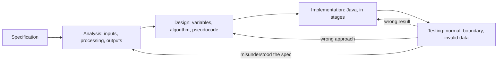
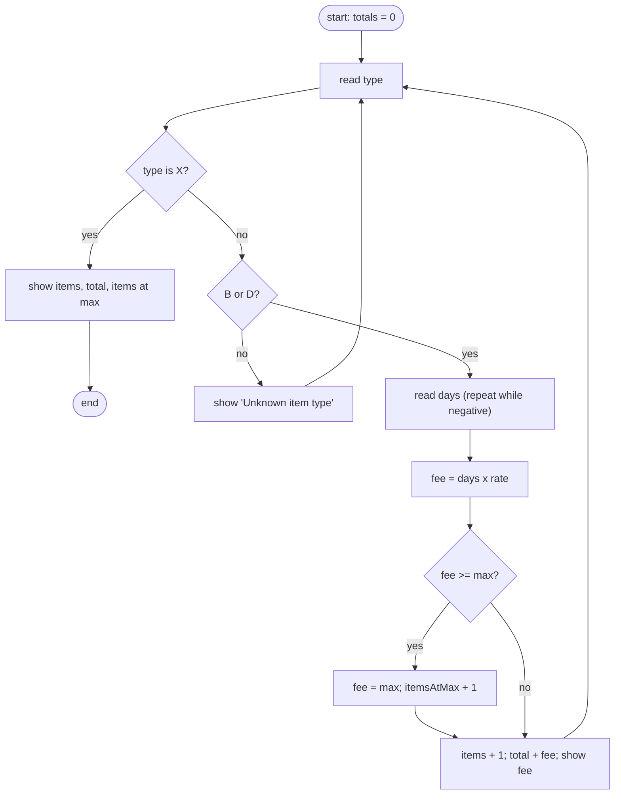

# Lecture 10 — Basic Software Design: Analysis, Design and Implementation

**Module:** 4300COMP Introduction to Programming · **Language:** Java

## Overview

Session 10 is different from the lectures so far. The official slides are a **short overview** before an **extended practical**: a guided set of analysis, design and implementation steps for a problem similar to the coursework (official Tutorial 10). The slides introduce no new Java. Instead, they teach the **process** of turning a written specification into a working program:

1. **Analysis:** what must the program do?
2. **Design:** how will it do it?
3. **Implementation:** write, compile and **test** the Java.

The slides' main message: **programming is not just typing code.** Most of the hard thinking happens away from the keyboard. These notes expand the slides with a complete worked example, taken through every stage. Every program and output shown was compiled and run with Java 21 (javac on the command line, not Eclipse).

**By the end you should be able to:**

1. Explain the three stages of analysis, design and implementation, and why testing belongs in them.
2. Analyse a specification into **inputs** (with types), **processing** and **outputs** (with formatting).
3. Spot unclear parts of a specification and write questions to resolve them.
4. Design a solution: choose variables and types, and break the problem into steps that map onto Java constructs.
5. Write an algorithm as **pseudocode** and as a **flowchart**.
6. Implement a design **in stages**, compiling and running after each stage.
7. Write a **test plan** with normal, boundary and invalid data, and record expected and actual results.

**Learning outcomes:** MLO3 (synthesising solutions to problem specifications) is the main one; MLO1 (applying constructs and basic algorithms) throughout.

**Matching lab:** Lab 10 (a design workbook; the official Tutorial 10 sheet is not in this collection, so its exact tasks are not included).

**What you need from earlier lectures:** everything so far: variables and types (Lectures 2–3), console and file I/O (Lectures 4–5), selection (Lectures 6–7) and loops (Lectures 8–9).

**About the coursework:** the slides say this session's problem is similar to Assignment 2 (AS2) and that AS2's specification is "quite descriptive". These notes do **not** describe AS2 and do not use its specification. Read the official AS2 brief on Canvas, including its rules on AI use, before getting any help with it. The worked example below is practice only.

## 1. Software design is more than typing code

The slides put it plainly: software design is **not** just following step-by-step instructions and typing code. You need to build three skills:

| Skill | Question it answers |
| --- | --- |
| **Analysing** a general problem specification | *What* exactly is being asked? |
| **Designing** a solution algorithm | *How* will the program do it, step by step? |
| **Implementing** the solution | How do I say that in Java, and does it work? |



The arrows going back matter. Testing often reveals a coding mistake (go back to implementation), sometimes a design mistake, and occasionally that you misunderstood the specification.

## 2. Analysis: what does the program need to do?

Analysis means reading the specification carefully and writing down, **separately from any code** (on paper or in a separate document):

| Identify | Details to record |
| --- | --- |
| **Required input data** | Each item, its **type** (`int`, `double`, `String`, `boolean`, `char`), where it comes from (console or file) and its valid range |
| **Processing** | What has to be calculated, decided or counted. **Not how yet**, just what |
| **Required output data** | What is shown or saved, where (console or file) and its **format** (decimal places, alignment, wording) |

This is often called an **IPO table** (Input, Processing, Output).

**Also write down what is unclear.** Specifications are written by people and are often vague. Good analysis produces a list of questions such as "Is 0 a valid value?", "What happens if the file is empty?", "Round or truncate?". In the module, ask your tutor; in a job, ask the client. Never silently guess.

## 3. Design: how will it work?

Once you know **what**, you can think about **how**. The slides list what to consider:

- variables and types for the **input** data;
- variables and types for **processing** and **output** (totals, counters, flags, results);
- what the processing needs to do, step by step;
- **how and when** to produce output (during the loop, or after it?).

The slides warn that design is **often very difficult**, and give the same advice again: **step away from the keyboard**. Do not start entering code yet.

### Break the problem into steps Java can do

The trick is to break the problem down into steps that match things the language does well:

| Kind of step | Java constructs |
| --- | --- |
| Read input from somewhere | `Scanner` on `System.in` or a `FileReader` |
| Make decisions / choose alternatives | `if`, `if...else if`, `switch` |
| Repeat actions | `for`, `while`, `do...while` |
| Calculate | arithmetic and `String` expressions |
| Produce output and send it somewhere | `println`, `printf`, `PrintWriter` |

If a step in your plan does not fit any row of this table, it is not broken down enough yet.

### Pseudocode

**Pseudocode** is an algorithm written in structured plain English, using the same shapes as code (IF, WHILE, FOR) but without Java's punctuation. It lets you check the logic before worrying about semicolons. There is no single official format; keep it consistent and readable.

### Flowcharts

A **flowchart** draws the same algorithm as boxes (actions), diamonds (decisions) and arrows. Flowcharts are good for seeing loops and branches at a glance. The Mermaid diagrams in these notes are flowcharts.

### Design gets easier with practice

The slides admit it: sometimes it is easy to understand **what** a program should do but hard to see **how**. Early specifications in the module are written to map closely onto the algorithm you need. As your skills grow, specifications become **more abstract** and you do more of the design yourself.

## 4. Implementation and testing

Implementation is "the programming bit", but the slides point out it is **not the only skill** in programming, and is actually **the easier bit**. You translate the design into Java, compile it and check it works.

### Implement in stages

Do not type the whole program and then compile for the first time. Build it in small stages, and compile and run after each one:

1. Read the input and simply print it back (proves the input works).
2. Add the processing for **one** item.
3. Add the loop.
4. Add totals, summaries and formatting.

When something breaks, you then know it is in the few lines you just added.

### Test with structured data

The slides say to test with **structured testing data, especially at the boundaries**. A **test plan** lists each test before you run it:

| Kind of test | Purpose | Example for "a mark from 0 to 100" |
| --- | --- | --- |
| **Normal** | Typical, valid values | 55, 72 |
| **Boundary** | Values exactly on and either side of each limit | −1, 0, 1, 99, 100, 101, and 69/70 at a grade boundary |
| **Invalid (erroneous)** | Values the program must reject safely | −5, 150 |

Each row records the **input**, the **expected** result (worked out **before** running) and the **actual** result. If they differ, you have found a bug, in the code or in your expectation.

**Cyber security link:** many security flaws are boundary and invalid-input bugs: a check that uses `<` instead of `<=`, or input that was never validated. Testing boundaries deliberately is a habit security testers rely on.

## 5. Worked example: library late fees (practice problem)

This is a practice specification written for these notes. It is not from the coursework.

> **Specification.** A library charges fees for items returned late. The librarian enters each returned item as a type (`B` for book, `D` for DVD) followed by the number of days late. Entry ends when the librarian types `X`. Books cost 20p per day late, up to a maximum of £5.00. DVDs cost £1.00 per day late, up to a maximum of £10.00. Days late must be 0 or more; if a negative number is entered, ask again. After each item, show its fee. At the end, show the number of items, the total fees, and how many items were charged the maximum.

### Stage 1: analysis

| Inputs | Type | Source | Valid values |
| --- | --- | --- | --- |
| Item type | `String` | console | `B`, `D`, or `X` to finish |
| Days late | `int` | console | 0 or more |

| Processing (what, not how) |
| --- |
| For each item: calculate the fee from the type and days; apply the maximum |
| Keep a count of items, a running total of fees, and a count of items charged the maximum |
| Reject negative days (ask again) |

| Outputs | Format |
| --- | --- |
| Fee for each item | £ with 2 decimal places |
| Number of items | whole number |
| Total fees | £ with 2 decimal places |
| Items charged the maximum | whole number |

**Questions the specification does not answer** (write them down, then decide or ask):

1. Should lower-case `b`, `d`, `x` be accepted? *Decision: yes.*
2. What if the type is something else, such as `M`? *Decision: print a message, ignore it and ask again; it does not count as an item.*
3. Does a fee of **exactly** the maximum count as "charged the maximum"? *Decision: yes (e.g. a book 25 days late costs exactly £5.00).*
4. Can items be 0 days late? *Decision: yes, fee £0.00, it still counts as an item.*

### Stage 2: design

**Variables:**

| Name | Type | Purpose |
| --- | --- | --- |
| `BOOK_RATE`, `DVD_RATE` | `final int` | Pence per day: 20, 100 |
| `BOOK_MAX`, `DVD_MAX` | `final int` | Maximum fees in pence: 500, 1000 |
| `type` | `String` | Current item type |
| `days` | `int` | Days late for the current item |
| `fee`, `max` | `int` | Fee and maximum for the current item, in pence |
| `items`, `itemsAtMax` | `int` | Counters |
| `totalPence` | `int` | Running total |

**Design decision: money in pence.** Storing money as whole pence in `int` avoids the tiny decimal errors of `double` (Lecture 7, Lab 2). Convert to pounds only for printing: `fee / 100.0`.

**Which loop?** The number of items is unknown and could be zero, and `X` marks the end: a **sentinel-controlled `while`** (Lecture 8). Checking days must happen at least once: a **`do...while`**.

**Pseudocode:**

```text
SET items, totalPence, itemsAtMax TO 0
READ type
WHILE type is not X
    IF type is B or D
        REPEAT
            READ days
            IF days < 0 THEN show "cannot be negative"
        UNTIL days >= 0
        IF type is B
            fee = days * BOOK_RATE, max = BOOK_MAX
        ELSE
            fee = days * DVD_RATE,  max = DVD_MAX
        IF fee >= max
            fee = max, add 1 to itemsAtMax
        add 1 to items, add fee to totalPence
        SHOW fee in pounds
    ELSE
        SHOW "Unknown item type"
    READ type
SHOW items, totalPence in pounds, itemsAtMax
```

**Flowchart of the main loop:**



### Stage 3: implementation (in stages)

Built in four stages: (1) read the type and print it back, in the sentinel loop; (2) add the days input with its `do...while`; (3) add the fee calculation and maximum; (4) add the totals and the final report. Each stage was compiled and run before the next was added. The finished program:

```java
import java.util.Scanner;

public class LibraryFees {
    public static void main(String[] args) {
        Scanner console = new Scanner(System.in);
        final int BOOK_RATE = 20;      // pence per day late
        final int BOOK_MAX = 500;      // maximum fee for a book, in pence (£5.00)
        final int DVD_RATE = 100;      // pence per day late
        final int DVD_MAX = 1000;      // maximum fee for a DVD, in pence (£10.00)

        int items = 0;
        int totalPence = 0;
        int itemsAtMax = 0;

        System.out.print("Item type (B = book, D = DVD, X = finish): ");
        String type = console.next();
        while (!type.equalsIgnoreCase("X")) {
            if (type.equalsIgnoreCase("B") || type.equalsIgnoreCase("D")) {
                int days;
                do {
                    System.out.print("Days late: ");
                    days = console.nextInt();
                    if (days < 0) {
                        System.out.println("Days late cannot be negative.");
                    }
                } while (days < 0);

                int fee;
                int max;
                if (type.equalsIgnoreCase("B")) {
                    fee = days * BOOK_RATE;
                    max = BOOK_MAX;
                } else {
                    fee = days * DVD_RATE;
                    max = DVD_MAX;
                }
                if (fee >= max) {
                    fee = max;
                    itemsAtMax++;
                }
                items++;
                totalPence = totalPence + fee;
                System.out.printf("  Fee: £%.2f%n", fee / 100.0);
            } else {
                System.out.println("Unknown item type: " + type);
            }
            System.out.print("Item type (B = book, D = DVD, X = finish): ");
            type = console.next();
        }

        System.out.println();
        System.out.println("Items: " + items);
        System.out.printf("Total fees: £%.2f%n", totalPence / 100.0);
        System.out.println("Items at the maximum fee: " + itemsAtMax);
        console.close();
    }
}
```

`equalsIgnoreCase` compares two Strings ignoring upper and lower case, so `b` and `B` both match (it is a `String` method like `equals`, Lecture 6).

### Stage 4: testing

Test plan, worked out **before** running:

| # | Kind | Input | Expected | Actual (verified) |
| --- | --- | --- | --- | --- |
| 1 | Normal | `B 3` | £0.60 | £0.60 |
| 2 | Normal, over max | `D 12` | £10.00, counts as max | £10.00 |
| 3 | Boundary, exactly max, lower case | `b 25` | £5.00, counts as max | £5.00 |
| 4 | Invalid type | `M` | "Unknown item type: M", not counted | as expected |
| 5 | Invalid then valid days | `D -2 4` | message, then £4.00 | as expected |
| 6 | Boundary, just over max | `B 26` | £5.00 (capped), counts as max | £5.00 |
| 7 | End | `X` | Items 5, total £24.60, at max 3 | Items 5, total £24.60, at max 3 |
| 8 | Empty session | `X` straight away | Items 0, total £0.00, at max 0 | as expected |

All eight tests were run with the inputs piped in. (In a console that is not set to UTF-8, `£` may print as `?`; see Lecture 4.)

A boundary test that is still missing: `B 24` (£4.80, **not** at max). Adding it would prove the program does not cap too early.

## 6. Common mistakes in the design process

| Mistake | What goes wrong | Better approach |
| --- | --- | --- |
| Starting to type code straight away | Code that solves the wrong problem, rewritten many times | Analysis and design first, on paper |
| Not recording types during analysis | `int` used for a price, or a phone number stored as `int` (loses a leading 0) | Decide each type deliberately |
| Guessing at unclear requirements | Program does something reasonable but not what was asked | Write questions down; ask |
| Using `double` for money totals | Totals like 0.30000000000000004 | Use whole pence in `int`, or round only when printing |
| Writing the whole program before the first compile | Dozens of errors at once, hard to locate | Implement and run in stages |
| Testing only with "nice" data | Boundary and invalid cases fail in use | A test plan with normal, boundary and invalid rows |
| Working out expected results **after** running | You believe whatever the program says | Write the expected column first |
| Magic numbers in the code (`* 20`, `500`) | Hard to read and to change | Named constants (Lecture 3) |

## 7. Check yourself — 15 multiple-choice questions

1. According to the slides, which stage is "actually the easier bit"? (A) analysis (B) design (C) implementation (D) none of them
2. During analysis, you should identify: (A) the Java statements needed (B) inputs and their types, processing needed, and outputs and their format (C) the variable names only (D) the test results
3. During analysis, the slides say not to worry yet about: (A) what the outputs are (B) **how** the processing is done (C) the data types (D) the specification
4. Which is the best type for a UK mobile number such as `07700 900123`? (A) `int` (B) `long` (C) `double` (D) `String`
5. A program must repeat for an unknown number of items, possibly none, ending at `X`. Which loop fits best? (A) `for` (B) sentinel-controlled `while` (C) `do...while` (D) `switch`
6. Which test data is a **boundary** test for "pass mark is 40 or more"? (A) 75 (B) 40 (C) −20 (D) 200
7. Why store money as whole pence in an `int`? (A) it uses less memory (B) it avoids small decimal rounding errors in totals (C) `double` cannot hold money (D) `printf` needs an `int`
8. What is pseudocode? (A) Java with comments (B) structured plain-English steps describing an algorithm (C) a compiled program (D) a flowchart
9. In a flowchart, a diamond usually shows: (A) an action (B) a decision (C) the start (D) output
10. When should the expected results in a test plan be worked out? (A) after running the program (B) before running the program (C) only if a test fails (D) never; the program decides
11. What is the advantage of implementing in stages? (A) fewer lines of code (B) errors can be traced to the few lines just added (C) the program runs faster (D) no testing is needed
12. A specification says "customers over 65 get a discount". What should you do in analysis? (A) assume 65 counts (B) assume 65 does not count (C) note the question "does exactly 65 count?" and ask (D) ignore it
13. In the worked example, why is a `do...while` used for days late? (A) the number of items is known (B) the value must be read at least once and re-read while invalid (C) `while` cannot read input (D) to avoid a sentinel
14. In the worked example, `B 25` costs exactly £5.00. Why is that an important test? (A) it is a normal value (B) it is exactly on the maximum boundary (C) it is invalid (D) it is the sentinel
15. Testing shows your output is wrong because you misread the specification. Which stage should you return to? (A) implementation only (B) analysis (C) none; patch the output (D) testing

### Answers

| Q | Answer | Why |
| --- | --- | --- |
| 1 | C | The slides call implementation "actually the easier bit" |
| 2 | B | Inputs (and types), processing, outputs (and formatting) |
| 3 | B | "Don't worry about how just yet" |
| 4 | D | It is not a number you calculate with, and `int` would lose the leading 0 |
| 5 | B | Unknown count, possibly zero, special end value |
| 6 | B | 40 is exactly on the limit (39 and 41 would also be boundary tests) |
| 7 | B | `double` cannot store most decimal fractions exactly |
| 8 | B | |
| 9 | B | |
| 10 | B | Otherwise you just accept what the program prints |
| 11 | B | |
| 12 | C | Never silently guess at unclear requirements |
| 13 | B | Read once, then repeat while negative |
| 14 | B | Boundary values find `>` versus `>=` mistakes |
| 15 | B | The misunderstanding started in analysis |

**Score:** 13–15 go to Lab 10; 10–12 re-read the sections for the ones you missed; under 10, re-read sections 2–5 and redo the worked example on paper.

## 8. Quick reference: the design checklist

1. **Read** the whole specification twice. Underline every input, rule and output.
2. **IPO table:** inputs (type, source, valid range), processing (what), outputs (where, format).
3. **Questions:** list everything unclear; decide or ask, and record the decision.
4. **Variables table:** name, type, purpose. Constants for every fixed rule value.
5. **Choose constructs:** which loop and why; which decisions; where input comes from; where output goes.
6. **Algorithm:** pseudocode and/or flowchart. Desk-check it with one small example.
7. **Test plan:** normal, boundary, invalid; expected results worked out now.
8. **Implement in stages**, compiling and running after each.
9. **Run every test**, fill in the actual column, fix and re-test.
10. **Review** against the specification: is every requirement met?

## 9. Glossary

| Term | Meaning |
| --- | --- |
| Specification | A written description of what a program must do |
| Analysis | Working out what a program must do: its inputs, processing and outputs |
| Design | Working out how the program will do it: variables, types and algorithm |
| Implementation | Writing the program code from the design |
| IPO table | A table of Inputs, Processing and Outputs |
| Algorithm | A precise sequence of steps that solves a problem |
| Pseudocode | An algorithm written in structured plain English |
| Flowchart | A diagram of an algorithm using boxes, diamonds and arrows |
| Desk-check | Tracing an algorithm by hand with sample data before coding it |
| Incremental development | Building a program in small stages, testing after each |
| Test plan | A list of tests with inputs, expected results and actual results |
| Normal / boundary / invalid data | Typical values / values at and next to limits / values that must be rejected |

## 10. Summary

- Programming is analysis, design and implementation, with testing throughout; implementation is the easier part.
- **Analysis:** identify inputs (and types), processing and outputs (and format); list unclear points. Do it away from the keyboard.
- **Design:** choose variables and types, break the problem into steps that map onto Java constructs, and write pseudocode or a flowchart.
- **Implementation:** translate the design into Java in stages, compiling and running each time.
- **Testing:** use structured data, especially at the boundaries, with expected results written first.

**Next:** work through Lab 10, and the official Tutorial 10 practical on Canvas. Lecture 11 starts collections: **arrays**.
