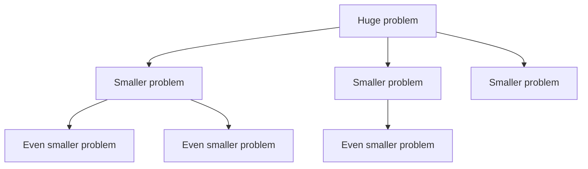
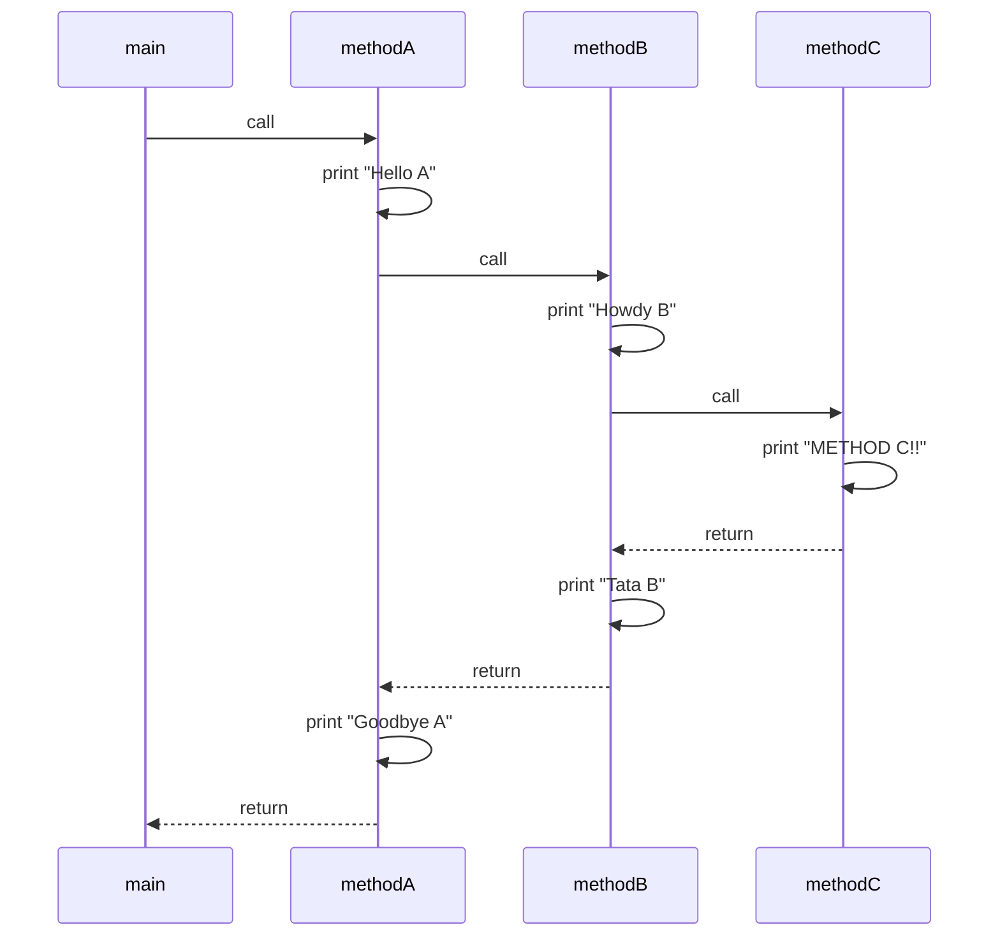

# Lecture 14 — Methods #1: Method Definitions and Void Methods

**Module:** 4300COMP Introduction to Programming · **Language:** Java

## Overview

Every program so far has been one long `main` method. Lecture 14 shows how to **break a problem into smaller pieces** and write each piece as your own **method**: a named block of code you can **call** whenever you need it. You will learn the four parts of a method definition (modifiers, return type, name, parameters), write **void methods** (methods that do something but send nothing back), and see how Java runs method calls using the **call stack**. These notes rewrite the official Lecture 14 slides in plain English. Every program and output shown was compiled and run with Java 21 (javac on the command line, not Eclipse).

**By the end you should be able to:**

1. Explain problem decomposition and why methods make programs easier to write, read and change.
2. Describe calling a method as sending a **message** to a class or object.
3. Label the parts of any method header: modifiers, return type, name, parameter list.
4. Explain `public`, `private`, `protected` and `static`, and why your methods are `public static` for now.
5. Write and call void methods with no parameters and with several parameters.
6. Explain the difference between **parameters** and **arguments**, and why changing an `int` parameter does not change the caller's variable.
7. Explain how a void method can still have an effect (printing, changing a list, changing a `static` variable).
8. Trace a chain of method calls using the call stack and predict the output.

**Learning outcomes:** MLO1 (methods as a programming construct), MLO2 (methods in the Java API; using the IDE debugger to watch the call stack), MLO3 (decomposing a specification into methods), MLO4 (first look at classes, objects and messages).

**Matching lab:** Lab 14 (official Tutorial 14: void method exercises).

**What you need from earlier lectures:** everything so far, especially loops (Lectures 8–9) and `ArrayList` (Lecture 12).

## 1. Problem decomposition

A huge problem is hard to solve in one go. **Decomposition** means breaking it into **smaller problems**, and those into **even smaller problems**, until each piece is small enough to solve on its own:



In Java, each small piece becomes a **method**. Tutorial 14 lists the benefits: it organises code so it is easier to manage, and when a task happens in several places you **write it once** and **call** it each time. To change it later, you change it in one place.

You may also see methods called **functions** or **subroutines**; the ideas are the same.

## 2. Classes, objects and messages

You have used methods since Lecture 1 (`println`, `nextInt`, `equals`, `add`…) without seeing how they work. The slides suggest thinking of classes and objects as **actors** that do something when you send them a **message**, provided they understand it.

**Example: printing.** You don't know how to put characters on the screen yourself. Instead, you send a message to the `System.out` object, asking it to run its `printf` method with some values:

```java
System.out.printf("The time is %d:%d", 4, 20);
```

The object does the work. You expect no reply: this is a one-way message.

**Sending messages to classes.** You can also send messages to a **class** rather than an object. `System.out` itself is one: you ask the class `java.lang.System` for its `out` variable. For now the module writes all its own methods at **class level**, marked `static`. Objects come in Lecture 16.

(Slide note: the slide says the printing behaviour is implemented by `java.io.PrintWriter`. Strictly, `System.out` is a `java.io.PrintStream`, a closely related class with the same `print`, `println` and `printf` methods you used for files in Lecture 5.)

## 3. Anatomy of a method definition

You have written one method in every program:

```java
public static void main(String[] args) {
    System.out.println("Hello, world!");
}
```

| Part | In this example | Meaning |
| --- | --- | --- |
| **Modifiers** | `public static` | Who can use the method, and whether it belongs to the class |
| **Return type** | `void` | What the method sends back (`void` = nothing) |
| **Name** | `main` | How you call it |
| **Parameters** | `(String[] args)` | The information it needs, in brackets |
| **Statements** (body) | `{ ... }` | What it does |

The first line (modifiers to parameters) is the method's **header** or **signature**.

### Modifiers

Modifiers control two things:

| Visibility | Who can see the method |
| --- | --- |
| `public` | Any other class |
| `private` | Only the class that contains it |
| `protected` | The containing class, its package, and its "children" (subclasses, covered in later years) |
| (no modifier) | Classes in the same package only ("package-private") |

| Scope | Where the method lives |
| --- | --- |
| `static` | Defined on the **class**: call it without creating an object |
| (no `static`) | Defined on **objects** (instances) of the class |

**For now, make all your methods `public static`.** If you leave out `static`, calling the method from `main` gives `error: non-static method greet() cannot be referenced from a static context` (verified).

(Slide note: the slide says methods are "by default private and scoped to the package". To be precise, with no modifier a method is **package-private**: visible to classes in the same package, which is more than `private` allows.)

### Return types: two kinds of method

| Kind | Return type | What it does | Example |
| --- | --- | --- | --- |
| **Void method** | `void` | Performs an action; sends nothing back | `public static void main(String[] args)` |
| **Value-returning method** | any type: `int`, `double`, `String`, … | Computes a result and sends it back | `public static double sqrt(double a)` in `java.lang.Math` |

This lecture is about void methods. Lecture 15 covers value-returning methods.

### Names

A method's name should say clearly **what it does**:

- use a **verb** (an action word);
- be **descriptive**;
- use **camelCase**: first word lower case, each later word starting with a capital;
- make names **unique** within your class.

| Good | Bad (and why) |
| --- | --- |
| `bookRoom`, `open`, `close`, `reset`, `print`, `sendMessage`, `isHostAlive` | `bookRm` (abbreviated), `c` (meaningless), `printAMessageToTheConsole` (too long) |

### Parameters and arguments

**Parameters** make a method **reusable**: the same statements work on different values. They are a list of types and names in the header. When you call the method, you must supply a value for **every** parameter, in the **same order** and of matching **types**. Those values are the **arguments**.

```java
public static void repeat(String msg, int n)     // definition: parameters msg and n
repeat("Hello, world!", 10);                      // call: arguments "Hello, world!" and 10
```

During the call, it is as if the method starts with `String msg = "Hello, world!";` and `int n = 10;`. The parameters are local variables that exist only inside the method (their **scope** is the method body).

| Call mistake | Error (verified) |
| --- | --- |
| Too few arguments: `repeat("hi")` | `error: method repeat in class … cannot be applied to given types;` |
| Arguments in the wrong order: `repeat(3, "hi")` | `error: incompatible types: int cannot be converted to String` |
| Calling a method that doesn't exist | `error: cannot find symbol` |

### The body

The statements in the body run **from top to bottom** when the method is called. They can use the parameters, any shared `static` variables of the class, and any Java you have learned (loops, `if`, `ArrayList`…).

```java
public static void repeat(String msg, int n) {
    for (int i = 0; i < n; i++) {
        System.out.println(msg);
    }
}
```

### Where methods go

Methods are written **inside the class** but **outside every other method**, usually after `main`. Defining a method inside `main` fails with `error: illegal start of expression` (verified). The order of methods inside the class does not matter: `main` can call a method written below it.

## 4. Void methods in action

### Program A — Pause (from the slides)

Void methods are good for **repetitive tasks**: extract a repeated block of code into a method, then call it each time.

```java
import java.util.Scanner;

public class Pause {
    private static Scanner console = new Scanner(System.in);

    public static void main(String[] args) {
        System.out.println("I've finished a complicated task");
        pause();
        System.out.println("And another");
        pause();
    }

    /**
     * Pause until the user presses enter.
     */
    public static void pause() {
        System.out.print("Press enter to continue...");
        console.nextLine();
    }
}
```

**Run (verified):** prints the first message, waits for Enter, prints the second, and waits again.

Points to notice:

- The `Scanner` is declared **outside** `main`, at class level, as `private static`. That makes it a **shared `static` variable** that every method in the class can use. (The slide leaves out `import java.util.Scanner;`, which the program needs.)
- `pause()` takes no parameters, so the brackets are empty, both in the definition and in the call.
- The `/** ... */` comment above the method is a **Javadoc comment**: a description that Eclipse shows when you hover over a call. Write one for every method.

### Program B — Repeat (from the slides)

`pause` always does exactly the same thing. **Parameters** let one method behave differently for different inputs:

```java
import java.util.Scanner;

public class Repeat {
    private static Scanner console = new Scanner(System.in);

    public static void main(String[] args) {
        System.out.print("Enter a message: ");
        String message = console.nextLine();
        System.out.print("Enter a number of times: ");
        int times = console.nextInt();
        repeat(message, times);
    }

    /**
     * Repeat a message a given number of times.
     */
    public static void repeat(String message, int n) {
        for (int i = 0; i < n; i++) {
            System.out.println(message);
        }
    }
}
```

**Run (verified), input `Hi there` and `3`:** `Hi there` is printed three times.

`main`'s variable `times` and `repeat`'s parameter `n` have **different names**, and that's fine. Only the **position** in the argument list matters: the second argument goes into the second parameter.

### The example from Tutorial 14

Tutorial 14 shows a method `printToScreen(int inputValue)` but then calls `methodName(testValue)`, which does not exist (`error: cannot find symbol`), and it uses curly quotes. The corrected version:

```java
public class PrintValue {
    public static void printToScreen(int inputValue) {
        System.out.printf("The value is: %d%n", inputValue);
    }

    public static void main(String[] args) {
        int testValue = 123;
        printToScreen(testValue);
    }
}
```

**Output (verified):** `The value is: 123`

## 5. How a void method can have an effect

A void method returns nothing, so how does it make a difference? Three ways:

1. **Output**: printing to the console or writing a file (Programs A and B).
2. **Changing an object passed in**: a parameter of a **reference type** (such as an `ArrayList`) refers to the caller's object, so the method can change that object's **state**.
3. **Changing a `static` variable** of the class.

```java
import java.util.ArrayList;

public class Effects {
    public static int count = 0;

    public static void main(String[] args) {
        System.out.println(count);
        increaseCount();
        System.out.println(count);

        ArrayList<Integer> numbers = new ArrayList<Integer>();
        numbers.add(8);
        numbers.add(3);
        numbers.add(5);
        removeSmallest(numbers);
        System.out.println(numbers);

        int x = 10;
        tryToChange(x);
        System.out.println(x);
    }

    public static void increaseCount() {
        count++;
    }

    public static void removeSmallest(ArrayList<Integer> numbers) {
        if (numbers.isEmpty()) {
            return;
        }
        int smallestIndex = 0;
        for (int i = 0; i < numbers.size(); i++) {
            if (numbers.get(i) < numbers.get(smallestIndex)) {
                smallestIndex = i;
            }
        }
        numbers.remove(smallestIndex);
    }

    public static void tryToChange(int value) {
        value = 99;                    // changes only the method's own copy
    }
}
```

**Output (verified):**

```text
0
1
[8, 5]
10
```

- `increaseCount` changed the shared `static` variable `count` (from the slides).
- `removeSmallest` (from the slides) changed the caller's list: the 3 is gone.
- `tryToChange` did **not** change `x`. An `int` argument is **copied** into the parameter, so the method only changes its own copy. (Java passes every argument **by value**: for an `ArrayList` the value copied is the *reference*, which still points at the same list. This matches what you saw with arrays in Lecture 11.)

**`return;` in a void method** means "stop this method now and go back to the caller". `removeSmallest` uses it to give up straight away when the list is empty. Returning a **value** from a void method (`return 5;`) gives `error: incompatible types: unexpected return value` (verified).

## 6. The call stack

To understand what happens when one method calls another, you need the **method stack** (also called the **call stack** or **function stack**). A stack works like a pile of plates: you can only add or remove at the **top**.

- When a method **starts**, it is **pushed** onto the top of the stack, with its parameters and local variables.
- When it **finishes**, it is **popped** off, and the method underneath, the one that called it, **continues from where it left off**.

### The slides' question: what will this output?

```java
public class StackDemo {
    public static void main(String[] args) {
        methodA();
    }

    public static void methodA() {
        System.out.println("Hello A");
        methodB();
        System.out.println("Goodbye A");
    }

    public static void methodB() {
        System.out.println("Howdy B");
        methodC();
        System.out.println("Tata B");
    }

    public static void methodC() {
        System.out.println("METHOD C!!");
    }
}
```

The slide offers four options. The answer is **Option C** (verified):

```text
Hello A
Howdy B
METHOD C!!
Tata B
Goodbye A
```

| Step | Event | Stack (top on the right) | Printed |
| --- | --- | --- | --- |
| 1 | `main` starts | main | |
| 2 | `main` calls `methodA` | main, A | `Hello A` |
| 3 | `methodA` calls `methodB` | main, A, B | `Howdy B` |
| 4 | `methodB` calls `methodC` | main, A, B, C | `METHOD C!!` |
| 5 | `methodC` finishes, popped; B continues | main, A, B | `Tata B` |
| 6 | `methodB` finishes, popped; A continues | main, A | `Goodbye A` |
| 7 | `methodA` finishes; then `main` finishes | (empty) | |



Option B is the common wrong answer: it assumes each method finishes before the next one starts. In fact the caller **waits** at the call until the called method finishes.

**See it yourself:** in Eclipse, put a breakpoint on `System.out.println("METHOD C!!");` and run in Debug mode. The **Debug** view lists the stack: `methodC`, `methodB`, `methodA`, `main`. The same list appears in every exception's error message (the lines starting `at ...`): that is the call stack at the moment of the crash, top first.

## 7. Common mistakes

| Mistake | Symptom (verified with javac) | Fix |
| --- | --- | --- |
| Method defined inside `main` | `error: illegal start of expression` | Move it inside the class, outside `main` |
| Missing `static` | `error: non-static method greet() cannot be referenced from a static context` | `public static void greet()` |
| Calling a misspelt or undefined method | `error: cannot find symbol` | Match the name exactly (case matters) |
| Wrong number of arguments | `error: method repeat in class … cannot be applied to given types;` | One argument per parameter |
| Arguments in the wrong order or of the wrong type | `error: incompatible types: int cannot be converted to String` | Same order and types as the parameters |
| `return 5;` in a void method | `error: incompatible types: unexpected return value` | Use a return type (Lecture 15), or just `return;` |
| Storing a void method's "result": `int x = show();` | `error: incompatible types: void cannot be converted to int` | Void methods return nothing |
| Printing a void method call: `println(show())` | `error: 'void' type not allowed here` | Call it on its own line |
| Expecting a method to change an `int` argument | Caller's variable unchanged | Return the new value (Lecture 15) |
| Forgetting the brackets on a call: `pause;` | `error: not a statement` | `pause();` |

## 8. Check yourself — 15 multiple-choice questions

1. What is problem decomposition? (A) deleting old code (B) breaking a big problem into smaller ones (C) compiling a program (D) a kind of loop
2. In `public static void repeat(String msg, int n)`, what is the return type? (A) `public` (B) `static` (C) `void` (D) `repeat`
3. In the same header, what are `msg` and `n`? (A) arguments (B) parameters (C) modifiers (D) return values
4. In the call `repeat("Hi", 3);`, what are `"Hi"` and `3`? (A) parameters (B) arguments (C) types (D) modifiers
5. Which visibility modifier lets **any** class use a method? (A) `private` (B) `protected` (C) `public` (D) `static`
6. What does `static` mean for a method? (A) it cannot change (B) it belongs to the class, not to an object (C) it returns nothing (D) it is private
7. What does a void method return? (A) 0 (B) `null` (C) nothing (D) an empty String
8. Which is the best method name? (A) `Calc` (B) `x1` (C) `calculateTotal` (D) `calculate_the_total_of_the_items_in_the_basket`
9. What happens if `main` calls a method that has no `static` modifier? (A) it runs normally (B) `error: non-static method … cannot be referenced from a static context` (C) the method runs twice (D) a runtime exception
10. Where should you define your own methods? (A) inside `main` (B) inside the class but outside other methods (C) in a separate file always (D) after the class's closing brace
11. What does the slides' StackDemo print **third**? (A) `Tata B` (B) `METHOD C!!` (C) `Goodbye A` (D) `Howdy B`
12. When a method finishes, it is: (A) pushed onto the stack (B) popped off the stack (C) copied (D) compiled
13. After `int x = 10; tryToChange(x);` where `tryToChange` sets its parameter to 99, what is `x`? (A) 99 (B) 10 (C) 0 (D) error
14. `removeSmallest(numbers)` is a void method, yet `numbers` loses its smallest value. Why? (A) it returns the list (B) the parameter refers to the same `ArrayList` object (C) `ArrayList` is static (D) it doesn't really change
15. What does `return;` do in a void method? (A) returns 0 (B) ends the method immediately (C) restarts the method (D) causes an error

### Answers

| Q | Answer | Why |
| --- | --- | --- |
| 1 | B | |
| 2 | C | |
| 3 | B | Names in the definition |
| 4 | B | Values in the call |
| 5 | C | |
| 6 | B | |
| 7 | C | |
| 8 | C | Verb, descriptive, camelCase, not too long |
| 9 | B | Verified |
| 10 | B | Verified: inside `main` is a compile error |
| 11 | B | Verified |
| 12 | B | |
| 13 | B | The method changes its own copy (verified) |
| 14 | B | Verified |
| 15 | B | |

**Score:** 13–15 go to Lab 14; 10–12 re-read the sections for the ones you missed; under 10, trace StackDemo on paper with a stack drawing, then re-run Programs A and B.

## 9. Quick reference

```java
public class MyProgram {
    private static Scanner console = new Scanner(System.in);  // shared by all methods
    public static int count = 0;                                // shared static variable

    public static void main(String[] args) {
        sayHello();                 // call with no arguments
        repeat("Hi", 3);            // call with two arguments
    }

    /** Print a greeting. */
    public static void sayHello() {
        System.out.println("Hello World!");
    }

    /** Print msg n times. */
    public static void repeat(String msg, int n) {
        if (n <= 0) {
            return;                 // leave the method early
        }
        for (int i = 0; i < n; i++) {
            System.out.println(msg);
        }
    }
}
```

## 10. Glossary

| Term | Meaning |
| --- | --- |
| Method | A named block of code that performs a task when called |
| Decomposition | Breaking a problem into smaller sub-problems |
| Message | The idea of asking a class or object to run one of its methods |
| Header / signature | The first line of a method: modifiers, return type, name, parameters |
| Modifier | A keyword such as `public`, `private` or `static` |
| `void` | Return type meaning "returns nothing" |
| Parameter | A variable in a method's definition that receives a value |
| Argument | A value supplied in a method call |
| Call / invoke | Run a method by writing its name with arguments |
| Static variable | A variable declared in the class (outside methods) and shared by its static methods |
| Call stack | The stack of methods currently running; the top one is executing |
| Push / pop | Add to / remove from the top of a stack |
| Javadoc comment | A `/** ... */` comment describing a method |
| Pass by value | Arguments are copied into parameters |

## 11. Summary

- Decompose big problems into small ones and write each as a method.
- A method definition has modifiers, a return type, a name, a parameter list and a body; for now use `public static`.
- Void methods perform an action and return nothing; they have effects through output, through objects passed in, or through `static` variables.
- Arguments are matched to parameters by position and type, and are copied in.
- Methods run on the call stack: a call pushes a method, and finishing pops it so the caller continues.

**Recommended reading (from the slides):** [Understanding Class Members](https://docs.oracle.com/javase/tutorial/java/javaOO/classvars.html), Oracle's Java Tutorials.

**Next:** work through Lab 14. Tutorial 14's additional activity asks you to look for repeated code in your coursework that could become void methods; check the official brief's rules first. Lecture 15 covers methods that **return values**.
