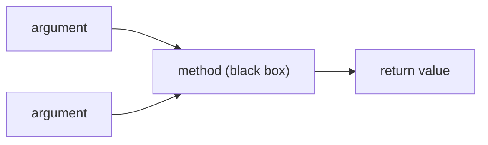

# Lecture 15 — Methods #2: Value-Returning Methods

**Module:** 4300COMP Introduction to Programming · **Language:** Java

## Overview

Lecture 14's void methods were **one-way messages**: "do this", with no reply. Lecture 15 adds the reply: **value-returning methods** compute a result and **return** it to the caller, just as `console.nextInt()` returns the number typed and `Math.sqrt(16)` returns 4.0. You will also explore **scope** (which variable a name refers to, and when one variable hides another) through the slides' three `celsius` puzzles, and work through two useful methods from the slides: `yesOrNo` and `readFile`. These notes rewrite the official Lecture 15 slides in plain English. Every program and output shown was compiled and run with Java 21 (javac on the command line, not Eclipse).

**By the end you should be able to:**

1. Explain the difference between void and value-returning methods, and give examples of each from the Java API.
2. Write a method with a return type and a `return` statement, and use its result in an expression, an assignment, a condition or another call.
3. Explain what `return` does in a value-returning method and in a void method.
4. Predict the effect of `static` variables, local variables and parameters that share a name (scope and shadowing).
5. Explain why returning values is better than passing information through `static` variables.
6. Design a method by thinking about its purpose, output (return type), input (parameters) and implementation.
7. Fix the common compile errors: missing return, wrong return type, unreachable statements.

**Learning outcomes:** MLO1 (methods and algorithms), MLO2 (methods in the Java API such as `Math`), MLO3 (decomposing a specification into methods with clear inputs and outputs).

**Matching lab:** Lab 15 (official Tutorial 15: Value-returning method exercises).

**What you need from earlier lectures:** Lecture 14 (method definitions, parameters, the call stack), `ArrayList` (Lecture 12), `String` and `Character` methods (Lecture 13).

## 1. Messages and replies

Lecture 14 described calling a method as **sending a message**. Sometimes we want a **reply**.

**Example: reading an integer.** You don't know how to read a number from the keyboard yourself, so you send a message to a `Scanner` object asking it to run its `nextInt` method. The method reads the value and sends it back in its reply. That reply is the **return value**:

```java
int value = console.nextInt();   // the returned int is stored in value
```

You have used many value-returning methods already: `nextInt`, `nextLine`, `length`, `charAt`, `equals`, `get`, `size`, `Math.sqrt`, `Integer.parseInt`.

## 2. Return types

A method definition has the same parts as before (Lecture 14): modifiers, **return type**, name, parameters and statements.

| Kind | Return type | Behaviour | Example |
| --- | --- | --- | --- |
| Void | `void` | Performs an action; sends nothing back | `public static void main(String[] args)` |
| Value-returning | any type | Computes a result and sends it back to the caller | `public static double sqrt(double a)` |

The return type can be **any** data type:

```java
public static int calculateArea(int width, int height)     // primitive: must return an int
public static ArrayList<String> getStrings()                // reference: returns a list (or null)
public static void printVersion()                           // void: cannot return a value
```

### A note on null: the "billion dollar mistake"

A method with a reference return type (`String`, `ArrayList`, …) is allowed to return `null`, meaning "no object". The slides say: **don't**. Its inventor, Tony Hoare, called null references his "billion dollar mistake", because of the crashes they cause. If a caller uses the result without checking, the program fails:

```java
String s = find();              // find() returns null
System.out.println(s.length()); // NullPointerException
```

**Verified:** `NullPointerException: Cannot invoke "String.length()" because "<local1>" is null`. Return an empty String `""` or an empty list instead, so callers can always use the result safely.

## 3. The return statement

```java
return <value>;
```

| In a… | `return` means |
| --- | --- |
| **Value-returning method** | Paired with a value: stop now and send this value back to the caller (`return true;`) |
| **Void method** | On its own: stop now and go back to the caller (`return;`) |

When `return` runs, the method **ends immediately**, even in the middle of a loop. The value replaces the method call in the caller's code.

### Program A — TestAdd (from the slides)

```java
public class TestAdd {
    public static void main(String[] args) {
        int result = add(2, 3);
        System.out.println("Result is: " + result);
        System.out.println("Nested: " + add(add(1, 2), add(3, 4)));
    }

    public static int add(int a, int b) {
        return a + b;
    }
}
```

**Output (verified):**

```text
Result is: 5
Nested: 10
```

How `add(2, 3)` runs:

1. `main` calls `add` with arguments 2 and 3; `add` is pushed onto the stack with `a = 2`, `b = 3`.
2. `return a + b;` works out 5 and sends it back; `add` is popped.
3. In `main`, the call `add(2, 3)` is **replaced by 5**, so the line becomes `int result = 5;`.

The second line shows a returned value used straight away as an **argument**: `add(1, 2)` returns 3, `add(3, 4)` returns 7, then `add(3, 7)` returns 10.

(The slides' version contains `// TODO Auto-generated method stub`, a comment Eclipse adds when it generates a method. Delete these comments once you've written the method.)

### Where a returned value can go

| Use | Example |
| --- | --- |
| Stored in a variable | `int area = calculateArea(4, 5);` |
| In an expression | `double total = price(3) * 1.2;` |
| As a condition | `if (isValidPort(port)) { ... }` |
| As an argument | `System.out.println(add(2, 3));` |
| Ignored | `add(2, 3);` compiles, but the result is lost; usually a bug |

## 4. A question of scope

**Scope** is the part of a program where a variable can be used. A `static` variable declared in the class can be used in every method of the class. A parameter or local variable exists only inside its method. When a local variable or parameter has the **same name** as a `static` variable, the local one **hides** (shadows) the static one inside that method.

The slides ask three questions. Each prints `celsius` at four points. Try them before reading the answers.

### Question One

```java
public class QuestionOne {
    public static int celsius = 0;

    public static void main(String[] args) {
        System.out.printf("1. celsius = %d\n", celsius);
        updateCelsius();
        System.out.printf("4. celsius = %d\n", celsius);
    }

    public static void updateCelsius() {
        System.out.printf("2. celsius = %d\n", celsius);
        celsius = 20;
        System.out.printf("3. celsius = %d\n", celsius);
    }
}
```

**Answer A (verified): 0, 0, 20, 20.** There is one `static` variable, and nothing hides it. `updateCelsius` changes it, and `main` sees the change.

### Question Two

Identical, except the method says `int celsius = 20;` instead of `celsius = 20;`.

**Answer C (verified): 0, 0, 20, 0.** `int celsius = 20;` **declares a new local variable** that hides the static one for the rest of the method. Line 2 still sees the static (0); line 3 sees the local (20). The static is never changed, so line 4 prints 0.

### Question Three

```java
public class QuestionThree {
    public static int celsius = 0;

    public static void main(String[] args) {
        System.out.printf("1. celsius = %d\n", celsius);
        updateCelsius(30);
        System.out.printf("4. celsius = %d\n", celsius);
    }

    public static void updateCelsius(int celsius) {
        System.out.printf("2. celsius = %d\n", celsius);
        celsius = celsius;
        System.out.printf("3. celsius = %d\n", celsius);
    }
}
```

**Answer A (verified): 0, 30, 30, 0.** The **parameter** `celsius` hides the static variable throughout the method. `celsius = celsius;` assigns the parameter to itself, which does nothing. The static is untouched.

**The lesson from the slides:** using `static` variables to move information between methods gets complicated very quickly, especially when names are reused. There is a better way to get information **out** of a method: **return it**.

```java
public static int toFahrenheit(int celsius) {
    return celsius * 9 / 5 + 32;
}
int f = toFahrenheit(30);    // 86
```

(If you ever do need to reach a hidden static variable, `QuestionThree.celsius` names it through the class. Better: don't reuse the name.)

## 5. Methods as black boxes

The slides describe methods as **black boxes**: the caller can't see inside. Values go in as **arguments**, and a result comes out as the **return value**. The result can come from arithmetic, from input or output, or from any other work, and the caller can assign it to a variable.



This is what makes methods reusable: you only need to know **what** goes in and **what** comes out, not how it works inside. (You have never seen inside `Math.sqrt`, yet you can use it.)

## 6. Worked example: asking yes or no

The slides build a method that would have helped in the first coursework: ask a question and return whether the user typed yes or no.

Design questions:

- **Parameters:** think general. The method should work for **any** question, so take the message as a `String`.
- **Return type:** how do we model yes/no? With a `boolean`: `true` for yes, `false` for no.

```java
import java.util.Scanner;

public class TestYesOrNo {
    static Scanner input = new Scanner(System.in);

    public static void main(String[] args) {
        boolean choice = yesOrNo("Enter yes or no: ");
        if (choice) {
            System.out.println("Do something ...");
        } else {
            System.out.println("Do something else ...");
        }
    }

    public static boolean yesOrNo(String msg) {
        String ans = "";
        do {
            System.out.print(msg);
            ans = input.next();
            // Note the brackets and logic in the while bit
        } while (!(ans.equalsIgnoreCase("yes") || ans.equalsIgnoreCase("no")));
        if (ans.equalsIgnoreCase("yes")) {
            return true;
        } else {
            return false;
        }
    }
}
```

**Runs (verified):** input `maybe` then `YES` asks twice, then prints `Do something ...`; input `no` prints `Do something else ...`.

Read the loop condition carefully: "repeat while it is **not** (yes **or** no)". Without the outer brackets, `!` would apply only to the first test.

The final `if...else` can be shortened to one line, because `equalsIgnoreCase` already returns the `boolean` we want:

```java
return ans.equalsIgnoreCase("yes");
```

The `Scanner` is a `static` variable of the class, so both `main` and `yesOrNo` can use it (Lecture 14).

## 7. Worked example: loading a file

A method that reads a whole file and returns its lines:

- **Parameter:** the file name (`String`), so it works for any file.
- **Return type:** several options: a `String` (one long text with newlines), a `String[]` or an `ArrayList<String>` (one element per line), or a `StringBuffer`/`StringBuilder`. The slides choose a `String`, which fits what you've learned so far.

```java
import java.io.FileNotFoundException;
import java.io.FileReader;
import java.util.Scanner;

public class TestReadFile {
    public static void main(String[] args) throws FileNotFoundException {
        System.out.println(readFile("test.txt"));
    }

    public static String readFile(String filename) throws FileNotFoundException {
        String content = "";
        FileReader file = new FileReader(filename);
        Scanner reader = new Scanner(file);
        while (reader.hasNext()) {
            content += reader.nextLine() + "\n";
        }
        reader.close();
        return content;
    }
}
```

With `test.txt` containing two lines, the program prints both lines and then an empty line (verified): the returned String already ends with `\n`, and `println` adds another.

Notes:

- `content += x` is shorthand for `content = content + x` (Lecture 9's `+=` works for Strings too).
- `throws FileNotFoundException` appears on **both** methods: `readFile` might fail to open the file, and `main` calls `readFile`, so `main` must declare it too (Lecture 5). Handling it properly with `try` and `catch` is a later topic in the module syllabus.
- As in Lecture 8, `hasNextLine()` is the exact partner of `nextLine()`.
- The slides note there are more sophisticated ways to read files; this one uses only what you know.

## 8. Example from Tutorial 15: a validated selection

Tutorial 15 shows a vending-machine method that keeps asking until the user types a letter followed by a digit, such as `C7`:

```java
public static String getSelection() {
    while (true) {
        System.out.print("Enter a selection (A1-Z9): ");
        String response = console.next();
        if (response.length() != 2) {
            continue;
        }
        if (Character.isLetter(response.charAt(0)) && Character.isDigit(response.charAt(1))) {
            return response;
        }
    }
}
```

Two new pieces of syntax here:

- `while (true)` is a loop whose condition is always true. It would run forever, except that `return` ends the **whole method**, loop included.
- `continue` skips the rest of the current iteration and goes straight back to the loop's test. Here it means "wrong length: ask again".

**Run (verified):** inputs `B12` and `7C` are rejected; `C7` gives `Dispensing item C7...`.

Tutorial 15 adds two rules: **never define a method inside another method**, and a value-returning method must **always** reach a `return` statement. The compiler checks this second rule.

## 9. Thinking about methods

The slides finish with a four-step way to design any method:

| Step | Question | Becomes |
| --- | --- | --- |
| 1. **Purpose** | What exactly am I trying to do? | The method's name and Javadoc comment |
| 2. **Output** | What information must the method produce? | The **return type** |
| 3. **Input** | What does it need to know to produce that? | The **parameter list** |
| 4. **Implement** | How do I turn the inputs into the output? | The statements |

Example: "convert a temperature from Celsius to Fahrenheit". Purpose: convert. Output: a temperature, `double`. Input: the Celsius temperature, `double`. Implementation: `return c * 9 / 5 + 32;`. So: `public static double toFahrenheit(double c)`.

Only at step 4 do you think about **how**. This mirrors the analysis–design–implementation process from Lecture 10.

## 10. Common mistakes

| Mistake | Symptom (verified with javac) | Fix |
| --- | --- | --- |
| No `return` in a value-returning method | `error: missing return statement` | Return a value on every path |
| `return` only inside some `if` branches | `error: missing return statement` | Add a final `else` or a `return` after the `if` |
| Returning the wrong type: `return n / 2.0;` in an `int` method | `error: incompatible types: possible lossy conversion from double to int` | Match the return type, or cast |
| Statements after `return` | `error: unreachable statement` | Nothing can run after `return` |
| Storing the result in the wrong type: `String s = name();` (returns `int`) | `error: incompatible types: int cannot be converted to String` | Match the variable type |
| `return 5;` in a void method | `error: incompatible types: unexpected return value` | Change the return type |
| Calling the method but ignoring the result | Compiles; result lost | Assign or use it |
| Returning `null` | `NullPointerException` in the caller | Return `""` or an empty list |
| Reusing a static variable's name for a local or parameter | Changes don't "stick" (Questions 2 and 3) | Use distinct names; return values |

## 11. Check yourself — 15 multiple-choice questions

1. What does a value-returning method do that a void method does not? (A) take parameters (B) send a result back to the caller (C) print output (D) use loops
2. What does `return a + b;` do? (A) prints a + b (B) stores a + b in a static variable (C) ends the method and sends a + b to the caller (D) returns to the start of the method
3. What is printed? `System.out.println(add(add(1, 2), add(3, 4)));` with `add` returning `a + b` (A) 3 (B) 7 (C) 10 (D) 1234
4. In the slides' Question One, what is line 4? (A) 0 (B) 20 (C) 30 (D) an error
5. In Question Two, what is line 4? (A) 0 (B) 20 (C) 30 (D) an error
6. In Question Three, why does line 4 print 0? (A) the parameter hides the static variable, so only the parameter is changed (B) 30 is invalid (C) `printf` is wrong (D) the method is not called
7. Which return type suits a method that answers "did the user say yes?" (A) `String` (B) `int` (C) `boolean` (D) `void`
8. What error does a value-returning method with no `return` give? (A) `unreachable statement` (B) `missing return statement` (C) `cannot find symbol` (D) none
9. What happens to a statement placed straight after `return x;`? (A) it runs after the return (B) `error: unreachable statement` (C) it runs first (D) it is ignored silently
10. Why do the slides call returning null "the billion dollar mistake"? (A) null is slow (B) callers who use the result without checking crash with `NullPointerException` (C) null costs memory (D) it is illegal
11. What does `while (true)` with a `return` inside do? (A) runs forever whatever happens (B) repeats until `return` ends the method (C) does not compile (D) runs once
12. What does `continue` do in a loop? (A) ends the method (B) skips to the next iteration (C) leaves the loop (D) restarts the program
13. In the four-step method design, the **output** becomes the method's… (A) name (B) parameters (C) return type (D) body
14. Which line uses a returned value as a condition? (A) `int x = add(1, 2);` (B) `if (isValidPort(p)) { }` (C) `add(1, 2);` (D) `return;`
15. `readFile` returns `content`, which is: (A) an `ArrayList` of lines (B) one `String` containing every line, each followed by `\n` (C) the number of lines (D) `null` at the end of the file

### Answers

| Q | Answer | Why |
| --- | --- | --- |
| 1 | B | |
| 2 | C | |
| 3 | C | 3 + 7 (verified) |
| 4 | B | One static variable, changed (verified) |
| 5 | A | A new local variable hid the static (verified) |
| 6 | A | Verified |
| 7 | C | |
| 8 | B | Verified |
| 9 | B | Verified |
| 10 | B | Verified example |
| 11 | B | Verified with the vending example |
| 12 | B | |
| 13 | C | |
| 14 | B | |
| 15 | B | |

**Score:** 13–15 go to Lab 15; 10–12 re-read the sections for the ones you missed; under 10, run the three `celsius` questions and TestAdd, tracing each with a stack diagram.

## 12. Quick reference

```java
/**
 * Purpose in one line.
 * @param a   what a is
 * @return    what is returned
 */
public static int square(int a) {
    return a * a;
}

public static boolean isEven(int n) {
    return n % 2 == 0;          // a condition is already a boolean
}

public static String grade(int mark) {
    if (mark >= 70) {
        return "A";
    } else if (mark >= 50) {
        return "C";
    }
    return "D";                 // every path must return
}

int s = square(4);              // store
if (isEven(s)) { }              // condition
System.out.println(grade(65));  // argument
```

## 13. Glossary

| Term | Meaning |
| --- | --- |
| Value-returning method | A method that computes a result and sends it back |
| Return type | The type of value a method returns (`void` if none) |
| Return value | The value sent back by `return` |
| `return` | Ends a method; in a value-returning method it also supplies the result |
| Scope | Where in the program a variable can be used |
| Local variable | A variable declared inside a method; exists only there |
| Shadowing / hiding | A local variable or parameter with the same name as a static variable, which hides it |
| Black box | Something used through its inputs and outputs without seeing inside |
| `null` | "No object"; using it causes `NullPointerException` |
| `continue` | Skip the rest of this loop iteration |

## 14. Summary

- Value-returning methods reply to a message: `return value;` ends the method and sends the value back.
- A returned value can be stored, used in an expression or condition, or passed straight into another call.
- The compiler insists that every path through a value-returning method returns a value of the right type.
- Local variables and parameters can hide static variables with the same name; passing information through static variables gets confusing, so return values instead.
- Avoid returning `null`.
- Design each method by its purpose, output (return type), input (parameters), then implementation.

**Next:** work through Lab 15. Lecture 16 introduces **classes and objects**.
