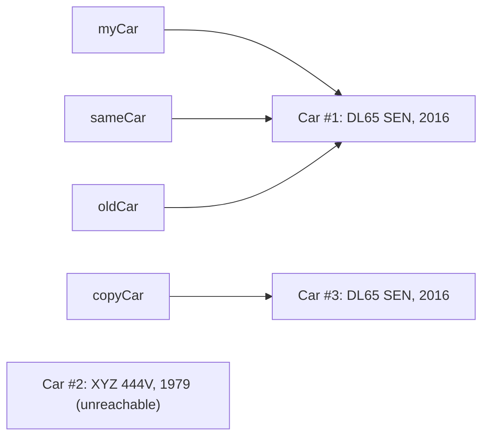

# Lecture 16 — Classes and Objects: the Basics

**Module:** 4300COMP Introduction to Programming · **Language:** Java

## Overview

Every program you have written lives inside a `class`, but so far each class has only been a container for `static` methods. Lecture 16 shows what classes are really for: they are **templates for objects**. A class bundles **data** (fields) and **behaviour** (methods) into one unit; each **object** created from it has its own copy of the data. You will learn how to write a class, create objects with `new` and a **constructor**, tell **instance** members from **static** (class) members, hide data with `private` (**encapsulation**), and write **accessor** and **mutator** methods. These notes rewrite the official Lecture 16 slides in plain English. Every program and output shown was compiled and run with Java 21 (javac on the command line, not Eclipse).

**What this session does and doesn't cover (from the slides):** you will see the basic object-oriented (OO) constructs and learn their syntax. You are **not yet** expected to analyse real-world problems and design classes for them. Object-oriented programming is a module in itself, and much more comes next year.

**By the end you should be able to:**

1. Explain the difference between a **class** and an **object**, and what **instantiation** means.
2. Write a class with fields, a constructor and methods, in its own `.java` file.
3. Create objects with `new`, and use the dot operator to read fields and call methods.
4. Explain what an object variable holds (a **reference**), and count variables and objects in a piece of code.
5. Explain the difference between **instance** and **static** (class) members, and call each correctly.
6. Use `private` and `public` to hide data, and write accessor (get) and mutator (set) methods, including validation.
7. Use `this` to refer to the current object, and to call another constructor.
8. Explain the default constructor and constructor overloading.

**Learning outcomes:** MLO4 (basic knowledge of the object-oriented paradigm) above all; also MLO1 and MLO3.

**Matching lab:** Lab 16 (official Tutorial 16: Classes #1).

**What you need from earlier lectures:** methods, parameters and return values (Lectures 14–15), `static` (Lecture 14), references and `==` (Lectures 11 and 13), `ArrayList` (Lecture 12).

## 1. Why classes?

- Classes are the key building blocks of Java. **Everything you've written so far has been inside a class.**
- They are a fundamental idea of **object-oriented (OO) programming**.
- Through their **members**, they combine **data and behaviour** into a single entity:
  - **member variables** (fields, attributes) provide the **data**;
  - **member methods** provide the **behaviour**.

Tutorial 16 adds the "divide and conquer" view: a large, complex program can be written as a collection of classes that communicate with each other, each responsible for one kind of thing.

## 2. Class versus object

This is the concept beginners find most confusing, so take it slowly.

| | Class | Object |
| --- | --- | --- |
| What it is | A **template** written in code | A **thing** built from the template |
| Defines | The data each object will have and the behaviour it supports | Holds actual values for that data |
| How many | One `Car` class | Many `Car` objects, each with its own registration |
| Analogy | The design of a type of car | Individual cars on the road |

- Creating an object from a class is called **instantiation**. It happens with the **`new`** keyword and a special method called the **constructor**.
- Objects are also called **instances** of their class.

## 3. Defining a class

```java
public class ClassName {
    DataType1 identifier1;          // data members (fields)
    DataType2 identifier2;

    public ClassName() {            // a constructor
        ...
    }

    public void method2() {         // a method (behaviour)
        ...
    }
}
```

- Classes are defined with the **`class`** keyword.
- A **`public` class must be in a file named exactly `ClassName.java`** (Lecture 1). In Eclipse: **File > New > Class**, in the same project and package as your `main` class.
- A class has a fixed set of **members**, accessed by name. Each member is a **field** (data), a **method** (behaviour) or a **constructor** (a special method that sets up a new object).

## 4. The Car class

The slides' example, in a file called `Car.java`:

```java
public class Car {
    String regNo;
    int regYear;

    public Car(String regNo, int year) {
        this.regNo = regNo;
        this.regYear = year;
    }

    public int calcAge(int year) {
        return year - regYear;
    }
}
```

It has **two fields** (`regNo` and `regYear`), **one constructor** and **one method**.

**The constructor** has the **same name as the class** and **no return type** (not even `void`). It runs once, when an object is created, and sets the new object's fields from its parameters.

**`this`** is a reference to **the current object**: the one being built or used. It is useful to **disambiguate** when a parameter has the same name as a field (Lecture 15's shadowing). In `this.regNo = regNo;`, `this.regNo` is the object's field and `regNo` is the parameter. Without `this`, `regNo = regNo;` would assign the parameter to itself and leave the field empty. Verified: a constructor written that way leaves fields as `null` and `0`.

**Slide note:** the slide writes `return year – regYear;` with an en dash (–) instead of a minus sign (-). Copied into Eclipse, that gives `error: illegal character: '–'` (verified). Always type a normal minus.

## 5. Creating and using objects

`main` usually goes in a **separate** class, for example `CarDemo.java` in the same project:

```java
public class CarDemo {
    public static void main(String[] args) {
        Car myCar = new Car("DL65 SEN", 2016);
        System.out.println(myCar.regNo);
        myCar.regYear = 2015;
        int carAge = myCar.calcAge(2016);
        System.out.println(carAge);
    }
}
```

**Output (verified):**

```text
DL65 SEN
1
```

- `new Car("DL65 SEN", 2016)` **calls the constructor**: Java creates a new `Car` object, runs the constructor with these arguments, and gives back a reference to the object. The arguments must match the constructor's parameters.
- `myCar.regNo` uses the **dot operator** on an object to read a field.
- `myCar.regYear = 2015;` changes that object's field.
- `myCar.calcAge(2016)` calls the method **on that object**; inside the method, `regYear` means *this car's* `regYear` (2015), so it returns 1.

## 6. Objects and references

An object variable such as `myCar` does not contain the car. It holds a **reference** to the object, just like array variables (Lecture 11). This explains several surprises:

- It is possible to create **many separate objects with the same data**. Uniqueness is **not** enforced.
- It is possible to have **many variables pointing at the same object**.

### The slides' question

```java
public static void main(String[] args) {
    Car myCar = new Car("DL65 SEN", 2016);
    Car oldCar = new Car("XYZ 444V", 1979);
    Car copyCar = new Car("DL65 SEN", 2016);
    Car sameCar = myCar;
    oldCar = myCar;
}
```

By the last line, how many **variables (references)** and how many **unique objects**?

**The slides' answer: 4 variables and 2 unique objects.** Line by line:

| Line | Effect |
| --- | --- |
| 1 | Object #1 (DL65 SEN, 2016) created; `myCar` refers to it |
| 2 | Object #2 (XYZ 444V, 1979) created; `oldCar` refers to it |
| 3 | Object #3 (another DL65 SEN, 2016) created; `copyCar` refers to it |
| 4 | **No new object**: `sameCar` now refers to object #1 too |
| 5 | **No new object**: `oldCar` now refers to object #1; nothing refers to object #2 any more |

So **three** objects were created, but after line 5 only **two** can still be reached: #1 (through `myCar`, `sameCar` and `oldCar`) and #3 (through `copyCar`). Object #2 is unreachable; Java's **garbage collector** reclaims its memory automatically.



Checked in code (verified): `myCar == sameCar` is `true`; `myCar == copyCar` is **`false`** (same data, but different objects); `oldCar.regNo` is now `DL65 SEN`.

**Printing an object** directly, as in `System.out.println(myCar)`, shows something like `Car@5451c3a8` (verified): the class name and an identity code, as with arrays. The slides say a special method called `toString` (covered in future sessions) controls this.

## 7. Instance members versus class (static) members

| | Instance members | Class (static) members |
| --- | --- | --- |
| Belong to | Each **object** | The **class** itself |
| Variables | Every object has **its own copy** | **One copy** shared by the whole class |
| Methods | Need an object to act on | Need no object |
| Access with | `objectVariable.member` | `ClassName.member` |
| Examples | `myCar.regNo`, `myCar.calcAge(2016)` | `Math.round(1.7899)`, `Car.getCarsMade()` |

**Instance example.** In `Car`, every member is an instance member. Each car has its own `regNo` and `regYear`. `calcAge` only makes sense **for a particular car**, because it uses that car's `regYear`. Calling `calcAge(2026)` from `main` without an object fails (`error: cannot find symbol`, verified).

**Class (static) example.** Utility classes such as `java.lang.Math` are full of static methods: `Math.round` gets all the data it needs from its parameter, so no object is needed:

```java
public static long round(double a) { ... }      // in java.lang.Math
long rounded = Math.round(1.7899);               // 2
```

**Slide note:** the slide writes `int rounded = Math.round(1.7899);`. Because `Math.round(double)` returns a `long`, that line does not compile: `error: incompatible types: possible lossy conversion from long to int` (verified). Use `long`, or cast: `int rounded = (int) Math.round(1.7899);`.

Java also lets you call a static member through an object (`myCar.someStaticMethod()`), but Eclipse warns about it by default, and some languages, such as C#, forbid it. Use the class name.

A **static field** is useful for data about the class as a whole, such as how many cars have been made:

```java
private static int carsMade = 0;     // one copy, shared by every Car
...
carsMade++;                          // in the constructor
```

## 8. Encapsulation and information hiding

A key OO principle is **encapsulation**, which has two parts:

1. **Combining** data and the behaviour that uses it in a single unit: the class.
2. **Restricting access** to some of the data, for example so that changes can be validated. This part is called **information hiding**.

Java supports this with **visibility modifiers** (Lecture 14 applied them to methods; they also apply to fields):

| Modifier | Accessible from |
| --- | --- |
| `private` | Only **within the class** |
| (no modifier) | Within the class and the **same package** |
| `protected` | The class, the package, and subclasses (next year) |
| `public` | **Everywhere** |

Reference: [Controlling Access to Members of a Class](https://docs.oracle.com/javase/tutorial/java/javaOO/accesscontrol.html) (Oracle's Java Tutorials, linked from the slides).

### Accessor methods: a read-only field

A common pattern for a "read-only" member:

1. Make the field **`private`**.
2. Set its value when the object is constructed.
3. Provide a **`public` accessor method** (a "getter") to read it.

```java
public class Car {
    String regNo;
    private int regYear;            // hidden

    ...

    public int getYear() {          // accessor
        return regYear;
    }
}
```

Now `myCar.regYear = 2000;` from another class fails with `error: regYear has private access in Car` (verified), while `myCar.getYear()` works. (The slide writes `public int getYear{`, missing the `()`, which gives `error: ';' expected`; verified.)

### Mutator methods: validated changes

To let other classes **change** a hidden field, but only in acceptable ways, add a **mutator** ("setter"):

```java
import java.time.Year;
...
public void setYear(int year) {
    if (year <= Year.now().getValue()) {      // not in the future
        this.regYear = year;
    }
}
```

`Year.now().getValue()` gives the current year from the computer's clock (`java.time.Year` must be imported).

Points from the slides:

- The **owning class decides** about changes to its own data. A call to `setYear` is a **request, not an instruction**.
- This is good practice even for fields that may be read and written freely, because it makes later changes and maintenance simpler: the rules live in one place.
- But think about other programmers: is it clear that `setYear(2099)` will be **silently ignored**? One improvement is to return a `boolean` saying whether the change was accepted (Lab 16 does this).
- Languages such as C# offer **properties**, a shorter syntax for getters and setters.

Verified (in 2026): `setYear(2015)` changes the year; `setYear(2099)` is refused and the year stays 2015.

## 9. More on constructors

A constructor is the special method used with `new` whenever an object is created. The `Car` constructor takes all the data the object needs as parameters. Two other kinds exist.

### The default constructor

If you write **no** constructor at all, Java provides a **default constructor**: one with **no parameters**, which leaves every field at its default value (`null`, `0`, `false`). Verified: a class with fields `String name; int size;` and no constructor allows `new Plain()`, and printing the fields gives `null 0`.

**Java only provides it if you don't write your own.** Once `Car` has a constructor with parameters, `new Car()` fails (verified with the final `Car` below: `error: no suitable constructor found for Car(no arguments)`). The slides ask whether we would even **want** "blank" cars with no registration. Often not, and leaving the default constructor out prevents them.

### Overloaded constructors

A class can have **several constructors**, told apart by their **parameter lists** (number, types or order). This is **constructor overloading**. One constructor can call another with **`this(...)`**, which must be its first statement:

```java
public Car(String regNo, int year) {
    this.regNo = regNo;
    this.regYear = year;
}

public Car(String regNo) {
    this(regNo, Year.now().getValue());     // a new car: registered this year
}
```

Programmers can then use any public constructor: `new Car("DL65 SEN")` or `new Car("XYZ 444V", 1979)`.

## 10. The complete example

```java
import java.time.Year;

public class Car {
    private static int carsMade = 0;     // class (static) member: one copy shared by all cars

    String regNo;                        // instance members: every Car has its own copy
    private int regYear;

    public Car(String regNo, int year) {
        this.regNo = regNo;
        this.regYear = year;
        carsMade++;
    }

    public Car(String regNo) {
        this(regNo, Year.now().getValue());   // calls the other constructor
    }

    public int calcAge(int year) {
        return year - regYear;
    }

    public int getYear() {                   // accessor
        return regYear;
    }

    public void setYear(int year) {          // mutator: a request, not an instruction
        if (year <= Year.now().getValue()) {
            this.regYear = year;
        }
    }

    public static int getCarsMade() {
        return carsMade;
    }
}
```

```java
public class CarDemo {
    public static void main(String[] args) {
        Car myCar = new Car("DL65 SEN", 2016);
        Car newCar = new Car("AB26 NEW");
        System.out.println(myCar.regNo + " " + myCar.getYear());
        System.out.println(newCar.regNo + " " + newCar.getYear());

        myCar.setYear(2015);
        System.out.println(myCar.getYear());
        myCar.setYear(2099);                 // refused: in the future
        System.out.println(myCar.getYear());
        System.out.println(myCar.calcAge(2026));
        System.out.println("Cars made: " + Car.getCarsMade());

        long rounded = Math.round(1.7899);
        System.out.println(rounded);
    }
}
```

**Output (verified, run in 2026; the second line shows the current year):**

```text
DL65 SEN 2016
AB26 NEW 2026
2015
2015
11
Cars made: 2
2
```

## 11. Common mistakes

| Mistake | Symptom (verified with javac) | Fix |
| --- | --- | --- |
| Accessing a `private` field from another class | `error: regYear has private access in Car` | Use the accessor/mutator |
| `new Car()` when only constructors with parameters exist | `error: no suitable constructor found for Car(no arguments)` (or `constructor Car in class Car cannot be applied to given types`) | Pass the arguments, or add a no-argument constructor |
| Constructor arguments in the wrong order | `error: incompatible types: int cannot be converted to String` | Match the parameter list |
| Using an object variable before `new` | `error: variable c might not have been initialized` | `Car c = new Car(...);` |
| Calling an instance method from `main` without an object | `error: cannot find symbol` | `myCar.calcAge(2026)` |
| `name = name;` in a constructor | Fields stay `null` / `0` | `this.name = name;` |
| Giving a constructor a return type (`public void Car(...)`) | It becomes an ordinary method; `new Car(...)` then fails | No return type on constructors |
| `int r = Math.round(1.7899);` | `error: incompatible types: possible lossy conversion from long to int` | `long`, or cast to `int` |
| En dash `–` copied from slides | `error: illegal character: '–'` | Type `-` |
| `public int getYear{` | `error: ';' expected` | `getYear()` |
| Comparing objects with `==` | `false` for separate objects with equal data | Compare fields, or an `equals` method (future sessions) |
| Two public classes in one file | `error: class CarDemo is public, should be declared in a file named CarDemo.java` | One public class per file |

## 12. Check yourself — 15 multiple-choice questions

1. What is a class? (A) an object (B) a template that defines data and behaviour for objects (C) a variable (D) a method
2. What is instantiation? (A) deleting an object (B) creating an object from a class (C) compiling a class (D) calling a static method
3. What is special about a constructor? (A) it returns `void` (B) it has the class's name and no return type, and runs when an object is created (C) it must be `static` (D) it can only have one parameter
4. In `this.regNo = regNo;`, what is `this.regNo`? (A) the parameter (B) the current object's field (C) a static variable (D) a local variable
5. What does `myCar.calcAge(2016)` return if `myCar.regYear` is 2015? (A) 2015 (B) 2016 (C) 1 (D) −1
6. After the slides' five lines (three `new`, then `sameCar = myCar; oldCar = myCar;`), how many objects can still be reached? (A) 1 (B) 2 (C) 3 (D) 4
7. `Car a = new Car("X", 2020); Car b = new Car("X", 2020);` What is `a == b`? (A) `true` (B) `false` (C) compile error (D) exception
8. Which member belongs to the class rather than to each object? (A) an instance field (B) a `static` field (C) a constructor parameter (D) a local variable
9. How do you call `Math.round`? (A) `new Math().round(1.5)` (B) `Math.round(1.5)` (C) `round.Math(1.5)` (D) `Math->round(1.5)`
10. What happens when another class runs `myCar.regYear = 2000;` and `regYear` is `private`? (A) it works (B) `error: regYear has private access in Car` (C) a runtime exception (D) it is ignored
11. What is an accessor method? (A) a method that changes a field (B) a public method that returns a private field's value (C) a constructor (D) a static method
12. Why might a mutator such as `setYear` not change the field? (A) mutators never change fields (B) it validates the request and may refuse it (C) fields are final (D) `this` is null
13. When does Java provide a default constructor? (A) always (B) only when you write no constructor (C) only for `public` classes (D) never
14. What does `this(regNo, 2026);` inside a constructor do? (A) creates a second object (B) calls another constructor of the same class (C) returns a value (D) causes an error
15. What does `int r = Math.round(1.7899);` give? (A) 2 (B) 1 (C) `error: incompatible types: possible lossy conversion from long to int` (D) 1.79

### Answers

| Q | Answer | Why |
| --- | --- | --- |
| 1 | B | |
| 2 | B | With `new` and a constructor |
| 3 | B | |
| 4 | B | `this` is the current object |
| 5 | C | Verified |
| 6 | B | Three created; one is unreachable (verified with `==`) |
| 7 | B | Two different objects (verified) |
| 8 | B | |
| 9 | B | Static: use the class name |
| 10 | B | Verified |
| 11 | B | |
| 12 | B | A request, not an instruction (verified with 2099) |
| 13 | B | Verified |
| 14 | B | |
| 15 | C | Verified |

**Score:** 13–15 go to Lab 16; 10–12 re-read the sections for the ones you missed; under 10, re-type `Car` and `CarDemo` and draw the reference diagram for the slides' question.

## 13. Quick reference

```java
// Thing.java
public class Thing {
    private static int count = 0;      // class member: one copy
    private String name;               // instance members: one per object
    private int size;

    public Thing(String name, int size) {     // constructor
        this.name = name;
        this.size = size;
        count++;
    }

    public Thing(String name) {               // overloaded constructor
        this(name, 1);
    }

    public String getName() { return name; }  // accessor

    public void setSize(int size) {           // mutator with validation
        if (size > 0) {
            this.size = size;
        }
    }

    public static int getCount() { return count; }   // static method
}

// ThingDemo.java
Thing t = new Thing("box", 3);    // instantiate
t.setSize(5);                     // instance method: object.method()
String n = t.getName();
int c = Thing.getCount();         // static method: ClassName.method()
```

## 14. Glossary

| Term | Meaning |
| --- | --- |
| Class | A template defining the data (fields) and behaviour (methods) of objects |
| Object / instance | A thing created from a class, with its own field values |
| Instantiation | Creating an object with `new` and a constructor |
| Field / member variable / attribute | A variable declared in a class, outside methods |
| Member | A field, method or constructor of a class |
| Constructor | A special method with the class's name and no return type that sets up a new object |
| `this` | A reference to the current object; `this(...)` calls another constructor |
| Reference | What an object variable holds: the location of the object |
| Garbage collection | Java automatically reclaiming objects that can no longer be reached |
| Instance member | Belongs to each object; needs an object to use |
| Class (static) member | Belongs to the class; one copy; used with the class name |
| Encapsulation | Combining data and behaviour in a class, and hiding data |
| Information hiding | Restricting access to fields, e.g. with `private` |
| Accessor (getter) | A method that returns a field's value |
| Mutator (setter) | A method that changes a field, usually with validation |
| Default constructor | The no-parameter constructor Java provides only when you write none |
| Constructor overloading | Several constructors with different parameter lists |

## 15. Summary

- A class is a template; objects are instances created from it with `new` and a constructor.
- A class combines data (fields) and behaviour (methods); `this` refers to the current object.
- Object variables hold references: several variables can share one object, and `==` compares references.
- Instance members belong to each object; static members belong to the class and are used through the class name.
- Encapsulation: make fields `private`, read them with accessors, change them through validating mutators.
- Java gives a default constructor only if you write none; constructors can be overloaded and can call each other with `this(...)`.

**Recommended reading:** [Controlling Access to Members of a Class](https://docs.oracle.com/javase/tutorial/java/javaOO/accesscontrol.html) and [Understanding Class Members](https://docs.oracle.com/javase/tutorial/java/javaOO/classvars.html) (Oracle's Java Tutorials).

**Next:** work through Lab 16. According to the slides, the next sessions recap variables and strong typing, look at structured data design and compound data types, use classes to define new types of data, and later cover methods such as `toString` and `equals`.
