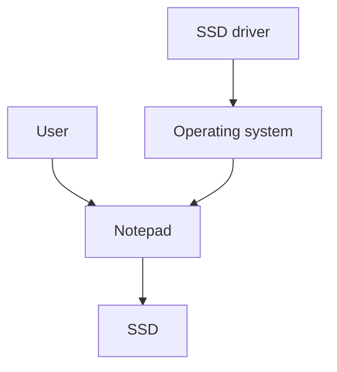
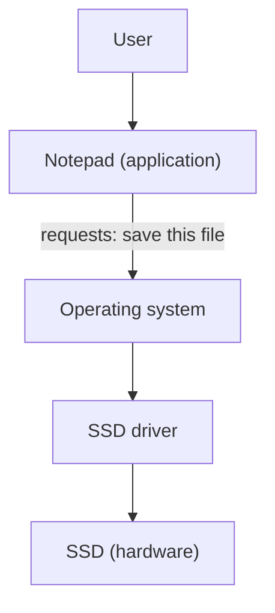
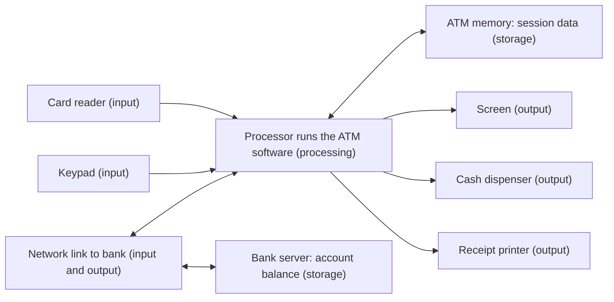

# Lab 1 — Introduction to Computer Systems Hands-on Workbook (20 Tasks)

**Module:** 4301COMP Computer Systems Architecture

**Session:** Teaching Week 01, Session A · **Matching lecture:** `../Lectures/Lecture-01-Introduction-to-Computer-Systems.md`

---

## How to use this lab

**What this lab is for.** You will take apart a real computer system, on paper and on screen: find its hardware and software, follow information through it, do the clock and capacity arithmetic, and practise explaining it the way an exam or report expects.

**Where the official tasks are.** The official TW01 Session A lab has three parts. They are all here, marked **official**:

| Official lab sheet | This workbook |
| --- | --- |
| Official Task 1 — Identify the parts of a computer system | Task 16 |
| Official Task 2 — Follow one user action through the system | Task 17 |
| Official Extra Challenge — Compare two computer systems | Task 18 |

If you are in the timetabled lab, **do Tasks 16 and 17 first**, then come back to Task 1.

**Tools you need**

| Tool | Needed for | Notes |
| --- | --- | --- |
| A Windows computer (a university PC is fine) | Tasks 11, 16, 17, 19 | Named on the official lab sheet |
| System Information (`msinfo32`), Task Manager, Notepad | Tasks 16, 17 | Built into Windows; named on the official lab sheet |
| Microsoft Word | Tasks 16–17 | The official sheet asks for a Word document |
| Command Prompt and PowerShell | Task 11 | Built into Windows; nothing to install |
| Python 3 | Tasks 12, 15 | **Optional, your choice, not a module requirement.** Free from python.org. Each task has a no-install alternative |
| A web browser | Tasks 13, 14 | For mermaid.live (diagram preview) and a manufacturer's spec page |
| Pen, paper, calculator | Everywhere | Do the working by hand first |

**Rules**

1. **Predict before you check.** Write your prediction down, then test it. A wrong prediction you correct teaches you more than a right guess.
2. **Show your working** for every calculation, including the powers of ten.
3. **Use the hints only after a real attempt.** Hint 1 names the idea. Hint 2 gives the next step.
4. **Record what you actually see**, not what you expected to see. Your PC will differ from the examples here.
5. **Nothing in this lab changes your computer.** Every command is read-only and is explained before you run it.

**Labels:** **Verified** means the result was actually run or calculated before being written here. **Expected** means it was not run here (for example a Windows screen), so check it yourself.

> **Academic integrity.** The official lab asks you to build your own Word document with your own screenshots and explanations. Do that yourself. Check Canvas for this module's rules on AI tools before using any AI help on anything that is assessed.

---

## Part A — Warm-up: recognise and predict (Tasks 1–5)

### Task 1 — Hardware or software?

**Goal:** sort items into hardware and software, and give each hardware item its main role.

**Steps**

1. Copy the table. Fill in **Prediction** for each row *without* looking anything up.
2. For hardware, write its main role: **processing, memory, storage, input or output**. For software, write **system** or **application**.
3. Check against lecture sections 7, 19 and 20 and correct any mistakes in a different colour.

| # | Item | Hardware or software? | Role or kind (Prediction) |
| --- | --- | --- | --- |
| 1 | AMD Ryzen 5 processor | | |
| 2 | 16 GB DDR4 RAM | | |
| 3 | Windows 11 Home | | |
| 4 | 1 TB hard disk drive | | |
| 5 | Google Chrome | | |
| 6 | Webcam | | |
| 7 | Realtek audio driver | | |
| 8 | Speakers | | |
| 9 | UEFI firmware | | |
| 10 | Spotify | | |
| 11 | Microphone | | |
| 12 | NVIDIA graphics card | | |
| 13 | Ubuntu Linux | | |
| 14 | Laser printer | | |
| 15 | Notepad | | |

**Expected result:** 8 hardware items and 7 software items (4 system, 3 application).

- **Hint 1:** If you could, in principle, drop it on your foot, it is hardware.
- **Hint 2:** For software, ask "does this help *me* do a task, or does it keep the *computer* running?"

---

### Task 2 — Spot the input, processing, storage and output

**Goal:** apply the IPSO model to everyday systems.

**Steps**

1. For each scenario, fill in all four columns.
2. Mark any device that is **both** input and output.

| Scenario | Input | Processing | Storage | Output |
| --- | --- | --- | --- | --- |
| a) Taking money from a cash machine | | | | |
| b) Paying by contactless card in a shop | | | | |
| c) A smart thermostat turning the heating on | | | | |
| d) Taking a photo on a phone | | | | |
| e) Printing a document | | | | |
| f) Asking a smart speaker for the weather | | | | |

**Expected result:** every row has at least one entry per column. In (b) and (f), at least one device is both input and output.

- **Hint 1:** Processing is nearly always "the processor runs the device's software". Storage might be memory, flash, or a remote server.
- **Hint 2:** For (f), the question goes over the network and the answer comes back over it.

---

### Task 3 — Clock units drill

**Goal:** convert frequencies and work out clock periods by hand.

**Steps**

1. Fill in the table by hand. Write each frequency in hertz as a number × 10ⁿ first.
2. Use **period = 1 ÷ frequency**.
3. Check with a calculator (or Task 12's script, if you do it).

| Frequency | In Hz (× 10ⁿ) | Period |
| --- | --- | --- |
| 1 GHz | | |
| 4 GHz | | |
| 500 MHz | | |
| 16 MHz | | |
| 2.1 GHz | | (to 3 significant figures) |

Then answer:

6. How many times bigger is 1 THz than 1 GHz?
7. A period is 0.5 ns. What is the frequency in GHz?

**Expected result:** periods of 1 ns, 0.25 ns, 2 ns, 62.5 ns and about 0.476 ns; 1,000 times; 2 GHz. All verified (see the answer key).

- **Hint 1:** 1 ÷ 10⁹ = 10⁻⁹, which is one nanosecond.
- **Hint 2:** For 500 MHz: 500 × 10⁶ = 5 × 10⁸. 1 ÷ (5 × 10⁸) = 0.2 × 10⁻⁸ = 2 × 10⁻⁹ s.

---

### Task 4 — Predict the memory

**Goal:** trace memory reads and writes using addresses.

Start state:

| Address | 0 | 1 | 2 | 3 | 4 |
| --- | --- | --- | --- | --- | --- |
| Contents | 8 | 15 | 3 | 22 | 0 |

**Steps:** for each operation, write the value returned (for reads) and the full memory contents after the step.

1. READ address 3
2. WRITE 40 to address 0
3. READ address 0
4. WRITE the value at address 2 into address 4 (that is: read address 2, then write what you got to address 4)
5. READ address 2
6. WRITE 1 to address 2
7. READ address 4

**Expected result:** final memory is 40, 15, 1, 22, 3. Step 7 returns 3, not 1.

- **Hint 1:** Reading never changes memory. Writing replaces only the one address you write to.
- **Hint 2:** In step 4, address 4 receives a *copy* of 3. Changing address 2 later (step 6) does not change that copy.

---

### Task 5 — Power cut: what survives?

**Goal:** predict what is kept in non-volatile storage and what is lost from volatile memory.

For each scenario, predict **kept** or **lost**, and name the hardware involved.

| # | Scenario: the power goes off suddenly... | Kept or lost? | Where was it? |
| --- | --- | --- | --- |
| a | ...while you are typing a new Notepad file you have never saved | | |
| b | ...after you saved a Word document an hour ago | | |
| c | ...the photos on your phone's internal storage | | |
| d | ...the web page currently shown in your browser (not saved) | | |
| e | ...your Wi-Fi password saved in Windows | | |
| f | ...the value in a processor register | | |
| g | ...the firmware in your home router | | |

**Expected result:** 4 kept, 3 lost. Check the answer key.

- **Hint 1:** RAM and registers are volatile. SSDs, hard disks and flash memory are non-volatile.
- **Hint 2:** "Saved" means the OS wrote it to storage. Anything only "open" is in RAM.

---

## Part B — Find and fix (Tasks 6–10)

### Task 6 — Fix a classmate's classification table

**Goal:** find and correct classification errors.

A classmate, Sam Archer, produced this table from System Information. **Five rows contain an error.** Find each one, say what is wrong and correct it.

| Item | Sam's classification | Sam's role |
| --- | --- | --- |
| Intel Core i7-1255U | Hardware | Processing |
| 16.0 GB installed physical memory (RAM) | Hardware | Storage |
| Microsoft Windows 11 Pro | Application software | — |
| Intel Iris Xe Graphics (display adapter) | Software | — |
| Samsung 512 GB NVMe SSD | Hardware | Memory |
| Keyboard | Hardware | Input |
| Monitor | Hardware | Input |
| Intel Wi-Fi 6 adapter | Hardware | Input and output |

**Expected result:** 5 errors found, each with a one-line reason.

- **Hint 1:** Check the difference between *memory* and *storage* twice.
- **Hint 2:** A display adapter is a physical card or chip. An OS manages the computer.

---

### Task 7 — Fix the clock calculations

**Goal:** find powers-of-ten and method errors.

Each calculation below is wrong. Find the mistake, then give the correct working and answer.

1. "A 3 GHz processor has a period of 1 ÷ 3 = 0.333 seconds."
2. "A 2 GHz processor completes 2 × 10⁶ cycles every second."
3. "At 4 GHz, 8 × 10⁹ cycles take 8 × 10⁹ × 4 × 10⁹ = 32 × 10¹⁸ seconds."
4. "A 500 MHz clock has a period of 1 ÷ 500 = 0.002 ns."
5. "Laptop A is 3.5 GHz and laptop B is 2.8 GHz, so A will finish every job 25% faster."

**Expected result:** five corrected answers; 2.0 s for item 3 (Verified).

- **Hint 1:** Convert to hertz first: GHz means × 10⁹, MHz means × 10⁶.
- **Hint 2:** For item 3, time = cycles **÷** frequency, not ×. For item 5, re-read slide 11's third bullet.

---

### Task 8 — Fix the misread spec sheet

**Goal:** read a product specification correctly.

This is part of a (made-up) laptop specification:

```text
Processor:   8-core, up to 4.4 GHz boost, 2.0 GHz base
Memory:      16 GB DDR5
Storage:     512 GB PCIe NVMe SSD
Display:     15.6" 1920 x 1080
Wireless:    Wi-Fi 6E, Bluetooth 5.3
OS:          Windows 11 Home
```

A shop assistant makes these claims. For each one, say **correct** or **wrong**, and fix the wrong ones.

1. "It has 512 GB of memory, so it can run loads of programs at once."
2. "The processor always runs at 4.4 GHz."
3. "When you open File Explorer it will show 512 GB of space."
4. "Windows 11 Home is part of the hardware you are buying."
5. "If the battery dies, anything you have not saved is lost."

**Expected result:** 1 claim correct, 4 wrong. For claim 3, Windows shows about **476.84 GB** in total (Verified), and less is free because Windows itself takes space.

- **Hint 1:** RAM is "Memory" on the sheet. "Up to" and "boost" tell you something about claim 2.
- **Hint 2:** Claim 3: 512 × 10⁹ ÷ 2³⁰.

---

### Task 9 — Fix the broken layers diagram

**Goal:** correct a diagram that breaks the layering rule.

Sam drew this to show how Notepad saves a file:



**Steps**

1. List every problem with the diagram (there are at least three).
2. Redraw it correctly in Mermaid (paste your code into <https://mermaid.live> to preview it; it is a free browser editor and needs no account).
3. Add one sentence saying why the correct order matters for security.

**Expected result:** a top-to-bottom chain User → Notepad → Operating system → driver → SSD.

- **Hint 1:** Applications *request services* from the OS. They do not talk to devices.
- **Hint 2:** Look at the direction of each arrow: who asks whom?

---

### Task 10 — Myth-busting

**Goal:** correct common wrong beliefs using the trade-offs on slide 26.

For each claim, write **true** or **false** and a one- or two-sentence correction or justification.

1. "If my computer is slow, buying a bigger hard disk will make it faster."
2. "Embedded systems aren't real computers because they have no screen."
3. "A computer system is just the hardware."
4. "Doubling the RAM always doubles performance."
5. "A smart doorbell should use the fastest processor available."
6. "Applications need the OS to reach the hardware."

**Expected result:** 1 true, 5 false.

- **Hint 1:** Slide 26: more memory and storage increase capacity but "do not solve every performance problem".
- **Hint 2:** Think about each system's *purpose* before deciding what "better" means.

---

## Part C — Build (Tasks 11–15)

### Task 11 — Build a system inventory from the command line

**Goal:** collect the same facts as System Information, but with commands.

**Skill you gain:** you can produce a hardware and software inventory of a Windows machine from the command line, which is how IT and security teams record assets at scale.

**Steps (Windows; Expected — these were not run here)**

Every command below **only reads** information. None changes anything.

1. Open **Command Prompt** (Windows key, type `cmd`, Enter) and run:

   ```text
   systeminfo
   ```

   *What it does:* lists the OS name and version, system type (for example x64-based PC), processor, total physical memory and installed updates. Record **OS Name, OS Version, System Type, Processor(s), Total Physical Memory**.

2. Open **PowerShell** (Windows key, type `powershell`, Enter) and run each line, one at a time:

   ```powershell
   Get-CimInstance Win32_Processor | Select-Object Name, NumberOfCores, NumberOfLogicalProcessors, MaxClockSpeed
   ```

   *What it does:* asks Windows for the processor's name, core count and maximum clock speed. **MaxClockSpeed is in MHz**, so 2400 means 2.4 GHz.

   ```powershell
   Get-CimInstance Win32_PhysicalMemory | Measure-Object -Property Capacity -Sum
   ```

   *What it does:* adds up the size of every RAM module. The **Sum** is in **bytes**.

   ```powershell
   Get-CimInstance Win32_DiskDrive | Select-Object Model, Size
   ```

   *What it does:* lists each drive's model and size in **bytes**.

   ```powershell
   Get-CimInstance Win32_VideoController | Select-Object Name
   Get-CimInstance Win32_OperatingSystem | Select-Object Caption, Version, OSArchitecture
   ```

   *What they do:* show the display adapter, and the OS name, version and whether it is 64-bit.

3. Fill in this table from your results:

   | Item | Value from commands | Hardware or software | Role |
   | --- | --- | --- | --- |
   | Processor name and cores | | | |
   | Max clock speed (convert MHz to GHz) | | | |
   | Total RAM (convert bytes to GB: ÷ 2³⁰) | | | |
   | Main drive model and size (convert bytes to GB both ways: ÷ 10⁹ and ÷ 2³⁰) | | | |
   | Display adapter | | | |
   | OS name, version, architecture | | | |

4. **Compare with System Information** (Task 16). Do the numbers agree once you allow for units?

**Linux alternative (Verified on an Ubuntu 24.04 cloud machine).** If you have Linux, a Linux virtual machine or WSL, these read-only commands give the same kind of facts. Real output from the machine used to check this lab (yours will differ):

```text
$ uname -m
x86_64
$ head -1 /etc/os-release
PRETTY_NAME="Ubuntu 24.04.5 LTS"
$ lscpu | head -8
Architecture:                            x86_64
CPU op-mode(s):                          32-bit, 64-bit
Address sizes:                           52 bits physical, 57 bits virtual
Byte Order:                              Little Endian
CPU(s):                                  2
On-line CPU(s) list:                     0,1
Vendor ID:                               GenuineIntel
Model name:                              Intel(R) Xeon(R) Processor @ 2.10GHz
$ free -h
               total        used        free      shared  buff/cache   available
Mem:           7.8Gi       382Mi       7.5Gi        12Mi       211Mi       7.5Gi
Swap:             0B          0B          0B
```

(`uname -m` prints the architecture, `lscpu` describes the processor, `free -h` shows memory in human-readable units. `Gi` means GiB, 2³⁰ bytes.)

**Expected result:** a completed table with every value labelled with its unit.

- **Hint 1:** If `Win32_DiskDrive` shows a huge number like 512105932800, that is bytes.
- **Hint 2:** Divide bytes by 1,000,000,000 for "box" GB and by 1,073,741,824 for "Windows" GB.

---

### Task 12 — Build a clock calculator

**Goal:** write a small program that does the clock arithmetic for you, and use it to check Task 3.

**Skill you gain:** you can turn a formula into a reusable script and use it to check hand calculations.

**Option A: Python (optional install; Verified).** Save this as `clock_calc.py`:

```python
# clock_calc.py - work out clock period and timing from a clock frequency.
# Usage: python clock_calc.py

PREFIX = {"Hz": 1, "kHz": 10**3, "MHz": 10**6, "GHz": 10**9, "THz": 10**12}


def to_hertz(value, unit):
    """Turn a value such as 3.2 GHz into plain hertz (cycles per second)."""
    return value * PREFIX[unit]


def period_ns(freq_hz):
    """Length of one clock cycle in nanoseconds: period = 1 / frequency."""
    return 1 / freq_hz * 10**9


def cycles_in(seconds, freq_hz):
    """How many clock cycles happen in a given time."""
    return freq_hz * seconds


def time_for(cycles, freq_hz):
    """How long a given number of cycles takes, in seconds."""
    return cycles / freq_hz


if __name__ == "__main__":
    for value, unit in [(1, "GHz"), (2.5, "GHz"), (3.2, "GHz"), (4, "GHz"),
                        (500, "MHz"), (16, "MHz")]:
        f = to_hertz(value, unit)
        print(f"{value} {unit} = {f:.4g} Hz, one cycle = {period_ns(f):g} ns")

    print("Cycles in 1 ms at 2.5 GHz:", f"{cycles_in(0.001, to_hertz(2.5, 'GHz')):,.0f}")
    print("Time for 6e9 cycles at 3 GHz:", time_for(6e9, to_hertz(3, "GHz")), "s")
    print("Time for 1.2e9 cycles at 2.4 GHz:", time_for(1.2e9, to_hertz(2.4, "GHz")), "s")
    print("Time for 1.2e9 cycles at 3.0 GHz:", time_for(1.2e9, to_hertz(3.0, "GHz")), "s")
```

Run it from the folder where you saved it with `python clock_calc.py`. *What it does:* only prints calculations; it does not touch any files. Actual output when run with Python 3.13 (Verified):

```text
1 GHz = 1e+09 Hz, one cycle = 1 ns
2.5 GHz = 2.5e+09 Hz, one cycle = 0.4 ns
3.2 GHz = 3.2e+09 Hz, one cycle = 0.3125 ns
4 GHz = 4e+09 Hz, one cycle = 0.25 ns
500 MHz = 5e+08 Hz, one cycle = 2 ns
16 MHz = 1.6e+07 Hz, one cycle = 62.5 ns
Cycles in 1 ms at 2.5 GHz: 2,500,000
Time for 6e9 cycles at 3 GHz: 2.0 s
Time for 1.2e9 cycles at 2.4 GHz: 0.5 s
Time for 1.2e9 cycles at 3.0 GHz: 0.4 s
```

**Your build tasks**

1. Run it and compare with your Task 3 answers.
2. Add **2.1 GHz** to the list. Predict the output first.
3. Add your **own processor's** max clock speed from Task 11 and print its period.
4. Add a line that prints how many cycles your processor completes in **1 microsecond** (10⁻⁶ s).

**Option B: no install.** PowerShell can do the same arithmetic (Expected; not run here): type `1 / 2.5e9` and press Enter. PowerShell shows the answer in seconds (4E-10, meaning 4 × 10⁻¹⁰ s = 0.4 ns).

**Expected result:** 2.1 GHz gives about 0.47619 ns (Verified). A 3.2 GHz processor completes 3,200 cycles in 1 µs (Verified).

- **Hint 1:** Each new frequency is one more pair, such as `(2.1, "GHz")`, in the list on the `for` line.
- **Hint 2:** For step 4, use `cycles_in(0.000001, to_hertz(...))` inside a `print(...)`.

---

### Task 13 — Build a data-flow diagram

**Goal:** draw the IPSO flow of a real system as a diagram that can live in a Markdown file.

**Skill you gain:** you can draw system diagrams as code (Mermaid), which renders on GitHub and in many documentation tools and is easy to update.

**Specification:** a **cash machine withdrawal**. Your diagram must show:

- at least **three inputs** (for example card reader, keypad, network reply from the bank);
- the **processing** step;
- **storage** (local and remote);
- at least **three outputs** (for example screen, cash dispenser, receipt printer, network request).

**Steps**

1. Sketch it on paper first.
2. Write it in Mermaid, starting from this template, and preview it at <https://mermaid.live>:

   ```mermaid
   flowchart LR
       IN1["Card reader"] --> P["Processor runs the ATM software"]
       P --> OUT1["Screen"]
       P <--> S1["Local memory"]
   ```

3. Label each box with **(input)**, **(output)**, **(storage)** or **(processing)**.
4. Mark any device that is **both** input and output.

**Expected result:** a diagram that previews without errors and has at least eight boxes.

- **Hint 1:** The network link to the bank goes both ways.
- **Hint 2:** Where is your account balance actually stored? Not inside the cash machine.

---

### Task 14 — Read a real embedded device's specification

**Goal:** find and interpret the specification of a real embedded computer.

**Skill you gain:** you can read a manufacturer's technical specification and identify the processor, memory, storage and I/O of a device.

**Steps**

1. Choose a real embedded device you have access to: your home router, a smart speaker, a smart TV, a games controller or a Raspberry Pi.
2. Find the model number (on the label underneath or in the manual). **Do not log in to the router or change any settings**; the label and the manufacturer's website are enough.
3. Search the manufacturer's website for the specification page or datasheet for that model.
4. Fill in this table. Write "not stated" if the spec does not say; do not guess.

   | Item | Value | Where you found it (URL or label) |
   | --- | --- | --- |
   | Device and model | | |
   | Purpose (one dedicated job?) | | |
   | Processor | | |
   | Memory (RAM) | | |
   | Storage (flash) | | |
   | Inputs | | |
   | Outputs | | |
   | How firmware is updated | | |

5. Write two sentences comparing it with your laptop: what is the main **design priority** of each?

**Expected result:** a table with real values and a source for each. It is normal for some values to be "not stated"; consumer routers often do not publish RAM size.

- **Hint 1:** Search for "[model number] datasheet" or "[model number] specifications".
- **Hint 2:** Look for words like "SoC" (system on a chip), "CPU", "RAM", "Flash" or "memory".

---

### Task 15 — Build a capacity converter

**Goal:** explain the "missing" space on a drive using a script.

**Skill you gain:** you can convert between decimal GB (10⁹ bytes) and binary GiB (2³⁰ bytes) and explain why tools report different sizes.

**Steps**

1. Work out by hand what Windows shows for a **256 GB** drive. Show working.
2. Save and run this script (Python, optional; Verified):

   ```python
   # capacity_calc.py - why a "512 GB" drive shows as about 476 GB in Windows.
   # Drive makers count 1 GB = 1,000,000,000 bytes (10^9).
   # Windows divides by 1,073,741,824 bytes (2^30) but still writes "GB".
   # Usage: python capacity_calc.py

   def advertised_to_windows(advertised_gb):
       total_bytes = advertised_gb * 10**9      # what the box means
       return total_bytes / 2**30               # what Windows shows


   if __name__ == "__main__":
       for size in [128, 256, 512, 1000, 2000]:
           print(f"Advertised {size} GB -> Windows shows about "
                 f"{advertised_to_windows(size):.2f} GB")
   ```

   Actual output (Verified):

   ```text
   Advertised 128 GB -> Windows shows about 119.21 GB
   Advertised 256 GB -> Windows shows about 238.42 GB
   Advertised 512 GB -> Windows shows about 476.84 GB
   Advertised 1000 GB -> Windows shows about 931.32 GB
   Advertised 2000 GB -> Windows shows about 1862.65 GB
   ```

3. **Extend it:** add a second function that goes the other way (Windows GB → advertised GB) and test it with 476.84. You should get about 512.
4. Check **your own** drive: find the advertised size (from the product name in Task 11 or the manufacturer) and the size File Explorer shows under **This PC**. Does the script explain the difference?

**No-install alternative:** do steps 1, 3 and 4 with a calculator.

**Expected result:** 256 GB → about 238.42 GB (Verified); the reverse function turns 476.84 back into about 512 (512.003, Verified).

- **Hint 1:** Going the other way, multiply by 2³⁰ then divide by 10⁹.
- **Hint 2:** File Explorer's "free of" value is the total; the coloured bar is what is used.

---

## Part D — Official tasks and integration (Tasks 16–20)

### Task 16 — Identify the parts of a computer system (Official Task 1)

**Goal:** find, record and classify the main parts of the computer in front of you.

**Skill you gain:** you can use System Information to inventory a Windows computer and classify what you find.

**Official steps (from the TW01 Session A lab sheet)**

1. Create a Word document named `TW01A_YourStudentID.docx`. Open **System Information** by pressing **Windows key + R**, entering `msinfo32`, and selecting **OK**.
2. Record the **processor**, **installed RAM**, **main storage device**, **display adapter** and **operating-system name** shown on your computer.
3. Classify each recorded item as hardware or software. For each hardware item, state whether its main role is processing, memory, storage, input or output.
4. Add one input device and one output device used with the computer, even if they are not listed on the summary screen.
5. Capture the relevant System Information view and paste a cropped screenshot into your document.

**Where to look (Expected; check on your PC):** the **System Summary** page shows *OS Name*, *Processor* and *Installed Physical Memory (RAM)*. The display adapter is under **Components → Display**. The storage device is under **Components → Storage → Disks**. *Windows key + Shift + S* opens the snipping tool for a cropped screenshot.

**Test plan**

| Check | Expected | Actual |
| --- | --- | --- |
| Document saved with the correct name | `TW01A_<your ID>.docx` | |
| Five items recorded (processor, RAM, storage, display adapter, OS) | All five, with units | |
| Each item classified hardware/software | 4 hardware, 1 software | |
| Each hardware item has a role | Processing, memory, storage, output | |
| Extra input and output device added | e.g. keyboard, monitor | |
| Cropped screenshot included | Readable, no unrelated windows | |
| Storage size compared with Task 15 | Explained in one sentence | |

- **Hint 1:** The display adapter is hardware, even though Windows also lists its driver.
- **Hint 2:** If the storage size looks "too small", go back to Task 15.

---

### Task 17 — Follow one user action through the system (Official Task 2)

**Goal:** observe one real action and explain it as input, processing, storage and output across the layers.

**Skill you gain:** you can use Task Manager to observe what a program does to the processor, memory and disk: the first step in spotting unusual behaviour.

**Official steps (from the TW01 Session A lab sheet)**

1. Open **Task Manager** on the **Processes** tab. Then open **Notepad**, type a short sentence and save it in your **Documents** folder.
2. Describe the **input, processing, storage and output** involved while typing and saving the sentence.
3. Explain the roles of the **Notepad application**, the **operating system** and the **physical hardware** in this activity.
4. Observe Task Manager while closing and reopening the file. Record **one change** in processor, memory or storage activity.
5. Capture one Task Manager view that supports your observation and paste it into the document.

**Tips (Expected):** open Task Manager with **Ctrl + Shift + Esc**. On the Processes tab, the **CPU**, **Memory** and **Disk** columns show each program's use. Click a column heading to sort. Changes can be small and short-lived, so watch for a few seconds and repeat if needed. Record what you **actually** saw, even if it is "no visible change in Disk".

**Test plan**

| Check | Expected | Actual |
| --- | --- | --- |
| Notepad file saved in Documents | File visible in File Explorer | |
| IPSO description | All four stages, with hardware named for each | |
| Roles of application, OS, hardware | One or two sentences each | |
| One observed change recorded | A real figure, e.g. Notepad memory before and after | |
| Task Manager screenshot | Shows the column you describe | |
| Memory versus storage used correctly | Text in RAM while typing; file on drive after saving | |

- **Hint 1:** Use the lecture's worked example (section 8.2) as a model, but describe **your** sentence and **your** observation.
- **Hint 2:** For the OS role, think: who decides *where on the drive* the file goes, and who checks you are allowed to save there?

---

### Task 18 — Compare two computer systems (Official Extra Challenge)

**Goal:** compare a general-purpose and an embedded computer system.

**Official steps (from the TW01 Session A lab sheet)**

1. Choose one general-purpose computer and one embedded computer system, such as a laptop and a home router.
2. For each system, identify its purpose, likely inputs, processing, storage and outputs.
3. Explain one design priority that differs between them, such as flexibility, energy use, cost or predictable response.

**Suggested layout**

| | General-purpose: ______ | Embedded: ______ |
| --- | --- | --- |
| Purpose | | |
| Inputs | | |
| Processing | | |
| Storage | | |
| Outputs | | |
| Main design priority | | |

**Test plan**

| Check | Expected | Actual |
| --- | --- | --- |
| One general-purpose and one embedded system chosen | e.g. laptop and router | |
| All five rows filled for both | No blanks | |
| One differing design priority explained | A reason, not just a word | |

- **Hint 1:** You can reuse your Task 14 research for the embedded side.
- **Hint 2:** "Predictable response" matters most when a late answer is dangerous or useless, such as a car's braking controller.

---

### Task 19 — Mini-project: a system profile for your own computer

**Goal:** combine Tasks 11, 13, 15, 16 and 17 into one short, professional document.

**Skill you gain:** you can produce a basic **asset record**, the kind of document an IT or security team keeps for every device it manages.

**Specification.** One to two pages in a Markdown or Word file, titled "System profile: [device type]" (use the device type, not your name). It must contain:

1. **Hardware table:** processor (name, cores, clock), RAM, storage (advertised and Windows size), display adapter, network adapters, two input and two output devices.
2. **Software table:** OS name, version and architecture; three applications you use; one driver.
3. **Layers diagram** (Mermaid): user → one of your applications → OS → driver → hardware.
4. **IPSO walk-through** of one task you really do on this computer (not Notepad).
5. **Three security observations**, read-only, for example:
   - Is the OS version still supported? (Check **Settings → Windows Update**; do not install anything for this task.)
   - Which apps start automatically? (Task Manager → **Startup apps** tab.)
   - Which programs use the most memory when you are doing nothing?

**Test plan**

| Check | Expected | Actual |
| --- | --- | --- |
| All five sections present | Yes | |
| Every number has a unit | Yes | |
| Storage size explained (GB vs Windows GB) | One sentence | |
| Mermaid diagram previews without errors | Yes | |
| Security observations are facts you saw, not guesses | Yes | |
| No personal information (name, student ID, home address) | None | |

- **Hint 1:** Most of the hardware table is already in your Task 11 and Task 16 answers.
- **Hint 2:** A good security observation states what you saw and why it matters, in one sentence each.

---

### Task 20 — Assessment-style practice: explaining a computer system

**This is practice only. It is not a real exam question.** The module's exam is two hours with short-answer and essay-style questions (module guide). These questions practise the same skills; the marks below are invented to help you plan your time.

**Goal:** write clear, technically accurate answers under time pressure, in your own words.

**Rules:** 25 minutes, closed book, no calculator for part (c). Write it yourself.

**(a)** Explain the difference between a *computer* and a *computer system*. Give one example. *(3 marks)*

**(b)** Distinguish **system software** from **application software**, giving two examples of each. *(4 marks)*

**(c)** A processor has a clock frequency of 2.5 GHz. Calculate the clock period in nanoseconds, showing your working, and explain why a 2.5 GHz processor is not necessarily slower than a 3 GHz one. *(4 marks)*

**(d)** Using **opening a web page** as an example, explain how input, processing, storage and output take place, and how the hardware, the operating system and the application work together. *(9 marks; aim for 250–350 words)*

**Self-marking checklist (test plan)**

| Part | A good answer includes | Expected | Actual (tick or mark) |
| --- | --- | --- | --- |
| (a) | Device alone vs device + software + data + connected equipment; an example that shows dependence (e.g. laptop without an OS) | 3 points | |
| (b) | A definition of each kind; two correct examples each; drivers or firmware placed under system software | 4 points | |
| (c) | 2.5 × 10⁹ Hz; 1 ÷ (2.5 × 10⁹) = 0.4 × 10⁻⁹ s = 0.4 ns; "clock rate alone does not determine performance": work per cycle, memory, cores | 4 points | |
| (d) | All four IPSO stages with named hardware; network interface as both input and output; RAM holds active data; browser **requests services** from the OS; OS manages devices; a clear order of events | 9 points | |
| All | Correct terms (memory vs storage); full sentences; no unexplained abbreviations | — | |
| Time | Finished within 25 minutes | Yes | |

- **Hint 1:** Plan (d) for two minutes first: list the four stages, then the three layers, then join them in order.
- **Hint 2:** Lecture section 10 has the sequence of events. Write it as prose, not a copy of the diagram.

---

## Tracker

| Task | Name | Done | Notes / score |
| --- | --- | --- | --- |
| 1 | Hardware or software? | ☐ | /15 |
| 2 | Spot the IPSO | ☐ | |
| 3 | Clock units drill | ☐ | /7 |
| 4 | Predict the memory | ☐ | /7 |
| 5 | Power cut | ☐ | /7 |
| 6 | Fix the classification table | ☐ | /5 |
| 7 | Fix the clock calculations | ☐ | /5 |
| 8 | Fix the misread spec sheet | ☐ | /5 |
| 9 | Fix the layers diagram | ☐ | |
| 10 | Myth-busting | ☐ | /6 |
| 11 | Command-line inventory | ☐ | |
| 12 | Clock calculator | ☐ | |
| 13 | Data-flow diagram | ☐ | |
| 14 | Embedded device spec | ☐ | |
| 15 | Capacity converter | ☐ | |
| 16 | **Official Task 1** — Identify the parts | ☐ | |
| 17 | **Official Task 2** — Follow one user action | ☐ | |
| 18 | **Official Extra Challenge** — Compare two systems | ☐ | |
| 19 | Mini-project: system profile | ☐ | |
| 20 | Assessment-style practice | ☐ | /20 |

## Reflection

1. Which surprised you more in your own computer: the size of its RAM compared with its storage, or the processor's clock speed? Why?
2. In Task 17, what did you **actually** see change in Task Manager? Was it what you predicted?
3. Explain in two sentences, to someone who has never studied computing, why an application has to ask the operating system to save a file.
4. Which task was hardest, and which lecture section would you reread before trying it again?

---

## Answer key

Results marked **(Verified)** were calculated or run before being written down. Results marked **(Expected)** depend on your own computer or could not be run here.

### Task 1

| # | Item | Answer |
| --- | --- | --- |
| 1 | AMD Ryzen 5 processor | Hardware, processing |
| 2 | 16 GB DDR4 RAM | Hardware, memory |
| 3 | Windows 11 Home | Software, system |
| 4 | 1 TB hard disk drive | Hardware, storage |
| 5 | Google Chrome | Software, application |
| 6 | Webcam | Hardware, input |
| 7 | Realtek audio driver | Software, system |
| 8 | Speakers | Hardware, output |
| 9 | UEFI firmware | Software, system (it is stored *on* hardware, but it is instructions) |
| 10 | Spotify | Software, application |
| 11 | Microphone | Hardware, input |
| 12 | NVIDIA graphics card | Hardware, output (it produces the picture on the screen; it also does processing for graphics) |
| 13 | Ubuntu Linux | Software, system |
| 14 | Laser printer | Hardware, output |
| 15 | Notepad | Software, application |

Totals: 8 hardware, 7 software (4 system: Windows, driver, UEFI, Ubuntu; 3 application: Chrome, Spotify, Notepad). The usual slip is putting UEFI firmware under hardware; if you did, re-read lecture section 20.

### Task 2 (model answers; other sensible answers are fine)

| Scenario | Input | Processing | Storage | Output |
| --- | --- | --- | --- | --- |
| a) Cash machine | Card reader, keypad, network reply from the bank | ATM processor checks PIN and amount | Bank's server holds the balance; ATM memory holds the session | Screen, cash dispenser, receipt printer, network request |
| b) Contactless payment | Card reader in the terminal (radio), till keypad | Terminal processor builds the payment message | Bank's records; terminal memory | Screen/beep, network message (the **network link and the card radio are both input and output**) |
| c) Smart thermostat | Temperature sensor, schedule set in app (network) | Compares temperature with the target | Schedule in flash memory | Signal to switch the boiler on, display |
| d) Phone photo | Camera sensor, touchscreen tap | Processor turns sensor data into an image | Image saved to flash storage | Photo shown on screen (**touchscreen is both**) |
| e) Printing | Print command (mouse/keyboard) | OS and printer driver convert the document; printer's own processor | Document in RAM / file on disk; printer's memory | Printed page |
| f) Smart speaker | Microphone, network reply | Speaker's processor; most of the work is done on a remote server | Remote server | Speaker sound, network request (**network interface is both**) |

### Task 3 (Verified)

| Frequency | In Hz | Period |
| --- | --- | --- |
| 1 GHz | 1 × 10⁹ | 1 ÷ 10⁹ = 10⁻⁹ s = **1 ns** |
| 4 GHz | 4 × 10⁹ | (1 ÷ 4) × 10⁻⁹ = **0.25 ns** |
| 500 MHz | 500 × 10⁶ = 5 × 10⁸ | 0.2 × 10⁻⁸ = **2 ns** |
| 16 MHz | 16 × 10⁶ = 1.6 × 10⁷ | (1 ÷ 16) × 10⁻⁶ = 0.0625 × 10⁻⁶ s = **62.5 ns** |
| 2.1 GHz | 2.1 × 10⁹ | (1 ÷ 2.1) × 10⁻⁹ ≈ **0.476 ns** |

6. 10¹² ÷ 10⁹ = 10³ = **1,000 times**.
7. Frequency = 1 ÷ period = 1 ÷ (0.5 × 10⁻⁹) = 2 × 10⁹ Hz = **2 GHz**.

### Task 4

| Step | Operation | Returned | Memory after (0, 1, 2, 3, 4) |
| --- | --- | --- | --- |
| 1 | READ 3 | 22 | 8, 15, 3, 22, 0 |
| 2 | WRITE 40 → 0 | — | **40**, 15, 3, 22, 0 |
| 3 | READ 0 | 40 | 40, 15, 3, 22, 0 |
| 4 | READ 2, WRITE result → 4 | (3) | 40, 15, 3, 22, **3** |
| 5 | READ 2 | 3 | 40, 15, 3, 22, 3 |
| 6 | WRITE 1 → 2 | — | 40, 15, **1**, 22, 3 |
| 7 | READ 4 | **3** | 40, 15, 1, 22, 3 |

Step 7 returns 3 because step 4 stored a **copy**. Final memory: 40, 15, 1, 22, 3.

### Task 5

| # | Kept or lost | Where |
| --- | --- | --- |
| a | **Lost** | Only in RAM (never saved) |
| b | **Kept** | Saved to SSD/hard disk |
| c | **Kept** | Phone's flash storage (non-volatile) |
| d | **Lost** | In RAM (you can reload it from the web server, but the copy in RAM is gone) |
| e | **Kept** | Saved by Windows on the drive |
| f | **Lost** | Register (inside the processor, volatile) |
| g | **Kept** | Router's flash memory (non-volatile) |

4 kept, 3 lost.

### Task 6

| Row | Error | Correction |
| --- | --- | --- |
| RAM | Role "storage" | **Memory** (RAM is volatile main memory) |
| Windows 11 Pro | "Application software" | **System software** (it is an operating system) |
| Intel Iris Xe Graphics | "Software" | **Hardware, output** (display adapter; its driver is the software) |
| Samsung SSD | Role "memory" | **Storage** (non-volatile secondary storage) |
| Monitor | Role "input" | **Output** |

The processor, keyboard and Wi-Fi rows are correct.

### Task 7 (Verified)

1. Forgot the 10⁹. Period = 1 ÷ (3 × 10⁹) ≈ 0.333 × 10⁻⁹ s = **0.333 ns**, not 0.333 s.
2. Wrong power. 2 GHz = **2 × 10⁹** cycles per second.
3. Multiplied instead of dividing. Time = (8 × 10⁹) ÷ (4 × 10⁹) = **2.0 s**.
4. Forgot the 10⁶, and the unit is wrong. 1 ÷ (500 × 10⁶) = 2 × 10⁻⁹ s = **2 ns**.
5. Wrong reasoning. 3.5 ÷ 2.8 = 1.25, so A's clock is 25% faster, but **clock rate alone does not determine performance**. If the two processors are different designs, B could even be faster. You cannot conclude anything from GHz alone.

### Task 8

1. **Wrong.** 512 GB is **storage**. The memory (RAM) is **16 GB**.
2. **Wrong.** 4.4 GHz is the **maximum ("up to", boost)** speed. The base is 2.0 GHz; the speed changes with the workload and temperature.
3. **Wrong.** Windows shows about **476.84 GB** total (512 × 10⁹ ÷ 2³⁰, Verified), and less is free because Windows itself is installed on the drive.
4. **Wrong.** Windows is **software** (system software) supplied with the hardware.
5. **Correct.** Unsaved work is only in RAM, which is volatile.

### Task 9

Problems: (1) Notepad talks **directly to the SSD**; (2) the arrows between the OS and Notepad point the wrong way (the OS does not send the save request to Notepad); (3) the driver is not connected to the SSD; (4) the OS is not between the application and the hardware.

Corrected:



Security sentence (model): because every request passes through the OS, the OS can check permissions and refuse, so one program cannot read or overwrite another user's or the system's files.

### Task 10

1. **False.** A bigger disk adds capacity, not speed. A faster SSD or more RAM may help, depending on the cause (slide 26).
2. **False.** They have a processor, memory and I/O; they are dedicated computers (slide 12).
3. **False.** A system includes software, data and connected equipment (slide 5).
4. **False.** More RAM only helps if the computer was running out of RAM; it does not make the processor faster.
5. **False.** A doorbell needs low power, reliability and security more than speed; a fast processor would waste battery and money.
6. **True.** Applications request OS services instead of controlling hardware directly (slide 21).

### Task 11 (Expected)

Your values depend on your PC. Checks: MaxClockSpeed ÷ 1,000 = GHz (for example 2400 MHz = 2.4 GHz); RAM Sum ÷ 2³⁰ should match System Information's "Installed Physical Memory" (for example 17,179,869,184 bytes ÷ 2³⁰ = 16 GB); disk Size ÷ 10⁹ is close to the advertised size and ÷ 2³⁰ is close to what File Explorer shows. The Linux sample output shown in the task was Verified on the checking machine.

### Task 12 (Verified)

- Adding `(2.1, "GHz")` prints `2.1 GHz = 2.1e+09 Hz, one cycle = 0.47619 ns`.
- 1 µs at 3.2 GHz: 3.2 × 10⁹ × 10⁻⁶ = **3,200 cycles**.

Example added lines:

```python
    print("2.1 GHz period:", period_ns(to_hertz(2.1, "GHz")), "ns")
    print("Cycles in 1 us at 3.2 GHz:", cycles_in(0.000001, to_hertz(3.2, "GHz")))
```

Actual output of these two lines (Verified): `2.1 GHz period: 0.4761904761904762 ns` and `Cycles in 1 us at 3.2 GHz: 3200.0`. For other values you may see results like `0.30000000000000004` instead of a neat decimal. That is a rounding effect of how computers store decimal numbers in binary, not a mistake in your code.

### Task 13 (model answer)



### Task 14 (Expected)

Depends on your device. A good answer gives a source for every value, writes "not stated" rather than guessing, and identifies a design priority such as reliability, low power or always-on operation for the embedded device versus flexibility for the laptop.

### Task 15 (Verified)

1. 256 × 10⁹ = 256,000,000,000 bytes. ÷ 1,073,741,824 ≈ **238.42 GB**.
2. Output as shown in the task.
3. Reverse function and check:

   ```python
   def windows_to_advertised(windows_gb):
       return windows_gb * 2**30 / 10**9

   print(windows_to_advertised(476.84))   # prints 512.00305135616
   ```

   476.84 × 1,073,741,824 ÷ 10⁹ ≈ **512.003** (Verified). It is not exactly 512 because 476.84 was already rounded to two decimal places.
4. Depends on your drive (Expected).

### Tasks 16–18 (Expected)

These depend on your own computer and what you observe. Use the test plans as the marking guide. Typical classifications for Task 16: processor = hardware, processing; RAM = hardware, memory; SSD/HDD = hardware, storage; display adapter = hardware, output; OS = software (system).

### Task 19

Use the test plan. A strong profile reads like a record someone else in IT could use: every value has a unit and a source, and every security observation is something you actually saw.

### Task 20 (model points)

- **(a)** A computer is the physical device. A computer system is the device plus its software, stored data and connected equipment working together for a purpose. Example: a laptop without an operating system powers on but cannot provide its normal services.
- **(b)** System software runs and manages the computer (Windows, Linux, device drivers, firmware). Application software helps the user with a specific task (web browser, word processor, game).
- **(c)** 2.5 GHz = 2.5 × 10⁹ Hz. Period = 1 ÷ (2.5 × 10⁹) s = 0.4 × 10⁻⁹ s = **0.4 ns** (Verified). Clock rate alone does not determine performance: a different design may complete more work per cycle, and memory, storage and the number of cores also matter.
- **(d)** Should cover, in order: the user types the address or taps a link (**input**: keyboard/touchscreen); the OS passes the input to the browser; the browser **requests** the OS to send a request; the network interface sends it (**output**) and receives the page (**input**); the processor runs the browser's instructions while **RAM holds the active data** (**processing**); data may be cached on the drive (**storage**); the browser asks the OS to draw the page and the screen shows it (**output**). The application never controls the hardware directly; the OS manages the processor, memory and devices.
