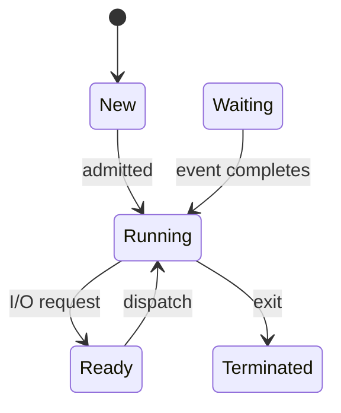

# Lab 6 — Processes and Context Switching Hands-on Workbook (20 Tasks)

**Module:** 4301COMP Computer Systems Architecture

**Session:** Teaching Week 03, Session B · **Matching lecture:** `../Lectures/Lecture-06-Processes-and-Context-Switching.md`

---

## How to use this lab

**What this lab is for.** You will inspect real processes and threads, infer their states, count context switches, simulate a scheduler, cause (and fix) a real race condition, and practise the process-triage steps used when investigating a suspicious computer.

**Where the official tasks are.**

| Official lab sheet (TW03 Session B) | This workbook |
| --- | --- |
| Task 1 — Inspect processes and threads in Windows 11 | Task 16 |
| Task 2 — Infer process/thread states and context switching | Task 17 |
| Extra Challenge — Observe context-switch activity in Windows 11 | Task 18 |

In the timetabled lab, **do Tasks 16–18 first**. The official sheet's checkpoints and final document check are included in those tasks.

**Tools**

| Tool | Used in | Notes |
| --- | --- | --- |
| Microsoft Word | Tasks 16–18 | Official record: `TW03B_YourStudentID.docx` |
| Task Manager, Resource Monitor (`resmon`), Performance Monitor (`perfmon`) | Tasks 15–19 | Built into Windows; named on the official sheet |
| Notepad, Paint, Microsoft Edge (or Chrome) | Tasks 15–17 | Named on the official sheet |
| PowerShell | Tasks 13–14 | Built in; read-only commands |
| Python 3 | Tasks 11–12 | **Optional, your choice.** Free from python.org; built-in modules only |
| Linux or WSL | Task 13 (optional part) | Only if you already have it |

**Rules:** predict before you check; show your reasoning; use hints only after a real attempt; record what you actually see.

**Labels:** **Verified** = actually run (Ubuntu 24.04, 2 logical processors, Python 3.13) before being written here. **Expected** = not run here; all Windows results are Expected, so record your own.

**Safety.** Only suspend or end processes **you** started (your own Notepad or Paint). Never end or suspend system processes.

**Troubleshooting (from the official sheet):** if Task Manager's left menu is collapsed, click the menu icon. If columns are missing, right-click a column heading > **Select columns**. Resource Monitor: Task Manager > Performance > **…** > **Resource Monitor**, or Win + R > `resmon`. Browsers show many `msedge.exe`/`chrome.exe` processes: pick any active one.

---

## Part A — Warm-up: recognise and predict (Tasks 1–5)

### Task 1 — Program, process or thread?

**Goal:** classify each item.

| # | Item | Program, process or thread? |
| --- | --- | --- |
| a | `C:\Windows\System32\notepad.exe` on disk | |
| b | Notepad running with PID 4812 | |
| c | The part of Word that checks spelling while you type | |
| d | A second Notepad window opened separately, PID 5220 | |
| e | `mspaint.exe` before anyone opens Paint | |
| f | One `msedge.exe` entry in Task Manager for a group of tabs | |
| g | The code path in a game that plays music while another draws the screen | |

**Expected result:** 2 programs, 3 processes, 2 threads.

- **Hint 1:** Does it have a PID? Then it is a process.
- **Hint 2:** Is it a path of execution **inside** a running program? Then it is a thread.

---

### Task 2 — Which state?

**Goal:** name the process state (New, Ready, Running, Waiting, Terminated).

1. Paint has just been double-clicked; the OS is still building its PCB.
2. Spotify's thread is executing instructions on a core right now.
3. Notepad is idle, waiting for you to press a key.
4. A compiler has everything it needs, but all cores are busy.
5. A browser tab is waiting for a web server to reply.
6. You closed Paint; the OS is releasing its memory.
7. A thread was pre-empted at the end of its time slice.

**Expected result:** seven states, each justified by one phrase from slide 10.

- **Hint 1:** Waiting for the **CPU** → Ready. Waiting for an **event** → Waiting.
- **Hint 2:** A pre-empted thread is still runnable.

---

### Task 3 — Match the trigger

**Goal:** link each transition to its trigger (slide 22).

| Transition | Trigger (choose: dispatch · event completes · I/O request · pre-emption or yield · admitted · exit) |
| --- | --- |
| Ready → Running | |
| Running → Waiting | |
| Waiting → Ready | |
| Running → Ready | |
| New → Ready | |
| Running → Terminated | |

Then answer: why is there **no** arrow from Waiting straight to Running?

**Expected result:** six matches and one explanation.

- **Hint 1:** Who decides which Ready thread gets the CPU?
- **Hint 2:** When the event completes, is the CPU necessarily free?

---

### Task 4 — Which PCB field?

**Goal:** match each piece of information to its PCB field (slide 13).

| Information | PCB field |
| --- | --- |
| "Next instruction is at address 0x401A20" | |
| "Priority: normal; in the Ready queue" | |
| "Has `report.docx` open for writing" | |
| "Used 3 minutes 12 seconds of CPU so far" | |
| "Page tables at …; address space size …" | |
| "R1 = 42, stack pointer = 0x7FFE…" | |
| "Currently Waiting" | |

**Expected result:** seven different fields.

- **Hint 1:** Slide 13 has exactly seven field names.
- **Hint 2:** "Accounting" is about usage and billing.

---

### Task 5 — Predict a round-robin schedule

**Goal:** schedule two processes by hand.

One logical processor, quantum = **2** ticks, both arrive at time 0 in the order P, Q:

| Process | Needs |
| --- | --- |
| P | 3 ticks of CPU |
| Q | 4 ticks of CPU |

1. Fill in which process runs in each tick, t = 1 to 7.
2. When does each finish?
3. How many context switches (changes from one process to another)?

| t | 1 | 2 | 3 | 4 | 5 | 6 | 7 |
| --- | --- | --- | --- | --- | --- | --- | --- |
| Running | | | | | | | |

**Expected result:** P finishes at t = 5, Q at t = 7, 3 switches (Verified with `rr_sim.py`).

- **Hint 1:** A pre-empted process goes to the **back** of the Ready queue.
- **Hint 2:** When P finishes at t = 5, Q runs to completion: no switch is needed in between.

---

## Part B — Find and fix (Tasks 6–10)

### Task 6 — Fix the state diagram

**Goal:** correct a wrong lifecycle diagram.

Sam Archer drew this. **Four** arrows are wrong or missing.



1. List the four problems.
2. Redraw it correctly in Mermaid (preview at <https://mermaid.live>).

**Expected result:** a diagram matching lecture section 8.2.

- **Hint 1:** A new process is not given the CPU straight away.
- **Hint 2:** Check where I/O requests and completed events really lead, and whether pre-emption appears at all.

---

### Task 7 — Fix the false PCB and tool statements

**Goal:** correct misunderstandings from slides 13–16.

Each statement is **false**. Correct it.

1. "Task Manager shows you the complete PCB."
2. "PIDs are always 16-bit numbers and never reused."
3. "The PCB only stores the process's name."
4. "Resource Monitor shows exactly when each thread moves between Ready, Running and Waiting."
5. "The Program Counter field records how much CPU time the process has used."

**Expected result:** five corrected statements, each with its slide number.

- **Hint 1:** Slides 15 and 16 are explicit.
- **Hint 2:** The official lab sheet has a note about Resource Monitor's limits.

---

### Task 8 — Fix the round-robin trace

**Goal:** find the errors in a classmate's schedule.

One processor, quantum = 2. X needs 4 ticks CPU. Y needs 2 ticks CPU, then 2 ticks I/O, then 1 tick CPU. Both arrive at t = 0, X first.

Sam's answer:

| t | 1 | 2 | 3 | 4 | 5 | 6 | 7 |
| --- | --- | --- | --- | --- | --- | --- | --- |
| Running | X | X | Y | Y | Y | X | X |

Sam says: "X finishes at 7, Y at 5, and there were 2 context switches."

1. Explain what is wrong at t = 5.
2. Write the correct schedule, finish times and switch count.
3. While Y waits for I/O, is the CPU idle? Why does that matter?

**Expected result:** X finishes at 6, Y at 7, 3 switches, no idle ticks (Verified).

- **Hint 1:** After its first CPU burst, Y must **wait** for 2 ticks of I/O.
- **Hint 2:** While Y waits, X is Ready.

---

### Task 9 — Fix the race

**Goal:** make a threaded counter correct.

**Skill you gain:** you can recognise a data race in code and fix it with a lock.

This function is run by **two** threads at the same time, each calling it 200,000 times:

```python
def add_one():
    global counter
    value = counter
    tiny_pause()
    counter = value + 1
```

1. Explain, step by step with a table like lecture section 7.3, how an update can be lost.
2. Rewrite it using `threading.Lock()` so no updates are lost.
3. Run `race_demo.py` (Task 12) to see the before-and-after numbers.

**Expected result:** the unlocked version loses updates (and a different number each run); the locked version always gives exactly 400,000 (Verified).

- **Hint 1:** The danger is the gap between reading `counter` and writing it back.
- **Hint 2:** Create one lock **outside** the function, and put the read **and** the write inside `with lock:`.

---

### Task 10 — Fix the concurrency claims

**Goal:** correct statements about processors and threads (slide 21).

1. "My laptop runs 250 processes at exactly the same instant because it has 4 cores."
2. "A single-core computer cannot multitask."
3. "SMT doubles the number of physical cores."
4. "Context switches cost nothing, so a tiny quantum is always best."
5. "A system call is the same thing as a context switch."

Then open Task Manager > **Performance** > **CPU** and record your PC's **Cores** and **Logical processors**. How many threads can it execute at the same instant?

**Expected result:** five corrections and your own two numbers.

- **Hint 1:** Concurrency is not parallelism.
- **Hint 2:** Logical processors = cores × hardware threads per core.

---

## Part C — Build (Tasks 11–15)

### Task 11 — Run and extend the scheduler simulator

**Goal:** explore how the quantum changes the number of context switches.

**Skill you gain:** you can model an OS algorithm in code and use the model to compare design choices.

1. Save as `rr_sim.py`:

```python
# rr_sim.py - a round-robin scheduler on ONE logical processor.
#
# Each process is a list of bursts: ("CPU", n) needs n ticks of processor time;
# ("IO", n) waits n ticks for input/output (it does not need the CPU).
# The scheduler gives each Ready process at most QUANTUM ticks, then pre-empts it.
#
# States used (slide 10): Ready, Running, Waiting, Terminated.
# Usage: python rr_sim.py

from collections import deque


def simulate(processes, quantum, show=True):
    bursts = {name: deque(b) for name, b in processes.items()}
    ready = deque(processes)           # all arrive at time 0, in this order
    waiting = {}                       # name -> ticks of I/O left
    running, used = None, 0            # who has the CPU, and for how long
    finished, switches, idle, time = {}, 0, 0, 0
    last = None                        # last process that ran (to count switches)

    while len(finished) < len(processes):
        # Dispatch: Ready -> Running, if the CPU is free.
        if running is None and ready:
            running, used = ready.popleft(), 0
            if last is not None and running != last:
                switches += 1          # save last's context, restore this one
            last = running

        # One tick passes.
        time += 1
        if running is None:
            idle += 1
        else:
            kind, left = bursts[running][0]
            bursts[running][0] = (kind, left - 1)
            used += 1
        for name in list(waiting):     # I/O makes progress at the same time
            waiting[name] -= 1

        if show:
            print(f"t={time:>2}  Running: {running or '(idle)':<6}  "
                  f"Ready: {','.join(ready) or '-':<8}  "
                  f"Waiting: {','.join(waiting) or '-'}")

        # Waiting -> Ready when an I/O burst completes.
        for name in [n for n, left in waiting.items() if left == 0]:
            del waiting[name]
            bursts[name].popleft()
            if bursts[name]:
                ready.append(name)
            else:
                finished[name] = time

        # What happens to the running process after this tick?
        if running is not None:
            kind, left = bursts[running][0]
            if left == 0:                          # CPU burst finished
                bursts[running].popleft()
                if not bursts[running]:
                    finished[running] = time       # Running -> Terminated
                else:
                    waiting[running] = bursts[running][0][1]   # Running -> Waiting
                running = None
            elif used == quantum:                  # time slice used up
                ready.append(running)              # Running -> Ready (pre-empted)
                running = None

    return finished, switches, idle


if __name__ == "__main__":
    PROCESSES = {
        "A": [("CPU", 5)],                            # CPU-bound
        "B": [("CPU", 2), ("IO", 3), ("CPU", 2)],     # does some I/O
        "C": [("CPU", 3)],
    }
    QUANTUM = 2

    finished, switches, idle = simulate(PROCESSES, QUANTUM)
    print(f"\nQuantum {QUANTUM}: finish times {finished}, "
          f"context switches {switches}, idle ticks {idle}")
    for q in (1, 2, 3, 10):
        f, s, i = simulate(PROCESSES, q, show=False)
        print(f"Quantum {q:>2}: all done at t={max(f.values())}, context switches {s}")
```

2. Run `python rr_sim.py`. *What it does:* prints a simulated schedule; it reads and changes no files. Actual output (Verified):

```text
t= 1  Running: A       Ready: B,C       Waiting: -
t= 2  Running: A       Ready: B,C       Waiting: -
t= 3  Running: B       Ready: C,A       Waiting: -
t= 4  Running: B       Ready: C,A       Waiting: -
t= 5  Running: C       Ready: A         Waiting: B
t= 6  Running: C       Ready: A         Waiting: B
t= 7  Running: A       Ready: C         Waiting: B
t= 8  Running: A       Ready: C,B       Waiting: -
t= 9  Running: C       Ready: B,A       Waiting: -
t=10  Running: B       Ready: A         Waiting: -
t=11  Running: B       Ready: A         Waiting: -
t=12  Running: A       Ready: -         Waiting: -

Quantum 2: finish times {'C': 9, 'B': 11, 'A': 12}, context switches 6, idle ticks 0
Quantum  1: all done at t=12, context switches 11
Quantum  2: all done at t=12, context switches 6
Quantum  3: all done at t=12, context switches 4
Quantum 10: all done at t=12, context switches 3
```

3. Check the first trace against lecture section 13.2.
4. **Extend:** change `PROCESSES` to the Task 5 and Task 8 examples (one at a time, comment out the others) and check your hand answers.
5. **Extend:** add a fourth process `"D": [("CPU", 2)]` to the original three. Predict, then run with quantum 2: when does D finish, and how many switches are there?
6. **Extend:** make a single process `"P": [("CPU", 1), ("IO", 3), ("CPU", 1)]` the only one. How many **idle** ticks are there, and why?

**Expected result:** step 5 gives D finishing at t = 8 with 7 switches; step 6 gives 3 idle ticks (Verified).

- **Hint 1:** With D added, the queue order at the start is A, B, C, D.
- **Hint 2:** With only one process, nobody else can use the CPU while it waits.

---

### Task 12 — Cause and cure a real race condition

**Goal:** watch a data race lose updates, then fix it.

**Skill you gain:** you can demonstrate and fix a race condition, a real class of software bug (and, in some programs, of security vulnerability).

1. Save as `race_demo.py`:

```python
# race_demo.py - two threads update one shared counter.
# Without synchronisation, updates can be lost (a "data race").
# With a lock, only one thread updates the counter at a time.
#
# Usage: python race_demo.py

import sys
import threading

N = 200_000                     # increments per thread
sys.setswitchinterval(1e-6)     # ask Python to switch threads very often,
                                # so the race shows up quickly


def tiny_pause():
    """Stands in for any real work done between reading and writing."""
    pass


def run(use_lock):
    counter = 0
    lock = threading.Lock()

    def worker():
        nonlocal counter
        for _ in range(N):
            if use_lock:
                with lock:              # only one thread at a time in here
                    value = counter
                    tiny_pause()
                    counter = value + 1
            else:
                value = counter         # 1. read the shared value
                tiny_pause()            #    (a moment where a switch can happen)
                counter = value + 1     # 2. write it back: another thread may
                                        #    have changed counter in between!

    threads = [threading.Thread(target=worker) for _ in range(2)]
    for t in threads:
        t.start()
    for t in threads:
        t.join()
    return counter


if __name__ == "__main__":
    expected = 2 * N
    for attempt in range(1, 4):
        got = run(use_lock=False)
        print(f"No lock,   run {attempt}: {got:,} (expected {expected:,}, lost {expected - got:,})")
    got = run(use_lock=True)
    print(f"With lock, run 1: {got:,} (expected {expected:,}, lost {expected - got:,})")
```

2. Run it three times. Record the "lost" numbers. Actual output of one run (Verified; yours will differ every time):

```text
No lock,   run 1: 333,994 (expected 400,000, lost 66,006)
No lock,   run 2: 285,943 (expected 400,000, lost 114,057)
No lock,   run 3: 276,303 (expected 400,000, lost 123,697)
With lock, run 1: 400,000 (expected 400,000, lost 0)
```

3. Why is the number lost **different every run**?
4. Why does the version with a lock always give exactly 400,000?
5. **Extend:** remove the `tiny_pause()` call from the **unlocked** branch and run again. On the checking machine (Python 3.13), the race then **hid**: every run gave 400,000 (Verified). Does that mean the code is now correct? Explain.

**Expected result:** unlocked runs lose updates; locked runs never do.

- **Hint 1:** Losses depend on exactly when context switches happen.
- **Hint 2:** For step 5: "it passed my test" is not the same as "it cannot fail".

---

### Task 13 — Inspect processes from the command line

**Goal:** get process information without the GUI.

**Skill you gain:** you can list and sort processes from PowerShell, which is quicker to repeat, filter and save as evidence than screenshots.

On your own Windows PC (Expected; all read-only):

1. Top 5 processes by CPU time:

   ```powershell
   Get-Process | Sort-Object CPU -Descending | Select-Object -First 5 Id, ProcessName, CPU, @{Name="Threads"; Expression={$_.Threads.Count}}, @{Name="WorkingSetMB"; Expression={[math]::Round($_.WorkingSet64 / 1MB, 1)}}
   ```

   *What it does:* lists every process, sorts by total CPU seconds, and shows ID, name, CPU, thread count and working set in MB.

2. Count all processes and all threads:

   ```powershell
   (Get-Process).Count
   (Get-Process | ForEach-Object { $_.Threads.Count } | Measure-Object -Sum).Sum
   ```

3. Compare with Task Manager > Performance > CPU ("Processes" and "Threads").

**Linux/WSL alternative (optional; Verified).** Save and run `proc_states.py` (Linux/WSL only). It starts a sleeping process, a stopped process and more busy loops than you have logical processors, then reads each one's state and context-switch counts from `/proc`:

```python
# proc_states.py - LINUX / WSL ONLY. Start some child processes, then ask the
# kernel (through /proc) what state each is in and how many context switches
# it has had.
#   voluntary switches    = the process gave up the CPU itself (e.g. to wait)
#   nonvoluntary switches = the scheduler pre-empted it (time slice used up)
#
# Usage: python3 proc_states.py

import os
import signal
import subprocess
import sys
import time

STATE_NAMES = {"R": "Running/Ready (runnable)", "S": "Waiting (sleeping)",
               "D": "Waiting (disk I/O)", "T": "Stopped", "Z": "Terminated (zombie)"}


def info(pid):
    with open(f"/proc/{pid}/stat") as f:
        state = f.read().rsplit(")", 1)[1].split()[0]   # field after the name
    counts = {}
    with open(f"/proc/{pid}/status") as f:
        for line in f:
            if "ctxt_switches" in line:
                key, value = line.split(":")
                counts[key] = int(value)
    return state, counts["voluntary_ctxt_switches"], counts["nonvoluntary_ctxt_switches"]


if __name__ == "__main__":
    py = sys.executable
    cores = os.cpu_count()
    children = {
        "sleeper": subprocess.Popen([py, "-c", "import time; time.sleep(30)"]),
        "stopped": subprocess.Popen([py, "-c", "import time; time.sleep(30)"]),
    }
    for n in range(cores + 1):          # more busy loops than cores, so they compete
        children[f"busy{n}"] = subprocess.Popen([py, "-c", "while True: pass"])

    time.sleep(0.5)
    os.kill(children["stopped"].pid, signal.SIGSTOP)   # pause it
    time.sleep(2)

    print(f"{cores} logical processors. After about 2 seconds:")
    print(f"{'child':<8} {'PID':>6}  {'state':<28} {'voluntary':>9} {'nonvoluntary':>12}")
    for name, p in children.items():
        state, vol, nonvol = info(p.pid)
        print(f"{name:<8} {p.pid:>6}  {state} = {STATE_NAMES.get(state, '?'):<24} {vol:>9} {nonvol:>12}")

    for p in children.values():          # tidy up: end every child we started
        p.kill()
        p.wait()
```

Actual output on the checking machine (PIDs hidden):

```text
2 logical processors. After about 2 seconds:
child       PID  state                        voluntary nonvoluntary
sleeper   <PID>  S = Waiting (sleeping)               2            4
stopped   <PID>  T = Stopped                          2            3
busy0     <PID>  R = Running/Ready (runnable)         0          223
busy1     <PID>  R = Running/Ready (runnable)         0          207
busy2     <PID>  R = Running/Ready (runnable)         0          243
```

**Expected result:** a short table of your top processes and the two totals.

- **Hint 1:** `CPU` in `Get-Process` is total processor seconds, like Task Manager's CPU time.
- **Hint 2:** In the Linux output, nonvoluntary switches = pre-emptions; the busy loops have hundreds because three of them share two processors.

---

### Task 14 — Process triage: path and parent

**Goal:** find where a process's program file is and which process started it.

**Skill you gain:** you can check a process's executable path and parent process, two of the first things checked when deciding whether a process is legitimate or malware pretending to be something else.

1. Open Notepad yourself.
2. In PowerShell (Expected; read-only):

   ```powershell
   Get-CimInstance Win32_Process -Filter "Name='notepad.exe'" | Select-Object ProcessId, ParentProcessId, ExecutablePath
   ```

3. Find the **parent**: run `Get-Process -Id <ParentProcessId>`. What is it? (If you opened Notepad from the Start menu, expect `explorer.exe`.)
4. In Task Manager > Details, add the **Command line** column (Select columns) and compare.
5. Why would `svchost.exe` running from `C:\Users\Public\` instead of `C:\Windows\System32\` be suspicious?

**Linux equivalent (Verified):** `ps -o pid,ppid,stat,comm -p <PID>` shows the PID, the **parent** PID (PPID), the state and the command.

**Expected result:** Notepad's path under `C:\Windows\` (or a `WindowsApps` folder for the Store version of Notepad) and its parent (Expected).

- **Hint 1:** If Notepad's name differs (e.g. `Notepad.exe`), the filter is not case-sensitive.
- **Hint 2:** Malware often copies the **name** of a real Windows process but cannot easily copy its **location** or **parent**.

---

### Task 15 — Suspend and resume a process

**Goal:** see the Suspend and Resume operations from slide 5 for real.

**Skill you gain:** you can freeze a process without ending it, which investigators use to stop a suspicious program while keeping it (and its memory) available as evidence.

1. Open **Notepad** yourself and type a few words.
2. Open **Resource Monitor** (`resmon`) > **CPU** tab. Find `notepad.exe` in **Processes**.
3. Right-click it > **Suspend Process** > confirm.
4. Try typing in Notepad. What happens? What does Task Manager > Details show in the **Status** column?
5. In Resource Monitor, right-click > **Resume Process**. Type again.
6. Map what you saw to the slide 5 operations and to the lifecycle states.

**Linux equivalent (Verified):** `kill -STOP <PID>` suspends a process (state **T** in `ps`), and `kill -CONT <PID>` resumes it. The `stopped` row in Task 13's output was suspended this way.

**Expected result:** while suspended, Notepad does not respond and Status shows **Suspended**; after resuming, it responds and your typing appears (Expected).

- **Hint 1:** Only suspend the Notepad **you** opened.
- **Hint 2:** A suspended process still exists: it keeps its PID and memory.

---

## Part D — Official tasks and integration (Tasks 16–20)

### Task 16 — Inspect processes and threads in Windows 11 (Official Task 1)

**Goal:** record real process data for three applications and explain program, process and thread.

**Official steps**

1. Create a Word document **TW03B_YourStudentID.docx**. Save regularly.
2. Open **Notepad**, **Paint** and **Microsoft Edge** (or Google Chrome). Press **Ctrl + Shift + Esc** for Task Manager, expand the left menu if needed, select **Details**, and find each application's process.
3. Right-click a column header > **Select columns**: tick **PID, Status, Threads, CPU time, Working set (memory)** > OK. Record:

   | Application | Process name | PID | Status | Threads | CPU time | Working set |
   | --- | --- | --- | --- | --- | --- | --- |
   | Notepad | Notepad.exe | | | | | |
   | Paint | mspaint.exe | | | | | |
   | Browser | msedge.exe | | | | | |

   *Official note:* values will differ across systems depending on running tasks, resources and open browser tabs.
4. Modern browsers spawn **multiple separate processes** for tabs, extensions and GPU rendering, for **security and stability**. Select one active main browser process for your table.
5. Using the lecture's definitions (**program** = executable file/code on disk; **process** = active executing instance with a virtual address space and allocated resources; **thread** = lightweight unit of execution within a process sharing code and data), explain the distinctions using **one** application from your table.
6. Capture the Task Manager Details rows with Snipping Tool (Win + Shift + S) while the applications run, and paste the screenshot.

**Official Checkpoint 1:** a completed table; a written program/process/thread explanation; a clear screenshot; document saved.

**Test plan**

| Check | Expected | Actual |
| --- | --- | --- |
| Five columns visible | PID, Status, Threads, CPU time, Working set | |
| Three rows recorded | Real values | |
| Browser: one main process chosen; multiple processes noted | Yes | |
| Explanation uses all three terms correctly | Yes | |
| Screenshot readable | Yes | |

- **Hint 1:** The browser will have the most threads and memory; that is normal.
- **Hint 2:** Use Paint as your example: `mspaint.exe` (program), the Paint process with its PID (process), its threads (Threads column).

---

### Task 17 — Infer process/thread states and context switching (Official Task 2)

**Goal:** connect what Resource Monitor shows to the lifecycle and to context switching.

**Official steps**

1. Task Manager > **Performance** > three dots (…) > **Resource Monitor** > **CPU** tab.
2. Observe CPU usage and thread activity under three conditions: **(a)** system idle; **(b)** typing continuously in Notepad; **(c)** refreshing or interacting with a normal web page several times.
3. Map your observations to the lifecycle states (**Running, Ready, Waiting**). Explain when threads move to Waiting (e.g. awaiting I/O or user input) versus Ready and Running.

   *Official note:* Resource Monitor displays high-level metrics (CPU usage, Status = Running/Suspended) but does **not** directly display internal scheduler states (Ready, Running, Waiting). Scheduler transitions occur in **microseconds**.

4. List and describe the PCB/process-management information from the lecture: **Process State, Program Counter, CPU Registers, CPU Scheduling Information, Memory-Management Information, Accounting Information, I/O Status Information, Process Identifier (PID)**.

   *Official note:* Task Manager and Resource Monitor expose only selected summary fields (e.g. PID, memory, CPU time), not the complete internal kernel PCB.

5. Explain how the scheduler selects runnable threads (**pre-emption** versus **voluntary yields**) and what processor state (**Program Counter, registers, stack pointer**) is saved and restored during a context switch.
6. Capture a clear Resource Monitor CPU tab view supporting your explanation.

**Official Checkpoint 2:** observations for idle, typing and browsing; the state mapping with the note on Resource Monitor's limits; the PCB descriptions; the context-switch explanation and a screenshot; document saved.

**Observation record**

| Condition | Notepad CPU % | Browser CPU % | Total CPU % | Most likely state of Notepad's main thread most of the time |
| --- | --- | --- | --- | --- |
| (a) Idle | | | | |
| (b) Typing | | | | |
| (c) Browsing | | | | |

- **Hint 1:** Between keystrokes (thousands of microseconds apart), Notepad has nothing to do.
- **Hint 2:** Use the PCB table in lecture section 10.1 for step 4 and the table in section 14.2 for step 5.

---

### Task 18 — Observe context-switch activity in Windows 11 (Official Extra Challenge)

**Goal:** measure context switches per second and explain why the number changes.

**Official steps**

1. **Win + R** > `perfmon` > Enter. Under **Monitoring Tools**, click **Performance Monitor**. Click the green **+**. Expand **System**, select **Context Switches/sec**, click **Add >>**, then **OK**.
2. Observe the graph and values during **idle** background activity, then **launch and switch rapidly** between several applications.
3. Capture screenshots of the idle and active states, and explain why Context Switches/sec may **increase** when more runnable threads compete for processor time.
4. Summarise what state the kernel **saves and restores** when changing execution from one thread or process to another.

**Record**

| Condition | Context Switches/sec (typical value you saw) |
| --- | --- |
| Idle | |
| Switching between apps | |

**Linux comparison (Verified):** `vmstat 1` prints a system-wide `cs` (context switches per second) column; on the mostly idle checking machine it showed values of about 76–144 per second.

- **Hint 1:** Each runnable thread that gets a turn needs a switch in, and each one that blocks or is pre-empted needs a switch out.
- **Hint 2:** Lecture section 14.2 lists what is saved.

---

### Task 19 — Mini-project: process triage report

**Goal:** produce a short, evidence-based report on the processes running on your PC.

**Skill you gain:** you can carry out basic process triage and write it up clearly, the first stage of investigating a possibly compromised computer.

Using Tasks 13–18 (read-only, except suspending your own Notepad), write a one-page report titled "Process triage: [device type]":

1. **Overview:** total processes and threads; logical processors (Task 10).
2. **Top five** processes by CPU time, with PID, threads and working set (Task 13).
3. **Three processes examined in depth:** path, parent and whether each looks legitimate, with your reason (Task 14).
4. **Context switches/sec** idle versus busy (Task 18), with one sentence explaining the difference.
5. **One unfamiliar process:** its name, path and publisher (Task Manager > Details > right-click > Properties > Details), and what you found out about it from a reputable source.

**Test plan**

| Check | Expected | Actual |
| --- | --- | --- |
| All five sections present | Yes | |
| Every value came from a tool you name | Yes | |
| "Legitimate?" judgements give a reason (path, parent, publisher) | Yes | |
| Nothing was ended or changed except your own test processes | Yes | |
| No personal information | Yes | |

- **Hint 1:** Many processes named `svchost.exe` are normal; check their **path**.
- **Hint 2:** "I don't know yet, and here is how I would find out" is a valid finding.

---

### Task 20 — Assessment-style practice: processes and context switching

**This is practice only, not a real exam question.** The module exam is two hours with short-answer and essay-style questions, and covers operating systems (module guide). Marks are invented for planning.

**Rules:** 25 minutes, closed book, write it yourself.

**(a)** Distinguish a program, a process and a thread, with one example. *(3 marks)*

**(b)** Draw the process lifecycle with five states and label every transition with its trigger. *(5 marks)*

**(c)** List five fields of a Process Control Block and explain why the kernel needs two of them. *(4 marks)*

**(d)** Explain what a context switch is, what triggers it, what is saved and restored, and why too many context switches reduce performance. Use the example of a web server waiting for and then handling a request. *(8 marks; aim for 250–350 words)*

**Self-marking checklist**

| Part | A good answer includes | Expected | Actual |
| --- | --- | --- | --- |
| (a) | File on disk / running instance with address space and PID / execution path sharing the process's resources; a correct example | 3 points | |
| (b) | New, Ready, Running, Waiting, Terminated; admitted, dispatch, pre-emption/yield, I/O or event wait, event completes, exit; no Waiting → Running arrow | 5 points | |
| (c) | Five of the seven slide-13 fields; the PC lets execution resume; registers restore working values (or other justified pair) | 4 points | |
| (d) | Definition; triggers (time slice, priority, blocking I/O, interrupt); PC, registers, stack pointer (and memory mappings); overhead; web server Waiting → Ready on request, dispatched, state restored, system calls for I/O | 8 points | |
| Time | Within 25 minutes | Yes | |

- **Hint 1:** Draw (b) as a box-and-arrow sketch first.
- **Hint 2:** Lecture sections 8, 10, 14 and 15.

---

## Tracker

| Task | Name | Done | Notes / score |
| --- | --- | --- | --- |
| 1 | Program, process or thread? | ☐ | /7 |
| 2 | Which state? | ☐ | /7 |
| 3 | Match the trigger | ☐ | /7 |
| 4 | Which PCB field? | ☐ | /7 |
| 5 | Predict a round-robin schedule | ☐ | /3 |
| 6 | Fix the state diagram | ☐ | /4 |
| 7 | Fix PCB and tool statements | ☐ | /5 |
| 8 | Fix the round-robin trace | ☐ | |
| 9 | Fix the race | ☐ | |
| 10 | Fix the concurrency claims | ☐ | /5 |
| 11 | Scheduler simulator | ☐ | |
| 12 | Real race condition | ☐ | |
| 13 | Processes from the command line | ☐ | |
| 14 | Process triage: path and parent | ☐ | |
| 15 | Suspend and resume | ☐ | |
| 16 | **Official Task 1** — Inspect processes and threads | ☐ | |
| 17 | **Official Task 2** — States and context switching | ☐ | |
| 18 | **Official Extra Challenge** — Context Switches/sec | ☐ | |
| 19 | Mini-project: process triage report | ☐ | |
| 20 | Assessment-style practice | ☐ | /20 |

## Reflection

1. How many `msedge.exe` (or `chrome.exe`) processes did you see? Why do browsers split themselves up like that?
2. What happened to Context Switches/sec when you switched rapidly between applications? Did it match your prediction?
3. In Task 12, the race disappeared when `tiny_pause()` was removed. What does that teach you about testing threaded code?
4. Which lifecycle transition did you find hardest to picture, and how would you explain it to a friend?

---

## Answer key

**(Verified)** = run on the Ubuntu 24.04 checking machine (2 logical processors, Python 3.13). **(Expected)** = Windows or your own PC; not run here.

### Task 1

Programs: a, e. Processes: b, d, f. Threads: c, g.

### Task 2

1 New · 2 Running · 3 Waiting (for an event: a key press) · 4 Ready · 5 Waiting · 6 Terminated · 7 Ready.

### Task 3

Ready → Running: dispatch · Running → Waiting: I/O request · Waiting → Ready: event completes · Running → Ready: pre-emption or yield · New → Ready: admitted · Running → Terminated: exit. There is no Waiting → Running arrow because the completed event only makes the process **eligible**; the CPU may be busy, and only the scheduler's dispatch can give it the processor.

### Task 4

Program counter · CPU scheduling information · I/O status information · Accounting information · Memory-management information · CPU registers · Process state.

### Task 5 (Verified)

| t | 1 | 2 | 3 | 4 | 5 | 6 | 7 |
| --- | --- | --- | --- | --- | --- | --- | --- |
| Running | P | P | Q | Q | P | Q | Q |

P finishes at **5**, Q at **7**; **3** switches (P→Q at t3, Q→P at t5, P→Q at t6).

### Task 6

Problems: (1) New → Running should be **New → Ready** (admitted); (2) Running → Ready labelled "I/O request" should be **Running → Waiting** on an I/O request; (3) Waiting → Running should be **Waiting → Ready** (event completes); (4) the **Running → Ready** arrow for **pre-emption or yield** is missing. Correct diagram: lecture section 8.2.

### Task 7

1. Task Manager shows selected information **derived from** OS data, not the PCB (slide 16). 2. PID size and reuse are implementation details; do not assume 16 bits; PIDs are reused (slide 15). 3. The PCB holds state, PC, registers, scheduling, memory-management, accounting and I/O information (slide 13). 4. Resource Monitor does **not** show scheduler states; they change in microseconds (official lab note). 5. The PC holds the **address of the next instruction**; CPU time is accounting information (slides 13–14).

### Task 8 (Verified)

1. At t = 5, Y cannot run: it has just started a 2-tick **I/O wait** (Running → Waiting).
2. Correct: X X Y Y X X Y. X finishes at **6**; Y at **7**; **3** switches.
3. No: X uses the CPU while Y waits, so there are **0** idle ticks. Overlapping one process's I/O with another's computation is the main reason multitasking improves throughput.

### Task 9 (Verified)

Lost update: both threads read the same value (say 41), both write 42, so one increment disappears. Fixed:

```python
lock = threading.Lock()

def add_one():
    global counter
    with lock:
        value = counter
        tiny_pause()
        counter = value + 1
```

`race_demo.py` without the lock lost between about 66,000 and 156,000 of 400,000 updates over nine runs; with the lock, every run gave exactly 400,000.

### Task 10

1. Each logical processor runs one thread at a time; 4 cores (8 with SMT) run at most 4 (8) threads at the same instant; the rest take turns. 2. A single core multitasks by rapid context switching (concurrency, not parallelism). 3. SMT doubles **logical** processors, not physical cores. 4. Each switch costs time; a tiny quantum wastes CPU on switching. 5. A system call is a mode switch within one thread; a context switch changes which thread runs. Your cores/logical processors: Expected (own values); threads at the same instant = logical processors.

### Task 11 (Verified)

Step 4: Task 5 and Task 8 answers as above. Step 5: with D added (quantum 2), finish times D = **8**, C = 11, B = 13, A = 14; **7** switches. Step 6: **3** idle ticks (t = 2–4): the only process is Waiting, so nothing is Ready.

### Task 12 (Verified)

3. Losses depend on exactly when switches fall between the read and the write, which varies with timing. 4. The lock lets only one thread at a time into the read–write section, so no update can be overwritten. 5. No. The race still exists in principle; Python simply did not switch threads between those two lines in that test. A different machine, Python version or load can expose it. Shared data must be protected by design, not by luck.

### Task 13 (Expected; Linux part Verified)

Your values. In the Verified Linux output, the sleeper is **S** (Waiting) with few switches, the stopped process **T**, and the three busy loops **R** with 200+ nonvoluntary switches each (pre-emptions), because three runnable processes share two logical processors.

### Task 14 (Expected)

Notepad's parent is usually `explorer.exe` (the desktop shell). A process named like a Windows system process (`svchost.exe`) but running from a user-writable folder such as `C:\Users\Public\` is a strong warning sign: real `svchost.exe` runs from `C:\Windows\System32\` and is started by `services.exe`.

### Task 15 (Expected; Linux part Verified)

Suspended Notepad ignores input and shows Status **Suspended**; after Resume it responds and catches up with your typing. Slide 5 operations: suspend and resume. Lifecycle: a suspended process is not Ready, Running or Waiting for an event; it is held until resumed (Linux shows **T**, stopped).

### Tasks 16–18 (Expected)

Use the test plans. Model points for Task 17: idle and typing, Notepad's main thread is **Waiting** for input almost all the time, briefly **Ready** then **Running** after each key press (microseconds); browsing makes many threads Ready/Running (network, layout, drawing) and many briefly Waiting for network replies. Task 18: Context Switches/sec rises when more threads are runnable and when threads block and wake more often (each needs a switch in and out); the kernel saves and restores the PC, registers (including flags) and stack pointer, and for a different process its memory mappings.

### Task 19

Use the test plan.

### Task 20 (model points)

(a) Lecture section 7.1 with an example such as Paint. (b) Lecture section 8.2 diagram. (c) Lecture section 10.1. (d) Lecture sections 14–15: definition; triggers; saved state; overhead (no user work during the switch; caches cold); web server Waiting → Ready when the request arrives, dispatched, saved state restored, `recv()`/`send()` system calls.
