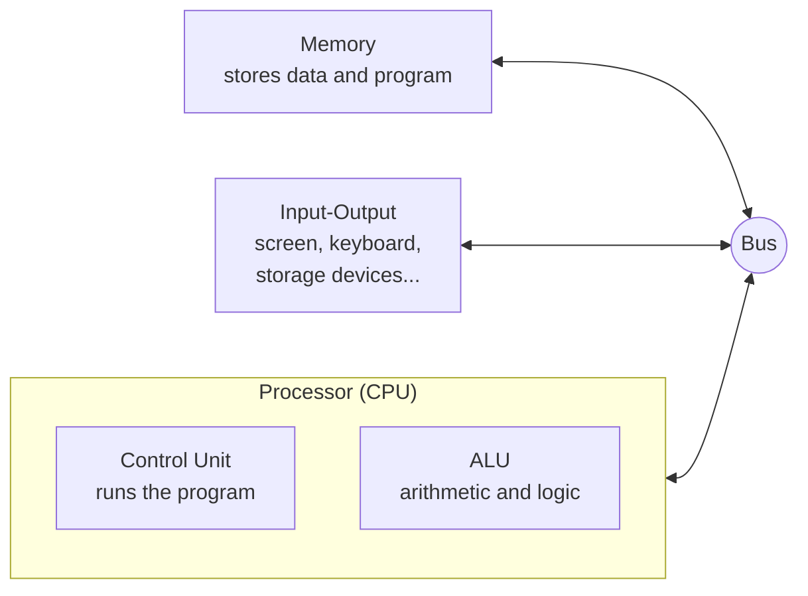
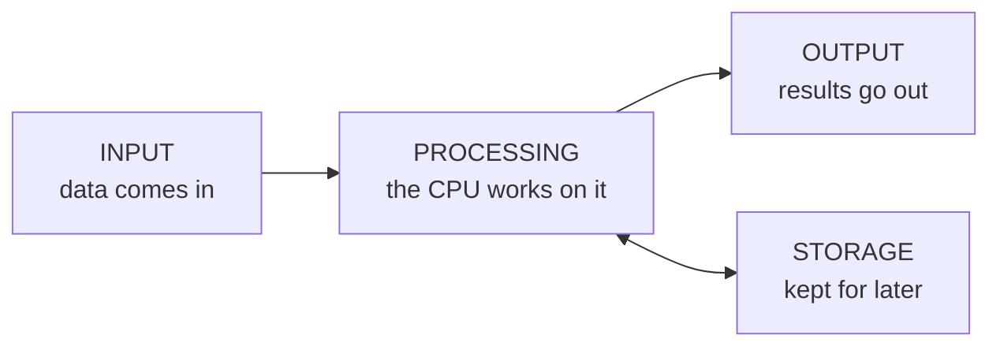
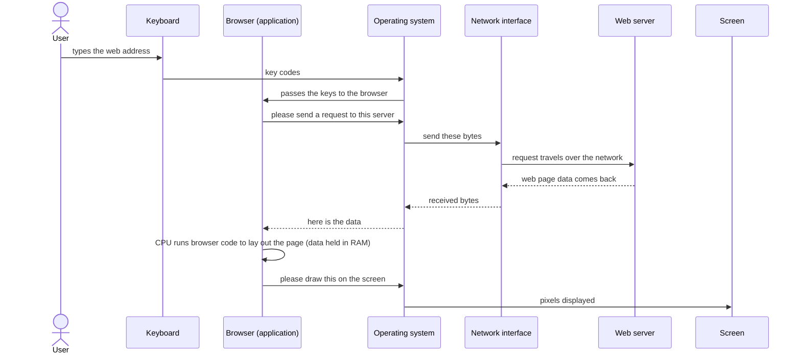
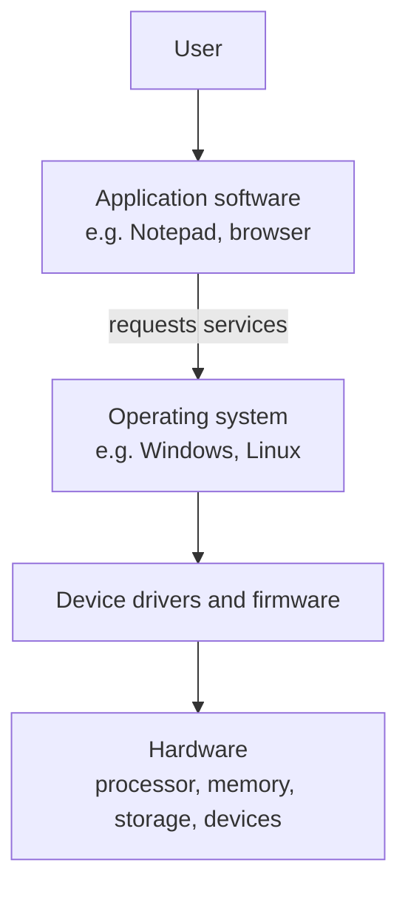
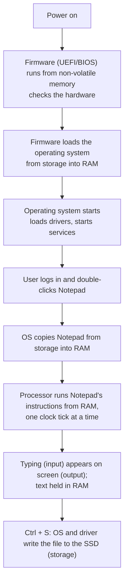

# Lecture 1 — Introduction to Computer Systems

**Module:** 4301COMP Computer Systems Architecture

**Session:** Teaching Week 01, Session A

## Start here

This is the first lecture of the module. It answers one question: **what is a computer system, and what are its parts?** Everything later in the module, including the fetch–decode–execute cycle, memory, storage, operating systems and networking, builds on the ideas here. After reading it, do **Lab 1** (`../Labs/Lab-01-Introduction-to-Computer-Systems-Hands-on-Workbook.md`).

**Labels used in these notes:**

- **Official**: taken from the LJMU TW01 Session A slides or lab sheet.
- **Extra**: additional explanation added to help you understand. It is useful, but it is not on the slides, so do not assume it is examined.
- **Verified**: a calculation or command that was actually run before being written down.
- **Expected**: a result that was not run here (for example a Windows screen), so yours may look slightly different.

> **Note on the slides.** Slides 8, 9, 13, 14, 18, 19, 20, 24 and 25 are mainly diagrams. Only their titles (and one caption on slide 9) were available as text when these notes were written. The sections for those slides explain the topic named in the title using standard textbook material, marked **Extra**. Check the diagrams on the real slides in Canvas and add anything they show that these notes miss.

---

## 1. Overview

A phone, a laptop, a games console, a home router and the controller inside a washing machine look very different. Underneath, they are built from the same few ideas:

- they take **input**, **process** it, **store** it and produce **output**;
- they have a **processor**, **memory** and **input/output** devices connected by **buses**;
- they need **hardware** (the physical parts) and **software** (the instructions) working together.

This lecture introduces those ideas and the vocabulary for them. It finishes by explaining what **computer architecture** means, which is the subject of the whole module.

**Why this matters for cyber security.** You cannot protect a system you do not understand. Security work starts with knowing what hardware and software a system has (an *asset inventory*) and what "normal" looks like, so that you can spot what is not normal.

## 2. By the end you should be able to

1. Explain the difference between a **computer** and a **computer system**.
2. Name the main parts of a computer system (processor with control unit and ALU, memory, input/output, bus) and say what each does.
3. Classify items as **hardware**, **system software** or **application software**.
4. Describe **input, processing, storage and output** for a familiar activity such as typing and saving a file or opening a web page.
5. Convert clock frequencies between Hz, kHz, MHz, GHz and THz, and work out the length of one clock cycle.
6. Explain what happens when memory is **read** and when it is **written**, using addresses.
7. Explain the difference between **memory** and **storage**, and between an **embedded** and a **general-purpose** computer system.
8. Explain what **computer architecture** means and how it differs from **computer organisation**.

## 3. Learning outcomes

**Session learning outcomes (Official, slide 3):**

- Describe a computer system as connected hardware and software.
- Distinguish hardware, system software and application software.
- Explain input, processing, storage and output using a familiar example.
- Identify the main components found in different computer systems.

**Module learning outcomes this lecture supports** (from the module guide, as recorded in this module's project instructions):

| Module LO | How this lecture supports it |
| --- | --- |
| **LO1** Explain the fundamental principles underlying the operation of modern computer systems | Input–process–storage–output, the stored-program idea, the processor clock |
| **LO2** Demonstrate knowledge of the structure and organisation of computer systems | The main parts (CPU, memory, I/O, bus), architecture versus organisation |
| **LO3** Explain the role and functions of an operating system | First look only: the OS as the layer between applications and hardware |

## 4. Matching lab and what you need first

- **Matching lab:** Lab 1 — Introduction to Computer Systems Hands-on Workbook. It contains the official TW01 Session A lab tasks (System Information, Task Manager and Notepad, and the Extra Challenge) plus supplementary practice.
- **What you need from earlier lectures:** nothing. This is the first lecture. It helps if you can use a Windows computer (open a program, save a file), and you will meet powers of ten (10³, 10⁶, 10⁹), which are explained in section 11.

---

## 5. What is a computer system? (slides 4–5)

### 5.1 The definition (Official)

A **computer system** combines physical **hardware** components and **software** programs into one structure that performs useful tasks. The slides add three points:

| Idea (Official) | What it means in plain English |
| --- | --- |
| **Core processing cycle** | The system keeps doing the same basic job: accept input, process it, store information and deliver output. |
| **System interdependence** | Every part relies on the others. Change or remove one part and the whole system can stop working properly. |
| **Operational context** | People, data flowing in and out, and connections to networks all affect how the system behaves. |

### 5.2 Why the word "system" matters

A **system** is a set of parts that work together for a purpose. The important word is *together*. A processor on its own does nothing useful. Memory on its own just holds bits. The usefulness comes from the connections between the parts.

### 5.3 Computer versus computer system (Official, slide 5)

| Term | Meaning |
| --- | --- |
| **Computer** | Often means just the physical device: the laptop or the box under the desk. |
| **Computer system** | The device **plus** its software, its stored data and the equipment connected to it. |

Two examples from the slide show why the difference matters:

- **A laptop without an operating system** cannot provide its normal services. It powers on, but you cannot open files, run a browser or connect to Wi-Fi.
- **Software without suitable hardware** cannot run. A Windows game cannot run on a washing-machine controller, because that hardware was not built for it.

### 5.4 Worked example (Extra): a smartphone as a computer system

| Part of the system | In a smartphone |
| --- | --- |
| Hardware | Processor chip, memory chips, flash storage, touchscreen, camera, microphone, speaker, battery, radio for 4G/5G and Wi-Fi |
| System software | The operating system (Android or iOS), device drivers, firmware |
| Application software | Messaging app, camera app, banking app, maps |
| Data | Contacts, photos, messages, settings |
| Connected equipment and context | Earbuds, a charger, the mobile network, the user |

Take away the operating system and the hardware cannot run the apps. Take away the network and the messaging app cannot send messages. That is **interdependence**.

> **Common confusion.** "The computer" and "the computer system" are often used as if they mean the same thing. In this module, *computer system* always includes the software and data, not just the box.

---

## 6. The main parts of a computer system (slide 6)

### 6.1 The four main blocks (Official)

Slide 6 shows the classic block diagram:

| Block | Job (Official wording from slide 6) | Plain English |
| --- | --- | --- |
| **Memory** | Store data and program | Holds the instructions the processor is running and the data they are working on |
| **Control Unit (CU)** | Execute program | Fetches each instruction, works out what it means and directs the other parts to carry it out |
| **ALU** (Arithmetic and Logic Unit) | Do arithmetic/logic operations requested by the program | Does the actual sums (add, subtract) and comparisons (is A bigger than B?) |
| **Input-Output** | Communicate with the "outside world", e.g. screen, keyboard, storage devices | Everything that gets data into or out of the processor-and-memory core |
| **Bus** | Connects the blocks | The shared communication paths that carry data, addresses and control signals |

The **processor**, also called the **CPU (Central Processing Unit)**, is the control unit and ALU together (plus registers, see section 13).

> **Common confusion.** Slide 6 lists **storage devices** under *Input-Output*. That can look odd, because storage keeps your files. From the processor's point of view, though, a disk or SSD is a device it sends data out to and reads data in from, just like a keyboard or screen. So in this diagram it counts as I/O. **Memory** in this diagram means **main memory (RAM)**, not the disk. Section 14 explains the difference.

---

## 7. Hardware and software (slide 7)

### 7.1 Definitions (Official)

- **Hardware** means the physical parts of the system: the processor, memory, storage, keyboard, screen and network interface. If you could (in principle) touch it, it is hardware.
- **Software** consists of instructions that tell the hardware what work to perform.
- **A working system needs both.**

### 7.2 Two kinds of software

The slides divide software into two kinds (slides 20 and 21, covered fully in sections 16–17):

| Kind | Job | Examples |
| --- | --- | --- |
| **System software** | Runs and manages the computer itself | Operating system (Windows, Linux, macOS), device drivers, firmware |
| **Application software** | Helps the user do a specific task | Web browser, word processor, game, Notepad |

### 7.3 Worked example: classifying items

| Item | Hardware or software? | If hardware, main role | If software, which kind? |
| --- | --- | --- | --- |
| Intel Core i5 processor | Hardware | Processing | — |
| 16 GB RAM | Hardware | Memory | — |
| 512 GB SSD | Hardware | Storage | — |
| Keyboard | Hardware | Input | — |
| Monitor | Hardware | Output | — |
| Windows 11 | Software | — | System software |
| Microsoft Word | Software | — | Application software |
| Graphics card driver | Software | — | System software |

> **Common confusion.** A *display adapter* (graphics card) is hardware, but the *driver* that controls it is software. In the lab, System Information shows both, so read each line carefully.

---

## 8. Input, processing, storage and output (slide 8)

### 8.1 The cycle (Official title; explanation Extra)

Every computer system does four things with information:

| Stage | What happens | Typical hardware |
| --- | --- | --- |
| **Input** | Data enters the system | Keyboard, mouse, touchscreen, microphone, camera, sensor, network interface (receiving) |
| **Processing** | Instructions are carried out on the data | Processor (CPU), using main memory |
| **Storage** | Data is kept so it can be used later | Main memory while working; SSD or hard disk to keep it after power-off |
| **Output** | Results leave the system | Screen, speaker, printer, network interface (sending), a motor or light in an embedded system |

Storage is drawn with a two-way arrow because processing both **saves** data to storage and **loads** data back from it.

### 8.2 Worked example: typing and saving in Notepad (matches the official lab, Task 2)

| Step | What you do | Input | Processing | Storage | Output |
| --- | --- | --- | --- | --- | --- |
| 1 | Press the key **H** | Keyboard sends a code for "H" | OS passes it to Notepad; Notepad adds "H" to its text | The text is held in **main memory (RAM)** | "H" appears on screen |
| 2 | Type the rest of the sentence | More key codes | Same as above, for each key | Text in RAM grows | Sentence appears |
| 3 | Press **Ctrl + S** and choose a name | Keyboard and mouse | Notepad asks the OS to create a file; the OS works out where on the drive to put it | The text is written to the **SSD/hard disk** as a file | The window title changes to show the file name |

Notice that the sentence is in **memory** while you type, and only reaches **storage** when you save. If the power fails before step 3, the sentence is lost.

> **Common confusion.** "Storage" in the input–process–storage–output model can mean short-term memory *or* long-term storage. In this module, be precise: say **main memory (RAM)** for short-term and **secondary storage (SSD/HDD)** for long-term.

---

## 9. Hardware components communicate: buses (slide 9)

**Official (slide 9 caption):** the processor, memory and input/output exchange information through communication paths called **buses**. The detailed roles of the buses come in Session B.

**Plain English (Extra):** a bus is a set of shared wires or connections. When the processor needs something from memory, it puts a request on the bus, and memory sends the answer back along the bus. One bus is shared by several components, so they must take turns.

You will learn in Session B that there are separate groups of lines for **addresses** (where), **data** (what) and **control** (read or write, and when). For now, it is enough to know that the parts in section 6 talk to each other over buses.

---

## 10. A familiar example: opening a web page (slide 10)

### 10.1 The four stages (Official)

1. **Input request:** the keyboard or touchscreen provides the request (you type an address or tap a link).
2. **System work:** the browser and the operating system coordinate the work.
3. **Processing data:** the processor executes instructions while memory holds the active data.
4. **Output result:** the network interface exchanges data with the web server, and the screen displays the result.

### 10.2 The same example as a sequence diagram (Extra)

Notice two things:

- The **network interface** is both **input** (receiving the page) and **output** (sending the request).
- The browser **never talks to the hardware directly**. Every time it needs the keyboard, network or screen, it **asks the operating system**. Section 18 explains why.

---

## 11. The processor clock (slide 11)

### 11.1 What the clock is (Official)

- The **processor clock** coordinates regular state changes inside the processor. Think of it as a very fast, steady tick. On each tick, parts of the processor move one step forward together.
- **Clock frequency** is measured in **hertz (Hz)**. 1 Hz is one cycle per second. **1 GHz means one billion (10⁹) cycles per second.**
- **Clock rate alone does not determine the overall performance** of a computer system.

### 11.2 The units (Official table, slide 11)

| Frequency | Cycles per second | Written out |
| --- | --- | --- |
| 1 Hz | 1 | one |
| 1 kHz (kilohertz) | 10³ | one thousand |
| 1 MHz (megahertz) | 10⁶ | one million |
| 1 GHz (gigahertz) | 10⁹ | one billion |
| 1 THz (terahertz) | 10¹² | one trillion |

> **Note on the slide text.** In the text copy of slide 11, the powers appear as "1012", "109" and "106". This is almost certainly because superscripts were lost when the text was copied: they mean **10¹²**, **10⁹** and **10⁶**. Check the real slide; if it really prints "1012", that is a typing error.

**Powers of ten, explained.** 10³ means 10 × 10 × 10 = 1,000. 10⁶ means six tens multiplied together = 1,000,000. Each step up the table (Hz → kHz → MHz → GHz → THz) multiplies by 1,000.

### 11.3 Clock period: how long one tick lasts (Extra)

The **clock period** is the time for one cycle. It is the reciprocal of the frequency:

> **period = 1 ÷ frequency**

Small times use these units: 1 millisecond (ms) = 10⁻³ s, 1 microsecond (µs) = 10⁻⁶ s, 1 nanosecond (ns) = 10⁻⁹ s.

**Worked example 1 (Verified): a 2.5 GHz processor**

1. Convert to hertz: 2.5 GHz = 2.5 × 10⁹ Hz.
2. Period = 1 ÷ (2.5 × 10⁹) s.
3. 1 ÷ 2.5 = 0.4, so the period = 0.4 × 10⁻⁹ s.
4. 10⁻⁹ s is one nanosecond, so the period = **0.4 ns**.

**Worked example 2 (Verified): a 3.2 GHz processor**

1. 3.2 GHz = 3.2 × 10⁹ Hz.
2. Period = 1 ÷ (3.2 × 10⁹) s = (1 ÷ 3.2) × 10⁻⁹ s.
3. 1 ÷ 3.2 = 0.3125.
4. Period = **0.3125 ns**.

**Worked example 3 (Verified): cycles in a millisecond**

How many clock cycles does a 2.5 GHz processor complete in 1 ms?

1. Cycles = frequency × time.
2. = (2.5 × 10⁹ cycles/s) × (1 × 10⁻³ s).
3. Multiply the numbers: 2.5 × 1 = 2.5. Add the powers: 9 + (−3) = 6.
4. = 2.5 × 10⁶ = **2,500,000 cycles**.

**Worked example 4 (Verified): time for a job**

A task needs 1.2 × 10⁹ clock cycles. How long does it take at 2.4 GHz, and at 3.0 GHz?

- Time = cycles ÷ frequency.
- At 2.4 GHz: (1.2 × 10⁹) ÷ (2.4 × 10⁹) = 1.2 ÷ 2.4 = **0.5 s**.
- At 3.0 GHz: (1.2 × 10⁹) ÷ (3.0 × 10⁹) = 1.2 ÷ 3.0 = **0.4 s**.

### 11.4 Why clock rate is not the whole story (Official point; example Extra)

Example 4 assumed both processors need the **same number of cycles** for the job. Real processors differ: one design may finish more work in each cycle than another.

**Worked example 5 (Verified, invented figures):**

| | Processor A | Processor B |
| --- | --- | --- |
| Clock | 4.0 GHz | 3.0 GHz |
| Cycles needed for the same program | 8 × 10⁹ | 4.5 × 10⁹ |
| Time = cycles ÷ frequency | 8 ÷ 4 = **2.0 s** | 4.5 ÷ 3 = **1.5 s** |

Processor B has the slower clock but finishes first, because it needs fewer cycles. Performance also depends on memory speed, storage speed, the number of processor cores and the software. That is why the slide says clock rate **alone** does not decide performance.

> **Common confusion.** "Higher GHz always means a faster computer" is false. It is only a fair comparison between processors of the **same design**.

---

## 12. Embedded computer systems (slide 12)

### 12.1 Definition (Official)

| Feature (Official) | Explanation |
| --- | --- |
| **Focused role** | An embedded system performs one dedicated, specialised function inside a larger product or system. |
| **Real-world examples** | Washing-machine controllers, vehicle control units, home routers. |
| **Design priorities** | Predictable behaviour, low power consumption and high reliability. |
| **Autonomous operation** | Most run in the background with little or no direct user interaction. |

A **general-purpose** computer (laptop, desktop, smartphone) is the opposite: it is designed to run whatever software the user installs.

### 12.2 Worked example: a washing-machine controller as a computer system (Extra)

| Stage | In a washing machine |
| --- | --- |
| Input | Buttons and dial (programme, temperature), door sensor, water-level sensor, temperature sensor |
| Processing | A small processor runs the washing programme stored in its memory |
| Storage | Programme instructions in non-volatile memory; the current step in RAM |
| Output | Motor, water valves, heater, pump, display, beeper |

> **Cyber security link: embedded devices.** A home router is an embedded computer that is permanently connected to the internet, usually runs with no screen, and is rarely updated by its owner. That combination makes routers and other "Internet of Things" devices a common target. Keeping their **firmware** (section 16) updated and changing default passwords are basic protections.

---

## 13. Different systems share common foundations (slide 13)

**Official title; explanation Extra.** Very different devices are built on the same foundations from section 6: a processor, memory, input/output and buses, running software.

| System | Purpose | Main inputs | Processing | Storage | Main outputs | Top design priority |
| --- | --- | --- | --- | --- | --- | --- |
| Laptop | General purpose | Keyboard, touchpad, camera, Wi-Fi | Multi-core CPU | RAM + SSD | Screen, speakers, Wi-Fi | Flexibility, battery life |
| Smartphone | General purpose, portable | Touchscreen, sensors, camera, radio | Low-power multi-core CPU | RAM + flash storage | Screen, speaker, radio | Energy use |
| Home router | Embedded: forward network traffic | Network ports, Wi-Fi | Small CPU | Small RAM + flash for firmware | Network ports, Wi-Fi, lights | Reliability, always-on |
| Server | Provide services to many users | Network | Many powerful cores | Lots of RAM + many drives | Network | Throughput, reliability |
| Washing-machine controller | Embedded: run wash cycles | Buttons, sensors | Tiny microcontroller | Small memory | Motor, valves, display | Low cost, predictable behaviour |

The scale and priorities differ, but the **parts are the same**. That is why one module can teach the architecture of all of them.

---

## 14. A stored-program computer (slide 14)

**Official title; explanation Extra.**

The earliest electronic computers were "programmed" by plugging cables and setting switches. Changing the job meant rewiring the machine.

A **stored-program computer** keeps its **program instructions in memory**, in the **same memory as its data**. This idea is usually credited to John von Neumann and colleagues (1945), and computers built this way are said to follow the **von Neumann architecture**. The consequences are huge:

- To change what the computer does, you just load a different program into memory. No rewiring.
- Programs can be stored on disk, copied, downloaded and updated like any other data.
- One machine can run a word processor one minute and a game the next.

Every computer you will use in this module is a stored-program computer.

> **Cyber security link: instructions and data share memory.** Because instructions and data are both just bits in the same memory, a program can be tricked into treating attacker-supplied *data* as *instructions*. This is the idea behind many classic attacks (you will meet *buffer overflows* later in your degree, as a concept). Modern processors and operating systems defend against it by marking areas of memory as "data only, do not execute".

---

## 15. Memory stores information as bits (slide 15)

### 15.1 Official

Memory holds **both program instructions and data**. Each location has an **address**, and its contents are represented using **bits**.

### 15.2 Bits and bytes (Extra)

- A **bit** (binary digit) is the smallest unit of information. It has two possible values, written **0** and **1**. In hardware, these are two different electrical states (for example low and high voltage).
- A **byte** is a group of **8 bits**. Memory is usually organised so that each address holds one byte.
- With *n* bits you can make **2ⁿ** different patterns. 1 bit gives 2 patterns, 4 bits give 2⁴ = 16, and 8 bits give 2⁸ = **256** (Verified).

The same bits can mean different things. The byte `01000001` could be the number 65, the letter "A", part of an instruction or part of a pixel. **What a pattern means depends on how the program uses it.** Binary and data representation are taught later in the module.

---

## 16. Memory addresses: reading and writing (slide 16)

### 16.1 Official

- An **address** identifies a memory location.
- **Reading** returns the current contents of the location.
- **Writing** replaces the contents stored at that address.

### 16.2 What this means

Think of memory as a long row of numbered boxes. The number on the box is the **address**; what is inside is the **contents**.

- **Reading does not change** the contents. You look in the box; the value stays there and can be read again.
- **Writing destroys the old value.** The new value replaces it; the old one is gone.

> **Analogy and its limits.** Numbered boxes or pigeonholes are a good picture. The limit: a real box can be empty, but a memory location **always contains some bit pattern**, even if it is leftover rubbish from earlier. There is no "empty".

### 16.3 Worked example (Extra): tracing reads and writes

Start state:

| Address | 0 | 1 | 2 | 3 |
| --- | --- | --- | --- | --- |
| Contents | 12 | 7 | 30 | 5 |

Operations, in order:

| Step | Operation | Value returned | Memory after the step (addresses 0, 1, 2, 3) | Why |
| --- | --- | --- | --- | --- |
| 1 | READ address 2 | 30 | 12, 7, 30, 5 | Reading does not change anything |
| 2 | WRITE 9 to address 1 | — | 12, **9**, 30, 5 | 7 is replaced by 9 |
| 3 | READ address 1 | 9 | 12, 9, 30, 5 | Returns the **current** contents |
| 4 | WRITE 30 to address 3 | — | 12, 9, 30, **30** | Two addresses can hold the same value |
| 5 | READ address 2 | 30 | 12, 9, 30, 30 | Still 30: reads never change memory |

> **Common confusion.** The **address** and the **contents** are different numbers. "Address 3 contains 5" means box number 3 holds the value 5. Mixing these up is one of the most common beginner errors in this topic.

---

## 17. The processor (slide 17)

### 17.1 Official

| Part | Official description |
| --- | --- |
| **Instruction execution** | The processor executes instructions from running programs. |
| **Control Unit (CU)** | Coordinates activity. |
| **Arithmetic and Logic Unit (ALU)** | Performs calculations and logical decisions. |
| **Registers** | Small, fast storage locations that hold values needed immediately. |

### 17.2 How the parts work together (Extra)

To add two numbers held in memory:

1. The **control unit** fetches the instruction "add" from memory and works out what it means.
2. The control unit has the two numbers copied from memory into **registers**, because registers are inside the processor and much faster to use than memory.
3. The **ALU** adds the two register values.
4. The result goes into a register, and may then be written back to memory.

This step-by-step process is the **fetch–decode–execute (FDE) cycle**, which is the topic of Session B.

> **Common confusion.** Registers are not "a bit of RAM". They are inside the processor itself, there are very few of them (tens, not billions) and each holds only one value at a time.

---

## 18. Memory and storage (slide 18)

**Official title; explanation Extra.**

These two words are often confused, and the difference matters in the exam and the report.

| | **Main memory (RAM)** | **Secondary storage (SSD, hard disk)** |
| --- | --- | --- |
| Job | Holds the programs and data **in use right now** | Keeps programs and files **for later** |
| Keeps data without power? | **No** (it is *volatile*) | **Yes** (it is *non-volatile*) |
| Speed | Much faster | Much slower |
| Typical size in a laptop | 8–32 GB | 256 GB – 2 TB |
| Cost per GB | Higher | Lower |
| Can the processor run a program directly from it? | Yes | No: the program is first loaded into RAM |

- **Volatile** means the contents are lost when power is removed.
- **Non-volatile** means the contents survive power-off.

**Why both?** RAM is fast enough to keep up with the processor but expensive and forgets everything when the power goes. Storage is cheap and permanent but slow. Using both gives speed *and* permanence.

**What happens when you open a program:** its instructions are copied from storage into RAM; then the processor runs them from RAM.

### 18.1 Why your "512 GB" drive shows as about 476 GB (Extra, Verified)

Drive manufacturers count **1 GB = 1,000,000,000 bytes (10⁹)**. Windows divides by **1,073,741,824 bytes (2³⁰)** but still labels the result "GB". So:

1. 512 GB as sold = 512 × 10⁹ = 512,000,000,000 bytes.
2. Windows shows 512,000,000,000 ÷ 1,073,741,824 ≈ **476.84 GB**.

No space is missing; the two numbers use different-sized "GB". (The standard name for the 2³⁰-byte unit is **GiB**, gibibyte, which Linux tools such as `free -h` use.)

> **Common confusion.** "My laptop has 512 GB of memory" usually means 512 GB of **storage**. A spec sheet that says "16 GB RAM, 512 GB SSD" means 16 GB of memory and 512 GB of storage.

---

## 19. Input and output (slide 19)

**Official title; explanation Extra.**

**Input/output (I/O)** devices connect the processor-and-memory core to the outside world.

| Input only | Output only | Both input and output |
| --- | --- | --- |
| Keyboard, mouse, microphone, camera, scanner, temperature sensor | Monitor, speaker, printer, motor, LED | Touchscreen, network interface, storage drive, headset with microphone |

Some points that catch people out:

- A **touchscreen** is both: it displays (output) and senses touches (input).
- A **network interface** both sends and receives.
- A **storage drive** is written to (output from the CPU) and read from (input to the CPU). That is why slide 6 lists it under Input-Output.
- In an embedded system, the "outside world" is often sensors and motors, not a keyboard and screen.

---

## 20. System software (slide 20)

**Official title; explanation Extra.**

**System software** runs and manages the computer so that applications can work.

| Type | What it does | Examples |
| --- | --- | --- |
| **Operating system (OS)** | Manages the processor, memory, storage and devices; runs applications; provides files, users and security | Windows 11, Linux (Ubuntu), macOS, Android |
| **Device drivers** | Small programs that let the OS control one particular piece of hardware | Graphics driver, printer driver, Wi-Fi driver |
| **Firmware** | Software stored in non-volatile memory *on* a hardware device, which runs first or runs the device | The **BIOS/UEFI** that starts a PC; the firmware inside a router, SSD or keyboard |
| **Utilities** | Help maintain the system | Disk tools, backup, antivirus |

The **operating system** is the most important. You will study it in depth later (LO3). For now, remember it sits between applications and hardware.

> **Cyber security link: firmware.** Firmware runs before the operating system starts, so if it is compromised, the OS and antivirus may not notice. This is why features like **Secure Boot** check that firmware and the OS loader have not been tampered with.

---

## 21. Application software (slide 21)

### 21.1 Official

| Point | Official description |
| --- | --- |
| **Task completion** | Helps users complete specific tasks, from documents and web browsing to specialised activities. |
| **Examples** | Web browsers, word processors, video games, software development tools and utility programs. |
| **OS service layer** | Applications **request operating-system services** instead of controlling the hardware directly. This gives abstraction and security. |
| **Resource sharing** | Several applications can run at the same time and share the same resources, managed by the OS. |

### 21.2 Explained (Extra)

- **Abstraction** means hiding detail. Notepad does not know whether you have a Samsung SSD or a Seagate hard disk. It just asks Windows to "save this file", and Windows and the driver handle the details. One version of Notepad therefore works on millions of different computers.
- **Resource sharing.** Your browser, music player and Notepad can all be open at once. The OS shares the processor's time, the memory and the devices between them.

> **Note on the slide.** Slide 21 lists "utility programs" as application software, while many textbooks list utilities as system software. Both views exist: a utility the user runs on purpose (like a file compressor) behaves like an application, while one that maintains the system (like a disk checker) is closer to system software. Use the slide's wording in this module, and say which you mean if asked.

---

## 22. Software and hardware layers (slide 22)

### 22.1 Official

- A **user** interacts with an **application**.
- The application requests services from the **operating system**.
- The operating system manages the **processor, memory, storage and devices**.
- Layering hides unnecessary detail while keeping responsibilities clear.

### 22.2 Diagram (Extra)

Each layer only talks to the layer directly below it.

### 22.3 Worked example (Extra): what happens when Notepad saves a file

1. **User:** presses Ctrl + S.
2. **Application (Notepad):** asks the OS, "please create a file called `note.txt` in Documents and write these bytes".
3. **Operating system:** checks you are allowed to write there, decides where on the drive the file goes and updates the file system.
4. **Driver:** turns the OS's request into commands this particular SSD understands.
5. **Hardware (SSD):** stores the bits in non-volatile memory chips.

The request from an application to the OS is called a **system call** (Extra term; you will meet it again in the operating-systems lectures).

> **Cyber security link: layering is a security boundary.** Because applications must ask the OS, the OS can say **no**. That is how file permissions work: if a program running as a normal user asks to overwrite a Windows system file, the OS refuses. If applications could control hardware directly, any program could read any file.

---

## 23. What computer architecture means (slide 23)

### 23.1 Official

- **Computer architecture** describes the **structure and behaviour** of a computer system.
- It explains how the **processor, memory and input/output cooperate**.
- It also describes the **instructions and information visible to software**.
- Architecture helps us reason about how a complete system performs its work.

### 23.2 Explained (Extra)

"Visible to software" means: what a programmer (or compiler) needs to know to write instructions for the machine. For example: what instructions exist (add, compare, jump...), how many registers there are and how memory addresses are written.

---

## 24. Architecture and organisation (slide 24)

**Official title; explanation Extra** (this is the standard textbook distinction).

| | **Computer architecture** | **Computer organisation** |
| --- | --- | --- |
| Question it answers | *What* does the machine do, as software sees it? | *How* is that built in hardware? |
| Examples | The instruction set; the number and size of registers that programs use; how memory is addressed; the data types the instructions support | Clock speed; cache size; how the ALU is built; bus widths; the memory technology used |
| Visible to the programmer? | Yes | Mostly not |

**Worked example.** Intel and AMD processors both implement the **x86-64 architecture**. That is why the same Windows program runs on both. Inside, their **organisation** is different: different clock speeds, cache sizes and circuit designs. Same architecture, different organisation. (The Linux machine used to check these notes reports `Architecture: x86_64` from the command `lscpu`, Verified.)

> **Common confusion.** "Architecture" in everyday speech means the design of a building. Here it has a narrower meaning: the design **as seen by software**.

---

## 25. A complete system in operation (slide 25)

**Official title; explanation Extra.** Putting the lecture together: what happens from pressing the power button to typing in Notepad.

Every idea from the lecture appears: firmware and OS (system software), Notepad (application), RAM versus SSD (memory versus storage), the processor and clock, and I/O.

---

## 26. Computer-system design involves trade-offs (slide 26)

### 26.1 Official

| Trade-off | Official point |
| --- | --- |
| **Performance and cost** | Higher performance can increase cost, heat and energy use. |
| **Memory and storage** | More memory and storage increase capacity but do not solve every performance problem. |
| **Reliability and security** | Reliability and security influence both hardware and software choices. |
| **System purpose** | A suitable design depends on the system's intended purpose. |

### 26.2 Worked example (Extra): the same choice for two systems

| Question | Gaming laptop | Smart doorbell |
| --- | --- | --- |
| Fast processor? | Yes: worth the cost, heat and battery drain | No: it would waste battery and money |
| Lots of RAM and storage? | Yes: large games | No: a few MB is enough; clips go to the cloud |
| Most important priority | Performance | Low power, reliability, security (it is on your front door and your network) |

There is no "best" computer, only the best design **for a purpose**.

---

## 27. Common mistakes

| Mistake | Symptom | Fix |
| --- | --- | --- |
| Treating "computer" and "computer system" as the same | Answers that list only hardware | Always include software, data and connected equipment when describing a system |
| Calling RAM "storage" or the SSD "memory" | "My laptop has 512 GB of memory" | RAM = memory (volatile, in use now); SSD/HDD = storage (non-volatile, for later) |
| Saying higher GHz always means faster | Wrong comparisons between processors | Clock rate only compares fairly within the same design; cycles needed, memory and cores matter too |
| Losing a power of ten in clock sums | Answers 1,000 times too big or small | Write every value as a number × 10ⁿ, then multiply numbers and add powers separately |
| Thinking reading memory changes it | Wrong answers in memory traces | Reading copies the value; only writing replaces it |
| Confusing address and contents | "Address 5 is 30" when 30 is the value | Say "address 5 **contains** 30" |
| Putting device drivers under application software | Wrong classification | Drivers help the OS control hardware: system software |
| Classing a touchscreen or network interface as input only | Missing half the I/O | Check both directions |
| Saying applications control hardware directly | Wrong layer diagram | Applications **request services** from the OS |
| Thinking embedded systems are not "real computers" | Missing them in comparisons | They have a processor, memory and I/O like any computer; they are just dedicated to one job |

---

## 28. Check yourself: 15 multiple-choice questions

Answer all 15 before looking at the answers.

**Q1.** Which best describes a *computer system*?
A) The physical box only
B) Hardware, software, data and connected equipment working together for a purpose
C) The operating system
D) Any device with a screen

**Q2.** Which of these is **system software**?
A) A graphics card driver
B) A web browser
C) A word processor
D) A video game

**Q3.** Which part of the processor performs calculations and logical decisions?
A) Control unit
B) ALU
C) Registers
D) Bus

**Q4.** A processor runs at 2.5 GHz. How long is one clock cycle?
A) 2.5 ns
B) 0.25 ns
C) 0.4 ns
D) 4 ns

**Q5.** Which of these is **volatile**?
A) SSD
B) Hard disk drive
C) USB flash drive
D) RAM

**Q6.** Address 5 contains the value 42. The processor **reads** address 5. What does address 5 contain afterwards?
A) 0
B) 42
C) Nothing; reading empties it
D) 43

**Q7.** Address 3 contains 7. The processor **writes** 9 to address 3. What does address 3 contain afterwards?
A) 7
B) 16
C) 9
D) Both 7 and 9

**Q8.** What does "stored-program computer" mean?
A) Programs can only be kept on a hard disk
B) Program instructions are held in memory alongside data, so the program can be changed without rewiring
C) The program is permanently built into the circuits
D) Programs are stored in the cloud

**Q9.** Which of these is an **embedded** computer system?
A) A washing-machine controller
B) A laptop
C) A desktop PC
D) A web server

**Q10.** You type a sentence in Notepad and press Ctrl + S. Which part of this is **secondary storage**?
A) The keyboard sending key codes
B) The processor running Notepad
C) The characters appearing on screen
D) The file being written to the SSD

**Q11.** Why do applications request services from the operating system instead of controlling hardware directly?
A) Applications cannot be written in high-level languages
B) The OS provides abstraction, shares resources between programs and enforces security
C) Hardware only understands the operating system's name
D) It is always faster

**Q12.** Laptop A has a 4.0 GHz processor and laptop B has a 3.0 GHz processor of a different design. What can you conclude?
A) A is always faster
B) B is always faster
C) You cannot tell which is faster from the clock rate alone
D) A uses less power

**Q13.** Which of these is part of computer **organisation** rather than **architecture**?
A) The size of the processor's cache
B) The instruction set
C) The registers programs can use
D) How memory addresses are written in instructions

**Q14.** How many clock cycles does a 2.5 GHz processor complete in 1 millisecond?
A) 2,500
B) 2,500,000,000
C) 250,000
D) 2,500,000

**Q15.** A laptop's RAM fails completely, but its SSD is fine. What happens?
A) It runs normally, just more slowly
B) It cannot run programs, because programs must be loaded into memory to be executed
C) All the files on the SSD are deleted
D) Only the internet stops working

### Answers

| Q | Answer | Why |
| --- | --- | --- |
| 1 | **B** | Slide 5: a system is the device plus its software, stored data and connected equipment. |
| 2 | **A** | A driver lets the OS control hardware, so it is system software. The others help a user with a task (application software). |
| 3 | **B** | Slide 17: the ALU performs calculations and logical decisions. The CU coordinates. |
| 4 | **C** | Period = 1 ÷ (2.5 × 10⁹) = 0.4 × 10⁻⁹ s = 0.4 ns (Verified). |
| 5 | **D** | RAM loses its contents without power. SSDs, hard disks and USB flash drives keep data. |
| 6 | **B** | Slide 16: reading returns the current contents and does not change them. |
| 7 | **C** | Slide 16: writing **replaces** the contents. The old 7 is gone. |
| 8 | **B** | Instructions and data share memory; loading a new program changes the machine's job. |
| 9 | **A** | Slide 12 names washing-machine controllers as an embedded example: one dedicated job inside a product. |
| 10 | **D** | Writing to the SSD keeps the data after power-off. A is input, B is processing, C is output. |
| 11 | **B** | Slide 21: requesting OS services gives abstraction and security, and lets the OS share resources. |
| 12 | **C** | Slide 11: clock rate alone does not determine performance; different designs do different work per cycle. |
| 13 | **A** | Cache size is a hardware implementation detail (organisation). B, C and D are visible to software (architecture). |
| 14 | **D** | (2.5 × 10⁹) × (1 × 10⁻³) = 2.5 × 10⁶ = 2,500,000 (Verified). |
| 15 | **B** | Programs are copied from storage into RAM and run from there. With no working RAM, nothing can run; the files on the SSD are untouched. |

---

## 29. Quick reference

**The system model**

| Term | One-line meaning |
| --- | --- |
| Computer system | Hardware + software + data + connected equipment, working together for a purpose |
| IPSO | Input → Processing → Output, with Storage used throughout |
| Main blocks | Processor (CU + ALU + registers), memory, input/output, bus |

**Units**

| Frequency | Value | Time | Value |
| --- | --- | --- | --- |
| kHz | 10³ Hz | ms | 10⁻³ s |
| MHz | 10⁶ Hz | µs | 10⁻⁶ s |
| GHz | 10⁹ Hz | ns | 10⁻⁹ s |
| THz | 10¹² Hz | | |

**Formulas**

- period = 1 ÷ frequency
- cycles = frequency × time
- time = cycles ÷ frequency
- *n* bits give 2ⁿ patterns (8 bits = 1 byte = 256 patterns)

**Useful clock periods (Verified)**

| Frequency | 16 MHz | 500 MHz | 1 GHz | 2.5 GHz | 3.2 GHz | 4 GHz |
| --- | --- | --- | --- | --- | --- | --- |
| Period | 62.5 ns | 2 ns | 1 ns | 0.4 ns | 0.3125 ns | 0.25 ns |

**Memory versus storage**

| | RAM | SSD / HDD |
| --- | --- | --- |
| Volatile? | Yes | No |
| Speed | Fast | Slow |
| Holds | What is in use now | Files and programs for later |

## 30. Glossary

| Term | Meaning |
| --- | --- |
| **Address** | The number that identifies one memory location |
| **ALU** | Arithmetic and Logic Unit: the part of the processor that calculates and compares |
| **Application software** | Programs that help a user do a specific task |
| **Architecture (computer)** | The structure and behaviour of a computer as seen by software |
| **Bit** | A binary digit, 0 or 1 |
| **Bus** | A shared communication path between the processor, memory and I/O |
| **Byte** | 8 bits |
| **Clock** | The steady signal that coordinates state changes in the processor |
| **Clock period** | The time taken by one clock cycle (1 ÷ frequency) |
| **Computer system** | Hardware, software, data and connected equipment working together |
| **Control unit (CU)** | The part of the processor that coordinates activity and runs the program |
| **CPU** | Central Processing Unit: the processor |
| **Device driver** | System software that lets the OS control one piece of hardware |
| **Embedded system** | A computer dedicated to one function inside a larger product |
| **Firmware** | Software stored in non-volatile memory on a device, such as UEFI/BIOS |
| **Hardware** | The physical parts of a computer system |
| **Hertz (Hz)** | One cycle per second |
| **Input/output (I/O)** | Devices that move data into or out of the processor-and-memory core |
| **Main memory (RAM)** | Fast, volatile memory holding the programs and data in use |
| **Non-volatile** | Keeps its contents without power |
| **Operating system (OS)** | System software that manages hardware and runs applications |
| **Organisation (computer)** | How the architecture is implemented in hardware |
| **Read (memory)** | Return the contents of an address without changing them |
| **Register** | A very small, very fast storage location inside the processor |
| **Secondary storage** | Non-volatile storage for long-term data, such as an SSD or hard disk |
| **Software** | Instructions that tell the hardware what to do |
| **Stored-program computer** | A computer that keeps its instructions in memory with its data |
| **System software** | Software that runs and manages the computer (OS, drivers, firmware) |
| **Volatile** | Loses its contents when power is removed |
| **Write (memory)** | Replace the contents of an address with a new value |

## 31. Summary

- A **computer system** is hardware, software and data working together for a purpose; every part depends on the others.
- Information flows through **input, processing, storage and output**.
- The main parts are the **processor** (control unit, ALU, registers), **memory**, **input/output** and the **buses** connecting them.
- **Hardware** is physical; **software** is instructions. Software is either **system software** (OS, drivers, firmware) or **application software**.
- The **clock** sets the pace of the processor; period = 1 ÷ frequency. Clock rate **alone** does not decide performance.
- A **stored-program computer** keeps instructions and data together in memory. Memory locations have **addresses**; reading leaves contents unchanged, writing replaces them.
- **Memory (RAM)** is fast and volatile; **storage (SSD/HDD)** is slower and non-volatile.
- **Embedded** systems are dedicated computers inside products; they share the same foundations as general-purpose computers.
- Applications **request services from the OS**; this layering hides detail and provides security.
- **Architecture** is the machine as software sees it; **organisation** is how it is built. Design always involves **trade-offs** that depend on purpose.

## 32. Next

According to slide 28, the next session is **Teaching Week 01, Session B: Computer Architecture Foundations and the FDE Cycle**. It examines how the processor, memory and buses work together to execute instructions, including the detailed roles of the buses mentioned in section 9.
