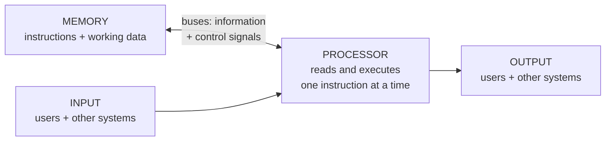
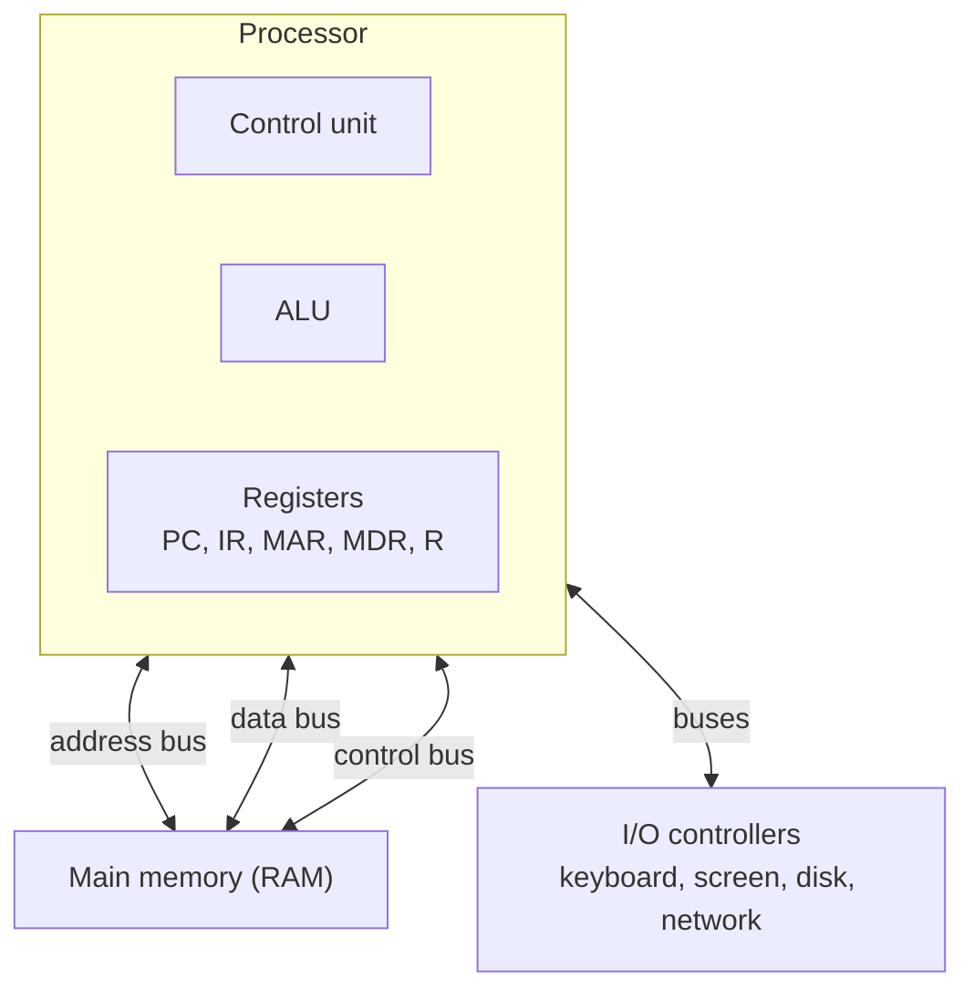
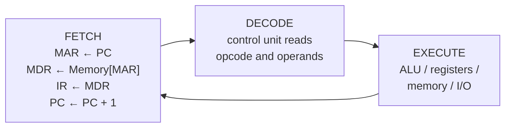
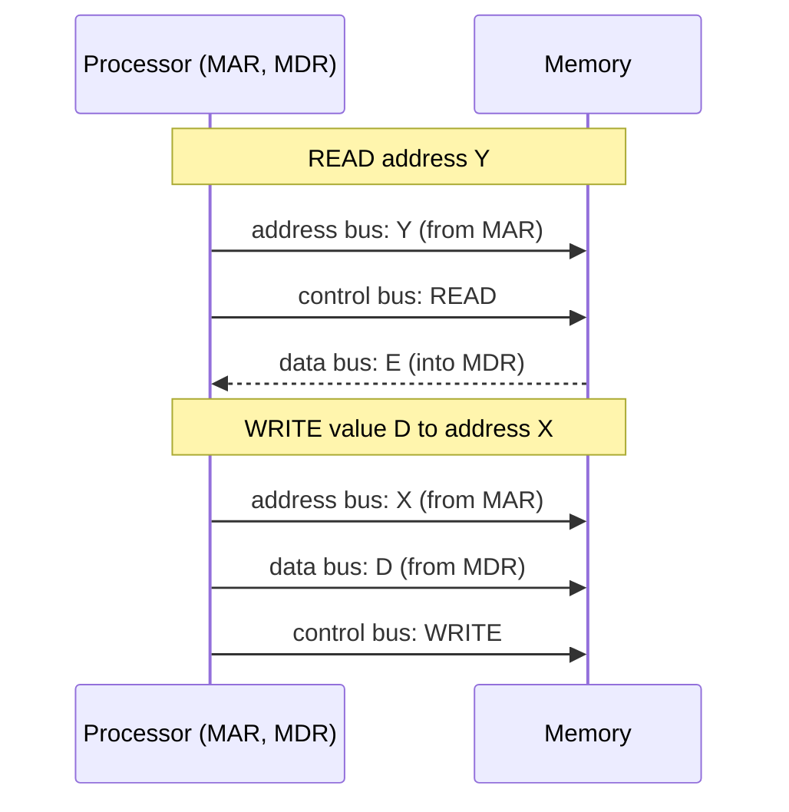
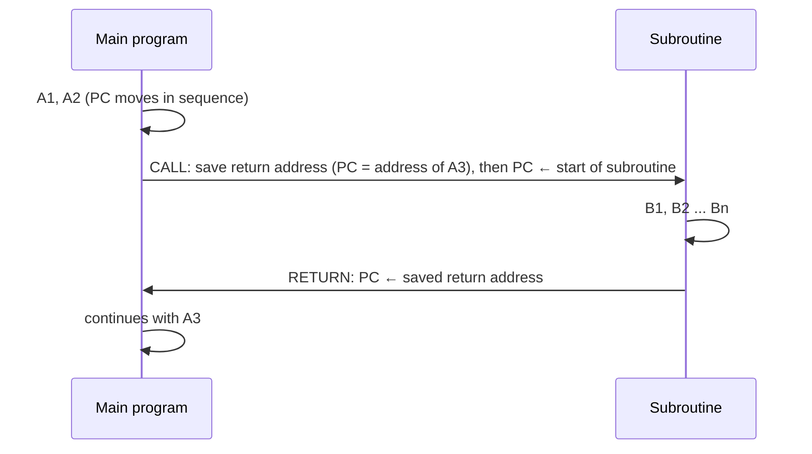

# Lecture 2 — Computer Architecture Foundations and the FDE Cycle

**Module:** 4301COMP Computer Systems Architecture

**Session:** Teaching Week 01, Session B

## Start here

Lecture 1 named the parts of a computer system. This lecture shows them **working**: how the processor uses the Program Counter, Instruction Register, buses and memory to carry out one instruction after another. This repeating process is the **fetch–decode–execute (FDE) cycle**, and every program you will ever run depends on it. After reading, do **Lab 2** (`../Labs/Lab-02-Computer-Architecture-Foundations-and-the-FDE-Cycle-Hands-on-Workbook.md`).

**Labels used in these notes:** **Official** = from the TW01 Session B slides or lab sheet. **Extra** = added explanation, not on the slides. **Verified** = actually run or calculated before being written down. **Expected** = not run here.

> **Note on the slides.** Slides 4, 7, 12, 17 and 20 are diagrams, and slides 32, 33 and 35 are mostly diagrams. Only their titles and labels were available as text. The matching sections below explain the topic from standard textbook material, marked **Extra**. Check the real diagrams on Canvas.

---

## 1. Overview

A processor can only do very simple things: copy a value, add two values, compare, jump to another instruction. It becomes powerful because it does these simple things **billions of times a second, in exactly the right order**. This lecture explains:

- the **von Neumann (stored-program) architecture** that almost all computers follow;
- what an **instruction** looks like (opcode and operands) and the main **instruction groups**;
- the **registers** the processor uses to run a program: PC, IR, MAR, MDR and general-purpose registers;
- the **address, data and control buses**;
- the **fetch–decode–execute cycle**, traced step by step;
- how **branches, subroutines and interrupts** change the normal order of execution.

**Why this matters for cyber security.** Malware analysts read machine instructions to find out what a program really does. Many attacks work by changing where the processor goes next (the Program Counter or a saved return address). You cannot understand either until you understand the FDE cycle.

## 2. By the end you should be able to

1. State the three characteristics of the von Neumann architecture.
2. Explain the roles of the **address bus**, **data bus** and **control bus**.
3. Describe what the **PC**, **IR**, **MAR**, **MDR** and a general-purpose register each hold.
4. Split an instruction into **opcode** and **operands**, and say whether it is a zero-, one-, two- or three-address instruction.
5. Put an instruction into the right **instruction group** (arithmetic, logic, program control, data movement, I/O).
6. Trace a short program through **fetch, decode and execute**, recording the registers after each step.
7. Describe step by step how the processor **reads from** and **writes to** memory.
8. Explain how a **branch**, a **subroutine call** and an **interrupt** each change the normal sequence.

## 3. Learning outcomes

**Session learning outcomes (Official, slide 3):**

- Identify the processor, memory and input/output in a stored-program computer.
- Explain the roles of the address, data and control buses.
- Describe the Program Counter, Instruction Register and general-purpose registers.
- Trace a simple instruction through fetch, decode and execute.

**Module learning outcomes supported** (module guide, as recorded in this module's project instructions):

| Module LO | How this lecture supports it |
| --- | --- |
| **LO1** Explain the fundamental principles underlying the operation of modern computer systems | The stored-program idea and the FDE cycle |
| **LO2** Demonstrate knowledge of the structure and organisation of computer systems | Registers, buses, the control unit and ALU, instruction formats |
| **LO3** Explain the role and functions of an operating system | Interrupts as the way devices get the processor's (and OS's) attention (first look) |

## 4. Matching lab and what you need first

- **Matching lab:** Lab 2. It contains the official TW01 Session B lab tasks (component and bus table; tracing `LOAD R1, [40]`; branches, subroutines and interrupts) and a small Python simulator you can run to watch the cycle happen.
- **From Lecture 1 you need:** the main parts (CPU with control unit and ALU, memory, I/O, bus); memory addresses, and the difference between **reading** (contents unchanged) and **writing** (contents replaced); main memory versus secondary storage.

---

## 5. Recap of Session A (slide 4)

**Official title; content Extra (summary of Lecture 1).**

- A computer system is hardware, software and data working together.
- The processor (control unit, ALU, registers), memory and I/O are connected by buses.
- Memory locations have **addresses**. Reading returns the contents; writing replaces them.
- A **stored-program computer** keeps instructions and data in the same memory.

---

## 6. The von Neumann architecture (slide 5)

### 6.1 Official

The von Neumann architecture is a model for designing and building computers. It has **three characteristics**:

1. The computer consists of **four main sub-systems**: **memory**, the **ALU**, the **control unit** and the **input/output system**.
2. The **program is stored in memory** during execution.
3. Program instructions are **executed sequentially** (one after another, in order).

John von Neumann (1903–1957) presented this design in 1945 in the *First Draft of a Report on the EDVAC*, describing an electronic digital computer.

### 6.2 What each characteristic means (Extra)

| Characteristic | What it means | What it makes possible |
| --- | --- | --- |
| Four sub-systems | Separate parts for storing, calculating, controlling and communicating | Each part can be designed and improved separately |
| Stored program | Instructions are just bit patterns in memory, like data | Change the program without rewiring; load any software |
| Sequential execution | After one instruction, the next one in memory runs, unless the program says otherwise | A simple, predictable way to step through a program |

> **Common confusion.** "Sequential" does not mean a program can never jump. It means sequence is the **default**. Branches, subroutine calls and interrupts (section 17) are the deliberate exceptions.

---

## 7. The stored-program model (slide 6)

**Official, four core principles:**

1. Program instructions and working data are held in **memory**.
2. The **processor** reads and executes **one instruction at a time**.
3. **Input and output** connect the computer to users and other systems.
4. **Buses** carry information and control signals between components.



---

## 8. Processor, memory and input/output (slide 7)

**Official title; content Extra.** The diagram on this slide shows the three main hardware blocks joined by buses. Inside the processor are the **control unit**, the **ALU** and the **registers** (section 10). Memory holds instructions and data at numbered addresses. I/O devices connect to the same buses through **I/O controllers** (small circuits that translate between the bus and each device).



---

## 9. Instructions

### 9.1 Common instruction groups (Official, slide 8)

| Group | What it does | Example instructions |
| --- | --- | --- |
| **Arithmetic** | Calculates with numbers | Add, Subtract, Multiply, Divide |
| **Logic** | Works on bits: true/false operations | AND, OR, NOT, XOR |
| **Program control** | Changes which instruction runs next | Branch, Subroutine (call) |
| **Data movement** | Copies values between memory and registers | Move, Load, Store |
| **Input/Output** | Talks to devices | Read, Write |

**Load** copies a value **from memory into a register**. **Store** copies a value **from a register into memory**. These two words are easy to mix up. Think from the processor's point of view: it **loads** a value *in* to work on it, and **stores** the result *away* in memory.

### 9.2 Instruction format (Official, slides 9–11)

Every instruction has two parts:

| OPCODE | OPERAND(S) |
| --- | --- |
| Tells the CPU **which operation** to perform | Say **where the data is**: in registers or in memory |

An **opcode** (operation code) is the part of an instruction that tells the CPU which operation to perform. **Operands** specify the location of the data.

- The location may be **explicit**: the memory address is written in the instruction, for example `ADD <m1>, <m2>, <m3>`.
- The location may be **implicit**: a default register is assumed, for example `ADD <m>` uses the **accumulator (ACC)**, a register the ALU uses by default.

**Slide 9's example:** `ADD R0 100`. The opcode is `ADD`; the operands are `R0` (a register) and `100`.

> **Note on slide 9.** The slide does not say whether `100` is a memory **address** or the number 100 itself. In these notes, a number in an operand means a **memory address** unless it is marked otherwise (later in the module you may meet "immediate" values, which are the number itself). If the lecture used a different meaning, follow the lecture.

### 9.3 Number of addresses (Official, slides 10–11)

`<m>` means "a memory location". `←` means "becomes" (the value on the right is copied into the place on the left).

| Format | Example | Meaning | Where is the result? |
| --- | --- | --- | --- |
| **Three-address** | `ADD <m1>, <m2>, <m3>` | `<m3> ← <m1> + <m2>` | A separate third location |
| **Two-address** | `ADD <m1>, <m2>` | `<m2> ← <m1> + <m2>` | Overwrites the second operand |
| **One-address** | `ADD <m1>` | `ACC ← ACC + <m1>` | The accumulator (implicit) |
| **Zero-address** | `ADD` | (Extra) Takes two values from the top of a **stack**, adds them and puts the result back | The stack (implicit) |

A **stack** (Extra) is an area of memory used like a pile of plates: you can only add (push) or remove (pop) the top item.

**Why instruction length matters (Official, slide 11):**

- The total number of instructions and the types and formats of the operands determine the **length** of an instruction.
- **Shorter instructions** are faster to fetch and decode, take up less space in memory and are transferred to the CPU faster.
- The trade-off (Extra): shorter instructions can say less each, so a task may need **more** of them.

### 9.4 Worked example (Extra): X = A + B in each format

| Format | Instructions | Count |
| --- | --- | --- |
| Three-address | `ADD A, B, X` | 1 |
| Two-address | `MOVE A, X` then `ADD B, X` (X ← B + X) | 2 |
| One-address | `LOAD A` · `ADD B` · `STORE X` | 3 |
| Zero-address | `PUSH A` · `PUSH B` · `ADD` · `POP X` | 4 |

The fewer addresses each instruction has, the shorter each instruction is, but the **more instructions** you need. This is the trade-off from slide 11.

### 9.5 How many bits? (Extra, Verified)

Suppose a machine uses **16-bit** instructions, with **4 bits** for the opcode and **12 bits** for one address.

1. Number of different opcodes = 2⁴ = **16**.
2. Number of different addresses = 2¹² = **4,096**.

Make the opcode 1 bit bigger and you get 32 operations but only 2,048 addresses. Instruction design is always a trade-off between how many operations and how much memory an instruction can reach.

> **Common confusion: operand order.** The slides write the **result last** (`<m3> ← <m1> + <m2>`). Many real processors put the **destination first**: on Intel/AMD processors, `add eax, edx` means `eax ← eax + edx`. Always check which convention a document uses.

---

## 10. A simple instruction (slide 12)

**Official title; content Extra.** The official lab uses this example:

```text
LOAD R1, [40]
```

| Part | Value | Meaning |
| --- | --- | --- |
| Opcode | `LOAD` | Data movement: copy from memory into a register |
| Destination operand | `R1` | General-purpose register 1 will receive the value |
| Source operand | `[40]` | The square brackets mean "**the contents of memory address 40**" |

So `LOAD R1, [40]` means **R1 ← Memory[40]**. If address 40 contains 25, then after this instruction R1 contains 25, and address 40 still contains 25 (reading does not change memory).

---

## 11. Registers and addresses (slides 13 and 28)

### 11.1 Official (slide 13)

- **Registers** hold values that the processor needs immediately.
- The **Program Counter (PC)** holds the **address of the next instruction**.
- The **Instruction Register (IR)** holds the **current instruction**.
- **Memory addresses** identify where instructions and data are stored.

### 11.2 The full set used in this module's teaching model (Official, slide 28)

| Register or signal | Holds or does |
| --- | --- |
| **PC** — Program Counter | Points to (holds the address of) the next instruction |
| **IR** — Instruction Register | Holds the current instruction |
| **MAR** — Memory Address Register | Holds the active memory address (the address being read or written) |
| **MDR** — Memory Data Register | Holds data moving to or from memory |
| **R** — general-purpose register | A temporary register for working values |
| **ALU** | Handles arithmetic and logic |
| **F/S** | Selects a fetch or store action (a control signal) |
| **I/O** | Links the processor to external devices |
| **RAM** | Stores active instructions and data |
| **GT / EQ / LT** | Comparison-result **flags**: greater than, equal, less than |

A **flag** (Extra) is a single bit that records a fact about the last result, for example "the result was zero" (EQ). Branch instructions test flags to decide whether to jump.

> **Common confusion.** The **PC holds an address**, not an instruction. If the PC contains 6, it means "the next instruction is at address 6", not "the next instruction is 6".

---

## 12. Instructions are stored as bits (slide 14)

### 12.1 Official

- Machine instructions use **binary patterns** inside memory.
- Part of the pattern identifies the **operation** and other parts identify **operands**.
- **Assembly mnemonics** such as `LOAD` and `ADD` provide readable names for these patterns.
- Binary and hexadecimal representation are developed later in the module.

A **mnemonic** is a short memorable name. **Assembly language** is the human-readable form of machine instructions; an **assembler** turns it into the binary patterns.

### 12.2 A real example (Extra, Verified)

This tiny C function was compiled with gcc 13.3 for an Intel/AMD (x86-64) processor and then **disassembled** (turned back into readable instructions) with `objdump`:

```c
int total;

void add(int a, int b) {
    total = a + b;
}
```

Part of the real output (Intel syntax):

```text
   e:   8b 55 fc        mov    edx,DWORD PTR [rbp-0x4]
  11:   8b 45 f8        mov    eax,DWORD PTR [rbp-0x8]
  14:   01 d0           add    eax,edx
  16:   89 05 00 00 00 00   mov    DWORD PTR [rip+0x0],eax
```

How to read it:

| Column | Example | Meaning |
| --- | --- | --- |
| Address | `14` | Where this instruction sits (in hexadecimal, from the start of the function) |
| Bytes | `01 d0` | The actual bit patterns in memory, written in hexadecimal |
| Mnemonic and operands | `add eax,edx` | The same instruction in assembly language: eax ← eax + edx |

The two `mov` instructions **load** `a` and `b` into registers, `add` adds them, and the last `mov` **stores** the result. That is exactly the load–add–store pattern of section 9.4, on a real processor.

> **Cyber security link: reading machine code.** Malware rarely comes with its source code. Analysts use **disassemblers** (such as `objdump`, Ghidra or IDA) to turn the bytes back into instructions, exactly as above, and work out what the program does.

---

## 13. The control unit (slide 15)

**Official:**

- The control unit **coordinates** instruction execution.
- It uses the **Program Counter** to request the next instruction from memory.
- It **decodes** the instruction and issues the required **control signals**.
- The instruction then uses the ALU, registers, memory or I/O as needed.

A **control signal** (Extra) is an electrical signal that tells one part what to do at this moment: "memory, read now", "ALU, add", "copy the MDR into the IR". The control unit is like a conductor: it does not play the instruments, it tells each one when to play.

---

## 14. Fetch, decode and execute (slides 16–20)

### 14.1 The three stages (Official, slide 16)

| Stage | What happens | Shorthand |
| --- | --- | --- |
| **1. FETCH** | The Program Counter identifies the next instruction. Memory places it in the Instruction Register. | PC → memory → IR |
| **2. DECODE** | The control unit identifies the operation and operands, then issues the required control signals. | opcode + operands |
| **3. EXECUTE** | The ALU, registers, memory or I/O perform the operation. The result is retained. | ALU · registers · memory · I/O |

Then the **PC advances**, the next instruction is fetched and the cycle **repeats** while the program runs.



### 14.2 The ALU during execution (Official, slide 18)

The control unit coordinates the instruction. The ALU performs the required arithmetic or logical operation using values supplied through registers.

### 14.3 The Program Counter (Official, slide 19)

The PC holds the address of the next instruction. **After a normal fetch, it advances** so execution can continue in sequence. In the simple model here, it advances by 1 (one instruction per address). On real processors (Extra), it advances by the **length** of the instruction, which is why the addresses in section 12.2 go 0e, 11, 14, 16 rather than 1, 2, 3, 4.

> **Common confusion.** The PC is increased **during fetch**, not at the end of execute. So while an instruction is executing, the PC **already points to the next one**. This matters for branches: a branch simply overwrites the PC with a new address.

### 14.4 Fetch step by step (Extra, using the registers from slide 28)

| Micro-step | Register transfer | In words |
| --- | --- | --- |
| 1 | MAR ← PC | Copy the address of the next instruction into the MAR; the **address bus** carries it to memory |
| 2 | (control bus: read) | The control unit signals "read" |
| 3 | MDR ← Memory[MAR] | Memory puts the instruction on the **data bus**; it arrives in the MDR |
| 4 | IR ← MDR | The instruction is copied into the IR |
| 5 | PC ← PC + 1 | The PC now points to the next instruction |

---

## 15. The stages of instruction execution (slides 21–27)

### 15.1 A more detailed view (Official, slide 21)

Slide 21 splits the same work into **four linked stages**:

| Stage | Job | Stage output |
| --- | --- | --- |
| 01 **Instruction fetch** | Moves the next instruction into the processor | The instruction in the **IR** |
| 02 **Instruction decode** | Identifies the operation and the required operands | **Control signals** |
| 03 **Data fetch** | Obtains values that are not already in registers | **Operand values** |
| 04 **Execution** | Performs the operation and retains the result where required | **Retained result** |

Slides 22–26 then describe five steps: instruction fetch, instruction decode, **data fetch** ("if the instruction needs data from memory, the processor obtains it before performing the operation"), instruction execution, and **result storage** ("the result is retained in a register, written to memory or sent to an output device").

> **Note: 3, 4 or 5 stages?** These are not contradictions; they are the same cycle described in more or less detail. The 3-stage view (slide 16) includes data fetch and result storage inside "execute". Slide 21 separates data fetch. Slides 22–26 also separate result storage. In an exam, use the number of stages the question asks for, and say which model you are using.

### 15.2 Putting the cycle together (Official, slide 27)

- The Program Counter identifies the next instruction.
- The control unit fetches and decodes it.
- The ALU, registers, memory or input/output perform the required work.
- The processor then continues with the next instruction **unless control flow changes**.

---

## 16. Buses during execution (slides 28–33)

### 16.1 The three buses (Official roles from slides 28–30; table Extra)

| Bus | Carries | Direction | Example |
| --- | --- | --- | --- |
| **Address bus** | The **address** of the memory location or device to use | Processor → memory/devices (one way) | "I want address 40" |
| **Data bus** | The **data** (or instruction) being transferred | Both ways | The value 25 coming back from address 40 |
| **Control bus** | **Control signals**: read or write, timing, interrupt requests | Both ways (individual lines go one way or the other) | "This is a READ" |

**Bus width (Extra, Verified).** The number of lines in the address bus sets how many addresses the processor can reach: an *n*-line address bus gives 2ⁿ addresses. A 16-line bus gives 2¹⁶ = 65,536 addresses; a 32-line bus gives 2³² = 4,294,967,296 addresses, which is 4 GiB of byte-addressed memory. This is why old 32-bit computers could not use more than about 4 GB of RAM.

### 16.2 Writing data to memory (Official, slide 29)

Example: **store value D at memory address X.**

| Step | Register or bus activity |
| --- | --- |
| 1. Select the address | MAR ← X; the **address bus** carries X |
| 2. Supply the data | MDR ← D; the **data bus** carries D |
| 3. Request the write | The control unit issues a **write** signal (control bus) |
| 4. Complete the operation | Memory[X] ← D |

The **address** selects the location, the **data** is the value stored and the **control signal** identifies the operation as a write.

### 16.3 Reading data from memory (Official, slide 30)

Example: **read value E from memory address Y.**

| Step | Register or bus activity |
| --- | --- |
| 1. Select the address | MAR ← Y; the address bus carries Y |
| 2. Request the read | The control unit issues a **read** signal |
| 3. Return the value | Memory places Memory[Y] on the data bus |
| 4. Receive the data | MDR ← E; the processor can use E |

A read retrieves the stored value. It does **not**, by itself, change the contents of that memory location.



### 16.4 An addition instruction (Official, slide 31)

`ADD Y`: add the value at memory address Y to the current value in register R.

| Step | Activity |
| --- | --- |
| 1. Decode the instruction | Identify ADD and memory address Y |
| 2. Read the operand | MAR ← Y; request a read; MDR ← Memory[Y] |
| 3. Add the values | The ALU combines R and the fetched operand |
| 4. Store the result | R ← R + MDR; update the relevant condition flags |

If R held E and Memory[Y] held D, the new value in R is **E + D**. The slide calls this "a simple teaching model of instruction execution".

### 16.5 Reading input and writing output (slides 32–33)

**Official labels:**

- `READ Y`: **read data input and store it in location Y**.
- `WRITE Y`: **write the data stored in location Y to output**.

**Explained (Extra):** `READ Y` takes a value D from an input device and stores it at address Y (Memory[Y] ← D). `WRITE Y` reads the value D from address Y and sends it to an output device. Both use the buses in the same way as memory reads and writes, but one end of the transfer is an I/O device.

---

## 17. A complete worked trace (Extra, Verified)

This program adds two numbers already in memory and stores the total. The values were checked by running the program in the Lab 2 simulator.

**Memory before running:**

| Address | 0 | 1 | 2 | 3 | … | 20 | 21 | 22 |
| --- | --- | --- | --- | --- | --- | --- | --- | --- |
| Contents | `LOAD 20` | `ADD 21` | `STORE 22` | `HALT` | … | 6 | 9 | 0 |

**Trace** (values **after** each micro-step; PC starts at 0, R at 0):

| Instruction | Stage | Register transfer | PC | MAR | MDR | IR | R |
| --- | --- | --- | --- | --- | --- | --- | --- |
| 1st | Fetch | MAR ← PC | 0 | 0 | – | – | 0 |
| | Fetch | MDR ← Memory[0]; IR ← MDR | 0 | 0 | LOAD 20 | LOAD 20 | 0 |
| | Fetch | PC ← PC + 1 | **1** | 0 | LOAD 20 | LOAD 20 | 0 |
| | Decode | opcode LOAD, operand 20 | 1 | 0 | LOAD 20 | LOAD 20 | 0 |
| | Execute | MAR ← 20; MDR ← Memory[20]; R ← MDR | 1 | 20 | 6 | LOAD 20 | **6** |
| 2nd | Fetch | MAR ← 1; IR ← ADD 21; PC ← 2 | **2** | 1 | ADD 21 | ADD 21 | 6 |
| | Decode | opcode ADD, operand 21 | 2 | 1 | ADD 21 | ADD 21 | 6 |
| | Execute | MAR ← 21; MDR ← 9; R ← R + MDR | 2 | 21 | 9 | ADD 21 | **15** |
| 3rd | Fetch | MAR ← 2; IR ← STORE 22; PC ← 3 | **3** | 2 | STORE 22 | STORE 22 | 15 |
| | Decode | opcode STORE, operand 22 | 3 | 2 | STORE 22 | STORE 22 | 15 |
| | Execute | MAR ← 22; MDR ← R; Memory[22] ← MDR | 3 | 22 | 15 | STORE 22 | 15 |
| 4th | Fetch, decode, execute | IR ← HALT; PC ← 4; stop | 4 | 3 | HALT | HALT | 15 |

After the program, address 22 contains **15** (6 + 9), and addresses 20 and 21 still contain 6 and 9.

Notice the pattern: **every** instruction uses the MAR and MDR at least once (to fetch itself), and instructions that touch data use them **again** during execute.

---

## 18. Branches, subroutines and interrupts (slides 34–35)

### 18.1 Official

- A **branch** changes the next Program Counter value to a target chosen by the program.
- A **subroutine call** saves a **return address** before transferring control.
- An **interrupt** transfers control to a **handler** when an event needs attention.
- These mechanisms change the normal sequence for different reasons.

Slide 35 shows a program running instructions A1, A2, A3… and then **branching** to a different set of instructions B1, B2 … Bn to deal with a subroutine call or an interrupt: execution is **not always sequential**.

### 18.2 Branch (Extra)

A branch (also called a **jump**) simply **writes a new address into the PC**. The next fetch then comes from the new address.

- An **unconditional** branch always jumps: `JUMP 7` means PC ← 7.
- A **conditional** branch jumps only if a flag is set: `JUMPZ 7` means "if the last result was zero (EQ flag), PC ← 7; otherwise carry on in sequence".

Conditional branches are how computers make decisions (`if` in Java) and repeat things (`while` and `for` loops).

### 18.3 Subroutine call (Extra)

A **subroutine** is a block of instructions that can be used from many places (a **method** in Java). The problem: when it finishes, how does the processor know where to go back to? Answer: the call **saves the return address** (the address of the instruction after the call, which is the current PC value) before jumping. The return instruction copies that saved address back into the PC.



Return addresses are usually saved on the **stack** (section 9.3), so subroutines can call other subroutines and each return finds the right way back.

### 18.4 Interrupt (Extra)

An **interrupt** is a signal (on the control bus) from a device or event saying "I need attention now": a key was pressed, network data arrived, a timer expired.

1. The processor **finishes the current instruction**.
2. It **saves** the PC and other register values so the interrupted program can continue later.
3. It loads the PC with the address of the **interrupt handler** (a routine in the operating system for that event).
4. The handler runs (for example, reads the key code).
5. The saved values are **restored**, including the PC, and the interrupted program continues as if nothing happened.

| | Branch | Subroutine call | Interrupt |
| --- | --- | --- | --- |
| Caused by | An instruction in the program | An instruction in the program | An event outside the program (device, timer, error) |
| Planned by the program? | Yes | Yes | No: it can happen at any time |
| Saves where to come back to? | No | Yes: return address | Yes: PC and other registers |

> **Cyber security link: return addresses.** Because a subroutine's return address is stored in memory, a program bug that lets too much data be written into a nearby area can **overwrite the return address**. When the subroutine returns, the processor jumps to wherever the attacker chose. This is the idea behind a **stack buffer overflow** (concept only; you will study defences later in the degree). The Intel `endbr64` instruction at the start of the function in section 12.2 is part of one such defence.

---

## 19. Common mistakes

| Mistake | Symptom | Fix |
| --- | --- | --- |
| Thinking the PC holds the current instruction | Saying "PC = LOAD 20" | The PC holds the **address of the next** instruction; the IR holds the current one |
| Increasing the PC at the end of execute | Branch traces go one address wrong | The PC advances **during fetch**; a branch then overwrites it |
| Mixing up MAR and MDR | Address and data swapped in traces | **A**ddress → M**A**R; **D**ata → M**D**R |
| Saying the data bus carries addresses | Wrong bus table | Address bus = where; data bus = what; control bus = which operation and when |
| Thinking a read changes memory | Values "disappear" in a trace | Reading copies; only writing replaces |
| Confusing LOAD and STORE | Values go the wrong way | LOAD: memory → register. STORE: register → memory |
| Treating `[40]` as the number 40 | R1 gets 40 instead of the contents of address 40 | Square brackets mean "the contents of address 40" |
| Assuming every processor writes the destination last | Misreading real assembly | Check the convention: the slides put the result last; x86 puts it first |
| Forgetting that a subroutine call saves a return address | Cannot explain how a return works | Call = save return address + jump; return = PC ← saved address |
| Thinking an interrupt loses the current program | Interrupt explained as a crash | The PC and registers are saved and restored afterwards |

---

## 20. Check yourself: 15 multiple-choice questions

**Q1.** Which is **not** one of the three characteristics of the von Neumann architecture on slide 5?
A) Four main sub-systems
B) The program is stored in memory during execution
C) Instructions are executed sequentially
D) Instructions and data are kept in separate memories

**Q2.** What does the Program Counter hold?
A) The address of the next instruction
B) The current instruction
C) The number of instructions run so far
D) The result of the last calculation

**Q3.** Which register holds the address currently being read from or written to memory?
A) MDR
B) IR
C) MAR
D) PC

**Q4.** Which bus carries the value being read from memory back to the processor?
A) Address bus
B) Data bus
C) Control bus
D) It does not use a bus

**Q5.** In `LOAD R1, [40]`, what is the opcode?
A) R1
B) [40]
C) 40
D) LOAD

**Q6.** Address 40 contains 25. After `LOAD R1, [40]`, what do R1 and address 40 contain?
A) R1 = 40, address 40 = 25
B) R1 = 25, address 40 = 25
C) R1 = 25, address 40 = 0
D) R1 = 0, address 40 = 25

**Q7.** `ADD <m1>` (one-address format) means:
A) <m1> ← <m1> + <m1>
B) ACC ← ACC + <m1>
C) <m1> ← ACC
D) ACC ← <m1>

**Q8.** Which instruction group does `XOR` belong to?
A) Logic
B) Arithmetic
C) Data movement
D) Program control

**Q9.** At what point in the cycle does the PC normally advance?
A) At the end of execute
B) During decode
C) During fetch
D) Only when a branch is taken

**Q10.** A machine has 16-bit instructions with a 4-bit opcode and a 12-bit address. How many memory addresses can one instruction refer to?
A) 16
B) 256
C) 65,536
D) 4,096

**Q11.** During a memory **write**, which three things are needed?
A) An address on the address bus, the data on the data bus and a write signal on the control bus
B) Only the data on the data bus
C) An address on the data bus and the data on the address bus
D) The IR and the PC

**Q12.** R contains 6 and address 21 contains 9. What does R contain after `ADD 21`?
A) 9
B) 6
C) 15
D) 21

**Q13.** Why does a subroutine call save a return address?
A) To make the subroutine run faster
B) So the processor can go back to the instruction after the call when the subroutine finishes
C) Because the PC cannot be changed
D) To stop interrupts happening

**Q14.** What is the main difference between an interrupt and a branch?
A) An interrupt is caused by an event outside the program and can happen at any time; a branch is an instruction in the program
B) A branch saves all the registers; an interrupt does not
C) Interrupts only happen when the program ends
D) There is no difference

**Q15.** A program is at address 5 and the instruction there is `JUMP 2`. What is in the PC immediately after this instruction has executed?
A) 6
B) 5
C) 3
D) 2

### Answers

| Q | Answer | Why |
| --- | --- | --- |
| 1 | **D** | Von Neumann keeps instructions and data in the **same** memory. A, B and C are the three characteristics. |
| 2 | **A** | Slide 13: the PC holds the address of the next instruction. |
| 3 | **C** | Slide 28: the MAR holds the active memory address. |
| 4 | **B** | The data bus carries data both ways; the address bus only carries the address. |
| 5 | **D** | The opcode says which operation: LOAD. R1 and [40] are the operands. |
| 6 | **B** | `[40]` means the contents of address 40, which is copied (not moved) into R1. |
| 7 | **B** | Slide 10: in one-address format the accumulator is the implicit operand and destination. |
| 8 | **A** | Slide 8 lists AND, OR, NOT and XOR as logic instructions. |
| 9 | **C** | Slide 19: after a normal fetch, the PC advances. |
| 10 | **D** | 2¹² = 4,096 (Verified). 16 is the number of opcodes. |
| 11 | **A** | Slide 29: address on the address bus, data on the data bus, write signal from the control unit. |
| 12 | **C** | Slide 31 model: R ← R + Memory[21] = 6 + 9 = 15 (Verified in the simulator). |
| 13 | **B** | Slide 34: the return address lets execution continue after the call. |
| 14 | **A** | An interrupt comes from an event (device, timer) and transfers control to a handler; a branch is part of the program. |
| 15 | **D** | Fetch set the PC to 6, then executing `JUMP 2` overwrote it with 2. |

---

## 21. Quick reference

**Von Neumann:** four sub-systems (memory, ALU, control unit, I/O) · stored program · sequential execution.

**Registers**

| Register | Holds |
| --- | --- |
| PC | Address of the next instruction |
| IR | The current instruction |
| MAR | The address being read or written |
| MDR | The data being read or written |
| R / ACC | Working values |
| Flags GT/EQ/LT | Result of the last comparison or calculation |

**Buses:** address = where (CPU → memory) · data = what (both ways) · control = which operation and when.

**Fetch:** MAR ← PC · MDR ← Memory[MAR] · IR ← MDR · PC ← PC + 1

**Read Y:** MAR ← Y · read signal · MDR ← Memory[Y]

**Write D to X:** MAR ← X · MDR ← D · write signal · Memory[X] ← MDR

**Instruction formats:** three-address `<m3> ← <m1> + <m2>` · two-address `<m2> ← <m1> + <m2>` · one-address `ACC ← ACC + <m1>` · zero-address uses a stack.

**Instruction groups:** arithmetic · logic · program control · data movement · I/O.

**Counting:** *n* bits → 2ⁿ patterns. 4 bits = 16 · 12 bits = 4,096 · 16 bits = 65,536 · 32 bits = 4,294,967,296 (Verified).

## 22. Glossary

| Term | Meaning |
| --- | --- |
| **Accumulator (ACC)** | A register the ALU uses by default in one-address instructions |
| **Address bus** | Lines carrying the address of the location to read or write |
| **Assembly language** | Human-readable mnemonics for machine instructions |
| **Branch (jump)** | An instruction that writes a new address into the PC |
| **Control bus** | Lines carrying control signals such as read, write and interrupt requests |
| **Control signal** | A signal from the control unit telling a part what to do now |
| **Data bus** | Lines carrying the data or instruction being transferred |
| **Decode** | The control unit works out the operation and operands |
| **Disassembler** | A tool that turns machine-code bytes back into assembly language |
| **Execute** | The operation is carried out and the result retained |
| **Fetch** | The next instruction is copied from memory into the IR |
| **Flag** | A single bit recording a fact about the last result, such as zero or negative |
| **Instruction Register (IR)** | Holds the instruction currently being carried out |
| **Interrupt** | A signal that makes the processor pause, run a handler and then continue |
| **Interrupt handler** | The routine (usually in the OS) that deals with an interrupt |
| **MAR** | Memory Address Register: the address being accessed |
| **MDR** | Memory Data Register: the data moving to or from memory |
| **Mnemonic** | A short readable name for an operation, such as ADD |
| **Opcode** | The part of an instruction that says which operation to perform |
| **Operand** | The part of an instruction that says where the data is |
| **Program Counter (PC)** | Holds the address of the next instruction |
| **Return address** | The saved address to go back to when a subroutine finishes |
| **Stack** | Memory used last-in, first-out, like a pile of plates |
| **Subroutine** | A reusable block of instructions that is called and then returns |
| **Von Neumann architecture** | The stored-program, sequential, four-sub-system design from 1945 |

## 23. Summary

- The **von Neumann architecture** has four sub-systems, keeps the program in memory and executes instructions in sequence.
- An instruction has an **opcode** and **operands**. Formats range from three-address to zero-address; shorter instructions are faster to fetch but do less each.
- The **PC** points to the next instruction; the **IR** holds the current one; the **MAR** and **MDR** handle every memory access.
- The **address bus** says where, the **data bus** carries what, and the **control bus** says which operation and when.
- The **fetch–decode–execute** cycle repeats for every instruction. The PC advances during fetch.
- **Branches** overwrite the PC; **subroutine calls** save a return address first; **interrupts** save the state, run a handler and then resume.

## 24. Next

According to slide 37, the next session is **Teaching Week 02, Session A: Network Fundamentals and Cisco Packet Tracer**. It moves from one computer system to **communication between systems**.
