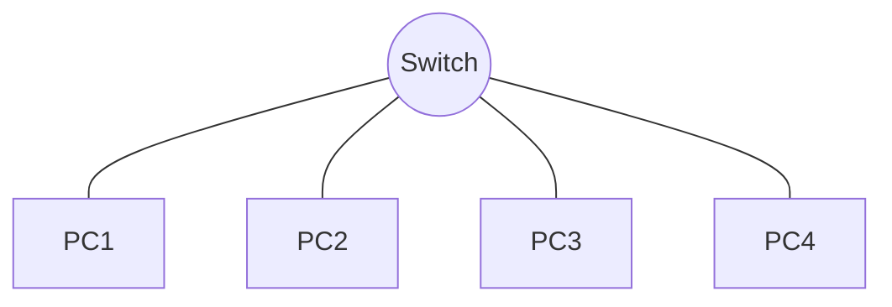
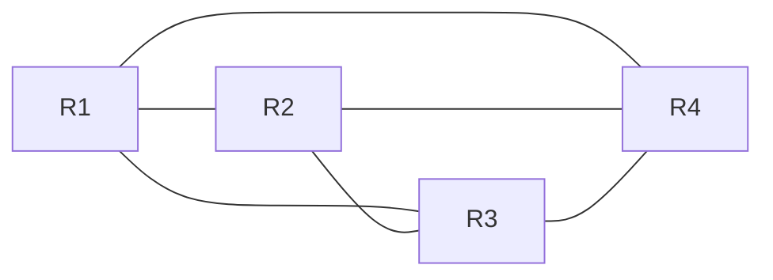
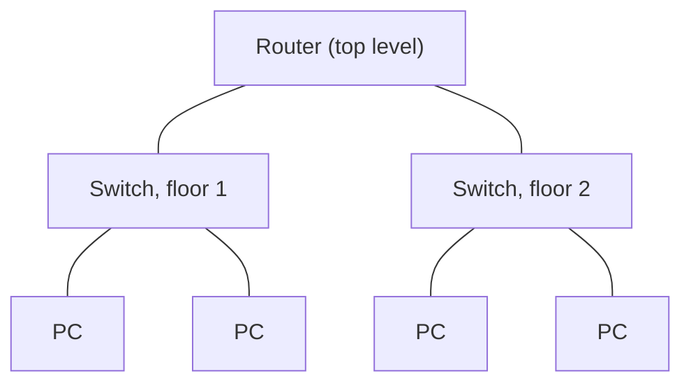
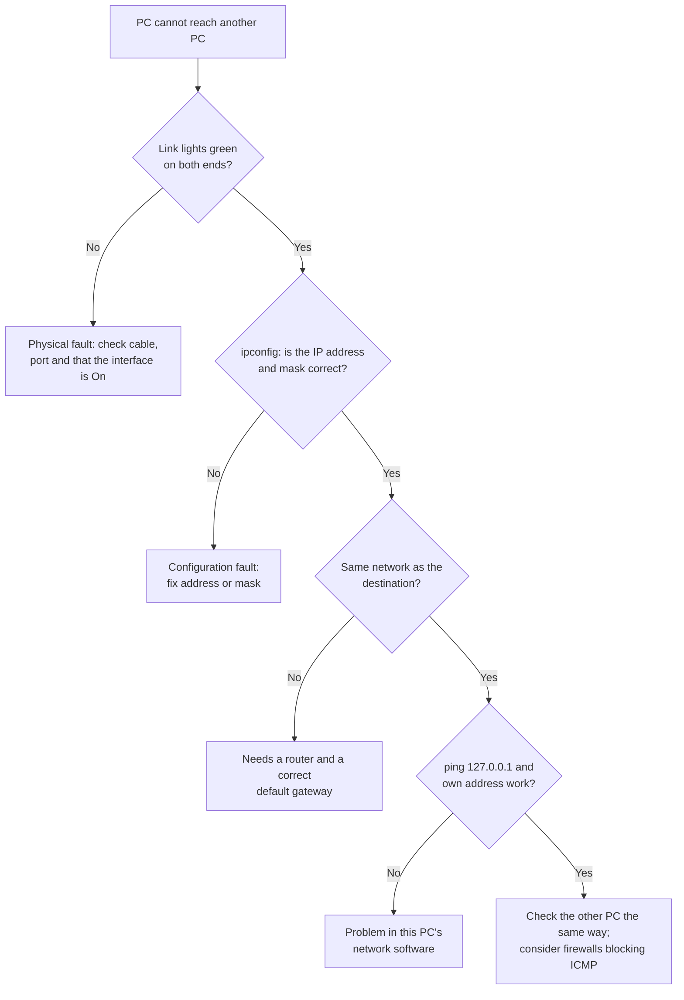

# Lecture 3 — Network Fundamentals and Packet Tracer

**Module:** 4301COMP Computer Systems Architecture

**Session:** Teaching Week 02, Session A

## Start here

Lectures 1 and 2 looked inside **one** computer. This lecture moves to **communication between computers**: what a network is, how networks are classified and laid out, which devices connect them, how errors are detected, and how IP addresses, subnet masks and `ping` let you test whether two devices can talk. After reading, do **Lab 3** (`../Labs/Lab-03-Network-Fundamentals-and-Packet-Tracer-Hands-on-Workbook.md`), where you build a small network in Cisco Packet Tracer.

**Labels used in these notes:** **Official** = from the TW02 Session A slides or lab sheet. **Extra** = added explanation, not on the slides. **Verified** = actually run or calculated before being written down. **Expected** = not run here (for example anything inside Packet Tracer).

> **Note on the slides.** Slides 6, 7, 22, 24 and 25 are diagrams, and slides 8 and 9 are partly diagrams. Only their titles and labels were available as text. The matching sections explain the topic from standard textbook material, marked **Extra**. Check the real diagrams on Canvas.

---

## 1. Overview

A **network** lets separate computers share information and resources: files, printers, an internet connection, a web service. This lecture covers:

- **why** networks are used;
- **LAN, MAN and WAN**, which classify networks by size;
- **topologies**, which describe how devices are connected: star, mesh, irregular, hierarchical, bus and ring;
- the job of **hubs, switches, bridges, routers and access points**;
- **error detection** with a **parity bit**;
- **IP addresses** and **subnet masks**, which decide whether two devices can talk directly;
- **`ping`** and a simple method for **diagnosing network faults**.

**Why this matters for cyber security.** Almost every attack today arrives over a network, and almost every defence (firewalls, segmentation, monitoring) is built on the ideas here. You also need to read `ping` results correctly: "no reply" does **not** always mean "the device is off".

## 2. By the end you should be able to

1. Explain why computer networks are used, with examples.
2. Classify a network as a **LAN**, **MAN** or **WAN**.
3. Describe the star, mesh, irregular, hierarchical, bus and ring topologies, with one advantage and one disadvantage of each.
4. Calculate the number of links in a **full mesh** of *n* devices.
5. State the job of a hub, switch, bridge, router and access point.
6. Add an **even** or **odd parity bit** to a group of bits and check received data for an error.
7. Use a **subnet mask** to decide whether two IPv4 addresses are in the same network.
8. Interpret `ping` results and follow a simple, step-by-step method to diagnose a connectivity fault.

## 3. Learning outcomes

**Session learning outcomes (Official, slide 3):**

- Explain why computer networks are used.
- Classify networks and compare common topologies.
- Identify the roles of common network devices.
- Use basic addressing and diagnostic concepts to investigate connectivity.

**Module learning outcomes supported** (module guide, as recorded in this module's project instructions):

| Module LO | How this lecture supports it |
| --- | --- |
| **LO4** Explain the fundamental concepts involved in computer networking | All of this lecture: network types, topologies, devices, IP addressing, ping, faults |
| **LO1** Explain the fundamental principles underlying the operation of modern computer systems | Error detection with parity |

The module's **report (40%)** assesses data storage and computer networking (module guide), so this lecture's material is directly relevant to it.

## 4. Matching lab and what you need first

- **Matching lab:** Lab 3. It contains the official TW02 Session A tasks: logging in to Packet Tracer, building a four-PC LAN with a switch, testing it with `ping`, and creating and fixing faults.
- **From earlier lectures you need:** the network interface as an I/O device that both sends and receives (Lecture 1); the idea that *n* bits give 2ⁿ patterns (Lectures 1–2); and the fact that **interrupts** let a network card get the processor's attention when data arrives (Lecture 2).
- **From your own practice:** you have already met Packet Tracer and `ping`. This lecture explains **why** the results come out as they do.

---

## 5. Recap of the previous session (slide 4, Official)

- A stored-program computer holds instructions and data in memory.
- Buses connect the processor, memory and input/output.
- The Program Counter identifies the next instruction to fetch.
- The processor repeatedly fetches, decodes and executes instructions.

A network interface is one more I/O device on those buses. Everything in this lecture happens through it.

---

## 6. What is a computer network? (slide 5)

### 6.1 Official definition

A **computer network** is a collection of computing devices that are connected in various ways in order to **communicate** and **share resources**. It connects **two or more autonomous computers**, which can be located anywhere geographically.

**Autonomous** means each computer can work on its own: it has its own processor and operating system. A keyboard plugged into a PC is not a network; two PCs that exchange files are.

### 6.2 Terms you will need (Extra)

| Term | Meaning |
| --- | --- |
| **Node** | Any device attached to a network: PC, printer, switch, router |
| **Host** or **end device** | A node that sends or receives user data, such as a PC, phone or server |
| **Link** | A connection between two nodes: a cable or a wireless channel |
| **Packet** | A small block of data sent across a network, with addressing information attached |
| **Protocol** | An agreed set of rules for communication (for example, IP and ICMP in this lecture) |

---

## 7. Network applications (slide 6)

**Official title; content Extra.** Networks exist because sharing is cheaper and more useful than duplicating.

| Purpose | Example |
| --- | --- |
| Share **resources** | One printer or one internet connection for a whole office |
| Share **information** | Shared drives, databases, the web |
| **Communicate** | Email, messaging, video calls |
| Run **services** centrally | University login, Canvas, online banking |
| **Reliability** | Data copied to servers in different places, so one failure does not lose it |
| **Remote** work and control | Working from home; managing servers in a data centre |

---

## 8. Types of networks: LAN, MAN and WAN (slide 7)

**Official title (the overview names LAN, MAN and WAN); content Extra.** Networks are classified by the **geographical area** they cover.

| Type | Stands for | Area | Typical owner | Example |
| --- | --- | --- | --- | --- |
| **LAN** | Local Area Network | A room, building or campus | One organisation or household | The PCs and Wi-Fi in a university lab; your home network |
| **MAN** | Metropolitan Area Network | A town or city | A city council, university group or provider | Linking several university buildings across Liverpool |
| **WAN** | Wide Area Network | A country, continent or the world | Telecoms providers; large companies | The internet; a bank's network joining branches |

LANs are usually fast and owned by the people who use them. WANs cover long distances, are slower and more expensive per bit, and often use links rented from providers. A **router** usually sits where a LAN meets a WAN.

> **Common confusion.** Size is about **geography**, not the number of devices. A data centre with 10,000 servers in one building is still a LAN.

---

## 9. Network topologies (slides 8–18)

### 9.1 What a topology is

A **topology** is the arrangement of the links and nodes: who is connected to whom (Official, slide 8: various configurations, called topologies, have been used to administer networks).

Slide 9 divides topologies into two families (Extra explanation):

- **Point-to-point channels:** each link joins exactly two nodes. Possible point-to-point topologies are **star**, **fully connected (mesh)**, **irregular** and **hierarchical** (Official).
- **Broadcast (shared) channels:** one medium is shared by many nodes, so every node can hear every transmission. **Bus** and **ring** belong here.

### 9.2 Star (slides 10–11, Official)

A configuration that centres on **one node** to which all others are connected and **through which all messages are sent**.

- Each device connects directly to a central device, such as a **switch**.
- All communication passes through that central device.
- Adding or removing one end device usually does **not** affect the others.
- **Failure of the central device can disrupt the whole network.**



This is exactly the network you build in Lab 3.

### 9.3 Mesh (slide 12, Official)

- **Full mesh:** every node has a direct link to every other node. It offers many alternative paths but uses many links.
- **Partial mesh:** only selected nodes have multiple interconnections. It balances resilience, cost and complexity.
- Most real networks use a **mixture** of star, hierarchical and partial-mesh structures.

**How many links does a full mesh need? (Extra, Verified)**

Each of the *n* nodes links to the other *n* − 1, but each link is shared by two nodes, so:

> **links = n × (n − 1) ÷ 2**

| Nodes *n* | Working | Links |
| --- | --- | --- |
| 3 | 3 × 2 ÷ 2 | 3 |
| 4 | 4 × 3 ÷ 2 | 6 |
| 5 | 5 × 4 ÷ 2 | 10 |
| 10 | 10 × 9 ÷ 2 | 45 |

The number of links grows roughly with *n*², which is why full meshes are only used for a few very important nodes (for example, the core routers of a provider).



*A full mesh of 4 routers: 6 links.*

### 9.4 Irregular (slide 13, Official)

- Does not follow a single fixed structure; often combines features of star, mesh or hierarchical designs.
- Gives great flexibility to adapt and scale to specific requirements.
- Can be more complex to design, route and manage because the connections are not uniform.

The internet as a whole is irregular.

### 9.5 Hierarchical (slide 14, Official)

- Devices are arranged in **levels**, with lower-level devices connected through higher-level devices such as switches or routers.
- Easier to organise, manage and expand as the network grows.
- Failure of an important higher-level device can affect **many** lower-level devices.



A hierarchical network is often a "star of stars" (also called an **extended star**).

### 9.6 Broadcast and bus (slides 15 and 18, Official)

- **Legacy shared-bus Ethernet** connected devices to **one coaxial cable** segment.
- Every device saw every transmission, and access had to be coordinated; nodes competed (**contention**) to use the shared medium.
- One cable fault could affect the whole segment.
- This is historically important, but **modern Ethernet LANs normally use switches in a star or hierarchical topology**.

### 9.7 Ring (slides 16–17, Official)

- Each node connects to **two neighbours**, forming a closed loop. Data passes around the ring according to the network's rules.
- A break can disrupt a simple ring. Some ring technologies (dual rings, bypass designs) add **redundancy**.
- Legacy ring networks passed frames or a **token** (permission to send) around the loop. **Token Ring is obsolete** in normal enterprise networks; switched Ethernet dominates.

### 9.8 Comparison (Extra summary of the slides)

| Topology | Advantage | Disadvantage | Still common? |
| --- | --- | --- | --- |
| Star | Easy to add/remove devices; one cable fault affects one device | Central device is a single point of failure | Yes: every switched LAN |
| Full mesh | Many alternative paths; very resilient | Many links: n(n − 1)/2; expensive | Only for small, critical cores |
| Partial mesh | Balance of resilience and cost | More complex to design | Yes: WAN and core networks |
| Irregular | Flexible; grows to fit needs | Hard to design, route and manage | Yes: the internet |
| Hierarchical | Organised, easy to expand | A high-level failure affects many devices | Yes: campus networks |
| Bus | Simple, little cable | Shared medium; one fault affects all | Historical |
| Ring | Orderly access | One break can stop a simple ring | Historical (Token Ring) |

A **single point of failure** (Extra) is one component whose failure stops the whole system. Good network design removes them by adding redundant links and devices (section 15).

---

## 10. Common network devices (slide 19)

### 10.1 Official table

| Device | Purpose | Layer | Example |
| --- | --- | --- | --- |
| **Hub** | Repeats received bits to all other ports | 1 | Legacy shared Ethernet |
| **Switch** | Forwards **frames** using **MAC addresses**; floods when required | 2 | Connect PCs in a LAN |
| **Bridge** | Connects LAN segments and filters frames | 2 | Join LAN segments |
| **Router** | Forwards **IP packets** between networks | 3 | Link different IP networks |
| **Access point** | Bridges wireless clients to the LAN | 2 | Connect Wi-Fi clients |

### 10.2 What the new words mean (Extra)

- **Layer** refers to the layers of the **OSI model**, a way of splitting networking into seven levels. It is the main topic of the next session. For now: layer 1 = **physical** (bits on a cable), layer 2 = **data link** (frames on one local network, using MAC addresses), layer 3 = **network** (packets between networks, using IP addresses).
- A **MAC address** is a hardware address built into each network interface, such as `00:1A:2B:3C:4D:5E`. It identifies the interface on the **local** network.
- A **frame** is the layer-2 package that carries data across one local network.
- **Flooding:** if a switch does not yet know which port leads to a destination MAC address, it sends the frame out of **every other port**, like a hub, and learns from the reply.

### 10.3 Hub versus switch (Extra)

| | Hub | Switch |
| --- | --- | --- |
| Intelligence | None: repeats bits | Learns which MAC address is on which port |
| Who receives a frame? | **Every** other port | Only the port leading to the destination (after learning) |
| Shared or dedicated bandwidth? | Shared by all ports | Each port has its own |
| Today | Obsolete | Standard |

> **Cyber security link: hubs and eavesdropping.** On a hub, every device receives every frame, so any connected computer can capture everyone else's traffic. Switches send frames only where they need to go, which makes casual eavesdropping much harder (though not impossible; you will meet attacks on switches later in the degree).

### 10.4 Router (Extra)

A switch connects devices **within** one network. A **router** connects **different** IP networks and decides where to send each packet next. Your home "router" is actually several devices in one box: a router, a switch, a wireless access point and often a modem.

---

## 11. Error detection (slides 20–22)

### 11.1 Official (slide 20)

- **Transmission errors** can corrupt bits during network transmission (electrical noise, interference, a damaged cable).
- **Error-detection** methods add **redundant information** so corruption can be detected.
- When an error is detected, the data may be **discarded and retransmitted**, depending on the protocol.
- **Error-correction** methods can recover corrupted data, but need additional overhead.

**Redundant information** means extra bits that carry no new data, only a way to check the data.

### 11.2 Parity checking (Official, slide 21)

Before transmission, one extra **parity bit** is added to a character so that:

- the total number of 1s is **odd** (**odd parity**), or
- the total number of 1s is **even** (**even parity**).

The sender and receiver must agree in advance which kind they are using.

### 11.3 Worked examples (Extra, Verified)

In these examples the parity bit is placed on the **left** of 7 data bits.

| Data (7 bits) | Number of 1s | Even parity bit | Sent (even) | Odd parity bit | Sent (odd) |
| --- | --- | --- | --- | --- | --- |
| 1000001 | 2 (even) | 0 | **0**1000001 | 1 | **1**1000001 |
| 1100011 | 4 (even) | 0 | **0**1100011 | 1 | **1**1100011 |
| 1010101 | 4 (even) | 0 | **0**1010101 | 1 | **1**1010101 |
| 1110000 | 3 (odd) | 1 | **1**1110000 | 0 | **0**1110000 |
| 0000000 | 0 (even) | 0 | **0**0000000 | 1 | **1**0000000 |

**Method:** count the 1s in the data. For **even** parity, add a 1 only if the count is odd. For **odd** parity, add a 1 only if the count is even.

### 11.4 Checking at the receiver (Extra, Verified)

The receiver counts **all** the 1s, including the parity bit.

| Received (even parity agreed) | Number of 1s | Result |
| --- | --- | --- |
| 01000001 | 2 | Even: **passes** |
| 01010001 | 3 | Odd: **error detected** |
| 01010101 | 4 | Even: **passes**, but this is the original with **two** bits flipped |

### 11.5 The limits of parity (Extra)

- Parity detects any **odd** number of flipped bits (1, 3, 5…).
- It **cannot** detect an **even** number of flipped bits: two errors cancel out, as the last row shows.
- It cannot say **which** bit is wrong, so it cannot correct the error; the data must be sent again.

Real networks use stronger checks. For example, every Ethernet frame carries a **cyclic redundancy check (CRC)**, which catches far more error patterns.

> **Cyber security link: errors versus attacks.** Parity and CRCs detect **accidental** damage. They do not stop **deliberate** tampering: an attacker who changes the data can simply recalculate the parity bit. Protecting against tampering needs **cryptographic** integrity checks (hashes and message authentication codes), which you will study later in the degree.

---

## 12. IP networks (slide 23, Official)

- IP networks let devices exchange **packets** using **IP addresses** assigned to their **network interfaces**.
- They include local and private networks that can work **without internet access**.
- **Routers** forward packets between IP networks. Internet connectivity is needed only when communicating with destinations reached through the internet.

Your Lab 3 network has no router and no internet, but the four PCs can still talk to each other using IP. That is exactly the point of this slide.

---

## 13. IP addressing (slides 24–25)

**Official titles; content Extra.** These notes cover **IPv4**, the version used in the lab.

### 13.1 What an IPv4 address looks like

- An IPv4 address is **32 bits** long, so there are 2³² = 4,294,967,296 possible addresses (Verified).
- For people, it is written in **dotted decimal**: four numbers separated by dots, such as `192.168.10.11`.
- Each of the four numbers is called an **octet** because it is 8 bits. 8 bits give 2⁸ = 256 patterns, so each octet is **0 to 255**. `192.168.10.256` is **not** a valid address.

For example, the octet 192 is the 8 bits `11000000`, and 10 is `00001010` (Verified). Binary is developed properly later in the module; you do not need to convert by hand yet.

### 13.2 Two parts: network and host

Every IPv4 address has two parts:

- the **network part** says **which network** the device is on (like a street name);
- the **host part** says **which device** on that network (like a house number).

The **subnet mask** says where the split is (section 14).

### 13.3 Special addresses (Extra, Verified with Python's `ipaddress` module)

| Address or range | Meaning |
| --- | --- |
| `192.168.10.0` (host part all 0s) | The **network address**: the name of the network itself; not given to a device |
| `192.168.10.255` (host part all 1s) | The **broadcast address**: "every device on this network"; not given to a device |
| `192.168.10.1` – `192.168.10.254` | The **254 usable host addresses** in a /24 network |
| `127.0.0.1` | **Loopback**: "this computer itself"; tests the computer's own network software |
| `10.0.0.0`–`10.255.255.255`, `172.16.0.0`–`172.31.255.255`, `192.168.0.0`–`192.168.255.255` | **Private** ranges: used inside homes and organisations; not routed on the internet |

The **default gateway** (Extra) is the address of the router a device uses to reach **other** networks. In Lab 3 it is left blank, because all four PCs are on the same network and no router exists.

---

## 14. The subnet mask (slide 26)

### 14.1 Official

A **subnet mask** defines which part of the IP address is the **network** and which part is the **host** (device).

Example: IP address `192.168.1.10` with subnet mask `255.255.255.0`:

- `192.168.1` → **network part**
- `.10` → **host part**

**Why it matters:** devices must be in the **same network (subnet)** to communicate **directly**.

- `192.168.1.10` ↔ `192.168.1.20`: same subnet → can ping.
- `192.168.1.10` ↔ `192.168.2.10`: different subnet → **needs a router**.

### 14.2 Reading a mask (Extra)

In a mask, **255** means "this octet is network" and **0** means "this octet is host". (Underneath, 255 is eight 1-bits and 0 is eight 0-bits; the 1-bits mark the network part.)

| Mask | Network part | Host part | Short form (prefix) |
| --- | --- | --- | --- |
| 255.255.255.0 | First 3 octets | Last octet | **/24** (24 network bits) |
| 255.255.0.0 | First 2 octets | Last 2 octets | **/16** |
| 255.0.0.0 | First octet | Last 3 octets | **/8** |

So `192.168.10.11/24` means "address 192.168.10.11 with mask 255.255.255.0". The 1-bits in a mask must all come first: `255.0.255.0` is **not** a valid mask (Verified).

### 14.3 Worked examples: same network or not? (Extra, Verified)

**Method (for a /24 mask):** compare the first three octets. If they match, the addresses are in the same network.

| Address A | Address B | First three octets | Same network? |
| --- | --- | --- | --- |
| 192.168.10.11 | 192.168.10.14 | 192.168.10 = 192.168.10 | **Yes** |
| 192.168.10.11 | 192.168.20.14 | 192.168.10 ≠ 192.168.20 | **No**: needs a router |
| 10.0.0.5 | 10.0.0.250 | 10.0.0 = 10.0.0 | **Yes** |
| 172.16.4.1 | 172.16.5.1 | 172.16.4 ≠ 172.16.5 | **No** |
| 192.168.100.1 | 192.168.10.1 | 192.168.100 ≠ 192.168.10 | **No** (read every digit) |

The second row is exactly the fault you create in Lab 3 (Option B).

> **Common confusion.** "Different network" is not the same as "broken". Two devices on different networks **can** communicate, but only through a **router**. With no router (or no default gateway set), the packets have nowhere to go.

> **Cyber security link: segmentation.** Putting different groups of devices (staff PCs, servers, guest Wi-Fi, CCTV) on **different subnets** means their traffic must pass through a router or firewall, where it can be **checked and blocked**. This **network segmentation** limits how far an attacker can move after compromising one device.

---

## 15. The `ping` command (slide 27)

### 15.1 Official

- `ping` sends **ICMP Echo Request** messages and reports replies when they are allowed and returned.
- A successful reply confirms **reachability for that test path**.
- **No reply does not by itself prove that the host is down**: firewalls, policy, congestion, routing faults or ICMP filtering can also prevent a response.

**ICMP** (Internet Control Message Protocol, Extra) is the protocol networks use for control and error messages. An **Echo Request** says "please reply"; an **Echo Reply** is the answer.

### 15.2 What the output looks like

**In Packet Tracer and Windows (Expected; from the official lab sheet):**

```text
Reply from 192.168.10.12: bytes=32 time<1ms TTL=128
```

| Part | Meaning |
| --- | --- |
| `Reply from 192.168.10.12` | The destination answered |
| `bytes=32` | Size of the test data sent |
| `time<1ms` | **Round-trip time**: how long the request and reply took |
| `TTL=128` | **Time to live**: a counter that stops packets looping forever (Extra) |

Common failure messages:

| Message | Usual meaning (Extra) |
| --- | --- |
| `Request timed out.` | A request was sent but no reply came back in time |
| `Destination host unreachable.` | The sender, or a router on the path, could not deliver the request at all |

**On a real Linux machine (Verified).** These are actual results from the Linux cloud machine used to check these notes:

```text
$ ping -c 4 127.0.0.1
PING 127.0.0.1 (127.0.0.1) 56(84) bytes of data.
64 bytes from 127.0.0.1: icmp_seq=1 ttl=64 time=0.028 ms
64 bytes from 127.0.0.1: icmp_seq=2 ttl=64 time=0.050 ms
64 bytes from 127.0.0.1: icmp_seq=3 ttl=64 time=0.044 ms
64 bytes from 127.0.0.1: icmp_seq=4 ttl=64 time=0.037 ms

--- 127.0.0.1 ping statistics ---
4 packets transmitted, 4 received, 0% packet loss, time 3050ms
```

```text
$ ping -c 2 -W 2 8.8.8.8
PING 8.8.8.8 (8.8.8.8) 56(84) bytes of data.
From 21.4.102.23 icmp_seq=1 Destination Port Unreachable
From 21.4.102.23 icmp_seq=2 Destination Port Unreachable

--- 8.8.8.8 ping statistics ---
2 packets transmitted, 0 received, +2 errors, 100% packet loss, time 1030ms
```

The second test failed. 8.8.8.8 is Google's public DNS server, which is certainly running. The machine used for checking is only allowed to reach the internet through a controlled route, so a device on the path **refused** the ICMP requests. This is slide 27's point in real life: **no reply ≠ host down**.

### 15.3 Useful things to ping (Extra)

| Target | What a reply proves |
| --- | --- |
| `127.0.0.1` (loopback) | The computer's own network software works |
| Your own IP address | Your network interface is configured |
| Another device on the same LAN | The local network (cables, switch, addresses) works |
| Your default gateway | You can reach the router |
| An address on the internet | The whole path works, **if** ICMP is allowed |

Working outwards in this order is a simple troubleshooting method in itself.

---

## 16. Network faults (slide 28)

### 16.1 Official

| Stage | What it involves |
| --- | --- |
| **Goal** | Keep network services available and reduce the time needed to restore them |
| **Detect** | Monitoring dashboards, alerts, interface counters and logs |
| **Diagnose** | `ping` tests reachability; **traceroute** helps identify where responses along a path stop or change; **SNMP** reports device and interface state |
| **Design for continuity** | Redundant links and devices, failover and spare capacity |
| **Recover** | Isolate the fault, restore known-good configurations, replace failed components and escalate when needed |

New terms (Extra):

- **Interface counters:** numbers each network port keeps, such as packets sent, received and dropped, and errors.
- **Traceroute** (`tracert` on Windows, `traceroute` or `tracepath` on Linux): lists each router a packet passes through on the way to a destination, so you can see **where** it stops.
- **SNMP** (Simple Network Management Protocol): lets a management system ask network devices for their status.
- **Failover:** automatically switching to a backup link or device when the main one fails.

### 16.2 A simple method for "PC A cannot reach PC B" (Extra)

Work from the **bottom up**: physical first, then addressing, then testing.



The three faults in the official Lab 3 Task 3 each stop at a different point in this flowchart: a **deleted cable** and an **interface turned off** fail at the first question, and a **wrong IP network** fails at the third.

---

## 17. Common mistakes

| Mistake | Symptom | Fix |
| --- | --- | --- |
| Classifying by number of devices | "1,000 PCs, so it's a WAN" | LAN/MAN/WAN is about geographical area |
| Saying a star has no single point of failure | Wrong comparison answers | The central switch is a single point of failure |
| Using n × (n − 1) for mesh links | Answers twice too big | Divide by 2: each link joins two nodes |
| Treating a hub and a switch as the same | Wrong device table | A hub repeats to all ports; a switch forwards by MAC address |
| Using a router to join PCs on one subnet | Over-complicated designs | A switch joins devices on one network; a router joins networks |
| Forgetting to count the parity bit at the receiver | Wrong error decisions | The receiver counts all bits, parity bit included |
| Thinking parity catches every error | Missing two-bit errors | Parity misses an even number of flipped bits |
| Comparing only the last octet | "192.168.100.1 and 192.168.10.1 are the same network" | With /24, compare the whole first three octets |
| Giving a device the network or broadcast address | `.0` or `.255` used as a host | Usable hosts in a /24 are .1 to .254 |
| "No ping reply, so the PC is off" | Wrong diagnosis | Firewalls, filtering, routing or configuration can also block replies |

---

## 18. Check yourself: 15 multiple-choice questions

**Q1.** A network joining the computers in one office building is a:
A) WAN
B) MAN
C) LAN
D) The internet

**Q2.** In a star topology, what is the main disadvantage?
A) Adding a PC disconnects the others
B) Failure of the central device can disrupt the whole network
C) Every PC needs a link to every other PC
D) Data must pass round a ring

**Q3.** How many links are needed for a full mesh of 5 nodes?
A) 10
B) 20
C) 5
D) 25

**Q4.** Which device forwards frames using MAC addresses?
A) Hub
B) Router
C) Repeater
D) Switch

**Q5.** Which device forwards IP packets between different networks?
A) Access point
B) Router
C) Hub
D) Bridge

**Q6.** Using **even** parity, what parity bit is added to the data `1110000`?
A) 0
B) It depends on the cable
C) 1
D) No bit is added

**Q7.** Even parity is in use. Which received byte shows an error?
A) 01000001
B) 11111111
C) 00110110
D) 11100011

**Q8.** Why can't parity detect two flipped bits?
A) The two changes cancel out, so the number of 1s stays odd or even as before
B) Parity only checks the first bit
C) Two errors always fix each other
D) It can always detect them

**Q9.** With mask 255.255.255.0, which pair is in the **same** network?
A) 192.168.10.11 and 192.168.20.14
B) 192.168.10.200 and 192.168.10.2
C) 172.16.4.1 and 172.16.5.1
D) 192.168.100.1 and 192.168.10.1

**Q10.** Which of these is **not** a valid IPv4 address?
A) 10.1.1.1
B) 192.168.10.255
C) 192.168.10.256
D) 127.0.0.1

**Q11.** In the network 192.168.10.0/24, how many addresses can be given to devices?
A) 256
B) 255
C) 24
D) 254

**Q12.** `ping` gets no reply from a server. What can you conclude?
A) Nothing certain on its own: the server could be down, or a firewall, routing fault or ICMP filter could be blocking the reply
B) The server is definitely switched off
C) The cable on your PC is definitely broken
D) Your IP address is definitely wrong

**Q13.** Which tool helps find **where** along a path the responses stop?
A) ipconfig
B) traceroute (tracert)
C) Parity
D) A hub

**Q14.** In Lab 3, PC4's address is changed to 192.168.20.14/24 while the others stay on 192.168.10.x/24, with no router. What happens when PC4 pings PC1?
A) It works, because they share a switch
B) It works, but slowly
C) It fails, because PC4 is now on a different network and there is no router
D) The switch automatically fixes the address

**Q15.** Which statement about modern Ethernet LANs is correct?
A) They use a shared coaxial bus
B) They use Token Ring
C) They use full mesh between all PCs
D) They normally use switches in a star or hierarchical topology

### Answers

| Q | Answer | Why |
| --- | --- | --- |
| 1 | **C** | One building is a local area. |
| 2 | **B** | Slide 11: failure of the central device can disrupt the whole network. |
| 3 | **A** | 5 × 4 ÷ 2 = 10 (Verified). |
| 4 | **D** | Slide 19: a switch forwards frames using MAC addresses (layer 2). |
| 5 | **B** | Slide 19: a router forwards IP packets between networks (layer 3). |
| 6 | **C** | 1110000 has three 1s (odd), so a 1 is added to make four (Verified). |
| 7 | **D** | 11100011 has five 1s, which is odd: error (Verified). The others have 2, 8 and 4. |
| 8 | **A** | Each flip changes the count by one; two flips change it by two, so even stays even. |
| 9 | **B** | Both start 192.168.10 (Verified). |
| 10 | **C** | Each octet must be 0–255. |
| 11 | **D** | 256 addresses minus the network address and the broadcast address = 254 (Verified). |
| 12 | **A** | Slide 27: no reply does not by itself prove the host is down. |
| 13 | **B** | Slide 28: traceroute helps identify where responses along a path stop or change. |
| 14 | **C** | 192.168.20 ≠ 192.168.10, so they are different networks and need a router (Verified network calculation; the Packet Tracer message itself is Expected). |
| 15 | **D** | Slides 15 and 18: shared-bus Ethernet is historical; modern LANs use switches. |

---

## 19. Quick reference

**Network types:** LAN (building/campus) · MAN (city) · WAN (country/world).

**Topologies:** star (central switch; single point of failure) · full mesh (n(n − 1)/2 links) · partial mesh · irregular · hierarchical (star of stars) · bus (shared cable, historical) · ring (closed loop, historical).

**Devices**

| Device | Works with | Layer |
| --- | --- | --- |
| Hub | Bits, repeats to all ports | 1 |
| Switch | Frames, MAC addresses | 2 |
| Bridge | Frames between LAN segments | 2 |
| Access point | Wireless clients to the LAN | 2 |
| Router | IP packets between networks | 3 |

**Parity:** even → total 1s even; odd → total 1s odd. Detects an odd number of bit errors; cannot correct.

**IPv4:** 32 bits · four octets 0–255 · mask 255.255.255.0 = /24 · /24 network has 254 usable hosts · `.0` network address · `.255` broadcast · `127.0.0.1` loopback · private: 10.x, 172.16–31.x, 192.168.x.

**Same network (/24):** first three octets match → direct; otherwise → router needed.

**Diagnosis order:** link lights → `ipconfig` → same network? → `ping 127.0.0.1` → `ping` neighbour → `ping` gateway → `tracert`.

## 20. Glossary

| Term | Meaning |
| --- | --- |
| **Access point** | Device that connects wireless clients to a wired LAN |
| **Autonomous** | Able to work on its own (own processor and OS) |
| **Broadcast address** | Address meaning "all devices on this network" (host part all 1s) |
| **Bridge** | Connects LAN segments and filters frames |
| **Default gateway** | The router a device uses to reach other networks |
| **Error detection** | Adding redundant bits so corruption can be noticed |
| **Flooding** | A switch sending a frame out of all other ports when it does not know the destination |
| **Frame** | Layer-2 unit of data on a local network |
| **Hub** | Legacy device that repeats bits to every port |
| **ICMP** | Protocol for network control and error messages; used by `ping` |
| **IP address** | Address of a network interface; IPv4 addresses are 32 bits |
| **LAN / MAN / WAN** | Local / Metropolitan / Wide Area Network |
| **Loopback** | 127.0.0.1: the computer itself |
| **MAC address** | Hardware address of a network interface, used on the local network |
| **Mesh** | Topology with multiple direct links between nodes (full or partial) |
| **Network address** | Address naming the network itself (host part all 0s) |
| **Node** | Any device attached to a network |
| **Octet** | One of the four 8-bit parts of an IPv4 address |
| **Packet** | Unit of data sent across networks, with addressing information |
| **Parity bit** | Extra bit making the total number of 1s even or odd |
| **ping** | Tool that sends ICMP Echo Requests to test reachability |
| **Private address** | Address from a range used inside organisations, not routed on the internet |
| **Protocol** | Agreed rules for communication |
| **Router** | Forwards IP packets between networks |
| **Single point of failure** | One component whose failure stops the whole system |
| **SNMP** | Protocol for monitoring network devices |
| **Subnet mask** | Says which part of an IP address is network and which is host |
| **Switch** | Forwards frames to the right port using MAC addresses |
| **Topology** | The arrangement of nodes and links |
| **Traceroute** | Tool that lists the routers on the path to a destination |

## 21. Summary

- A **network** connects autonomous computers so they can communicate and share resources.
- **LAN, MAN and WAN** classify networks by geographical size.
- **Topologies** describe the layout. Modern LANs use switched **star** or **hierarchical** designs; meshes add resilience at the cost of links; bus and ring are historical.
- **Hubs** repeat bits, **switches** and **bridges** forward frames by MAC address, **access points** join wireless clients, and **routers** forward IP packets between networks.
- A **parity bit** detects an odd number of bit errors but cannot correct them or catch two-bit errors.
- An **IPv4 address** has a network part and a host part; the **subnet mask** marks the split. Devices on the **same** network talk directly; different networks need a **router**.
- **`ping`** tests reachability, but **no reply does not prove the host is down**. Diagnose faults from the physical layer upwards.

## 22. Next

According to slide 30, the next session is **Teaching Week 02, Session B: Ethernet, Switching and Network Models**. That is where the "Layer" column in the devices table is fully explained.
