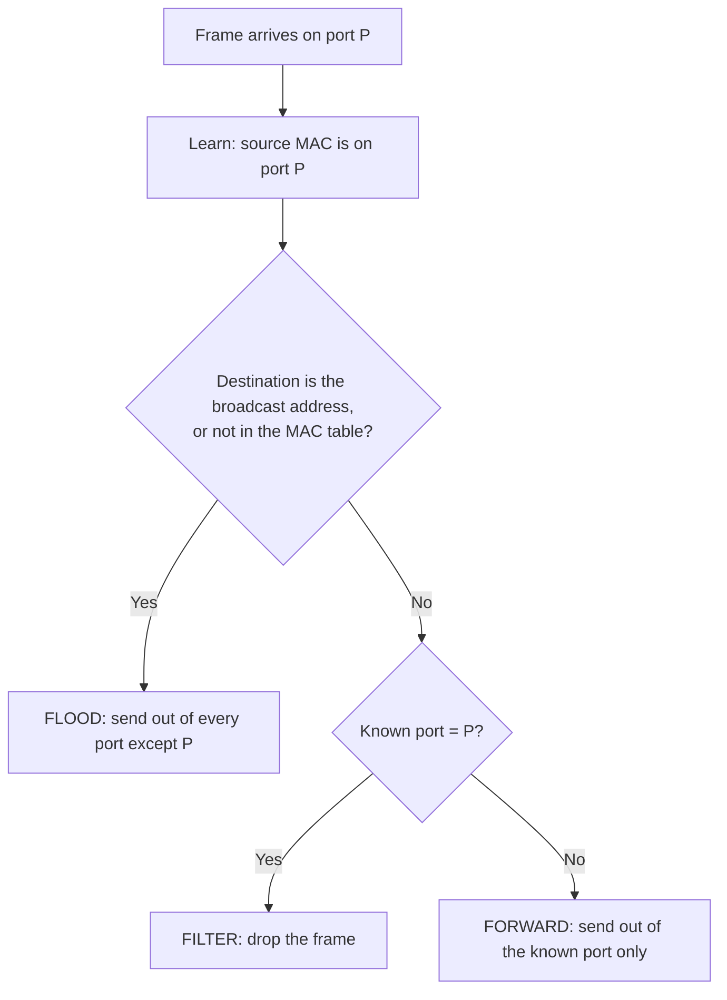
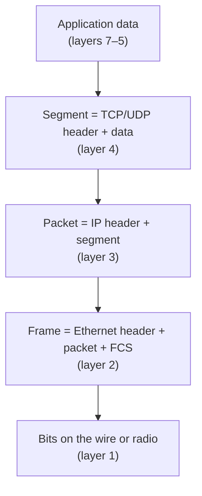
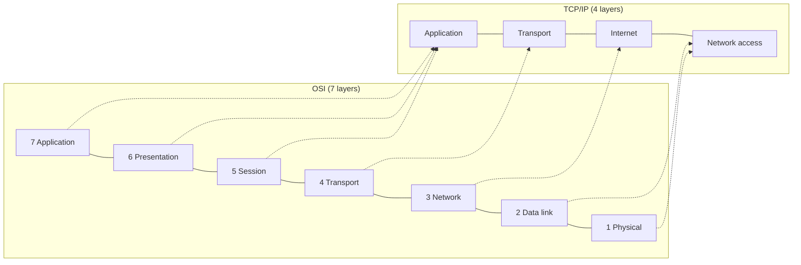

# Lecture 4 — Ethernet, Switching and Network Models

**Module:** 4301COMP Computer Systems Architecture

**Session:** Teaching Week 02, Session B

## Start here

Lecture 3 introduced networks, topologies, devices and IP addresses. This lecture goes one level deeper: how **Ethernet** moves frames using **MAC addresses**, how **switches learn**, which **transmission media** carry the signals, the three ways of **switching** data through a network, and the **OSI and TCP/IP models** that organise all of it into layers. After reading, do **Lab 4** (`../Labs/Lab-04-Ethernet-Switching-and-Network-Models-Hands-on-Workbook.md`), where you extend your Packet Tracer LAN to two switches and experiment with the subnet mask.

**Labels used in these notes:** **Official** = from the TW02 Session B slides or lab sheet. **Extra** = added explanation, not on the slides. **Verified** = actually run or calculated before being written down. **Expected** = not run here.

> **Note on the slides.** Slides 7, 9, 11, 13, 15, 20, 23, 29 and 34 are diagrams, and slide 26 is mostly a diagram. Only their titles and labels were available as text. Slide 9 (**MAC and duplex**) and slide 34 (**OSI vs TCP/IP**) are important topics, so the matching sections explain them from standard textbook material, marked **Extra**. Check the real diagrams on Canvas.

> **Assessment date (Official, slide 36).** **AS1 hand-out: 6 October 2026.** The slide advises you to begin planning with your Packet Tracer practice.

---

## 1. Overview

When PC1 pings PC3 in your Packet Tracer LAN, a lot happens that you cannot see: PC1 finds PC3's **MAC address**, builds an **Ethernet frame**, the **switch** looks up which port leads to PC3, and the bits travel over **copper**. This lecture explains each step and where it sits in the **layered models** that network engineers use to describe and troubleshoot networks.

**Why this matters for cyber security.** Attacks and defences are usually described by layer: "a layer-2 attack", "a layer-7 firewall". Switch behaviour (learning and flooding) is the basis of several local-network attacks, and the choice of medium affects how easy it is to tap a link.

## 2. By the end you should be able to

1. Describe what **Ethernet** is and the main fields of an **Ethernet frame**.
2. Explain what a **MAC address** is, how it is written and how it differs from an IP address.
3. Explain **half duplex** and **full duplex**, and **collision domains** and **broadcast domains**.
4. Trace how a **switch** learns MAC addresses and decides to **forward**, **flood** or **filter** a frame.
5. Compare **copper**, **coaxial** and **optical-fibre** media, and wired with wireless links.
6. Compare **circuit**, **message** and **packet switching**, and **virtual-circuit** with **datagram** services.
7. Name the seven **OSI** layers and four **TCP/IP** layers, and place protocols, devices and addresses in the right layer.
8. Use a **subnet mask** of 255.255.255.128 to decide whether two addresses are in the same subnet, and convert data sizes and link speeds to transfer times.

## 3. Learning outcomes

**Session learning outcomes (Official, slide 3):**

- Describe the purpose of Ethernet and MAC addressing.
- Compare copper, coaxial and optical-fibre media.
- Compare circuit, message and packet switching.
- Map common networking functions to the OSI and TCP/IP models.

**Module learning outcomes supported** (module guide, as recorded in this module's project instructions):

| Module LO | How this lecture supports it |
| --- | --- |
| **LO4** Explain the fundamental concepts involved in computer networking | All of this lecture |
| **LO2** Demonstrate knowledge of the structure and organisation of computer systems | The network interface and its MAC address as part of the system |

This material is relevant to the **report (40%)**, which assesses data storage and computer networking (module guide).

## 4. Matching lab and what you need first

- **Matching lab:** Lab 4. It contains all the official TW02 Session B tasks: reopening your TW02A LAN, adding a second switch, testing it, recording IP and MAC addresses, the 255.255.255.128 subnet-mask experiment, and breaking the inter-switch link.
- **From Lecture 3 you need:** LAN/WAN, star and hierarchical topologies, the device table (hub, switch, bridge, router, access point), parity as error detection, IPv4 addresses and the /24 subnet mask, and `ping`.
- **From Lectures 1–2 you need:** bits and bytes; *n* bits give 2ⁿ patterns.

---

## 5. Recap of the previous session (slide 4, Official)

- Networks connect autonomous devices so they can communicate and share resources.
- Network scale and topology affect how devices are organised.
- Parity provides a simple form of transmission error detection.
- IP settings, `ping`, traceroute, counters and logs support fault diagnosis.

---

## 6. Wired and wireless links (slide 5, Official)

| | Wired links | Wireless links |
| --- | --- | --- |
| Strengths | Predictable performance, low **latency**, strong physical control | Mobility, flexible installation |
| Typical use | Desktops, servers, switches, backbones | Laptops, phones, places where cabling is hard |

**Latency** (Extra) is the delay before data arrives; lower is better for calls and games.

The slide's conclusion: actual speed, reliability, security and cost depend on the standard, equipment, interference, distance, cabling and configuration. **Neither medium is universally superior**; the choice depends on the deployment.

> **Cyber security link.** "Strong physical control" matters: to tap a cable an attacker needs physical access, whereas radio signals spread beyond the building. That is why Wi-Fi must always be encrypted, and why server rooms are locked.

---

## 7. Wired network technologies (slide 6)

Slide 6 names three groups, covered in turn below:

1. The **IEEE 802.3 Ethernet** family (sections 8–10).
2. **Copper (telephone) access** (section 11).
3. **Coaxial** and **optical-fibre access** (sections 12–13).

---

## 8. Ethernet (slides 7–8)

### 8.1 Official

- Ethernet is a **family of IEEE 802.3 LAN standards**.
- Common access speeds: **100 Mb/s, 1 Gb/s, 2.5 Gb/s, 5 Gb/s and 10 Gb/s**.
- Data-centre and provider Ethernet also includes **25, 40, 50, 100, 200, 400 and 800 Gb/s** families.
- The supported rate depends on the interfaces, transceivers, cabling and **negotiated link mode**.

**IEEE** (Extra) is the Institute of Electrical and Electronics Engineers, the body that publishes the Ethernet standards. **Negotiated** means the two ends agree automatically on the fastest speed and mode they both support (called **auto-negotiation**).

### 8.2 Bits, bytes and transfer times (Extra, Verified)

Link speeds are in **bits** per second (b/s); file sizes are usually in **bytes** (B). **1 byte = 8 bits.** Mixing them up gives answers 8 times wrong.

> **time = (size in bits) ÷ (rate in bits per second)**

**Worked example:** how long does a 100 MB file take over 100 Mb/s Ethernet, ignoring overheads?

1. Convert the size to bits: 100 MB = 100 × 10⁶ bytes × 8 = 800 × 10⁶ bits.
2. Rate: 100 Mb/s = 100 × 10⁶ bits/s.
3. Time = (800 × 10⁶) ÷ (100 × 10⁶) = **8 s**.
4. At 1 Gb/s (1,000 × 10⁶ bits/s): 800 ÷ 1,000 = **0.8 s**.

Real transfers take a little longer, because every frame also carries headers and there are gaps between frames.

### 8.3 The Ethernet frame (Extra)

Ethernet sends data in **frames**. The main fields of an Ethernet II frame:

| Field | Size | Purpose |
| --- | --- | --- |
| Preamble and start frame delimiter | 8 bytes | A bit pattern that lets the receiver synchronise its clock |
| **Destination MAC address** | 6 bytes | Which interface the frame is for |
| **Source MAC address** | 6 bytes | Which interface sent it |
| Type | 2 bytes | What is inside, e.g. IPv4 or ARP |
| **Payload** (data) | 46–1,500 bytes | The packet being carried, such as an IP packet |
| **Frame check sequence (FCS)** | 4 bytes | A **CRC**: the receiver recalculates it and discards the frame if it does not match |

The FCS is the stronger cousin of the parity bit from Lecture 3: error **detection**, not correction. A damaged frame is simply dropped.

---

## 9. MAC addresses and duplex (slide 9)

**Official title; content Extra** (except where the official lab sheet is quoted).

### 9.1 MAC addresses

The official lab sheet defines it: **"A MAC address is a 48-bit Layer 2 address associated with a network interface and is used for Ethernet frame delivery on the local network."**

- **48 bits** = 6 bytes, which allows 2⁴⁸ = 281,474,976,710,656 addresses (Verified).
- It is written as **12 hexadecimal digits**, usually in pairs separated by colons or hyphens: `00:1A:2B:3C:4D:5E` or `00-1A-2B-3C-4D-5E`. **Hexadecimal** (Extra preview) uses the digits 0–9 and the letters A–F, so each digit stands for 4 bits; it is covered properly later in the module.
- The **first half** (24 bits) is usually the **OUI** (Organisationally Unique Identifier): a code the IEEE gives to each manufacturer. The second half is the interface's number within that manufacturer.
- The **broadcast** MAC address is `FF:FF:FF:FF:FF:FF`: "every device on this local network".
- Virtual machines and privacy features often use **locally administered** addresses, which do not belong to a manufacturer. The Linux machine used to check these notes has the MAC address `02:fc:00:00:00:01` (Verified); the leading `02` marks it as locally administered.

### 9.2 MAC address versus IP address

The official lab sheet: an **IP address is a logical Layer 3 address** used to identify a device or interface on an IP network; a **MAC address is a 48-bit Layer 2 address** used for frame delivery on the **local** network.

| | MAC address | IPv4 address |
| --- | --- | --- |
| Layer | 2 (data link) | 3 (network) |
| Length | 48 bits | 32 bits |
| Written as | `00:1A:2B:3C:4D:5E` (hex) | `192.168.10.11` (dotted decimal) |
| Set by | The manufacturer (can be overridden) | The network administrator or DHCP |
| Scope | One local network only | Across networks, through routers |
| Analogy (with limits) | A person's name on a delivery note for one building | The postal address used across the country |

### 9.3 How PC1 finds PC3's MAC address: ARP (Extra)

PC1 knows PC3's **IP** address (you typed it). To build a frame it also needs PC3's **MAC** address. It uses the **Address Resolution Protocol (ARP)**:

1. PC1 broadcasts an ARP request: "Who has 192.168.10.13? Tell 192.168.10.11." (destination MAC `FF:FF:FF:FF:FF:FF`)
2. Every device on the LAN receives it; only PC3 replies: "192.168.10.13 is at `00:…:03`."
3. PC1 stores the answer in its **ARP cache** and sends the real frames.

This is why the **first** ping in Packet Tracer sometimes times out (as the official lab sheet warns): the first packet waits while ARP finishes.

A real ARP (neighbour) table entry from the Linux checking machine (Verified, `ip neigh`):

```text
192.0.2.1 dev eth0 lladdr 02:fc:00:00:00:05 REACHABLE
```

It says the gateway 192.0.2.1 has MAC address `02:fc:00:00:00:05`. On Windows, `arp -a` shows the same kind of table.

> **Cyber security link: ARP spoofing.** ARP has no authentication: any device can reply "that IP is at **my** MAC". An attacker on the LAN can do this to receive traffic meant for the gateway (a "man-in-the-middle" attack). Switch features such as Dynamic ARP Inspection exist to stop it.

### 9.4 Duplex

- **Half duplex:** a device can send **or** receive, but not both at once (like a walkie-talkie). On old shared Ethernet, two devices sending at once caused a **collision**: both signals were garbled and had to be re-sent. The rule that handled this was **CSMA/CD** (listen before sending; detect collisions; wait a random time; retry).
- **Full duplex:** a device can send **and** receive at the same time (like a phone call). Each switch port with full duplex has separate paths for each direction, so **collisions cannot happen**.

Modern switched Ethernet runs full duplex. A **duplex mismatch** (one end half, the other full) is a classic cause of a link that works but is very slow and shows many errors.

---

## 10. Hubs, switches and routers (slide 10)

### 10.1 Official

| Device | Layer | What it does | Domains |
| --- | --- | --- | --- |
| **Hub** | Physical (1) | Repeats incoming bits to every other port; does not learn MAC addresses | All connected devices share **one collision domain** |
| **Switch** | Data link (2) | Learns source MAC addresses in a **MAC (CAM) table** and forwards Ethernet frames to the required port | **Each switch port is a separate collision domain** |
| **Router** | Network (3) | Reads destination IP addresses and uses a **routing table** to forward packets between subnets | **Each router interface separates broadcast domains** |

### 10.2 Domains explained (Extra)

- A **collision domain** is the part of a network where two devices sending at once would collide. A hub makes all its ports one collision domain; a switch gives each port its own.
- A **broadcast domain** is the set of devices that receive a broadcast frame (such as an ARP request). Switches **pass broadcasts on**; routers **stop** them. So one switched LAN, however many switches it has, is **one broadcast domain**; each router interface starts a new one.

**Worked example (Extra): counting domains**

| Network | Collision domains | Broadcast domains |
| --- | --- | --- |
| One hub with 4 PCs | **1** (the hub shares everything) | **1** |
| One switch with 4 PCs (your TW02A LAN) | **4** (one per PC link) | **1** |
| Two switches joined by one link, 2 PCs on each (the official TW02B LAN) | **5** (4 PC links + 1 inter-switch link) | **1** |
| A router with two interfaces, each to a switch with 3 PCs | **8** (6 PC links + 2 router–switch links) | **2** (one per router interface) |

**Rule of thumb:** count every link that ends on a switch or router port as one collision domain; count every router interface (with its LAN behind it) as one broadcast domain.

### 10.3 How a switch learns (Extra, Verified with the Lab 4 simulator)

For **every** frame that arrives, a switch:

1. **Learns:** it records "this **source** MAC address is reachable on the port the frame arrived on".
2. **Decides:**
   - destination MAC **in the table** → **forward** out of that one port only;
   - destination **unknown**, or the **broadcast** address → **flood** out of every port except the one it arrived on;
   - destination is on the **same** port it arrived on → **filter** (drop it; it does not need to cross the switch).

**Trace:** a switch has PC1–PC4 on ports Fa0/1–Fa0/4. Its MAC table starts empty.

| Frame | Learns | Destination known? | Action | Sent out of | Table size after |
| --- | --- | --- | --- | --- | --- |
| 1. PC1 → broadcast (ARP request) | PC1 on Fa0/1 | Broadcast | **Flood** | Fa0/2, Fa0/3, Fa0/4 | 1 |
| 2. PC3 → PC1 (ARP reply) | PC3 on Fa0/3 | Yes (Fa0/1) | **Forward** | Fa0/1 | 2 |
| 3. PC1 → PC3 | (PC1 again) | Yes (Fa0/3) | **Forward** | Fa0/3 | 2 |
| 4. PC2 → PC4 | PC2 on Fa0/2 | **No** | **Flood** | Fa0/1, Fa0/3, Fa0/4 | 3 |
| 5. PC4 → PC2 | PC4 on Fa0/4 | Yes (Fa0/2) | **Forward** | Fa0/2 | 4 |

Notice in frame 4 that PC1 and PC3 also receive a copy of a frame meant for PC4. That only happens until the switch has learned PC4's port.



> **Cyber security link: MAC flooding.** A switch's MAC table has a limited size. An attacker who sends thousands of frames with fake source MACs can fill it, after which the switch floods frames to every port like a hub, letting the attacker see other people's traffic. **Port security** (limiting how many MACs a port may learn) is the standard defence.

---

## 11. Copper (telephone) access (slides 11–12)

### 11.1 Official

- Telephone networks have provided connectivity for decades.
- The network connecting users across and between countries is the **Public Switched Telephone Network (PSTN)**.
- The service delivered to the end user is **Plain Old Telephone Service (POTS)**.
- The access line in most telephone networks is a **twisted-pair copper cable** between the local exchange and the home or office.
- Because telephones were everywhere, data communications adapted to use the network: **dial-up** internet access, **ISDN** (Integrated Services Digital Network), and **Digital Subscriber Line** technologies such as **ADSL, HDSL and VDSL**.

### 11.2 Explained (Extra)

- **Twisted pair:** two insulated copper wires twisted together. The twisting cancels much of the electrical interference picked up along the way. The same idea, in cables with four twisted pairs, is used for Ethernet (the "copper straight-through" cables in Packet Tracer).
- **Dial-up** used a modem to turn data into sounds on a phone call: very slow (at most 56 kb/s) and the phone line was busy.
- **DSL** sends data at frequencies above the voice range on the same copper pair, so phone and internet work at once. **ADSL** is *asymmetric*: faster download than upload, which suits most home users. Speed falls as the distance to the exchange or street cabinet grows.

---

## 12. Coaxial cable access (slides 13–14)

**Official key features:** generally **faster than ADSL**, although a **shared medium**; customers can avoid paying for a telephone line if they use **Voice over IP**.

**Explained (Extra):** **coaxial** cable has a central copper conductor surrounded by insulation, a metal shield and an outer jacket. The shield keeps interference out, so coax carries higher frequencies than twisted pair. Cable broadband (and cable TV) uses it. "Shared medium" means all the homes on one local segment share its capacity, so speeds can drop at busy times. **Voice over IP (VoIP)** carries phone calls as data packets, so no separate phone line is needed.

---

## 13. Optical-fibre access (slides 15–17)

**Official:**

| Point | Detail |
| --- | --- |
| Deployment | **Fibre-to-the-premises** access is now widely deployed, as well as fibre in provider core networks |
| PON | **Passive optical networks** share optical capacity among a group of premises |
| Speeds | Retail services range from hundreds of megabits to multi-gigabit, depending on provider and PON generation |
| Advantages | **Resistant to electromagnetic interference**; supports **long distances** and **high capacity** |
| Other features (slide 17) | Much higher data rates than copper and coax; carries data, voice and video (e.g. digital TV); **requires installation of optical fibre** |

**Explained (Extra):** fibre carries data as **pulses of light** in a thin glass strand, not electricity. Light is not affected by electrical interference, loses little strength over distance, and can be switched on and off extremely fast. "Passive" means the splitters in the street need no power.

### 13.1 Comparing the media (Extra summary of slides 11–17)

| | Twisted-pair copper | Coaxial | Optical fibre |
| --- | --- | --- | --- |
| Carries | Electrical signals | Electrical signals | Light |
| Typical capacity | Lower (DSL); up to 10 Gb/s over short Ethernet runs | Higher than DSL; shared | Highest; multi-gigabit and beyond |
| Distance | Short for high speeds (100 m for Ethernet) | Medium | Long (kilometres) |
| Interference | Affected; twisting reduces it | Shield reduces it | **Immune** to electromagnetic interference |
| Cost and installation | Cheapest; already installed everywhere | Moderate; existing cable-TV networks | Highest; new installation needed |
| Tapping | Easier | Easier | Much harder without being detected |

---

## 14. Implementing networks: switching (slide 18, Official)

The core of building a network is its **switching** mechanism: channelling data received on any input port to the port that will transmit it towards its destination. There are three forms:

1. **Circuit switching**
2. **Message switching**
3. **Packet switching**

("Switching" here means the general idea of passing data from link to link through intermediate nodes; it is wider than an Ethernet switch.)

### 14.1 Circuit switching (slides 19–21, Official)

- The **public telephone system** is the classic example. When a caller dials, a **path** is set up through switches in all the exchanges along the way.
- The circuit is **set up and held for the duration of the call**. Once established it behaves like **one dedicated cable** (a point-to-point link).
- After set-up, the **reserved capacity** gives **predictable** service.
- **But:** set-up can **fail or wait** when capacity is unavailable, and reserved capacity that is not being used (silences in a call) **cannot be used by other traffic**.

### 14.2 Message switching (slides 22–24, Official)

- Each intermediate node **stores the entire message** before forwarding it (**store-and-forward**).
- No dedicated end-to-end circuit is needed, but **large messages create long storage and forwarding delays**.
- It is mainly of **historical interest**; modern data networks normally use packet switching.

**Advantages (slide 24):** no call set-up delay; the two computers do not have to communicate at the same rate; the sender can send when ready even if the receiver is not; the network effectively acts as a **buffer** (temporary storage).

### 14.3 Packet switching (slides 25–27 and 31, Official)

- Data is divided into **protocol data units (PDUs)** such as **frames**, **IP packets** and **transport segments**. Their lengths are usually **variable within protocol limits**.
- **Headers** carry addressing and control information; error-detection fields depend on the layer and protocol.
- Intermediate devices **store and forward packets independently**.
- An **IP datagram** is forwarded independently, and IP itself gives **best-effort** delivery: it does **not** acknowledge delivery or retransmit lost datagrams.
- Higher layers may add acknowledgements, retransmission and ordering: **TCP does; UDP does not**.
- Packet switching **shares network capacity** among many flows and can use **alternative routes** dynamically. It is very efficient for **bursty** data (traffic that comes in short bursts with gaps, like web browsing). The trade-off: **delay and loss can vary** when queues build up or links fail.
- Cost and security are not decided simply by distance or by packets taking several routes. Security and continuity come from **encryption and authentication**, **traffic filtering** and **resilient design**.

**Slide 26's diagram** shows packets numbered 1–4 leaving A and travelling through nodes towards D, some by different routes (for example "1 to 3", "2 to 4"), illustrating that packets of the same message can take different paths.

### 14.4 Why packets beat whole messages (Extra, Verified)

Simple model: a 1 Mbit message crosses **3 links**, each 1 Mb/s, ignoring headers and queues.

- **Message switching:** each link must receive the **whole** message before passing it on. Each link takes 1 Mbit ÷ 1 Mb/s = 1 s, so the total is 3 × 1 = **3 s**.
- **Packet switching with 10 packets** of 0.1 Mbit: while link 2 is passing on packet 1, link 1 is already sending packet 2 (a **pipeline**). Delay = (links + packets − 1) × time per packet = (3 + 10 − 1) × 0.1 s = **1.2 s**.
- With 100 packets: (3 + 100 − 1) × 0.01 s = **1.02 s**.

Smaller packets let all the links work at once. (In reality each packet also carries a header, so packets that are too small waste capacity: another trade-off.)

### 14.5 Virtual circuits and datagrams (slides 28–30, Official)

| | **Virtual circuit** (connection-oriented) | **Datagram** (connectionless) |
| --- | --- | --- |
| Before sending | A **logical connection** is set up | Nothing: just send |
| Route | All packets of a connection **follow the same route** | Each packet is treated **independently** and can take **any practical route** |
| Physical path | **No** real dedicated path: packets are queued at each node and **share links** with unrelated packets | Shared links |
| Order | Delivered **in the correct order** | **May arrive out of order** |
| Loss | (Handled by the connection) | **Packets may go missing**; it is up to the receiver to re-order and recover |

Slide 29: a virtual circuit is said to exist **between the connected computers**.

> **Common confusion.** A **virtual** circuit is not a real circuit: nothing is reserved end to end, unlike circuit switching. It is an agreement that all packets follow one route in order. **IP is a datagram service**; **TCP** adds connection-like reliability on top of it.

---

## 15. The OSI model (slide 32)

### 15.1 Official

| Layer | Name | Function |
| --- | --- | --- |
| 7 | **Application** | Protocols/services used by applications (not merely the user interface) |
| 6 | **Presentation** | Data formatting (representation), encryption, compression |
| 5 | **Session** | Establishes and manages dialogues (connections) between devices where needed |
| 4 | **Transport** | End-to-end process communication. **TCP**: reliable, ordered; **UDP**: no delivery or order guarantee |
| 3 | **Network** | Logical addressing and routing (**IP**) |
| 2 | **Data link** | Physical addressing (**MAC**), local frame delivery, error detection |
| 1 | **Physical** | Transmission of bits through cables or signals |

A popular memory aid (Extra), from layer 1 upwards: **P**lease **D**o **N**ot **T**hrow **S**ausage **P**izza **A**way (Physical, Data link, Network, Transport, Session, Presentation, Application).

### 15.2 Why layers? (Extra)

Each layer does one job and only talks to the layers directly above and below, so they can change independently. Your browser does not care whether the link below is Wi-Fi or fibre. This is the same idea as the software layers in Lecture 1, section 22.

### 15.3 Encapsulation (Extra)

As data goes **down** the layers at the sender, each layer adds its own **header** (and the data link layer also adds a trailer, the FCS). At the receiver, each layer removes its header going **up**. The PDU has a different name at each layer:



### 15.4 Where things sit (Extra, using the official layer functions)

| Layer | PDU | Addresses | Devices | Examples |
| --- | --- | --- | --- | --- |
| 7 Application | Data | (names, e.g. www.ljmu.ac.uk) | — | HTTP, DNS, SMTP, FTP |
| 6 Presentation | Data | — | — | Encryption, compression, character encoding |
| 5 Session | Data | — | — | Setting up and managing a dialogue |
| 4 Transport | Segment (TCP) / datagram (UDP) | Port numbers | — | TCP, UDP |
| 3 Network | Packet | IP addresses | Router | IP, ICMP (ping) |
| 2 Data link | Frame | MAC addresses | Switch, bridge, access point | Ethernet, Wi-Fi framing, ARP |
| 1 Physical | Bits | — | Hub, cables, repeaters | Copper, coax, fibre, radio |

ARP is usually placed between layers 2 and 3, because it links an IP address to a MAC address. **Port numbers** are covered in a later lecture.

---

## 16. The TCP/IP model (slide 33)

### 16.1 Official

| TCP/IP layer | OSI equivalent | Function | Examples |
| --- | --- | --- | --- |
| **Application** | Layers 5–7 | Network services used by applications | HTTP, DNS, SMTP, FTP |
| **Transport** | Layer 4 | TCP: reliable, ordered bytes; UDP: no delivery or ordering guarantee | TCP, UDP |
| **Internet** | Layer 3 | IP addressing and routing | IP |
| **Network access (link)** | Layers 1–2 | Local framing and access to the physical network | Ethernet, Wi-Fi |

### 16.2 OSI versus TCP/IP (slide 34; comparison Extra)



| | OSI | TCP/IP |
| --- | --- | --- |
| Layers | 7 | 4 |
| Origin | A reference model designed by a standards body | Grew from the protocols actually used on the internet |
| Main use today | **Teaching and troubleshooting** language ("a layer-2 problem") | **Real implementation**: the protocols your computer runs |
| Presentation and session | Separate layers | Folded into the application layer |

> **Cyber security link: thinking in layers.** Attacks and controls are often named by layer: MAC flooding and ARP spoofing (layer 2), IP spoofing (layer 3), port scanning (layer 4), phishing websites (layer 7). A basic **firewall** filters on IP addresses and ports (layers 3–4); a **web application firewall** inspects HTTP (layer 7). Encryption such as HTTPS protects data at the top, but the lower layers still reveal who is talking to whom.

---

## 17. Subnet masks beyond /24: 255.255.255.128 (from the official lab, Task 5)

The official lab changes the mask to **255.255.255.128**. This section explains why PC1 and PC4 stop communicating (Extra explanation; calculations Verified).

1. In binary, 128 is `10000000` (Verified). So 255.255.255.128 has **25** one-bits: it is a **/25** mask. One extra bit of the last octet now belongs to the network part.
2. That one bit splits the old /24 network into **two halves** of 128 addresses each:

| Subnet | Network address | Usable hosts | Broadcast address |
| --- | --- | --- | --- |
| 192.168.10.0/25 | 192.168.10.0 | .1 – .126 (126 hosts) | 192.168.10.127 |
| 192.168.10.128/25 | 192.168.10.128 | .129 – .254 (126 hosts) | 192.168.10.255 |

3. **PC1 = 192.168.10.11** is in the **first** half; **PC4 = 192.168.10.130** is in the **second** half.
4. Different subnets + no router = **no communication**. With the /24 mask, both were in 192.168.10.0/24, which is why Stage A worked.

**Quick rule for /25:** last octet 0–127 → lower half; 128–255 → upper half.

> **Common confusion.** The PCs did not move, and no cable changed. Only the **mask** changed, and with it each PC's idea of which addresses are "local". This is why masks must be consistent across a network.

---

## 18. Common mistakes

| Mistake | Symptom | Fix |
| --- | --- | --- |
| Mixing bits and bytes | Transfer times 8× wrong | Size in bytes × 8 = bits; link speeds are bits per second |
| Thinking a MAC address works across the internet | Wrong explanations of routing | MACs are for the **local** network; IP addresses cross routers |
| Saying a switch floods every frame | Confusing it with a hub | A switch floods only broadcasts and unknown destinations |
| Saying switches separate broadcast domains | Wrong domain counts | Switches separate **collision** domains; **routers** separate broadcast domains |
| Thinking a virtual circuit reserves capacity | Mixing it with circuit switching | Virtual circuit = same route, in order, but links are shared |
| Saying IP guarantees delivery | Wrong transport answers | IP is best-effort; **TCP** adds reliability, UDP does not |
| Putting the switch at layer 3 or the router at layer 2 | Wrong OSI tables | Hub 1 · switch 2 · router 3 |
| Thinking the application layer is the user interface | Weak OSI answers | Slide 32: it is the network **services** applications use (HTTP, DNS) |
| Assuming fibre is always the right choice | Ignoring cost and installation | Choose by requirements; neither medium is universally superior |
| Thinking 255.255.255.128 still gives one network of 254 hosts | Wrong subnet answers | /25 splits it into two subnets of 126 hosts |

---

## 19. Check yourself: 15 multiple-choice questions

**Q1.** Ethernet is a family of standards published as:
A) IEEE 802.3
B) IEEE 802.11
C) ISDN
D) PSTN

**Q2.** How long is a MAC address?
A) 32 bits
B) 64 bits
C) 48 bits
D) 128 bits

**Q3.** A switch receives a frame whose destination MAC is not in its MAC table. What does it do?
A) Drops it
B) Sends it back to the sender
C) Sends it to the router
D) Floods it out of every port except the one it arrived on

**Q4.** Which device separates **broadcast** domains?
A) Hub
B) Router
C) Switch
D) Access point

**Q5.** How many collision domains are there in one switch with 4 PCs connected (no other links)?
A) 1
B) 2
C) 4
D) 8

**Q6.** Which medium is immune to electromagnetic interference?
A) Optical fibre
B) Twisted-pair copper
C) Coaxial cable
D) Wi-Fi

**Q7.** Which switching method reserves capacity for the whole duration of a connection?
A) Packet switching
B) Message switching
C) Datagram switching
D) Circuit switching

**Q8.** In message switching, each intermediate node:
A) Reserves a circuit before sending
B) Stores the entire message before forwarding it
C) Splits the message into small packets
D) Never stores any data

**Q9.** Which statement about IP is correct (slide 27)?
A) IP acknowledges every datagram
B) IP retransmits lost datagrams
C) IP provides best-effort delivery; TCP may add acknowledgements and retransmission
D) IP guarantees packets arrive in order

**Q10.** Datagram (connectionless) packets:
A) Always follow the same route
B) Are treated independently, may take different routes and may arrive out of order
C) Need a circuit to be set up first
D) Never get lost

**Q11.** Which OSI layer handles logical addressing and routing?
A) Layer 3, Network
B) Layer 2, Data link
C) Layer 4, Transport
D) Layer 7, Application

**Q12.** Which TCP/IP layer corresponds to OSI layers 1 and 2?
A) Application
B) Transport
C) Internet
D) Network access (link)

**Q13.** How long does a 100 MB file take over a 1 Gb/s link, ignoring overheads?
A) 100 s
B) 0.8 s
C) 0.1 s
D) 8 s

**Q14.** With mask 255.255.255.128, which pair is in the **same** subnet?
A) 192.168.10.11 and 192.168.10.130
B) 192.168.10.127 and 192.168.10.128
C) 192.168.10.14 and 192.168.10.100
D) 192.168.10.100 and 192.168.10.200

**Q15.** Why does the first ping sometimes time out in Packet Tracer?
A) The switch is broken
B) The first packet waits while ARP finds the destination's MAC address
C) Ping always fails once on purpose
D) The cable needs warming up

### Answers

| Q | Answer | Why |
| --- | --- | --- |
| 1 | **A** | Slide 8: Ethernet is a family of IEEE 802.3 LAN standards (802.11 is Wi-Fi). |
| 2 | **C** | Official lab sheet: a MAC address is a 48-bit Layer 2 address. |
| 3 | **D** | Unknown destinations are flooded; the switch learns from the reply. |
| 4 | **B** | Slide 10: each router interface separates broadcast domains. |
| 5 | **C** | Slide 10: each switch port is a separate collision domain; 4 PC links = 4. |
| 6 | **A** | Slide 16: optical fibre is resistant to electromagnetic interference (it carries light). |
| 7 | **D** | Slide 21: circuit switching reserves resources for the duration of a connection. |
| 8 | **B** | Slide 22: message switching stores the entire message at an intermediate node. |
| 9 | **C** | Slide 27: IP is best-effort; TCP adds acknowledgements, retransmission and ordering. |
| 10 | **B** | Slide 30: each packet is treated independently and may arrive out of order or go missing. |
| 11 | **A** | Slide 32: layer 3 provides logical addressing and routing (IP). |
| 12 | **D** | Slide 33: network access (link) covers OSI layers 1–2. |
| 13 | **B** | 100 MB × 8 = 800 Mb; 800 ÷ 1,000 = 0.8 s (Verified). |
| 14 | **C** | 14 and 100 are both in .0–.127 (Verified). 127 and 128 sit either side of the split. |
| 15 | **B** | The official lab sheet notes the first ping may time out while devices establish the information needed: that is ARP. |

---

## 20. Quick reference

**Ethernet:** IEEE 802.3 · 100 Mb/s – 10 Gb/s access; up to 800 Gb/s in data centres · frame = preamble, dest MAC, source MAC, type, payload 46–1,500 B, FCS (CRC).

**MAC address:** 48 bits · 12 hex digits · first 24 bits = OUI (manufacturer) · broadcast `FF:FF:FF:FF:FF:FF` · layer 2 · local only.

**ARP:** IP → MAC, by broadcast request and unicast reply; cached (`arp -a`, `ip neigh`).

**Duplex:** half = one direction at a time (collisions possible on shared media) · full = both at once (no collisions).

**Switch:** learn source → forward known / flood unknown and broadcast / filter same-port.

**Domains:** hub = 1 collision domain · switch port = 1 collision domain each · router interface = 1 broadcast domain each.

**Media:** copper (cheap, interference, short at high speed) · coax (faster than DSL, shared, shielded) · fibre (light, immune to EMI, long, highest capacity, needs installation).

**Switching:** circuit (reserved path, predictable, wasteful) · message (store whole message, long delays, historical) · packet (independent PDUs, shared links, efficient for bursty traffic).

**Services:** virtual circuit = set up, same route, in order · datagram = independent, any route, may be lost or reordered.

**Time:** time = bits ÷ bit rate; bytes × 8 = bits. Message switching delay = N × L/R; packet switching ≈ (N + P − 1) × (L/P)/R.

**OSI:** 7 Application · 6 Presentation · 5 Session · 4 Transport · 3 Network · 2 Data link · 1 Physical.

**TCP/IP:** Application (5–7) · Transport (4) · Internet (3) · Network access (1–2).

**/25 mask (255.255.255.128):** .0–.127 and .128–.255; 126 hosts each.

## 21. Glossary

| Term | Meaning |
| --- | --- |
| **ARP** | Address Resolution Protocol: finds the MAC address for an IP address on the local network |
| **Best effort** | Delivery with no guarantee; lost packets are not re-sent by IP itself |
| **Broadcast domain** | The set of devices that receive a broadcast; routers mark its edges |
| **Bursty traffic** | Traffic that arrives in short bursts with gaps |
| **CAM / MAC table** | A switch's table of which MAC address is on which port |
| **Circuit switching** | Setting up and reserving a dedicated path for a whole connection |
| **Coaxial cable** | Cable with a central conductor inside a metal shield |
| **Collision domain** | The part of a network where simultaneous transmissions would collide |
| **CSMA/CD** | The old shared-Ethernet rule: listen, detect collisions, back off, retry |
| **Datagram** | A packet sent independently with no connection set up |
| **Duplex (half/full)** | Whether a link can send in one direction at a time or both at once |
| **Encapsulation** | Each layer adding its own header around the data from the layer above |
| **Ethernet** | The IEEE 802.3 family of wired LAN standards |
| **FCS** | Frame check sequence: the CRC at the end of an Ethernet frame |
| **Flooding** | Sending a frame out of every port except the one it arrived on |
| **Latency** | The delay before data arrives |
| **MAC address** | A 48-bit layer-2 address of a network interface |
| **Message switching** | Storing a whole message at each node before forwarding it |
| **OSI model** | A seven-layer reference model of network functions |
| **OUI** | The manufacturer part (first 24 bits) of a MAC address |
| **Packet switching** | Splitting data into independent PDUs that share links |
| **PDU** | Protocol data unit: segment, packet, frame or bits, depending on the layer |
| **PON** | Passive optical network: one fibre shared by a group of premises |
| **PSTN / POTS** | The public telephone network / the basic phone service it provides |
| **TCP / UDP** | Transport protocols: TCP reliable and ordered; UDP without guarantees |
| **TCP/IP model** | The four-layer model of the protocols used on the internet |
| **Twisted pair** | Two copper wires twisted together to reduce interference |
| **Virtual circuit** | A logical connection in which all packets follow the same route in order |

## 22. Summary

- **Ethernet** (IEEE 802.3) delivers **frames** on a local network using 48-bit **MAC addresses**; **ARP** links IP addresses to MAC addresses.
- **Switches** learn which MAC is on which port and forward, flood or filter. Each switch port is a **collision domain**; each router interface separates **broadcast domains**. Modern links are **full duplex**.
- **Copper**, **coax** and **fibre** differ in capacity, reach, interference and cost; neither wired nor wireless is universally better.
- **Circuit switching** reserves a path; **message switching** stores whole messages; **packet switching** shares links with independent PDUs and dominates today. **IP** is best-effort; **TCP** adds reliability, **UDP** does not.
- The **OSI** (7 layers) and **TCP/IP** (4 layers) models organise networking into layers; each layer **encapsulates** the one above.
- Changing the mask to **255.255.255.128** splits a /24 into two /25 subnets, so devices in different halves need a router.

## 23. Next

According to slide 36, the next session is **Teaching Week 03, Session A: Operating Systems and the Kernel**. The slide also states: **AS1 hand-out: 6 October 2026. Begin planning with your Packet Tracer practice.**
