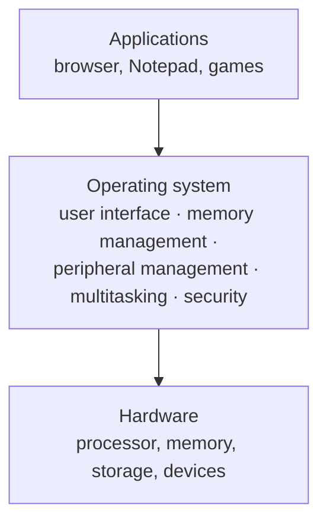
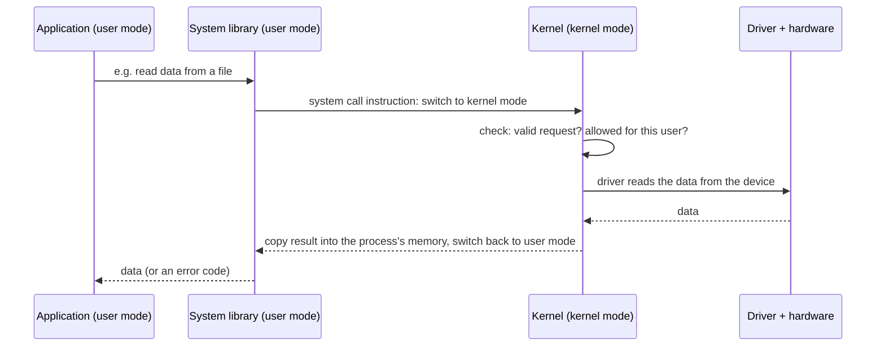
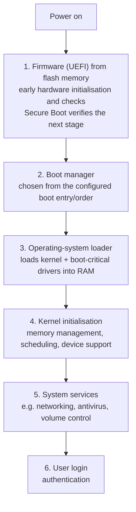
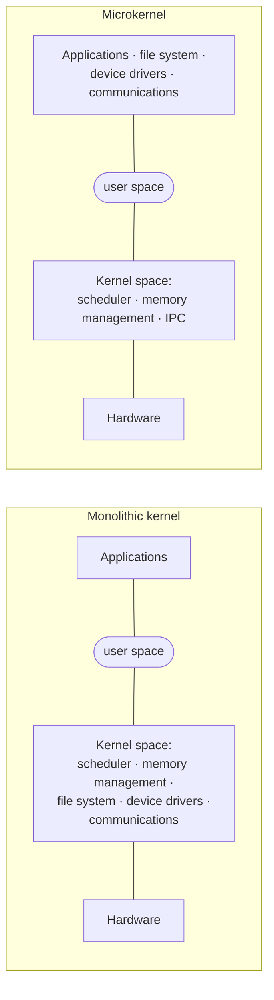

# Lecture 5 — Operating Systems and the Kernel

**Module:** 4301COMP Computer Systems Architecture

**Session:** Teaching Week 03, Session A

## Start here

Lecture 1 said that applications **ask the operating system** to use the hardware. This lecture explains how: what the **operating system (OS)** does, what the **kernel** is, how a program crosses into the kernel with a **system call**, how a computer **boots**, and the three main ways a kernel can be designed (**monolithic**, **microkernel** and **hybrid**). After reading, do **Lab 5** (`../Labs/Lab-05-Operating-Systems-and-the-Kernel-Hands-on-Workbook.md`), where you watch the kernel at work in Task Manager and see real system calls.

**Labels used in these notes:** **Official** = from the TW03 Session A slides or lab sheet. **Extra** = added explanation, not on the slides. **Verified** = actually run before being written down (on a Linux machine). **Expected** = not run here (for example Windows screens).

> **Note on the slides.** Slides 7, 13, 14 and 26 are diagrams; only their titles were available as text. The matching sections explain the topic from standard textbook material, marked **Extra**. Check the real diagrams on Canvas.

---

## 1. Overview

Without an operating system, every program would need its own code to drive the disk, the screen, the network card and the keyboard, and any program could read any other program's memory. The OS solves both problems: it gives programs **standard services** and it **protects** the hardware and other programs. Its core, the **kernel**, runs with the processor's highest privilege.

This lecture covers:

- what an OS does and why **abstraction** matters;
- the **kernel**: resource management, processes, threads, memory and devices;
- **user mode** and **kernel mode**, and **system calls** as the controlled door between them;
- the Windows kernel as a real example;
- the **boot sequence** from power-on to login, including **UEFI** and **Secure Boot**;
- **user interfaces**;
- **kernel design**: monolithic, microkernel and hybrid.

**Why this matters for cyber security.** The kernel decides what every program is allowed to do. Malware that reaches **kernel mode** can hide from security tools and control the whole machine, which is why boot protection (Secure Boot), driver quality and the system-call boundary are central to OS security.

## 2. By the end you should be able to

1. List the main functions of an operating system and explain **abstraction**.
2. Define the **kernel** and explain why it must be privileged and stay resident in memory.
3. Explain the difference between **user mode** and **kernel mode** (user space and kernel space).
4. Describe how the kernel manages **processes, threads, memory and devices**, including interrupts and exceptions.
5. Explain what a **system call** is, name the main categories, and recognise real system calls such as `open`, `read`, `write` and `close`.
6. Put the stages of the **boot sequence** in order and explain what **UEFI Secure Boot** does.
7. Compare **CLI** and **GUI** user interfaces.
8. Compare **monolithic**, **microkernel** and **hybrid** kernels, with an example and a trade-off for each.

## 3. Learning outcomes

**Session learning outcomes (Official, slide 3):**

- Explain the role of an operating system.
- Describe how the kernel manages processor, memory and device resources.
- Explain how applications request services through system calls.
- Compare monolithic, microkernel and hybrid kernel designs.

**Module learning outcomes supported** (module guide, as recorded in this module's project instructions):

| Module LO | How this lecture supports it |
| --- | --- |
| **LO3** Explain the role and functions of an operating system | All of this lecture |
| **LO2** Demonstrate knowledge of the structure and organisation of computer systems | Privilege levels, boot firmware, kernel structure |
| **LO1** Explain the fundamental principles underlying the operation of modern computer systems | Interrupts, the stored program loaded at boot |

The module **exam (60%)** covers operating systems (module guide).

## 4. Matching lab and what you need first

- **Matching lab:** Lab 5. It contains the official TW03 Session A tasks: mapping user actions to OS services, observing processes in Task Manager (PID, threads, CPU time, working set), and the kernel-architecture and boot-order challenge.
- **From earlier lectures you need:** the software layers (user → application → OS → hardware) from Lecture 1 sections 20–22; firmware and UEFI/BIOS (Lecture 1 section 20); **interrupts** and the saved PC (Lecture 2 section 18); RAM is volatile and programs must be loaded into it to run (Lecture 1 section 18).

---

## 5. Recap of the previous session (slide 4, Official)

- Ethernet defines widely used wired LAN technologies and MAC addressing.
- Transmission media differ in capacity, reach and resistance to interference.
- Packet switching shares links by dividing messages into independent units.
- The OSI and TCP/IP models organise networking functions into layers.

The OS links these two halves of the module: the **network stack** that implements TCP/IP is part of the operating system.

---

## 6. What an operating system does (slide 5)

### 6.1 Official

The OS sits **between applications and hardware**. Slide 5 lists its main functions:

| Function | What it means (Extra) | Example |
| --- | --- | --- |
| **User interface** | Lets people give commands and see results | The Windows desktop; Command Prompt |
| **Memory management** | Gives each program memory, keeps programs apart, reclaims memory | Opening Chrome allocates RAM to it |
| **Peripheral management** | Drives devices through **drivers** | Printing; using a USB stick |
| **Multitasking** | Runs many programs, apparently at once, by sharing the processor | Music playing while you type |
| **Security** | Controls who can do what | Login passwords; file permissions |



### 6.2 Abstraction (slides 6–7, Official)

- Applications request services through **operating-system interfaces**.
- The OS **manages and protects** hardware resources.
- This **abstraction** lets applications use services **without controlling each hardware device directly**.

Slide 7's diagram is titled **"Abstraction: Standard Interface"**. **Extra explanation:** a **standard interface** is one fixed way of asking for a service that works whatever hardware is underneath. Notepad uses the same "write this data to a file" request whether the file is on an SSD, a USB stick or a network drive; the OS and its drivers handle the differences. That is why one copy of a program runs on millions of different PCs.

> **Common confusion.** The OS is not "the desktop". The desktop is one **user interface** the OS provides. The OS keeps working on servers and embedded devices that have no desktop at all.

---

## 7. The kernel: the core of the OS (slide 8)

### 7.1 Official

- The **kernel** is the **privileged core** of an operating system. Its essential parts **remain resident in memory** while the system runs.
- During **boot**, firmware starts a **boot manager** and **operating-system loader**, which load the kernel and required drivers from **non-volatile storage into RAM**.
- The kernel manages **processors, memory, devices, files and communication** resources.
- Applications request protected services through the **system-call interface**.

### 7.2 Explained (Extra)

- **Privileged** means the kernel can do things ordinary programs cannot: talk to hardware directly, change memory protections, stop or start any program.
- **Resident** means it stays loaded in RAM the whole time the computer is on. It cannot be swapped out, because it is the code that handles swapping, interrupts and everything else.
- The rest of the OS (the desktop, settings apps, many background services) is **not** the kernel; it runs as ordinary user-mode programs.

---

## 8. User mode and kernel mode (slides 10–11 and 23)

### 8.1 Official (slide 23)

- **Kernel space** is where the kernel's code and data reside. It typically has the **highest CPU privilege** for access to hardware resources.
- **User space** is where system utilities, user programs and their data reside. It has **lower privileges**, so programs can be **isolated from each other** and from the kernel.
- There is **overhead** when user-space programs call kernel functions (passing data, enforcing protection).
- User space can be **swapped to the page file** when using virtual memory, to make the best use of main memory.

### 8.2 How the processor enforces it (Extra)

The processor itself has a **mode bit** (on Intel/AMD, privilege "rings": ring 0 for the kernel, ring 3 for applications).

| | **User mode** | **Kernel mode** |
| --- | --- | --- |
| Who runs here | Applications, most services | The kernel and kernel-mode drivers |
| Can access hardware directly? | No | Yes |
| Can access any memory? | Only its own process's memory | All memory |
| What happens on a bad instruction? | The process is stopped; the system carries on | The whole system can crash (Windows "blue screen", Linux "kernel panic") |

The **only** ways from user mode into kernel mode are controlled ones: a **system call**, an **interrupt** (Lecture 2) or an **exception** (an error such as division by zero). Each switches the processor into kernel mode and jumps to kernel code chosen by the **kernel**, not by the program.

> **Cyber security link: privilege.** This boundary is the foundation of OS security. An ordinary program cannot read another user's files or install a hidden driver, because it cannot get into kernel mode on its own terms. **Privilege escalation** attacks try to find a bug that breaks this rule.

---

## 9. Kernel resource management (slides 9–10)

### 9.1 Processes and threads (Official, slide 9)

- The kernel **creates and schedules processes and their threads**.
- It creates each process's **virtual address space** and manages the mappings between virtual memory, physical RAM and backing storage where required.
- **Threads** are execution paths inside a process and **share that process's resources**.
- The **scheduler** selects runnable threads for available **logical processors**; **multicore** systems can execute several threads at the same time.

**Definitions (Extra):**

| Term | Meaning | Example |
| --- | --- | --- |
| **Program** | Instructions stored in a file | `notepad.exe` on disk |
| **Process** | A running instance of a program, with its own memory and resources, identified by a **PID** (process ID) | Notepad running, PID 4812 |
| **Thread** | One path of execution inside a process; a process has at least one | Notepad's main thread handling your typing |
| **Virtual address space** | The private range of memory addresses each process sees, mapped by the kernel onto real RAM | Two processes can both use "address 1000" without clashing |
| **Logical processor** | A processor the scheduler can run a thread on (a core, or a hardware thread of a core) | A 4-core CPU with hyper-threading shows 8 |
| **Scheduler** | The kernel component that decides which thread runs next, on which logical processor | Gives your music player a turn every few milliseconds |

**Real example (Verified on Linux).** A Python program that starts 5 extra threads: before, the kernel reported **1** thread for the process; while the threads ran it reported **6**; when they finished, **1** again. All six threads shared the same PID, because they belong to the same process. (This is the `threads_demo.py` script from Lab 5.)

Processes, scheduling and context switching are the topic of the **next** session.

### 9.2 Devices, interrupts and exceptions (Official, slide 10)

- The kernel manages **devices through drivers** and handles **interrupts** and **exceptions**.
- Examples: a **network event**, a **timer event**, an **invalid instruction** or a **division fault**.

**Extra:** an **interrupt** comes from **outside** the running program (a device, a timer). An **exception** is caused **by** the running instruction (dividing by zero, using an invalid instruction, touching memory it is not allowed to). In both cases the processor switches to kernel mode and runs the kernel's **handler** (Lecture 2, section 18). The **timer interrupt** is what lets the scheduler take the processor back from a program that would otherwise run forever.

### 9.3 System calls are not a free pass (Official, slide 10)

- A **system call** is a **controlled request** by a user-mode process for a kernel service, such as file access, memory mapping or network communication.
- A system call does **not** grant a program general permission to run or unrestricted hardware access.

The kernel checks every request. If the answer is no, the program gets an error back and nothing happens to the hardware.

---

## 10. System calls (slide 11)

### 10.1 Official

A system call is a controlled request from a user program to the OS kernel.

| Category | Official examples | What they do (Extra) |
| --- | --- | --- |
| **File operations** | `open()`, `read()`, `write()`, `close()` | Open a file, move data in or out, release it |
| **Process control** | `fork()` creates a process; `exec()` loads a program | Start new processes and run programs |
| **Memory** | Request or release address space, e.g. `mmap()` or `brk()` | Get more memory for the process |
| **Communication** | `socket()`, `send()`, `receive()` | Network communication |

**Applications cannot access protected hardware or kernel data directly.**

(These names are the Unix/Linux style. Windows has its own system calls with different names, normally reached through Windows API functions such as `CreateFile` and `WriteFile`; the idea is the same.)

### 10.2 What happens during a system call (Extra)



### 10.3 Real system calls (Verified)

On Linux, the tool `strace` lists every system call a program makes. This is a real trace of `cat note.txt` (the program `cat` prints a file), with unrelated start-up calls removed:

```text
openat(AT_FDCWD, "note.txt", O_RDONLY) = 3
read(3, "Operating systems manage compute"..., 131072) = 67
write(1, "Operating systems manage compute"..., 67) = 67
read(3, "", 131072)               = 0
close(3)                          = 0
```

How to read it:

1. `openat(…, "note.txt", O_RDONLY) = 3`: open the file for reading. The kernel returns **3**, a **file descriptor**: a small number the program uses from now on to mean "that file".
2. `read(3, …) = 67`: read from file descriptor 3; the kernel returned **67 bytes**.
3. `write(1, …) = 67`: write those bytes to file descriptor **1**, which is the screen (standard output).
4. `read(3, "", …) = 0`: **0** bytes means end of file.
5. `close(3) = 0`: release the file; **0** means success.

Exactly the four file operations from slide 11.

**When the kernel says no (Verified):**

```text
openat(AT_FDCWD, "missing.txt", O_RDONLY) = -1 ENOENT (No such file or directory)
openat(AT_FDCWD, "/etc/shadow", O_RDONLY) = -1 EACCES (Permission denied)
```

The second line came from running `cat /etc/shadow` as an **ordinary user**. `/etc/shadow` holds Linux password hashes and is readable only by the administrator, so the kernel refused with **EACCES**, and no data was read. This is slide 10's point in action: a system call is a **request**, not a permission.

A summary of all the calls made by `ls /` (Verified, `strace -c`) also showed **`mmap`** (17 calls) and **`brk`** (3 calls), the memory system calls named on slide 11, and **`execve`**, the Linux form of `exec()`.

> **Cyber security link.** Security tools on every major OS watch system calls: "Why is a word processor opening network sockets?" or "Why is this new program reading the password database?" Unusual system-call patterns are one of the main ways **endpoint detection** software spots malware.

---

## 11. Example: the Windows kernel (slides 12–13)

### 11.1 Official

- On current Windows systems, the kernel image is **`ntoskrnl.exe`** in the Windows system directory.
- The Windows loader loads the kernel, **hardware-abstraction support**, the registry **SYSTEM hive** and **boot-critical drivers**.
- The obsolete name **`ntkrnlpa.exe`** should **not** be used to describe current 64-bit Windows systems.

### 11.2 Explained (Extra)

| Item | Meaning |
| --- | --- |
| `C:\Windows\System32\ntoskrnl.exe` | The file containing the Windows kernel ("NT OS kernel") |
| Hardware abstraction layer (HAL) | Code that hides differences between motherboards from the rest of the kernel |
| Registry **SYSTEM hive** | The part of the Windows registry (configuration database) that says which drivers and services to start |
| Boot-critical drivers | Drivers needed before Windows can even read the rest of the disk, such as the storage driver |

You can see `ntoskrnl.exe` in File Explorer, but you cannot change it while Windows is running: it is in use and protected. (Lab 5 asks you to look at its version number.)

---

## 12. The boot sequence (slides 14–18)

### 12.1 Official

- **Booting** is the controlled sequence that starts **firmware**, selects a **boot entry**, loads an **operating-system loader**, loads the **kernel and drivers**, and starts **system services** (slide 15).
- The configured **boot order** decides which eligible device or network entry is tried.
- Modern PCs normally use **UEFI firmware** stored in non-volatile **flash** memory; older systems may use **legacy BIOS** (slide 16).
- Firmware performs **early hardware initialisation and checks**, provides boot services and starts the selected **boot manager**.
- **UEFI Secure Boot** can **verify trusted boot components** before they run.
- The firmware starts the boot manager from a configured boot entry; the **OS loader** then loads the kernel and boot-critical drivers from the selected storage device; the kernel initialises **memory management, scheduling and device support** before starting **user-space services** (slide 17).
- Firmware does **not** directly load the complete Windows kernel in the simplified BIOS-only way often shown in older diagrams.
- After the kernel: **load system utilities** (e.g. antivirus, speaker volume control) and **authenticate users** with a username and password (slide 18).

### 12.2 The order (Extra diagram of the official stages)



On Windows (Extra), stage 2 is **Windows Boot Manager** and stage 3 is the **Windows OS loader** (`winload.efi`); on Linux, both are often handled by **GRUB**.

**Why the firmware must come first (Extra):** at power-on, RAM is empty (it is volatile, Lecture 1). The processor needs *something* to run, so it starts from code permanently stored in flash memory on the motherboard: the firmware.

> **Cyber security link: Secure Boot.** Malware that infects the boot manager or loader (a **bootkit**) starts **before** the kernel and antivirus, so it can hide from them. **Secure Boot** stops this: the firmware checks each boot component's **digital signature** and refuses to run anything that has been tampered with. Lab 5 shows you how to check whether Secure Boot is on.

---

## 13. User interface (slide 19)

### 13.1 Official

The **user interface** is the system by which users interact with a computer. It includes **hardware** (physical) and **software** (logical) components and provides the means of input and output.

### 13.2 CLI and GUI (Extra)

| | **Command-line interface (CLI)** | **Graphical user interface (GUI)** |
| --- | --- | --- |
| How you use it | Type text commands | Point, click and touch windows, icons and menus |
| Examples | Command Prompt, PowerShell, Linux terminal | Windows desktop, macOS Finder |
| Strengths | Precise; easy to repeat and **automate** (scripts); works remotely over slow links; uses few resources | Easy to learn; discoverable; good for visual tasks |
| Weaknesses | Must learn the commands | Harder to automate; uses more resources |

Both are just **programs** that ask the kernel for services. Security professionals rely heavily on the CLI because investigations and configurations need to be repeatable and scriptable.

---

## 14. Kernel design (slides 20–26)

### 14.1 What kernel design means (Official, slide 20)

- Kernel design describes **which OS services execute in the privileged kernel address space** and which execute as **user-space services**.
- **Monolithic**, **microkernel** and **hybrid** are **design categories**, not measures of how much the OS can do.
- The choice is an **architectural trade-off**; it is **not** decided simply by whether a device is a desktop or a phone.

### 14.2 The three designs (Official, slide 21)

| | **Monolithic** | **Microkernel** | **Hybrid** |
| --- | --- | --- | --- |
| What is in kernel space | Most core services and many drivers | A small set of mechanisms (scheduling, **IPC**) | Microkernel ideas **plus** substantial kernel-space services for performance |
| Advantage | Reduces communication overhead | Improves **fault isolation** | Balances modular isolation with fast kernel execution |
| Risk/cost | A kernel-mode fault can affect the **entire** system | Extra communication and **context-switch** overhead | Kernel-mode driver faults can still crash the system |
| Examples | **Linux** (modular monolithic) | **MINIX 3**, **QNX** | **Windows NT**, Apple's **XNU** |

**IPC** (inter-process communication, Extra): ways for separate processes to send each other messages. In a microkernel, the file system, drivers and network stack are separate user-space processes, so they must talk by IPC through the kernel. A **context switch** (next session) is the kernel saving one thread's state and loading another's.

### 14.3 Picture (slide 22, Extra drawing of the official labels)



### 14.4 The trade-off explained (Official, slides 24–25)

- **Microkernels** can improve fault isolation because many services and drivers run **outside** the kernel. The cost is extra IPC and context switching between protected components.
- **Monolithic kernels** can provide efficient in-kernel communication, but a defect in privileged code can have **wider impact**.
- A **hybrid** kernel keeps substantial services in kernel space while also using modular or message-based design ideas, to balance performance, compatibility and isolation. **Kernel-mode driver faults can still crash the system**, so driver quality and protection boundaries remain important.
- **Actual reliability and performance depend on the implementation, not only the category.**

**Modular monolithic (Extra):** Linux is monolithic, but drivers can be **loadable kernel modules**: added to or removed from the running kernel without rebooting. They still run in kernel space once loaded.

> **Cyber security link: a real kernel-driver failure.** On 19 July 2024, a faulty update to CrowdStrike's Falcon security software, which runs a **kernel-mode** component on Windows, made millions of Windows computers crash (blue screen) and fail to restart until fixed by hand. Airlines, hospitals and banks were affected. It is a real example of slide 25's warning: code running in kernel mode can bring down the whole system, even when it is security software.

### 14.5 Examples (slide 26)

**Official title; content Extra.** Where common systems sit:

| System | Kernel design |
| --- | --- |
| Linux (and Android, which uses the Linux kernel) | Modular monolithic |
| Windows 10/11 (Windows NT family) | Hybrid |
| macOS and iOS (XNU) | Hybrid |
| MINIX 3 | Microkernel |
| QNX (cars, industrial and medical devices) | Microkernel |

---

## 15. Common mistakes

| Mistake | Symptom | Fix |
| --- | --- | --- |
| Treating the OS and the kernel as the same thing | Saying "the desktop is the kernel" | The kernel is the privileged core; much of the OS runs in user mode |
| Thinking a system call gives a program hardware access | Weak security explanations | The kernel does the work and checks permission; the program only gets a result or an error |
| Confusing a process with a program | "Notepad is a process" when it is not running | Program = file; process = running instance with a PID |
| Confusing threads with processes | Expecting each thread to have its own PID and memory | Threads share their process's PID and resources |
| Saying the firmware loads the whole Windows kernel directly | Old BIOS-only diagrams | Firmware → boot manager → OS loader → kernel |
| Putting login before kernel initialisation | Wrong boot order | Kernel and services start first; login is last |
| Saying "microkernel = mobile, monolithic = desktop" | Wrong kernel-design answers | Slide 20: the choice is a trade-off, not the device type |
| Saying microkernels are always more reliable | Over-simplified comparisons | Slide 24: it depends on the implementation |
| Citing `ntkrnlpa.exe` as the Windows kernel | Outdated answer | Current 64-bit Windows uses `ntoskrnl.exe` |
| Mixing up interrupts and exceptions | Wrong examples | Interrupt = external event (device, timer); exception = caused by the current instruction (division fault) |

---

## 16. Check yourself: 15 multiple-choice questions

**Q1.** Which is **not** one of the OS functions listed on slide 5?
A) Memory management
B) Multitasking
C) Compiling Java programs
D) Security

**Q2.** What is the kernel?
A) The privileged core of the OS that stays resident in memory
B) The desktop and taskbar
C) The firmware on the motherboard
D) Any program the user runs

**Q3.** Why can't an ordinary application control the disk directly?
A) Disks only accept commands from the user
B) Applications run in user mode; direct hardware access needs kernel mode, so they must request it through system calls
C) Applications are too slow
D) The disk is switched off while applications run

**Q4.** Which system call category does `fork()` belong to?
A) File operations
B) Memory
C) Communication
D) Process control

**Q5.** In the trace line `read(3, …) = 67`, what does 67 mean?
A) 67 bytes were read
B) The file is 67 KB
C) The process ID is 67
D) The read failed with error 67

**Q6.** A normal user runs a program that tries to open a protected file. The trace shows `= -1 EACCES (Permission denied)`. What happened?
A) The program read the file anyway
B) The disk is faulty
C) The kernel checked the request and refused it
D) The file does not exist

**Q7.** Threads inside one process:
A) Each have their own PID and separate memory
B) Share the process's resources and PID
C) Can only run one at a time on any computer
D) Are the same thing as programs

**Q8.** Which is an **exception** rather than an interrupt?
A) A network packet arriving
B) A key being pressed
C) A timer firing
D) A division fault

**Q9.** What is the correct boot order?
A) Firmware (UEFI) → boot manager → OS loader → kernel initialisation → system services → user login
B) Boot manager → firmware → kernel → OS loader → login → services
C) Kernel → firmware → login → boot manager
D) Login → firmware → kernel → services

**Q10.** What does UEFI Secure Boot do?
A) Encrypts the hard disk
B) Speeds up booting
C) Verifies that trusted boot components have not been tampered with before they run
D) Replaces the kernel

**Q11.** On current 64-bit Windows, the kernel image is:
A) ntkrnlpa.exe
B) ntoskrnl.exe
C) explorer.exe
D) winlogon.exe

**Q12.** Which kernel design keeps only a small set of mechanisms (such as scheduling and IPC) in kernel space?
A) Monolithic
B) Hybrid
C) Microkernel
D) Modular monolithic

**Q13.** What is the main **cost** of a microkernel design?
A) Extra inter-process communication and context-switching overhead
B) A driver fault always crashes the system
C) It cannot run on desktops
D) It has no scheduler

**Q14.** Linux is described on the slides as:
A) A microkernel
B) A hybrid kernel
C) Not a kernel
D) A modular monolithic kernel

**Q15.** Why should "monolithic", "microkernel" and "hybrid" be treated as categories rather than exact descriptions of every component?
A) Because all kernels are identical
B) Because real systems mix ideas, and actual reliability and performance depend on the implementation
C) Because only microkernels are real
D) Because the categories describe the user interface

### Answers

| Q | Answer | Why |
| --- | --- | --- |
| 1 | **C** | Slide 5 lists user interface, memory management, peripheral management, multitasking and security. |
| 2 | **A** | Slide 8: the privileged core, with essential parts resident in memory. |
| 3 | **B** | Slides 10–11 and 23: user mode has lower privilege; protected services come through system calls. |
| 4 | **D** | Slide 11: `fork()` creates a process (process control). |
| 5 | **A** | The return value of `read` is the number of bytes read (Verified trace). |
| 6 | **C** | Slide 10: a system call is a controlled request, not unrestricted access (Verified EACCES). |
| 7 | **B** | Slide 9: threads are execution paths inside a process and share its resources. |
| 8 | **D** | A division fault is caused by the running instruction; the others are external events. |
| 9 | **A** | Slides 15–18 and the official lab's boot-order question. |
| 10 | **C** | Slide 16: Secure Boot can verify trusted boot components before they run. |
| 11 | **B** | Slide 12: `ntoskrnl.exe`; `ntkrnlpa.exe` is obsolete. |
| 12 | **C** | Slide 21: a microkernel keeps a small set of mechanisms in kernel space. |
| 13 | **A** | Slides 21 and 24: extra communication and context-switch overhead. |
| 14 | **D** | Slide 21: Linux (modular monolithic). |
| 15 | **B** | Slides 20 and 24: categories describe architecture; implementation decides real behaviour. |

---

## 17. Quick reference

**OS functions:** user interface · memory management · peripheral management · multitasking · security.

**Kernel:** privileged core · resident in RAM · manages processors, memory, devices, files, communication · reached by system calls.

**Modes:** user mode (applications, restricted) · kernel mode (kernel, full access). Entry to kernel mode only by system call, interrupt or exception.

**System calls:** file `open read write close` · process `fork exec` · memory `mmap brk` · communication `socket send receive`. Return value ≥ 0 = success; −1 with an error name (ENOENT, EACCES) = refused.

**Resources:** process (running program, PID, own address space) · thread (path of execution, shares the process) · scheduler (picks threads for logical processors).

**Boot:** firmware (UEFI, flash; Secure Boot) → boot manager → OS loader → kernel initialisation → system services → user login.

**Windows:** kernel `ntoskrnl.exe`; loader loads kernel, HAL support, SYSTEM hive, boot-critical drivers.

**Kernel designs:** monolithic (Linux; fast, wide fault impact) · microkernel (MINIX 3, QNX; isolation, IPC overhead) · hybrid (Windows NT, XNU; balance).

## 18. Glossary

| Term | Meaning |
| --- | --- |
| **Abstraction** | Hiding hardware detail behind a standard interface |
| **Boot manager** | Program started by firmware that chooses and starts an OS loader |
| **Bootkit** | Malware that infects the boot process to start before the OS |
| **Context switch** | Saving one thread's state and loading another's |
| **Exception** | A processor event caused by the current instruction, such as a division fault |
| **File descriptor** | A small number the kernel gives a process to refer to an open file |
| **Firmware (UEFI/BIOS)** | Software in flash memory that starts the computer |
| **HAL** | Hardware abstraction layer: hides motherboard differences from the Windows kernel |
| **Hybrid kernel** | Microkernel ideas combined with substantial kernel-space services |
| **IPC** | Inter-process communication: messages between processes |
| **Kernel** | The privileged, resident core of the OS |
| **Kernel mode / space** | Highest privilege; where the kernel runs |
| **Logical processor** | A core or hardware thread the scheduler can use |
| **Microkernel** | Kernel with minimal mechanisms; most services in user space |
| **Monolithic kernel** | Kernel with most services and drivers in kernel space |
| **OS loader** | Loads the kernel and boot-critical drivers into RAM |
| **PID** | Process identifier |
| **Process** | A running instance of a program |
| **Scheduler** | Kernel component that chooses which thread runs next |
| **Secure Boot** | UEFI feature that verifies boot components' signatures |
| **System call** | A controlled request from a user program to the kernel |
| **Thread** | A path of execution inside a process |
| **User mode / space** | Lower privilege; where applications run |
| **Virtual address space** | The private memory addresses a process sees |
| **Working set** | (Windows) the physical memory currently associated with a process |

## 19. Summary

- The **OS** provides a user interface, memory management, peripheral management, multitasking and security, and **abstracts** hardware behind standard interfaces.
- The **kernel** is its privileged, resident core. It manages processes and threads, virtual memory, devices, interrupts and exceptions.
- Programs run in **user mode** and reach the kernel only through **system calls**, which the kernel can refuse. Real traces show `open`, `read`, `write`, `close` and refusals such as EACCES.
- **Booting** runs firmware (UEFI, with Secure Boot), a boot manager, an OS loader, kernel initialisation, system services and login, in that order.
- **Monolithic**, **microkernel** and **hybrid** kernels place services differently, trading performance against fault isolation; the real result depends on the implementation.

## 20. Next

According to slide 28, the next session is **Teaching Week 03, Session B: Processes and Context Switching**.
