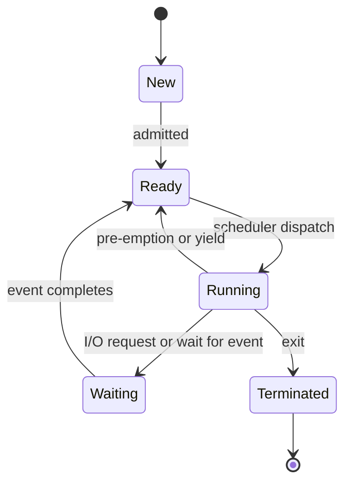
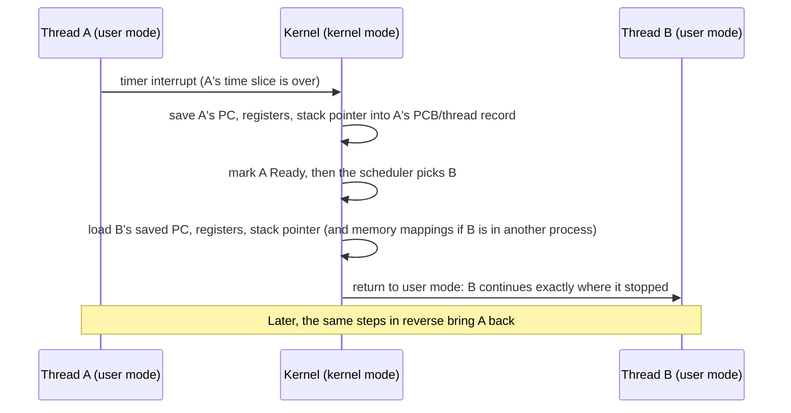

# Lecture 6 — Processes and Context Switching

**Module:** 4301COMP Computer Systems Architecture

**Session:** Teaching Week 03, Session B

## Start here

Lecture 5 introduced the kernel and said it "creates and schedules processes and their threads". This lecture opens that up: what exactly a **process** and a **thread** are, the **states** a process moves through, the **Process Control Block** the kernel keeps for each one, and the **context switch** that lets one processor appear to run dozens of programs at once. After reading, do **Lab 6** (`../Labs/Lab-06-Processes-and-Context-Switching-Hands-on-Workbook.md`), where you inspect processes in Task Manager and Resource Monitor and count context switches in Performance Monitor.

**Labels used in these notes:** **Official** = from the TW03 Session B slides or lab sheet. **Extra** = added explanation, not on the slides. **Verified** = actually run before being written down (on a 2-processor Linux machine, Python 3.13). **Expected** = not run here (for example Windows screens).

> **Note on the slides.** Slides 6, 7, 11, 17, 18 and 23 are diagrams or screenshots; only their titles were available as text. Slide 11 (the process lifecycle diagram) and slide 23 (process switching) are central, so the matching sections draw them from the official text on slides 10, 22 and 25, marked **Extra** where the drawing is added. Check the real diagrams on Canvas.

---

## 1. Overview

Right now your computer is compiling, printing, playing music, checking email and drawing this page, apparently all at once (Official, slide 5). It does this with **processes** and **threads**, a set of **states** each one moves between, and very fast **context switches** between them. This lecture covers:

- program versus process versus thread, and the danger of **data races**;
- the five **process states** and the transitions between them;
- each process's private **virtual address space**;
- the **Process Control Block (PCB)** and the **PID**;
- how Windows and UNIX let you **view** process information;
- **scheduling** on one processor and on multicore processors;
- **context switching**: what is saved, when it happens, and what it costs.

**Why this matters for cyber security.** Investigating a suspicious computer starts with its processes: which are running, who started them, how much CPU and memory they use, and whether one is hiding inside another. Process **isolation** is what stops one program reading another's memory, and **race conditions** are a real class of security bug.

## 2. By the end you should be able to

1. Distinguish a **program**, a **process** and a **thread**, with an example of each.
2. Explain why threads are useful and why shared data needs **synchronisation**.
3. Name the five process states and the event that causes each transition.
4. Explain how **virtual address spaces** isolate processes.
5. List the main fields of a **Process Control Block** and say why each is needed.
6. Read process information in Task Manager (Windows) and `ps` (UNIX/Linux).
7. Explain how one processor appears to run many processes, and how **multicore** processors differ.
8. Describe a **context switch**: what triggers it, what is saved and restored, and why it has a cost.

## 3. Learning outcomes

**Session learning outcomes (Official, slide 3):**

- Distinguish a program, process and thread.
- Interpret the main states in a process lifecycle.
- Explain what information is held in a Process Control Block.
- Describe how and why the operating system performs a context switch.

**Module learning outcomes supported** (module guide, as recorded in this module's project instructions):

| Module LO | How this lecture supports it |
| --- | --- |
| **LO3** Explain the role and functions of an operating system | Process management, scheduling, context switching |
| **LO1** Explain the fundamental principles underlying the operation of modern computer systems | How the FDE cycle, registers and interrupts support multitasking |
| **LO2** Demonstrate knowledge of the structure and organisation of computer systems | Logical processors, multicore and SMT, the memory-management unit |

## 4. Matching lab and what you need first

- **Matching lab:** Lab 6. It contains the official TW03 Session B tasks: inspecting Notepad, Paint and a browser in Task Manager; inferring states and context switching with Resource Monitor; and counting **Context Switches/sec** in Performance Monitor.
- **From Lecture 2 you need:** the **Program Counter**, registers and flags, and **interrupts** (the processor saves the PC and registers, runs a handler and restores them). A context switch uses the same idea.
- **From Lecture 5 you need:** kernel mode, system calls, processes, threads, PIDs and the scheduler; the Task Manager **Details** tab.

---

## 5. Recap of the previous session (slide 4, Official)

- The operating system provides services and abstractions for programs.
- The kernel is the privileged core that manages system resources.
- System calls form the controlled boundary between applications and the kernel.
- Booting loads the operating system; kernel designs organise services differently.

---

## 6. Why processes? (slides 5–7)

**Official (slide 5):**

- Computers perform operations **concurrently**: for example compiling a program, sending a file to a printer, rendering a web page, playing music and receiving email.
- **Processes** enable systems to perform and track simultaneous activities.
- Processes **transition between process states**.
- Operating systems perform **operations on processes**, such as **creating, destroying, suspending, resuming and waking** them.

| Operation (Official) | What it means (Extra) | Example |
| --- | --- | --- |
| Create | Build a new process, give it a PID, memory and a PCB | Double-clicking Paint |
| Destroy | End it and reclaim all its resources | Closing Paint, or `taskkill` |
| Suspend | Pause it; it gets no CPU time | Windows suspending a background Store app |
| Resume | Let a suspended process run again | Switching back to that app |
| Wake | Move a waiting process to ready when its event happens | A download finishes, so the browser wakes |

Slides 6 and 7 are diagrams (not available as text).

**Concurrency (Extra)** means several activities are **in progress** at the same time. It does not have to mean they are executing at the same instant; section 13 explains the difference.

---

## 7. Programs, processes and threads (slides 8–9)

### 7.1 Official definitions (slide 8 and the official lab sheet)

| | Definition |
| --- | --- |
| **Program** | An executable file / code stored on disk (lab sheet) |
| **Process** | A running program with its **own dedicated address space** and **owned system resources** |
| **Thread** | An **execution path inside a process**. Threads **share** code, data and open files. Cheaper to create and switch than full processes |

**Example (Extra):** `msedge.exe` on disk is a **program**. When you open Edge, Windows creates several **processes** from it (the browser itself, one per group of tabs, the GPU process, extensions), each with its own PID and memory. Inside the main browser process, several **threads** run: one handles your clicks, others load pages and decode images.

### 7.2 Why threads? (Official benefits, slide 8)

| Benefit | Example (Extra) |
| --- | --- |
| **Responsive interfaces** | Word stays usable while a separate thread saves or spell-checks |
| **Overlapping I/O operations** | One thread waits for the network while another keeps working |
| **Higher overall system throughput** | More work finished per second |
| **Multicore parallelism** | Threads of one process run on several cores at the same time |

### 7.3 The primary risk: data races (Official, slide 8)

Shared data can **race** when accessed concurrently, so threads **strictly require explicit synchronisation**.

**What a race looks like (Extra, Verified).** Two threads each add 1 to a shared counter 200,000 times. Each "add 1" is really two steps: **read** the counter, then **write** back the value + 1. If a context switch happens between the two steps, both threads can read the same old value and one update is lost:

| Time | Thread 1 | Thread 2 | Counter in memory |
| --- | --- | --- | --- |
| 1 | reads 41 | | 41 |
| 2 | *(switched out)* | reads 41 | 41 |
| 3 | | writes 42 | 42 |
| 4 | writes 42 | | **42** (should be 43) |

Real results from the Lab 6 script `race_demo.py` (expected total 400,000):

```text
No lock,   run 1: 333,994 (expected 400,000, lost 66,006)
No lock,   run 2: 285,943 (expected 400,000, lost 114,057)
No lock,   run 3: 276,303 (expected 400,000, lost 123,697)
With lock, run 1: 400,000 (expected 400,000, lost 0)
```

The result is different every run, which is what makes races so hard to find. A **lock** (also called a mutex) lets only one thread at a time into the read–write section, so no update is lost. That is **synchronisation**.

> **Cyber security link: race conditions.** Some vulnerabilities are races. In a **time-of-check to time-of-use (TOCTOU)** bug, a program checks something (for example "is this file safe to open?") and then uses it, and an attacker changes it in the gap between the two steps. Synchronisation and careful design close the gap.

### 7.4 The baking analogy (Official, slide 9)

| Baking | Computing |
| --- | --- |
| **Recipe** | Program |
| **Baker** | Processor |
| **Ingredients** | Data |
| **Baking the cake** (the activity) | **Process** |
| The baker's son runs in with a wounded hand | **Interrupt** (trigger event) |
| First-aid guide | **Interrupt handler** code |

The baker marks the place in the recipe, deals with the injury using the first-aid guide, then carries on baking from the marked place. That is exactly an interrupt: save where you were, run the handler, resume.

**Limits of the analogy (Extra):** a real processor switches between "cakes" thousands of times a second, and two copies of the same recipe can be baked as two separate processes, each with its own ingredients. A recipe book does not change while you bake, but a process's data does.

> **Common confusion.** A process is not "the program". Open Notepad twice and you normally get **two** processes from **one** program file, each with its own PID.

---

## 8. The process lifecycle (slides 10–11, and 22)

### 8.1 The five states (Official, slide 10)

| State | Official description |
| --- | --- |
| **New** | The process is just being put together |
| **Ready** | The process has all needed resources and is **waiting for the CPU only** |
| **Running** | Instructions are being executed; this process **holds the CPU** |
| **Waiting** | Waiting for an **event** (hardware, human, or another process) |
| **Terminated** | The process is being torn apart |

### 8.2 Transitions (Official, slide 22; diagram Extra)

| Transition | Trigger |
| --- | --- |
| **Ready → Running** | Scheduler **dispatch** |
| **Running → Waiting** | The task requests **I/O** or **waits for an event** |
| **Waiting → Ready** | The **event completes** |
| **Running → Ready** | **Pre-emption** or a voluntary **yield** |

Plus (Extra, from slide 10's states): **New → Ready** when the process has been set up and is **admitted**, and **Running → Terminated** when it **exits**.



**Key points (Extra):**

- A waiting process goes back to **Ready**, not straight to Running. Its event has happened, but it must still wait for the scheduler to give it the CPU.
- Only a **Running** process can move to Waiting or Terminated: it has to be executing to ask for I/O or to finish.
- On one logical processor, **only one** thread is Running at a time; many can be Ready or Waiting.

**Real states on Linux (Verified).** Linux shows a one-letter state for each process (`ps`, or `/proc`). With 2 logical processors and three busy-loop processes competing, the Lab 6 script `proc_states.py` reported (PID column removed):

```text
child   state                         voluntary  nonvoluntary
sleeper S = Waiting (sleeping)                2             4
stopped T = Stopped                           2             3
busy0   R = Running/Ready (runnable)          0           223
busy1   R = Running/Ready (runnable)          0           207
busy2   R = Running/Ready (runnable)          0           243
```

Linux uses **R** for both Running and Ready ("runnable"), **S** or **D** for Waiting, **T** for a suspended (stopped) process and **Z** for a terminated process whose parent has not yet collected it (a "zombie"). The last two columns count context switches; section 14.4 explains them.

---

## 9. Each process has its own address space (slide 12)

### 9.1 Official

- A process has its own **virtual address space**, which **isolates** it from other processes.
- The operating system and **memory-management unit (MMU)** translate virtual addresses to physical memory **frames**.
- The **same virtual address** can therefore refer to **different physical memory** in different processes.
- **Shared memory** is possible only when the OS **deliberately** maps the same pages into more than one process.

**Terms (Extra):** a **virtual address** is the address a program uses. The **MMU** is hardware in the processor that converts it to a **physical address** in RAM, using tables the kernel sets up. A **frame** is a fixed-size block of physical RAM (often 4 KB); a **page** is the matching block of virtual memory. Virtual memory is covered in more depth later in the module.

### 9.2 Seeing it happen (Extra, Verified)

On Linux, `fork()` makes a **copy** of a process. This small Python program stores the number 1 at a memory location, forks, and has the **child** change its copy to 99:

```python
import ctypes, os
x = ctypes.c_int(1)
addr = ctypes.addressof(x)
pid = os.fork()
if pid == 0:
    x.value = 99
    print(f"child : virtual address {hex(addr)} holds {x.value}", flush=True)
    os._exit(0)
os.waitpid(pid, 0)
print(f"parent: virtual address {hex(addr)} holds {x.value}")
```

Real output:

```text
child : virtual address 0x7fee1a437a20 holds 99
parent: virtual address 0x7fee1a437a20 holds 1
```

**Same virtual address, different values.** The MMU maps the child's address to a different physical frame, so the child's change cannot affect the parent. That is slide 12's isolation, in action.

> **Cyber security link: isolation.** Because every process has its own address space, a malicious web page running in one browser process cannot simply read your banking tab's memory in another. This is why browsers deliberately split themselves into many processes (as the official lab notes for `msedge.exe`): **for security and stability**.

---

## 10. The Process Control Block (slides 13–16)

### 10.1 What the PCB holds (Official, slide 13)

The **PCB** is the kernel's record of one process: everything needed to manage it and to **resume** it later.

| Field | Contents (Official) | Why it is needed (Extra) |
| --- | --- | --- |
| **Process state** | Running, waiting, ready or new | So the scheduler knows which processes it can choose |
| **Program counter** | Address of the next instruction to execute | So execution resumes at exactly the right place |
| **CPU registers** | Accumulators, index registers and stack pointers | So all working values are restored exactly |
| **CPU scheduling information** | Process priority and queue pointers | So the scheduler can decide fairly and by importance |
| **Memory-management information** | Page/segment tables and address space | So the MMU can be set up to map this process's memory |
| **Accounting information** | CPU time used, time limits, account ID | For monitoring, limits and billing |
| **I/O status information** | Allocated devices and open-file lists | So open files and devices are tracked and released |

### 10.2 Slide 14's explanation (Official)

- **State:** the current execution state.
- **Priority:** importance to the scheduling algorithm.
- **Program counter:** where execution had reached before a context switch occurred.
- **Memory pointers:** where the process's data is stored.
- **Context data:** where register values are stored so the process can be suspended and restarted.
- **I/O status information:** I/O resources in use by the process.
- **Accounting information:** some OSs record process time so an administrator can bill users.
- And whatever other fields the OS requires to manage a process.

The **stack pointer** (Extra) is a register holding the address of the top of the process's **stack** (the memory area used for method calls and return addresses, Lecture 2 section 18).

### 10.3 The PID (Official, slide 15)

- Each active process is identified by a **process identifier (PID)**.
- PID size and reuse rules are **OS implementation details**; do **not** assume PIDs are 16 bits.
- On Windows, **Task Manager**, **Resource Monitor** and **PowerShell** can display PIDs.

PIDs are **reused** after a process ends, so a PID only identifies a process **while it is running** (Extra).

### 10.4 Tools show summaries, not the PCB (Official, slide 16)

- A PCB is an OS data structure recording execution state and management information for a process.
- Typical fields include identifier, state, scheduling data, memory mappings, **credentials** (which user it runs as) and open-resource references.
- **Task Manager displays selected process information derived from OS data; it does not expose the PCB itself.**

**Linux comparison (Extra, Verified):** Linux publishes many PCB-derived values as text files under `/proc/<PID>/`. For example `/proc/<PID>/status` includes `State`, `Threads`, `VmRSS` (resident memory, similar to Windows' working set) and the context-switch counters used in section 8.2.

---

## 11. Viewing process data (slides 17–19)

### 11.1 Windows (slide 17, a screenshot; content Extra)

Task Manager's **Details** tab can show these columns (as used in the official lab):

| Column | Meaning | Link to the PCB |
| --- | --- | --- |
| **PID** | Process identifier | Identifier |
| **Status** | Running or Suspended | A simplified view of state |
| **Threads** | Number of threads in the process | — |
| **CPU time** | Total processor time used since it started | Accounting information |
| **Working set (memory)** | Physical memory currently associated with the process | Memory-management information |
| **Base priority** (optional column) | Scheduling priority class | Scheduling information |

**Resource Monitor** (`resmon`) shows per-process CPU, threads and activity in more detail; **Performance Monitor** (`perfmon`) can graph counters such as **Context Switches/sec**. The official lab uses all three.

> **Note (official lab sheet).** Resource Monitor shows high-level metrics such as CPU use and Status = Running/Suspended, but it does **not** show the internal scheduler states Ready, Running and Waiting: those transitions happen in **microseconds**.

### 11.2 UNIX (slide 18, a screenshot; content Extra)

On UNIX and Linux, `ps` lists processes. `ps -eo pid,stat,nlwp,rss,time,comm` shows PID, **STAT** (state letter, section 8.2), **NLWP** (number of threads), **RSS** (resident memory in KB), **TIME** (CPU time) and the command name: the same kinds of information as Task Manager's Details tab. `top` shows a live, updating view.

### 11.3 How the scheduler chooses (Official, slide 19)

- The scheduler chooses **runnable threads** for **logical processors**.
- **Priority** is one input, but **time slicing**, **policy**, **affinity**, **fairness** and **processor availability** also affect selection.
- Task Manager can show process priority and resource use, although many applications contain **multiple processes and threads**.

**Terms (Extra):** **time slicing** gives each thread a short turn (a **quantum**); **affinity** means a thread prefers or is restricted to certain processors; **fairness** stops low-priority threads from never running (**starvation**).

---

## 12. Behind the scenes: sharing a processor (slides 20–21)

### 12.1 Official

- The OS manages many processes (slide 20 mentions 58 in its example screenshot).
- OS design has been refined over many years so that a process's behaviour follows a set of **stages** from start to end: the process's **lifetime**.
- This behaviour lets **multiple processes co-exist in memory and share a single CPU**.

Slide 21:

| | |
| --- | --- |
| **Single processor** | At any instant, **one logical processor executes one hardware thread's instruction stream** |
| **Multicore and SMT** | A **multicore** or **simultaneous-multithreading** processor can execute **several threads at the same time** across its logical processors |
| **OS concurrency** | The OS creates the **appearance** of broader concurrency by **rapidly scheduling** many runnable threads |

### 12.2 Concurrency versus parallelism (Extra)

| | Concurrency | Parallelism |
| --- | --- | --- |
| Meaning | Several tasks in progress, taking turns | Several tasks executing at the **same instant** |
| Needs | Any processor plus a scheduler | More than one logical processor |
| Example | One core switching between Word and Spotify every few milliseconds | Four cores each running a different thread right now |

**SMT** (simultaneous multithreading; Intel calls it Hyper-Threading) lets one physical core run two hardware threads, so a 4-core processor may show **8 logical processors**. The Linux checking machine has **2** logical processors (Verified, `os.cpu_count()`).

---

## 13. Executing processes: scheduling (slide 22)

### 13.1 Official

- The scheduler selects a **ready** thread to run on a logical processor.
- A **pre-emptive** scheduler can return a runnable thread to **Ready** so another can run. **Quantum** rules vary by OS, scheduling class and workload.
- A thread may instead **block** for I/O, wait for an event, **yield** or terminate. A blocked thread becomes **Ready** when its event completes.

**Pre-emptive** (Extra) means the OS can take the processor away from a thread that has not finished, using the **timer interrupt** (Lecture 5 section 9.2). Without pre-emption, one program stuck in a loop could freeze the whole computer.

### 13.2 Worked example: round robin (Extra, Verified)

**Round robin** is a simple pre-emptive policy: Ready threads queue up, each gets at most one quantum, then goes to the back of the queue.

Three processes on **one** processor, quantum = **2** ticks:

| Process | Needs |
| --- | --- |
| A | 5 ticks of CPU |
| B | 2 ticks CPU, then 3 ticks of I/O, then 2 ticks CPU |
| C | 3 ticks of CPU |

Real trace from the Lab 6 simulator `rr_sim.py` (each line shows what happens during that tick):

```text
t= 1  Running: A       Ready: B,C       Waiting: -
t= 2  Running: A       Ready: B,C       Waiting: -
t= 3  Running: B       Ready: C,A       Waiting: -
t= 4  Running: B       Ready: C,A       Waiting: -
t= 5  Running: C       Ready: A         Waiting: B
t= 6  Running: C       Ready: A         Waiting: B
t= 7  Running: A       Ready: C         Waiting: B
t= 8  Running: A       Ready: C,B       Waiting: -
t= 9  Running: C       Ready: B,A       Waiting: -
t=10  Running: B       Ready: A         Waiting: -
t=11  Running: B       Ready: A         Waiting: -
t=12  Running: A       Ready: -         Waiting: -
```

Reading it:

1. t1–2: A runs for its quantum, then is **pre-empted** (Running → Ready) and joins the back of the queue.
2. t3–4: B runs its 2-tick CPU burst, then requests I/O (Running → **Waiting**).
3. t5–7: while B waits, C and then A use the CPU. **The CPU is never idle**, because there is always someone Ready. B's I/O finishes at the end of t7 (Waiting → **Ready**).
4. t9: C finishes (Terminated at 9); t10–11: B finishes (11); t12: A finishes (12).

The processor switched between processes **6** times. With different quanta, the same work (12 ticks) needs (Verified):

| Quantum | Context switches | All finished at |
| --- | --- | --- |
| 1 | 11 | t = 12 |
| 2 | 6 | t = 12 |
| 3 | 4 | t = 12 |
| 10 | 3 | t = 12 |

A **small quantum** feels more responsive (everyone gets a turn quickly) but causes **more switches**; a **large quantum** has fewer switches but a long wait for your turn. In this model switches are free; in reality each one costs time (section 14.3).

---

## 14. Context switching (slides 23–25)

### 14.1 Official

- A **context switch** is the process of **storing the state** of a process or thread so that it can be **restored** and **resume** execution at a later point (slide 24).
- It saves the current thread's **processor state** and restores the state of another runnable thread (slide 25).
- **Triggers:** a **time-slice expiry**, a **higher-priority thread** becoming ready, **blocking for I/O**, or an **interrupt** that leads to rescheduling.
- A **pre-empted** thread normally returns to **Ready**. A thread waiting for an event enters **Blocked/Waiting**.
- Context switching enables responsive multitasking but **adds overhead**.

### 14.2 What is saved and restored (Extra, using slide 13 and the official lab)

| Saved for the outgoing thread | Why |
| --- | --- |
| **Program Counter** | Where to carry on |
| **General-purpose registers** and **flags** | Its working values and the results of its last comparison |
| **Stack pointer** | Where its stack (method calls, return addresses) is |
| For a switch to a **different process**: memory-management information | So the MMU maps the new process's address space |

### 14.3 The steps (Extra; slide 23's diagram is not available as text)



**Why it has a cost (Extra):** while the kernel saves and restores state, **no user program makes progress**. The processor's caches (fast memory, covered later) also hold the old thread's data, so the new thread runs slowly at first. Switching between **threads of the same process** is cheaper than between **processes**, because the address space does not change (this is why slide 8 says threads are cheaper to switch).

**Link to Lecture 2:** this is the **interrupt mechanism** you already know (save the PC and registers, run a handler, restore), with one difference: the kernel may restore a **different** thread from the one it interrupted.

### 14.4 Counting real context switches (Verified)

Linux counts two kinds for every process:

- **voluntary**: the process gave up the processor itself, for example to wait for I/O or sleep (Running → Waiting);
- **nonvoluntary**: the scheduler **pre-empted** it (Running → Ready).

In the `proc_states.py` result in section 8.2, the sleeping process had only 2 voluntary switches in 2 seconds, while each of the three busy loops, competing for 2 logical processors, was **pre-empted** over 200 times. Windows shows the system-wide rate as **System > Context Switches/sec** in Performance Monitor (the official Extra Challenge); Linux shows it in the `cs` column of `vmstat 1`.

> **Common confusion.** A context switch is **not** a mode switch. A system call switches from user mode to kernel mode and back **within the same thread**. A context switch changes **which thread** is running (and it happens in kernel mode).

---

## 15. A network service running on the CPU (slide 26, Official)

This slide links processes back to networking:

- A **DHCP** or **web server** runs as a **process** managed by the kernel.
- When a request arrives, the service can move from **Waiting** to **Ready**.
- The scheduler selects it and **restores its saved execution state**.
- **System calls** request network input, file access and response output.
- **Fetch, decode and execute** repeats while the CPU runs the service's instructions.

Putting several lectures together (Extra): a packet arrives at the network card (Lecture 4) → an **interrupt** (Lecture 2) → the kernel's network stack (Lecture 5) sees the data is for the web server's socket and **wakes** it (Waiting → Ready) → a **context switch** restores the server's PCB state → the server's `recv()` system call returns the request → it builds a reply and calls `send()`. **DHCP** (the service that hands out IP addresses automatically) is covered in the next networking sessions.

---

## 16. Common mistakes

| Mistake | Symptom | Fix |
| --- | --- | --- |
| Calling a program file a process | "Paint.exe is a process" when it is not running | Program = file on disk; process = running instance with a PID and address space |
| Saying threads have their own memory | Wrong program/process/thread answers | Threads share their process's code, data and open files; they have their own registers and stack |
| Moving Waiting → Running directly | Wrong state diagram | Waiting → **Ready** when the event completes; only dispatch gives Running |
| Saying Ready means "waiting for I/O" | States swapped | Ready = waiting for the **CPU only**; Waiting = waiting for an **event** |
| Thinking Task Manager shows the PCB | Over-claiming | It shows summaries derived from OS data (slide 16) |
| Assuming PIDs are 16 bits or permanent | Wrong PID statements | Size and reuse are implementation details; PIDs are reused |
| Saying one core runs many threads at the same instant | Confusing concurrency with parallelism | One logical processor runs one thread at a time; the OS switches rapidly |
| Thinking context switches are free | Ignoring overhead | Saving and restoring state costs time; too many switches waste CPU |
| Confusing a context switch with a system call | Wrong definitions | System call = mode switch in the same thread; context switch = change of thread |
| Ignoring synchronisation | "My threaded program works on my PC, so it is correct" | Races depend on timing; protect shared data with locks |

---

## 17. Check yourself: 15 multiple-choice questions

**Q1.** Which best describes a **process**?
A) A program file stored on disk
B) A running program with its own address space and resources
C) A single line of code
D) A hardware component

**Q2.** Threads in the same process:
A) Each have their own separate address space
B) Cannot run at the same time on a multicore processor
C) Share code, data and open files
D) Each need their own program file

**Q3.** What is the primary risk of using threads (slide 8)?
A) Data races on shared data
B) They use too much disk space
C) They cannot be scheduled
D) They make interfaces slower

**Q4.** A process has all the resources it needs and is waiting only for the CPU. Its state is:
A) Waiting
B) New
C) Terminated
D) Ready

**Q5.** A running process asks to read a file from disk. Which transition follows?
A) Running → Waiting
B) Running → Ready
C) Ready → Running
D) Waiting → Running

**Q6.** A process's disk read completes. Where does it go?
A) Straight to Running
B) To Ready
C) To Terminated
D) To New

**Q7.** Which PCB field records where execution should resume?
A) Accounting information
B) I/O status information
C) Program counter
D) Process priority

**Q8.** Which is true of Task Manager (slide 16)?
A) It displays the complete PCB
B) It edits the PCB directly
C) It shows only the PID
D) It shows selected information derived from OS data, not the PCB itself

**Q9.** Why can the same virtual address hold different values in two processes?
A) The MMU maps each process's virtual addresses to different physical frames
B) Memory is copied to disk every time
C) Virtual addresses are random
D) It cannot

**Q10.** A 4-core processor with SMT (2 hardware threads per core) has how many logical processors?
A) 2
B) 4
C) 8
D) 16

**Q11.** Which is **not** a trigger for a context switch (slide 25)?
A) Time-slice expiry
B) A thread blocking for I/O
C) A higher-priority thread becoming ready
D) Adding a column in Task Manager

**Q12.** What is saved during a context switch?
A) The program file on disk
B) The thread's processor state: PC, registers, stack pointer
C) The user's password
D) The entire contents of RAM

**Q13.** In round robin with quantum 2, process A needs 5 ticks of CPU. How many separate turns does A need?
A) 1
B) 2
C) 3
D) 5

**Q14.** Making the quantum much smaller usually:
A) Reduces the number of context switches
B) Increases the number of context switches and the overhead
C) Makes processes need less CPU time in total
D) Stops pre-emption

**Q15.** A web server process is waiting for a request. A request arrives. What happens first?
A) The server is terminated
B) It runs immediately without the scheduler
C) It moves from Waiting to Ready; later the scheduler dispatches it and restores its saved state
D) It moves to New

### Answers

| Q | Answer | Why |
| --- | --- | --- |
| 1 | **B** | Slide 8: a running program with its own dedicated address space and owned resources. |
| 2 | **C** | Slide 8: threads share code, data and open files. |
| 3 | **A** | Slide 8: data race conditions; shared data needs explicit synchronisation. |
| 4 | **D** | Slide 10: Ready = has all resources, waiting for the CPU only. |
| 5 | **A** | Slide 22: Running → Waiting when the task requests I/O. |
| 6 | **B** | Slide 22: Waiting → Ready when the event completes. |
| 7 | **C** | Slides 13–14: the PC records where execution had reached. |
| 8 | **D** | Slide 16, word for word. |
| 9 | **A** | Slide 12: the OS and MMU translate virtual addresses to physical frames (Verified with the fork demo). |
| 10 | **C** | 4 cores × 2 hardware threads = 8 logical processors. |
| 11 | **D** | Slide 25 lists time-slice expiry, higher-priority thread, blocking for I/O and interrupts. |
| 12 | **B** | The official lab: Program Counter, registers and stack pointer are saved and restored. |
| 13 | **C** | 2 + 2 + 1 = 5, so three turns (Verified: A ran at t1–2, t7–8 and t12). |
| 14 | **B** | Verified in the simulator: quantum 1 gave 11 switches, quantum 10 gave 3. |
| 15 | **C** | Slide 26: the service moves from waiting to ready; the scheduler then restores its saved state. |

---

## 18. Quick reference

**Program** = file on disk · **Process** = running instance (own address space, resources, PID) · **Thread** = execution path inside a process (shares code, data, files; own registers and stack).

**States:** New → Ready → Running → (Waiting → Ready) → Terminated.

| Transition | Trigger |
| --- | --- |
| Ready → Running | Dispatch |
| Running → Waiting | I/O request / wait for event |
| Waiting → Ready | Event completes |
| Running → Ready | Pre-emption / yield |

**PCB:** state · PC · registers · scheduling info · memory-management info · accounting · I/O status · PID (and credentials).

**Address spaces:** virtual → physical via the MMU; same virtual address ≠ same memory; sharing only when the OS maps it.

**Scheduler inputs:** priority, time slicing, policy, affinity, fairness, processor availability.

**Context switch:** save PC, registers, stack pointer (and memory mappings for another process); restore another thread's; triggered by time-slice expiry, higher priority, blocking I/O or interrupts; costs overhead.

**Tools:** Task Manager Details (PID, Status, Threads, CPU time, Working set) · Resource Monitor (`resmon`) · Performance Monitor (`perfmon`, Context Switches/sec) · Linux `ps`, `top`, `/proc`, `vmstat` (`cs`).

## 19. Glossary

| Term | Meaning |
| --- | --- |
| **Affinity** | A thread's preference or restriction to certain processors |
| **Concurrency** | Several tasks in progress at once, possibly taking turns |
| **Context switch** | Saving one thread's processor state and restoring another's |
| **Data race** | Concurrent access to shared data that gives timing-dependent wrong results |
| **Dispatch** | The scheduler moving a Ready thread to Running |
| **Frame** | A fixed-size block of physical memory |
| **Lock (mutex)** | A synchronisation tool letting one thread at a time into a section |
| **Logical processor** | A core or hardware thread that can run one thread at a time |
| **MMU** | Memory-management unit: hardware translating virtual to physical addresses |
| **Parallelism** | Several tasks executing at the same instant on different logical processors |
| **PCB** | Process Control Block: the kernel's record of a process |
| **PID** | Process identifier |
| **Pre-emption** | The OS taking the CPU away from a running thread |
| **Process** | A running program with its own address space and resources |
| **Quantum (time slice)** | The maximum time a thread runs before it can be pre-empted |
| **Ready / Running / Waiting** | Waiting for the CPU / using it / waiting for an event |
| **Round robin** | Scheduling where Ready threads take turns of one quantum each |
| **SMT** | Simultaneous multithreading: one core running two hardware threads |
| **Stack pointer** | Register holding the address of the top of the stack |
| **Synchronisation** | Coordinating threads so shared data stays correct |
| **Thread** | An execution path inside a process |
| **TOCTOU** | Time-of-check to time-of-use: a race-condition vulnerability |
| **Virtual address space** | The private range of addresses a process sees |
| **Working set** | (Windows) physical memory currently associated with a process |
| **Yield** | A thread voluntarily giving up the CPU |

## 20. Summary

- A **program** is a file; a **process** is a running instance with its own **virtual address space**; **threads** are execution paths inside a process that share its resources and need **synchronisation** to avoid data races.
- Processes move between **New, Ready, Running, Waiting and Terminated**; Waiting always returns to Ready, never straight to Running.
- The **PCB** stores everything needed to manage and resume a process. Task Manager and `ps` show summaries of it.
- One logical processor runs one thread at a time; the OS's rapid, **pre-emptive scheduling** creates the appearance of concurrency, and **multicore/SMT** processors add true parallelism.
- A **context switch** saves one thread's PC, registers and stack pointer and restores another's. It makes multitasking possible but costs time; a smaller quantum means more switches.

## 21. Next

According to slide 28, the next session is **Teaching Week 04, Session A: TCP/IP, Addressing and Subnetting**. It returns to network addressing and connects it to the services running on a computer.
