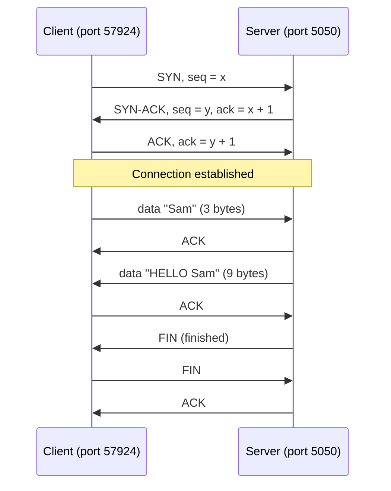
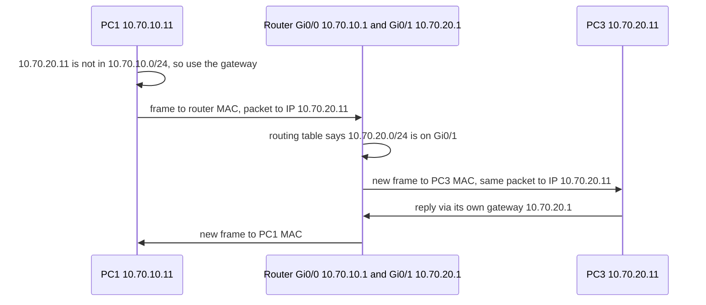

# Lecture 7 — TCP/IP, Addressing and Subnetting

**Module:** 4301COMP Computer Systems Architecture

**Session:** Teaching Week 04, Session A

## Start here

Lectures 3 and 4 built a single LAN and introduced the OSI and TCP/IP models. This lecture goes through the **TCP/IP suite** layer by layer: application protocols, **TCP and UDP** (with a real captured **TCP handshake**), **port numbers**, **IP addressing in binary**, **CIDR** prefixes, **private addresses and NAT**, and the **default gateway** that lets traffic leave the local network. After reading, do **Lab 7** (`../Labs/Lab-07-TCP-IP-Addressing-and-Subnetting-Hands-on-Workbook.md`), where you connect two networks with a router in Packet Tracer.

**Labels used in these notes:** **Official** = from the TW04 Session A slides or lab sheet. **Extra** = added explanation, not on the slides. **Verified** = actually run or calculated before being written down (Linux machine, Python 3.13, `tcpdump`). **Expected** = not run here (Packet Tracer, Windows).

> **Note on the slides.** Slide 15 (**Binary masks and /24 addressing**) is a diagram; only its title was available as text. Section 13 explains binary masks from standard material, marked **Extra**, with every conversion checked. Slides 8 and 13 are mostly diagrams of encapsulation; their labels are used in section 8.

---

## 1. Overview

When you open a web page, your PC uses **DNS** to find the server's address, **TCP** to set up a reliable connection with a three-way **handshake**, **IP** to address each packet, and, if the server is not on your LAN, sends everything to its **default gateway**, which forwards it onwards (often through **NAT**). This lecture explains each of those steps.

**Why this matters for cyber security.** Firewalls filter by **IP address and port**. Attackers scan for open **ports**, and some old protocols (**Telnet**) send passwords in plain text. Reading a packet capture, an address plan or a `netstat` listing is a daily task in security work.

## 2. By the end you should be able to

1. Explain what a **protocol** is and what the **TCP/IP suite** is.
2. Name example protocols for each TCP/IP layer and map the layers to OSI.
3. Compare **TCP** and **UDP**, and choose the right one for an application.
4. Describe the **TCP three-way handshake** and read it in a real capture.
5. Recall the well-known **port numbers** on slide 12 and explain what a port is.
6. Convert an IPv4 address and mask to **binary**, and find the **network address, broadcast address and host range** of a /24.
7. Explain **CIDR** notation, **longest-prefix matching**, **private addresses**, **NAT** and the **historical classes**.
8. Explain why a host needs a **default gateway**, and use `ipconfig`, `ping`, `tracert` and `netstat`.

## 3. Learning outcomes

**Session learning outcomes (Official, slide 3):**

- Explain the purpose of protocols and the TCP/IP suite.
- Compare TCP and UDP and describe connection establishment.
- Interpret IPv4 addresses, subnet masks and default gateways.
- Use common network commands to inspect and test a configuration.

**Module learning outcomes supported** (module guide, as recorded in this module's project instructions):

| Module LO | How this lecture supports it |
| --- | --- |
| **LO4** Explain the fundamental concepts involved in computer networking | All of this lecture |
| **LO1** Explain the fundamental principles underlying the operation of modern computer systems | Binary representation of addresses and masks |

Relevant to the **report (40%)** on data storage and networking, and the **exam (60%)**, which covers networking (module guide).

## 4. Matching lab and what you need first

- **Matching lab:** Lab 7. It contains both official TW04 Session A tasks: building two /24 networks joined by a **2911 router** (GUI only, no router CLI), and interpreting the addressing.
- **From Lecture 3:** IPv4 addresses, the /24 mask, network and broadcast addresses, `ping`, the default gateway (introduced but left blank).
- **From Lecture 4:** the OSI and TCP/IP models, encapsulation, MAC addresses, ARP, the /25 mask, TCP versus UDP (first look).
- **From Lectures 5–6:** system calls such as `socket()`, `send()`, `recv()`; processes and PIDs (used with `netstat -ano`).

---

## 5. TCP/IP and protocols (slides 4–5, Official)

- **TCP/IP** is a set of protocols developed to let cooperating computers **share resources across a network**.
- **TCP** = Transmission Control Protocol; **IP** = Internet Protocol. They are the **transport-layer** and **network-layer** protocols of the suite respectively.
- The best-known network using TCP/IP is the **internet**, the biggest WAN in the world.
- A **protocol** is a collection of **rules and procedures** for two computers to exchange information. It also defines the **format** of the data exchanged.

**Analogy (Extra, with limits):** a protocol is like the rules of a phone call: say hello first, take turns, say goodbye. Unlike people, computers cannot improvise: if one side breaks the rules, the exchange fails.

---

## 6. TCP/IP and OSI (slide 6, Official)

The TCP/IP model commonly has **four** layers; the seven-layer OSI model separates some functions more finely. The models have **different purposes**; their layer counts do not simply reflect their age.

| TCP/IP layer | OSI correspondence | Examples |
| --- | --- | --- |
| **Application** | Application, Presentation, Session | HTTP, SMTP, DNS |
| **Transport** | Transport | TCP, UDP |
| **Internet** | Network | IPv4, IPv6, ICMP |
| **Link / network access** | Data link, Physical | Ethernet, Wi-Fi |

(Some slides call the bottom layer **Network Interface**; it is the same layer.)

---

## 7. Application layer (slide 7)

### 7.1 Official

- Examples: **HTTP/HTTPS** for web access, **DNS** for names, **SMTP** for email transfer and **SSH** for secure remote login.
- **Telnet** is a **legacy plaintext** remote-login protocol and should **not** be used on untrusted networks.
- The application layer defines the **message formats and interactions** used by networked programs.

### 7.2 What each does (Extra)

| Protocol | Job |
| --- | --- |
| HTTP / HTTPS | Fetch web pages. HTTPS = HTTP inside an encrypted TLS connection |
| DNS | Turn a name (`www.ljmu.ac.uk`) into an IP address |
| SMTP | Pass email between mail servers (and from your mail program to its server) |
| SSH | Log in to and control another computer remotely, encrypted |
| Telnet | Old remote login, **not** encrypted |

> **Cyber security link: plaintext protocols.** With Telnet (and plain HTTP or FTP), anyone who can capture the traffic (for example on the same Wi-Fi) can read usernames and passwords directly from the packets. SSH and HTTPS encrypt the data, so a capture shows only scrambled bytes. Finding Telnet (port 23) open on a device is a common audit finding.

---

## 8. Transport layer (slides 8–9)

### 8.1 Encapsulation down the stack (slides 8 and 13 labels)

Slides 8 and 13 show an application **message (M)** being given a **header (h)** at each layer: the transport layer turns messages into **segments**; the network layer turns segments into **datagrams/packets**; the network interface then adds its own header (and trailer) to make **frames** (Lecture 4, section 15.3).

### 8.2 Official (slide 9)

- The transport layer provides communication **between application processes**.
- **TCP** is **connection-oriented** and provides **reliable, ordered byte-stream** delivery with **acknowledgements**, **retransmission** and **flow control**.
- **UDP** (User Datagram Protocol) is **connectionless** and does **not** guarantee delivery or order.
- UDP suits applications where **low overhead or timeliness** matters and the application can tolerate loss or provide its own recovery.

**Terms (Extra):** an **acknowledgement (ACK)** tells the sender "I received your data up to here". **Retransmission** means re-sending data that was not acknowledged in time. **Flow control** stops a fast sender overwhelming a slow receiver.

### 8.3 Ports: which application process? (Extra)

An IP address gets a packet to the right **computer**. A **port number** (0–65,535) gets the data to the right **process** on that computer. A **socket** is the combination of IP address + protocol + port, for example `127.0.0.1:5050/TCP`.

- **Servers** listen on fixed, **well-known** ports (section 11), so clients know where to connect.
- **Clients** use a temporary **ephemeral** port chosen by the OS. In the capture in section 9, the client's port was **57924** (Verified).

---

## 9. The TCP handshake (slide 10)

### 9.1 Official

Before data transfer, TCP establishes **shared connection state**:

1. **Client → server: SYN.** Request a connection and propose an **initial sequence number**.
2. **Server → client: SYN–ACK.** Acknowledge, and propose **its own** sequence number.
3. **Client → server: ACK.** Acknowledge the server.

The connection is now **established**, and reliable, ordered data transfer can begin.

A **sequence number** (Extra) numbers the bytes a side sends, so the other side can acknowledge them, put them in order and spot gaps.



### 9.2 A real handshake (Verified)

A tiny Python client and server on the same Linux machine exchanged "Sam" and "HELLO Sam" while `tcpdump` captured every TCP packet (times and options removed for clarity):

```text
127.0.0.1.57924 > 127.0.0.1.5050: Flags [S],  seq 2895998211, length 0
127.0.0.1.5050 > 127.0.0.1.57924: Flags [S.], seq 1942035680, ack 2895998212, length 0
127.0.0.1.57924 > 127.0.0.1.5050: Flags [.],  ack 1942035681, length 0
127.0.0.1.57924 > 127.0.0.1.5050: Flags [P.], seq 2895998212:2895998215, ack 1942035681, length 3
127.0.0.1.5050 > 127.0.0.1.57924: Flags [.],  ack 2895998215, length 0
127.0.0.1.5050 > 127.0.0.1.57924: Flags [P.], seq 1942035681:1942035690, ack 2895998215, length 9
127.0.0.1.57924 > 127.0.0.1.5050: Flags [.],  ack 1942035690, length 0
127.0.0.1.5050 > 127.0.0.1.57924: Flags [F.], seq 1942035690, ack 2895998215, length 0
127.0.0.1.57924 > 127.0.0.1.5050: Flags [F.], seq 2895998215, ack 1942035691, length 0
127.0.0.1.5050 > 127.0.0.1.57924: Flags [.],  ack 2895998216, length 0
```

How to read it (`tcpdump` flag letters: **S** = SYN, **.** = ACK, **P** = push data, **F** = FIN):

| Line | Meaning | Check |
| --- | --- | --- |
| 1 `[S]` | Client SYN, initial sequence number **2895998211** | Step 1 |
| 2 `[S.]` | Server SYN-ACK: its own number **1942035680**, acknowledging **2895998212** | 2895998211 + 1 ✓ (Step 2) |
| 3 `[.]` | Client ACK of **1942035681** | 1942035680 + 1 ✓ (Step 3) |
| 4 `[P.]` | Client sends 3 bytes ("Sam"), bytes 2895998212 to 2895998215 | 2895998215 − 2895998212 = 3 ✓ |
| 5 `[.]` | Server acknowledges up to 2895998215 | All 3 bytes received |
| 6–7 | Server sends 9 bytes ("HELLO Sam"); client acknowledges | 1942035690 − 1942035681 = 9 ✓ |
| 8–10 | Each side sends FIN; the last ACK completes the close | Connection closed |

Ten packets were needed to move 12 bytes of data reliably. That is TCP's **overhead**.

> **Cyber security link: the handshake and scanning.** Port scanners send a SYN to each port: a SYN-ACK reply means "open", a reset means "closed", no reply often means "filtered by a firewall". A **SYN flood** attack sends huge numbers of SYNs and never completes step 3, trying to exhaust the server's memory for half-open connections.

---

## 10. TCP versus UDP (slide 11)

### 10.1 Official

| | **TCP** | **UDP** |
| --- | --- | --- |
| Connection | Connection-oriented; **handshake** | **Connectionless** |
| Delivery and order | **Reliable and ordered** | **No** protocol guarantee of delivery or order |
| Recovery | **Acknowledgements and retransmission** | **No retransmission** by UDP |
| Overhead | **Higher** | **Lower** overhead and latency |
| Typical uses | Web/HTTPS, email, file transfer | DNS queries, live voice/video, online games |

**Rule of thumb (Official):** choose **TCP** when **correctness** matters; choose **UDP** when **timeliness and low overhead** matter.

### 10.2 The same exchange over UDP (Verified)

The same "Sam" / "HELLO Sam" exchange, sent with UDP and captured:

```text
IP 127.0.0.1.42534 > 127.0.0.1.6353: UDP, length 3
IP 127.0.0.1.6353 > 127.0.0.1.42534: UDP, length 9
```

**Two** packets instead of ten: no handshake, no acknowledgements, no closing exchange. If one had been lost, UDP would not have noticed; the application would have had to deal with it.

**Why live video uses UDP (Extra):** a video frame that arrives late is useless. Retransmitting it (TCP) would delay all the frames after it; it is better to skip it and carry on.

---

## 11. Well-known port numbers (slide 12, Official)

| Port | Service | Transport |
| --- | --- | --- |
| 21 | FTP (file transfer) | TCP |
| 22 | SSH | TCP |
| 23 | Telnet | TCP |
| 25 | SMTP (server to server) | TCP |
| 53 | DNS | UDP / TCP |
| 80 | HTTP | TCP |
| 443 | HTTPS | TCP |
| 587 | SMTP submission (mail client to server) | TCP |

DNS uses UDP for most queries and TCP for large responses and zone transfers (Extra).

**Seeing listening ports (Verified).** With a test server listening on port 5050, `ss -tln` on the Linux checking machine showed (other lines removed):

```text
State  Recv-Q Send-Q Local Address:Port  Peer Address:Port
LISTEN 0      128        127.0.0.1:5050       0.0.0.0:*
```

`127.0.0.1:5050` means "listening on port 5050, only for connections from this computer". `0.0.0.0` would mean "on every interface". On Windows, `netstat -ano` shows the same, plus the **PID** of the listening process (Lecture 6).

> **Cyber security link: open ports are the attack surface.** Every listening port is a service someone could try to attack. Security baselines list which ports **should** be open; anything else is investigated. `netstat -ano` + the PID tells you **which program** opened a port.

---

## 12. The Internet (network) layer (slides 13–14, Official)

- The internet layer provides **logical addressing** and **best-effort** packet delivery across interconnected networks.
- IP forwards packets but does **not** guarantee delivery, order or absence of duplication.
- For IPv4 on a local link, **ARP** resolves a next-hop IPv4 address to a link-layer (MAC) address.
- **Routers** use **routing tables** to select the **next hop** toward a destination.

The **next hop** (Extra) is the next router (or the final host) a packet is handed to. Each router only decides the next step, not the whole route.

---

## 13. Binary masks and /24 addressing (slide 15)

**Official title; content Extra. All conversions Verified with Python.**

### 13.1 Binary place values

Each octet is 8 bits. From left to right the bits are worth **128, 64, 32, 16, 8, 4, 2, 1**.

**Converting 192 to binary:**

| Place value | 128 | 64 | 32 | 16 | 8 | 4 | 2 | 1 |
| --- | --- | --- | --- | --- | --- | --- | --- | --- |
| Bit | 1 | 1 | 0 | 0 | 0 | 0 | 0 | 0 |

128 + 64 = **192**, so 192 = `11000000`.

**Method:** go left to right; if the place value fits into what is left, write 1 and subtract it; otherwise write 0.

**Converting 70 to binary:** 70 − 64 = 6 → 6 − 4 = 2 → 2 − 2 = 0. Bits for 64, 4 and 2 are 1: `01000110`.

### 13.2 A whole address and mask in binary

The official lab's PC1 address, `10.70.10.11/24` (from `ipv4_tool.py`):

```text
Address        10.70.10.11      00001010.01000110.00001010.00001011
Mask (/24)     255.255.255.0    11111111.11111111.11111111.00000000
Network        10.70.10.0       00001010.01000110.00001010.00000000
Broadcast      10.70.10.255     00001010.01000110.00001010.11111111
Host range     10.70.10.1 - 10.70.10.254  (254 usable hosts)
```

- The mask has **24 ones** followed by 8 zeros: that is what **/24** means.
- **Network address** = keep the address bits where the mask is 1, set the rest to **0**.
- **Broadcast address** = keep the network bits, set the host bits to **1**.
- **Usable hosts** = 2^(host bits) − 2 = 2⁸ − 2 = **254** (minus the network and broadcast addresses).

### 13.3 How a PC decides "local or not" (the AND operation)

A computer finds the network part with a bitwise **AND**: each address bit AND the matching mask bit (1 AND 1 = 1; anything AND 0 = 0). If two addresses give the **same** result with the PC's mask, they are on the same network.

| | Third octet (binary) |
| --- | --- |
| PC1 10.70.**10**.11 | `00001010` |
| PC3 10.70.**20**.11 | `00010100` |
| Mask third octet 255 | `11111111` |
| PC1 AND mask | `00001010` = 10 |
| PC3 AND mask | `00010100` = 20 |

10 ≠ 20, so PC1 and PC3 are on **different** networks: PC1 must send to its **default gateway**.

---

## 14. Subnet masks and CIDR (slide 16)

### 14.1 Official

- A **CIDR prefix length** states how many leading address bits identify the network.
- Example: `192.0.2.34/24` has mask **255.255.255.0**; the first 24 bits identify network **192.0.2.0** and the remaining 8 bits identify addresses within it.
- **Routers compare destination prefixes and choose the most specific matching route.**
- **CIDR** (Classless Inter-Domain Routing) is the current addressing and routing notation; classful A/B/C boundaries are historical.

### 14.2 Common prefixes (Extra, Verified)

| Prefix | Mask | Usable hosts per network |
| --- | --- | --- |
| /8 | 255.0.0.0 | 16,777,214 |
| /16 | 255.255.0.0 | 65,534 |
| /24 | 255.255.255.0 | 254 |
| /25 | 255.255.255.128 | 126 |
| /26 | 255.255.255.192 | 62 |
| /27 | 255.255.255.224 | 30 |
| /28 | 255.255.255.240 | 14 |
| /30 | 255.255.255.252 | 2 |

**Subnetting** (Extra preview) means splitting one network into smaller ones by lengthening the prefix. For example, `10.70.10.0/24` split into **/26**s gives four subnets (Verified): `10.70.10.0/26`, `10.70.10.64/26`, `10.70.10.128/26` and `10.70.10.192/26`, each with 62 usable hosts.

### 14.3 Most specific match (longest prefix) (Extra, Verified)

A router (or PC) may have several routes that **match** a destination. It uses the one with the **longest prefix**. `0.0.0.0/0` matches every address, so it is the **default route** (on a PC, this is the default gateway).

Real output of the Lab 7 script `route_lookup.py`:

```text
10.70.20.12  matches 10.70.20.0/24, 10.70.0.0/16, 0.0.0.0/0  -> /24: deliver directly on GigabitEthernet0/1
10.70.10.11  matches 10.70.10.0/24, 10.70.0.0/16, 0.0.0.0/0  -> /24: deliver directly on GigabitEthernet0/0
10.70.55.5   matches 10.70.0.0/16, 0.0.0.0/0                 -> /16: send to router 10.70.99.2
8.8.8.8      matches 0.0.0.0/0                               -> /0: default route: send to ISP 203.0.113.1
```

---

## 15. Private IPv4 and NAT (slide 17)

### 15.1 Official

- **Private** IPv4 ranges are **not routed on the public internet**: **10.0.0.0/8**, **172.16.0.0/12**, **192.168.0.0/16**.
- **Public** addresses are globally routable and normally allocated by an ISP or provider.
- **NAT** (Network Address Translation) rewrites private **source addresses** (and usually **ports**) to a public address for outbound traffic, then **maps replies back** to the correct host.
- NAT **conserves addresses** and gives internal addressing flexibility. **NAT is not a firewall by itself.**

### 15.2 A NAT example (Extra, illustrative addresses)

A home router has public address `203.0.113.7`. Two PCs inside browse the same website:

| Inside (private) | → | Outside (public, after NAT) |
| --- | --- | --- |
| 192.168.1.10 : 51000 | → | 203.0.113.7 : 62001 |
| 192.168.1.11 : 51000 | → | 203.0.113.7 : 62002 |

The router keeps this **translation table**. When a reply arrives for `203.0.113.7:62002`, it looks up the table and sends it to `192.168.1.11:51000`. Changing the **port** as well as the address is what lets many devices share **one** public address.

**`172.16.0.0/12`** covers 172.16.0.0 to **172.31**.255.255, so 172.20.5.5 is private but 172.32.1.1 is public (Verified).

> **Common confusion.** NAT hides inside addresses and drops unexpected incoming traffic it has no table entry for, which **looks** like protection, but it does not inspect or filter traffic by rules. Slide 17 is explicit: **NAT is not a firewall by itself.**

---

## 16. Historical IPv4 address classes (slide 18)

### 16.1 Official

| Class | First octet | Leading bits | Default mask | Network/host bits | Capacity |
| --- | --- | --- | --- | --- | --- |
| **A** | 1–126 | `0` | 255.0.0.0 (/8) | 8 / 24 | 126 networks, 16,777,214 hosts each |
| **B** | 128–191 | `10` | 255.255.0.0 (/16) | 16 / 16 | 16,384 networks, 65,534 hosts each |
| **C** | 192–223 | `110` | 255.255.255.0 (/24) | 24 / 8 | 2,097,152 networks, 254 hosts each |
| **D** | 224–239 | `1110` | N/A | 28-bit multicast ID | Multicast (one-to-many) |

**Classful addressing is historical; modern IPv4 networks use CIDR prefixes such as /24.**

### 16.2 Where the numbers come from (Extra, Verified)

- Class A: 7 free network bits (after the leading 0) → 2⁷ = 128, minus 0 and 127 (loopback) = **126**; hosts 2²⁴ − 2 = **16,777,214**.
- Class B: 14 free network bits → 2¹⁴ = **16,384**; hosts 2¹⁶ − 2 = **65,534**.
- Class C: 21 free network bits → 2²¹ = **2,097,152**; hosts 2⁸ − 2 = **254**.

The classes wasted addresses (an organisation needing 300 hosts had to take a whole class B of 65,534). CIDR lets a network be any size.

---

## 17. Local and remote delivery: the default gateway (slide 19)

### 17.1 Official

A host is configured as **192.168.20.34/24**, so its local subnet is **192.168.20.0/24**.

| | **Local traffic** (inside the /24) | **Remote traffic** (outside the /24) |
| --- | --- | --- |
| Destination | 192.168.20.80 | 8.8.8.8 (default gateway 192.168.20.1) |
| Decision | Matches the local prefix 192.168.20.0/24 | Does not match |
| What happens | The host uses **ARP** to find the destination's MAC and sends the frame **directly** | The host sends the frame to the **default gateway** (192.168.20.1) |
| Ethernet destination | The destination host's MAC | The **gateway's MAC** |
| IP destination | 192.168.20.80 | **Stays 8.8.8.8** |
| Then | Delivered | The router removes the frame, checks its routing table and forwards a **new frame** towards the destination |

(Slide 19 is titled "Public vs Private IPs", but its content is about local versus remote delivery.)

### 17.2 The key idea (Extra)



- **MAC addresses change at every hop**; the **IP destination stays the same** end to end (until NAT, if any).
- The gateway must be **on the host's own network** (10.70.10.1 for PC1). A host cannot send a frame directly to a gateway on another network.
- The **reply** needs a gateway too: if PC3 had no default gateway, PC1's ping would reach PC3 but the reply would never come back.

---

## 18. Data link and physical layers (slides 20–22, Official)

**Physical layer:**

- Transmits raw **bits** as electrical signals, radio waves or light.
- Defines signalling, connectors, media, timing and physical data rates.
- **Repeaters and hubs** operate mainly at this layer.
- A switch's **forwarding** function is data-link layer, although each physical port also does physical-layer signalling.

**Data-link layer:**

- Provides **frame delivery over one local link or LAN**.
- Uses link-layer addresses such as **Ethernet MAC addresses**, controls access to the medium and **detects** many transmission errors using fields such as the **frame check sequence**.
- Detection does **not** guarantee recovery or reliable end-to-end delivery; recovery depends on the link technology or higher-layer protocols (such as TCP).
- An Ethernet MAC address is normally **48 bits**; switches learn MAC addresses and forward frames to the appropriate port.

---

## 19. Common network commands in Windows (slide 23)

### 19.1 Official

| Command | Description |
| --- | --- |
| `tracert` | Traces the route packets take to a destination, showing each hop |
| `ipconfig` | Displays IP configuration (IP address, subnet mask, gateway) |
| `ping` | Tests connectivity by sending ICMP echo requests and measuring response time |
| `netstat` | Shows active network connections, listening ports and protocol statistics |

### 19.2 Useful options (Extra, Expected on Windows)

| Command | What it adds |
| --- | --- |
| `ipconfig /all` | MAC address, DHCP, DNS servers |
| `ping -n 10 <address>` | Send 10 echo requests instead of 4 |
| `tracert -d <address>` | Do not look up names (faster) |
| `netstat -ano` | All connections and listening ports, numeric addresses, with the owning **PID** |
| `netstat -s` | Statistics per protocol (packets sent, received, errors) |

Linux equivalents: `ip addr`, `ping -c`, `traceroute`/`tracepath`, `ss -tunap` (Lecture 3 and section 11 show real Linux output).

---

## 20. Common mistakes

| Mistake | Symptom | Fix |
| --- | --- | --- |
| Saying UDP is "unreliable so never used" | Missing DNS, voice, games | UDP is chosen when timeliness and low overhead matter |
| Thinking the handshake carries the data | Wrong handshake answers | SYN, SYN-ACK, ACK only set up state; data follows |
| Getting ACK numbers wrong | "ack = same sequence number" | ACK = the next byte expected = sequence number + 1 for a SYN |
| Mixing up ports and IP addresses | "Port 443 is the server's address" | IP → which computer; port → which process |
| Wrong binary conversion | 70 = `01000101` | Use the 128…1 place values and subtract |
| Using the network or broadcast address as a host | `.0` or `.255` on a PC | /24 hosts are .1–.254 |
| Gateway on a different network | Remote pings fail | The gateway must be inside the host's own subnet (e.g. 10.70.10.1 for 10.70.10.0/24) |
| Forgetting the return path | "PC1 reaches PC3, so PC3's gateway doesn't matter" | Replies also need a correct gateway |
| Saying the IP destination changes at the router | Wrong hop explanation | MAC changes at each hop; IP destination stays the same |
| Treating NAT as a firewall | Weak security answers | Slide 17: NAT is not a firewall by itself |
| Using classes as current practice | "10.x is always /8" | Classful is historical; use CIDR prefixes |

---

## 21. Check yourself: 15 multiple-choice questions

**Q1.** What is a protocol?
A) A cable standard
B) A collection of rules and procedures for exchanging information, including the data format
C) A type of router
D) A port number

**Q2.** Which layer of the TCP/IP model do TCP and UDP belong to?
A) Application
B) Internet
C) Transport
D) Link

**Q3.** What is the correct order of the TCP handshake?
A) SYN, SYN-ACK, ACK
B) ACK, SYN, SYN-ACK
C) SYN, ACK, FIN
D) SYN-ACK, SYN, ACK

**Q4.** A client sends a SYN with sequence number 1000. What acknowledgement number does the server's SYN-ACK carry?
A) 999
B) 1000
C) 2000
D) 1001

**Q5.** Which application would most likely use UDP?
A) Downloading a file
B) Live voice calls
C) Sending an email
D) Online banking over HTTPS

**Q6.** Which port is HTTPS?
A) 443
B) 80
C) 22
D) 23

**Q7.** Why should Telnet not be used on untrusted networks?
A) It is too slow
B) It uses UDP
C) It sends data, including passwords, in plain text
D) It needs port 443

**Q8.** What is 70 in 8-bit binary?
A) 01000101
B) 01000110
C) 01100110
D) 00100110

**Q9.** What is the broadcast address of 10.70.20.0/24?
A) 10.70.20.0
B) 10.70.20.1
C) 10.70.255.255
D) 10.70.20.255

**Q10.** How many usable host addresses are in a /26 network?
A) 64
B) 62
C) 126
D) 30

**Q11.** A router has routes for 10.70.0.0/16 and 10.70.20.0/24. A packet is for 10.70.20.12. Which route is used?
A) 10.70.0.0/16
B) Both, alternately
C) 10.70.20.0/24, because it is the most specific match
D) Neither

**Q12.** Which address is private?
A) 172.20.5.5
B) 172.32.1.1
C) 8.8.8.8
D) 150.10.1.1

**Q13.** Which statement about NAT is correct (slide 17)?
A) NAT is a complete firewall
B) NAT rewrites private source addresses (and usually ports) to a public address and maps replies back
C) NAT assigns MAC addresses
D) NAT makes private addresses routable on the internet

**Q14.** PC1 (10.70.10.11/24, gateway 10.70.10.1) sends a packet to 8.8.8.8. What is the Ethernet destination of the frame PC1 sends?
A) 8.8.8.8's MAC address
B) The broadcast MAC address
C) PC1's own MAC address
D) The default gateway's MAC address

**Q15.** Which Windows command shows listening ports with the PID of the owning process?
A) `ipconfig /all`
B) `tracert -d`
C) `netstat -ano`
D) `ping -n 10`

### Answers

| Q | Answer | Why |
| --- | --- | --- |
| 1 | **B** | Slide 5. |
| 2 | **C** | Slides 4, 6 and 9. |
| 3 | **A** | Slide 10. |
| 4 | **D** | The ACK is the next number expected: 1000 + 1 (Verified pattern in the real capture). |
| 5 | **B** | Slide 11: live voice/video are typical UDP uses. |
| 6 | **A** | Slide 12. |
| 7 | **C** | Slide 7: Telnet is a legacy plaintext protocol. |
| 8 | **B** | 64 + 4 + 2 = 70 → `01000110` (Verified). |
| 9 | **D** | Host bits all 1 (Verified). |
| 10 | **B** | 2⁶ − 2 = 62 (Verified). |
| 11 | **C** | Slide 16: routers choose the most specific matching route (Verified with `route_lookup.py`). |
| 12 | **A** | 172.16.0.0/12 runs to 172.31.255.255 (Verified). |
| 13 | **B** | Slide 17, including "NAT is not a firewall by itself". |
| 14 | **D** | Slide 19: Ethernet destination = gateway's MAC; IP destination stays 8.8.8.8. |
| 15 | **C** | `-a` all, `-n` numeric, `-o` owning PID. |

---

## 22. Quick reference

**Layers:** Application (HTTP/S, DNS, SMTP, SSH) · Transport (TCP, UDP) · Internet (IPv4, IPv6, ICMP) · Link (Ethernet, Wi-Fi).

**TCP:** connection-oriented, handshake SYN → SYN-ACK → ACK, reliable and ordered, ACKs, retransmission, flow control, higher overhead. **UDP:** connectionless, no guarantees, low overhead.

**Ports:** 21 FTP · 22 SSH · 23 Telnet · 25 SMTP · 53 DNS · 80 HTTP · 443 HTTPS · 587 SMTP submission.

**Binary place values:** 128 64 32 16 8 4 2 1.

**For any network:** network = host bits 0 · broadcast = host bits 1 · hosts = 2^(host bits) − 2.

**Prefixes:** /8 255.0.0.0 · /16 255.255.0.0 · /24 255.255.255.0 · /25 .128 · /26 .192 · /27 .224 · /28 .240 · /30 .252.

**Private:** 10.0.0.0/8 · 172.16.0.0/12 (172.16–172.31) · 192.168.0.0/16. **NAT:** private → public address and port; not a firewall.

**Routing:** most specific (longest) matching prefix wins; 0.0.0.0/0 = default route.

**Delivery:** same subnet → ARP + direct; different subnet → frame to gateway's MAC, IP destination unchanged.

**Commands:** `ipconfig` · `ping` · `tracert` · `netstat -ano`.

## 23. Glossary

| Term | Meaning |
| --- | --- |
| **ACK** | Acknowledgement: "received up to here" |
| **CIDR** | Classless Inter-Domain Routing: addresses written with a prefix length such as /24 |
| **Default gateway** | The router a host sends traffic to when the destination is not local |
| **Default route** | 0.0.0.0/0: matches every destination; used when nothing more specific does |
| **Ephemeral port** | A temporary client port chosen by the OS |
| **Flow control** | Stops a sender overwhelming the receiver |
| **Handshake** | TCP's SYN, SYN-ACK, ACK exchange that sets up a connection |
| **Longest-prefix match** | Choosing the most specific matching route |
| **NAT** | Rewriting private addresses/ports to a public address and mapping replies back |
| **Next hop** | The next router (or final host) a packet is handed to |
| **Port** | A number identifying an application process on a host |
| **Prefix length** | Number of leading network bits (/24 = 24) |
| **Private address** | An address from 10/8, 172.16/12 or 192.168/16, not routed on the internet |
| **Protocol** | Rules and data formats for exchanging information |
| **Retransmission** | Re-sending data that was not acknowledged |
| **Routing table** | A router's list of prefixes and where to send matching packets |
| **Segment** | A transport-layer PDU (TCP) |
| **Sequence number** | A number labelling the bytes TCP sends |
| **Socket** | IP address + protocol + port: one end of a connection |
| **Subnetting** | Splitting a network into smaller networks with a longer prefix |
| **SYN / FIN** | TCP flags to start / finish a connection |
| **Telnet** | Legacy plaintext remote-login protocol (port 23) |
| **UDP** | User Datagram Protocol: connectionless, no delivery or order guarantee |

## 24. Summary

- **TCP/IP** is a suite of protocols; a **protocol** defines the rules and data format of an exchange.
- **TCP** is connection-oriented and reliable (handshake, acknowledgements, retransmission); **UDP** is connectionless and lightweight. A real capture showed 10 TCP packets versus 2 UDP packets for the same exchange.
- **Ports** identify processes; well-known ports identify services. Open ports are the attack surface.
- An **IPv4** address and **mask** in binary show the network and host parts; network = host bits 0, broadcast = host bits 1, hosts = 2ⁿ − 2.
- **CIDR** prefixes replace the historical **classes**; routers choose the **most specific** matching route.
- **Private** ranges are not routed on the internet; **NAT** translates them, but is **not a firewall**.
- To reach another network, a host sends frames to its **default gateway's MAC**; the **IP destination stays the same** and each router builds a new frame.

## 25. Next

According to slide 25, the next session is **Teaching Week 04, Session B: DHCP, Web Services and VLAN Routing**.
