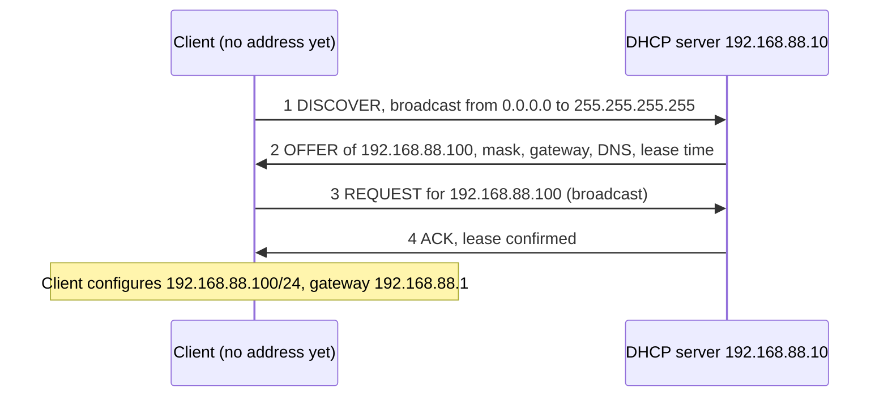
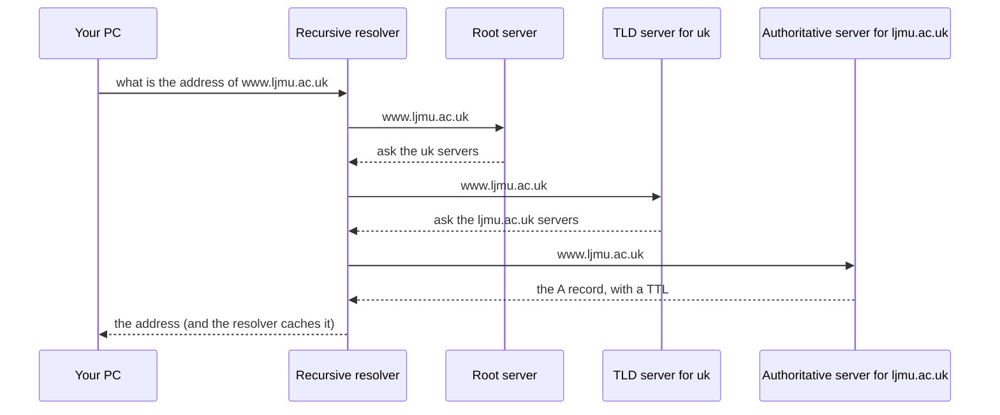
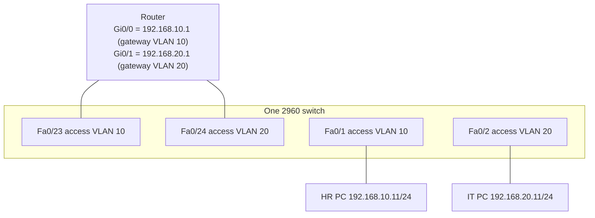

# Lecture 8 — DHCP, Web Services and VLAN Routing

**Module:** 4301COMP Computer Systems Architecture

**Session:** Teaching Week 04, Session B

## Start here

Until now you have typed every IP address by hand. Real networks do not: **DHCP** hands out addresses automatically, **DNS** turns names into addresses, and **web servers** deliver pages over **HTTP** and **HTTPS**. Large networks are also split into **VLANs**, which a router then joins back together. This lecture covers all four. After reading, do **Lab 8** (`../Labs/Lab-08-DHCP-Web-Services-and-VLAN-Routing-Hands-on-Workbook.md`), where you build a LAN with a DHCP server and a web server in Packet Tracer.

**Labels used in these notes:** **Official** = from the TW04 Session B slides or lab sheet. **Extra** = added explanation, not on the slides. **Verified** = actually run before being written down (Linux machine: a real local DNS server queried with `dig`, a real web server queried with `curl`, real HTTPS certificate checks, and Python models). **Expected** = not run here (Packet Tracer, Cisco IOS, Windows).

> **Note on the slides.** Slides 10 (DHCP client-side setting), 15 (Cisco IOS operating system) and the diagram on slide 20 are images; only their titles were available as text. The matching sections explain them from standard material, marked **Extra**. Check the real slides on Canvas.

---

## 1. Overview

When your laptop joins the university Wi-Fi, it receives an IP address, mask, gateway and DNS server from **DHCP**. When you type `canvas.ljmu.ac.uk`, **DNS** finds its IP address. Your browser then fetches the page from a **web server** over **HTTPS**. Behind the scenes, staff, student and server traffic is kept on separate **VLANs** and routed between them under control.

**Why this matters for cyber security.** DHCP and DNS are trusted automatically by every device, so attackers target them (rogue DHCP servers, DNS spoofing, edited hosts files). HTTPS protects data in transit **only** when certificate checks pass. VLANs separate traffic but are **not** a complete security control on their own.

## 2. By the end you should be able to

1. List the settings a **DHCP** server provides and explain what a **lease** is.
2. Describe the four steps of **DORA** and why the first steps are broadcasts.
3. Explain **pools**, **static configuration** and **reservations**, and work out a pool's address range.
4. Describe how a **recursive resolver** answers a DNS query (root, TLD, authoritative, caching).
5. Name the **A, AAAA, CNAME, MX and PTR** record types and read real `dig`/`nslookup` answers.
6. Describe how a **web server** delivers a page, read an HTTP request and response, and explain what **HTTPS** does and does not protect.
7. Explain what a **VLAN** is, configure access ports with the Cisco IOS commands on slide 16, and explain **inter-VLAN routing**.
8. Explain how DHCP and DNS can work together with **dynamic DNS**.

## 3. Learning outcomes

**Session learning outcomes (Official, slide 3):**

- Explain how DHCP allocates network settings.
- Describe how DNS supports name resolution.
- Explain how web servers deliver content using HTTP and HTTPS.
- Design the basic relationship between VLANs and inter-VLAN routing.

**Module learning outcomes supported** (module guide, as recorded in this module's project instructions):

| Module LO | How this lecture supports it |
| --- | --- |
| **LO4** Explain the fundamental concepts involved in computer networking | All of this lecture |
| **LO3** Explain the role and functions of an operating system | Cisco IOS as a network operating system; services running as processes |

Relevant to the **report (40%)** on data storage and networking, and the **exam (60%)** (module guide).

## 4. Matching lab and what you need first

- **Matching lab:** Lab 8. It contains the official TW04 Session B tasks: building a practice LAN with a 1941 router (configured through the **router CLI** this time), a DHCP pool and an HTTP page on a Server-PT, and the Extra Challenge of diagnosing a DHCP fault.
- **From Lecture 7:** TCP and UDP, ports (53 DNS, 80 HTTP, 443 HTTPS), the default gateway, binary masks.
- **From Lecture 4:** broadcasts, broadcast domains, MAC addresses, switches.
- **From Lecture 6:** services run as processes that wait for requests (slide 26 of TW03B used a DHCP or web server as its example).

---

## 5. Recap of the previous session (slide 4, Official)

- TCP/IP is a suite of cooperating protocols.
- TCP is connection-oriented and reliable; UDP has lower overhead.
- IPv4 addresses and subnet masks identify networks and hosts.
- Gateways and NAT help traffic move beyond the local network; diagnostic commands help inspect and troubleshoot connectivity.

---

## 6. DHCP: what it gives a device (slides 5–6)

### 6.1 Official

- **Dynamic Host Configuration Protocol (DHCP)** simplifies IP management by **automatically assigning IP addresses and network parameters** to hosts.
- It **reduces manual configuration** and the **risk of addressing errors**.
- It is common in enterprise networks, universities and homes.

The DHCP server provides:

| Setting | Lecture 7 link |
| --- | --- |
| **IP address** | Identifies the host |
| **Subnet mask** | Decides which addresses are local |
| **Default gateway** | Where to send non-local traffic |
| **DNS server address** | Where to ask for names |
| **Lease duration** | How long the host may use the address |

A **lease** assigns an address for a **defined period**; expired leases can be **returned to the pool** for reuse.

### 6.2 Why automatic assignment matters (slide 5's question; answer Extra)

A university may have tens of thousands of laptops and phones arriving and leaving every day. Typing addresses by hand would be impossible, and any mistake (a duplicate address, a wrong gateway: Lecture 3 Task 7, Lecture 7 Task 8) would break connectivity. DHCP gives each device a correct, unique configuration in seconds, and **reclaims** addresses when devices leave.

---

## 7. The DORA exchange (slide 7)

### 7.1 Official

1. **Discover**: the client **broadcasts** a request for a DHCP server.
2. **Offer**: the server responds with an available IP address and parameters.
3. **Request**: the client requests to use the offered IP.
4. **Acknowledge**: the server confirms and finalises the lease.

Example: after joining a network, a laptop uses DHCP to obtain its IP configuration.

### 7.2 Why broadcasts? (Extra)

At the start, the client has **no IP address** and does not know where the server is. So the Discover is sent **from 0.0.0.0 to 255.255.255.255**, the "everyone on this network" broadcast, using **UDP** (server port **67**, client port **68**). Every device on the broadcast domain receives it; only DHCP servers answer. The Request is also broadcast, so that any **other** servers that made offers know theirs was not chosen.



Because DHCP depends on broadcasts, and **routers do not forward broadcasts** (Lecture 4), a DHCP server normally has to be on the same broadcast domain as its clients, or a router must be configured to relay the requests (a **DHCP relay**, covered later in the module if taught).

### 7.3 A model of DORA (Extra, Verified)

The Lab 8 script `dhcp_sim.py` models the official pool (start 192.168.88.100, 20 users). Part of its real output:

```text
Client-1 joins at hour 0:
  D  00:0A:00:00:00:01 broadcasts DHCPDISCOVER (source 0.0.0.0, destination 255.255.255.255)
  O  server offers 192.168.88.100, mask 255.255.255.0, gateway 192.168.88.1, DNS 0.0.0.0, lease 24 h
  R  00:0A:00:00:00:01 broadcasts DHCPREQUEST for 192.168.88.100
  A  server sends DHCPACK: 192.168.88.100 leased until hour 24

DHCP service switched Off; Client-3 asks at hour 13:
  D  00:0A:00:00:00:03 broadcasts DHCPDISCOVER (source 0.0.0.0, destination 255.255.255.255)
     ...no reply. The client gives up and uses 169.254.x.x (APIPA): not valid here.
```

**169.254.x.x** (Extra) is an **APIPA** (Automatic Private IP Addressing) or "link-local" address. A device gives itself one when no DHCP server answers. The official lab is clear: a blank, `0.0.0.0` or `169.254.x.x` address is **not** a valid result. Seeing one usually means "DHCP failed".

**Renewal (Extra):** a client normally renews part-way through its lease (often at half the lease time) by sending a **Request** straight to its server and receiving an **Ack**, without a new Discover. The model simplifies this by repeating the full exchange.

---

## 8. Pools, static addresses and reservations (slide 8)

### 8.1 Official

- DHCP supplies configuration such as **IP address, prefix length, default gateway and DNS servers**.
- Client addresses are commonly **leased from a pool**.
- Devices that need a **stable** address can use **manual static configuration** or a **DHCP reservation**.
- A **reservation** still uses DHCP but **consistently maps a client identifier to the same address**.

### 8.2 Working out a pool (Extra, Verified)

The official lab's pool: **start 192.168.88.100**, **maximum 20 users**.

1. First address = 192.168.88.100.
2. Last address = first + (users − 1) = 100 + 19 = **192.168.88.119**.
3. So the pool is **192.168.88.100 – 192.168.88.119** (20 addresses).

The pool deliberately **avoids** the router's static address (**.1**) and the server's static address (**.10**). A pool that overlapped them could give a PC the router's address, causing a duplicate-address fault.

In the model, the 21st client to ask received **no offer** (pool exhausted), and an address became available again once a lease expired (Verified).

| Method | Who sets the address | Typical use |
| --- | --- | --- |
| Dynamic (pool) | DHCP server, any free address | Laptops, phones, lab PCs |
| Reservation | DHCP server, always the same address for that MAC | Printers, cameras, some servers |
| Static | Typed in by an administrator | Routers, DHCP/DNS servers themselves |

> **Cyber security link: rogue DHCP and starvation.** Clients accept the **first** offer they receive. An attacker who plugs in a **rogue DHCP server** can hand out their own machine as the gateway or DNS server and intercept traffic. **DHCP starvation** floods the server with fake requests until the pool is empty (like the 21st client above), so real devices get nothing. Switches can defend with **DHCP snooping**, which only allows offers from trusted ports.

---

## 9. DNS: names to addresses (slide 9)

### 9.1 Official

- The **Domain Name System (DNS)** translates **hostnames into IP addresses**. Without it, users would need to memorise IP addresses.
- A client normally asks a **recursive resolver**.
- If the answer is not **cached**, the resolver may query: **1. a root name server**, **2. a TLD name server**, **3. the authoritative name server**.
- The resolver then **returns and caches** the answer.

### 9.2 Explained (Extra)

A domain name is read from right to left: in `www.ljmu.ac.uk`, `uk` is the **top-level domain (TLD)**, `ac.uk` and `ljmu.ac.uk` are levels below it, and `www` is a host in `ljmu.ac.uk`.



- **Caching** means the resolver keeps the answer for a while, so the next person asking gets it immediately. Every record has a **TTL** (time to live) saying how many seconds it may be cached.
- Most queries use **UDP port 53** (Lecture 7). A real query to a local DNS server, captured on the Linux checking machine (Verified, timestamps removed):

```text
IP 127.0.0.1.33653 > 127.0.0.53.53: 48130+ [1au] A? www.uni.test. (53)
IP 127.0.0.53.53 > 127.0.0.1.33653: 48130* 1/0/1 A 192.168.88.10 (57)
```

  One question ("A? www.uni.test.") and one answer ("A 192.168.88.10"), matched by the ID 48130. No handshake: it is UDP.

**The hosts file (Extra).** Before asking DNS, computers check a small local file: `C:\Windows\System32\drivers\etc\hosts` on Windows, `/etc/hosts` on Linux. A line such as `192.168.88.10 intranet` makes that name resolve locally.

> **Cyber security link: name resolution attacks.** Some malware **edits the hosts file** so that a bank's name points to the attacker's server. **DNS spoofing** or **cache poisoning** puts a false answer into a resolver's cache, sending everyone who asks to the wrong place. HTTPS certificate checks (section 13) are one of the defences: the fake site cannot prove it is the real bank.

---

## 10. DHCP on the client side (slide 10)

**Official title; content Extra.** The slide shows a client set to obtain its configuration by DHCP. On Windows, `ipconfig /all` (Expected) shows the result:

| Field | Meaning |
| --- | --- |
| DHCP Enabled: Yes | The adapter uses DHCP |
| IPv4 Address | The leased address |
| Subnet Mask, Default Gateway | From the server |
| DHCP Server | The address of the server that granted the lease |
| DNS Servers | Where name queries go |
| Lease Obtained / Lease Expires | The lease period |

`ipconfig /release` gives the address back and `ipconfig /renew` requests a new one. **In the official lab you use these only inside Packet Tracer, never on your real Windows adapter.**

---

## 11. DNS record types (slide 11)

### 11.1 Official

| Record | Meaning |
| --- | --- |
| **A** | IPv4 address record |
| **AAAA** | IPv6 address record |
| **CNAME** | Alias record (one name points to another name) |
| **MX** | Mail exchange record (which server receives a domain's email) |
| **PTR** | Reverse lookup (address → name) |

Each record type serves a distinct purpose in domain management.

### 11.2 Real answers (Verified)

A local DNS server (`dnsmasq`) was set up on the Linux checking machine for a made-up domain, `uni.test`, and queried with `dig` (IDs removed):

```text
$ dig @127.0.0.53 www.uni.test A
;; ->>HEADER<<- opcode: QUERY, status: NOERROR
www.uni.test.		0	IN	A	192.168.88.10
$ dig @127.0.0.53 portal.uni.test AAAA
;; ->>HEADER<<- opcode: QUERY, status: NOERROR
portal.uni.test.	0	IN	AAAA	2001:db8::20
$ dig @127.0.0.53 intranet.uni.test A
;; ->>HEADER<<- opcode: QUERY, status: NOERROR
intranet.uni.test.	0	IN	CNAME	portal.uni.test.
portal.uni.test.	0	IN	A	192.168.88.20
$ dig @127.0.0.53 uni.test MX
;; ->>HEADER<<- opcode: QUERY, status: NOERROR
uni.test.		0	IN	MX	10 mail.uni.test.
$ dig @127.0.0.53 -x 192.168.88.10
;; ->>HEADER<<- opcode: QUERY, status: NOERROR
10.88.168.192.in-addr.arpa. 0	IN	PTR	www.uni.test.
$ dig @127.0.0.53 nothere.uni.test A
;; ->>HEADER<<- opcode: QUERY, status: NXDOMAIN
```

How to read them:

- Each answer line is **name, TTL, class (IN = internet), type, value**. (The TTL is 0 because this test server sets none.)
- The **CNAME** query returned **two** records: `intranet` is an alias for `portal`, and `portal`'s A record gives the address. The resolver follows the alias for you.
- The **MX** value `10 mail.uni.test.` has a **preference** number (lower = tried first) and the name of the mail server.
- The **PTR** query uses a special reversed name: 192.168.88.10 becomes `10.88.168.192.in-addr.arpa`.
- **NXDOMAIN** means "no such name": the domain exists but that name does not.

On Windows, `nslookup` does the same: `nslookup -type=MX ljmu.ac.uk`.

---

## 12. Web servers, HTTP and deployment (slides 12–13)

### 12.1 Official (slide 12)

- A **web server** hosts websites and delivers content via **HTTP** or **HTTPS**.
- Examples: **Apache**, **Nginx**, **Microsoft IIS**.
- Default ports: **80 (HTTP)**, **443 (HTTPS, secure transmission)**.
- Process: (1) the client requests `www.example.com`; (2) **DNS resolves** it to an IP; (3) the web server responds with the requested content.

### 12.2 An HTTP exchange (Extra, Verified)

A tiny web server (Python's built-in `http.server`) served the same kind of page as the official lab. `curl -v` shows the request (`>`) and response (`<`):

```text
> GET / HTTP/1.1
> Host: 127.0.0.1:8080
> User-Agent: curl/8.5.0
> Accept: */*
>
< HTTP/1.0 200 OK
< Server: SimpleHTTP/0.6 Python/3.13.18
< Date: (removed)
< Content-type: text/html
< Content-Length: 72
< Last-Modified: (removed)
<
<html><body><h1>Visitor Information</h1><p>Sam Archer</p></body></html>
```

| Part | Meaning |
| --- | --- |
| `GET / HTTP/1.1` | **Method** GET ("send me"), **path** `/` (the main page), protocol version |
| `Host:` | Which site is wanted (one server can host many) |
| `HTTP/1.0 200 OK` | **Status code** 200 = success |
| `Content-type: text/html` | What kind of data follows |
| `Content-Length: 72` | How many bytes of page follow |
| The HTML | The page itself |

Common status codes (Extra): **200** OK · **301/302** moved elsewhere · **403** forbidden · **404** not found (requesting `/missing.html` returned **404**, Verified) · **500** server error.

All of this travels inside a **TCP** connection to port 80 (Lecture 7's handshake comes first).

### 12.3 Servers and deployment models (Official, slide 13)

- A **server** is a **program or system** that provides a network service to clients.
- It can run on **dedicated physical hardware**, a **virtual machine**, a **container** or a **cloud platform**.
- One host may provide **several services**, and one service may be **distributed across many hosts**.

In the official lab, **one** Server-PT provides **two** services, DHCP and HTTP. A large website does the opposite: one service spread over thousands of machines (Extra).

---

## 13. HTTPS and its limits (slides 12 and 19)

### 13.1 Official (slide 19)

- **HTTPS is HTTP protected by TLS** (Transport Layer Security).
- When **certificate validation succeeds**, TLS **authenticates the server** and protects the **confidentiality and integrity** of data **in transit**.
- It does **not** by itself prove that website **content is trustworthy**, or protect data **after it reaches an endpoint**.

**Why HTTPS is preferred over HTTP (slide 12's question; answer Extra):** with plain HTTP, anyone on the path (the same Wi-Fi, a compromised router) can **read** and **change** the page and anything you send, including passwords. HTTPS encrypts it and lets your browser check it is talking to the real server.

### 13.2 Certificate validation in action (Extra, Verified)

An HTTPS server was given a **self-signed** certificate for `www.uni.test` and tested with `curl` three ways:

```text
$ curl --cacert cert.pem https://www.uni.test:8443/
<html><body><h1>Visitor Information</h1><p>Sam Archer</p></body></html>
(exit code 0)
$ curl https://www.uni.test:8443/            # certificate not trusted
curl: (60) SSL certificate problem: self-signed certificate
(exit code 60)
$ curl --cacert cert.pem https://evil.test:8443/   # wrong name
curl: (60) SSL: no alternative certificate subject name matches target host name 'evil.test'
(exit code 60)
```

1. When the client **trusts** the certificate and the **name matches**, the page loads.
2. When the certificate is **not from a trusted authority**, the client **refuses** to continue: it cannot prove who the server is.
3. When the certificate is for a **different name**, the client refuses again, even though the encryption itself would work.

The connection used **TLS 1.3** (Verified in `curl -v`). A real website uses a certificate signed by a **certificate authority** that browsers already trust, so step 1 happens automatically.

> **Common confusion.** The padlock means "the connection to this named server is encrypted and the server proved its identity". It does **not** mean the site is honest: a phishing site can have a perfectly valid certificate for its own (fake) name.

---

## 14. VLANs (slide 14)

### 14.1 Official

- A **VLAN** (virtual LAN) creates a **separate Layer-2 broadcast domain** on a switch infrastructure.
- VLANs improve **organisation**, **reduce broadcast scope** and support **segmentation**.
- **Traffic between VLANs requires a router or Layer-3 switch.**
- VLAN membership alone is **not a complete security control**; ACLs, firewalls, authentication and secure management enforce policy.

**Terms (Extra):** an **access port** belongs to one VLAN and connects an end device. An **ACL** (access control list) is a list of rules on a router or switch that permits or denies traffic. A **Layer-3 switch** is a switch that can also route.

### 14.2 What VLANs do (Extra, Verified)

Without VLANs, every port on a switch is in one broadcast domain (in the official lab, all ports stay in the default **VLAN 1**). With VLANs, one physical switch behaves like several separate switches.

Real output of the Lab 8 model `vlan_sim.py` (HR on VLAN 10, IT on VLAN 20, two PCs each, one switch):

```text
HR-PC1 sends a broadcast (e.g. ARP or DHCP Discover)
   VLAN 10: flood -> reaches HR-PC2
IT-PC1 sends a broadcast
   VLAN 20: flood -> reaches IT-PC2
HR-PC2 sends to HR-PC1
   VLAN 10: forward -> reaches HR-PC1
IT-PC2 tries to send straight to HR-PC1's MAC
   VLAN 20: flood -> reaches IT-PC1
```

Broadcasts stay inside their VLAN, and an IT PC **cannot reach** an HR PC at Layer 2 even on the same switch. Each VLAN is normally given its **own IP subnet**, and a router joins them.

---

## 15. Cisco IOS (slide 15)

**Official title; content Extra.** Cisco routers and switches run **Cisco IOS** (Internetwork Operating System): a **network operating system** with a command-line interface (CLI). It has **modes**, shown by the prompt:

| Prompt | Mode | Reached by | Can do |
| --- | --- | --- | --- |
| `Switch>` | User EXEC | Logging in | Look at basic status |
| `Switch#` | Privileged EXEC | `enable` | All `show` commands; save; enter configuration |
| `Switch(config)#` | Global configuration | `configure terminal` | Change device-wide settings |
| `Switch(config-if)#` | Interface configuration | `interface fa0/1` | Configure one port |
| `Switch(config-vlan)#` | VLAN configuration | `vlan 10` | Name a VLAN |

`exit` goes back one level; `end` jumps straight back to privileged EXEC. Like the Linux and Windows CLIs in Lecture 5, IOS is a **user interface** to an operating system, here one that runs a network device.

The official Lab 8 router commands (Expected; run in Packet Tracer):

| Command | What it does |
| --- | --- |
| `enable` | Enter privileged EXEC mode |
| `configure terminal` | Enter global configuration mode |
| `interface g0/0` | Select GigabitEthernet0/0 |
| `ip address 192.168.88.1 255.255.255.0` | Give the interface its address and mask |
| `no shutdown` | Switch the interface on (router interfaces start "shut down") |
| `end` | Back to privileged EXEC |
| `show ip interface brief` | One line per interface: address and up/down status |
| `show ip route` | The routing table; `C` marks a **connected** network |

---

## 16. VLAN configuration example (slide 16, Official)

Cisco Packet Tracer 9.0, 2960 switch, one command per line:

**Create VLANs**

```text
Switch> enable
Switch# configure terminal
Switch(config)# vlan 10
Switch(config-vlan)# name HR
Switch(config-vlan)# exit
Switch(config)# vlan 20
Switch(config-vlan)# name IT
Switch(config-vlan)# exit
```

**Assign access ports**

```text
Switch(config)# interface fa0/1
Switch(config-if)# switchport mode access
Switch(config-if)# switchport access vlan 10
Switch(config-if)# exit
Switch(config)# interface fa0/2
Switch(config-if)# switchport mode access
Switch(config-if)# switchport access vlan 20
Switch(config-if)# end
Switch# show vlan brief
```

**VLAN 10 and VLAN 20 are separate broadcast domains.** Routing can use **separate physical router links to access ports**.

| Command | Meaning (Extra) |
| --- | --- |
| `vlan 10` / `name HR` | Create VLAN 10 and label it HR |
| `switchport mode access` | This port connects one end device, in one VLAN |
| `switchport access vlan 10` | Put this port in VLAN 10 |
| `show vlan brief` | List VLANs and which ports belong to each |

(You type only the part after the prompt, e.g. `vlan 10`, not `Switch(config)#`.)

---

## 17. Inter-VLAN communication (slide 17)

### 17.1 Official

Separate physical interfaces provide inter-VLAN routing:

- Each VLAN connects to a **different router interface** through a switch **access port**.
- Each router interface acts as the **default gateway** for its VLAN.
- Traffic between VLANs **must pass through the router**.
- This design uses **two separate physical links**, with **no trunk link or router subinterfaces**.
- **Router-on-a-stick** and **Layer-3 switching** are alternative inter-VLAN routing methods.

### 17.2 Picture (Extra, using slide 16's VLANs and illustrative addresses)



An HR PC sending to an IT PC: the destination is on another subnet → frame to the HR gateway (Gi0/0) through VLAN 10 → the router routes it out of Gi0/1 → through VLAN 20 to the IT PC. This is exactly Lecture 7's two-network router, with VLANs replacing the second switch.

**Alternatives (Extra, named on the slide):** **router-on-a-stick** uses **one** physical router link carrying all VLANs (a **trunk**) with a **subinterface** per VLAN; a **Layer-3 switch** routes between VLANs internally. Both scale better than one cable per VLAN.

---

## 18. A real-world scenario (slide 18, Official)

A university network:

| Service | Role |
| --- | --- |
| **DHCP** | Assigns IPs to staff and student devices |
| **DNS** | Resolves internal and external addresses |
| **Web server** | Hosts the intranet portal |
| **VLANs** | Separate networks for HR, IT and Students |
| **Inter-VLAN routing** | A router or Layer-3 switch routes between VLANs; **ACLs or firewalls** can restrict communication |

---

## 19. Security considerations (slide 19, Official)

- HTTPS is HTTP protected by TLS; with successful certificate validation it authenticates the server and protects data **in transit** (section 13).
- It does **not** prove content is trustworthy or protect data **after it reaches an endpoint**.
- **VLANs segment Layer-2 traffic; security policy still requires controls such as ACLs and firewalls.**

**Why VLANs are not enough on their own (Extra):** the router between VLANs will forward **any** traffic unless told otherwise. Segmentation becomes **security** only when the router or firewall between the segments has rules (for example "Students may reach the web server on port 443, but not HR on any port").

---

## 20. DHCP and DNS integration (slide 20)

### 20.1 Official

- DNS maps names to resource records such as IP addresses.
- A DHCP service may **register or update DNS records** only when **dynamic DNS** is configured and supported.
- Otherwise DHCP and DNS operate as **separate services**, and records must be managed independently.

### 20.2 Example (Extra; slide 20's diagram not available as text)

1. Laptop `SAM-LAPTOP` gets 10.10.5.37 from DHCP.
2. With **dynamic DNS**, the DHCP server (or the laptop) tells the DNS server: "`sam-laptop.uni.test` A 10.10.5.37" (and the matching PTR record).
3. Tomorrow the laptop gets 10.10.5.81; the record is **updated**.
4. Without dynamic DNS, the DNS record would still say .37: wrong.

---

## 21. Common mistakes

| Mistake | Symptom | Fix |
| --- | --- | --- |
| Thinking DHCP only gives an IP address | Missing gateway/DNS in answers | DHCP gives address, mask, gateway, DNS and lease time |
| Getting DORA out of order | "Offer, Discover, …" | Discover, Offer, Request, Acknowledge |
| Accepting 169.254.x.x as "working" | DHCP faults missed | APIPA means no DHCP reply: not a valid result in the lab |
| Pool overlapping static addresses | Duplicate-address faults | Keep router/server statics outside the pool |
| Off-by-one pool maths | ".100 + 20 = .120" | Last = start + users − 1 = .119 |
| Saying DNS "connects" you to a website | Confused explanations | DNS only returns records; the browser then connects with TCP |
| Mixing record types | MX given an IP address | A/AAAA → address; CNAME → another name; MX → mail server name; PTR → name for an address |
| Thinking the padlock means the site is safe | Weak HTTPS answers | It protects the connection to that name only |
| Thinking VLANs block traffic by themselves | "VLANs are a firewall" | Routers forward between VLANs unless ACLs/firewalls restrict it |
| Typing prompts in IOS | "Invalid input detected" | Type only the command, not `Switch(config)#` |
| Forgetting `no shutdown` | Router interface stays down | Router interfaces start administratively down |

---

## 22. Check yourself: 15 multiple-choice questions

**Q1.** Which is **not** one of the settings a DHCP server provides (slide 6)?
A) Default gateway
B) DNS server address
C) Lease duration
D) The user's password

**Q2.** What is the correct order of DHCP's lease process?
A) Discover, Offer, Request, Acknowledge
B) Request, Offer, Discover, Acknowledge
C) Offer, Discover, Acknowledge, Request
D) Discover, Request, Offer, Acknowledge

**Q3.** Why is the DHCP Discover sent as a broadcast?
A) Broadcasts are faster
B) The client has no address yet and does not know where the server is
C) DHCP only works with TCP
D) To reach the internet

**Q4.** A pool starts at 192.168.88.100 with 20 users. What is the last address?
A) 192.168.88.120
B) 192.168.88.200
C) 192.168.88.119
D) 192.168.88.20

**Q5.** A PC shows the address 169.254.12.7 after joining the lab network. What does that most likely mean?
A) It got a valid DHCP lease
B) It is the router's address
C) It has a DNS problem only
D) No DHCP server answered, so it gave itself a link-local address

**Q6.** What is a DHCP reservation?
A) DHCP always giving the same address to a particular client identifier
B) A static address typed by hand
C) A pool with no addresses
D) A DNS record

**Q7.** In DNS resolution, which server finally holds the answer for `www.ljmu.ac.uk`?
A) The root server
B) The authoritative server for ljmu.ac.uk
C) The TLD server for uk
D) The DHCP server

**Q8.** Which DNS record type gives an IPv6 address?
A) A
B) MX
C) AAAA
D) PTR

**Q9.** A query for `intranet.uni.test` returns `CNAME portal.uni.test` and then `A 192.168.88.20`. What does that mean?
A) intranet is an alias for portal, whose address is 192.168.88.20
B) There are two different servers
C) The query failed
D) intranet is a mail server

**Q10.** Which HTTP status code means "not found"?
A) 200
B) 301
C) 500
D) 404

**Q11.** When HTTPS certificate validation succeeds, what does TLS provide (slide 19)?
A) Proof that the website's content is true
B) Server authentication, and confidentiality and integrity of data in transit
C) Protection of data after it is stored on the server
D) A faster connection than HTTP

**Q12.** What does a VLAN create?
A) A separate Layer-2 broadcast domain
B) A new IP address for the switch
C) An encrypted tunnel
D) A firewall

**Q13.** Traffic between VLAN 10 and VLAN 20 requires:
A) A hub
B) Nothing: switches forward between VLANs automatically
C) A router or Layer-3 switch
D) A DHCP server

**Q14.** Which Cisco IOS command puts a port into VLAN 10?
A) `vlan 10`
B) `switchport access vlan 10`
C) `name HR`
D) `show vlan brief`

**Q15.** Which statement is correct (slides 14 and 19)?
A) VLANs on their own are a complete security control
B) NAT and VLANs are the same thing
C) VLANs segment traffic, but policy still needs controls such as ACLs and firewalls
D) VLANs encrypt traffic

### Answers

| Q | Answer | Why |
| --- | --- | --- |
| 1 | **D** | Slide 6: IP address, mask, gateway, DNS server and lease duration. |
| 2 | **A** | Slide 7: DORA. |
| 3 | **B** | The client has no address and no server address yet. |
| 4 | **C** | 100 + 20 − 1 = 119 (Verified). |
| 5 | **D** | 169.254.x.x (APIPA) means no DHCP reply; the official lab says it is not valid. |
| 6 | **A** | Slide 8: a reservation consistently maps a client identifier to the same address. |
| 7 | **B** | Slide 9: root → TLD → authoritative; the authoritative server has the record. |
| 8 | **C** | Slide 11: AAAA = IPv6 address (Verified with `dig`). |
| 9 | **A** | Verified `dig` output: CNAME alias followed by the target's A record. |
| 10 | **D** | 404 Not Found (Verified with `curl`). |
| 11 | **B** | Slide 19, word for word. |
| 12 | **A** | Slide 14. |
| 13 | **C** | Slides 14 and 17. |
| 14 | **B** | Slide 16. |
| 15 | **C** | Slides 14 and 19. |

---

## 23. Quick reference

**DHCP:** gives address, mask, gateway, DNS, lease · DORA = Discover (broadcast) → Offer → Request → Ack · UDP 67/68 · pool last = start + users − 1 · reservation = same address per client · 169.254.x.x = no DHCP reply.

**DNS:** name → records · client → recursive resolver → root → TLD → authoritative · cached for the TTL · UDP 53 · records: A (IPv4), AAAA (IPv6), CNAME (alias), MX (mail server, with preference), PTR (reverse) · NXDOMAIN = no such name · tools: `nslookup`, `dig`.

**Web:** Apache, Nginx, IIS · HTTP 80, HTTPS 443 · request `GET /path` + `Host:` · response status (200, 301, 403, 404, 500) + headers + body · HTTPS = HTTP + TLS · protects in transit after certificate validation; not content, not endpoints.

**VLANs:** separate Layer-2 broadcast domain · access port = one VLAN · between VLANs: router or Layer-3 switch · VLANs ≠ security policy (need ACLs/firewalls).

**IOS modes:** `>` user · `#` privileged (`enable`) · `(config)#` (`configure terminal`) · `(config-if)#` (`interface …`) · `(config-vlan)#` (`vlan …`).

**Key commands:** `ip address A M` · `no shutdown` · `show ip interface brief` · `show ip route` · `vlan 10` / `name HR` · `switchport mode access` · `switchport access vlan 10` · `show vlan brief`.

## 24. Glossary

| Term | Meaning |
| --- | --- |
| **ACL** | Access control list: permit/deny rules on a router or switch |
| **APIPA** | 169.254.x.x address a device gives itself when DHCP fails |
| **Access port** | A switch port in one VLAN, for an end device |
| **Authoritative server** | The DNS server that holds a domain's records |
| **Certificate** | Signed proof of a server's identity used by TLS |
| **CNAME** | DNS alias record |
| **DHCP** | Dynamic Host Configuration Protocol |
| **DHCP snooping** | A switch feature that blocks offers from untrusted ports |
| **DNS** | Domain Name System |
| **DORA** | Discover, Offer, Request, Acknowledge |
| **Dynamic DNS** | DNS records updated automatically, e.g. by DHCP |
| **HTTP / HTTPS** | Web protocol / HTTP protected by TLS |
| **Inter-VLAN routing** | Routing traffic between VLANs |
| **Lease** | Permission to use an address for a defined period |
| **Layer-3 switch** | A switch that can also route |
| **MX** | Mail exchange record |
| **NXDOMAIN** | DNS answer meaning "no such name" |
| **Pool** | The range of addresses a DHCP server can lease |
| **PTR** | Reverse lookup record (address → name) |
| **Recursive resolver** | The DNS server that does the lookups on a client's behalf |
| **Reservation** | A DHCP mapping from one client to a fixed address |
| **Router-on-a-stick** | Inter-VLAN routing over one trunk link with subinterfaces |
| **Status code** | Three-digit HTTP result, e.g. 200 or 404 |
| **TLD** | Top-level domain, such as `uk` or `com` |
| **TLS** | Transport Layer Security, the encryption in HTTPS |
| **Trunk** | A switch link carrying several VLANs |
| **TTL (DNS)** | How long a DNS answer may be cached |
| **VLAN** | Virtual LAN: a separate Layer-2 broadcast domain on a switch |

## 25. Summary

- **DHCP** automatically gives hosts an address, mask, gateway, DNS server and lease using **DORA**; addresses come from a **pool** (or a **reservation**); a 169.254 address means DHCP failed.
- **DNS** resolves names through a recursive resolver, root, TLD and authoritative servers, caching answers; **A, AAAA, CNAME, MX and PTR** records each have a distinct purpose.
- **Web servers** answer HTTP requests with status codes, headers and content; **HTTPS** adds TLS, which authenticates the server and protects data in transit **only if certificate validation succeeds**.
- **VLANs** split one switch into separate broadcast domains; a **router** (or Layer-3 switch) connects them, and **ACLs/firewalls** turn segmentation into security.
- **Dynamic DNS** can link DHCP and DNS; otherwise they are managed separately.

## 26. Next

According to slide 23, the next session is **Teaching Week 05, Session A: Network Segmentation and Layer 3 Connectivity**.
