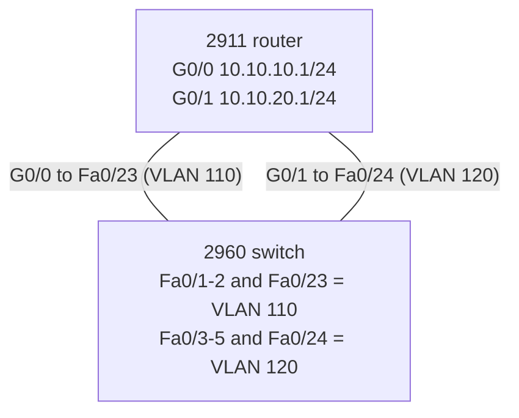
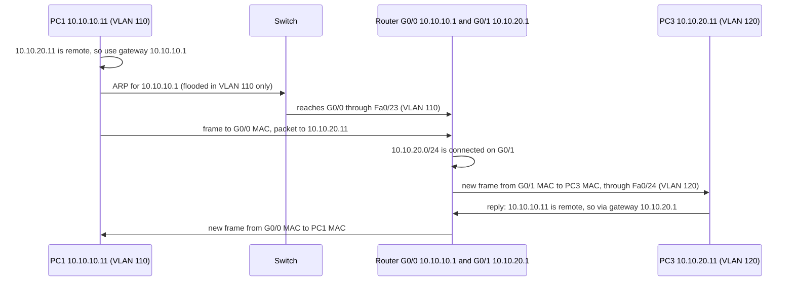

# Lecture 9 — Network Segmentation and Layer 3 Connectivity

**Module:** 4301COMP Computer Systems Architecture

**Session:** Teaching Week 05, Session A

## Start here

Lecture 8 introduced VLANs and routing between them. This lecture turns that into **design**: why and how to **segment** a network, how **access ports** place devices in a VLAN, how the **default gateway** decides a packet's path, the **three ways** to route between VLANs, how to write an **address plan**, and how to **verify** a design with switch and router checks. After reading, do **Lab 9** (`../Labs/Lab-09-Network-Segmentation-and-Layer-3-Connectivity-Hands-on-Workbook.md`), where you build two VLANs and route between them with a 2911 router.

**Labels used in these notes:** **Official** = from the TW05 Session A slides or lab sheet. **Extra** = added explanation, not on the slides. **Verified** = actually run before being written down (Python models of the official network, Python 3.13). **Expected** = not run here (Packet Tracer and Cisco IOS).

> **Note on the slides.** Slides 8 (three routing designs), 9 (address plans), 11 (following a packet), 12 (switch and router checks) and 13 (knowledge check) are diagrams; only their titles were available as text. These are important for the exam and the lab, so sections 8–12 explain them from standard material, marked **Extra**, using the official lab's network. Check the real slides on Canvas. In the text of slide 10, "VVLAN 120LAN 120" is a copying glitch for **VLAN 120**.

---

## 1. Overview

One flat network where every device hears every broadcast is simple, but it scales badly and lets any device talk to any other directly. **Segmentation** divides it into VLANs and subnets along sensible boundaries (roles, services, risk), and **Layer-3 connectivity** joins the segments back together through a point where traffic can be checked. This lecture covers both, with the reasoning a good design needs.

**Why this matters for cyber security.** Segmentation is one of the most effective defences an organisation has: if a reception PC is compromised, the attacker should not be able to reach the workshop's machines directly. Getting a single access port wrong can put a device into the **wrong** segment, which is both a fault and a security risk.

## 2. By the end you should be able to

1. Explain why organisations segment networks and what a VLAN broadcast boundary does.
2. Explain what an **access port** does and the effect of putting a port in the wrong VLAN.
3. Predict whether a destination is **local** or **routed**, using an address and mask.
4. Compare **separate physical interfaces**, **router-on-a-stick** and **Layer-3 switching** for inter-VLAN routing.
5. Write an **address plan** that reserves infrastructure first and prevents overlap.
6. Trace a packet across a VLAN boundary, saying which MAC and IP addresses are used on each leg.
7. Choose the right **switch** and **router** checks to verify a design and locate a fault.
8. Justify a design using security, manageability and scale.

## 3. Learning outcomes

**Session learning outcomes (Official, slide 3):**

- Explain how VLANs segment a switched network.
- Configure and verify the idea of an access port.
- Compare common methods of connecting VLANs.
- Explain how addressing and gateways control packet paths.

**Module learning outcomes supported** (module guide, as recorded in this module's project instructions):

| Module LO | How this lecture supports it |
| --- | --- |
| **LO4** Explain the fundamental concepts involved in computer networking | All of this lecture |
| **LO2** Demonstrate knowledge of the structure and organisation of computer systems | How a network is structured into segments and routed |

Relevant to the **report (40%)** on networking and the **exam (60%)** (module guide).

## 4. Matching lab and what you need first

- **Matching lab:** Lab 9. It contains the official TW05 Session A tasks: creating VLANs 110 and 120 on a 2960, routing between them through two physical links on a 2911, and the Extra Challenge of diagnosing an access-port fault.
- **From Lecture 8:** VLANs, access ports, Cisco IOS modes, `show vlan brief`, inter-VLAN routing with separate physical links.
- **From Lecture 7:** masks, the AND test for "local or remote", the default gateway, MAC versus IP addresses at each hop.
- **From Lecture 4:** broadcast and collision domains, ARP.

---

## 5. Recap of the previous session (slide 4, Official)

- DHCP automates host configuration through the DORA process.
- DNS maps names to resource records, including IP addresses.
- Web servers provide content over HTTP or HTTPS.
- VLANs segment broadcast domains, and Layer-3 routing connects them.

---

## 6. A VLAN creates a broadcast boundary (slide 5)

### 6.1 Official

- A switch can carry **several logical networks** at the same time.
- Devices in one VLAN **share broadcasts with that VLAN only**.
- Separating groups **reduces unnecessary broadcasts**, **improves organisation** and **can support security policies**.
- VLANs **limit direct Layer-2 communication** between groups but are **not a complete security control**.

**Slide 5's question: which devices genuinely need to share one local broadcast domain?** (Answer, Extra.) Only devices that need to find each other **directly** at Layer 2 and belong to the same role or risk level, such as the PCs and printer at one reception desk. Devices with different owners, trust levels or purposes (guest Wi-Fi, CCTV, servers, staff PCs) should usually be in **different** VLANs.

### 6.2 Why fewer broadcasts helps (Extra)

Every broadcast (ARP requests, DHCP Discovers, some service announcements) is received and processed by **every** device in the broadcast domain. In a VLAN of 30 devices, that is 30 copies; in a flat network of 3,000, it is 3,000. Smaller broadcast domains mean less wasted bandwidth and processing, and a fault such as a broadcast storm stays contained.

---

## 7. Access ports place endpoints in one VLAN (slide 6)

### 7.1 Official

- An **access port** normally carries **untagged** data traffic for **one VLAN**.
- The switch associates an untagged endpoint with the port's **configured access VLAN**.
- **A port in the wrong VLAN gives the endpoint the wrong local neighbours.**
- Example values use **VLAN 110** and **VLAN 120**.

### 7.2 Untagged and tagged (Extra)

- **Untagged** means the Ethernet frame looks completely normal. The PC has **no idea** which VLAN it is in: the switch decides, from the port's configuration.
- A **tag** (IEEE **802.1Q**) is a small extra field the switch can insert into a frame to say "this frame belongs to VLAN 120". Tags are used on **trunk** links that carry several VLANs over one cable (section 9.2). End devices normally never see them.

### 7.3 The wrong-VLAN fault (Extra, Verified with the Lab 9 model)

In the official Extra Challenge, PC3 (10.10.20.11/24, gateway 10.10.20.1) is plugged into Fa0/3, which is moved from VLAN 120 to VLAN 110. Nothing on PC3 changes, but:

```text
ping PC3 -> 10.10.20.1: FAIL
   PC3: 10.10.20.1 is local (10.10.20.0/24); ARP for it in VLAN 110
      no reply to ARP: nobody with 10.10.20.1 in VLAN 110
```

PC3's ARP broadcast for its gateway now goes only to VLAN 110, where nobody owns 10.10.20.1. Its **subnet** says it belongs with the workshop, but its **port** has put it with reception: the wrong local neighbours. After moving the port back to VLAN 120, the same ping succeeds (Verified).

> **Cyber security link.** The same mistake in reverse is a security problem: a guest device plugged into a port wrongly left in the **staff** VLAN can reach staff machines directly, with no router or firewall in the way. Organisations audit access-port assignments for exactly this reason, and unused ports are usually shut down or put in an unused VLAN.

---

## 8. The default gateway is the subnet exit (slide 7)

### 8.1 Official

- A host compares the destination with **its own address and mask**.
- **Local destination:** resolve the **destination's MAC** address and send **directly**.
- **Remote destination:** resolve the **gateway's MAC** address and send the frame **to the gateway**.
- **The IP destination remains the final remote host.**

### 8.2 Local or routed? (Extra, Verified with Python)

**Method:** apply **your own** mask to both addresses and compare the network parts (Lecture 7 section 13.3). For a /24, compare the first three octets.

| Host | Destination | Local or routed? | Why |
| --- | --- | --- | --- |
| 10.10.10.11/24 | 10.10.10.12 | **Local** | Both in 10.10.10.0/24 |
| 10.10.10.11/24 | 10.10.20.11 | **Routed** | 10.10.20 ≠ 10.10.10 |
| 10.10.20.13/24 | 10.10.20.1 | **Local** | The gateway itself is always local |
| 10.10.20.12/**16** | 10.10.10.11 | **Local (wrongly)** | With /16, 10.10.x.x all looks local: the host ARPs in its own VLAN and gets no answer |

The last row is a classic hidden fault: the mask makes the host believe a remote device is local, so it never uses its gateway (Verified with the Lab 9 model: the ping fails).

---

## 9. Three routing designs (slide 8)

**Official title (slide 8) and the three methods named on slide 16; comparison Extra.** Lecture 8 section 17 introduced them; here they are compared as design choices.

### 9.1 Separate physical interfaces (the official lab's design)

One router interface and one switch **access port** per VLAN. Each router interface is the gateway for its VLAN.



### 9.2 Router-on-a-stick

**One** physical link between router and switch, configured as a **trunk** that carries **all** VLANs with 802.1Q tags. On the router, one physical interface is split into **subinterfaces** (G0/0.110, G0/0.120), one per VLAN, each the gateway for its VLAN. Example commands (Extra; Expected in Packet Tracer):

```text
Switch(config)# interface fa0/24
Switch(config-if)# switchport mode trunk

Router(config)# interface g0/0
Router(config-if)# no shutdown
Router(config-if)# interface g0/0.110
Router(config-subif)# encapsulation dot1Q 110
Router(config-subif)# ip address 10.10.10.1 255.255.255.0
Router(config-subif)# interface g0/0.120
Router(config-subif)# encapsulation dot1Q 120
Router(config-subif)# ip address 10.10.20.1 255.255.255.0
```

### 9.3 Layer-3 switch

A **multilayer switch** (for example a Cisco 3560) routes internally. Each VLAN gets a **switch virtual interface (SVI)** such as `interface vlan 110` with the gateway address, and `ip routing` is switched on. Traffic between VLANs never leaves the switch.

```text
Switch(config)# ip routing
Switch(config)# interface vlan 110
Switch(config-if)# ip address 10.10.10.1 255.255.255.0
Switch(config-if)# no shutdown
Switch(config-if)# interface vlan 120
Switch(config-if)# ip address 10.10.20.1 255.255.255.0
Switch(config-if)# no shutdown
```

### 9.4 Comparison (Extra)

| | Separate physical interfaces | Router-on-a-stick | Layer-3 switch |
| --- | --- | --- | --- |
| Links between router and switch | One per VLAN | One trunk for all VLANs | None (routing inside the switch) |
| Router ports used | One per VLAN | One | None (or one uplink) |
| Configuration | Simplest: access ports, plain interfaces | Trunk + subinterfaces + 802.1Q | SVIs + `ip routing` |
| Inter-VLAN capacity | Each VLAN has its own link | All inter-VLAN traffic shares one link (in and out) | Very high (switch hardware) |
| Scales to many VLANs? | No: runs out of router ports | Moderately | Yes |
| Single points of failure | Router; each link (losing one link cuts one VLAN off) | Router **and** the one trunk link (cuts every VLAN off) | The switch itself |
| Typical use | Small labs, few VLANs, spare router ports | Small branches with one router link | Campus distribution, many VLANs, high traffic |

---

## 10. Address plans reserve infrastructure first (slide 9)

**Official title; content Extra** (built on slide 16's "address plans should reserve infrastructure and prevent overlap").

### 10.1 Principles

1. **One subnet per VLAN**, and the subnets must **not overlap**.
2. **Reserve infrastructure first:** decide the gateway and other fixed addresses before giving anything out. A common convention is **.1 for the gateway** and a small block (for example .2–.9) for switches, printers and servers.
3. Keep any **DHCP pool** away from the reserved block (Lecture 8).
4. Make the plan **understandable**: link VLAN numbers to subnets (VLAN 110 → 10.10.10.0/24; VLAN 120 → 10.10.20.0/24), so anyone can work out one from the other.
5. **Leave room for growth**: size subnets for future devices, and leave gaps for future VLANs.

### 10.2 A plan for the official network (Verified with `plan_check.py`)

| VLAN | Name | Subnet | Gateway | Reserved | DHCP pool (if used) |
| --- | --- | --- | --- | --- | --- |
| 110 | RECEPTION | 10.10.10.0/24 | 10.10.10.1 | .1–.9 | .100–.199 |
| 120 | WORKSHOP | 10.10.20.0/24 | 10.10.20.1 | .1–.9 | .100–.199 |

The checker reports **No problems found** for this plan. Given a deliberately faulty plan, it reported (among others): a /16 subnet overlapping two others, a DHCP pool starting at .1 that overlapped the reserved range, and a /27 with only 30 usable addresses for 50 hosts (Verified).

### 10.3 Worked example: the community centre (slide 10, Official)

| VLAN | Network | Subnet | Purpose (Official) |
| --- | --- | --- | --- |
| **110** | Reception | **10.10.10.0/24** | Dedicated VLAN for front-desk reception devices and administrative services |
| **120** | Workshop | **10.10.20.0/24** | Isolated segment for workshop devices and equipment |

These are exactly the official lab's VLANs and subnets.

---

## 11. Follow a packet across a VLAN boundary (slide 11)

**Official title; content Extra (Verified with the Lab 9 model).** PC1 (10.10.10.11, VLAN 110) pings PC3 (10.10.20.11, VLAN 120):



| Leg | VLAN | Source MAC → destination MAC | Source IP → destination IP |
| --- | --- | --- | --- |
| PC1 → router | 110 | PC1 → router G0/0 | 10.10.10.11 → 10.10.20.11 |
| Router → PC3 | 120 | router G0/1 → PC3 | 10.10.10.11 → 10.10.20.11 |

**MACs change at the router; IPs stay the same.** Real model output for this ping:

```text
ping PC1 -> 10.10.20.11: SUCCESS
   PC1: 10.10.20.11 is remote; ARP for gateway 10.10.10.1 in VLAN 110
      Router G0/0 routes it out of G0/1 (10.10.20.0/24) into VLAN 120
   PC3 received the request; now the reply:
   PC3: 10.10.10.11 is remote; ARP for gateway 10.10.20.1 in VLAN 120
      Router G0/1 routes it out of G0/0 (10.10.10.0/24) into VLAN 110
```

---

## 12. Switch and router checks answer different questions (slide 12)

**Official title; content Extra.** When a ping fails, each check answers one question. Work from the bottom up (Lecture 3 section 16.2).

| Device | Command | Question it answers |
| --- | --- | --- |
| Switch | `show vlan brief` | Which VLAN is each port in? (Is the PC, and the router link, in the right VLAN?) |
| Switch | `show interfaces status` | Is each port **connected**, and in which VLAN, at what speed and duplex? |
| Switch | `show mac address-table` | Which MAC addresses has the switch learned, on which port and VLAN? |
| PC | `ipconfig` | Are this host's address, mask and gateway correct? |
| PC | `ping` gateway, then remote | Can it reach its exit? Can it reach beyond? |
| Router | `show ip interface brief` | Do the interfaces have the right addresses, and are they **up/up**? |
| Router | `show ip route` | Does the router have a **connected** route (`C`) for every VLAN's subnet? |

The official lab's troubleshooting order (Task 2.6): **switch links and `show vlan brief` → PC `ipconfig` → router interface state and connected routes**, then "fix only the inconsistent setting and repeat the test".

**Fault → which check shows it (Extra, each Verified with the Lab 9 model):**

| Fault | Symptom | Check that reveals it |
| --- | --- | --- |
| PC port in wrong VLAN | PC cannot reach its own gateway | `show vlan brief` |
| Router-facing port in wrong VLAN (Fa0/24 in 110) | VLAN 120 cannot reach its gateway; PC1 cannot reach PC3 | `show vlan brief` |
| Router interface shut down (G0/1) | VLAN 120 hosts reach each other but not the gateway or VLAN 110 | `show ip interface brief` (administratively down) |
| PC with no gateway (PC3) | PC3 → PC4 works, but PC1 → PC3 fails (the reply has no exit) | `ipconfig` on PC3 |
| Wrong gateway on PC2 (10.10.20.1) | PC2 → PC1 works; PC2 → PC3 fails | `ipconfig` on PC2 |
| Wrong mask on PC4 (/16) | PC4 → PC1 fails (wrongly treated as local) | `ipconfig` on PC4 |

---

## 13. Knowledge check: local or routed? (slide 13)

**Official title; questions Extra.** For each host and destination, decide **local** (ARP for the destination) or **routed** (ARP for the gateway). Answers are in section 17 (Q1–Q3) and Lab 9 Task 1.

1. 10.10.10.12/24 → 10.10.10.11
2. 10.10.20.11/24 → 10.10.10.1
3. 192.168.1.130/25 → 192.168.1.20
4. 10.10.20.13/24 → 8.8.8.8

(Answers: 1 local; 2 routed, because the gateway for 10.10.20.11 is 10.10.20.1, and 10.10.10.1 is a different network; 3 routed: /25 splits at .128; 4 routed.)

---

## 14. Scenario: choose a routing method (slide 14)

### 14.1 Official scenarios

1. A **temporary training room** has **three small VLANs** and a router with **spare ports**.
2. A **campus distribution network** has **many VLANs and high traffic**.
3. A **small branch** has **one router link** available to the switch.

Choose a suitable method for each case and state the trade-off.

### 14.2 Model answers (Extra)

| Scenario | Method | Why | Trade-off |
| --- | --- | --- | --- |
| Training room | **Separate physical interfaces** | Few VLANs, spare ports, simplest to set up and fault-find | Uses a port and cable per VLAN; does not scale |
| Campus distribution | **Layer-3 switch** | Routes in switch hardware at high speed; handles many VLANs | More expensive, more complex switch; the switch becomes critical |
| Small branch | **Router-on-a-stick** | Only one link needed; many VLANs over one trunk | All inter-VLAN traffic shares one link; that link is a single point of failure |

---

## 15. Design decisions need reasons (slide 15, Official)

| Area | Principle |
| --- | --- |
| **Segmentation** | Should follow **user roles, services or risk boundaries** |
| **Addressing** | Should be **understandable** and leave **room for growth** |
| **Routing** | Should meet the stated constraints **without unnecessary complexity** |
| **Justification** | A strong justification links the design to **security, manageability and scale** |

**Example of a justified sentence (Extra):** "Reception and workshop devices are placed in separate VLANs because they have different users and the workshop equipment does not need to be reachable from the front desk; routing through a router means rules can later be added there to control which reception devices may reach the workshop."

> **Cyber security link: segmentation as a defence.** In many real breaches, attackers got into one low-value device and then moved **sideways** across a flat network to valuable systems. Segmenting by risk, and allowing only the traffic each segment needs at the router or firewall, limits that **lateral movement**. VLANs are the first step; the rules at the Layer-3 boundary are what enforce it (slides 5 and 14 of TW04B).

---

## 16. Common mistakes

| Mistake | Symptom | Fix |
| --- | --- | --- |
| Putting the router-facing port in the wrong VLAN | A whole VLAN cannot reach its gateway | The router link's access VLAN must match its clients' VLAN |
| Forgetting `no shutdown` on a router interface | Interface "administratively down"; no connected route | `no shutdown`, then `show ip interface brief` |
| Changing only the PC's address when moving it to another VLAN (or only the port) | Wrong local neighbours; gateway unreachable | Port VLAN **and** host subnet/gateway must match |
| Same subnet on two VLANs | Hosts think remote devices are local | One unique, non-overlapping subnet per VLAN |
| Pool or host addresses on top of the gateway | Duplicate-address faults | Reserve infrastructure first |
| Thinking a trunk is needed for the separate-interface design | Unnecessary configuration | Separate interfaces use access ports only (official lab) |
| Choosing a method without a reason | Weak design answers | Link the choice to the constraints: ports, VLAN count, traffic, failure points |
| Treating VLANs as security on their own | "The workshop is safe now" | Add ACL/firewall rules at the Layer-3 boundary |
| Fixing several things at once | Cannot tell which change worked | Fix only the inconsistent setting and retest (official lab) |

---

## 17. Check yourself: 15 multiple-choice questions

**Q1.** Host 10.10.10.12/24 pings 10.10.10.11. What does it ARP for?
A) The gateway 10.10.10.1
B) 10.10.10.11 directly
C) Nothing: it broadcasts the ping
D) 10.10.20.1

**Q2.** Host 10.10.20.11/24 (gateway 10.10.20.1) pings 10.10.10.1. Local or routed?
A) Routed: 10.10.10.1 is on a different network
B) Local: all 10.10 addresses are local
C) Local, because it is a gateway address
D) Neither

**Q3.** Host 192.168.1.130/25 pings 192.168.1.20. Local or routed?
A) Local
B) Routed: with /25, .130 and .20 are in different subnets
C) It depends on the switch
D) Routed only if DHCP is used

**Q4.** What does an access port normally carry?
A) Tagged traffic for all VLANs
B) Only management traffic
C) Untagged data traffic for one VLAN
D) Routed IP packets only

**Q5.** PC3's port is moved from VLAN 120 to VLAN 110, but PC3 keeps 10.10.20.11/24. What happens?
A) It cannot reach its gateway 10.10.20.1: its ARP goes only to VLAN 110
B) It automatically gets a VLAN 110 address
C) Nothing changes
D) The router moves it back

**Q6.** On the second leg of a routed packet (router → PC3), what is the source MAC address?
A) PC1's MAC
B) The router's G0/0 MAC
C) The router's G0/1 MAC
D) PC3's MAC

**Q7.** Which statement about the destination IP address of a routed packet is correct (slide 7)?
A) It changes to the gateway's address
B) It remains the final remote host's address
C) It changes at every switch
D) It is removed by the router

**Q8.** Which inter-VLAN method uses one trunk link and subinterfaces?
A) Separate physical interfaces
B) Layer-3 switch
C) Hub
D) Router-on-a-stick

**Q9.** Which method suits a campus network with many VLANs and high traffic?
A) Layer-3 switch
B) Separate physical interfaces
C) Router-on-a-stick
D) No routing

**Q10.** What is the main weakness of router-on-a-stick?
A) It needs one router port per VLAN
B) All inter-VLAN traffic shares one link, which is also a single point of failure
C) It cannot route between VLANs
D) It requires a Layer-3 switch

**Q11.** Which command shows whether router interfaces are up/up and what their addresses are?
A) `show vlan brief`
B) `show mac address-table`
C) `show ip interface brief`
D) `ipconfig`

**Q12.** Which command shows which VLAN each switch port is in?
A) `show ip route`
B) `show vlan brief`
C) `show ip interface brief`
D) `ping`

**Q13.** According to slide 16, what should an address plan do?
A) Reserve infrastructure and prevent overlap
B) Use the same subnet for every VLAN
C) Give every device a public address
D) Start every DHCP pool at .1

**Q14.** According to slide 15, segmentation should follow:
A) The alphabetical order of device names
B) Where cables are easiest to run
C) The number of switch ports only
D) User roles, services or risk boundaries

**Q15.** PC3 has no default gateway. PC1 pings PC3. What happens?
A) It works because PC3 does not need a gateway to receive
B) The request reaches PC3, but PC3's reply has no exit, so the ping fails
C) The router replies on PC3's behalf
D) The switch fixes it

### Answers

| Q | Answer | Why |
| --- | --- | --- |
| 1 | **B** | Same /24: local, so ARP for the destination itself (slide 7). |
| 2 | **A** | 10.10.10.x ≠ 10.10.20.x (Verified). |
| 3 | **B** | /25 splits at .128: .130 is in .128–.255, .20 in .0–.127 (Verified). |
| 4 | **C** | Slide 6. |
| 5 | **A** | Slide 6: wrong VLAN, wrong neighbours (Verified with the model). |
| 6 | **C** | The router sends the new frame from the interface facing PC3. |
| 7 | **B** | Slide 7. |
| 8 | **D** | Router-on-a-stick: one 802.1Q trunk, a subinterface per VLAN. |
| 9 | **A** | High-speed routing in the switch; scales to many VLANs. |
| 10 | **B** | One shared link carries all inter-VLAN traffic; lose it and every VLAN is cut off. |
| 11 | **C** | Router check (official lab Task 2.5). |
| 12 | **B** | Switch check (official lab Task 1.6). |
| 13 | **A** | Slide 16. |
| 14 | **D** | Slide 15. |
| 15 | **B** | Replies also need a gateway (Verified with the model). |

---

## 18. Quick reference

**VLAN** = broadcast boundary; reduces broadcasts, organises, supports (not replaces) security.

**Access port** = untagged, one VLAN; wrong VLAN → wrong neighbours. **Trunk** = tagged (802.1Q), many VLANs.

**Gateway rule:** local → ARP destination, send directly; remote → ARP gateway, send to gateway; IP destination unchanged; MACs change at the router.

**Inter-VLAN methods:** separate physical interfaces (simple, port per VLAN) · router-on-a-stick (one trunk, subinterfaces, shared link) · Layer-3 switch (SVIs + `ip routing`, scales).

**Address plan:** one non-overlapping subnet per VLAN · gateway .1 · reserve infrastructure first · pool outside reserved range · understandable · room to grow.

**Checks:** switch `show vlan brief`, `show interfaces status`, `show mac address-table` · PC `ipconfig`, `ping` gateway then remote · router `show ip interface brief`, `show ip route`.

**Official lab commands:** `vlan 110` / `name RECEPTION` · `interface range fa0/1 - 2` · `switchport mode access` · `switchport access vlan 110` · router `interface g0/0` / `ip address 10.10.10.1 255.255.255.0` / `no shutdown`.

## 19. Glossary

| Term | Meaning |
| --- | --- |
| **802.1Q** | The standard for VLAN tags on trunk links |
| **Access port** | Switch port carrying untagged traffic for one VLAN |
| **Address plan** | A table assigning subnets, gateways and ranges to each segment |
| **Broadcast boundary** | The edge of a broadcast domain; a VLAN creates one |
| **Inter-VLAN routing** | Forwarding traffic between VLANs at Layer 3 |
| **Lateral movement** | An attacker moving from one compromised device to others |
| **Layer-3 switch** | A switch that can route between VLANs internally |
| **Reserved range** | Addresses kept for infrastructure, never given out by DHCP |
| **Router-on-a-stick** | Inter-VLAN routing over one trunk with subinterfaces |
| **Segmentation** | Dividing a network into separate parts by role, service or risk |
| **Subinterface** | A logical part of a router interface, one per VLAN |
| **SVI** | Switch virtual interface: a Layer-3 interface for a VLAN on a switch |
| **Tagged / untagged** | Frame with / without an 802.1Q VLAN tag |
| **Trunk** | A link carrying several VLANs, using tags |

## 20. Summary

- A **VLAN** is a broadcast boundary; segmentation should follow roles, services or risk, and is not a complete security control on its own.
- **Access ports** put untagged endpoints into one VLAN; the wrong VLAN gives a device the wrong neighbours and breaks its path to the gateway.
- The **default gateway** is the subnet exit: local traffic goes direct, remote traffic goes to the gateway's MAC with the IP destination unchanged.
- **Separate physical interfaces**, **router-on-a-stick** and **Layer-3 switches** all route between VLANs, with different trade-offs in ports, capacity, scale and single points of failure.
- A good **address plan** reserves infrastructure first and prevents overlap; a good design gives **reasons** linked to security, manageability and scale.
- **Switch checks** (VLAN membership, port status) and **router checks** (interface state, connected routes) answer different questions; fix one inconsistency at a time and retest.

## 21. Next

According to slide 18, the next session is **Teaching Week 05, Session B: Network Testing and Fault Diagnosis**.
