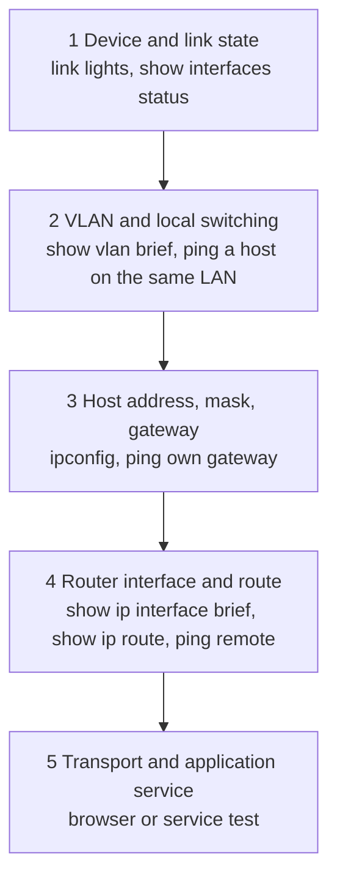
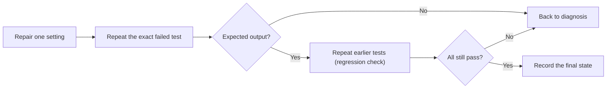

# Lecture 10 — Network Testing and Fault Diagnosis

**Module:** 4301COMP Computer Systems Architecture

**Session:** Teaching Week 05, Session B

## Start here

You can now build small routed and segmented networks. This lecture is about proving that they work, and finding out **why** when they do not. It covers:

- turning a requirement into a **testable claim**;
- testing in **dependency order** from the bottom up;
- the difference between **configuration checks** and **traffic tests**;
- reading symptoms to choose the **next** test;
- writing a **fault record**;
- **retesting** with regression checks.

After reading, do **Lab 10** (`../Labs/Lab-10-Network-Testing-and-Fault-Diagnosis-Hands-on-Workbook.md`). There you build a known-good baseline, break it on purpose three times and record each diagnosis.

**Labels used in these notes:**

- **Official** = from the TW05 Session B slides or lab sheet.
- **Extra** = added explanation, not on the slides.
- **Verified** = actually run before being written down. For this lecture, the official lab network was rebuilt as a **real Linux network** using network namespaces, and every fault was created and tested. Python checking tools were also run with Python 3.13.
- **Expected** = not run here: Packet Tracer, Cisco IOS and Windows.

> **Note on the slides.** Slide 18 says that **essential AS1 teaching is complete**. Use the remaining assessment period to build, test and explain your own design. This lecture's method (expected result → evidence → root cause → repair → retest) is the same structure a good report uses to show that a design works. Check the actual AS1 brief on Canvas for what it requires.

---

## 1. Overview

Most network faults are small: one wrong number, one interface left shut down, one port in the wrong VLAN. The difficulty is **finding** it among dozens of settings. Guessing and changing things at random usually makes things worse. A good diagnosis works like a scientific experiment:

1. Say what **should** happen.
2. Test it.
3. Compare the result with the expectation.
4. Use the dependencies to narrow the cause.
5. Make the **smallest** repair.
6. Prove that it worked **without breaking anything else**.

**Why this matters for cyber security.** Incident responders and security analysts do exactly this: they establish normal behaviour, compare it with what they observe, and record evidence that can be defended. A security control (a firewall rule, a VLAN boundary) is only trustworthy once it has been **tested**: one test showing that allowed traffic works and one showing that blocked traffic fails.

## 2. By the end you should be able to

1. Turn a network requirement into a **testable claim** with an expected result.
2. List the five **dependency layers** and explain why testing starts at the bottom.
3. Explain the difference between a **configuration check** and a **traffic test**, and the limits of each.
4. Interpret `ipconfig` evidence, including a **169.254.x.x** address, a wrong mask and an off-subnet gateway.
5. Explain what a **loopback** ping and an **own-IP** ping do and do **not** prove.
6. Choose the next test from a symptom, using switch and router evidence.
7. Write a **fault record** that separates symptom, evidence, root cause and repair.
8. Retest correctly: repeat the failure, verify, check for **regressions** and record the final state.

## 3. Learning outcomes

**Session learning outcomes (Official, slide 3):**

- Convert a network requirement into a testable result.
- Select checks in a logical dependency order.
- Interpret common addressing, VLAN, routing and service symptoms.
- Record a defensible diagnosis and successful retest.

**Module learning outcomes supported** (module guide, as recorded in this module's project instructions):

| Module LO | How this lecture supports it |
| --- | --- |
| **LO4** Explain the fundamental concepts involved in computer networking | All of this lecture |
| **LO1** Explain the fundamental principles underlying the operation of modern computer systems | Layered dependencies; how a host decides where to send a packet |

Relevant to the **report (40%)**, which covers networking, and the **exam (60%)** (module guide).

## 4. Matching lab and what you need first

- **Matching lab:** Lab 10. It contains the official TW05 Session B tasks:
  - a routed baseline with a web server (Task 16);
  - two faults diagnosed in dependency order (Task 17);
  - the Extra Challenge, a mask fault (Task 18).
- **From Lecture 9:** local or routed; VLAN membership; switch and router checks.
- **From Lecture 8:** DHCP and APIPA (169.254); HTTP and web servers.
- **From Lecture 7:** masks and the AND test; the default gateway; the return path.
- **From Lecture 3:** `ping`, and the bottom-up diagnosis idea.

---

## 5. Recap of the previous session (slide 4, Official)

- Explain why organisations segment networks.
- Predict whether a destination is local or routed.
- Compare three inter-VLAN routing approaches.
- Use configuration and traffic checks to validate a design.

---

## 6. Begin with the expected behaviour (slide 5)

### 6.1 Official

- A useful test starts with a **clear claim**. Example: *this client should reach its local gateway.*
- **State the expected output before running the command.**
- A result has meaning **only when it is compared with that expectation**.

### 6.2 Turning requirements into claims (Extra)

A requirement says what the network is for. A **testable claim** says exactly which test proves it and what you expect to see.

| Requirement | Testable claim | Test | Expected result |
| --- | --- | --- | --- |
| "PC-B can use its gateway" | PC-B reaches 10.50.20.1 | `ping 10.50.20.1` on PC-B | Replies |
| "The two networks are connected" | PC-A reaches PC-B **and** PC-B replies | `ping 10.50.20.10` on PC-A | Replies |
| "Staff can see the web page" | PC-A loads the practice page | Browser: `http://10.50.20.20` | "Practice page" heading |
| "The router has both networks" | Both /24s are connected routes | `show ip route` | `C 10.50.10.0/24`, `C 10.50.20.0/24` |
| "Guests cannot reach staff" (Lecture 9) | Guest PC **cannot** reach a staff PC | `ping` from guest to staff | **Fails** |

The last row matters: **a failing test can be the expected result**. Security controls are tested by proving that blocked traffic really is blocked.

> **Common confusion.** "The ping worked" is not a test result on its own. The result is "ping 10.50.20.1 from PC-B: **expected** replies, **observed** replies, **pass**". Writing the expected result first stops you explaining away a surprise afterwards.

---

## 7. Test dependencies from the bottom up (slide 6)

### 7.1 Official

| Layer | Depends on everything below | Start |
| --- | --- | --- |
| **5** Transport and application service | | |
| **4** Router interface and route | | |
| **3** Host address, mask and gateway | | |
| **2** VLAN and local switching | | |
| **1** Device and link state | | **START HERE** |

**Critical principle (Official):** skipping early dependencies makes later failures **ambiguous**.

### 7.2 Why the order matters (Extra)

Each layer needs every layer below it to work. A web page (layer 5) needs a route (4), a correct host configuration (3), the right VLAN (2) and a working link (1). If the web page fails, **any** of the five could be the cause. If you have already proved layers 1–4, only layer 5 is left.



**Real example (Verified).** With PC-B's cable unplugged, **every** test from PC-B failed: the server, the gateway, PC-A and the web page. Five failures, one cause. Someone starting at the top might spend an hour on the web server. Starting at layer 1 finds the fault in a few seconds.

---

## 8. Configuration checks and traffic tests differ (slide 7)

### 8.1 Official

| | Configuration checks | Traffic tests |
| --- | --- | --- |
| **Purpose** | Reveal what a device is **set to do** | Reveal whether a selected path **actually works** |
| **Limitation** | A correct-looking configuration does **not prove** end-to-end delivery | A successful ping does **not prove** that the application service is working |

### 8.2 Examples (Extra)

| Configuration checks | Traffic tests |
| --- | --- |
| `ipconfig` / `ipconfig /all` | `ping` |
| `show vlan brief` | `tracert` |
| `show ip interface brief` | Opening a web page |
| `show ip route` | `nslookup` (a DNS query is traffic) |
| `show running-config` | Packet Tracer Simulation mode PDUs |

**Both limitations, Verified on the real Linux network:**

- **Correct configuration, failed delivery.** With PC-B's switch port moved into the other switch's broadcast domain (like a wrong VLAN), PC-B's address, mask and gateway were all correct, but every ping from PC-B failed.
- **Successful ping, failed service.** With the web server program stopped, PC-A could still ping 10.50.20.20, but the web page failed (`HTTP FAIL`).

You need **both kinds** of evidence: configuration tells you what to expect; traffic tells you what really happens.

---

## 9. Read the host configuration before using ping (slide 8)

### 9.1 Official

1. **IP address:** check that it belongs to the intended network.
2. **Subnet mask:** check that it matches the design.
3. **Default gateway:** check that it is a reachable address in the local network.
4. **DHCP indicator:** an automatic private address beginning **169.254** usually indicates **DHCP failure**.

### 9.2 Reading `ipconfig` evidence (Extra, checked with `diagnose.py`)

The design for PC-B is 10.50.20.10, 255.255.255.0, gateway 10.50.20.1.

| `ipconfig` shows | What is wrong | Why it matters |
| --- | --- | --- |
| 10.50.20.10 / 255.255.255.0 / **10.50.20.254** | Gateway does not match the design | Remote traffic goes to a device that does not exist |
| 10.50.20.10 / **255.255.255.252** / 10.50.20.1 | Mask wrong; gateway now **outside** the host's /30 (10.50.20.8–.11) | Host thinks most of its own LAN is remote |
| **169.254.8.10** / 255.255.0.0 / (blank) | APIPA: no DHCP answer | Check DHCP server, link and VLAN (Lecture 8) |
| **10.50.10.10** / 255.255.255.0 / 10.50.20.1 | Address in the wrong network | Host is in a different subnet from its neighbours and gateway |
| 10.50.20.10 / 255.255.255.0 / (blank) | No gateway | Local traffic works; nothing remote does |

**Working for the /30 (Verified):** 255.255.255.252 is /30, so blocks of 4. 10 ÷ 4 = 2 remainder 2, so the block starts at 2 × 4 = **8**: network 10.50.20.8, usable .9 and .10, broadcast .11. The gateway (.1) and server (.20) are both outside it.

---

## 10. Use ping as an ordered sequence (slide 9)

### 10.1 Official

- **Step 1: loopback (127.0.0.1).** Checks the IPv4 loopback path and the local TCP/IP stack **without using a physical network interface**.
- **Step 2: host IP.** Pinging the host's own configured address confirms that the local interface and configuration respond **on that computer**.
- **Scope limitation:** **neither** test proves that the local cable, Wi-Fi link, switch, gateway or remote network is working.

### 10.2 Proof of the scope limitation (Verified)

On the real Linux network, PC-B's network interface was taken **down** (like unplugging it), then:

```text
ping 127.0.0.1    -> 64 bytes from 127.0.0.1: icmp_seq=1 ttl=64 time=0.020 ms
ping 10.50.20.10  -> 64 bytes from 10.50.20.10: icmp_seq=1 ttl=64 time=0.013 ms   (its own IP)
ping 10.50.20.20  -> ping: connect: Network is unreachable
```

Its own address still answered, because the reply never leaves the computer. Only the ping to **another** device showed that the link was broken.

### 10.3 The full sequence (Extra)

| Order | Ping | If it fails, suspect |
| --- | --- | --- |
| 1 | `127.0.0.1` | The host's TCP/IP software |
| 2 | Own IP | Interface configuration on this host |
| 3 | Another host on the **same** LAN | Link, switch port, VLAN, mask (layers 1–2) |
| 4 | Own **gateway** | Gateway address on the host, or the router interface |
| 5 | A **remote** host | Routes, or the remote host's own settings and gateway (the return path) |
| 6 | The **service** (browser, `nslookup`) | The application itself |

---

## 11. Switch evidence narrows VLAN faults (slide 10)

### 11.1 Official

- `show vlan brief` confirms the **VLAN membership** of access ports.
- **Interface status** confirms whether links are active.
- A host on an unexpected VLAN may have **correct-looking addressing but no intended neighbours**.
- **Check the exact endpoint port** rather than changing every VLAN setting.

### 11.2 Commands (Extra; Expected in Packet Tracer)

| Command | Look for |
| --- | --- |
| `show interfaces status` | The PC's port says **connected**, not `notconnect`; the VLAN column is right |
| `show vlan brief` | The PC's port is listed under the intended VLAN |
| `show mac address-table` | The PC's MAC appears on the expected port and VLAN after it sends traffic |

---

## 12. Router evidence narrows Layer 3 faults (slide 11)

### 12.1 Official

- `show ip interface brief` exposes interface **addresses** and **up/down state**.
- The **routing table** shows which destination networks are known.
- A gateway interface must be **active** and **addressed in the client network**.
- A route must identify a **valid path toward every remote network**.

### 12.2 What a shut-down interface looks like (Verified on Linux; IOS Expected)

When the router's G0/1 was shut down on the real Linux network, its routing table **lost** the connected route for 10.50.20.0/24. Only `10.50.10.0/24 dev g00` remained. Cisco IOS behaves the same way (Expected):

```text
Router# show ip interface brief
Interface              IP-Address      OK? Method Status                Protocol
GigabitEthernet0/0     10.50.10.1      YES manual up                    up
GigabitEthernet0/1     10.50.20.1      YES manual administratively down down
```

`show ip route` then shows `C 10.50.10.0/24` but **no** `C 10.50.20.0/24`. "Administratively down" means someone typed `shutdown`, or `no shutdown` was never entered. "Down/down" without "administratively" means a physical problem such as no cable.

---

## 13. Worked example: a branch printer is unavailable (slide 12)

### 13.1 Official

- **Symptom:** users in one department cannot reach a shared printer.
- Local gateway ping **succeeds**, and other remote services **work**.
- Printer ping **fails from every network**.
- **Next checks:** printer address, mask, gateway, link and access VLAN.
- The evidence narrows the fault **without rebuilding the network**.

### 13.2 Reasoning (Extra)

| Evidence | Rules out |
| --- | --- |
| Users' gateway ping works | Users' links, VLAN, addressing and gateway |
| Other remote services work | The router and its routes in general |
| Printer fails **from every network** (even its own) | A problem on one user's PC |

What remains is the **printer's own side**: its link, its switch port VLAN, and its address, mask and gateway. Notice that "from every network" is the key piece of evidence. If only one department failed, you would look at that department's path instead.

---

## 14. Knowledge check: choose the next test (slide 13)

**Official cases:** for each one, justify one next test. **Model answers: Extra.**

| Case | Symptom | Next test | Why |
| --- | --- | --- | --- |
| **A** | Client has **169.254.8.10** | Check the DHCP server is running and reachable: the client's link, switch port VLAN, then the DHCP service/pool | 169.254 means no DHCP offer arrived (slide 8). Fixing the IP by hand hides the real fault |
| **B** | Gateway ping **succeeds**, remote ping **fails** | Router `show ip route` (is there a route to the remote network?), then the **remote host's** `ipconfig`, especially its gateway | Layers 1–3 on this side are proven. The fault is in routing or on the return path |
| **C** | Server ping **succeeds**, browser **fails** | Layer 5: is the HTTP service on, on the right address and port? Is the URL right? | The network path is proven, so only the service remains (slide 7) |

**Case B in a real network (Verified).** With PC-B's gateway set wrongly to 10.50.20.254, **PC-A** could ping its gateway but not PC-B. PC-A's settings were perfect. The ping request reached PC-B, but PC-B's **reply** went to a gateway that does not exist. This is why case B asks for evidence from the **remote** side too.

---

## 15. A fault record separates four ideas (slide 14)

### 15.1 Official

| Part | Meaning |
| --- | --- |
| **Symptom** | What the user or test reveals |
| **Evidence** | The observations that narrow the possibilities |
| **Root cause** | The specific incorrect or failed component |
| **Repair** | The smallest justified change that removes the cause |

### 15.2 A complete example (Extra; results Verified on the Linux build)

| Part | Official Fault 2: router interface shut down |
| --- | --- |
| **Symptom** | PC-B cannot reach PC-A. PC-A cannot load the web page. |
| **Evidence** | PC-B link up. PC-B `ipconfig` matches the design. PC-B → server 10.50.20.20 **replies** (local LAN works). PC-B → 10.50.20.1 **fails**. Router `show ip interface brief`: G0/1 *administratively down*. `show ip route`: no `C 10.50.20.0/24`. |
| **Root cause** | Router interface G0/1 is shut down, so the gateway for 10.50.20.0/24 is unavailable. |
| **Repair** | `interface g0/1` → `no shutdown`. **Not** changing any PC address. |
| **Retest** | PC-B → 10.50.20.1 replies; PC-B → PC-A replies. **Regression:** PC-B → server still replies; PC-A web page loads. |

> **Common confusion.** "Ping failed" is a **symptom**, not a root cause. "The network is broken" is neither. A root cause names **one component** and **what is wrong with it**: "G0/1 is administratively down", "PC-B's gateway is 10.50.20.254 instead of 10.50.20.1".

---

## 16. Retesting must protect previous successes (slide 15)

### 16.1 Official

1. **Re-test failure:** repeat the **exact** test that originally failed.
2. **Verify output:** confirm that the expected output now appears.
3. **Regression check:** repeat important **earlier** tests to detect unintended side effects.
4. **Record state:** record the final state rather than relying on memory or assumption.

### 16.2 A real regression (Verified)

On the Linux build, the wrong-gateway fault (PC-B using 10.50.20.254) was "repaired" the **wrong** way: the **router's** G0/1 address was changed to 10.50.20.254 to match PC-B. PC-B's failed remote ping now worked, so it looked fixed. The regression checker (`retest.py`, Lab 10 Task 12) compared the runs:

```text
OK          pcb ping 10.50.20.20
FIXED       pcb ping 10.50.20.254
REGRESSION  pcb ping 10.50.20.1
FIXED       pcb ping 10.50.10.10
OK          pcb http 10.50.20.20
OK          pca ping 10.50.10.1
FIXED       pca ping 10.50.20.10
REGRESSION  pca ping 10.50.20.20
REGRESSION  pca http 10.50.20.20

Verdict: NOT finished: 3 test(s) need attention
```

The **server** still used 10.50.20.1 as its gateway, so PC-A lost the web page. Only a regression check catches this. Two more real lessons from the same experiment:

- **Caches can hide a fault.** Straight after the bad change, PC-A → server still worked, because the server had remembered the router's MAC address from before (its ARP cache). The regression appeared only once the caches were cleared. Real devices clear old entries after a few minutes, so a fault can appear **later**.
- **Wait before retesting.** After a switch port was moved back, the first retest got only 3 of 6 replies. A few seconds later, all 6 passed. The official lab says the same: wait for green links and repeat a ping that loses its first reply.



---

## 17. The three official lab faults (Extra summary, Verified on Linux)

Each line is a real result from the rebuilt network. Packet Tracer should behave in the same way except where noted (Expected).

| Test from PC-B | Baseline | Fault 1: gateway .254 | Fault 2: G0/1 shut | Mask /30 |
| --- | --- | --- | --- | --- |
| Server 10.50.20.20 (same LAN) | Reply | **Reply** | **Reply** | Fail* |
| Configured gateway | Reply | Fail | Fail | Fail* |
| Remote host 10.50.10.10 | Reply | Fail | Fail | Fail* |
| Web page | OK | **OK** | **OK** | Fail* |

\*On Linux, the system **refused** to accept a gateway outside the /30 (`Error: Nexthop has invalid gateway`). Every test then failed with "Network is unreachable". When the off-subnet gateway was forced in, as some operating systems allow, **all tests passed**, which hides the mask fault completely. Different systems handle an off-subnet gateway differently. That is why the official lab asks you to **record the observed outcomes** in Packet Tracer rather than predict them, and why `ipconfig` (a configuration check) is the reliable way to find this fault.

---

## 18. Common mistakes

| Mistake | Why it is wrong | Do instead |
| --- | --- | --- |
| Running tests without an expected result | A result cannot be judged | Write the expectation first (slide 5) |
| Starting at the application | Five layers could be at fault | Start at device and link (slide 6) |
| Trusting a correct-looking configuration | Configuration does not prove delivery | Add a traffic test (slide 7) |
| Trusting a ping for a service | Ping does not test HTTP | Test the service itself |
| Taking own-IP ping as proof the cable works | The reply never leaves the computer | Ping another host on the LAN (slide 9) |
| Fixing a 169.254 address by typing a static IP | Hides the DHCP fault | Find why DHCP failed |
| Changing every VLAN setting | Creates new faults | Check the exact endpoint port (slide 10) |
| Changing a correct PC address to fix a router fault | Moves the problem | Fix the inconsistent component (official lab) |
| Several changes at once | Cannot tell which worked; may cause regressions | One change, then retest |
| Not retesting earlier tests | Misses regressions | Regression check (slide 15) |
| Retesting instantly after a link change | Links and ARP need a moment | Wait for green, repeat the first ping |
| Recording from memory | Unreliable evidence | Record the final state with screenshots |

---

## 19. Check yourself: 15 multiple-choice questions

**Q1.** According to slide 5, what gives a test result meaning?
A) Running it twice
B) Comparing it with an expected result stated beforehand
C) Using Simulation mode
D) Taking a screenshot

**Q2.** Which layer should testing start at (slide 6)?
A) Transport and application service
B) Router interface and route
C) Device and link state
D) Host address, mask and gateway

**Q3.** Why does skipping early dependencies cause problems?
A) Later failures become ambiguous
B) Pings stop working
C) The router resets
D) It is slower to type

**Q4.** Which is a configuration check?
A) `ping 10.50.20.1`
B) Opening a web page
C) `tracert`
D) `show ip interface brief`

**Q5.** A server answers pings but its web page will not load. What does this show?
A) The cable is faulty
B) A successful ping does not prove that the application service works
C) The gateway is wrong
D) DHCP failed

**Q6.** A client shows 169.254.8.10. What is the most likely cause?
A) DHCP failure
B) A wrong default gateway
C) The router interface is shut down
D) The web service is off

**Q7.** Pinging a host's own IP address succeeds. What does that prove?
A) The cable works
B) The switch port is in the right VLAN
C) The local interface and configuration respond on that computer
D) The gateway works

**Q8.** PC-B is 10.50.20.10 with mask 255.255.255.252. Which addresses are in its subnet?
A) 10.50.20.0–10.50.20.255
B) 10.50.20.8–10.50.20.11
C) 10.50.20.10 only
D) 10.50.20.0–10.50.20.3

**Q9.** A host has correct-looking addressing but cannot reach any neighbour. Which switch command should be checked first?
A) `show ip route`
B) `show running-config` on the router
C) `ipconfig`
D) `show vlan brief` for that exact port

**Q10.** `show ip interface brief` shows G0/1 as "administratively down down". What is the repair?
A) `no shutdown` on G0/1
B) Change the PC addresses
C) Replace the cable
D) `shutdown` on G0/0

**Q11.** Gateway ping succeeds but remote ping fails. Which evidence is needed next (slide 13, case B)?
A) The client's cable
B) The routing table and the remote host's settings (the return path)
C) The client's loopback
D) The browser cache

**Q12.** In a fault record, what is "the specific incorrect or failed component"?
A) Symptom
B) Evidence
C) Root cause
D) Repair

**Q13.** What is a regression check?
A) Repeating important earlier tests to detect unintended side effects
B) Repeating the failed test only
C) Undoing the repair
D) Rebuilding the network

**Q14.** PC-B's gateway is wrongly 10.50.20.254. Which test still succeeds?
A) PC-B → 10.50.10.10
B) PC-A → PC-B
C) PC-B → its configured gateway
D) PC-B → server 10.50.20.20 (same LAN)

**Q15.** What is the best repair for a router-interface fault (official lab)?
A) Change the PCs' gateways to another address
B) Fix the router interface itself; do not change correct PC addresses
C) Add a second router
D) Restart every device

### Answers

| Q | Answer | Why |
| --- | --- | --- |
| 1 | **B** | Slide 5. |
| 2 | **C** | Slide 6: "START HERE". |
| 3 | **A** | Slide 6's critical principle. |
| 4 | **D** | It shows settings and state (slide 7). |
| 5 | **B** | Slide 7 (Verified with the web service stopped). |
| 6 | **A** | Slide 8 (APIPA). |
| 7 | **C** | Slide 9. It works even with the link down (Verified). |
| 8 | **B** | /30 = blocks of 4; 10 falls in .8–.11 (Verified). |
| 9 | **D** | Slide 10. |
| 10 | **A** | Official lab Task 2. |
| 11 | **B** | Slide 13. The return path matters (Verified). |
| 12 | **C** | Slide 14. |
| 13 | **A** | Slide 15. |
| 14 | **D** | The server is local, so no gateway is needed (Verified). |
| 15 | **B** | Official lab: "Do not change a correct PC address to repair a router-interface fault". |

---

## 20. Quick reference

**Method:** expected result → test → compare → narrow by dependencies → smallest repair → retest + regression → record.

**Dependency order:** 1 device/link → 2 VLAN/switching → 3 host address/mask/gateway → 4 router interface/route → 5 service.

**Configuration checks:** `ipconfig`, `show vlan brief`, `show interfaces status`, `show ip interface brief`, `show ip route`.
**Traffic tests:** `ping`, `tracert`, browser, `nslookup`.

**Ping sequence:** 127.0.0.1 → own IP → same-LAN host → gateway → remote host → service. The first two never test the cable.

**Clues:**

| Clue | Meaning |
| --- | --- |
| 169.254.x.x | DHCP failed |
| Gateway outside own subnet | Wrong mask or wrong gateway |
| Administratively down | Interface was shut down |
| No `C` route for a network | That interface is down or not addressed |

**Fault record:** symptom · evidence · root cause · repair · retest.

**Retest:** repeat the failed test → verify → regression check → record the state.

## 21. Glossary

| Term | Meaning |
| --- | --- |
| **APIPA** | Automatic Private IP Addressing: a 169.254.x.x address given when DHCP fails |
| **Baseline** | A known-good, tested state to compare faults against |
| **Configuration check** | Evidence of what a device is set to do |
| **Dependency order** | Testing lower layers before the layers that rely on them |
| **Evidence** | Observations that narrow the possible causes |
| **Expected result** | What a test should show if the claim is true, stated beforehand |
| **Fault record** | A written record of symptom, evidence, root cause, repair and retest |
| **Loopback** | 127.0.0.1: an address that tests the local TCP/IP stack only |
| **Regression** | Something that worked before a change and fails after it |
| **Regression check** | Repeating earlier tests after a repair |
| **Root cause** | The specific component that is wrong or has failed |
| **Symptom** | What the user or a test reveals |
| **Testable claim** | A statement that a specific test can prove true or false |
| **Traffic test** | Evidence of whether a path or service actually works |

## 22. Summary

- Start every test with a **claim** and an **expected result**. A result is only meaningful in comparison.
- Test in **dependency order**: device and link, VLAN, host settings, router, service. Skipping layers makes failures ambiguous.
- **Configuration checks** show intent; **traffic tests** show reality. You need both. A ping does not prove a service, and loopback or own-IP pings do not prove the cable.
- Read `ipconfig` **before** pinging: 169.254 means DHCP failed, and a gateway outside the host's subnet points to a wrong mask or gateway.
- A **fault record** separates symptom, evidence, root cause and the **smallest** repair.
- **Retest** the exact failure, then run **regression** checks, because a "fix" can break something else, sometimes only after caches expire.

## 23. Next

According to slide 18, the next session is **Teaching Week 06, Session A: DHCP and Application Services**. Slide 18 also says that essential AS1 teaching is complete.
