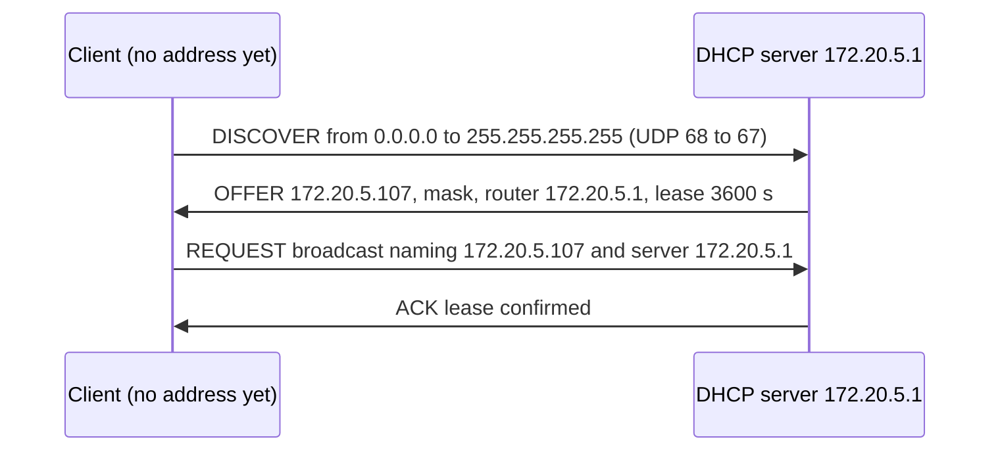
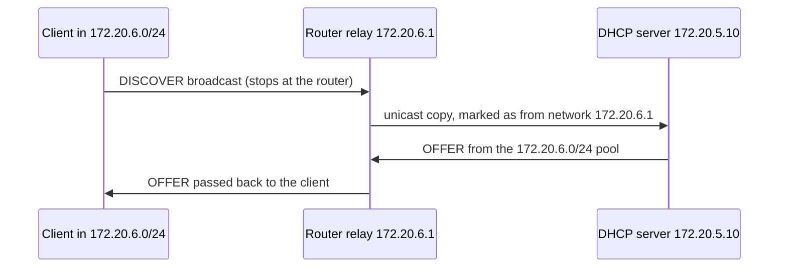
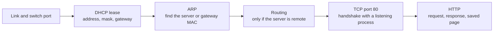

# Lecture 11 — DHCP and Application Services

**Module:** 4301COMP Computer Systems Architecture

**Session:** Teaching Week 06, Session A

## Start here

This session **consolidates** DHCP and HTTP from Week 4 (Lecture 8) and applies the Week 5 diagnostic method (Lecture 10) to them. It covers:

- the four DHCP messages, seen in a **real capture**;
- a DHCP **pool** as an address **policy**;
- **static** versus **dynamic** roles;
- when a **DHCP relay** is needed;
- how a browser reaches an HTTP service through a **dependency chain**;
- testing configuration before application behaviour, with evidence that proves a claim.

After reading, do **Lab 11** (`../Labs/Lab-11-DHCP-and-Application-Services-Hands-on-Workbook.md`). You will build the official visitor-information kiosk network, with a router as the DHCP server and an HTTP information server.

**Labels used in these notes:**

| Label | Meaning |
| --- | --- |
| **Official** | From the TW06 Session A slides or lab sheet |
| **Extra** | Added explanation, not on the slides |
| **Verified** | Actually run before being written down: the kiosk network was rebuilt as a real Linux network, with a real DHCP server (dnsmasq), a small DHCP client written for this lecture, a real web server and `tcpdump` captures. Python 3.13 |
| **Expected** | Not run here: Packet Tracer, Cisco IOS, Windows |

> **Note on the slides.** Slides 6 (DHCP pool), 7 (static and dynamic addresses), 9 (HTTP path) and 10 (dependency chain) are diagrams; only their titles were available as text. Sections 8, 9, 11 and 12 explain them from standard material, marked **Extra**. Check the real slides on Canvas. Slide 11 calls 172.20.5.0/24 a "Class C subnet". Historically, 172.x.x.x addresses were **Class B** (first octet 128–191; Lecture 7). It is a **/24 subnet** of a private Class B range, which is a different thing from a Class C network.

---

## 1. Overview

Two services do a lot of the everyday work on any network:

- **DHCP** gives devices their addresses automatically.
- **HTTP** delivers web pages and many application interfaces.

Both are **application-layer** services that depend on everything underneath them. When a visitor's tablet shows "no internet", the cause might be DHCP, the link, the gateway or the web server itself. This lecture joins up what you know about each service with a disciplined way of testing them.

**Why this matters for cyber security.** DHCP tells every client which gateway to trust. A rogue DHCP server can quietly send all traffic through an attacker (Lecture 8). A predictable **address policy** (fixed infrastructure, a bounded pool) makes unexpected devices stand out. Knowing whether a service is **refusing** connections or **unreachable** is the first question in many security investigations.

## 2. By the end you should be able to

1. Describe each **DORA** message: who sends it, to which address, and why.
2. Read a DHCP **pool** as a policy, and calculate exactly which addresses it hands out from IOS commands.
3. Explain why infrastructure uses **static** addresses outside the pool.
4. Explain when a **DHCP relay** is needed and when it is not.
5. Trace a browser request to an HTTP server through its **dependency chain** (DHCP, ARP, TCP, HTTP).
6. Apply the **ordered tests** of slide 12 to a service fault.
7. Tell apart a **refused** connection, a **timeout** and a network-unreachable error, and say what each means.
8. Capture **evidence that proves a claim** (slide 15) and make only the change the evidence supports.

## 3. Learning outcomes

**Session learning outcomes (Official, slide 3):**

- Explain the four-stage DHCP exchange.
- Distinguish dynamic pools from reserved infrastructure addresses.
- Explain how a browser reaches an HTTP service.
- Select tests that isolate configuration and service faults.

**Module learning outcomes supported** (module guide, as recorded in this module's project instructions):

| Module LO | How this lecture supports it |
| --- | --- |
| **LO4** Explain the fundamental concepts involved in computer networking | All of this lecture |
| **LO1** Explain the fundamental principles underlying the operation of modern computer systems | Layered services and their dependencies |

Relevant to the **report (40%)**, which covers networking, and the **exam (60%)** (module guide).

## 4. Matching lab and what you need first

- **Matching lab:** Lab 11. It contains the official TW06 Session A tasks:
  - the visitor network with a router DHCP pool (Task 16);
  - the information service with a Simulation-mode DORA and HTTP capture (Task 17);
  - the Extra Challenge, an HTTP fault (Task 18).
- **From Lecture 8:** DHCP basics, APIPA, DNS, HTTP status codes, IOS commands.
- **From Lecture 10:** testable claims, dependency order, fault records, regression checks.
- **From Lecture 7:** the TCP three-way handshake, ports, broadcasts.

---

## 5. Recap of the previous session (slide 4, Official)

- Turn requirements into meaningful tests.
- Select the next check from the visible symptom.
- Distinguish configuration, connectivity and service evidence.
- Document a defensible diagnosis and repair.

---

## 6. Automatic addressing is a four-message exchange (slide 5)

### 6.1 Official

| Letter | Message | Meaning |
| --- | --- | --- |
| **D** | Discover | The client **broadcasts** because it has no usable address |
| **O** | Offer | A server **proposes** an address and settings |
| **R** | Request | The client **selects** an offer |
| **A** | Acknowledge | The server **confirms** the lease |

The sequence is commonly remembered as **DORA**.

### 6.2 A real DORA exchange (Verified)

On the rebuilt kiosk network, the router ran a real DHCP server with the official pool (172.20.5.100–124). A client with **no address** ran `dora_client.py`, a small DHCP client written for this lecture (Lab 11 Task 12). Its output:

```text
-> DISCOVER  from 0.0.0.0 (MAC ea:aa:8e:8c:d1:0a) to 255.255.255.255, xid 0x1e18afc4
<- OFFER     from 172.20.5.1: address 172.20.5.107, mask 255.255.255.0, router 172.20.5.1, lease 3600 s
-> REQUEST   broadcast: 'I accept 172.20.5.107 from server 172.20.5.1'
<- ACK       from 172.20.5.1: lease confirmed for 172.20.5.107
```

`tcpdump` on the client recorded the same four messages, with the DHCP options inside (shortened):

```text
DHCP-Message (53): Discover      asks for: Subnet-Mask, Default-Gateway, Domain-Name-Server
Your-IP 172.20.5.107
DHCP-Message (53): Offer         Server-ID 172.20.5.1, Lease-Time 3600, Subnet-Mask 255.255.255.0, Default-Gateway 172.20.5.1
DHCP-Message (53): Request       Requested-IP 172.20.5.107, Server-ID 172.20.5.1
Your-IP 172.20.5.107
DHCP-Message (53): ACK           Server-ID 172.20.5.1, Lease-Time 3600, Subnet-Mask 255.255.255.0, Default-Gateway 172.20.5.1
```



### 6.3 Points the capture makes clear (Extra)

- **Discover comes from 0.0.0.0.** The client has no address, so it cannot use a normal source address. Its MAC address identifies it.
- **The Request is still a broadcast.** The client has not yet confirmed the address, and the broadcast tells **any other** server that offered an address that its offer was not chosen. Option 54 (Server-ID) names the winner.
- **The client asks for specific settings.** Option 55 asks for the mask, gateway and DNS server, and the server answers with those options.
- **The lease has a time limit** (3600 s here). The client must renew it before it runs out (Lecture 8).
- **The address need not be the lowest.** This server gave .116, .107 and .123 to three clients (Verified). The Linux server picks an address based on the client's MAC. Cisco IOS normally gives the lowest free address first, so in Packet Tracer expect .100, .101, .102 (Expected). Either way, the address comes from the pool.

---

## 7. A DHCP pool is an address policy (slide 6)

**Official title; content Extra.**

A pool is not just "some addresses". It is a **decision** about which addresses may be given to devices that nobody configured by hand. On Cisco IOS the policy is written as:

- the **network** the pool belongs to;
- **excluded** addresses that it must never hand out;
- the **options** it sends (default router, DNS server, lease time).

### 7.1 The official VISITORS pool (Official commands; working Extra, Verified)

```text
ip dhcp excluded-address 172.20.5.1 172.20.5.99
ip dhcp excluded-address 172.20.5.125 172.20.5.254
ip dhcp pool VISITORS
 network 172.20.5.0 255.255.255.0
 default-router 172.20.5.1
```

**Working.** A /24 has usable hosts .1–.254. Remove .1–.99 (99 addresses) and .125–.254 (130 addresses). 254 − 99 − 130 = **25** addresses: **.100–.124**. The checker `pool_policy.py` (Lab 11 Task 11) gives the same answer:

```text
Pool network : 172.20.5.0/24
Handed out   : 172.20.5.100-172.20.5.124  (25 addresses)
No conflicts with static addresses.
```

**Important IOS detail (Extra).** IOS does not have a "start" and "end" for a pool. It hands out **everything in the network except the exclusions**. Forgetting the second `excluded-address` line silently grows the pool to .100–.254, which is **155** addresses (Verified with the checker).

### 7.2 What happens when the pool is full (Verified)

On the Linux build, 3 clients and then 22 more test clients took all **25** addresses. The 26th client got no Offer at all, and the server logged:

```text
DHCPDISCOVER(eth0) 02:00:00:00:00:17 no address available
```

A Windows client in this situation would give itself a **169.254.x.x** address (Expected; Lecture 8). That is why 169.254 points at DHCP rather than at the cable.

---

## 8. Static and dynamic addresses serve different roles (slide 7)

**Official title; content Extra.**

| | Static (fixed) | Dynamic (from the pool) |
| --- | --- | --- |
| Who | Infrastructure: gateways, servers, printers, switches' management addresses | Visitors, laptops, phones, ordinary PCs |
| Why | Other devices and settings **point at** them (every client's gateway is .1; the kiosk page is at .10) | They come and go; nobody needs to know their address in advance |
| Set by | Typed on the device (or a DHCP **reservation** that always gives the same address) | Leased by the DHCP server |
| Must be | **Outside** the pool, so no client can be given the same address | Inside the pool |

**The kiosk design (slide 11, Official):**

| Role | Address |
| --- | --- |
| Network | 172.20.5.0/24 |
| Router (gateway) | 172.20.5.1, static |
| Information server | 172.20.5.10, static |
| Visitor clients | 172.20.5.100–172.20.5.124, DHCP pool |

**What goes wrong if they overlap (Verified with the checker).** If the first exclusion is mistyped as `172.20.5.1 172.20.5.9`, the pool becomes .10–.124. The checker reports:

```text
PROBLEM: Service-Server 172.20.5.10 is INSIDE the pool: a client could be given it
```

A visitor's tablet could then be leased .10, creating a **duplicate address**. The information page would work for some users and fail for others, depending on whose ARP reply arrived last. This is exactly the kind of intermittent fault that is hard to diagnose. Slide 16 says it directly: **pools must not overlap stable infrastructure addresses.**

> **Cyber security link.** A tight pool also limits **how many** unknown devices can join. Pairing the pool with DHCP bindings (`show ip dhcp binding`) gives you a list of which MAC received which address and when. That record is useful when investigating who was on the network.

---

## 9. Broadcasts determine when relay is needed (slide 8)

### 9.1 Official

- A local DHCP client can **broadcast directly** to a server in the same network.
- Routers **do not normally forward** that broadcast to another network.
- A **DHCP relay** forwards the request when the server is **remote**.
- **Do not** add relay when client and server already share the same broadcast domain.

### 9.2 Relay proved on a real network (Verified)

A second network, 172.20.6.0/24, was added behind the router, with one client. The DHCP server was moved to 172.20.5.10, **across the router**.

**Without relay:**

```text
-> DISCOVER  from 0.0.0.0 (MAC ca:f2:14:93:fe:3e) to 255.255.255.255, xid 0x0cb499a3
   (none)    no OFFER within 10 seconds: no DHCP server reachable, or the pool is full
```

**With a relay running on the router's 172.20.6.1 interface** (Cisco equivalent: `ip helper-address 172.20.5.10` on that interface; Expected):

```text
-> DISCOVER  from 0.0.0.0 (MAC ca:f2:14:93:fe:3e) to 255.255.255.255, xid 0x2038dd80
<- OFFER     from 172.20.6.1: address 172.20.6.113, mask 255.255.255.0, router 172.20.6.1, lease 3600 s
-> REQUEST   broadcast: 'I accept 172.20.6.113 from server 172.20.5.10'
<- ACK       from 172.20.6.1: lease confirmed for 172.20.6.113
```

Captured between the router and the server, the relay turned each broadcast into an ordinary **unicast** packet:

```text
IP 172.20.6.1.67 > 172.20.5.10.67: BOOTP/DHCP, Request from ca:f2:14:93:fe:3e
IP 172.20.5.10.67 > 172.20.6.1.67: BOOTP/DHCP, Reply
```



**How the server picks the right pool (Extra).** The relay writes its own interface address (172.20.6.1, the *giaddr* field) into the request. The server uses it to choose the **172.20.6.0/24** pool. In the first attempt, the server's pool for the new network sent the **wrong default router** (172.20.5.1). The client got an address but no usable gateway. Every pool needs its **own** `default-router` (Verified; Lab 11 Task 9).

**In the official lab** the router **is** the DHCP server and the clients are on its own LAN, so **no relay is needed** (official sheet).

---

## 10. Why the official lab switches the server's DHCP off (Official, lab Task 1)

Packet Tracer's Server-PT has its own DHCP service with a factory **serverPool**. If it were on, the clients' Discover broadcasts would reach **two** DHCP servers, and whichever offer arrived first would win. A client might get the wrong addresses or gateway. The official sheet therefore makes the router the **only** DHCP server.

This is the same mechanism a **rogue DHCP server** exploits (Lecture 8). Switches can be protected with **DHCP snooping**, which only trusts DHCP replies arriving on the port leading to the real server (Extra).

---

## 11. HTTP depends on a working lower-layer path (slide 9)

**Official title; content Extra (Verified).** When PC1 opens `http://172.20.5.10`, each step needs the one before it:

1. **Address:** PC1 has a lease (DHCP).
2. **Local or remote?** 172.20.5.10 is in PC1's /24, so it is local (Lecture 9).
3. **ARP:** PC1 finds the server's MAC address.
4. **TCP handshake** to port 80.
5. **HTTP request and response.**
6. **Connection closed.**

A real capture of PC1 (172.20.5.116, leased by DHCP) loading the page (flags: S = SYN, . = ACK, P = data, F = FIN):

```text
172.20.5.116.35026 > 172.20.5.10.80: Flags [S], seq 163074007
172.20.5.10.80 > 172.20.5.116.35026: Flags [S.], seq 694466869, ack 163074008
172.20.5.116.35026 > 172.20.5.10.80: Flags [.], ack 1
172.20.5.116.35026 > 172.20.5.10.80: Flags [P.], seq 1:75, ack 1, length 74: HTTP: GET / HTTP/1.1
172.20.5.10.80 > 172.20.5.116.35026: Flags [P.], seq 1:187, ack 75, length 186: HTTP: HTTP/1.0 200 OK
172.20.5.10.80 > 172.20.5.116.35026: Flags [P.], seq 187:259, ack 75, length 72: HTTP
172.20.5.10.80 > 172.20.5.116.35026: Flags [F.], seq 259, ack 75
172.20.5.116.35026 > 172.20.5.10.80: Flags [F.], seq 75, ack 260
```

The first three lines are the **three-way handshake**. The fourth is the browser's `GET /`. The server replies `200 OK` with headers (186 bytes), then the page itself (72 bytes: `<html><body><h1>Visitor Information</h1>…`). The FIN packets close the connection. A few plain acknowledgements are left out above.

---

## 12. Every service has a dependency chain (slide 10)

**Official title; content Extra.**



Any broken link in the chain stops the page. So the question is never just "does the page work?" but "**which link** is broken?". The order of the tests in section 13 follows this chain.

### 12.1 Three different failures look different (Verified)

The tool `port_check.py` (Lab 11 Task 13) tries a TCP connection and reports what happened. On the real kiosk network:

```text
# HTTP service on
172.20.5.10:80  OPEN  after 3 ms  -> service is listening: test the page itself next
# HTTP service switched off (server still on the network)
172.20.5.10:80  REFUSED  after 5 ms  -> host reached, but no service on this port: check the service is ON and the port/URL
# wrong port in the URL
172.20.5.10:8080  REFUSED  after 5 ms  -> host reached, but no service on this port: check the service is ON and the port/URL
# server's cable unplugged
172.20.5.10:80  TIMEOUT  after 3008 ms  -> no reply: check the path first (gateway, VLAN, link), then any firewall
# remote address with no route from PC1 (another network, no gateway set)
10.99.0.5:80  UNREACHABLE (Network is unreachable)  after 7 ms  -> no path to the host: check address, gateway, link and VLAN
# repaired, retested
172.20.5.10:80  OPEN  after 4 ms  -> service is listening: test the page itself next
```

| Result | What it means | Next step |
| --- | --- | --- |
| **OPEN** | The handshake completed; a process is listening | Test the page itself (content, URL) |
| **REFUSED**, instantly | The host is there, but **nothing listens** on that port. Its kernel answered with a TCP **reset** (RST) | Is the service **on**? Is the port in the URL right? |
| **TIMEOUT**, about 3 s | **No answer at all** | Check the path: link, VLAN, gateway. Then any firewall |
| **UNREACHABLE** | The client has no route to that network | Client's address, mask and gateway |

The capture of the **refused** case shows exactly two packets: PC1's SYN and the server's immediate `Flags [R.]` (reset). This is why the official Extra Challenge works the way it does: with HTTP off, **ping still replies** but the browser fails.

---

## 13. Test configuration before application behaviour (slide 12)

### 13.1 Official order

1. Inspect the client **address, mask and gateway**.
2. If the server is remote, test the **local gateway**.
3. Test the **server by IP address**.
4. Confirm the **service is enabled and listening**.
5. **Open the page** and interpret the result.

### 13.2 Applied to the kiosk (Extra)

| Step | Kiosk test | Expected | If it fails |
| --- | --- | --- | --- |
| 1 | PC1 `ipconfig` | 172.20.5.100–124, /24, gateway 172.20.5.1 | DHCP: router pool, server DHCP **Off**, link |
| 2 | (Server is local: skip, or ping 172.20.5.1 to prove the gateway) | Replies | Router G0/0 state |
| 3 | `ping 172.20.5.10` | Replies | Server static settings, link, VLAN |
| 4 | Server **Services > HTTP** shows On; or a port check | On / OPEN | Turn HTTP On |
| 5 | Browser `http://172.20.5.10` | "Visitor Information" + ID | Saved index.html, URL |

---

## 14. Knowledge check: interpret the symptom (slide 13)

**Official:**

| Symptom | Interpretation |
| --- | --- |
| **169.254.x.x** address | DHCP allocation **probably failed** |
| Valid address but **gateway ping fails** | Inspect the local **VLAN, mask and gateway** |
| **Server ping succeeds** but the **page fails** | Inspect the **HTTP configuration or port access** |

**A diagnosis should name the next test, not guess a repair (Official).** For example, "the page fails, so restart the server" is a guess. "Ping succeeds; next test: is HTTP on, and does port 80 accept a connection?" is a diagnosis.

---

## 15. Change only the setting supported by evidence (slide 14, Official)

1. Record the **symptom** and the **expected result**.
2. Run the **smallest test** that separates the possible causes.
3. Identify **one precise root cause**.
4. Change **one relevant setting**.
5. **Repeat** the failed test and confirm that **earlier tests still pass**.

The official lab gives two examples:

- *"Do not change the router configuration to repair a local server-connectivity fault."*
- *"If the ping succeeds but the page fails, check the HTTP switch, saved index.html and URL; do not alter correct addressing."*

---

## 16. Evidence should prove a claim (slide 15)

### 16.1 Official

- Keep the **device, command or service context** visible.
- Capture the result that **directly supports** the stated claim.
- Include enough information to **distinguish a valid result from an unrelated success**.
- **Explain** what the result demonstrates. Do not rely on the screenshot alone.

### 16.2 Good and weak evidence (Extra)

| Claim | Weak evidence | Strong evidence |
| --- | --- | --- |
| "PC2 got its address by DHCP" | Screenshot of `ipconfig` alone (it could have been typed by hand) | `ipconfig` **plus** `show ip dhcp binding` showing PC2's MAC with that address, or the four DORA events in Simulation mode |
| "HTTP was off, so the page failed" | A browser showing an old page | A **fresh** request (browser reopened) showing failure, **plus** the server's HTTP set to Off, **plus** a successful ping to prove the path |
| "The repair worked" | One working page | The same request now working, **and** the earlier ping still replying |

The official lab warns about the second row: *"Record failure to obtain a new response, not a previously displayed page."* A cached page is an **unrelated success**.

**Example of an explanation under a screenshot:** "PC3's ping to 172.20.5.10 replies, so the path and the server's addressing work. The browser's fresh request fails while HTTP is Off, so the fault is the service, not the network."

---

## 17. Common mistakes

| Mistake | Why it is wrong | Do instead |
| --- | --- | --- |
| Thinking the client "knows" the server's address before DHCP | It has no address at all | Discover is broadcast from 0.0.0.0 |
| Forgetting the second `excluded-address` | The pool grows to .100–.254 | Calculate what is **handed out** |
| Putting servers or printers inside the pool | Duplicate addresses, intermittent faults | Static infrastructure outside the pool |
| Leaving Server-PT's DHCP On | Two servers compete | One DHCP server per network (official) |
| Adding a relay on the same LAN | Not needed; adds confusion | Relay only across a routing boundary |
| One `default-router` for every pool | Clients get a gateway from another network | Each pool has its own gateway |
| "Ping works, so the website works" | Ping does not test port 80 | Test the service (port check, browser) |
| Changing addresses to fix a service fault | Breaks correct settings | Fix the service; keep the addressing |
| Recording a cached page as proof | An unrelated success | Fresh request; explain the screenshot |
| Treating every failure the same | Refused, timeout and unreachable differ | Read the error; it names the layer |

---

## 18. Check yourself: 15 multiple-choice questions

**Q1.** Why does a DHCP client broadcast its Discover?
A) To save bandwidth
B) It has no usable address and does not know the server's address
C) Routers require it
D) To find the gateway's MAC address

**Q2.** Which DHCP message does the server send to confirm the lease?
A) Discover
B) Offer
C) Request
D) Acknowledge

**Q3.** What source IP address does a Discover use?
A) 0.0.0.0
B) 255.255.255.255
C) 169.254.0.1
D) The gateway's address

**Q4.** Why is the Request also broadcast?
A) It is sent to the router
B) The client's address is already confirmed
C) The client still has no confirmed address, and other servers learn their offer was declined
D) Broadcasts are faster

**Q5.** With the official exclusions, how many addresses does the VISITORS pool hand out?
A) 99
B) 25
C) 125
D) 254

**Q6.** The second `excluded-address` line is forgotten. Which addresses can now be handed out?
A) 172.20.5.100–172.20.5.254
B) 172.20.5.100–172.20.5.124
C) 172.20.5.1–172.20.5.254
D) None

**Q7.** Why is the information server given a static address outside the pool?
A) Static addresses are faster
B) DHCP cannot give out .10
C) Clients and settings point at it, and a pool address could be leased to someone else
D) Servers cannot use DHCP

**Q8.** When is a DHCP relay needed?
A) Always
B) When the client and server share a broadcast domain
C) When there are more than 25 clients
D) When the DHCP server is on another network across a router

**Q9.** Why does the official lab turn the Server-PT's DHCP service Off?
A) So that the router is the only DHCP server and the pools do not compete
B) The server cannot run DHCP and HTTP together
C) To save power
D) To force 169.254 addresses

**Q10.** A client shows 169.254.20.7. What does this most likely mean?
A) The web service is off
B) The gateway is wrong
C) DHCP allocation failed
D) The client has a static address

**Q11.** Ping to 172.20.5.10 succeeds, but the page fails. What should be inspected (slide 13)?
A) The client's mask
B) The HTTP configuration or port access
C) The router's routing table
D) The DHCP pool

**Q12.** A TCP connection to port 80 is **refused** immediately. What does that show?
A) The host was reached, but nothing is listening on port 80
B) There is no path to the host
C) The DHCP lease expired
D) The cable is unplugged

**Q13.** What is the correct order of slide 12's tests?
A) Open the page, then check the address
B) Service, then gateway, then address
C) Client address/mask/gateway → gateway (if remote) → server by IP → service listening → page
D) Ping the server first, then check the address

**Q14.** Which is the strongest evidence that PC2 got its address by DHCP?
A) `ipconfig` alone
B) A screenshot of the browser
C) The server's HTTP settings
D) `ipconfig` together with the router's `show ip dhcp binding` entry for PC2's MAC address

**Q15.** HTTP is off on the server. What is the smallest correct repair?
A) Change the server's IP address
B) Turn HTTP On and repeat the same request
C) Change the client's gateway
D) Recreate the DHCP pool

### Answers

| Q | Answer | Why |
| --- | --- | --- |
| 1 | **B** | Slide 5 (Verified: from 0.0.0.0 to 255.255.255.255). |
| 2 | **D** | Slide 5. |
| 3 | **A** | Verified capture. |
| 4 | **C** | Verified: the Request names the chosen server. |
| 5 | **B** | 254 − 99 − 130 = 25 (Verified). |
| 6 | **A** | IOS hands out everything not excluded (Verified: 155 addresses). |
| 7 | **C** | Section 8. |
| 8 | **D** | Slide 8 (Verified both ways). |
| 9 | **A** | Official lab Task 1. |
| 10 | **C** | Slide 13. |
| 11 | **B** | Slide 13. |
| 12 | **A** | A reset came back (Verified). |
| 13 | **C** | Slide 12. |
| 14 | **D** | Slide 15: evidence must rule out an unrelated explanation (a typed address). |
| 15 | **B** | Official Extra Challenge. |

---

## 19. Quick reference

**DORA:** Discover (broadcast from 0.0.0.0) → Offer (address and options) → Request (broadcast naming the server) → Ack. UDP 68 to 67.

**IOS pool:** `ip dhcp excluded-address first last`, `ip dhcp pool NAME`, `network`, `default-router`. Handed out = network − excluded. The official pool is .100–.124 (25 addresses). Check with `show ip dhcp pool` and `show ip dhcp binding`.

**Policy:** static infrastructure **outside** the pool; one DHCP server per network; each pool has its own gateway.

**Relay:** only when the server is across a router (Cisco: `ip helper-address`). Not needed on the same LAN.

**HTTP chain:** link → lease → ARP → (route) → TCP 80 → HTTP.

**Service failures:** OPEN = listening · REFUSED = host up, no service · TIMEOUT = no path or filtered · UNREACHABLE = no route on the client.

**Order (slide 12):** client settings → gateway (if remote) → server by IP → service listening → page.

**Evidence:** context visible, proves the claim, rules out unrelated success, explained in words.

## 20. Glossary

| Term | Meaning |
| --- | --- |
| **Binding** | The DHCP server's record of which MAC address holds which address |
| **DHCP relay** | A router function that forwards DHCP broadcasts to a server on another network (Cisco `ip helper-address`) |
| **DORA** | Discover, Offer, Request, Acknowledge |
| **Excluded address** | An address that the IOS DHCP pool must never hand out |
| **giaddr** | The relay's address, written into relayed requests so the server picks the right pool |
| **Lease** | Time-limited permission to use an address |
| **Listening** | A server process waiting for connections on a port |
| **Pool** | The set of addresses and options a DHCP server can hand out |
| **Reservation** | A DHCP entry that always gives one device the same address |
| **RST (reset)** | A TCP packet refusing or aborting a connection |
| **Server-ID (option 54)** | The DHCP server's address, used in the Request to name the chosen server |
| **Static address** | An address typed into a device, not leased |

## 21. Summary

- DHCP is four messages. The client broadcasts because it has no address, the server offers, the client requests by broadcast naming the server, and the server acknowledges. A real capture shows every step.
- A pool is an **address policy**. On IOS, what is handed out is the network minus the exclusions. Infrastructure stays static and **outside** the pool.
- A **relay** is needed only when the DHCP server is across a router. Each relayed network needs a pool with its own gateway.
- HTTP depends on a chain: link, lease, ARP, route, TCP port 80, HTTP. A ping tests only part of it. **Refused**, **timeout** and **unreachable** point at different links in the chain.
- Test the configuration before the application, change only what the evidence supports, and capture evidence that proves the claim, not an unrelated success.

## 22. Next

According to slide 18, the next session is **Teaching Week 06, Session B: Computer Architecture Behind Network Services**. It revisits the CPU and operating-system concepts from Weeks 1 and 3.
