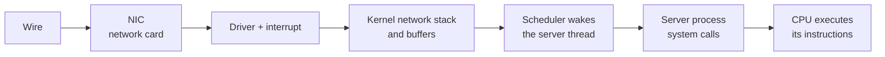
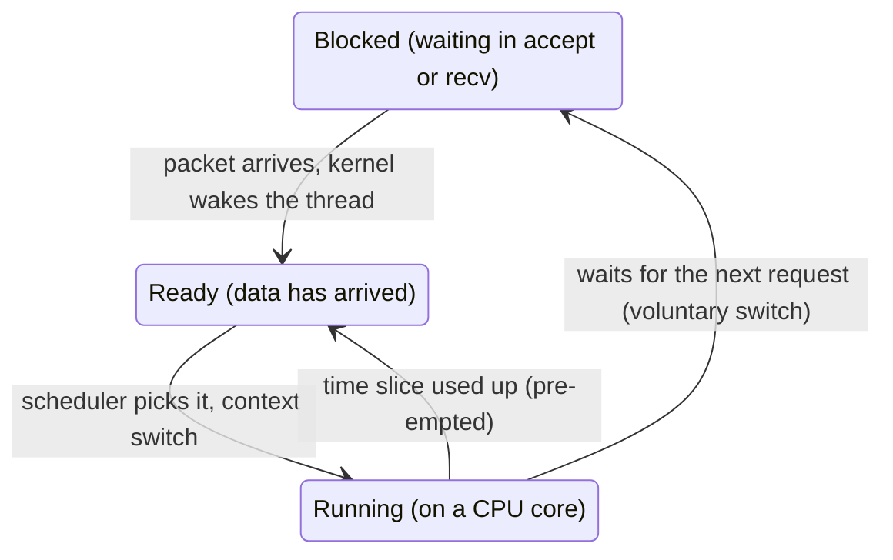
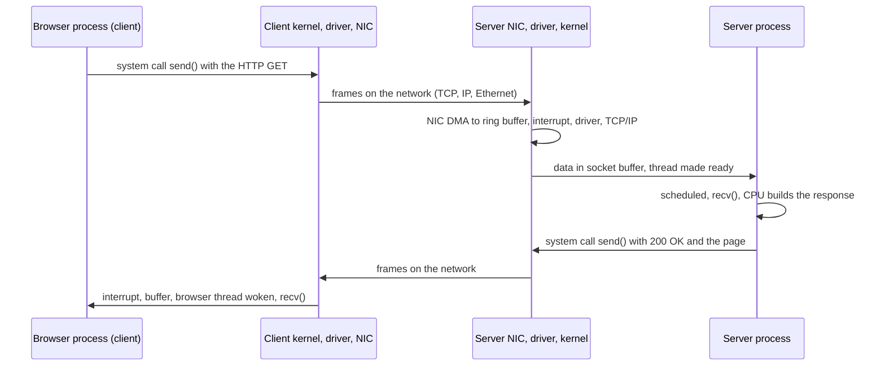

# Lecture 12 — Computer Architecture Behind Network Services

**Module:** 4301COMP Computer Systems Architecture

**Session:** Teaching Week 06, Session B

## Start here

For six weeks you have studied two worlds: the **inside** of a computer (the CPU, the fetch-decode-execute cycle, the OS, processes and scheduling) and the **network** between computers (addresses, switches, routers, DHCP and HTTP). This lecture joins them up. It follows one web request **inside** a server:

- the server is a **process**;
- it asks the kernel for help through **system calls**;
- the **NIC**, its **driver** and **interrupts** bring the data in;
- **buffers** hold it until the program is ready;
- the **scheduler** decides when the program runs;
- the **CPU** executes it, instruction by instruction.

It ends with how to **evaluate** a prototype and prioritise improvements.

After reading, do **Lab 12** (`../Labs/Lab-12-Computer-Architecture-Behind-Network-Services-Hands-on-Workbook.md`). There you observe a real browser as a process on your own computer and trace a request through hardware and software.

**Labels used in these notes:**

| Label | Meaning |
| --- | --- |
| **Official** | From the TW06 Session B slides or lab sheet |
| **Extra** | Added explanation, not on the slides |
| **Verified** | Actually run before being written down: a small web server written for this lecture, traced with `strace` and `ss`; kernel counters read from `/proc`; C code compiled with gcc 13.3 and disassembled with `objdump`; Python 3.13 on Linux |
| **Expected** | Not run here: Windows Task Manager, Resource Monitor, `netstat`, Device Manager, `msinfo32` |

> **Note on the slides.** Slides 5 (services as processes), 7 (NIC, driver and interrupts), 10 (CPU execution) and 11 (worked request path) are diagrams; only their titles were available as text. Sections 6, 8, 11 and 12 explain them from standard material, marked **Extra**, with real evidence. Check the real slides on Canvas.

---

## 1. Overview

When you open a web page, the network part (Lectures 3–11) gets the request to the right computer. What happens **inside** that computer is just as important, and it uses everything from Weeks 1 and 3:



The response then travels back the same way in reverse.

**Why this matters for cyber security.** Attacks and defences live at every one of these layers:

- **Denial-of-service floods** fill buffers and use up CPU time.
- **Malicious drivers** run with kernel privileges.
- **Least privilege** decides what a compromised service process can touch.
- **Monitoring tools** such as `netstat` and Task Manager show which process owns which connection: the first step in spotting malware that "phones home".

## 2. By the end you should be able to

1. Explain how a network service runs as a **process**, with a PID, threads, memory and a listening port.
2. Explain how **system calls** let a service create sockets and send or receive data across the user/kernel boundary.
3. Describe the roles of the **NIC**, **driver**, **interrupts** (or polling) and **buffers** when data arrives.
4. Explain how the **scheduler** and process states (blocked, ready, running) decide when the server responds.
5. Connect the **fetch-decode-execute** cycle to the real instructions a service runs.
6. Trace a browser request from the wire to the response, naming the component and purpose at each step.
7. Identify **limitations** of a prototype network and justify a **prioritised** improvement.
8. Use tools (`netstat -ano`, Task Manager, Resource Monitor) to link a connection to a process, and say what they **cannot** show.

## 3. Learning outcomes

**Session learning outcomes (Official, slide 3):**

- Explain how a network service runs as a process.
- Connect system calls and drivers to network hardware.
- Trace a request through memory, scheduling and CPU execution.
- Evaluate limitations and prioritise realistic improvements.

**Module learning outcomes supported** (module guide, as recorded in this module's project instructions):

| Module LO | How this lecture supports it |
| --- | --- |
| **LO1** Explain the fundamental principles underlying the operation of modern computer systems | CPU execution, buffering, interrupts |
| **LO2** Demonstrate knowledge of the structure and organisation of computer systems | NIC, driver, kernel and process as one system |
| **LO3** Explain the role and functions of an operating system | Processes, system calls, scheduling, drivers |
| **LO4** Explain the fundamental concepts involved in computer networking | How network data reaches and leaves an application |

Relevant to the **exam (60%)**, which covers architecture, operating systems and networking (module guide).

## 4. Matching lab and what you need first

- **Matching lab:** Lab 12. It contains the official TW06 Session B tasks:
  - observe a browser as a network process (Task 16);
  - trace a request through hardware and software (Task 17);
  - the Extra Challenge, inspecting the network adapter path (Task 18).
- **From Lecture 2:** registers, the FDE cycle, buses, interrupts.
- **From Lecture 5:** user and kernel mode, system calls, drivers, interrupts.
- **From Lecture 6:** processes, threads, states, the PCB, scheduling, context switching.
- **From Lectures 7 and 11:** ports, TCP, HTTP.

---

## 5. Recap of the previous session (slide 4, Official)

- Explain how clients obtain a DHCP lease.
- Build a coherent static and dynamic address policy.
- Trace a browser request to an HTTP server.
- Select evidence-led tests for common service failures.

---

## 6. Network services run as processes (slide 5)

**Official title; content Extra (Verified).**

A web server, a DHCP server or a browser is just a **program**. When it runs, the OS turns it into a **process** (Lecture 6) with:

- a **PID**;
- one or more **threads**;
- its own **virtual memory**;
- a list of open **files and sockets**.

To offer a service, the process asks the kernel for a socket **listening** on a port.

**Real evidence.** A tiny web server written for this lecture (`tiny_server.py`, Lab 12 Task 11) was started and inspected while it waited for a visitor:

```text
State:	S (sleeping)
Threads:	1
LISTEN 0      5          127.0.0.1:8080       0.0.0.0:*    users:(("python3",pid=2402,fd=3))
```

- The process is **sleeping** (blocked). It uses **no CPU** while it waits.
- The kernel shows which process owns the listening socket: `python3`, PID 2402. This is the Linux equivalent of the PID column in Windows `netstat -ano` (official lab Task 1).

| Process idea (Lecture 6) | In a network service |
| --- | --- |
| PID | Identifies which program owns a connection (`netstat -ano`, `ss -p`) |
| Threads | Many servers and browsers use several threads or processes to handle several requests at once |
| Working set (memory) | Code, page content, buffers for requests and responses |
| State | Blocked while waiting for a request; ready when one arrives; running while it is processed |

> **Common confusion.** Browsers such as Edge and Chrome run **many** processes: one for the interface, others for each tab, the network service and the GPU. The official lab warns: *"do not assume the first browser entry owns the network connection."* Match the **PID** in `netstat -ano` to the PID in Task Manager.

---

## 7. System calls cross the protection boundary (slide 6)

### 7.1 Official

- Applications normally run in **user mode** with restricted access.
- A **system call** requests a controlled kernel operation.
- Network software uses calls to **create sockets, receive data, send data and access files**.
- The kernel **validates** the request and **coordinates** the required resources.

### 7.2 Every network step is a system call (Verified with `strace`)

`strace` lists the system calls a program makes. The tiny server handled one browser request:

```text
socket(AF_INET, SOCK_STREAM|SOCK_CLOEXEC, IPPROTO_IP) = 3
setsockopt(3, SOL_SOCKET, SO_REUSEADDR, [1], 4) = 0
bind(3, {sa_family=AF_INET, sin_port=htons(8080), sin_addr=inet_addr("127.0.0.1")}, 16) = 0
listen(3, 5)                      = 0
accept4(3, {sa_family=AF_INET, sin_port=htons(55970), sin_addr=inet_addr("127.0.0.1")}, [16], SOCK_CLOEXEC) = 4
recvfrom(4, "GET / HTTP/1.1\r\nHost: 127.0.0.1:"..., 4096, 0, NULL, NULL) = 77
sendto(4, "HTTP/1.0 200 OK\r\nContent-Type: t"..., 110, 0, NULL, 0) = 110
close(4)                          = 0
close(3)                          = 0
+++ exited with 0 +++
```

| System call | What the server asked the kernel to do |
| --- | --- |
| `socket` | Create a TCP endpoint. The kernel returns **file descriptor 3** (a handle) |
| `bind` | Claim port 8080 on 127.0.0.1 |
| `listen` | Accept connections and queue up to 5 |
| `accept4` | **Wait** for a client. It returned descriptor 4 for the new connection |
| `recvfrom` | Copy the 77-byte request (`GET / HTTP/1.1…`) from the kernel's buffer into the program |
| `sendto` | Copy the 110-byte response into the kernel to transmit |
| `close` | Release the connection, then the listening socket |

The program **never touches the network card**. It only asks the kernel, which checks the request, for example refusing a port that is already in use or one the program is not allowed to bind. The kernel then does the hardware work. This is the **protection boundary** from Lecture 5.

---

## 8. The NIC, driver and interrupts deliver data (slide 7)

**Official title; content Extra (Verified where stated).**

| Component | Role when a packet arrives |
| --- | --- |
| **NIC** (network interface card) | Hardware that receives the signal, checks the frame (FCS, Lecture 4) and, if the frame is for this computer, copies it into memory |
| **DMA** (direct memory access) | Lets the NIC write the frame straight into a **ring buffer** in RAM without the CPU copying each byte |
| **Interrupt** | The NIC signals the CPU: "new data is waiting". The CPU pauses its current work and runs the driver's handler (Lecture 2: interrupts) |
| **Driver** | Kernel software that knows how to talk to **this particular** NIC. It takes frames from the ring buffer and passes them to the kernel's network stack |
| **Polling** | When traffic is heavy, the driver switches interrupts off and **checks** the ring buffer in a loop, handling many frames per interrupt. This avoids an "interrupt storm" |

**Real counters (Verified).** On the Linux machine used for these notes:

- the NIC's driver is `virtio_net`, a virtual network card;
- the kernel counts interrupts per device in `/proc/interrupts`;
- it counts receive processing (`NET_RX` soft-interrupts) in `/proc/softirqs`.

Around one small HTTPS download (`irq_watch.sh`, Lab 12 Task 15):

```text
driver: virtio_net   device: virtio7
packets received:           18
NIC receive interrupts:     12
NET_RX soft-interrupt runs: 24
```

There were **fewer interrupts than packets**: about 12 interrupts for 18 packets. Some interrupts delivered more than one packet, which is the polling behaviour described above. The machine was also doing other small amounts of network work, so the numbers are approximate. This matches the official lab's wording: **"interrupts or polling"**.

> **Cyber security link.** A driver runs in **kernel mode** with full privileges. A buggy or malicious driver can crash or take over the whole system (Lecture 5: the July 2024 kernel-driver crash). That is why Windows requires drivers to be signed, and why the official lab says to **inspect** drivers read-only and never update or disable them.

---

## 9. Buffers bridge hardware and software (slide 8)

### 9.1 Official

- Network input may arrive while the service is **not running** on the CPU.
- **Kernel buffers** hold data until protocol processing and the application can use it.
- **Application buffers** hold request or response data during processing.
- Buffering **absorbs timing differences** but **consumes memory**.

### 9.2 Proof: the kernel holds data while the program is not running (Verified)

**Experiment 1** (`buffer_demo.py`, Lab 12 Task 12). The "server" accepts a connection and then deliberately does nothing for 3 seconds. The client sends five messages straight away:

```text
 0.01 s  server: connection accepted, now NOT reading for 3 s
 0.01 s  client: sent msg1 (send() returned at once - the kernel holds the data)
 0.01 s  client: sent msg2 (send() returned at once - the kernel holds the data)
 0.01 s  client: sent msg3 (send() returned at once - the kernel holds the data)
 0.01 s  client: sent msg4 (send() returned at once - the kernel holds the data)
 0.01 s  client: sent msg5 (send() returned at once - the kernel holds the data)
 3.01 s  server: calls recv() for the first time
 3.01 s  server: received 25 bytes in one go: 'msg1;msg2;msg3;msg4;msg5;'
```

Every `send()` returned immediately, because the data went into the kernel's buffers. Three seconds later, the server's first `recv()` found all 25 bytes waiting.

**Experiment 2.** The tiny server process was **stopped** completely (Linux `SIGSTOP`, state `T`), so it could not run at all. Then a client connected and sent a request. While it was stopped:

```text
Recv-Q Send-Q Local Address:Port  Peer Address:Port
77     0          127.0.0.1:8080     127.0.0.1:41498
LISTEN 1      5          127.0.0.1:8080       0.0.0.0:*
```

The **kernel** had completed the TCP handshake and stored the 77-byte request (`Recv-Q 77`). It had also put the new connection in the listening socket's queue (`LISTEN 1`). The program had done nothing. When the process was resumed, it served the waiting request within about 4 ms.

| Buffer | Where | Holds |
| --- | --- | --- |
| NIC ring buffer | RAM, filled by the NIC via DMA | Raw frames just received |
| Socket receive buffer | Kernel memory | Data for one connection, waiting for `recv()` |
| Accept queue | Kernel memory | New connections waiting for `accept()` |
| Application buffer | The process's own memory | The request being parsed; the response being built |
| Socket send buffer | Kernel memory | Data handed over by `send()`, waiting to be transmitted |

> **Cyber security link.** Buffers are finite. A **SYN flood** fills the queue of half-open connections; a slow-sending attacker can tie up connections and their buffers. Both are denial-of-service attacks on the buffering described here. In applications, writing more data into a buffer than it can hold is a **buffer overflow**, one of the oldest classes of vulnerability.

---

## 10. The scheduler decides when the server runs (slide 9)

### 10.1 Official

- A **waiting** service thread becomes **runnable** when input is available.
- The **scheduler** selects a runnable thread for CPU time.
- A **context switch** restores the selected thread's processor state.
- The thread may **run**, **block** for I/O, or be **pre-empted**.

### 10.2 Seen in a real server (Verified)

The tiny server's own log (Lab 12 Task 11), serving two requests:

```text
[      0.1 ms] ... accept() ...                 BLOCKED: waiting, using no CPU
[    712.1 ms] ... accept() returned            client 127.0.0.1:44276 - thread is runnable again
[    712.2 ms] ... recv()                       77 bytes from the kernel buffer: 'GET / HTTP/1.1'
[    712.2 ms] ... send()                       110 bytes handed to the kernel to transmit
[    712.2 ms] ... close()                      connection finished
[    712.2 ms] ... accept() ...                 BLOCKED: waiting, using no CPU
```

For about 700 ms the process was **blocked** in `accept()`. When the request arrived:

1. The kernel marked it **ready**.
2. The scheduler gave it the CPU.
3. It **ran** for about 0.1 ms.
4. It went straight back to **blocked**.

Its **voluntary context switch** count (the times it gave up the CPU itself to wait) rose from 1 to 2 after one request:

```text
before:  voluntary_ctxt_switches: 1
after:   voluntary_ctxt_switches: 2
```



---

## 11. The CPU executes the service instruction by instruction (slide 10)

**Official title; content Extra (Verified with gcc and objdump).**

Everything above ends with the **CPU** running instructions, using the fetch-decode-execute cycle from Lecture 2. Network code often loops over every byte of a packet, for example to compute a checksum. Here is a small C function that adds up the bytes of a buffer:

```c
unsigned int sum_bytes(const unsigned char *buf, int len)
{
    unsigned int total = 0;
    for (int i = 0; i < len; i++)
        total += buf[i];
    return total;
}
```

Compiled by gcc 13.3 (`-O1`) for x86-64, the real machine instructions are:

```text
0000000000000000 <sum_bytes>:
   0:	f3 0f 1e fa          	endbr64
   4:	85 f6                	test   %esi,%esi
   6:	7e 1f                	jle    27 <sum_bytes+0x27>
   8:	48 89 f8             	mov    %rdi,%rax
   b:	48 63 f6             	movslq %esi,%rsi
   e:	48 01 f7             	add    %rsi,%rdi
  11:	ba 00 00 00 00       	mov    $0x0,%edx
  16:	0f b6 08             	movzbl (%rax),%ecx
  19:	01 ca                	add    %ecx,%edx
  1b:	48 83 c0 01          	add    $0x1,%rax
  1f:	48 39 f8             	cmp    %rdi,%rax
  22:	75 f2                	jne    16 <sum_bytes+0x16>
  24:	89 d0                	mov    %edx,%eax
  26:	c3                   	ret
  27:	ba 00 00 00 00       	mov    $0x0,%edx
  2c:	eb f6                	jmp    24 <sum_bytes+0x24>
```

**The loop is five instructions** (addresses 16–22). For each byte:

| Address | Instruction | FDE view |
| --- | --- | --- |
| 16 | `movzbl (%rax),%ecx` | **Fetch** the instruction; **decode**: "load one byte from memory"; **execute**: read the byte at the address in register `rax` into `ecx` (through the cache and memory bus) |
| 19 | `add %ecx,%edx` | ALU adds the byte to the running total in `edx` |
| 1b | `add $0x1,%rax` | ALU moves the pointer on by one byte |
| 1f | `cmp %rdi,%rax` | ALU compares the pointer with the end address and sets the **flags** |
| 22 | `jne 16` | If the flags say "not equal", load **16** into the **program counter**: a branch back to the start of the loop |

**Working (Verified).** The function runs 7 setup instructions, then 5 per byte, then 2 to return: **9 + 5n** instructions. For a 1,500-byte packet (the usual Ethernet maximum payload), 9 + 5 × 1500 = **7,509 instructions** for this one pass over the data. A test program confirmed the function's result: the sum of a 1,500-byte test packet was 187290, matching a Python check.

This is why **CPU speed and the number of cores** matter for busy servers. Each request means many thousands of fetch-decode-execute cycles, in the kernel and in the application.

---

## 12. Worked path: browser request to response (slide 11)

**Official title; content Extra.** A visitor's browser requests `http://172.20.5.10/` from the kiosk server (Lecture 11).



| # | Stage | Component | Purpose |
| --- | --- | --- | --- |
| 1 | Sending | Browser process | Builds `GET /` in an application buffer |
| 2 | Sending | System call (`send`) | Crosses into the kernel, which may touch the network hardware |
| 3 | Sending | Kernel network stack | Adds TCP, IP and Ethernet headers (encapsulation) |
| 4 | Sending | Driver + NIC | Hands frames to the hardware, which transmits them |
| 5 | Receiving | Server NIC | Receives the frame and copies it to RAM by DMA |
| 6 | Receiving | Interrupt / polling | Tells the CPU that data is waiting |
| 7 | Receiving | Driver + kernel stack | Removes headers, matches port 80, stores the data in the **socket buffer** |
| 8 | Processing | Scheduler | Wakes the blocked server thread and context-switches it in |
| 9 | Processing | CPU | Executes the server's instructions (FDE) |
| 10 | Processing | System calls | `recv` the request, `read` the page file, `send` the response |
| 11 | Returning | Steps 3–7 in reverse | The response travels back to the browser, which displays it |

---

## 13. Strong explanations connect the layers (slide 12)

### 13.1 Official

**Key rule:** do **not** present process, system call and fetch-decode-execute as **isolated definitions**.

1. **Name the event**: the specific request being explained.
2. **Identify components**: which hardware or software acts at each stage.
3. **Explain purpose**: why that action is necessary for the request to complete.

### 13.2 Weak versus strong (Extra)

**Weak** (isolated definitions): "A process is a program in execution. A system call is a request to the kernel. The FDE cycle fetches, decodes and executes instructions."

**Strong** (connected): "When the browser's GET request reaches the server (**event**), the NIC copies the frame into RAM and raises an interrupt so the driver can pass it to the TCP/IP stack (**components**). The data waits in the socket buffer because the server thread is blocked in `accept()` (**purpose**: the hardware cannot wait for the program). The scheduler then makes the thread runnable and context-switches it onto a core. Its `recv()` system call copies the request across the protection boundary, and the CPU executes the server's instructions, fetch, decode, execute, to build the response."

---

## 14. Knowledge check: assign the responsibility (slide 13)

**Official questions; answers Extra.**

| Question | Answer |
| --- | --- |
| Which buffer can temporarily hold data from an arriving packet? | The **NIC ring buffer**, then the kernel's **socket receive buffer** (Verified: `Recv-Q 77` while the server was stopped) |
| Who selects a runnable thread to receive CPU time? | The OS **scheduler** |
| How does an application request a protected kernel service? | With a **system call** (for example `recv`, `send`, `accept`) |
| Which hardware executes the instructions that generate a response? | The **CPU** (its control unit, registers and ALU, through the FDE cycle) |
| Explain how the components work together | See the strong paragraph in section 13.2 |

---

## 15. Every prototype has limitations (slide 14)

### 15.1 Official

- **Limited interfaces or address space** can restrict growth.
- **Single devices and services** create points of failure.
- **Open services and weak separation** increase security exposure.
- **Manual configuration and testing** become difficult as a system expands.

### 15.2 Applied to the TW06A kiosk prototype (Extra)

| Limitation type | In the kiosk network (Lecture 11) |
| --- | --- |
| Interfaces and address space | One /24, a pool of only 25 addresses (Verified: the 26th client got nothing); one router interface in use |
| Single points of failure | One router, which is also the only DHCP server; one switch; one information server |
| Security exposure | HTTP, not HTTPS; visitors and the server on the same network with no filtering; anyone can plug in and get an address |
| Manual work | Every device configured by hand; tests run by hand in Packet Tracer |

---

## 16. Improvements need a justified priority (slide 15)

### 16.1 Official

| Area | Example improvements |
| --- | --- |
| **Security** | Filtering, authentication, encryption, least privilege |
| **Reliability** | Redundancy, backup services, monitored recovery |
| **Scalability** | Suitable routing, address planning, manageable segmentation |

**Key decision rule:** choose the improvement that addresses the **most important identified limitation**.

### 16.2 A justified priority (Extra)

1. **State the requirement.** Example: "the kiosk must serve up to 60 visitors on busy days".
2. **Link it to the limitation.** The pool holds 25, so 35 visitors would get no address (Verified behaviour).
3. **Choose the improvement that fixes it.** Enlarge the pool, for example .100–.199 (100 addresses), keeping infrastructure outside it.
4. **Explain why this comes first.** It is a hard failure for most users. HTTPS and a second router matter, but no-one can use the service at all without an address.
5. **Say what comes next and why.** Next, separate visitors from the server network (a VLAN plus router filtering), because visitors currently share a broadcast domain with the server.

A justification **names the limitation**, **names the improvement**, and **explains the priority** in terms of the requirement. "Add a firewall because security is important" does none of these.

---

## 17. Common mistakes

| Mistake | Why it is wrong | Do instead |
| --- | --- | --- |
| "The browser talks to the network card" | Applications cannot touch hardware | They make system calls; the kernel and driver use the NIC |
| Assuming the first browser process owns the connection | Browsers use many processes | Match the PID in `netstat -ano` to Task Manager |
| "Data is lost if the server is busy" | The kernel buffers it (up to a limit) | Explain socket buffers and queues |
| "One interrupt per packet" | Drivers often poll under load | "Interrupts **or** polling" (official) |
| "A waiting server uses CPU" | Blocked threads use none | Blocked → ready → running |
| Listing definitions only | Slide 12's key rule | Event → components → purpose |
| Claiming tools show every system call or interrupt | They do not | State the limitation (official lab) |
| Changing device or driver settings to "investigate" | It risks breaking the system | Read-only inspection only (official) |
| Proposing improvements without a limitation | Not justified | Limitation → improvement → priority |

---

## 18. Check yourself: 15 multiple-choice questions

**Q1.** What is a network service, from the operating system's point of view?
A) A hardware device
B) A process with a PID, threads, memory and sockets
C) A cable
D) A DNS record

**Q2.** How does a web server obtain data from the network?
A) It reads the NIC's registers directly
B) It asks the switch
C) It makes system calls such as `accept` and `recv`
D) It polls the router

**Q3.** In the real trace, what did `socket()` return?
A) A file descriptor (3) used in later calls
B) An IP address
C) A MAC address
D) The page content

**Q4.** What lets the NIC put a received frame into RAM without the CPU copying each byte?
A) The scheduler
B) A system call
C) The browser
D) DMA (direct memory access)

**Q5.** What does an interrupt from the NIC tell the CPU?
A) The program has crashed
B) New data is waiting to be handled
C) The disk is full
D) A context switch is complete

**Q6.** In the counter experiment, about 12 interrupts delivered 18 packets. What explains this?
A) Packets were lost
B) The counters were wrong
C) Several packets were handled per interrupt (polling)
D) The NIC was switched off

**Q7.** The server process was stopped, yet `ss` showed `Recv-Q 77`. Where were the 77 bytes?
A) In the kernel's socket receive buffer
B) In the browser
C) In the CPU's registers
D) On the disk

**Q8.** What is the cost of buffering (slide 8)?
A) It slows the NIC
B) It disables interrupts
C) It consumes memory
D) It needs a relay

**Q9.** A server thread is waiting in `accept()`. What is its state?
A) Running
B) Blocked (waiting)
C) Terminated
D) New

**Q10.** Who chooses which runnable thread gets the CPU?
A) The NIC
B) The driver
C) The browser
D) The scheduler

**Q11.** In the disassembled loop, what does `jne 16` do?
A) Adds 16 to the total
B) Jumps back to address 16 if the comparison was not equal, by loading 16 into the program counter
C) Ends the program
D) Reads 16 bytes

**Q12.** How many instructions does `sum_bytes` execute for a 1,500-byte buffer?
A) 1,500
B) 5
C) 7,509
D) 9

**Q13.** What is slide 12's key rule?
A) Use as many definitions as possible
B) Always draw the OSI model
C) Explain only the CPU
D) Do not present process, system call and FDE as isolated definitions

**Q14.** Which is a "single point of failure" limitation (slide 14)?
A) The router is the only router and the only DHCP server
B) HTTP is not encrypted
C) The pool is a /24
D) Tests are manual

**Q15.** According to slide 15, how should an improvement be chosen?
A) Cheapest first
B) Security always first
C) The one that addresses the most important identified limitation
D) The newest technology

### Answers

| Q | Answer | Why |
| --- | --- | --- |
| 1 | **B** | Section 6 (Verified with `/proc` and `ss`). |
| 2 | **C** | Slide 6 (Verified with `strace`). |
| 3 | **A** | Verified trace: `= 3`. |
| 4 | **D** | Section 8. |
| 5 | **B** | Section 8. |
| 6 | **C** | Verified counters; polling. |
| 7 | **A** | Verified with the stopped process. |
| 8 | **C** | Slide 8. |
| 9 | **B** | Slide 9 (Verified: state S). |
| 10 | **D** | Slide 9. |
| 11 | **B** | Section 11; Lecture 2 branches. |
| 12 | **C** | 9 + 5 × 1500 (Verified from the listing). |
| 13 | **D** | Slide 12. |
| 14 | **A** | Slide 14. |
| 15 | **C** | Slide 15's decision rule. |

---

## 19. Quick reference

**Chain:** wire → NIC (DMA into ring buffer) → interrupt or polling → driver → kernel TCP/IP → socket buffer → scheduler wakes the thread → `recv()` → CPU runs the code → `send()` → back out.

**Server system calls:** `socket`, `bind`, `listen`, `accept`, `recv`, `send`, `close` (plus `open`/`read` for files).

**States:** blocked (waiting for data) → ready (data arrived) → running (scheduled) → blocked again, or pre-empted to ready.

**Buffers:** NIC ring · socket receive · accept queue · application · socket send. They absorb timing differences but cost memory.

**Windows tools (official lab):**

| Tool | Shows |
| --- | --- |
| Task Manager **Details** | PID, Threads, CPU time, Working set |
| `resmon` **Network** | Processes with network activity |
| `netstat -ano` | Protocol, endpoints, state, PID |
| `devmgmt.msc` | Adapter and driver (read-only) |
| `msinfo32` | Adapter, IRQs (may say "not shown") |

**Evaluation:** limitation → improvement (security / reliability / scalability) → priority justified by the requirement.

## 20. Glossary

| Term | Meaning |
| --- | --- |
| **Accept queue** | Kernel queue of completed connections waiting for `accept()` |
| **Blocked** | Waiting for an event such as data arriving; uses no CPU |
| **DMA** | Direct memory access: a device writes to RAM without the CPU copying |
| **Driver** | Kernel software that controls one type of hardware device |
| **File descriptor** | A small number the kernel gives a process as a handle to a file or socket |
| **Interrupt** | A hardware signal that makes the CPU run a handler |
| **IRQ** | Interrupt request line: the number identifying a device's interrupts |
| **NIC** | Network interface card or adapter |
| **Polling** | Checking repeatedly for new data instead of waiting for an interrupt |
| **Ring buffer** | A circular area of RAM where the NIC places received frames |
| **Socket** | The kernel object a program uses for one network endpoint |
| **Socket buffer** | Kernel memory holding a connection's data until the program reads it, or until it is sent |
| **Working set** | The memory a process is actively using (Task Manager column) |

## 21. Summary

- A network service is a **process**: PID, threads, memory and a listening socket. It spends most of its time **blocked**, using no CPU.
- It never touches hardware. **System calls** (`socket`, `accept`, `recv`, `send`) ask the kernel, which validates the request and does the work.
- The **NIC** copies frames into memory by DMA. **Interrupts or polling** bring in the **driver** and the kernel's network stack.
- **Buffers** hold data while the program is not running. This was proved with a stopped server whose request still waited, 77 bytes in the kernel. Buffers cost memory and are a target for denial-of-service attacks.
- The **scheduler** makes the woken thread run, and the **CPU** executes its instructions through fetch-decode-execute: thousands for each packet.
- Good explanations connect **event, components and purpose**. Good evaluations link a **limitation** to a **justified, prioritised improvement**.

## 22. Next

According to slide 18:

- **Week 7 is Directed Study (2–6 November):** continue your AS1 implementation and testing.
- The next taught session is **Teaching Week 08, Session A: Wireless Networks**.
