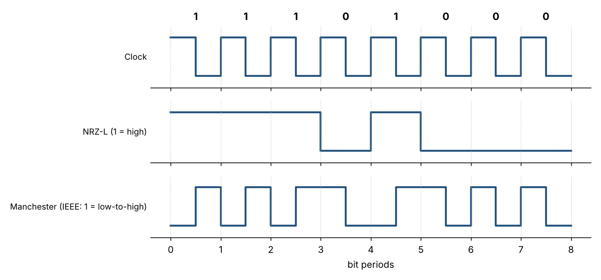
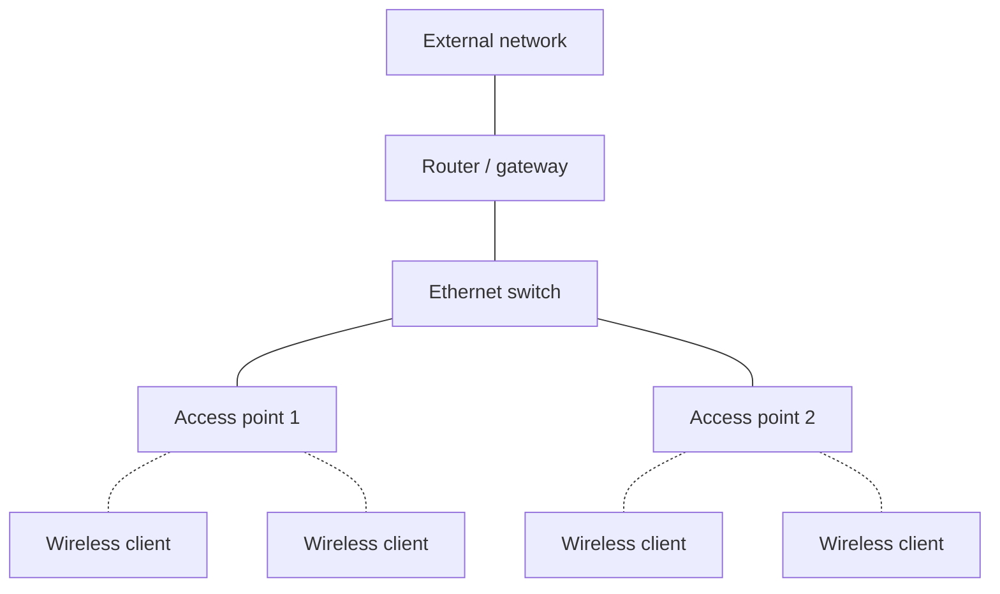
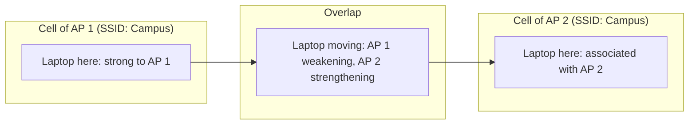
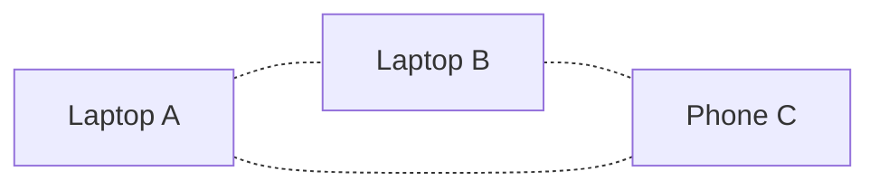
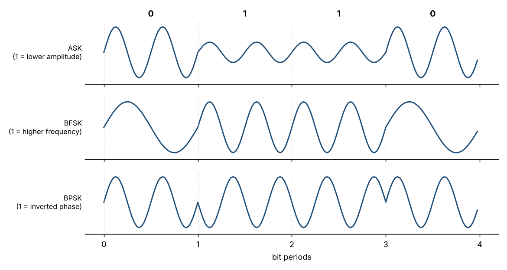

# Lecture 13 — Wireless Networks

**Module:** 4301COMP Computer Systems Architecture

**Session:** Teaching Week 08, Session A

## Start here

So far, every network in this module has used cables. This lecture covers networks without them:

- the **benefits and challenges** of wireless;
- how wireless LANs are structured (**infrastructure** cells, **multi-cell** roaming, **ad hoc**);
- how bits become signals (**NRZ** and **Manchester** encoding);
- **infrared** versus **radio**;
- how data rides on a radio wave (**amplitude, frequency and phase modulation**).

After reading, do **Lab 13** (`../Labs/Lab-13-Wireless-Networks-Hands-on-Workbook.md`). It contains the official guided worksheet (12 questions) and practical tasks: drawing and decoding line codes, generating modulated signals, reading your own Wi-Fi connection, and building a WLAN in Packet Tracer.

**Labels used in these notes:**

- **Official:** from the TW08 Session A slides or worksheet.
- **Extra:** added explanation, not on the slides.
- **Verified:** actually run before being written down. The waveforms, decoders and calculations come from Python scripts written for this lecture (Python 3.13), and the figures were drawn from the same code with matplotlib.
- **Expected:** not run here: Windows `netsh`, Packet Tracer.

> **Note on the slides.** Slide 11's NRZ/Manchester diagram and slides 16–19's network diagrams were readable only as labels. This lecture redraws them as a figure (section 9) and as diagrams (sections 11–13). Slides 10 and 27 stress that **bit-to-signal conventions must be stated**. Every example here states its convention, and you should do the same in exam answers.

---

## 1. Overview

Wireless networking replaces cables with **electromagnetic waves**, usually radio. That brings freedom (mobility, quick installation) and problems: signals fade, devices share the air, and anyone nearby can receive the signal. To understand wireless properly you need two layers of the network model:

| Layer | Question | This lecture |
| --- | --- | --- |
| **Physical** | How do 1s and 0s become a signal? | Line encoding (NRZ, Manchester); carriers and modulation (ASK, FSK, PSK); infrared vs radio |
| **Data link and network design** | How are devices organised and who may join? | 802.11 WLANs, access points, cells, roaming, ad hoc, WPA2/WPA3 |

**Why this matters for cyber security.** A radio signal does not stop at the wall, so anyone in range can receive it. That makes **authentication** (who may join) and **encryption** (who can read the data) essential (slide 6). Attackers also exploit wireless directly. A fake access point with the same network name, called an **evil twin**, can trick devices into connecting to it (Extra). Physical-layer tricks such as spread spectrum are **not** security controls (slides 20 and 22).

## 2. By the end you should be able to

1. Describe the benefits and challenges of wireless communication.
2. Explain why data rate depends on **bandwidth, signal-to-noise ratio and modulation**, not simply on the carrier frequency.
3. Encode a bit string in **NRZ-L** and **Manchester**, with a stated convention, and decode it again.
4. Explain why Manchester helps **clock recovery** and what it costs.
5. Describe **infrastructure**, **multi-cell** and **ad hoc** WLANs and the role of an **access point**.
6. Compare **infrared** and **radio** transmission.
7. Distinguish **ASK**, **FSK** and **PSK**, and read BPSK with the slide's convention.
8. Explain why **WPA2/WPA3**, not modulation or spread spectrum, secures a WLAN.

## 3. Learning outcomes

**Session learning outcomes (Official, slide 3):**

- Describe infrastructure and ad hoc wireless networks.
- Compare NRZ and Manchester encoding.
- Explain the roles of infrared and radio transmission.
- Distinguish amplitude, frequency and phase modulation.

**Module learning outcomes supported** (module guide, as recorded in this module's project instructions):

| Module LO | How this lecture supports it |
| --- | --- |
| **LO4** Explain the fundamental concepts involved in computer networking | All of this lecture |
| **LO1** Explain the fundamental principles underlying the operation of modern computer systems | How digital data is represented as physical signals |

Relevant to the **exam (60%)** (module guide).

## 4. Matching lab and what you need first

- **Matching lab:** Lab 13. The official guided worksheet's 12 questions are Tasks 16–18. The official sheet says no wireless adapter, Packet Tracer, internet access or administrator permissions are needed for those.
- **From Lecture 3:** LANs, access points, topologies.
- **From Lecture 4:** Ethernet, CSMA/CD, the OSI physical and data link layers, bits and signals.
- **From Lecture 7:** decibels are new here and are explained in section 15.

---

## 5. Recap of the previous session (slide 4, Official)

- Trace a network request through hardware and software.
- Relate process states and scheduling to a server response.
- Apply fetch-decode-execute to real service instructions.
- Evaluate a prototype without writing a ready-made assessment answer.

---

## 6. Wireless communications: benefits (slide 5, Official)

- **Untethered** communication: no wires.
- In some cases, **quick installation**.
- Deploying and maintaining cables is **expensive**.
- **Mobility** of users and devices.

**Examples (Extra):** a lecture theatre where hundreds of students connect laptops without a socket each; a historic building where cables cannot be fixed to walls; warehouse scanners carried around all day.

## 7. Wireless communications: challenges (slide 6, Official)

| Challenge | What it means for users (Extra) |
| --- | --- |
| Signal quality varies with **distance, obstacles, interference and movement** | Speed drops at the far end of a building; the connection becomes unreliable behind thick walls or near microwave ovens |
| Devices **share limited radio spectrum** and compete for **airtime** | A crowded lecture theatre feels slow even with a strong signal |
| **Errors and retransmissions** reduce throughput and increase delay | Pages load in bursts; video calls stutter |
| Some applications and **TCP** are sensitive to **loss, latency or congestion** | TCP treats loss as congestion and slows down (Lecture 7); voice and games suffer from delay |
| Signals may extend **beyond a building** | Anyone outside can receive them: **authentication and encryption are essential** |

**Sharing the air (Extra).** Wired Ethernet once used CSMA/CD, *detecting* collisions (Lecture 4; slide 14). A radio cannot easily listen while it transmits, so Wi-Fi uses **CSMA/CA** (collision *avoidance*). A device listens first, waits a random time if the channel is busy, and the receiver acknowledges each frame. Only one device can transmit on a channel at a time, which is why airtime is shared.

---

## 8. Carrier frequency and data rate (slide 7)

### 8.1 Official

- A **radio carrier frequency** identifies **where** a wireless signal sits in the spectrum, for example 2.4 GHz or 5 GHz.
- **Data rate** depends mainly on **channel bandwidth, signal-to-noise ratio, modulation, coding, spatial streams and protocol overhead**.
- **Higher frequencies do not automatically mean higher speed or shorter range.** Propagation, obstacles, antennas, transmit power and regulation all matter.

### 8.2 Why bandwidth, not the carrier, sets the limit (Extra, Verified)

The **Shannon limit** gives the maximum error-free data rate of a channel:

**C = B × log₂(1 + S/N)**

- **B** is the channel **bandwidth**: how wide a slice of spectrum is used, in hertz.
- **S/N** is the **signal-to-noise ratio**: how much stronger the signal is than the background noise. It is usually given in **decibels (dB)**: S/N as a ratio = 10^(dB ÷ 10). So 10 dB means 10 times stronger and 25 dB means about 316 times.

The **carrier frequency does not appear in the formula.** `wireless_calc.py` (Lab 13 Task 13) gives:

```text
Bandwidth   SNR     Limit
  20 MHz   10 dB      69.2 Mbit/s
  20 MHz   25 dB     166.2 Mbit/s
  40 MHz   25 dB     332.4 Mbit/s
  80 MHz   25 dB     664.8 Mbit/s
 160 MHz   25 dB    1329.5 Mbit/s

Same 20 MHz channel and 25 dB SNR at two carriers:
  2.4 GHz: 166.2 Mbit/s  (identical - bandwidth and SNR decide)
  5 GHz: 166.2 Mbit/s  (identical - bandwidth and SNR decide)
```

Newer Wi-Fi is often faster on 5 or 6 GHz because **wider channels** (80 or 160 MHz) are available there, and there is less interference. The higher frequency in itself is not the reason. Real Wi-Fi rates are lower than the Shannon limit because of coding and protocol overhead (slide 7).

> **Common confusion (worksheet question 4).** "Higher frequency = faster network" is not necessarily true. Speed comes from bandwidth, SNR, modulation, coding and the number of spatial streams. Range is not simply "shorter at higher frequency" either: walls, antennas, transmit power and regulations all play a part (slide 7).

---

## 9. Encoding bits as signals: NRZ and Manchester (slides 8–11)

**Line encoding** is the rule for turning 1s and 0s into signal levels on a wire or into the baseband signal before modulation.

### 9.1 Non-Return-to-Zero (Official, slides 8–9)

- NRZ represents bits using **signal levels** without returning to a neutral level between bits.
- **NRZ-L** uses two stable levels for 0 and 1. **The level-to-bit mapping must be stated.** In this lecture, **1 = high and 0 = low**.
- **Long runs without transitions** make **clock recovery** harder. Practical systems use line coding, scrambling or separate timing.

**Why transitions matter (Extra).** The receiver has no separate clock wire. It works out where each bit starts by watching for **changes** in the signal. Eight 0s in NRZ are one long, flat low level. The receiver must count time very accurately to know whether that was 7, 8 or 9 bits. Each transition lets it correct its clock.

### 9.2 Manchester (Official, slide 10)

- Manchester has a **transition in the middle of every bit period**, which helps clock recovery.
- Whether high-to-low means 0 or 1 **depends on the stated convention**. Use the convention given in the question or on the slide.

**The two common conventions (Extra):**

| Convention | 0 | 1 |
| --- | --- | --- |
| **IEEE 802.3** (used by 10 Mbit/s Ethernet), **used in this lecture** | High-to-low | Low-to-high |
| **G. E. Thomas** (the original) | Low-to-high | High-to-low |

### 9.3 NRZ versus Manchester for 11101000 (slide 11, redrawn, Verified)



The same comparison from `line_codes.py` (Lab 13 Task 11):

```text
bits:         1     1     1     0     1     0     0     0    
clock:       |‾‾ __|‾‾ __|‾‾ __|‾‾ __|‾‾ __|‾‾ __|‾‾ __|‾‾ __
NRZ-L         ‾‾ ‾‾ ‾‾ ‾‾ ‾‾ ‾‾|     |‾‾ ‾‾|                 
                               |__ __|     |__ __ __ __ __ __
Manchester      |‾‾|  |‾‾|  |‾‾ ‾‾|     |‾‾ ‾‾|  |‾‾|  |‾‾|  
              __|  |__|  |__|     |__ __|     |__|  |__|  |__
NRZ-L       transitions:   3   longest stretch with no transition: 3 bit periods
Manchester  transitions:  12   longest stretch with no transition: 1 bit periods
Manchester (ieee convention) decodes back to: 11101000
Signal changes per bit: NRZ-L at most 1, Manchester up to 2 -> Manchester needs about twice the bandwidth
```

### 9.4 Comparison (Extra, Verified figures)

| | NRZ-L | Manchester |
| --- | --- | --- |
| Signal per bit | One level for the whole bit | Two half-bit levels with a mid-bit transition |
| Transitions for 11101000 | 3 | 12 |
| Longest flat stretch for 1111111100000000 | **8 bit periods** | 1 bit period |
| Clock recovery | Hard on long runs of the same bit | Easy: a transition in every bit |
| Changes per bit, so bandwidth needed | At most 1 | Up to 2: about **twice** the bandwidth |
| Detects some errors? | No | Yes: a bit period with **no** mid-bit transition is invalid |

**Worked example (Verified).** Encode **10110010** in Manchester (IEEE). Write each bit as two half-bit levels:

- 1 → low, high (`01`)
- 0 → high, low (`10`)

The result is `01 10 01 01 10 10 01 10`. To decode, read the pairs back: `01` = 1 and `10` = 0. A pair of `00` or `11` has no mid-bit transition, so it is an **error**.

> **Common confusion.** Manchester sometimes has a transition at the **boundary** between bits as well, when two equal bits follow each other. That boundary transition carries no data. Only the **mid-bit** transition does. And 01010101 in Manchester has fewer transitions (8) than 00001111 (14): alternating bits need no boundary transitions (Verified).

---

## 10. Wireless connections and the 802 family (slides 12–15)

### 10.1 Official

- Wireless networking lets users **move around** while keeping access to files, servers and shared services, wherever there is suitable **coverage, authentication and connectivity** (slide 12).
- **IEEE 802.11** is the family of standards for **Wi-Fi** WLANs. Modern WLANs use **Wi-Fi 5, Wi-Fi 6/6E and Wi-Fi 7** where supported. **802.11b** is an older **2.4 GHz** standard, discussed as a historical example (slide 13).
- **IEEE 802.3 Ethernet:** early shared Ethernet used **CSMA/CD** on a half-duplex medium. Modern switched Ethernet uses point-to-point **full-duplex** links, where collisions **do not occur** and CSMA/CD is **not used** (slide 14).
- **IEEE 802.5 Token Ring** used **token passing** on a ring. It is **legacy**. Modern enterprise LANs are dominated by **switched Ethernet and Wi-Fi** (slide 15).

### 10.2 Wi-Fi generations (Extra)

| Name | Standard | Bands |
| --- | --- | --- |
| (none) | 802.11b | 2.4 GHz (up to 11 Mbit/s; historical) |
| Wi-Fi 4 | 802.11n | 2.4 and 5 GHz |
| Wi-Fi 5 | 802.11ac | 5 GHz |
| Wi-Fi 6 | 802.11ax | 2.4 and 5 GHz |
| Wi-Fi 6E | 802.11ax | adds 6 GHz |
| Wi-Fi 7 | 802.11be | 2.4, 5 and 6 GHz |

Lab 13 Task 14 shows you how to see which one **your** laptop is using (`netsh wlan show interfaces`, "Radio type").

---

## 11. Infrastructure WLAN (slides 16–17)

### 11.1 Official

- In **infrastructure mode**, wireless clients **associate** with an **access point (AP)**.
- The AP **bridges** traffic between the wireless LAN and the **distribution network**, usually Ethernet.
- Enterprise deployments may use a central **wireless LAN controller**, but the radio device serving clients is still an access point.

### 11.2 Slide 16's diagram, redrawn

Solid lines are wired Ethernet; dotted lines are wireless radio links.



**What the AP does for a laptop (worksheet question 5, Extra):**

1. It advertises the network name (**SSID**).
2. It **authenticates** the laptop (with a password, or a university login with 802.1X).
3. It **encrypts** the radio link (WPA2/WPA3).
4. It **bridges** the laptop's frames onto the wired Ethernet, where the switch and router carry them on, as in Lectures 3–11.

An AP is **not** a router. The laptop's default gateway is still a router on the wired network.

---

## 12. Multi-cell WLAN and roaming (slide 18)

### 12.1 Official

- Each AP advertises an **SSID**, **authenticates** clients and **bridges** authorised traffic.
- **Overlapping cells** allow a client to **roam** between APs while staying on the WLAN.

### 12.2 How roaming works (Extra)



1. All the APs share the **same SSID** and security settings, and connect to the **same** wired network or VLAN.
2. As the user walks, the laptop notices AP 1's signal weakening and AP 2's strengthening.
3. In the overlap zone, the laptop **re-associates** with AP 2. Because the IP subnet is the same, it keeps its address and its connections usually survive.
4. Neighbouring APs use **different channels** so they do not interfere. In 2.4 GHz, the usual non-overlapping channels are **1, 6 and 11**.

---

## 13. Ad hoc networks (slide 19)

**Official:** in an **ad hoc** network, compatible devices communicate **directly** with one another, without a conventional infrastructure access point.



| | Infrastructure | Ad hoc |
| --- | --- | --- |
| Access point | Yes; all traffic passes through it | None |
| Wired network access | Through the AP's distribution network | Not unless one device shares its connection |
| Management | Central (SSID, security, many APs) | Each device |
| Typical use | Homes, campuses, offices | Quick file sharing, temporary or emergency setups |

---

## 14. Wireless LAN technology: infrared and radio (slides 20–22)

### 14.1 Official

**Slide 20:**

- Modern Wi-Fi uses **radio** transmission with **OFDM** or **OFDMA** physical layers.
- Infrared networking is **niche**; it is not how ordinary Wi-Fi works.
- Spread-spectrum techniques were important in earlier WLANs, but they are **not a substitute for security controls**.

**Slide 21: infrared.**

- Infrared uses light **below the visible spectrum**.
- Many infrared links are **directional or line-of-sight**, although diffuse indoor systems exist.
- Infrared normally **does not pass through walls**. This limits coverage but **reduces leakage between rooms**.

**Slide 22: radio.**

- Radio-sharing and modulation techniques improve robustness and spectral use, but they **do not provide security** by themselves.
- Wi-Fi security comes from **authentication and encryption**, such as **WPA2 or WPA3**.
- **WPA3 is preferred** where all equipment supports it. Strong passphrases and current firmware remain important.

### 14.2 Comparison (worksheet question 11, Extra)

| | Infrared | Radio |
| --- | --- | --- |
| Walls and obstacles | Blocked: stays in the room | Passes through many walls, but weakened |
| Coverage | Small, often line-of-sight | Large, all directions |
| Leakage outside the room | Low | High: needs encryption |
| Interference | Bright sunlight can interfere | Other radio devices on the same channel |
| Typical use | TV remotes, some short-range links | Wi-Fi, Bluetooth, mobile networks |

**OFDM in one sentence (Extra).** Orthogonal frequency-division multiplexing splits one wide channel into many narrow **subcarriers**, each modulated separately. OFDMA lets different users share those subcarriers at the same time.

> **Cyber security link.** "Our Wi-Fi uses OFDM and spread spectrum, so it's secure" is wrong (slides 20 and 22). These techniques make the signal robust, not secret: any compatible receiver can decode the physical layer. Confidentiality comes only from **encryption**, and controlling who joins comes only from **authentication**. WPA2-Personal with a weak passphrase can be attacked by capturing a login handshake and guessing passwords offline. WPA3's **SAE** exchange is designed to resist that, which is one reason it is preferred (Extra).

---

## 15. Radio waves: frequency, period and wavelength (slide 23)

### 15.1 Official

- Radio waves are **electromagnetic radiation** travelling through space.
- On a graph against **time**, one cycle takes the **period T** seconds. **Frequency f = 1/T** hertz.
- **Wavelength** is the distance between equivalent points of the wave, measured **in space**, not on the time axis.

### 15.2 Worked numbers (Extra, Verified)

**Formulas:**

- Period: T = 1 ÷ f
- Wavelength: λ = c ÷ f, where c ≈ 3 × 10⁸ m/s (the speed of light)

| Carrier | Period T | Wavelength λ |
| --- | --- | --- |
| 2.4 GHz | 0.4167 ns | 12.49 cm |
| 5 GHz | 0.2000 ns | 6.00 cm |
| 6 GHz | 0.1667 ns | 5.00 cm |
| 100 MHz (FM radio) | 10 ns | about 3 m |

**Working for 2.4 GHz:**

- T = 1 ÷ (2.4 × 10⁹) = 4.17 × 10⁻¹⁰ s = 0.417 ns.
- λ = 3 × 10⁸ ÷ 2.4 × 10⁹ = 0.125 m = 12.5 cm.

---

## 16. Modulation: carrying data on a wave (slides 24–27)

### 16.1 Official

Digital modulation carries data by changing one or more properties of a **carrier** signal:

| Property changed | Binary example | Official convention or description |
| --- | --- | --- |
| **Amplitude** | **ASK** (amplitude-shift keying) | Slide 26: two amplitude states; in the slide's diagram **1 = lower amplitude, 0 = higher amplitude** |
| **Frequency** | **BFSK** (binary frequency-shift keying) | Slide 25: two symbol values use two carrier frequencies |
| **Phase** | **BPSK** (binary phase-shift keying) | Slide 27: carrier phases 180° apart; **0 = reference sine wave, 1 = inverted phase** |

Slide 27 adds: the phase **changes when the bit value changes**, and **two consecutive 1s keep the same phase**. Slides 25 and 26 note that practical systems use more sophisticated amplitude/phase combinations and error-control coding.

### 16.2 The three methods for 0110 (Verified, drawn by `modulation.py`)



- **ASK:** the wave is **small** for each 1 (slide 26's convention) and large for each 0.
- **BFSK:** two cycles per bit for 1 and one cycle per bit for 0, in this script's convention (any two frequencies work).
- **BPSK:** the wave is **flipped upside down** for 1. Look at bits 2 and 3, both 1: there is **no** phase change between them, exactly as slide 27 says.

### 16.3 Which survives noise best? (Extra, Verified simulation)

`modulation.py` sent 2,000 random bits with each method, added the same kind of random noise, and counted the bits recovered wrongly:

```text
Noise experiment: 2000 random bits, the same random noise added to each method
  noise level 0.5:  ASK   10 errors   BFSK    0 errors   BPSK    0 errors
  noise level 1.0:  ASK  198 errors   BFSK    3 errors   BPSK    0 errors
  noise level 1.5:  ASK  398 errors   BFSK   69 errors   BPSK    4 errors
```

In this simple model, **BPSK made the fewest errors**. Its two symbols are as far apart as possible: +1 versus −1. ASK made the most, because a "small" and a "large" wave are easy to confuse when noise is added. This is one reason phase-based methods are widely used. Modern Wi-Fi combines phase **and** amplitude in **QAM**, carrying several bits per symbol when the SNR is high enough. That links back to slide 7's "data rate depends on modulation and SNR".

---

## 17. Common mistakes

| Mistake | Why it is wrong | Do instead |
| --- | --- | --- |
| Not stating the encoding convention | Manchester and BPSK have two possible mappings | Always state it (slides 9, 10, 27) |
| Reading Manchester from the levels, not the mid-bit transition | The level alone is meaningless | Look at the **direction** of the mid-bit change |
| Counting a boundary transition as a bit | It carries no data | Only the mid-bit transition counts |
| "Higher frequency = faster" | Bandwidth, SNR and modulation decide | Slide 7 |
| "The AP is a router" | It bridges WLAN to Ethernet | The gateway is still a router |
| "Ad hoc uses an AP" | It does not | Devices talk directly |
| "Spread spectrum or OFDM makes Wi-Fi secure" | They are not security controls | WPA2/WPA3 authentication and encryption |
| "Infrared goes through walls" | It normally does not | Line-of-sight or within a room |
| "Wi-Fi uses CSMA/CD" | Radios avoid collisions instead | CSMA/CA (Extra) |
| Measuring wavelength on a time axis | Wavelength is a distance | T on the time axis; λ in space (slide 23) |

---

## 18. Check yourself: 15 multiple-choice questions

**Q1.** Which is a **benefit** of wireless communication (slide 5)?
A) Signals stay inside the building
B) Mobility of users and devices
C) No interference
D) Unlimited bandwidth

**Q2.** Why must wireless devices share spectrum carefully?
A) Only one can use a channel at a time, and they compete for airtime
B) Radio waves run out
C) They need cables
D) Encryption needs it

**Q3.** According to slide 7, what mainly determines data rate?
A) The carrier frequency alone
B) The SSID
C) Bandwidth, SNR, modulation, coding, spatial streams and overhead
D) The number of APs

**Q4.** In NRZ-L (1 = high), what does 00000000 look like?
A) Eight mid-bit transitions
B) A flat low level for eight bit periods
C) Alternating high and low
D) A neutral level between bits

**Q5.** Why does a long run without transitions cause problems?
A) It uses more power
B) It breaks encryption
C) It doubles the bandwidth
D) The receiver finds clock recovery harder

**Q6.** Using the IEEE convention (1 = low-to-high), what is the Manchester code for **10**?
A) high-low, low-high
B) low-high, high-low
C) low-low, high-high
D) high-high, low-low

**Q7.** A Manchester bit period shows no mid-bit transition. What does this mean?
A) The bit is 0
B) The bit is 1
C) The signal is invalid (an error)
D) It is a boundary transition

**Q8.** What is the main cost of Manchester encoding?
A) It needs about twice the bandwidth
B) It cannot recover the clock
C) It cannot encode 0
D) It needs an access point

**Q9.** What does an access point do in an infrastructure WLAN?
A) Routes between subnets
B) Associates and authenticates clients and bridges their traffic to the wired network
C) Assigns public IP addresses
D) Replaces the switch

**Q10.** Why do multi-cell WLANs use overlapping cells?
A) To double the speed
B) To avoid encryption
C) So that clients can roam between APs without losing the WLAN
D) To use infrared

**Q11.** What defines an ad hoc network?
A) Devices communicate directly without an AP
B) It uses two APs
C) It uses Token Ring
D) It only works on 5 GHz

**Q12.** Which is true of infrared (slide 21)?
A) It passes through walls easily
B) It is how ordinary Wi-Fi works
C) It normally does not pass through walls, which reduces leakage between rooms
D) It is visible light

**Q13.** What provides Wi-Fi security (slide 22)?
A) Spread spectrum
B) Authentication and encryption such as WPA2 or WPA3
C) OFDM
D) A higher carrier frequency

**Q14.** Which property does BPSK change?
A) Amplitude
B) Frequency
C) Bandwidth
D) Phase

**Q15.** With slide 26's ASK convention, a bit period with a **lower** amplitude represents:
A) 1
B) 0
C) An error
D) A phase change

### Answers

| Q | Answer | Why |
| --- | --- | --- |
| 1 | **B** | Slide 5. |
| 2 | **A** | Slide 6; CSMA/CA (Extra). |
| 3 | **C** | Slide 7 (Verified: the Shannon limit has no carrier term). |
| 4 | **B** | Slide 9. |
| 5 | **D** | Slides 8–9. |
| 6 | **B** | 1 = low-high, then 0 = high-low (Verified). |
| 7 | **C** | Section 9.4. |
| 8 | **A** | Up to two changes per bit. |
| 9 | **B** | Slides 17–18. |
| 10 | **C** | Slide 18. |
| 11 | **A** | Slide 19. |
| 12 | **C** | Slide 21. |
| 13 | **B** | Slide 22. |
| 14 | **D** | Slide 27. |
| 15 | **A** | Slide 26's stated convention. |

---

## 19. Quick reference

**Benefits:** untethered, quick installation, avoids cabling costs, mobility.

**Challenges:** variable signal quality; shared spectrum and airtime; retransmissions; sensitivity to loss and latency; signals leak, so authenticate and encrypt.

**Data rate:** bandwidth, SNR, modulation, coding, spatial streams and overhead, **not** the carrier alone. Shannon: C = B log₂(1 + S/N).

**NRZ-L:** a level per bit (state the mapping). Few transitions, so clock recovery is hard on long runs.

**Manchester:** a mid-bit transition in every bit. Clock recovery is easy, but it needs about twice the bandwidth. IEEE convention: 0 = high-to-low, 1 = low-to-high.

**WLANs:**

- Infrastructure: clients associate with an AP, which bridges to Ethernet.
- Multi-cell: same SSID, overlapping cells, roaming, different channels.
- Ad hoc: devices connect directly, with no AP.

**Infrared vs radio:** infrared is line-of-sight, stays in the room and is niche. Radio passes through walls, so it needs encryption.

**Security:** WPA2/WPA3 (prefer WPA3), strong passphrase, current firmware. Spread spectrum and OFDM are **not** security.

**Waves:** T = 1/f; λ = c/f. 2.4 GHz → 12.5 cm; 5 GHz → 6 cm.

**Modulation:**

| Method | Changes | Slide convention |
| --- | --- | --- |
| ASK | Amplitude | Slide 26: 1 = lower |
| FSK | Frequency | |
| PSK | Phase | Slide 27: 0 = reference, 1 = inverted |

## 20. Glossary

| Term | Meaning |
| --- | --- |
| **Access point (AP)** | Radio device that serves wireless clients and bridges them to the wired network |
| **Ad hoc** | Devices communicating directly without an AP |
| **ASK / FSK / PSK** | Amplitude-, frequency- and phase-shift keying |
| **Association** | A client joining an AP |
| **Carrier** | The radio wave that is modulated to carry data |
| **Cell** | The area covered by one AP |
| **Clock recovery** | A receiver working out bit timing from transitions in the signal |
| **CSMA/CA** | Carrier sense multiple access with collision avoidance (Wi-Fi) |
| **Line encoding** | The rule mapping bits to signal levels (NRZ, Manchester) |
| **Manchester** | Encoding with a transition in the middle of every bit |
| **Modulation** | Changing a carrier's amplitude, frequency or phase to carry data |
| **NRZ-L** | Non-return-to-zero level: one signal level per bit |
| **OFDM / OFDMA** | Splitting a channel into many subcarriers (for one user / shared between users) |
| **Roaming** | A client moving between APs on the same WLAN |
| **SNR** | Signal-to-noise ratio, often in decibels |
| **SSID** | The network name an AP advertises |
| **Wavelength** | Distance in space between equivalent points of a wave |
| **WPA2 / WPA3** | Wi-Fi security standards for authentication and encryption |

## 21. Summary

- Wireless gives mobility and avoids cabling, but signals fade, the air is shared and signals leak, so **authentication and encryption** are essential.
- Data rate depends on **bandwidth, SNR and modulation**, not on the carrier frequency by itself. The Shannon limit makes this concrete.
- **NRZ-L** uses one level per bit. Long runs without transitions make clock recovery hard. **Manchester** puts a transition in every bit, which helps timing but costs about twice the bandwidth. Always state the convention.
- **Infrastructure** WLANs use APs that associate, authenticate and bridge. **Multi-cell** designs let users roam. **Ad hoc** networks connect devices directly.
- **Infrared** stays in the room; **radio** passes through walls. Modern Wi-Fi is radio-based (OFDM/OFDMA). Neither the physical layer nor spread spectrum provides security: **WPA2/WPA3** does.
- **Modulation** changes amplitude (ASK), frequency (FSK) or phase (PSK). In a simple noise test, BPSK made far fewer errors than ASK.

## 22. Next

According to slide 29, the next session is **Teaching Week 08, Session B: Binary and Decimal Number Systems**.
