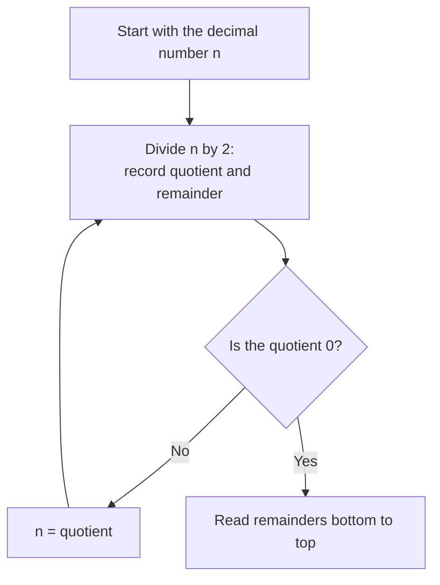
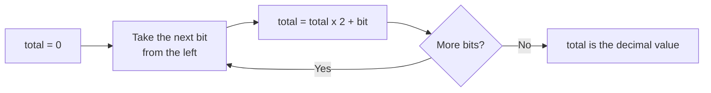

# Lecture 14 — Binary and Decimal Number Systems

**Module:** 4301COMP Computer Systems Architecture

**Session:** Teaching Week 08, Session B

## Start here

Every value inside a computer is stored as a pattern of bits: addresses, instructions, pixel colours, permissions, flags. People, though, think in decimal. This lecture explains:

- what a **positional number system** is;
- how **place values** work in decimal and binary;
- how to **count** in binary;
- how to **convert** in both directions, with the methods on the slides and on the lab sheet;
- how to **check** every answer.

After reading, do **Lab 14** (`../Labs/Lab-14-Binary-and-Decimal-Number-Systems-Hands-on-Workbook.md`). It contains the official conversion tables and the binary-flags Extra Challenge.

**Labels used in these notes:**

- **Official** = from the TW08 Session B slides or lab sheet.
- **Extra** = added explanation, not on the slides.
- **Verified** = actually run before being written down. Every conversion here was checked with Python 3.13 (`convert.py`, written for this lecture, plus Python's own `int()` and `format()`), and the permission example was run on Linux.
- **Expected** = not run here (Word, Snipping Tool, Windows Calculator).

> **Notes on the slides.** Slide 10 is a diagram with no readable text. Slide 9's nibble table shows only the nibbles 8–F as text, so the full 0–F table is given in section 8. **Slide 32 gives an official date: AS1 hand-in, Friday 20 November 2026 at 5 pm, through Canvas.**

---

## 1. Overview

A number is a **quantity**. "Thirteen sheep" is the same quantity whether you write it as 13 (decimal), 1101 (binary) or D (hexadecimal). The **number system** is only the way the quantity is written down.

| System | Base | Digits | Where you meet it |
| --- | --- | --- | --- |
| Decimal | 10 | 0–9 | Everyday life |
| Binary | 2 | 0, 1 | Inside every computer: memory, registers, network packets |
| Hexadecimal | 16 | 0–9, A–F | A compact way to write binary: MAC addresses, memory addresses, colours (next session) |

**Why this matters for cyber security.** Many security settings are binary underneath:

- IPv4 addresses and subnet masks are four 8-bit numbers (Lecture 7).
- Linux file permissions are 3-bit groups.
- Firewalls and protocols pack on/off **flags** into single bytes, such as TCP's SYN and ACK flags (Lecture 7).

Reading these quickly and accurately is a daily skill for analysts.

## 2. By the end you should be able to

1. Explain what a **base** is, and how place value works in any positional system.
2. Write the place values of decimal (powers of 10) and binary (powers of 2).
3. Count in binary, and state the range of values that **n bits** can hold.
4. Convert decimal to binary by **repeated division** and by the **subtraction (place-value) method**.
5. Convert binary to decimal by the **positional** and **doubling** methods.
6. **Check** a conversion by converting it back, or by using the other method.
7. Use bits as **flags**: set, clear and test them.
8. Relate binary to bits, nibbles, bytes and hexadecimal digits.

## 3. Learning outcomes

**Session learning outcomes (Official, slide 3):**

- Explain how a positional number system uses a base.
- Interpret binary and decimal place values.
- Convert decimal values to binary.
- Convert binary values to decimal and check the result.

**Module learning outcomes supported** (module guide, as recorded in this module's project instructions):

| Module LO | How this lecture supports it |
| --- | --- |
| **LO1** Explain the fundamental principles underlying the operation of modern computer systems | How computers represent numbers |
| **LO2** Demonstrate knowledge of the structure and organisation of computer systems | Bits, bytes and register sizes |

Relevant to the **exam (60%)** (module guide).

## 4. Matching lab and what you need first

- **Matching lab:** Lab 14. It contains the official tasks:
  - decimal to binary, Task 16;
  - binary to decimal, Task 17;
  - binary flags, Task 18.
- **Prerequisites:** multiplying and dividing by 2, and powers. A power such as 2³ means 2 × 2 × 2 = 8, and any number to the power 0 is 1.

---

## 5. Recap of the previous session (slide 4, Official)

- Wireless LANs can use infrastructure cells or ad hoc connections.
- Encoding represents digital values on a signal.
- Infrared and radio offer different propagation characteristics.
- Modulation changes amplitude, frequency or phase to carry data.

---

## 6. Why number systems matter (slides 5–8)

**Official:**

- A computer represents information as patterns of **bits**, each written as 0 or 1.
- People usually read and write numbers in **decimal (base 10)**; **binary is base 2**.
- **Positional place values** let us read the same quantity in different number systems.
- Number systems represent quantities using **digits** and a **base**. Decimal, binary and hexadecimal (base 16) are common in computing.
- **Binary** has just two digit values, **0 and 1**. **Decimal** has ten, **0–9**, and place value determines what each digit represents.

**Why computers use binary (Extra).** A transistor is easiest to build and read reliably as a switch with two states, on or off. Two states are also easy to tell apart in a signal (Lecture 13: NRZ levels). With ten voltage levels per wire, a little electrical noise would turn a 6 into a 7.

---

## 7. Positional number systems (slide 11)

### 7.1 Official

- In **base N**, each digit is one of **0, 1, …, N − 1**.
- Positions are numbered from **0 on the right**. The **weight** of position k is **Nᵏ**.
- **Value = d₀N⁰ + d₁N¹ + d₂N² + … + dₙ₋₁Nⁿ⁻¹**.
- d₀ is the **least significant digit (LSD)**; dₙ₋₁ is the **most significant digit (MSD)**.
- Each position has **N times** the weight of the position immediately to its right.

### 7.2 Decimal examples (slides 12–14, Official)

**375** = 3 hundreds + 7 tens + 5 units.

| Weight | 1,000 | 100 | 10 | 1 |
| --- | --- | --- | --- | --- |
| Digit | 4 | 5 | 8 | 2 |
| Contribution | 4,000 | 500 | 80 | 2 |

4,582 = 4 × 10³ + 5 × 10² + 8 × 10¹ + 2 × 10⁰ = 4,000 + 500 + 80 + 2.

| Power | 10⁴ | 10³ | 10² | 10¹ | 10⁰ |
| --- | --- | --- | --- | --- | --- |
| Weight | 10,000 | 1,000 | 100 | 10 | 1 |

Moving one position **left multiplies** the weight by 10. Moving one position **right divides** it by 10.

> **Common confusion.** The rightmost position is position **0**, not position 1, and its weight is N⁰ = **1** in every base.

---

## 8. Bits, bytes and hexadecimal (slide 9)

**Official:**

- A **bit** has two possible values, 0 or 1.
- One **byte** = **8 bits**; one **nibble** = **4 bits**.
- One **hexadecimal digit** represents exactly **one nibble**, so **two hex digits** represent one byte.

**Full nibble table (slide 9 shows 8–F; 0–7 added, Extra, Verified):**

| Nibble | 0000 | 0001 | 0010 | 0011 | 0100 | 0101 | 0110 | 0111 |
| --- | --- | --- | --- | --- | --- | --- | --- | --- |
| Hex | 0 | 1 | 2 | 3 | 4 | 5 | 6 | 7 |

| Nibble | 1000 | 1001 | 1010 | 1011 | 1100 | 1101 | 1110 | 1111 |
| --- | --- | --- | --- | --- | --- | --- | --- | --- |
| Hex | 8 | 9 | A | B | C | D | E | F |

Hexadecimal is the next session's main topic.

---

## 9. Binary numbers and place values (slides 15–17)

### 9.1 Official

- Binary is **base 2**; its only digits are 0 and 1.
- Each position has a weight of **2 raised to its position**, counting from **zero on the right**.
- Moving one position **left doubles** the weight. **Add the weights wherever the bit is 1.**

### 9.2 Sixteen-bit unsigned values (slide 16, Official)

| Bit | 15 | 14 | 13 | 12 | 11 | 10 | 9 | 8 |
| --- | --- | --- | --- | --- | --- | --- | --- | --- |
| Weight | 32768 | 16384 | 8192 | 4096 | 2048 | 1024 | 512 | 256 |

| Bit | 7 | 6 | 5 | 4 | 3 | 2 | 1 | 0 |
| --- | --- | --- | --- | --- | --- | --- | --- | --- |
| Weight | 128 | 64 | 32 | 16 | 8 | 4 | 2 | 1 |

- The **most significant bit** (left) has weight 2¹⁵ = **32,768**. The **least significant bit** (right) has weight 2⁰ = 1.
- Add the weights of the **set** bits to get the **unsigned** value.
- **All 16 bits set = 65,535.**
- The two rows continue **one** 16-bit sequence; they are not two separate place-value systems.

### 9.3 How many values fit in n bits? (Extra, Verified)

n bits give **2ⁿ** different patterns, so an unsigned value runs from **0 to 2ⁿ − 1**.

| Bits | Patterns | Unsigned range | Example use |
| --- | --- | --- | --- |
| 4 (nibble) | 16 | 0–15 | One hex digit |
| 8 (byte) | 256 | 0–255 | One IPv4 octet (Lecture 7) |
| 16 | 65,536 | 0–65,535 | TCP/UDP port numbers (Lecture 7) |
| 32 | 4,294,967,296 | 0–4,294,967,295 | An IPv4 address |

**Why 1111 1111 = 255:** 128 + 64 + 32 + 16 + 8 + 4 + 2 + 1 = 255. That is one less than the next weight, 256. The same pattern holds for any width: all n bits set equals 2ⁿ − 1.

### 9.4 Binary examples (slide 17, Official)

The subscript identifies the base: ₂ means binary and ₁₀ means decimal.

- 1000₂ = 1 × 8 + 0 × 4 + 0 × 2 + 0 × 1 = **8₁₀**
- 1011₂ = 1 × 8 + 0 × 4 + 1 × 2 + 1 × 1 = **11₁₀**

---

## 10. Counting in binary (slide 18)

### 10.1 Official

- Decimal place values are powers of 10; binary place values are powers of 2.
- Decimal ten is **10₁₀**: one ten and zero units. The same quantity is **1010₂**: one eight and one two (8 + 2 = 10).
- Binary often needs **more digits** for the same quantity.

### 10.2 Counting from 0 to 15 (Extra, Verified)

| Decimal | Binary | | Decimal | Binary |
| --- | --- | --- | --- | --- |
| 0 | 0000 | | 8 | 1000 |
| 1 | 0001 | | 9 | 1001 |
| 2 | 0010 | | 10 | 1010 |
| 3 | 0011 | | 11 | 1011 |
| 4 | 0100 | | 12 | 1100 |
| 5 | 0101 | | 13 | 1101 |
| 6 | 0110 | | 14 | 1110 |
| 7 | 0111 | | 15 | 1111 |

**The pattern:**

- The rightmost bit alternates on every count (0, 1, 0, 1, …).
- The next bit alternates every 2 counts, the next every 4, and the next every 8.
- When all the bits are 1, adding 1 **carries** all the way along, just like 999 + 1 = 1000 in decimal: 0111 + 1 = 1000.

---

## 11. Decimal to binary: repeated division (slides 19–21)

### 11.1 The method (Official, slide 19)

1. Divide the non-negative decimal integer by 2 and record the **remainder** (0 or 1).
2. Divide the **integer quotient** by 2 and record the next remainder.
3. Repeat until the integer quotient is **0**.
4. Read the remainders from **bottom to top**.



### 11.2 Worked examples (Official, Verified by `convert.py`)

**57₁₀:**

```text
Repeated division of 57 by 2 (slide 19):
  Division     Quotient  Remainder
     57 ÷ 2         28          1
     28 ÷ 2         14          0
     14 ÷ 2          7          0
      7 ÷ 2          3          1
      3 ÷ 2          1          1
      1 ÷ 2          0          1
  Read the remainders from bottom to top: 57 = 111001 (binary)
```

**207₁₀:**

```text
Repeated division of 207 by 2 (slide 19):
  Division     Quotient  Remainder
    207 ÷ 2        103          1
    103 ÷ 2         51          1
     51 ÷ 2         25          1
     25 ÷ 2         12          1
     12 ÷ 2          6          0
      6 ÷ 2          3          0
      3 ÷ 2          1          1
      1 ÷ 2          0          1
  Read the remainders from bottom to top: 207 = 11001111 (binary)
```

**Why bottom to top? (Extra)** The **first** remainder tells you whether the number is odd or even. That is the **units** bit, the least significant. Each later division looks one position further left, so the last remainder is the most significant bit, which is written first.

## 12. Decimal to binary: the subtraction (place-value) method (official lab Task 1)

**Official method:**

1. Start with the original value as the remainder.
2. Scan the weights from **128 down to 1**.
3. If a weight is **no larger** than the remainder, write **1** and subtract it. Otherwise write **0**.
4. Finish with **remainder zero**.

The lab sheet's own example: **18 = 16 + 2**, so its eight-bit form is **00010010**.

**Worked example: 57 with 8 bits (Verified):**

```text
Subtraction method, 8 bits (lab Task 1):
  weight  128: 128 >  57, write 0
  weight   64: 64 >  57, write 0
  weight   32: 32 <= 57, write 1, remainder 57 - 32 = 25
  weight   16: 16 <= 25, write 1, remainder 25 - 16 = 9
  weight    8: 8 <= 9, write 1, remainder 9 - 8 = 1
  weight    4: 4 >  1, write 0
  weight    2: 2 >  1, write 0
  weight    1: 1 <= 1, write 1, remainder 1 - 1 = 0
  Result: 00111001 (remainder 0)
```

Both methods give the same bits. Eight-bit answers keep their **leading zeros** (official lab).

---

## 13. Binary to decimal: positional method (slides 22–26)

### 13.1 Official

Sum the values according to their positions. Align each bit with its power of two and add the weights under the 1s.

**10011₂:**

| Weight | 16 | 8 | 4 | 2 | 1 |
| --- | --- | --- | --- | --- | --- |
| Bit | 1 | 0 | 0 | 1 | 1 |

10011₂ = 16 + 2 + 1 = **19₁₀**

**101001101₂:**

| Weight | 256 | 128 | 64 | 32 | 16 | 8 | 4 | 2 | 1 |
| --- | --- | --- | --- | --- | --- | --- | --- | --- | --- |
| Bit | 1 | 0 | 1 | 0 | 0 | 1 | 1 | 0 | 1 |

101001101₂ = 256 + 64 + 8 + 4 + 1 = **333₁₀**

### 13.2 Long binary values (slide 26)

The positional method still works for long strings such as **110101110110111101010110101₂**. However, writing every power of two takes space and makes transcription mistakes easier (Official). That 27-bit value equals **112,949,941₁₀** (Verified with both methods and with Python).

---

## 14. Binary to decimal: doubling method (slides 27–30)

### 14.1 The method (Official)

1. Start with a running total of **0**.
2. Read the bits from **left to right**.
3. For each bit: **new total = (previous total × 2) + current bit**.
4. **Check** the final result with the positional method, or by converting it back to binary.



### 14.2 Worked examples (Official, Verified)

**1001₂:**

| Next bit | Calculation | New total |
| --- | --- | --- |
| 1 | 0 × 2 + 1 | 1 |
| 0 | 1 × 2 + 0 | 2 |
| 0 | 2 × 2 + 0 | 4 |
| 1 | 4 × 2 + 1 | 9 |

So 1001₂ = **9₁₀**.

**101001101₂** (`convert.py` output, Verified):

```text
Doubling method for 101001101 (slides 27-30): start at 0, total = total x 2 + bit
  bit 1: 0 x 2 + 1 = 1
  bit 0: 1 x 2 + 0 = 2
  bit 1: 2 x 2 + 1 = 5
  bit 0: 5 x 2 + 0 = 10
  bit 0: 10 x 2 + 0 = 20
  bit 1: 20 x 2 + 1 = 41
  bit 1: 41 x 2 + 1 = 83
  bit 0: 83 x 2 + 0 = 166
  bit 1: 166 x 2 + 1 = 333
  101001101 = 333
```

**Why doubling works (Extra).** Each time you double the total, every bit already counted moves one place left, so its weight doubles. Then the new bit is added in the units place. After the last bit, each bit has been doubled once for every bit to its right, which is exactly its positional weight.

---

## 15. Checking your answer (slide 30 and the lab)

Always check a conversion with a **different** route:

| You converted | Check by |
| --- | --- |
| Decimal → binary (division) | Adding the weights of the 1s (positional) |
| Decimal → binary (subtraction) | Repeated division |
| Binary → decimal (positional) | The doubling method, or converting back to binary |

Quick sanity checks (Extra):

- A binary number ending in **1** is **odd**; ending in **0**, it is **even**.
- An 8-bit value cannot exceed **255**.
- If the leftmost of 8 bits is 1, the value is **at least 128**.

---

## 16. Bits as flags (official lab Extra Challenge)

One byte can hold eight independent **on/off flags**. The lab's convention:

| Bit | Weight | Flag |
| --- | --- | --- |
| 0 | 1 | power |
| 1 | 2 | alarm |
| 2 | 4 | network |
| 3 | 8 | sensor |
| 4–7 | 16–128 | unused (must stay 0) |

**Power, network and sensor on, alarm off:** 0000 1101 = 1 + 4 + 8 = **13**. Turning the alarm on sets **bit 1**: 0000 1111 = **15** (Verified with `flags.py`, Lab 14 Task 12).

Programs work with flags using **bitwise operators** (Extra):

| Operation | Operator | Example |
| --- | --- | --- |
| Test a flag | AND with its weight | 13 AND 2 = 0, so the alarm is off |
| Set a flag | OR with its weight | 13 OR 2 = 15 |
| Clear a flag | AND with NOT the weight | 15 AND NOT 4 = 11 |
| Find what changed | XOR | 13 XOR 15 = 2: bit 1 changed |

> **Cyber security link: permissions are binary.** Linux file permissions are three 3-bit groups (owner, group, others). In each group: read = 4, write = 2, execute = 1. `chmod 754` therefore means owner 7 = 111 = rwx, group 5 = 101 = r-x, others 4 = 100 = r-- (Verified on Linux: `stat` shows `754 -rwxr-xr--`). Reading a mode like 777, which means everyone can write, as a security problem depends on exactly this skill. TCP flags (SYN, ACK, FIN; Lecture 7) are also bits in one byte, and firewalls filter on them.

---

## 17. Common mistakes

| Mistake | Example | Fix |
| --- | --- | --- |
| Reading remainders top to bottom | 57 → 100111 instead of 111001 | Bottom to top (slide 19) |
| Dropping leading zeros in fixed-width answers | 13 → 1101, but 8 bits were asked for | 00001101 (official lab) |
| Starting position numbers at 1 | Giving the rightmost bit weight 2 | The rightmost weight is 2⁰ = 1 |
| Misaligning bits with weights | Writing 10011 under 128…1 without padding | Right-align, or pad with leading zeros |
| Doubling method read right to left | Gives the wrong value | Read left to right (slide 27) |
| Thinking 8 bits can hold 256 | The maximum is 255 | 2⁸ − 1 |
| Not checking | Arithmetic slips go unnoticed | Use the other method (slide 30) |
| Confusing a value with how it is written | "10 is ten" | 10₂ = 2; always write the base subscript |

---

## 18. Check yourself: 15 multiple-choice questions

**Q1.** In base N, which digits are allowed?
A) 1 to N
B) 0 to N
C) 0 to N − 1
D) 0 and 1 only

**Q2.** What is the weight of position 3 in binary?
A) 3
B) 8
C) 6
D) 9

**Q3.** 4,582 equals which expression?
A) 4 × 10⁴ + 5 × 10³ + 8 × 10² + 2 × 10¹
B) 4 × 10³ + 5 × 10² + 8 × 10¹ + 2 × 10⁰
C) 4 + 5 + 8 + 2
D) 4 × 1000 + 5 × 100 + 8 + 2

**Q4.** How many bits are in a nibble?
A) 4
B) 2
C) 8
D) 16

**Q5.** What is 1011₂ in decimal?
A) 13
B) 9
C) 11
D) 1011

**Q6.** What is the largest unsigned value that fits in 8 bits?
A) 256
B) 255
C) 128
D) 127

**Q7.** What do 16 set bits equal (slide 16)?
A) 65,535
B) 65,536
C) 32,768
D) 16

**Q8.** Converting 57 by repeated division gives the remainders (first to last) 1, 0, 0, 1, 1, 1. What is 57 in binary?
A) 100111
B) 111000
C) 110011
D) 111001

**Q9.** What is 207₁₀ in binary?
A) 11001111
B) 11110011
C) 11001101
D) 10101111

**Q10.** What is 10011₂ in decimal?
A) 17
B) 21
C) 19
D) 25

**Q11.** What is the doubling-method step for bit b and previous total t?
A) t + 2b
B) 2t + b
C) t × b
D) t / 2 + b

**Q12.** What is 101001101₂ in decimal?
A) 333
B) 331
C) 325
D) 341

**Q13.** What is 13 as an 8-bit binary value?
A) 1101
B) 11010000
C) 00001101
D) 00001011

**Q14.** Power (bit 0), network (bit 2) and sensor (bit 3) are on. What is the value?
A) 14
B) 13
C) 11
D) 7

**Q15.** What does `chmod 640` give the group?
A) Read only (4 = 100)
B) Read and write
C) Nothing
D) Read and execute

### Answers

| Q | Answer | Why |
| --- | --- | --- |
| 1 | **C** | Slide 11. |
| 2 | **B** | 2³ = 8. |
| 3 | **B** | Slide 13. |
| 4 | **A** | Slide 9. |
| 5 | **C** | Slide 17: 8 + 2 + 1. |
| 6 | **B** | 2⁸ − 1 (Verified). |
| 7 | **A** | Slide 16. |
| 8 | **D** | Read bottom to top (slide 20). |
| 9 | **A** | Slide 21 (Verified). |
| 10 | **C** | Slide 24. |
| 11 | **B** | Slides 27–30. |
| 12 | **A** | Slides 25 and 29 (Verified). |
| 13 | **C** | 8 + 4 + 1, with leading zeros (Verified). |
| 14 | **B** | 1 + 4 + 8 (Verified). |
| 15 | **A** | 640: group digit 4 = 100 = r-- (Verified: `-rw-r-----`). |

---

## 19. Quick reference

**Base N:** digits 0 to N − 1; position k has weight Nᵏ, counted from 0 on the right.

**Binary weights (8 bits):** 128 64 32 16 8 4 2 1. All set = 255. With 16 bits, all set = 65,535.

**Ranges:** n bits hold 2ⁿ patterns, 0 to 2ⁿ − 1.

**Decimal → binary:**

- Repeated division: divide by 2, read the remainders **bottom to top**.
- Subtraction: go from 128 down to 1; if the weight ≤ the remainder, write 1 and subtract it.

**Binary → decimal:**

- Positional: add the weights under the 1s.
- Doubling: total = total × 2 + bit, reading left to right.

**Check:** use the other method; odd numbers end in 1; 8 bits ≤ 255.

**Flags:**

| Action | How |
| --- | --- |
| Test | AND |
| Set | OR |
| Clear | AND NOT |
| Find what changed | XOR |

**Permissions:** r = 4, w = 2, x = 1. So 7 = rwx, 5 = r-x and 4 = r--.

## 20. Glossary

| Term | Meaning |
| --- | --- |
| **Base (radix)** | The number of digit values a system uses (10 for decimal, 2 for binary) |
| **Bit** | A binary digit: 0 or 1 |
| **Bitwise operator** | AND, OR, XOR or NOT applied to each bit position separately |
| **Byte** | 8 bits |
| **Flag** | A single bit used to record an on/off state |
| **LSB / MSB** | Least / most significant bit (rightmost / leftmost) |
| **Nibble** | 4 bits; one hex digit |
| **Place value (weight)** | What a digit is multiplied by in its position: Nᵏ |
| **Positional system** | A system where a digit's value depends on its position |
| **Unsigned** | Representing only zero and positive values |

## 21. Summary

- A positional system has a **base** N and digits 0 to N − 1. Position k (counting from 0 on the right) has weight **Nᵏ**.
- Decimal weights are powers of 10; binary weights are powers of 2, which **double** to the left. n bits hold values from **0 to 2ⁿ − 1**.
- **Decimal → binary:** repeated division by 2 (remainders read **bottom to top**) or subtracting weights from 128 down.
- **Binary → decimal:** add the weights under the 1s (**positional**) or double-and-add from the left (**doubling**).
- Always **check** with a second method.
- Single bits can be **flags**, and many security settings, such as permissions, masks and TCP flags, are bit patterns.

## 22. Next

According to slide 32:

- The next session is **Teaching Week 09, Session A: Hexadecimal and Data Representation**.
- **AS1 hand-in: Friday 20 November 2026 at 5 pm, through Canvas.**
