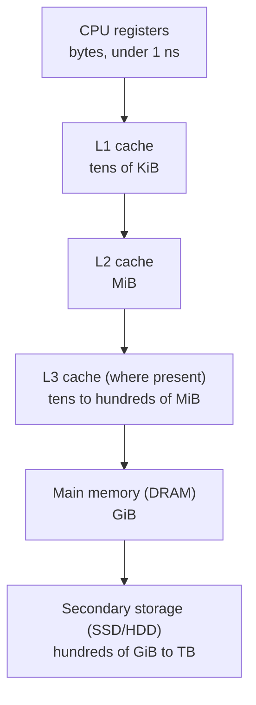
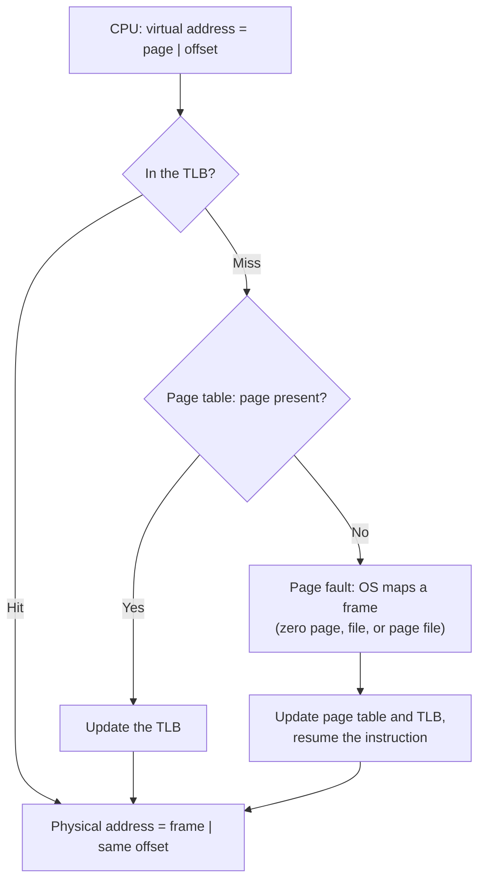

# Lecture 16 — Memory and Storage

**Module:** 4301COMP Computer Systems Architecture

**Session:** Teaching Week 09, Session B

## Start here

Every instruction the CPU runs needs data from somewhere: a register, a cache, RAM, or a disk. These differ enormously in speed, size, cost and persistence. This lecture explains:

- the **memory hierarchy** and why it exists;
- **registers** and **cache** (with **locality**);
- how **RAM** is organised, using **decoders**;
- **virtual memory**: pages, frames, the **MMU**, the **TLB** and **page faults**;
- **paging versus segmentation**;
- **ROM and firmware**;
- **secondary storage**: tape, HDD, SSD, optical and flash cards;
- **RAID** and where storage is deployed (DAS, NAS, SAN).

After reading, do **Lab 16** (`../Labs/Lab-16-Memory-and-Storage-Hands-on-Workbook.md`). It contains the official written practice questions and hands-on tasks.

**Labels used in these notes:**

- **Official** = from the TW09 Session B slides or lab sheet.
- **Extra** = added explanation, not on the slides.
- **Verified** = actually run before being written down. Real measurements were taken on a Linux virtual machine (Intel Xeon, 2 vCPUs, gcc 13.3) for cache sizes, memory latency, locality and page faults. RAID, decoder and MMU behaviour were checked with Python 3.13 simulations.
- **Expected** = not run here (Windows Task Manager, Resource Monitor, PowerShell).

> **Notes on the slides and sources.**
>
> - Slides 5, 6, 14, 18, 23, 24, 28, 32 and 33 are images (and slide 17 partly), so only titles or captions were readable. They are explained from standard material, marked **Extra**.
> - Only the **solution** version of this session's lab sheet is in the Project. Lab 16 gives its questions, and its answer key agrees with that official sheet.
> - **Slide 41: individual AS1 demonstrations take place in both Week 11 labs.**

---

## 1. Overview



Moving down the hierarchy, each level is **larger, slower and cheaper per bit** (slide 8). The CPU works fast because it usually finds what it needs near the top.

**Why this matters for cyber security.**

- **Memory isolation:** virtual memory and the MMU keep one process from reading another's memory. This is the basis of process separation (Lecture 6).
- **Cache timing:** cache timing differences are the root of attacks such as Spectre and Meltdown (Extra).
- **Forensics:** "deleted" data often survives on storage, and RAM holds secrets such as encryption keys. Forensic investigators capture both.
- **Firmware:** firmware updates must be controlled, because malicious firmware runs before the OS (slide 26).
- **Backups:** **RAID is not a backup.** Ransomware encrypts every mirror at once (slide 36).

## 2. By the end you should be able to

1. Explain the purpose of the memory hierarchy in terms of **speed, capacity, cost and persistence**.
2. Distinguish **volatile/non-volatile** from **primary/secondary**.
3. Compare registers, cache (SRAM), main memory (DRAM), ROM/flash firmware and secondary storage.
4. Explain **temporal** and **spatial locality** and why caches work.
5. Explain how a **decoder** selects one memory location from an address.
6. Describe **virtual memory**: page number and offset, MMU, TLB hit or miss, page table, **page fault**.
7. Compare **paging** and **segmentation**, including **internal** and **external fragmentation**.
8. Explain RAID 0, 1, parity RAID, 0+1 and 10, and where **DAS, NAS and SAN** are used, and why **RAID is not a backup**.

## 3. Learning outcomes

**Session learning outcomes (Official, slide 3):**

- Explain the purpose of the memory hierarchy.
- Compare registers, cache, RAM, ROM and secondary storage.
- Describe virtual memory and the role of the MMU.
- Explain the purpose of RAID and common storage deployments.

**Module learning outcomes supported** (module guide, as recorded in this module's project instructions):

| Module LO | How this lecture supports it |
| --- | --- |
| **LO1** Explain the fundamental principles underlying the operation of modern computer systems | Hierarchy, caching, locality |
| **LO2** Demonstrate knowledge of the structure and organisation of computer systems | RAM organisation, storage devices, RAID |
| **LO3** Explain the role and functions of an operating system | Virtual memory, paging, page faults |

This topic falls within the **data storage** focus of the module. It is relevant to the **exam (60%)**, and the module guide says the **report (40%)** covers data storage concepts.

## 4. Matching lab and what you need first

- **Matching lab:** Lab 16. The official written practice lab's Questions 1–5 are Tasks 16–18.
- **From Lecture 1:** memory versus storage.
- **From Lecture 2:** registers (PC, IR, MAR, MDR), buses, the FDE cycle.
- **From Lecture 5:** boot, UEFI, Secure Boot.
- **From Lecture 6:** virtual address spaces, the MMU, frames.
- **From Lectures 14–15:** binary and hex. You will split hex addresses into page number and offset.

---

## 5. Recap of the previous session (slide 4, Official)

- Hexadecimal uses sixteen digits and powers of sixteen.
- One hexadecimal digit represents exactly four binary bits.
- Grouping bits in fours makes binary-to-hexadecimal conversion efficient.
- Hexadecimal is widely used for addresses, file data and diagnostics.

---

## 6. Memory in the von Neumann architecture (slides 5–7)

**Slides 5–6 (Official titles; images):**

- Slide 5 shows "the classical SAVE icon", a floppy disk: a reminder that "saving" means copying from volatile memory to persistent storage.
- Slide 6 is the von Neumann architecture (Lecture 2): CPU, memory and I/O on shared buses, with programs and data in the same memory.

**Slide 7 (Official):**

- **Volatile** memory loses its contents when power is removed. RAM is the main example.
- **Non-volatile** memory keeps data without power, but that data is **not necessarily permanent or immutable**.
- **Primary versus secondary** describes **role and access**. **Volatile versus non-volatile** describes **persistence**.
- The categories **overlap**: firmware flash is primary-addressable in some systems but non-volatile.

| | Volatile | Non-volatile |
| --- | --- | --- |
| **Primary** (CPU accesses directly) | Registers, cache, DRAM | Firmware flash (in some systems) |
| **Secondary** (accessed through I/O) | (rare) | SSD, HDD, tape, optical, memory cards |

---

## 7. The memory hierarchy (slides 8–12)

### 7.1 Official

- Fast storage is generally **small and expensive per bit**; large levels tend to be **slower but cheaper**.
- The hierarchy **balances access speed, capacity and cost** (slide 8).
- **Primary storage** holds what the CPU needs immediately or with very low latency. **Secondary (mass) storage** holds much larger quantities for longer-term use (slide 9).
- Primary memory includes **registers, cache and main memory**. Most main memory is volatile **DRAM**; firmware commonly uses non-volatile **flash** (slide 10).
- **No single technology** gives maximum speed, large capacity and low cost at once (slide 11).

| Level | Holds (slide 12) |
| --- | --- |
| Registers | The processor's immediate operands, addresses and execution state |
| Cache | Recently used or nearby memory blocks |
| Main memory | Active programs and data |
| Non-volatile storage | Files and inactive program data |

### 7.2 The real hierarchy of the test machine (Verified)

```text
L1d cache:  96 KiB (2 instances)  -> 48 KiB per core, 64-byte lines
L2 cache:   4 MiB (2 instances)   -> 2 MiB per core
L3 cache:   260 MiB (1 instance)
Main memory: 7.8 GiB
Disk (vda):  256 GiB
Address sizes: 52 bits physical, 57 bits virtual
```

Next, a small C program (`latency.c`, Lab 16 Task 12) measured the **average time per memory access** as the amount of data grew. It follows a random chain of pointers, so the CPU cannot predict the next address:

```text
      16 KiB     1.9 ns per access
      32 KiB     2.1 ns per access
     256 KiB     5.7 ns per access
    1024 KiB     9.5 ns per access
    8192 KiB    35.2 ns per access
   65536 KiB   136.4 ns per access
  262144 KiB   154.1 ns per access
 1048576 KiB   174.5 ns per access
```

- Data that fits in **L1** (up to 48 KiB) took about **2 ns** per access.
- Data that fits in **L2** took about **6–10 ns**.
- Larger amounts took about **35 ns** and then **140–175 ns** from main memory.

That makes main memory nearly **100 times slower** than L1 cache: the hierarchy made visible. The machine is virtual, so the exact steps are approximate, and address-translation (TLB) misses add to the largest sizes.

---

## 8. Registers (slides 13–14)

**Official (slide 13):**

- Registers are **small, fast storage locations inside the CPU**.
- They temporarily hold binary values needed for instruction execution: **data, addresses, instructions or processor state**.
- CPU hardware and instructions access them **directly**.
- Their width is measured in **bits**, for example 32 or 64.

**Examples (slide 14 is an image; Extra, from Lecture 2):**

| Register | Holds |
| --- | --- |
| PC (program counter) | The address of the next instruction |
| IR (instruction register) | The current instruction |
| MAR / MDR | The memory address being accessed and the data moving to or from memory |
| General-purpose (e.g. `rax`, `ecx`) | Operands and results; Lecture 12's loop kept its running total in `edx` |
| Flags / status | Results of comparisons (zero, carry, negative) |

---

## 9. Cache memory and locality (slide 15)

### 9.1 Official

- Cache is **small, fast** memory that stores **copies** of selected blocks from lower levels.
- Hardware exploits **temporal locality** (recently used data is likely to be reused) and **spatial locality** (nearby data is likely to be used).
- Cache improves **average** access time but does **not** contain every value the processor may need.

### 9.2 How it works (Extra)

1. When the CPU needs an address, the cache is checked first.
2. A **hit** is served in a few nanoseconds.
3. A **miss** fetches a whole **cache line**, 64 bytes on the test machine, from the level below, and keeps it in case it is needed again (temporal locality) or neighbouring bytes are used next (spatial locality).

### 9.3 Spatial locality measured (Verified)

`locality.c` (Lab 16 Task 12) adds up the same 4096 × 4096 array of integers twice. Going **row by row** visits neighbouring addresses. Going **column by column** jumps 16 KiB between accesses:

```text
row by row:       sum 16777216 in   12.4 ms
column by column: sum 16777216 in  166.9 ms
```

Same data, same answer, but about **10 times slower** with poor locality. Row by row, one 64-byte line serves 16 consecutive integers. Column by column, almost every access misses the cache.

**Temporal locality example (official lab Q3c, Extra):** a loop of a few instructions runs thousands of times. After the first pass, its instructions stay in cache, so later passes are served from cache instead of slower main memory.

---

## 10. RAM: DRAM and SRAM (slides 16–17)

### 10.1 Official

- Main memory normally uses **DRAM**, which stores bits in **capacitor-based cells** and must be **refreshed**.
- CPU caches commonly use **SRAM**, which is **faster** but uses **more silicon area per bit** and is **more expensive**.
- Processor registers use specialised cells inside the CPU and **should not simply be labelled SRAM**.
- Power and heat depend on the implementation and workload, not only on the DRAM/SRAM name.
- DRAM **modules** provide primary memory, e.g. **64 GB = 8 × 8 GB** modules (slide 17).

| | SRAM | DRAM |
| --- | --- | --- |
| Cell | Several transistors holding the bit stably (Extra) | One capacitor (with one transistor) that leaks |
| Refresh needed | No | **Yes**, many times a second |
| Speed | Faster | Slower |
| Density and cost | Lower density, more expensive per bit | Higher density, cheaper per bit |
| Typical use | **CPU caches** | **Main memory** |

---

## 11. RAM organisation: decoders (slides 18–20)

### 11.1 Official

- The **Memory Address Register (MAR)** is a teaching-model register holding the address for a memory access.
- Address width is **implementation-specific**. A 64-bit instruction set **does not imply 64 physical address bits**. Modern processors support large **virtual** address spaces with a smaller implemented **physical**-address width (slide 19).
- A **decoder** circuit selects one location (slide 18). Slide 18 uses a **4-to-16 decoder** to select one of 16 locations. Slide 20 uses **two 2-to-4 decoders** to select a **row** and a **column** in a 4 × 4 array.

**Real example of slide 19 (Verified):** the 64-bit test machine reports **52 bits physical, 57 bits virtual**. Neither is 64.

### 11.2 How a decoder selects (Extra, Verified with `decoder.py`)

An n-bit address drives a decoder with **2ⁿ** output lines, and **exactly one** line switches on:

```text
Address 1011 (= 11) into a 4-to-16 decoder:
  line:   0  1  2  3  4  5  6  7  8  9 10 11 12 13 14 15
  value:  0  0  0  0  0  0  0  0  0  0  0  1  0  0  0  0

Two 2-to-4 decoders: row bits 10 -> row 2, column bits 11 -> column 3
  row 0 [ ] [ ] [ ] [ ]
  row 1 [ ] [ ] [ ] [ ]
  row 2 [ ] [ ] [ ] [X]
  row 3 [ ] [ ] [ ] [ ]

Select lines needed: one 4-to-16 decoder = 16; two 2-to-4 decoders = 4 + 4 = 8
```

Row-and-column decoding needs far fewer select lines: **8 instead of 16** here. For a million locations, it needs 2 × 1,024 lines instead of 1,048,576. That is why real memory chips are organised as grids.

---

## 12. Virtual memory (slide 21)

### 12.1 Official

- Virtual memory lets **active virtual pages** be mapped to **physical frames** as needed.
- **Anonymous** pages (program data with no file behind them) may be written to a **page file or swap** area when evicted.
- **Clean file-backed** pages can often be **discarded and reloaded** from their original files rather than copied to the page file.
- A **page fault** occurs when the required mapping is not currently usable and the **OS must resolve it**.
- Windows **"Committed"** memory is a commitment backed by RAM and/or page-file capacity. It is **not** a direct measure of page-file use.

### 12.2 Page faults without disk access (Verified)

`page_faults.py` (Lab 16 Task 13) reserved 100 MiB of virtual memory, then wrote one byte into each page:

```text
Page size: 4096 bytes;  100 MiB = 25600 pages
After reserving 100 MiB:   minor faults so far 1055, major 1
After touching every page: +25600 minor faults, +0 major (disk) faults
Touching them a second time: +0 minor faults (pages are now mapped)
```

- Reserving the memory caused **no** faults: the OS just gave out virtual addresses.
- The **first** touch of each of the 25,600 pages caused a **minor** page fault. The OS mapped a zero-filled frame. There were **0 major (disk) faults**.
- The second touch caused no faults, because the mappings now existed.

This is exactly the official lab's point: **a page fault does not always require disk access**.

---

## 13. The MMU, the TLB and page faults (slides 22–24)

### 13.1 Official (slide 22)

1. The CPU produces a **virtual address**: **[page number | offset]**.
2. The **MMU** looks for the page-to-frame mapping in the **TLB** (Translation Lookaside Buffer), a small fast cache.
3. **TLB hit:** combine the **frame number** with the **unchanged offset**.
4. **TLB miss:** consult the **page table**, then update the TLB if the page is present.
5. **Page fault:** the OS may load a page from storage **or** establish a mapping without disk access. If the access is valid, it updates the mapping and **resumes the instruction**.



### 13.2 Splitting an address (Extra, Verified)

With **4 KiB pages** (2¹² bytes; Verified: `getconf PAGESIZE` = 4096), the **offset is the low 12 bits**: the last **3 hex digits**. The rest is the page number.

| Virtual address | Page number | Offset |
| --- | --- | --- |
| 0x00400010 | 0x00400 | 0x010 |
| 0x570F517D (Lecture 15's address) | 0x570F5 | 0x17D |

`vmem_sim.py` (Lab 16 Task 11) follows a sequence of accesses through a 2-entry TLB:

```text
0x00400010 = page 0x00400 | offset 0x010  ->  TLB miss, page table gives frame           0x0A1 -> physical 0x0A1010
0x00400FFC = page 0x00400 | offset 0xFFC  ->  TLB hit                                    0x0A1 -> physical 0x0A1FFC
0x00401004 = page 0x00401 | offset 0x004  ->  TLB miss, page table gives frame           0x0A2 -> physical 0x0A2004
0x7FFF0ABC = page 0x7FFF0 | offset 0xABC  ->  TLB miss, page table gives frame           0x013 -> physical 0x013ABC
0x00400020 = page 0x00400 | offset 0x020  ->  TLB miss, page table gives frame           0x0A1 -> physical 0x0A1020
0x570F517D = page 0x570F5 | offset 0x17D  ->  TLB miss, PAGE FAULT: OS maps new frame    0x200 -> physical 0x20017D
0x570F5180 = page 0x570F5 | offset 0x180  ->  TLB hit                                    0x200 -> physical 0x200180

TLB hits 2, misses 5, page faults 1
```

Notice three things:

- The **offset never changes**; only the page number is replaced by a frame number.
- The second access to page 0x00400 (line 2) **hit** the TLB. Its fifth access **missed**, because the tiny TLB had been refilled in between.
- The first access to page 0x570F5 caused a **page fault**. The next access to the same page **hit**.

---

## 14. Paging versus segmentation (slide 25)

### 14.1 Official

| | **Paging** | **Segmentation** |
| --- | --- | --- |
| Divides memory into | **Fixed-size** pages (virtual) and frames (physical) | **Variable-size logical** regions: code, data, heap, stack |
| Address | Page number + offset | Segment number + offset |
| Table | Page table maps page → frame; the TLB caches recent mappings | Segment table holds each segment's **base and limit**; hardware checks the limit, then adds the offset to the base |
| Strength | **No external fragmentation** | Logical **protection and sharing** |
| Weakness | **Internal fragmentation** (unused part of the last page); page-table, TLB-miss and fault overhead | **External fragmentation**; may need **compaction** |

### 14.2 Fragmentation (Extra, official lab Q5c)

- **Internal fragmentation:** wasted space **inside** an allocated fixed-size block. A program needing 10,000 bytes gets 3 pages = 12,288 bytes, so 2,288 bytes are wasted inside the last page.
- **External fragmentation:** free space split into **gaps between** variable-size allocations. Enough free memory may exist in total, but no single gap is large enough.

**Segment limit check (Extra).** If a segment has base 40,000 and limit 2,000, then offset 1,500 gives physical 41,500. Offset 2,500 exceeds the limit, so the hardware raises a **fault** instead of letting the program read someone else's memory. This is protection in action.

> **Cyber security link.** Page tables also carry **permission bits**: read, write, execute, user/kernel. Modern systems mark data pages **non-executable**, so injected code in a data buffer cannot run. They also randomise where pages are placed (**ASLR**). Both defences are built on the MMU described here (Extra).

---

## 15. ROM and firmware (slide 26)

**Official:**

- **Firmware** contains low-level code that initialises hardware and starts the **boot** process.
- Modern PCs use **UEFI** firmware stored in **rewritable non-volatile flash**.
- Firmware **can be updated**, but updates must be **controlled**: a failed or **malicious** update can **prevent secure booting**.

**Why "ROM" (Extra).** Early firmware lived in true **read-only memory**, written at the factory. Today it is **flash** that can be rewritten for updates, but it is still usually called "ROM" or "BIOS". Lecture 5's Secure Boot checks digital signatures to make sure the boot code has not been tampered with.

---

## 16. Secondary storage (slides 27–35)

### 16.1 Official

- Secondary storage gives **persistent capacity** for the OS, applications and user files. It includes:
  - **SSDs**;
  - **HDDs**;
  - **optical** media;
  - **memory cards**;
  - **network/cloud** storage.
- It is **not necessarily electromechanical**: **SSDs have no moving parts** (slide 27).
- **Sequential access** means running through data in order to find an item. **Direct access** means retrieving any item by its address (slide 29).
- **Magnetic tape:** high capacity, **sequential** access. It is still used for **long-term archives and offline/off-site backups**. It has low cost per TB, but finding one item is slow (slide 30).
- **HDDs** store data magnetically on **rotating platters** with **moving read/write heads**. Bits are **changes in magnetic orientation**. HDDs remain economical for high capacity, while SSDs are common in modern PCs and servers (slide 31).
- **Optical:** a **laser** reads, and recordable formats can be written. CD-ROM (read-only), **CD-R** (record once), **CD-RW** (rewritable). **DVDs** usually hold more than CDs and come in read-only, recordable and rewritable formats (slide 34).
- **Memory cards** use non-volatile **flash**: SD and microSD. **CompactFlash** is one specific family, not a generic name. Capacity, speed class, endurance and interface vary (slide 35).

### 16.2 Comparison (Extra)

| | HDD | SSD | Tape | Optical |
| --- | --- | --- | --- | --- |
| Moving parts | Yes (platters, heads) | **No** | Yes (reel) | Yes (spinning disc) |
| Access | Direct, but must seek | Direct, fast | **Sequential** | Direct |
| Typical use | Bulk capacity, NAS | OS, apps, servers | Archive, offline backup | Distribution, archive |
| Relative cost per TB | Low | Higher | Lowest | Low (small capacities) |

> **Cyber security link.** "Deleting" a file usually only removes its directory entry. The data stays on an HDD until it is overwritten, and forensic tools recover it. On SSDs, wear-levelling means you cannot be sure where old copies sit, so secure disposal relies on **full-disk encryption** or the drive's own secure-erase commands. Offline **tape** backups are valued against ransomware because an attacker on the network cannot reach them (Extra).

---

## 17. RAID (slides 36–37)

### 17.1 Official

- **RAID** combines several drives for **performance, capacity or redundancy**, depending on the level.
- **RAID 0** uses **striping** with **no redundancy**. **RAID 1** **mirrors**. **Parity-based** levels distribute data and recovery information.
- RAID can use HDDs or SSDs. Redundancy can improve **availability** after a drive failure, but **RAID is not a backup**. More drives do not automatically make every design more reliable.

**Slide 37: two four-drive layouts.**

**RAID 0+1** is a mirror of stripes. Whole stripe sets mirror each other.

| | Stripe set A | | Mirrored set B | |
| --- | --- | --- | --- | --- |
| Drive | 1 | 2 | 3 | 4 |
| Blocks | A1, A3 | A2, A4 | A1, A3 | A2, A4 |

**RAID 10 (1+0)** is a stripe of mirrors. Data is striped across two mirror pairs.

| | Mirror pair | | Mirror pair | |
| --- | --- | --- | --- | --- |
| Drive | 1 | 2 | 3 | 4 |
| Blocks | A1, A3 | A1, A3 | A2, A4 | A2, A4 |

### 17.2 Parity, capacity and failures (Extra, Verified with `raid_sim.py`)

```text
RAID 5 parity (XOR):
  drive 1 10110010
  drive 2 01101100
  drive 3 11100001
  parity  00111111
  drive 2 fails -> rebuild = d1 XOR d3 XOR parity = 01101100  (matches: True)

Usable capacity with 4 drives of 2 TB (8 TB raw):
  RAID 0       8 TB
  RAID 1       2 TB
  RAID 5       6 TB
  RAID 10      4 TB
  RAID 0+1     4 TB
  (RAID 1 shown as one 4-way mirror; a 2-drive mirror of 2 TB drives also gives 2 TB)

Two drives fail at once (6 possible pairs out of 4 drives):
  RAID 0    survives 0/6: none
  RAID 5    survives 0/6: none
  RAID 0+1  survives 2/6: 1+2, 3+4
  RAID 10   survives 4/6: 1+3, 1+4, 2+3, 2+4

Remember: RAID protects against some DRIVE failures. It is not a backup - deletion,
ransomware and corruption are copied to every mirror instantly.
```

- **Parity** is the XOR of the data blocks. XOR-ing the survivors with the parity rebuilds **any one** lost block.
- **RAID 10 survives more two-drive failures than RAID 0+1**, with the same four drives and the same capacity. In RAID 0+1, one failure takes out a whole stripe set, so a second failure anywhere in the other set loses data.

---

## 18. Storage deployments: DAS, NAS, SAN (slides 38–39)

**Official:**

| | Meaning |
| --- | --- |
| **DAS** (direct-attached storage) | Storage connected directly to **one** computer or server |
| **NAS** (network-attached storage) | **Shared** storage accessed by authorised users and devices **over a network**, commonly through a switch or router |
| **SAN** (storage area network) | A specialised, **high-speed network** giving hosts access to storage devices. It consists of hosts, switches and storage elements, connected by various technologies, topologies and protocols, and may span **multiple sites**. A SAN presents storage so that it **appears locally attached** (virtualisation) |

**How they differ (Extra):** a NAS shares **files** (the client asks for "report.docx"). A SAN shares **blocks** (the server sees what looks like its own disk and puts its own file system on it).

---

## 19. Common mistakes

| Mistake | Why it is wrong | Correct idea |
| --- | --- | --- |
| "Non-volatile = permanent" | Non-volatile data can be changed or deleted | Non-volatile means it survives power-off (slide 7) |
| "Primary = volatile" | These are different classifications | Role/access vs persistence (slide 7) |
| "Registers are SRAM" | Slide 16 says they should not simply be labelled SRAM | Specialised cells in the CPU |
| "The cache holds everything" | It holds copies of selected blocks | It improves the **average** access time |
| "64-bit CPU = 64-bit physical addresses" | It is implementation-specific | E.g. 52 physical / 57 virtual (Verified) |
| "Every page fault reads the disk" | Many are resolved in memory | 25,600 minor faults, 0 major (Verified) |
| "The offset changes in translation" | Pages and frames are the same size | Only the page number becomes a frame number |
| Mixing up internal and external fragmentation | | Internal = inside fixed blocks; external = gaps between variable blocks |
| "SSDs are electromechanical" | They have no moving parts | Slide 27 |
| "RAID is a backup" | Deletions and ransomware hit every mirror | Keep independent, offline backups (slide 36) |
| "RAID 0 is safer" | It has no redundancy | One failure loses everything |

---

## 20. Check yourself: 15 multiple-choice questions

**Q1.** A program accesses one array element, then the elements next to it. This is:
A) temporal locality
B) spatial locality
C) virtualisation
D) mirroring

**Q2.** Which best describes DRAM?
A) It needs regular refresh
B) It stores data on spinning platters
C) It is always non-volatile
D) It is used only for firmware

**Q3.** The translation is not in the TLB. What is the next step?
A) Delete the file
B) Reboot
C) Format the drive
D) Consult the page table

**Q4.** Where is updatable firmware commonly stored?
A) CPU registers
B) Volatile cache
C) Rewritable flash
D) DRAM

**Q5.** What is the order from fastest to slowest?
A) L1, registers, DRAM, L2, SSD
B) Registers, L1, L2, DRAM, SSD
C) SSD, DRAM, L2, L1, registers
D) Registers, DRAM, L1, L2, SSD

**Q6.** Why is SRAM used for caches and DRAM for main memory?
A) DRAM is faster
B) SRAM never loses data
C) SRAM is faster but takes more area per bit and costs more; DRAM is denser and cheaper
D) DRAM needs no refresh

**Q7.** With 4 KiB pages, what is the offset of virtual address 0x570F517D?
A) 0x570F5
B) 0x17D
C) 0x7D
D) 0x517D

**Q8.** What happens to the offset during address translation?
A) It is added to the page number
B) It is looked up in the TLB
C) It stays unchanged
D) It is doubled

**Q9.** A program touches 100 MiB of new memory. Why might there be no disk access?
A) The OS can map zero-filled frames without reading storage (minor faults)
B) Memory is never paged
C) The TLB stores the data
D) Page faults are disabled

**Q10.** Which technique uses fixed-size blocks?
A) Segmentation
B) RAID 1
C) Paging
D) Compaction

**Q11.** What are gaps between variable-sized allocations called?
A) Internal fragmentation
B) External fragmentation
C) Spatial locality
D) Striping

**Q12.** How many select lines does a 4-to-16 decoder have?
A) 4
B) 8
C) 2
D) 16

**Q13.** Which is true of RAID 0?
A) It mirrors data
B) It uses parity
C) It stripes data with no redundancy
D) It is a backup

**Q14.** Four drives: in which layout do more two-drive failures leave the data intact?
A) RAID 0+1
B) RAID 10
C) RAID 0
D) They are identical

**Q15.** Which storage appears to a server as if it were locally attached, over a dedicated high-speed network?
A) DAS
B) NAS
C) Optical disc
D) SAN

### Answers

| Q | Answer | Why |
| --- | --- | --- |
| 1 | **B** | Slide 15; official lab Q1a. |
| 2 | **A** | Slide 16; official lab Q1b. |
| 3 | **D** | Slide 22; official lab Q1c. |
| 4 | **C** | Slide 26; official lab Q1d. |
| 5 | **B** | Slide 8; official lab Q2a. |
| 6 | **C** | Slide 16; official lab Q3b. |
| 7 | **B** | Low 12 bits = last 3 hex digits (Verified). |
| 8 | **C** | Slide 22. |
| 9 | **A** | Verified: 25,600 minor faults, 0 major. |
| 10 | **C** | Slide 25. |
| 11 | **B** | Slide 25; official lab Q5c. |
| 12 | **D** | 2⁴ = 16 (slide 20; Verified). |
| 13 | **C** | Slide 36. |
| 14 | **B** | 4 of 6 versus 2 of 6 (Verified). |
| 15 | **D** | Slide 39. |

---

## 21. Quick reference

**Hierarchy:** registers → L1 → L2 → L3 → DRAM → SSD/HDD. Faster and smaller at the top; larger, slower and cheaper at the bottom.

**Classifications:** volatile/non-volatile = persistence. Primary/secondary = role and access.

**Locality:** temporal (reused soon) and spatial (neighbours used next). Caches fetch whole lines (e.g. 64 B).

**SRAM vs DRAM:** SRAM is fast and costly, used for cache. DRAM is dense and cheap, needs refresh, used for main memory.

**Decoders:** n bits select 1 of 2ⁿ lines. Row/column decoding uses fewer lines.

**Virtual memory:** address = page number | offset. With 4 KiB pages, the offset is the low 12 bits, or 3 hex digits.

| Result | What happens |
| --- | --- |
| TLB hit | Frame + offset |
| TLB miss | Page table → update the TLB |
| Not present | Page fault: the OS maps a frame (from disk or not), then resumes |

**Paging vs segmentation:** fixed pages cause internal fragmentation; variable segments (base + limit) cause external fragmentation.

**Firmware:** UEFI in flash. Control updates.

**Access:** tape is sequential; disks and SSDs are direct.

**RAID:**

| Level | Layout | Usable capacity | Survives |
| --- | --- | --- | --- |
| 0 | Stripes | n | No failures |
| 1 | Mirror | 1 drive | Loss of all but one copy |
| 5 | Parity | n − 1 | Any 1 failure |
| 10 | Stripe of mirrors | n/2 | Better two-drive survival than 0+1 |

**RAID is not a backup.**

**DAS, NAS, SAN:** one host, shared files over the network, block storage on a dedicated network.

## 22. Glossary

| Term | Meaning |
| --- | --- |
| **Cache line** | The fixed-size block (e.g. 64 bytes) moved between cache levels |
| **DRAM / SRAM** | Dynamic RAM (capacitors, needs refresh) / static RAM (faster, no refresh) |
| **Firmware** | Low-level code in non-volatile memory that starts the hardware (UEFI) |
| **Fragmentation (internal / external)** | Wasted space inside fixed blocks / gaps between variable blocks |
| **Frame** | A fixed-size block of physical memory that holds one page |
| **Locality (temporal / spatial)** | Reuse soon / use of nearby data |
| **MMU** | Memory management unit: hardware that translates virtual to physical addresses |
| **Page** | A fixed-size block of virtual memory |
| **Page fault** | An access whose mapping is not usable, so the OS must resolve it |
| **Page table** | The OS data structure mapping pages to frames |
| **Parity** | Extra data (XOR) from which a lost block can be rebuilt |
| **RAID** | Redundant array of independent disks |
| **Segment** | A variable-size logical region with a base and a limit |
| **TLB** | Translation lookaside buffer: a cache of recent page-to-frame mappings |
| **Volatile** | Loses its contents without power |

## 23. Summary

- No single technology is fast, large and cheap at once, so computers use a **hierarchy**. Measured on the test machine, L1 took about 2 ns per access and main memory about 140–175 ns.
- **Registers** hold the instruction-level state. **Caches** (SRAM) keep copies of nearby and recent data, exploiting **locality**: row-wise access was about 10× faster than column-wise. **DRAM** is dense, needs refresh, and is used for main memory.
- **Decoders** turn an address into one selected location. Row/column grids need far fewer lines.
- **Virtual memory:** the MMU splits addresses into page and offset, checks the **TLB**, then the **page table**. **Page faults** are resolved by the OS, often without any disk access.
- **Paging** (fixed size, internal fragmentation) and **segmentation** (variable size, base + limit, external fragmentation) organise memory differently.
- **Firmware** lives in rewritable flash and must be updated with care.
- **Secondary storage** ranges from sequential tape to direct-access HDDs and SSDs. **RAID** trades capacity for performance or redundancy, but it is **not a backup**.
- **DAS, NAS and SAN** describe how storage is attached.

## 24. Next

According to slide 41:

- The next session is **Teaching Week 10, Session A: File Management**.
- **Individual AS1 demonstrations remain in both Week 11 labs.**
