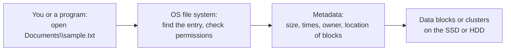
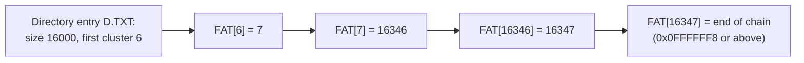

# Lecture 17 — File Management

**Module:** 4301COMP Computer Systems Architecture

**Session:** Teaching Week 10, Session A

## Start here

Lecture 16 covered the storage devices that hold data. This lecture is about how the operating system **organises** that data so people and programs can find it:

- what a **file** is, and the difference between its **data** and its **metadata**;
- **text versus binary** formats;
- **sequential versus random** access;
- **fragmentation**, and why HDDs and SSDs are treated differently;
- what a **file system** does;
- how **FAT** and **NTFS** work, and their strengths and limits.

After reading, do **Lab 17** (`../Labs/Lab-17-File-Management-Hands-on-Workbook.md`). There you inspect real file metadata, compare access methods, examine your file system and permissions, and practise a safe file recovery.

**Labels used in these notes:**

| Label | Meaning |
| --- | --- |
| **Official** | From the TW10 Session A slides or lab sheet. |
| **Extra** | Added explanation, not on the slides. |
| **Verified** | Actually run before being written down. |
| **Expected** | Not run here (Windows File Explorer, PowerShell, Properties windows, Recycle Bin). |

The **Verified** results come from:

- **a real FAT32 disk image.** It was created with `mkfs.fat`, files were copied in and deleted with `mtools`, and its raw bytes were read with `fat_reader.py`, a reader written for this lecture.
- **a real NTFS image**, made with `mkntfs`.
- **the real FAT32 4 GiB file-size limit**, tested on both sides of the boundary.
- **Python 3.13 and Linux `stat`** for the metadata and access-method demonstrations.

> **Note on the slides.** These slides are diagrams or screenshots, so only their titles were readable as text:
>
> - slides 8–9 (data and metadata; file properties);
> - slide 11 (file organisation);
> - slide 15 (defragmentation);
> - slides 17–18 (file system);
> - slide 20's GUI part;
> - slide 21 (FAT).
>
> They are explained from standard material and real evidence, marked **Extra**.

---

## 1. Overview

To a disk, a file is just numbered blocks. To you, it is "Lab_Record.docx in my Documents folder, saved this morning". The **file system** bridges the two. It names files, organises them into **directories**, records **where** their blocks are, keeps **metadata** such as sizes, times and permissions, and **allocates** free space.



**Why this matters for cyber security.**

- **Metadata is evidence.** Timestamps show when files were created and changed, so investigators build **timelines** from them.
- **Deleted is not gone.** On FAT, deleting a file leaves its data on disk until it is overwritten (Verified below).
- **NTFS access-control lists** decide who may read or change a file. FAT has none.
- **NTFS's journal** protects file-system consistency, but **not** your data. Only backups do that (slides 27 and 29).

## 2. By the end you should be able to

1. Distinguish file **data** from file **metadata**, and say which metadata changes when a file is edited.
2. Describe overlapping ways of classifying files (text/binary, executable/data, structured/unstructured, regular/special).
3. Compare **sequential** and **random (direct)** access and calculate a record's byte offset.
4. Explain **fragmentation** and why HDDs are defragmented but SSDs are optimised with **TRIM** instead.
5. List the responsibilities of a **file system**.
6. Explain how **FAT** uses clusters, directory entries and cluster **chains**, and what happens when a file is deleted.
7. Explain how **NTFS** uses the **MFT** and a **journal**, and what ACLs, compression and EFS add.
8. Choose between FAT32, exFAT and NTFS for a given device, file size and security need.

## 3. Learning outcomes

**Session learning outcomes (Official, slide 3):**

- Distinguish file data from file metadata.
- Compare sequential and random access.
- Explain fragmentation and defragmentation.
- Compare key features of FAT and NTFS.

**Module learning outcomes supported** (module guide, as recorded in this module's project instructions):

| Module LO | How this lecture supports it |
| --- | --- |
| **LO3** Explain the role and functions of an operating system | File management is a core OS function |
| **LO2** Demonstrate knowledge of the structure and organisation of computer systems | How data is laid out on storage |

This is part of the **data storage** focus of the module, relevant to the **report (40%)** and the **exam (60%)** (module guide).

## 4. Matching lab and what you need first

- **Matching lab:** Lab 17. It contains the official TW10 Session A tasks:
  - inspecting file data and metadata (Task 16);
  - comparing access methods and file-system features (Task 17);
  - the Extra Challenge, a safe recovery of a lab file (Task 18).
- **From Lecture 15:** hex dumps and file signatures. You will read a FAT directory entry in hex.
- **From Lecture 16:** storage devices, HDD and SSD, sequential and direct access, RAID is not a backup.
- **From Lecture 14:** permissions as bits (read, write, execute).

---

## 5. Recap of the previous session (slide 4, Official)

- The memory hierarchy balances speed, capacity, cost and persistence.
- Registers and cache are closest to the processor.
- RAM holds active work; virtual memory extends the address space using storage.
- Secondary devices provide persistent capacity, and RAID combines drives for resilience or performance.

---

## 6. What is a file? (slides 5–6)

### 6.1 Official

Files can be described in several **overlapping** ways:

| Pair | Meaning |
| --- | --- |
| Text or binary | How the data is represented |
| Executable or data | What the content is |
| Structured or unstructured | Whether it has a defined format |
| Regular file or special device/interface | Whether it stores data or represents a device |

These are useful categories, **not** three mutually exclusive file types.

**The registry (slide 6).** The Windows **registry** is a hierarchical database of data that is critical to the operation of Windows and the applications and services running on it.

### 6.2 Examples (Extra)

| File | Text or binary | Executable or data | Structured? |
| --- | --- | --- | --- |
| `sample.txt` | Text | Data | Unstructured |
| `records.csv` | Text | Data | Structured (fields and rows) |
| `photo.png` | Binary | Data | Structured (a PNG header with width and height; Lecture 15) |
| `notepad.exe` | Binary | Executable | Structured |
| `script.py` | Text | Executable, via an interpreter | Structured |

A file can be text **and** executable (a script). A `.docx` is binary **and** structured: it is a ZIP container (Lecture 15). Hence "overlapping".

**Registry example (Extra, Expected).** The Explorer setting that hides file extensions is stored in the registry. You can read it, without changing anything, with:

```text
reg query "HKCU\Software\Microsoft\Windows\CurrentVersion\Explorer\Advanced" /v HideFileExt
```

A value of 1 means extensions are hidden. Hidden extensions are why `invoice.pdf.exe` can look like `invoice.pdf`. The official lab turns on **File name extensions** for this reason.

---

## 7. Data and metadata (slides 7–9)

### 7.1 Official

- **Data:** the actual information in a file, such as documents and pictures.
- **Metadata:** information **about** the data, such as the date of creation and the location.
- Slide 8 also names **device information** and **location information** as metadata. Slide 9 shows a file's **Properties** window.

### 7.2 Metadata changes when data changes (Verified)

A text file was created, then edited 3 seconds later. Linux `stat` before and after the edit:

```text
before: sample.txt  size=20  birth=2026-11-24 16:06:47 +0000  modify=2026-11-24 16:06:47 +0000  change=2026-11-24 16:06:47 +0000
after:  sample.txt  size=49  birth=2026-11-24 16:06:47 +0000  modify=2026-11-24 16:06:50 +0000  change=2026-11-24 16:06:50 +0000
```

| Property | Changed? | Why |
| --- | --- | --- |
| **Size** | 20 → 49 bytes | The data grew |
| **Modified** (content last written) | Yes | The content was written |
| **Changed** (Linux: metadata last changed) | Yes | The size and time changed |
| **Birth / Created** | **No** | The file is the same file. Creation is not modification (official lab Task 1, step 4) |

The official lab does the same on Windows with:

```powershell
Get-ChildItem | Select-Object Name, Length, CreationTime, LastWriteTime, Attributes
```

That is Expected; **Length** is in bytes.

**Size versus size on disk (Extra, Verified).** The 49-byte file occupied **4,096 bytes** on disk: one whole cluster (`stat`: 8 blocks × 512 bytes). File systems allocate whole clusters, so the unused 4,047 bytes are **slack**. Windows shows this as **Size** versus **Size on disk** in Properties. This is the file-system version of Lecture 16's internal fragmentation.

> **Cyber security link: timelines.** Investigators sort files by their Modified, Accessed, Changed and Born times, sometimes called **MACB**, to reconstruct what happened and when. Attackers know this and may try to alter timestamps. So analysts compare several sources, such as file-system metadata, logs and the NTFS journal, rather than trusting one timestamp (Extra).

---

## 8. File organisation: text and binary (slides 10–11)

**Official (slide 10):**

- **Text** formats encode characters and are easy for people and many tools to inspect.
- **Binary** formats represent data according to a defined **byte structure**, and can be compact or efficient for particular operations.
- **Binary is not inherently faster than text.** Performance depends on parsing, representation, compression, I/O and the application.

**Example (Extra, Verified in Lecture 15):** a PNG's width is stored as 4 binary bytes, `00 00 04 92` = 1170. As text, "1170" would be 4 ASCII characters. Neither is "faster" in itself: what matters is how the program reads it.

---

## 9. Sequential and random access (slides 12–13)

### 9.1 Official

**Sequential access (slide 12):**

- processes data **in order from a current position**, as in a stream or log;
- works with fixed- **or** variable-length records and does **not** require append-only use;
- is efficient for **whole-file scans** but inefficient when a program repeatedly needs **distant** records.

**Random or direct access (slide 13):**

- lets software **seek to a chosen offset**, or locate a record through an **index**;
- with **fixed-size records**, offset calculation is simple; variable-size data can also support random access using indexes or metadata;
- the best method depends on the **file format and workload**.

### 9.2 Measured (Verified)

`records.py` (Lab 17 Task 12) wrote 100,000 records of exactly 32 bytes each, then found record 80,000 both ways:

```text
File: 3,200,000 bytes = 100,000 records x 32 bytes
Sequential: read 2,560,000 bytes (80,000 records) in 35.6 ms -> Record080000 value=560000
Direct:     seek to byte offset 2,559,968, read 32 bytes in 0.059 ms -> Record080000 value=560000
```

**The offset formula:** offset = (record number − 1) × record size = (80,000 − 1) × 32 = **2,559,968**. Direct access read **32 bytes** instead of **2.56 million**, and was about **600 times faster**.

> **Common confusion (official lab).** Pressing **Ctrl+F** in Notepad or Word does not prove direct access: the application may scan the whole contents. Direct access means the program **calculates or looks up** where the data is and seeks straight there.

---

## 10. Fragmentation and defragmentation (slides 14–15)

### 10.1 Official

- Fragmentation affects storage technologies **differently**.
- A fragmented **HDD** file can require extra **mechanical seeks**, so Windows may **defragment HDD volumes**.
- **SSDs** have no seek head and **should not be manually defragmented** as routine maintenance. Operating systems optimise SSDs with **TRIM/retrim** and device-aware maintenance.
- Use the OS's **storage optimisation tool** rather than a blanket schedule for every drive.

### 10.2 Fragmentation created on a real FAT32 volume (Verified)

The sequence was:

1. Write files A, B and C.
2. Fill the disk.
3. Delete B and a small file near the end.
4. Write a new 4-cluster file D.

The only free space was the two separate holes, so D was split:

```text
Boot sector: 512 bytes/sector x 8 = 4096-byte clusters, 2 copies of the FAT, root directory starts at cluster 2
Both FAT copies identical: True

Root directory entries (32 bytes each):
  A.TXT        size    10000  clusters 3-5             (3 clusters, end 0xFFFFFFF)  contiguous
  D.TXT        size    16000  clusters 6-7, 16346-16347 (4 clusters, end 0xFFFFFFF)  FRAGMENTED
  DELETED  ?.TXT        size     8800  first byte 0xE5; cluster 8 is now free; bytes there: b'Secret proje'
  FILL1.BIN    size 66908160  clusters 11-16345        (16335 clusters, end 0xFFFFFFF)  contiguous
  DELETED  ?2.TXT       size     8000  first byte 0xE5; cluster 16346 is now REUSED by another file; bytes there: b'DDDDDDDDDDDD'
  FILL2.BIN    size     8192  clusters 16348-16349     (2 clusters, end 0xFFFFFFF)  contiguous
```

D's four clusters are `6-7` and `16346-16347`: **fragmented**. On an HDD, reading D would need a seek from cluster 7 to cluster 16346. **Defragmenting** rewrites files so that their clusters are contiguous again.

**TRIM (Extra).** An SSD cannot overwrite a block in place: it must erase first. **TRIM** tells the SSD which blocks the file system no longer uses, so it can prepare them in advance. Moving data around to "defragment" an SSD gives no seek benefit and adds unnecessary writes, which wear the flash. Windows' **Optimize Drives** tool detects the media type and runs "defragment" for HDDs or "retrim" for SSDs (Expected).

---

## 11. What a file system does (slides 16–20)

### 11.1 Official

A file system:

- is responsible for **creating, manipulating, renaming, copying and removing** files on a storage device;
- organises files into **directories**;
- keeps track of **where** files and directories are located;
- relates files and folders to the **physical structure** of the storage medium.

Files and directories are like **documents and folders in a filing cabinet** (slide 17).

**Common file systems (slide 19):**

| OS | File systems |
| --- | --- |
| Windows | **NTFS** for system and general internal volumes; **ReFS** in selected server and resilience scenarios |
| Linux | **ext4**, XFS, Btrfs |
| macOS | **APFS** (HFS+ is legacy) |
| Removable media | **FAT32** and **exFAT** for compatibility |

**Listing directories (slide 20):** `dir` in Windows Command Prompt; `ls` in Linux; File Explorer in the GUI.

The Linux machine used for these notes uses **ext4** (Verified: `df -T`).

---

## 12. The File Allocation Table (FAT) (slides 21–24)

### 12.1 Official

- A FAT volume divides its data area into **clusters**.
- The **File Allocation Table** has **one entry per cluster**, recording whether the cluster is:
  - **free**;
  - **damaged**;
  - the **end of a chain**;
  - **followed by another cluster**.
- A file's **directory entry** identifies its **first cluster**. The **FAT chain** identifies the rest.
- FAT volumes normally store **more than one copy** of the table for resilience. A second FAT is a **redundant metadata copy**, but recovery is not guaranteed (slide 23).
- **FAT12/16** have a **fixed root-directory region**. **FAT32** stores its root directory as a **cluster chain** in the data region (slide 24).
- FAT size depends on the **cluster count and entry width**, not on a fixed two-cluster limit (slide 24).

**Layout (slide 24):**

| Format | Regions, in order |
| --- | --- |
| FAT12/16 | Reserved + boot · FAT 1 · FAT copy · **Fixed root** · Data clusters |
| FAT32 | Reserved + boot · FAT 1 · FAT copy · Data clusters, **including the root directory** |

### 12.2 Reading a real FAT32 volume (Verified)

`fat_reader.py` (Lab 17 Task 11) read the image's boot sector and reported:

- 4,096-byte clusters;
- **2 copies of the FAT**, which were byte-for-byte identical;
- the root directory starting at **cluster 2** (FAT32 style).

How D.TXT's chain is followed:



Each FAT32 entry is a 32-bit number. Only the low 28 bits are used, hence the `& 0x0FFFFFFF` in the reader. `0` means free, and `0x0FFFFFF8` or above means end of file.

---

## 13. FAT: advantages, deletion and disadvantages (slides 25–26)

### 13.1 Official

**Advantages and behaviour (slide 25):**

- **VFAT** extensions allow **long filenames** while keeping compatibility with short directory entries.
- A **deleted** FAT directory entry is **marked as deleted**, and its clusters are **made available for reuse**.
- Recovery may be possible **only until** directory metadata or file data is **overwritten**. It is **not guaranteed**.

**Disadvantages (slide 26):**

- No native file and directory **access-control lists**.
- No metadata **journalling** for recovery after interruptions.
- **Fragmentation** can reduce performance, especially on HDDs.
- FAT32's maximum individual file size is **4 GiB minus 1 byte**.
- Corruption can cause **lost clusters** or allocation errors.

### 13.2 What deletion really does (Verified)

The raw bytes of the root directory, shown in hex as in Lecture 15:

```text
4C 41 42 31 30 20 20 20 20 20 20 08 00 00 C6 80 | LAB10      .....
41 20 20 20 20 20 20 20 54 58 54 20 00 00 C6 80 | A       TXT ....
44 20 20 20 20 20 20 20 54 58 54 20 00 00 C6 80 | D       TXT ....
E5 20 20 20 20 20 20 20 54 58 54 20 00 00 C6 80 | .       TXT ....
```

- The deleted entry's first byte became **E5** (the "deleted" marker), replacing the "C" of `C.TXT`.
- Its FAT entries were set to 0 (free).
- Its **data was still on the disk**: `fat_reader.py` read `b'Secret proje'` from the freed cluster.
- The other deleted file's cluster had **already been reused** by D, so its data was gone (`b'DDDDDDDDDDDD'`).

That is slide 25 exactly: recovery is possible only until the data is overwritten.

### 13.3 The 4 GiB limit, tested on both sides (Verified)

| File size (bytes) | Copy onto FAT32 | Copy onto NTFS |
| --- | --- | --- |
| 4,294,967,295 (4 GiB − 1) | **Accepted** | (not needed) |
| 4,294,967,296 (exactly 4 GiB) | **Refused:** `File "BIG4G.BIN" too big` | **Accepted** |

**Why this number?** FAT32's directory entry stores the file size in a **32-bit** field (Extra). The largest 32-bit value is 2³² − 1 = 4,294,967,295 (Lecture 14: n bits hold up to 2ⁿ − 1).

> **Cyber security link.** FAT has **no permissions**. Anyone who can read a FAT USB stick can read every file on it, on any computer. Data on removable FAT or exFAT media should be **encrypted**, for example with BitLocker To Go (Extra). The deletion experiment also shows why simply deleting sensitive files from a USB stick does not erase them.

---

## 14. NTFS (slides 27–30)

### 14.1 Official

- NTFS (New Technology File System) **overcomes the limitations of FAT** (slide 27).
- It is a **journalling** file system. It journals **metadata** changes to help restore file-system consistency after a crash. This does **not** guarantee recovery of file **contents**.
- It uses a **Master File Table (MFT)** to store data about **every file and directory**. The MFT is like a database table with a record per file and directory. NTFS uses clusters and reserves space so that the MFT can grow (slide 28).
- It supports **access-control lists**, journalling, **compression**, **quotas**, **hard links** and more. **EFS** provides per-file encryption on supported Windows editions (slide 29).
- **Disadvantages (slide 30):**
  - support on other operating systems varies;
  - its metadata and advanced features add **overhead** compared with simpler formats;
  - for shared removable media, **exFAT** may be more compatible.

  Choose a file system according to device support, resilience, permissions and file-size needs.

### 14.2 Inside a real NTFS volume (Verified)

A fresh NTFS image (`mkntfs`, then `ntfsls -a`) already contains NTFS's own metadata files:

```text
$AttrDef
$BadClus
$Bitmap
$Boot
$Extend
$LogFile
$MFT
$MFTMirr
$Secure
$UpCase
$Volume
A.txt
```

| System file | Purpose (Extra) |
| --- | --- |
| `$MFT` | The Master File Table: one record per file and directory (slide 28) |
| `$MFTMirr` | A copy of the first MFT records, for resilience |
| `$LogFile` | The **journal** of metadata changes (slide 27) |
| `$Bitmap` | Which clusters are in use |
| `$Secure` | Security descriptors: the **ACLs** (slide 29) |
| `$Boot`, `$Volume`, `$BadClus`, `$UpCase`, `$AttrDef`, `$Extend` | Boot code, volume name, bad clusters, name case table, attribute definitions, extensions |

```text
Volume Name: NTFSLAB
Volume Version: 3.1
Cluster Size: 4096
MFT Record Size: 1024
```

Each MFT record here is **1,024 bytes**. Small files can even be stored **inside** their MFT record (Extra).

**Permissions (official lab).** On NTFS, **Properties > Security** lists accounts and groups with **Allow** and **Deny** entries:

- **read** allows access to the contents;
- **write** allows permitted changes;
- **execute** allows a program to run.

**NTFS can enforce** these. FAT cannot.

---

## 15. FAT32 and NTFS compared (slides 31–32)

### 15.1 Official

Capacity limits depend on the file system, the OS version and the allocation-unit size.

| Property | FAT32 | NTFS |
| --- | --- | --- |
| Largest individual file | **4 GiB minus 1 byte** | Configuration- and OS-dependent |
| Volume size | Implementation/configuration dependent | **Not** a universal 2 TB limit |
| Modern Windows example | Check the intended platform | Up to **8 PB** with supported configurations |
| Root directory | Cluster chain in the data region | Indexed through NTFS metadata |

Microsoft documents an **8 PB** NTFS maximum for supported modern Windows versions with sufficiently large allocation units.

**Slide 32 adds:**

- FAT32 offers **broad device compatibility**, but its single-file limit matters for large files.
- NTFS supports ACLs, metadata journalling, compression and other features.
- **Journalling is not a backup.**
- Choose a file system using the target OS or device, file sizes, access controls and recovery requirements.
- **Historical FAT12/16 limits should not be generalised** to FAT32 or NTFS.

### 15.2 Choosing (Extra)

| Situation | Choice | Why |
| --- | --- | --- |
| Windows system drive | NTFS | ACLs, journalling, large files |
| USB stick for a TV, car or camera | FAT32 (or exFAT if the device supports it) | Compatibility; check the 4 GiB limit |
| USB drive moving 10 GB videos between Windows and macOS | **exFAT** | No 4 GiB limit; widely supported |
| Shared folder needing per-user permissions | NTFS | ACLs |

---

## 16. Recovery, journalling, RAID and backups (official lab Extra Challenge)

These are four different protections, often confused:

| Protection | Protects against | Does **not** protect against |
| --- | --- | --- |
| **Recycle Bin** (user-level recovery) | A user's normal Delete, on local volumes that support it | Shift+Delete; some network or removable storage; the bin being emptied |
| **File-system journalling** (NTFS) | An inconsistent file system after a crash or power cut | Lost or overwritten file **contents**; deletion (slides 27, 29, 32) |
| **RAID** | A drive failure | Deletion, corruption, ransomware: these are copied to every mirror (Lecture 16) |
| **Backup** (separate copy) | Deletion, corruption, ransomware, device loss, as long as it is separate and tested | Only what was backed up, as of when it was backed up |

The official Extra Challenge makes this concrete. You keep a **backup copy first**, delete with **Delete** (never Shift+Delete), restore from the Recycle Bin if possible, and otherwise recreate the file from your backup.

---

## 17. Common mistakes

| Mistake | Why it is wrong | Correct idea |
| --- | --- | --- |
| "Metadata is part of the file's contents" | It is information **about** the contents | Size, times, owner, location, permissions |
| "Editing a file changes its creation time" | Creation and modification are separate | Only Modified (and size) change (Verified) |
| "Text, binary and executable are three types" | The categories overlap | Slide 5 |
| "Binary is always faster" | It depends on parsing, I/O and the application | Slide 10 |
| "Ctrl+F proves direct access" | The app may scan everything | Direct access = calculate or look up the offset, then seek |
| "Defragment SSDs regularly" | No seek benefit; extra wear | Use TRIM/Optimize Drives |
| "Deleting a FAT file erases it" | Only the entry is marked (E5) and the clusters freed | The data remains until overwritten (Verified) |
| "The second FAT guarantees recovery" | It is a redundant copy, not a guarantee | Slide 23 |
| "FAT32 can't hold 4 GB files because the disk is small" | It is a per-file limit, from a 32-bit size field | 4 GiB − 1 byte (Verified) |
| "NTFS journalling backs up my files" | It journals metadata only | Use backups (slide 32) |
| "NTFS volumes are limited to 2 TB" | That is not a universal limit | Up to 8 PB on supported configurations (slide 31) |

---

## 18. Check yourself: 15 multiple-choice questions

**Q1.** Which of these is file **metadata**?
A) The sentence inside sample.txt
B) The pixels of a photo
C) The file's last-modified time
D) The text in a Word document

**Q2.** You edit and save a text file. Which property should stay the same?
A) Size
B) Creation time
C) Modified time
D) Contents

**Q3.** Which statement matches slide 5?
A) Files belong to exactly one of three types
B) All binary files are executable
C) Text files cannot be executed
D) The categories (text/binary, executable/data…) overlap

**Q4.** Which statement about binary formats is true (slide 10)?
A) They are always faster than text
B) Performance depends on parsing, representation, compression, I/O and the application
C) They cannot be compressed
D) People can read them easily

**Q5.** Records are 32 bytes each. What is the byte offset of record 80,000 (first record at offset 0)?
A) 2,560,000
B) 80,000
C) 2,559,968
D) 32

**Q6.** When is sequential access efficient?
A) For whole-file scans
B) For repeatedly fetching distant records
C) Only for append-only files
D) Never

**Q7.** Why should SSDs not be routinely defragmented?
A) They are too small
B) They use FAT
C) They cannot store fragments
D) They have no seek head, so there is no benefit, and the extra writes cause wear; the OS uses TRIM

**Q8.** In FAT, where does the file system find a file's first cluster?
A) In the file's directory entry
B) In the MFT
C) In the boot sector
D) In the journal

**Q9.** What does a FAT entry record?
A) The file's name
B) Whether a cluster is free, damaged, end-of-chain or followed by another cluster
C) The file's owner
D) The file's permissions

**Q10.** What happens when a file is deleted on FAT?
A) Its data is immediately overwritten with zeros
B) The disk is defragmented
C) The directory entry is marked deleted (0xE5) and its clusters are freed; the data stays until reused
D) The FAT copy is removed

**Q11.** What is FAT32's maximum single file size?
A) 4 GiB minus 1 byte
B) 2 TB
C) 8 PB
D) Unlimited

**Q12.** What does NTFS use to store information about every file?
A) The FAT
B) The Master File Table (MFT)
C) The registry
D) The Recycle Bin

**Q13.** What does NTFS journalling protect?
A) File contents against deletion
B) Against ransomware
C) Against a drive failure
D) File-system (metadata) consistency after an interruption

**Q14.** Which file system feature lets Windows enforce per-user Allow and Deny permissions?
A) FAT long filenames
B) NTFS access-control lists
C) A second FAT copy
D) TRIM

**Q15.** You need to move 10 GB video files on a USB drive between Windows and macOS. Which is the best choice?
A) FAT32
B) FAT16
C) exFAT
D) NTFS only

### Answers

| Q | Answer | Why |
| --- | --- | --- |
| 1 | **C** | Slide 7. |
| 2 | **B** | Verified: birth time unchanged; size and modified time changed. |
| 3 | **D** | Slide 5. |
| 4 | **B** | Slide 10. |
| 5 | **C** | (80,000 − 1) × 32 (Verified). |
| 6 | **A** | Slide 12. |
| 7 | **D** | Slide 14. |
| 8 | **A** | Slide 22. |
| 9 | **B** | Slide 22. |
| 10 | **C** | Slide 25 (Verified: E5 marker, data still present). |
| 11 | **A** | Slides 26 and 31 (Verified at the boundary). |
| 12 | **B** | Slide 28. |
| 13 | **D** | Slides 27, 29 and 32. |
| 14 | **B** | Slide 29 and the official lab. |
| 15 | **C** | Slide 30; 10 GB exceeds FAT32's limit. |

---

## 19. Quick reference

**File** = data + metadata (size, times, location, owner, permissions, device). Categories overlap: text/binary, executable/data, structured/unstructured, regular/special.

**Access:** sequential = in order from the current position (good for scans). Direct = seek to an offset or use an index; offset = (n − 1) × record size.

**Fragmentation:** HDD → defragment (fewer seeks). SSD → TRIM, never routine defragmentation. Use Optimize Drives.

**File system jobs:** create, rename, copy and delete; directories; track locations; map to the physical medium.

**FAT:**

- clusters; one FAT entry per cluster (free, damaged, end or next);
- the directory entry gives the first cluster, then you follow the chain;
- 2 FAT copies;
- FAT32's root is a cluster chain;
- deleting marks the entry 0xE5 and frees the clusters, but the data remains until reused;
- no ACLs, no journal, 4 GiB − 1 file limit.

**NTFS:**

- MFT with a record per file;
- `$LogFile` journal (metadata only);
- ACLs, compression, quotas, hard links, EFS;
- up to 8 PB in supported configurations;
- exFAT is often better for shared removable media.

**Protection layers:** Recycle Bin ≠ journal ≠ RAID ≠ backup.

## 20. Glossary

| Term | Meaning |
| --- | --- |
| **ACL** | Access-control list: who may read, write or execute a file |
| **Cluster (allocation unit)** | The smallest block of space a file system allocates |
| **Defragmentation** | Rewriting files so their clusters are contiguous |
| **Directory entry** | The record holding a file's name, size and first cluster (FAT) |
| **EFS** | Encrypting File System: per-file encryption on NTFS |
| **exFAT** | A FAT-family file system without FAT32's 4 GiB file limit, for removable media |
| **FAT** | File Allocation Table: a cluster-chain file system |
| **Journal** | A log of metadata changes used to restore consistency after a crash |
| **Metadata** | Data about data |
| **MFT** | Master File Table: NTFS's table of records for every file |
| **Registry** | Windows' hierarchical configuration database |
| **Slack** | Unused space at the end of a file's last cluster |
| **TRIM** | An instruction telling an SSD which blocks are no longer used |

## 21. Summary

- A file has **data** and **metadata**. Editing changes the size and the modified time, but not the creation time (Verified). Metadata matters to users, to the OS and to forensic investigators.
- File categories **overlap**. Binary is not automatically faster than text.
- **Sequential** access suits scans. **Direct** access seeks to a calculated offset: 32 bytes read instead of 2.56 MB (Verified).
- **Fragmentation** slows HDDs, so they are defragmented. **SSDs** use TRIM instead.
- **FAT** follows cluster chains from a directory entry and keeps two FAT copies. Deletion only marks the entry (0xE5) and frees the clusters, so the data survives until overwritten. FAT32 has **no ACLs and no journal**, and a **4 GiB − 1 byte** file limit (all Verified).
- **NTFS** stores everything in the **MFT**, journals metadata in `$LogFile`, and adds ACLs, compression, quotas and EFS. **Journalling is not a backup.**
- Choose a file system for its **device support, file sizes, permissions and recovery needs**.

## 22. Next

According to slide 34, the next session is **Teaching Week 10, Session B: CPU Scheduling Fundamentals**. Its materials are not yet in this Project.
