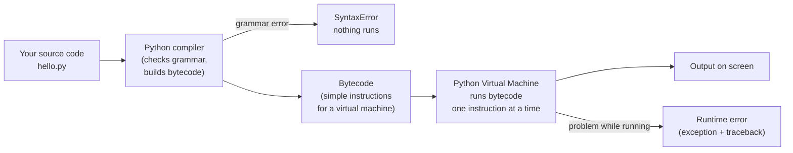
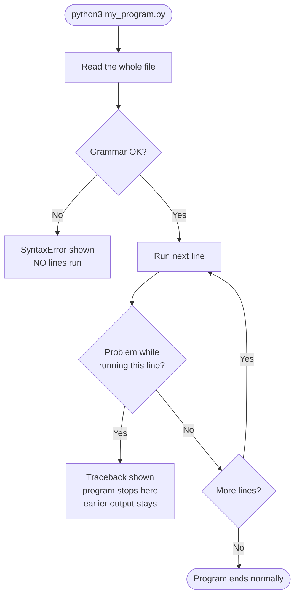

# Day 1 Lecture — Introduction to Programming and Python

## A. Lecture information

| | |
| --- | --- |
| **Course part** | Part I — Programming Foundations |
| **Module** | 00 — Foundations |
| **Chapter** | 1 — Introduction to Programming and Python |
| **Day** | 1 |
| **Lecture title** | What a program is, how Python runs one, and your first program |
| **Prerequisites** | None. You need a computer and the ability to open a terminal. |
| **Time** | About 2 hours to read and type the examples, then the lab |
| **Code checked with** | Python 3.13.18 and Python 3.15 (pre-release build). Outputs shown are real outputs. |

### Learning objectives

By the end of this lecture you will be able to:

1. Explain in your own words what a **program**, an **algorithm** and a **programming language** are.
2. Describe what a computer does when it runs a program (CPU, memory, input and output).
3. Explain the difference between **machine code**, **assembly language** and **high-level languages**.
4. Explain the difference between **compiling** and **interpreting**, and describe how Python runs your code.
5. Say what Python is, who made it, and why it is used in industry and in cybersecurity.
6. Run Python code in two ways: in the **interactive shell (REPL)** and from a **script file**.
7. Write programs that display output with `print()`, including several values, `sep`, `end` and **escape sequences**.
8. Write **comments** that explain code.
9. Recognise the three kinds of error — **syntax errors**, **runtime errors** and **logic errors** — and read a basic **traceback**.

### Concepts covered

program · algorithm · source code · hardware · CPU · RAM · input/output · machine code · assembly · high-level language · compiler · interpreter · bytecode · Python Virtual Machine · CPython · REPL · script · statement · function · function call · argument · string · string literal · escape sequence · comment · syntax · syntax error · runtime error (exception) · traceback · logic error · bug · debugging

---

## B. Introduction

### What problem does programming solve?

A computer is an extraordinarily fast machine that has no idea what you want. It can do billions of simple operations every second, but every one of those operations has to be described to it exactly. A **program** is that description: a precise, ordered set of instructions that tells a computer how to carry out a task.

Programming is the skill of turning a task you understand ("work out the total of this receipt", "check this log file for failed logins", "tell me which devices on my network are switched on") into instructions so exact that a machine with no common sense can follow them.

### Where is it used?

Everywhere. The banking app on your phone, the Wi-Fi router in your house, the software that runs a hospital's appointments, the tools a security analyst uses to investigate an attack — all of these are programs that someone wrote.

### Why start with Python?

Python is a language designed to be **readable**. Its code often looks close to plain English, so you can concentrate on *thinking like a programmer* instead of fighting punctuation. That does not make it a "toy" language. Python is one of the most widely used languages in the world, in web development, data science, artificial intelligence, automation and system administration — and it is the everyday language of cybersecurity. Well-known security tools such as Scapy (packet crafting), Volatility (memory forensics), Impacket (network protocols) and sqlmap (database testing) are written in Python, and analysts write small Python scripts every day to sort logs, check hashes and automate repetitive work.

> **If you know Java (from 4300COMP):** you have already seen these ideas — programs, statements, `System.out.println`, compile errors. Python does the same jobs with less ceremony. There is no class or `main` method required to print one line. Keep your Java knowledge, but do not assume Python behaves the same way. Where it differs, this course will say so.

---

## C. Detailed theoretical explanation

### C.1 Programs and algorithms

An **algorithm** is a step-by-step method for solving a problem. It is an idea, and it does not belong to any language. A recipe is an algorithm. So are the directions you might give a friend to walk from Lime Street station to campus.

A **program** is an algorithm written in a **programming language** so that a computer can carry it out. The text you write is called **source code**.

The key difference between giving instructions to a person and to a computer is **precision**. If you tell a friend "make me a cup of tea", they fill in a thousand missing details from common sense. A computer fills in nothing. Consider this algorithm:

```text
1. Boil the kettle.
2. Put a tea bag in the cup.
3. Pour water into the cup.
4. Wait 3 minutes.
5. Remove the tea bag.
```

A human follows this easily. A literal-minded machine has questions. Is there water in the kettle? Which cup? Pour *how much* water? Pour the boiled water from the kettle, or water from the tap? Programming is largely the work of answering those questions *before* the computer has to ask them. This is what "thinking like a programmer" means at its root: breaking a task into steps small and exact enough that nothing is left to guesswork.

Programs also run in order. Unless you tell it otherwise, a computer carries out instructions **one at a time, from top to bottom**. This idea is called **sequence**, and it is the first of the three building blocks of all programs. The other two, **selection** (making decisions) and **repetition** (loops), come in Part II.

### C.2 What a computer actually does

To understand what your program is asking for, you need a simple picture of the machine. (4301COMP Lecture 2 covers this in more depth.)

| Part | What it does | Analogy |
| --- | --- | --- |
| **CPU** (central processing unit) | Carries out instructions, one tiny step at a time, using the fetch–decode–execute cycle | The worker |
| **RAM** (main memory) | Holds the program and its data *while it runs*. Fast, but cleared when power goes off | The worker's desk |
| **Storage** (SSD or hard disk) | Holds files permanently, including your `.py` files | The filing cabinet |
| **Input devices** | Keyboard, mouse, network card, sensors | Ways of telling the worker things |
| **Output devices** | Screen, speakers, printer, network card | Ways the worker reports back |

When you run a Python program, this happens:

1. Your source code file is read from **storage** into **RAM**.
2. The Python interpreter (itself a program) processes it.
3. The **CPU** carries out the resulting instructions.
4. Results go to an **output device**. Today that means text on the screen.

### C.3 Levels of programming language

A CPU understands only one thing: **machine code**, which is patterns of binary digits (bits) that each mean a specific, very small operation, such as "add these two numbers" or "copy this value to that memory location". Each family of CPU (for example x86-64 in most laptops, ARM in most phones) has its own machine code.

Writing machine code by hand is slow and error-prone, so languages were built on top of it:

| Level | Example | Who reads it easily | Notes |
| --- | --- | --- | --- |
| Machine code | `10110000 01100001` | The CPU | Specific to one CPU family |
| Assembly language | `mov al, 61h` | Specialists | One short word per machine instruction. Still CPU-specific |
| High-level language | `print("Hello")` | People | One line may become hundreds of machine instructions. Works on many CPUs |

Python is a **high-level language**. You describe *what* you want ("display this text") and software handles *how* the CPU does it. The cost is that something has to translate your high-level code into instructions the machine can run. There are two main strategies.

### C.4 Compilers and interpreters

A **compiler** translates the whole program into another form *before* it runs. A C compiler, for example, turns your C source into a machine-code file (an `.exe` on Windows) that the CPU runs directly. If there is a mistake in the grammar of your code, the compiler refuses to produce the file and nothing runs.

An **interpreter** reads a program and carries it out *as it goes*, without first producing a separate machine-code file.

Real languages often mix the two. You met one mix in Java: `javac` compiles your code to **bytecode** (a `.class` file), and the Java Virtual Machine runs that bytecode.

Python, in its standard version, works in a similar mixed way, but you never see the compile step:



When you type `python hello.py`:

1. The Python program reads `hello.py`.
2. It first **compiles** the whole file into **bytecode**. If any line breaks Python's grammar rules, it stops here with a `SyntaxError` and **not a single line runs**.
3. The **Python Virtual Machine (PVM)** then executes the bytecode, one instruction at a time, top to bottom.
4. If something goes wrong *while running* (for example, you use a name that does not exist), it stops at that point with a **runtime error**. Anything before that point has already happened.

This explains one of the most useful facts in this lecture, which you will prove in the lab: **a syntax error anywhere stops the whole file from running, but a runtime error only stops the program when it is reached.**

Because you never run a separate compile command, people call Python an **interpreted language**. That is a fair everyday description, as long as you know the bytecode step exists underneath.

The standard Python you download from python.org is called **CPython**, because the interpreter itself is written in the C language. Other implementations exist (PyPy, for example), but CPython is what this course uses.

### C.5 What Python is

| Fact | Detail |
| --- | --- |
| Creator | Guido van Rossum, in the Netherlands |
| First released | 1991 |
| Name | From the British comedy series *Monty Python's Flying Circus*, not the snake |
| Python 3 | Released in 2008. It deliberately broke compatibility with Python 2 to fix design problems |
| Python 2 | Officially ended on 1 January 2020. If a tutorial writes `print "hello"` without brackets, it is Python 2 and out of date |
| Current versions | Python 3.15 was released on 9 October 2026. Python 3.14 is also still supported. This course works with any recent Python 3 |
| Licence | Free and open source |
| Philosophy | Readability counts. Type `import this` into Python to read "The Zen of Python" |

Python's main traits, which you will understand properly over the coming weeks:

- **Readable syntax.** Blocks of code are shown by indentation, not curly brackets.
- **Interpreted** (via bytecode), so you can try code instantly.
- **Dynamically typed.** You do not declare a variable's type in advance (Chapter 5).
- **"Batteries included."** A large standard library comes with every installation (Chapter 50).
- **Huge ecosystem** of free third-party packages.

### C.6 Two ways to run Python code

#### Way 1: the interactive shell (REPL)

**REPL** stands for **Read–Eval–Print Loop**. It reads one line you type, evaluates (works out) it, prints the result, and loops back for the next line. It is perfect for quick experiments.

Open a terminal and type `python3` (macOS or Linux) or `py` (Windows). You will see something like:

```text
Python 3.15.0 ...
Type "help", "copyright", "credits" or "license" for more information.
>>>
```

The `>>>` is the **prompt**. Python is waiting for you. Try:

```text
>>> 7 + 3
10
>>> print("Hello")
Hello
>>> "Hello"
'Hello'
```

Notice two things. In the REPL, typing just `7 + 3` shows `10`, because the REPL *automatically* prints the value of whatever you type. And typing `"Hello"` shows it *with quotes*, because the REPL shows you the value as Python sees it, whereas `print()` shows it as a human should read it.

To leave the REPL, type `exit()` and press Enter. (Ctrl+D also works on macOS and Linux, and Ctrl+Z then Enter on Windows.)

#### Way 2: a script file

A **script** is a text file of Python code ending in `.py`. You write it in an editor (VS Code, for example) and run it from the terminal:

```bash
python3 hello.py      # macOS / Linux
py hello.py           # Windows
```

The whole file runs from top to bottom, and then the program ends.

**Important difference:** a script does *not* automatically print values. A line containing only `7 + 3` in a script is worked out and then thrown away. Nothing appears. In a script, if you want to see something, you must `print()` it. This catches out many beginners who test in the REPL and then wonder why their script is silent.

| | REPL | Script |
| --- | --- | --- |
| Good for | Quick experiments, checking how something behaves | Real programs you save, rerun and share |
| Saved? | No. Gone when you exit | Yes, a `.py` file |
| Shows values automatically? | Yes | No. Use `print()` |

> **Getting Python running today.** Full installation and VS Code setup is Chapter 3. For today you only need *some* working Python 3. In a terminal, type `python3 --version` (or `py --version` on Windows). If you see `Python 3.something`, you are ready. If not, install the latest version from https://www.python.org/downloads/ (on Windows, tick **"Add python.exe to PATH"** in the installer), or use the Python on the LJMU lab machines.

### C.7 Your first function: `print()`

A **statement** is a single complete instruction, usually one line. Our first statement is:

```python
print("Hello, world!")
```

Let's take this apart piece by piece, because every part matters.

| Part | Name | Meaning |
| --- | --- | --- |
| `print` | a **function** name | A named, ready-made piece of code that does a job. `print`'s job is to display text |
| `( )` | brackets (parentheses) | Writing brackets after a function name **calls** it, which means "run it now" |
| `"Hello, world!"` | an **argument** | The value you hand to the function to work on |
| `"…"` | quotation marks | Mark the start and end of a **string**, a piece of text |

So the statement reads: *"Call the `print` function, giving it the text `Hello, world!`."* The function displays the text and moves the cursor to a new line.

`print` is a **built-in function**: it comes with Python and is always available. You will meet many more built-in functions, and in Part IV you will write your own.

#### Strings and string literals

A **string** is a sequence of characters: letters, digits, spaces, symbols. When you write text directly in your code between quotes, that is a **string literal** ("literal" because it is literally the value, typed out).

Python accepts single or double quotes. They mean exactly the same thing:

```python
print("Hello")
print('Hello')
```

Pick one style and use it consistently. This course uses double quotes, which is also what popular formatting tools default to. The choice matters when your text itself contains a quote mark: use the *other* kind on the outside.

```python
print("It's Day 1")          # apostrophe inside double quotes: fine
print('She said "go"')       # double quotes inside single quotes: fine
```

#### Text versus numbers

Quotes change everything. Compare:

```python
print("7 + 3")    # a string: shown exactly as written
print(7 + 3)      # a calculation: Python works it out first, then prints the result
```

Output:

```text
7 + 3
10
```

Without quotes, `7 + 3` is an **expression**: something Python evaluates to produce a value. Python works it out *first*, and then `print` receives the result, `10`. Day 1 uses the four basic arithmetic operators: `+`, `-`, `*` (multiply) and `/` (divide). Chapter 7 covers numbers properly. One thing to notice now: `/` always gives a result with a decimal point, so `7 / 2` is `3.5` and `10 / 2` is `5.0`, not `5`.

#### Printing several values at once

You can give `print` several arguments, separated by commas. It prints them in order with **one space between each**:

```python
print("Day", 1, "of the course")
```

```text
Day 1 of the course
```

Notice that you did not type the spaces around `1`. `print` added them. This is the easiest way to mix text and numbers on one line.

#### Two optional settings: `sep` and `end`

`print` has settings you can change by name. Two are useful from day one:

- **`sep`** (separator) is what goes *between* the values. The default is one space, `" "`.
- **`end`** is what goes *after* the last value. The default is `"\n"`, a new line. That default is why each `print` normally starts a fresh line.

```python
print("2026", "11", "27", sep="-")
print("Loading", end="")
print("...", end="")
print(" done")
```

```text
2026-11-27
Loading... done
```

Line 1 puts `-` between the values instead of a space. Lines 2 and 3 end with *nothing* instead of a new line, so the next `print` continues on the same line. Line 4 uses the normal `end`, so the line finishes.

These named settings are called **keyword arguments**. You will study them properly in Chapter 42. For now, remember the pattern: `sep=` and `end=` go after the values, separated by commas.

A `print()` with nothing in the brackets prints just the `end`, which is a new line, so it gives you a **blank line**.

#### Escape sequences

Some characters are hard or impossible to type inside a string: a new line, a tab, or a quote mark of the same kind as the surrounding quotes. Python uses the **backslash** `\` to start an **escape sequence**, a two-character code that stands for one special character.

| Escape | Means | Example code | Shows |
| --- | --- | --- | --- |
| `\n` | new line | `"one\ntwo"` | `one` then `two` on the next line |
| `\t` | tab (jump to the next tab stop) | `"Name:\tAfaq"` | `Name:   Afaq` |
| `\"` | a double quote | `"say \"hi\""` | `say "hi"` |
| `\'` | a single quote | `'It\'s'` | `It's` |
| `\\` | one real backslash | `"C:\\Temp"` | `C:\Temp` |

The last row matters on Windows, where file paths contain backslashes. In the lab you will see what goes wrong when you forget it.

#### Strings over several lines: triple quotes

Three quote marks (`"""` or `'''`) start a string that can run over several lines, keeping the line breaks exactly as typed:

```python
print("""+----------------------+
|   PYTHON MASTERY     |
+----------------------+""")
```

#### Repeating a string with `*`

One small preview from Chapter 8, because it makes output tidy: a string times a whole number repeats the string.

```python
print("=" * 30)
```

That prints 30 equals signs. It is far easier than typing them, and far easier to change.

### C.8 Comments

A **comment** is a note for humans. Python ignores it completely. A comment starts with `#` and runs to the end of that line.

```python
# Print a greeting for the user.
print("Hello!")            # a comment can also follow code on the same line
```

Comments exist because code is read far more often than it is written: by your future self, by teammates, by markers. Good comments explain **why** something is done, or give context the code cannot. They should not repeat what the code obviously says.

```python
print("=" * 30)   # BAD:  prints 30 equals signs   (the code already says that)
print("=" * 30)   # GOOD: divider must match the receipt printer's 30-character width
```

Programmers also **comment out** a line, putting `#` in front so it stops running without deleting it. This is a quick, useful debugging technique.

### C.9 When things go wrong: three kinds of error

Every programmer makes mistakes constantly. Professionals are not people who make no errors. They are people who find and fix them quickly. A mistake in a program is called a **bug**, and finding and fixing it is **debugging**.

There are three kinds of error, and telling them apart is the first debugging skill.

| Kind | When it is detected | Does any code run? | Example |
| --- | --- | --- | --- |
| **Syntax error** | Before the program starts, when Python compiles the file | **No.** Nothing runs at all | A missing bracket or quote |
| **Runtime error** (exception) | While the program is running, when Python reaches the bad line | **Yes**, every line *before* the error runs | Using a name that doesn't exist |
| **Logic error** | Never, by Python. Only you can spot it | **Yes**, all of it, with no message | Adding when you meant to multiply |

**Syntax** means the grammar rules of the language. A syntax error is like a sentence with a missing full stop: Python cannot even work out what you meant.

A **runtime error** means the code was grammatically fine, but something impossible was asked for at the moment it ran. Python calls these **exceptions**, and reports them with a **traceback**.

A **logic error** is the most dangerous kind, because nothing tells you about it. The program runs happily and gives the wrong answer. The only defence is to **check your output against what you expected**, which is why this course keeps asking you to predict output before you run.

---

## D. Syntax and programming rules for today

1. **One statement per line.** Python ends a statement at the end of the line.
2. **No leading spaces at the start of a line** (for now). In Python, indentation has meaning: it marks blocks of code, which you will meet in Part II. A stray space at the start of a top-level line causes `IndentationError: unexpected indent`.
3. **Python is case-sensitive.** `print`, `Print` and `PRINT` are three different names, and only `print` exists.
4. **Brackets come in pairs.** Every `(` needs a matching `)`.
5. **Quotes come in pairs, of the same kind.** `"Hello"` or `'Hello'`, never `"Hello'`.
6. **Use straight quotes** `"` `'`, never the curly “smart quotes” that word processors insert. Write code in a code editor, not in Word.
7. **Separate multiple arguments with commas:** `print("a", "b")`.
8. **Keyword arguments go last:** `print("a", "b", sep="-")`, not `print(sep="-", "a", "b")`.
9. **File names:** lowercase, words joined by underscores, ending in `.py`, for example `ex01_hello.py`. Avoid spaces, and never name a file after something built in, such as `print.py`.

---

## E. Code demonstrations

All of these are in the [`Examples/Lecture-01/`](../Examples/Lecture-01/) folder. **Type them yourself first**, then compare with the file.

### Demo 1 — Hello, world (`Examples/Lecture-01/ex01_hello.py`)

```python
# ex01_hello.py
# The traditional first program: display one line of text.
print("Hello, world!")
```

**Line by line**

- Lines 1–2 are comments: the file name and its purpose. Python skips them.
- Line 3 calls `print` with one string argument.

**Output**

```text
Hello, world!
```

**Why:** `print` displays its argument without the quotes, then ends the line.

### Demo 2 — Sequence (`Examples/Lecture-01/ex02_several_lines.py`)

```python
# ex02_several_lines.py
# Statements run one after another, from top to bottom.
print("Welcome to Python Mastery.")
print("Day 1: Introduction to Programming and Python.")
print()
print("Let's begin.")
```

**Output**

```text
Welcome to Python Mastery.
Day 1: Introduction to Programming and Python.

Let's begin.
```

**Execution trace.** A trace follows the program one step at a time, which is how you should learn to read code:

| Step | Line | What happens | Screen so far |
| --- | --- | --- | --- |
| 1 | 1–2 | Comments, skipped | (empty) |
| 2 | 3 | Prints the welcome text, then a new line | `Welcome to Python Mastery.` |
| 3 | 4 | Prints the Day 1 line, then a new line | …plus `Day 1: …` |
| 4 | 5 | `print()` with no arguments prints only a new line, giving a blank line | …plus a blank line |
| 5 | 6 | Prints `Let's begin.` The apostrophe is fine inside double quotes | …plus `Let's begin.` |
| 6 | end | No more lines, so the program ends | |

### Demo 3 — Several values, `sep` and `end` (`Examples/Lecture-01/ex03_print_options.py`)

```python
# ex03_print_options.py
# print() can take several values, and two optional settings: sep and end.
print("Module:", "Python Mastery")
print("Day", 1, "of the course")
print("2026", "11", "27", sep="-")
print("Loading", end="")
print("...", end="")
print(" done")
```

**Output**

```text
Module: Python Mastery
Day 1 of the course
2026-11-27
Loading... done
```

**Why**

- Line 3: two strings, so `print` puts a space between them.
- Line 4: a string, the number `1` and another string. `print` can mix them, spacing them automatically.
- Line 5: `sep="-"` replaces the spaces with hyphens.
- Lines 6–8: the first two use `end=""` so no new line is added. All three pieces land on one line. Notice that `" done"` has its own leading space, because nothing else adds one.

**Common mistake:** `print("Loading", end=" ")` with a space and then `print("...")` gives `Loading ...`, with a space you may not want. `end` adds *exactly* what you give it.

### Demo 4 — Text versus numbers (`Examples/Lecture-01/ex04_text_versus_numbers.py`)

```python
# ex04_text_versus_numbers.py
# Text in quotes is shown exactly. A calculation without quotes is worked out first.
print("7 + 3")
print(7 + 3)
print("7 + 3 =", 7 + 3)
print(10 - 4)
print(6 * 7)
print(7 / 2)
```

**Output**

```text
7 + 3
10
7 + 3 = 10
6
42
3.5
```

**Why:** line 5 combines both ideas. The first argument is a string, shown as is, and the second is an expression, worked out to `10`. This "label, then calculated value" pattern is very common.

### Demo 5 — Escape sequences (`Examples/Lecture-01/ex05_escape_sequences.py`)

```python
# ex05_escape_sequences.py
# A backslash starts an escape sequence: a code for a character that is hard to type.
print("Line one\nLine two")
print("Name:\tAfaq")
print("Course:\tCyber Security")
print("She said \"hello\" to me.")
print('It\'s working.')
print("A Windows path: C:\\Users\\afaq")
```

**Output**

```text
Line one
Line two
Name:	Afaq
Course:	Cyber Security
She said "hello" to me.
It's working.
A Windows path: C:\Users\afaq
```

**Why:** one string with `\n` produces two lines of output. `\t` jumps to the next tab stop, which lines up `Afaq` and `Cyber Security`. `\"` and `\'` put quote marks inside strings that use the same quotes. `\\` produces one real backslash.

### Demo 6 — Triple quotes (`Examples/Lecture-01/ex06_triple_quotes.py`)

```python
# ex06_triple_quotes.py
# Triple quotes let one string run over several lines.
print("""+----------------------+
|   PYTHON MASTERY     |
|   Day 1              |
+----------------------+""")
```

**Output**

```text
+----------------------+
|   PYTHON MASTERY     |
|   Day 1              |
+----------------------+
```

One `print`, one string, four lines. The line breaks inside the triple quotes are part of the string.

### Demo 7 — Comments (`Examples/Lecture-01/ex07_comments.py`)

```python
# ex07_comments.py
# Everything after a hash on a line is a comment. Python ignores it.

# Print a greeting for the user.
print("Hello!")            # a comment can also sit at the end of a line

# print("This line is switched off, so it never runs.")
print("Goodbye!")
```

**Output**

```text
Hello!
Goodbye!
```

The commented-out `print` on line 7 never runs. Blank lines are ignored too, and you should use them to separate sections of code.

### Demo 8 — A syntax error stops everything (`Examples/Lecture-01/ex08_syntax_error.py`)

```python
# ex08_syntax_error.py
# DELIBERATE ERROR: the closing bracket is missing on line 4.
print("This line is fine.")
print("This line is broken."
print("This line is fine too.")
```

**Output** (the folder path will differ on your computer)

```text
  File ".../ex08_syntax_error.py", line 4
    print("This line is broken."
         ^
SyntaxError: '(' was never closed
```

**Look carefully at what is missing:** `This line is fine.` was **not** printed, even though line 3 is perfect. Python compiles the whole file before running any of it, finds the grammar problem, and refuses to start.

**Reading the message**

- `File "...", line 4` tells you where Python noticed the problem.
- The next line shows that line of code, and `^` points at the spot.
- `SyntaxError: '(' was never closed` says what is wrong.

**Fix:** add the closing `)` to line 4.

> **Tip:** the line Python reports is where it *noticed* the problem, which is sometimes *after* the real mistake. If the reported line looks fine, check the line above it.

### Demo 9 — A runtime error stops at that line (`Examples/Lecture-01/ex09_name_error.py`)

```python
# ex09_name_error.py
# DELIBERATE ERROR: Python is case-sensitive. There is no built-in called Print.
print("Before the mistake.")
Print("Hello")
print("After the mistake.")
```

**Output**

```text
Before the mistake.
Traceback (most recent call last):
  File ".../ex09_name_error.py", line 4, in <module>
    Print("Hello")
    ^^^^^
NameError: name 'Print' is not defined. Did you mean: 'print'?
```

**Compare with Demo 8.** This time the first line *did* print. The grammar is fine (`Print("Hello")` is a correctly formed function call), so the program started. It ran line 3, then reached line 4, looked for something called `Print`, found nothing, and stopped. Line 5 never ran.

**Reading a traceback.** Read it from the **bottom up**:

1. **Last line:** the error **type** (`NameError`) and a message. Modern Python even suggests the fix.
2. **Above it:** the file, the line number (`line 4`) and the line of code, with `^^^^^` under the problem.
3. `in <module>` means "in the main part of the file", not inside a function.
4. `Traceback (most recent call last):` is the heading. You will see longer tracebacks once you write functions.

### Demo 10 — Joining text and a number with `+` (`Examples/Lecture-01/ex10_type_error.py`)

```python
# ex10_type_error.py
# DELIBERATE ERROR: + cannot join a piece of text and a number.
print("Age: " + 20)
```

**Output**

```text
Traceback (most recent call last):
  File ".../ex10_type_error.py", line 3, in <module>
    print("Age: " + 20)
          ~~~~~~~~^~~~
TypeError: can only concatenate str (not "int") to str
```

**Why:** `+` between two strings joins them (this is called **concatenation**), and `+` between two numbers adds them. Between a string and a number, Python will not guess which you meant, so it raises a `TypeError`. `str` is Python's name for the string type and `int` its name for whole numbers (integers).

**Two corrected versions**

```python
print("Age:", 20)       # let print() put them side by side, spaced
print("Age: " + "20")   # make both strings, so + joins them
```

> **If you know Java:** Java happily converts the number for you in `"Age: " + 20`. Python deliberately does not. This is one of the first places the two languages differ.

### Demo 11 — A logic error (`Examples/Lecture-01/ex11_logic_error.py`)

```python
# ex11_logic_error.py
# DELIBERATE LOGIC ERROR: the program runs, but the answer is wrong.
# The area of a 3 by 4 rectangle is 3 * 4 = 12, not 3 + 4.
print("Area of a 3 by 4 rectangle:", 3 + 4)
```

**Output**

```text
Area of a 3 by 4 rectangle: 7
```

No error message at all. The program ran perfectly and the answer is wrong. Python did exactly what was written, not what was meant. The fix is `3 * 4`, but you only find it by **knowing what answer to expect**.

### Demo 12 — A small realistic program (`Examples/Lecture-01/ex12_receipt.py`)

```python
# ex12_receipt.py
# A small, realistic program that uses only what Day 1 teaches.
print("=" * 30)
print("      CAMPUS CAFE RECEIPT")
print("=" * 30)
print("Coffee\t\t£", 2.50)
print("Sandwich\t£", 3.75)
print("-" * 30)
print("Total\t\t£", 2.50 + 3.75)
print("=" * 30)
print("Thank you!")
```

**Output**

```text
==============================
      CAMPUS CAFE RECEIPT
==============================
Coffee		£ 2.5
Sandwich	£ 3.75
------------------------------
Total		£ 6.25
==============================
Thank you!
```

**Things to notice**

- `"=" * 30` builds a 30-character line, used three times.
- Tabs line up the prices. `Coffee` needs two tabs and `Sandwich` one, because `Sandwich` is longer.
- **`2.50` printed as `2.5`.** Python stores the *number* 2.5. The trailing zero was only how you typed it. For money you want two decimal places, which needs **f-strings** (Chapter 8). Spotting when output is "technically right but not what a user expects" is part of thinking like a programmer.
- There is a space between `£` and the number because `print` separates its arguments with a space.

---

## F. Visual summary: what happens when you run a script



A logic error does not appear on this chart at all. The program follows the happy path to the end, and the only sign of trouble is output that is wrong.

---

## G. Common mistakes

| Mistake | What you see | Why it happens | Fix |
| --- | --- | --- | --- |
| `Print("Hi")` | `NameError: name 'Print' is not defined` | Python is case-sensitive | `print` in lowercase |
| `print("Hi"` | `SyntaxError: '(' was never closed` | Missing `)` | Close every bracket |
| `print("Hi)` | `SyntaxError: unterminated string literal` | Missing closing quote | Close every string |
| `print("Hi')` | `SyntaxError: unterminated string literal` | Quotes don't match | Use the same quote at both ends |
| `print(“Hi”)` | `SyntaxError: invalid character '“' (U+201C)` | Curly quotes pasted from a document | Retype with straight quotes, in a code editor |
| `print "Hi"` | `SyntaxError: Missing parentheses in call to 'print'` | Python 2 style from an old tutorial | `print("Hi")` |
| A space before `print` | `IndentationError: unexpected indent` | Indentation has meaning in Python | Start top-level lines at column 1 |
| `print("Total: " + 5)` | `TypeError: can only concatenate str (not "int") to str` | `+` can't join text and a number | `print("Total:", 5)` |
| `7 + 3` alone in a script | Nothing appears | Only the REPL auto-displays values | `print(7 + 3)` |
| `print("C:\notes")` | `C:` then `otes` on a new line | `\n` is an escape for a new line | `"C:\\notes"` |
| Running a file you haven't saved | Old output, or the old error | The terminal runs what is on disk | Save (Ctrl+S) before every run |

---

## H. Best practices from day one

1. **Type code, don't paste it.** Typing builds the muscle memory of syntax, and you notice details.
2. **Predict, then run.** Before running, write down what you expect. Every mismatch teaches you something.
3. **Change one thing at a time.** Then run again. If it breaks, you know exactly what caused it.
4. **Read the whole error message, bottom line first.** It almost always tells you the line and the problem.
5. **Start every file with a short comment** saying what it is and what it does.
6. **Use blank lines** to separate parts of a program, as you would use paragraphs.
7. **Be consistent with quotes.** This course uses double quotes.
8. **Name files clearly**: `ex07_separator.py`, not `test2final_REAL.py`.
9. **Break things on purpose.** Deliberately introducing errors and reading what Python says is the fastest way to learn its messages. Every lab includes this.
10. **Commit your work** to Git at the end of each session.

---

## I. Lecture summary

- A **program** is an exact, ordered set of instructions. An **algorithm** is the method behind it, independent of any language.
- Computers run instructions in **sequence**, top to bottom, unless told otherwise.
- The **CPU** executes, **RAM** holds the running program, **storage** keeps files, and **I/O devices** communicate.
- CPUs only understand **machine code**. **High-level languages** like Python are translated for them.
- **Compilers** translate a whole program before it runs, and **interpreters** carry it out as they go. Standard Python (**CPython**) compiles your file to **bytecode** and runs that bytecode on the **Python Virtual Machine**.
- Run Python interactively in the **REPL** (`>>>`) for experiments, or as a **script** (`python3 file.py`) for real programs. Only the REPL shows values automatically.
- `print()` displays values. It puts `sep` (default: a space) between values and `end` (default: a new line) after them.
- **Strings** are text in matching quotes. **Escape sequences** (`\n`, `\t`, `\"`, `\'`, `\\`) represent special characters. **Triple quotes** allow strings over several lines.
- **Comments** start with `#` and are ignored by Python. They are for people.
- **Syntax errors** stop the whole file before it runs. **Runtime errors** stop the program at the line where they occur. **Logic errors** produce wrong results silently.
- Read **tracebacks** from the bottom up: error type and message, then file and line.

### Glossary

| Term | Meaning |
| --- | --- |
| Algorithm | A step-by-step method for solving a problem |
| Argument | A value passed to a function inside its brackets |
| Bug | A mistake in a program |
| Bytecode | Simple, low-level instructions that Python produces from your source code and then runs on its virtual machine |
| Call (a function) | Run a function by writing its name followed by brackets |
| Comment | Text after `#` that Python ignores, written for human readers |
| Compiler | A program that translates a whole program into another form before it runs |
| Concatenation | Joining strings end to end with `+` |
| CPython | The standard Python implementation, written in C, from python.org |
| Debugging | Finding and fixing bugs |
| Escape sequence | A backslash code inside a string that stands for a special character, such as `\n` |
| Exception | Python's name for a runtime error |
| Expression | Code that Python evaluates to produce a value, such as `7 + 3` |
| Function | A named piece of code that does a job, such as `print` |
| High-level language | A language designed for people to read and write, translated for the machine |
| Interpreter | A program that carries out code as it reads it |
| Keyword argument | An argument given by name, such as `sep="-"` |
| Logic error | A bug where the program runs but gives the wrong result |
| Machine code | Binary instructions a CPU executes directly |
| Program | An algorithm written in a programming language |
| REPL | Read–Eval–Print Loop: Python's interactive shell, with the `>>>` prompt |
| Runtime error | An error that happens while the program is running |
| Script | A file of Python code, ending in `.py` |
| Sequence | Running instructions one after another, in order |
| Source code | The human-written text of a program |
| Statement | One complete instruction |
| String | A sequence of characters (text). Python's type name is `str` |
| String literal | A string written directly in code between quotes |
| Syntax | The grammar rules of a programming language |
| Syntax error | Code that breaks the language's grammar rules, so the program cannot start |
| Traceback | Python's report of a runtime error, showing where and what went wrong |

---

## J. Knowledge check

Answer these in your own words **before** starting the lab. Write your answers in `My-Solutions/Lab-01/knowledge_check.md` and they will be reviewed together with the lab.

1. What is the difference between an algorithm and a program?
2. Why does a computer need instructions to be more precise than a person does? Give an example from everyday life.
3. Name the four main parts of a computer from section C.2 and say what each does when a Python program runs.
4. Why can't a CPU run `print("Hello")` directly?
5. Explain the difference between a compiler and an interpreter. Where does Python's bytecode fit in?
6. A file has a perfect line 1 and a syntax error on line 10. What appears when you run it, and why?
7. A file has a perfect line 1 and a `NameError` on line 10. What appears when you run it, and why?
8. Why is a logic error often harder to find than a syntax error?
9. In the REPL, typing `5 * 5` shows `25`. In a script, the same line shows nothing. Why?
10. What do `sep` and `end` control, and what are their default values?
11. Predict the exact output of: `print("A", "B", "C", sep="")` and then `print("x", end="-")` followed by `print("y")`.
12. What does `print("Total:", 4 + 6)` display? What does `print("Total: " + 4 + 6)` do, and why?
13. Write the string literal you would use to display: `He said "it's fine"`. Give two different ways.
14. What is wrong with `print("Saved to C:\new\test.txt")`, and how would you fix it?
15. Who created Python, roughly when, and what is its name taken from? Why should you avoid tutorials that write `print "hello"`?

When you have answered them, open [Lab 1](../Labs/Lab-01-Introduction-to-Programming-and-Python-Hands-on-Workbook.md).
