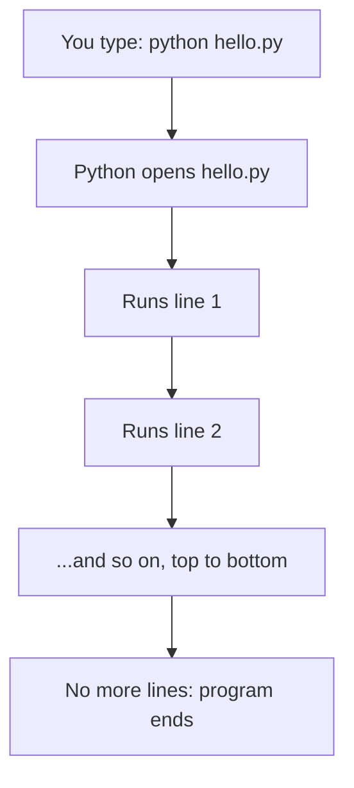

# Day 1 Lecture — Introduction to Programming and Python

## A. Lecture information

| | |
| --- | --- |
| **Course part** | Part I — Programming Foundations |
| **Module** | 00 — Foundations |
| **Chapter** | 1 — Introduction to Programming and Python |
| **Day** | 1 |
| **Today's one skill** | Making the computer show text on the screen with `print()` |
| **Prerequisites** | None. You need a computer that has Python on it (an LJMU lab machine is fine). |
| **Time** | About 1 hour to read and type the examples, then the lab |
| **Code checked with** | Python 3.13 and Python 3.14. Every output shown is real. |

### What you will be able to do by the end

1. Explain in plain words what a **program** is, and what an **algorithm** is.
2. Explain why a computer needs **exact** instructions, **in the right order**.
3. Say what Python is and why it is popular, especially in cyber security.
4. Create a Python file and run it.
5. Write programs that show text on the screen with `print()`.
6. Use double quotes and single quotes correctly, including text that contains an apostrophe.
7. Print blank lines, and draw simple banners and boxes out of text.
8. Spot and fix the most common typing mistakes in a `print()` line.

### What today does NOT cover

You will see other people's Python code that uses numbers, maths, `sep`, `end`, backslash codes like `\n`, comments with `#`, and so on. **Ignore those for now.** Each one has its own day later in the course. Today is only about showing text.

### New words today

program · algorithm · instruction · sequence · Python · source code · file · run · `print()` · brackets · quotes · string · blank line · error

---

## B. Introduction

### What is programming?

A computer is very fast, but it has no common sense. It cannot guess what you want. It does **exactly** what it is told, nothing more and nothing less.

A **program** is a list of instructions that tells a computer what to do. **Programming** is writing those instructions.

Every app on your phone, every website, the software in a Wi-Fi router, and every tool a security analyst uses is a program that somebody wrote.

### Why start with Python?

Python is a **programming language**: a set of words and rules for writing instructions that a computer can follow. Python was designed to be easy to read. Its code often looks close to English.

Python is not a "toy". It is one of the most used languages in the world, and it is used every day in cyber security. Analysts use it to search log files, check files for tampering and automate boring jobs. Many well-known security tools are written in Python.

> **If you know some Java (from 4300COMP):** in Java, showing one line of text needs a class, a `main` method and `System.out.println(...)`. In Python it needs one line. Python and Java do the same kind of job, but Python has much less to type.

---

## C. Explanation

### C.1 Instructions and algorithms

An **algorithm** is a step-by-step method for doing a task. A recipe is an algorithm. Directions to campus are an algorithm.

Here is an algorithm for making tea:

```text
1. Boil the kettle.
2. Put a tea bag in the cup.
3. Pour the water into the cup.
4. Wait 3 minutes.
5. Take out the tea bag.
```

A person can follow this easily, because a person fills in the missing details. Is there water in the kettle? Which cup? Pour how much? A person just knows.

A computer does not know. It needs every detail spelled out. **Programming is mostly the job of making instructions exact enough for a machine that cannot guess.**

When an algorithm is written in a programming language so a computer can follow it, it becomes a **program**.

### C.2 Order matters: sequence

A computer follows a program's instructions **one at a time, from the top to the bottom**. This is called **sequence**.

If the steps are in the wrong order, the computer still follows them, in the wrong order. Put "Pour the water" before "Boil the kettle" and you get cold tea. The computer will not notice. Only you will.

### C.3 What Python is

| Fact | Detail |
| --- | --- |
| Made by | Guido van Rossum, in the Netherlands |
| First released | 1991 |
| Name | Named after the British comedy show *Monty Python's Flying Circus*, not the snake |
| The version you use | Python 3. (The old Python 2 ended in 2020. If a website writes `print "hello"` without brackets, it is Python 2 and out of date.) |
| Cost | Free |

### C.4 Your first program file

Python programs are saved in plain text files whose names end in **`.py`**. The text inside is called **source code**.

To make and run your first program:

1. Open a code editor. VS Code is recommended. (Day 3 shows how to set it up properly. Today, any plain text editor works. Do **not** use Word.)
2. Create a new file called `hello.py`.
3. Type this one line exactly:

   ```python
   print("Hello, world!")
   ```

4. Save the file.
5. Open a terminal in the same folder as the file, and type:

   ```bash
   python3 hello.py      # on macOS or Linux
   python hello.py       # on Windows
   ```

6. Press Enter. You should see:

   ```text
   Hello, world!
   ```

Well done: that is a real program. To **run** a program means to tell the computer to carry out its instructions.

> **If `python` or `python3` is not found:** your computer does not have Python yet, or the terminal cannot find it. Use an LJMU lab machine today. Day 3 covers installing Python on your own laptop step by step. On Windows, if `python` does not work, try `py`.

> **The most common beginner problem:** forgetting to **save** before running. The terminal runs what is saved on the disk, not what you can see in the editor.

### C.5 The `print()` command

`print()` is Python's command for showing something on the screen. Look closely at each part:

```python
print("Hello, world!")
```

| Part | What it is | What it does |
| --- | --- | --- |
| `print` | The name of the command | Tells Python "show something on the screen" |
| `(` and `)` | Round brackets | Hold the thing you want to show. Every `(` needs a `)` |
| `"` and `"` | Quotation marks | Mark where the text starts and where it ends |
| `Hello, world!` | The text | What appears on the screen |

So `print("Hello, world!")` means: **"Show the text Hello, world! on the screen."**

After it shows the text, `print()` moves to a **new line**. That is why the next `print()` appears underneath.

Some extra words you will hear:

- `print` is called a **function**: a ready-made command that does a job. Python has many of them. You will learn about functions properly much later.
- Using a function, by writing its name and brackets, is called **calling** it.
- A piece of text inside quotes is called a **string**. (It is a "string" of characters, like beads on a string.)

You do not need to remember these words yet. You will hear them every day, and they will become natural.

### C.6 Several lines: one `print()` per line

To show three lines, write three `print()` lines. Python runs them in sequence, top to bottom:

```python
print("My name is Afaq.")
print("I study Cyber Security.")
print("Today I start Python.")
```

```text
My name is Afaq.
I study Cyber Security.
Today I start Python.
```

### C.7 Double quotes and single quotes

Python accepts **double quotes** `"..."` or **single quotes** `'...'`. They do exactly the same job:

```python
print("Hello")
print('Hello')
```

Both show `Hello`. The rule is: **the quote at the start and the quote at the end must be the same kind.**

This course uses double quotes, because most Python programmers do.

The choice matters when your text itself contains a quote mark:

| You want to show | Write it like this | Why |
| --- | --- | --- |
| `It's Day 1.` | `print("It's Day 1.")` | The apostrophe is a single quote, so wrap the text in double quotes |
| `My tutor said "type it".` | `print('My tutor said "type it".')` | The text has double quotes, so wrap it in single quotes |

If you use the same kind inside and outside, Python thinks the text has ended early, and you get an error. You will see this in the lab.

### C.8 Python shows the text exactly

Everything between the quotes is shown **exactly as you typed it**: capital letters, small letters, spaces, punctuation.

```python
print("hello")
print("HELLO")
print("   hello   with spaces")
print("Hello!!! ???")
```

```text
hello
HELLO
   hello   with spaces
Hello!!! ???
```

Python does not fix your spelling, add full stops or remove extra spaces. If you want something on the screen, you must type it inside the quotes.

### C.9 Blank lines

`print()` with nothing inside the brackets shows an **empty line**. Use it to space out your output, like paragraphs:

```python
print("Part 1")
print()
print("Part 2")
```

```text
Part 1

Part 2
```

### C.10 Drawing with text

Because `print()` shows characters exactly, you can draw boxes, lines and banners with characters such as `+`, `-`, `|`, `=` and `*`:

```python
print("+----------------------+")
print("|   PYTHON MASTERY     |")
print("+----------------------+")
```

```text
+----------------------+
|   PYTHON MASTERY     |
+----------------------+
```

The trick is to count characters so the sides line up. Every line in this box is exactly 24 characters wide.

---

## D. Rules for today

1. **Write `print` in small letters.** Python cares about capitals. `Print` and `PRINT` do not exist.
2. **Brackets come in pairs:** `print(` ... `)`.
3. **Quotes come in pairs of the same kind:** `"..."` or `'...'`, never `"...'`.
4. **One `print()` per line.**
5. **Start every line at the very left edge.** No spaces before `print`. (Spaces at the start of a line have a special meaning in Python, which you will learn later.)
6. **Use straight quotes** `"` and `'`, not curly “smart quotes” from Word or some phone keyboards. Write code in a code editor.
7. **Name files** in small letters, with underscores instead of spaces, ending in `.py`. For example: `ex01_hello.py`.
8. **Save before you run.**

---

## E. Examples

All examples are in [`Examples/Lecture-01/`](../Examples/Lecture-01/). **Type each one yourself first**, run it, and only then compare it with the file.

### Example 1 — Hello, world (`ex01_hello.py`)

```python
print("Hello, world!")
```

**Output**

```text
Hello, world!
```

**Why:** `print` shows the text between the quotes. The quotes themselves are not shown. They only mark where the text starts and ends.

### Example 2 — Three lines (`ex02_three_lines.py`)

```python
print("My name is Afaq.")
print("I study Cyber Security.")
print("Today I start Python.")
```

**Output**

```text
My name is Afaq.
I study Cyber Security.
Today I start Python.
```

**Step by step** (this is called a **trace**: following the program one line at a time):

| Step | Line run | What appears |
| --- | --- | --- |
| 1 | Line 1 | `My name is Afaq.` |
| 2 | Line 2 | `I study Cyber Security.` underneath |
| 3 | Line 3 | `Today I start Python.` underneath |
| 4 | No more lines | The program ends |

### Example 3 — Quotes (`ex03_quotes.py`)

```python
print("This uses double quotes.")
print('This uses single quotes.')
print("It's Day 1.")
print('My tutor said "type every line".')
```

**Output**

```text
This uses double quotes.
This uses single quotes.
It's Day 1.
My tutor said "type every line".
```

**Why:** lines 1 and 2 show that both kinds of quote work. Line 3 has an apostrophe in the text, so the outside quotes are double. Line 4 has double quotes in the text, so the outside quotes are single.

### Example 4 — Exactly as typed (`ex04_exact_text.py`)

```python
print("hello")
print("HELLO")
print("   hello   with spaces")
print("Hello!!! ???")
```

**Output**

```text
hello
HELLO
   hello   with spaces
Hello!!! ???
```

**Why:** spaces **inside** the quotes are part of the text, so they are kept. That is different from a space **before** `print`, which is not allowed (rule 5).

### Example 5 — Blank lines (`ex05_blank_lines.py`)

```python
print("Part 1")
print()
print("Part 2")
print()
print()
print("Part 3")
```

**Output**

```text
Part 1

Part 2


Part 3
```

**Why:** each empty `print()` gives one empty line. Two of them give two empty lines.

### Example 6 — A banner (`ex06_banner.py`)

```python
print("+----------------------+")
print("|   PYTHON MASTERY     |")
print("|   Day 1              |")
print("+----------------------+")
```

**Output**

```text
+----------------------+
|   PYTHON MASTERY     |
|   Day 1              |
+----------------------+
```

**Why it lines up:** every line has exactly 24 characters, counting spaces. If one line is a character short, its right-hand `|` moves left. Try it.

### Example 7 — Order matters (`ex07_order_matters.py`)

```python
print("3. Pour the water")
print("1. Boil the kettle")
print("2. Put a tea bag in the cup")
```

**Output**

```text
3. Pour the water
1. Boil the kettle
2. Put a tea bag in the cup
```

**Why:** Python does not read the numbers. It runs the lines from top to bottom, so the steps come out in the wrong order. There is no error message. The program did exactly what it was told. To fix it, move the lines into the right order.

### Example 8 — A real-looking welcome screen (`ex08_welcome_screen.py`)

```python
print("==============================")
print("   LJMU CYBER SECURITY LAB")
print("==============================")
print()
print("Welcome to lab machine 07.")
print("Log in with your university account.")
print()
print("Unauthorised access is not allowed.")
print("==============================")
```

**Output**

```text
==============================
   LJMU CYBER SECURITY LAB
==============================

Welcome to lab machine 07.
Log in with your university account.

Unauthorised access is not allowed.
==============================
```

Real systems show screens like this when you log in. Today you can only *display* them. In later chapters you will make them respond to what the user types.

---

## F. Picture: what happens when you run a file



Day 2 looks at what really happens inside that box called "Python".

---

## G. Common mistakes

You do not need to understand these messages fully yet. Day 2 explains them. For now, learn to **recognise** them and check your spelling, brackets and quotes.

| You typed | What you see | What is wrong | Fix |
| --- | --- | --- | --- |
| `Print("Hi")` | `NameError: name 'Print' is not defined. Did you mean: 'print'?` | Capital P | `print` in small letters |
| `prnt("Hi")` | `NameError: name 'prnt' is not defined. Did you mean: 'print'?` | Spelling | Spell it `print` |
| `print("Hi"` | `SyntaxError: '(' was never closed` | Missing `)` | Add `)` at the end |
| `print("Hi"))` | `SyntaxError: unmatched ')'` | One `)` too many | Remove one `)` |
| `print("Hi)` | `SyntaxError: unterminated string literal` | Missing closing quote | Add `"` before `)` |
| `print("Hi')` | `SyntaxError: unterminated string literal` | Quotes do not match | Use the same kind at both ends |
| `print('It's broken')` | `SyntaxError: unterminated string literal` | The apostrophe ends the text early | Use double quotes outside: `"It's broken"` |
| `print("She said "hi" to me")` | `SyntaxError: invalid syntax...` | The inner `"` ends the text early | Use single quotes outside |
| `print(Hi)` | `NameError: name 'Hi' is not defined` | No quotes, so Python thinks `Hi` is a name, not text | Add quotes: `print("Hi")` |
| `print "Hi"` | `SyntaxError: Missing parentheses in call to 'print'` | Old Python 2 style | `print("Hi")` |
| `print(“Hi”)` | `SyntaxError: invalid character '“' (U+201C)` | Curly quotes from Word or a phone | Retype with straight quotes in a code editor |
| ` print("Hi")` (space at start) | `IndentationError: unexpected indent` | A space before `print` | Start at the left edge |
| (forgot to save) | Old output, or an old error | The terminal runs the saved file | Save, then run |

> The exact wording after `invalid syntax` can differ between Python versions. Python 3.13 says `Perhaps you forgot a comma?` and Python 3.14 says `Is this intended to be part of the string?`. Both mean "the quotes are confused".

---

## H. Good habits from day one

1. **Type the code yourself.** Do not copy and paste. Typing is how you learn where the brackets and quotes go.
2. **Predict, then run.** Before you run, say what you expect to see. If the real output is different, find out why.
3. **Change one thing at a time**, then run again.
4. **Read the last line of an error message first.** It usually tells you what is wrong.
5. **Break things on purpose.** Remove a bracket, run it, and read the message. Then you will recognise it next time.
6. **Use blank lines in your output** to make it easy to read.

---

## I. Summary

- A **program** is a list of exact instructions for a computer. An **algorithm** is the step-by-step method behind it.
- A computer runs instructions **in order, top to bottom** (**sequence**). Wrong order means wrong result, with no warning.
- **Python** is a popular, readable programming language, widely used in cyber security.
- Python code is saved in **`.py` files** and run with `python file.py` (or `python3 file.py`).
- `print("text")` shows text on the screen, then moves to a new line.
- Text goes inside **matching quotes**, double or single. Use the other kind on the outside when the text contains a quote.
- Text is shown **exactly** as typed, spaces and capitals included.
- `print()` on its own shows a **blank line**.
- Most first mistakes are a capital `P`, a missing bracket, or a missing or wrong quote.

### Glossary

| Word | Meaning |
| --- | --- |
| Algorithm | A step-by-step method for doing a task |
| Blank line | An empty line of output, made with `print()` |
| Brackets | The round brackets `( )` after `print` that hold what you want to show |
| Call | To use a function by writing its name and brackets |
| Error | A message from Python saying it could not do what you wrote |
| File | A saved document. Python programs are files ending in `.py` |
| Function | A ready-made command that does a job, such as `print` |
| Instruction | One step in a program |
| `print()` | Python's command for showing something on the screen |
| Program | A list of instructions for a computer, written in a programming language |
| Programming language | A set of words and rules for writing programs, such as Python or Java |
| Quotes | The `"` or `'` marks that show where text starts and ends |
| Run | To make the computer carry out a program |
| Sequence | Running instructions one after another, from top to bottom |
| Source code | The text of a program that a person writes |
| String | A piece of text in quotes, such as `"Hello"` |

---

## J. Knowledge check

Answer these in your own words **before** you start the lab. Write your answers in `My-Solutions/Lab-01/knowledge_check.md`. Short answers are fine.

1. What is a program? What is an algorithm? How are they different?
2. Why must instructions for a computer be more exact than instructions for a person? Give your own example.
3. What does "sequence" mean? What happens if two `print()` lines are in the wrong order?
4. What does `print("Good morning")` show? Name each part of the line.
5. What does `print()` with nothing inside show?
6. Why does `print('It's late')` not work? Write a version that does.
7. Write one line that shows exactly: `He said "ready".`
8. What is wrong with each of these, and how would you fix it?
   - `Print("Hello")`
   - `print("Hello"`
   - `print(Hello)`
9. Why might the terminal show old output after you have changed your file?
10. Who created Python, and what is it named after?

When you have answered them, open [Lab 1](../Labs/Lab-01-Introduction-to-Programming-and-Python-Hands-on-Workbook.md).
