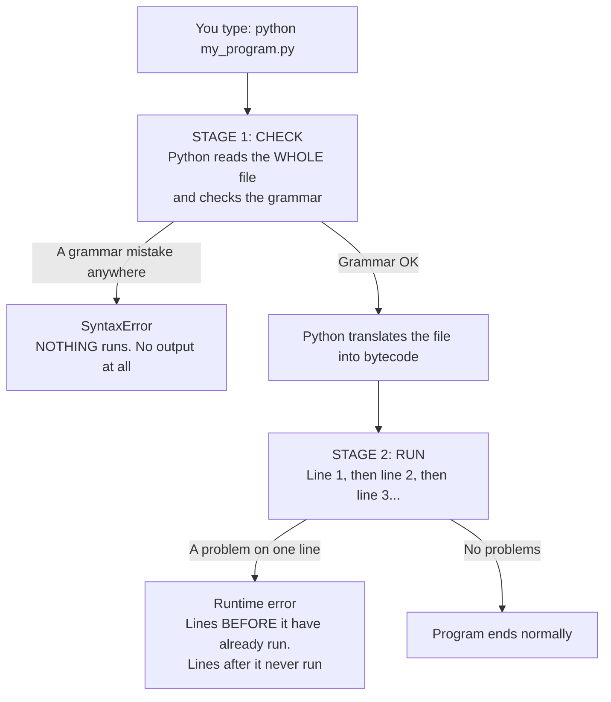
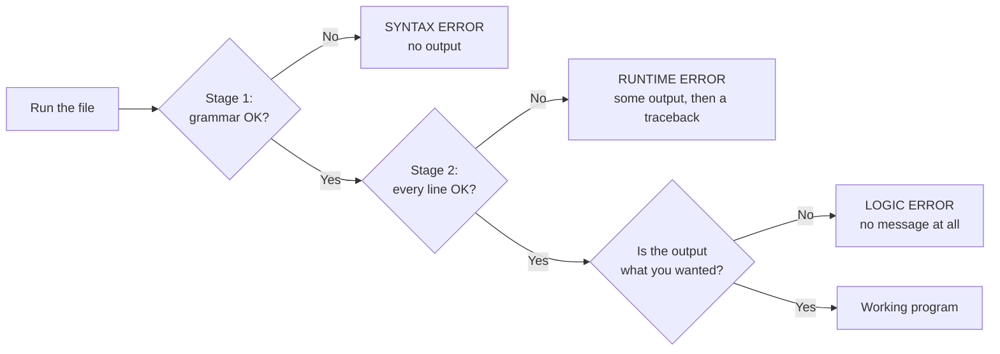

# Day 2 Lecture — How Programming Languages Work

## A. Lecture information

| | |
| --- | --- |
| **Course part** | Part I — Programming Foundations |
| **Module** | 00 — Foundations |
| **Chapter** | 2 — Understanding Programming Languages |
| **Day** | 2 |
| **Today's one skill** | Predicting what happens when you run a file: Python **checks the whole file first**, then **runs it line by line** |
| **Prerequisites** | Day 1: writing and running programs with `print()` |
| **Time** | About 1 hour to read and try the examples, then the lab |
| **Code checked with** | Python 3.13 and Python 3.14. Every output shown is real. |

### What you will be able to do by the end

1. Explain why a computer cannot understand Python directly.
2. Explain the difference between **machine code**, **assembly language** and a **high-level language** like Python.
3. Explain what a **compiler** and an **interpreter** are, using everyday examples.
4. Describe the **two stages** Python goes through when you run a file: **check**, then **run**.
5. Predict, before running, which lines of a program will appear on the screen.
6. Tell the three kinds of error apart: **syntax errors**, **runtime errors** and **logic errors**.
7. Read a Python error message and find the line that caused it.

### What today does NOT cover

You only need `print()` from Day 1. Every example and every lab exercise uses only `print()` with text. You will meet other kinds of error (with numbers, for example) when you learn about numbers later.

### New words today

machine code · assembly language · high-level language · translate · compiler · interpreter · bytecode · Python Virtual Machine · syntax · syntax error · runtime error · exception · logic error · bug · debugging · error message · traceback

---

## B. Introduction

Yesterday you wrote `print("Hello, world!")`, typed `python hello.py`, and text appeared. Today we answer the question: **what happened in between?**

This matters for one very practical reason. When something goes wrong, knowing *how* Python reads your file tells you:

- whether **any** of your program ran before the problem,
- **which** mistake Python will report first,
- **where** to look to fix it.

By the end of today, you should be able to look at a short program with mistakes in it and say exactly what will appear on the screen, before you run it.

---

## C. Explanation

### C.1 Computers only understand one thing

The part of a computer that follows instructions is the **CPU** (central processing unit). A CPU does not understand English, and it does not understand Python. It only understands **machine code**: long patterns of 0s and 1s, where each pattern means one tiny action, such as "add these two numbers" or "copy this value".

Machine code looks like this:

```text
10110000 01100001
```

Nobody wants to write programs like that. It is slow, very easy to get wrong, and different for different kinds of CPU. (A laptop CPU and a phone CPU use different machine code.)

### C.2 Three levels of language

So people invented languages that are easier to write, and tools that turn them into machine code.

| Level | What it looks like | Who can read it | Notes |
| --- | --- | --- | --- |
| **Machine code** | `10110000 01100001` | The CPU | The only thing a CPU understands |
| **Assembly language** | `mov al, 61h` | Specialists | One short word for each machine-code instruction. Still written for one kind of CPU |
| **High-level language** | `print("Hello")` | People | Close to English. One line can become hundreds of machine-code instructions. Works on many kinds of computer |

Python is a **high-level language**. So are Java, C# and JavaScript. You say **what** you want ("show this text"), and the language's tools work out **how** the CPU should do it.

The price is that your code must be **translated** into something the computer can carry out. There are two main ways to translate.

### C.3 Two ways to translate: compilers and interpreters

Think about translating a book from English into Urdu.

**Way 1: translate the whole book first.** A translator works through the whole book, writes out a complete Urdu copy, and then readers read the copy. If the translator finds a page that makes no sense, they stop and send the book back before anyone reads it.

That is a **compiler**: a program that translates your **whole** program **before** it runs. The C language works like this. You may also remember from 4300COMP that Java works like this too: `javac` checks and translates your whole `.java` file before `java` runs it.

**Way 2: translate as you go.** A live interpreter at a meeting listens to one sentence, translates it, then listens to the next one. Nobody waits for the whole speech to be finished.

That is an **interpreter**: a program that reads your code and carries it out bit by bit, **as it goes**.

| | Compiler | Interpreter |
| --- | --- | --- |
| Everyday example | A book translator | A live interpreter at a meeting |
| When does it translate? | All of it, before the program runs | Bit by bit, while the program runs |
| What happens to a mistake? | Found before anything runs | Found when that bit is reached |
| Example languages | C, Java (`javac`) | Simple command-line scripts |

### C.4 How Python does it: check first, then run

Python uses **both** ideas, one after the other. When you type `python hello.py`, two stages happen.

**Stage 1 — Check and translate.** Python reads your **whole file** first. It checks that every line follows Python's grammar rules. These grammar rules are called **syntax**. For example: every `(` needs a `)`, and every opening quote needs a matching closing quote. If the whole file is correct, Python translates it into **bytecode**: a list of very simple instructions that is easier for a computer to follow. You never see the bytecode. It all happens in a fraction of a second.

**Stage 2 — Run.** A part of Python called the **Python Virtual Machine** follows the bytecode instructions **one at a time, from top to bottom**. This is when text actually appears on the screen.



This one picture explains almost everything in today's lab.

> **Why is Python called an "interpreted" language?** Because you never run a separate translate command. You just run your file, and Python does stage 1 and stage 2 for you. That is a fair everyday description, as long as you remember that stage 1 checks the whole file before anything runs.

### C.5 Mistakes found in stage 1: syntax errors

A **syntax error** is a grammar mistake: Python cannot even understand what you wrote.

Because stage 1 checks the **whole** file before **anything** runs, **a syntax error anywhere in the file means no line runs at all**, not even the perfect lines at the top.

```python
print("Start")
print("Middle")
print("End"
```

Lines 1 and 2 are perfect, but line 3 is missing its `)`. Output:

```text
  File ".../ex02_syntax_error_at_the_end.py", line 3
    print("End"
         ^
SyntaxError: '(' was never closed
```

`Start` and `Middle` did **not** appear. Python never reached stage 2.

Syntax errors you have already met:

| Mistake | Error |
| --- | --- |
| Missing `)` | `SyntaxError: '(' was never closed` |
| An extra `)` | `SyntaxError: unmatched ')'` |
| Missing or wrong closing quote | `SyntaxError: unterminated string literal` |
| `print "Hi"` with no brackets | `SyntaxError: Missing parentheses in call to 'print'` |
| Curly quotes `“ ”` | `SyntaxError: invalid character` |
| A space before `print` | `IndentationError: unexpected indent` (a special kind of syntax error) |

### C.6 Mistakes found in stage 2: runtime errors

Now look at this file:

```python
print("Start")
print("Middle")
Print("End")
```

Is `Print("End")` a grammar mistake? **No.** It has the right shape: a name, a `(`, some text in quotes, a `)`. To Python's grammar checker, it looks like a perfectly good command. So stage 1 passes.

In stage 2, Python runs line 1 (`Start` appears), then line 2 (`Middle` appears). Then it reaches line 3 and looks for a command called `Print`, with a capital P. There isn't one. Only now does Python discover the problem, and it stops:

```text
Start
Middle
Traceback (most recent call last):
  File ".../ex03_misspelling_at_the_end.py", line 3, in <module>
    Print("End")
    ^^^^^
NameError: name 'Print' is not defined. Did you mean: 'print'?
```

This is a **runtime error**: a mistake that is only found **while the program is running** ("run time"). Python's own name for a runtime error is an **exception**.

**The key difference:**

| | Syntax error | Runtime error |
| --- | --- | --- |
| Found in | Stage 1 (check) | Stage 2 (run) |
| Does any output appear? | **No**, none at all | **Yes**, every line before the mistake runs |
| Example | `print("End"` | `Print("End")` |
| First word of the message | `File ...` | `Traceback ...` |

### C.7 Mistakes Python never finds: logic errors

A **logic error** is when your program runs with no error message at all, but does the wrong thing.

```python
print("Step 3: Type your password")
print("Step 1: Switch on the computer")
print("Step 2: Type your username")
```

```text
Step 3: Type your password
Step 1: Switch on the computer
Step 2: Type your username
```

Python ran every line perfectly. The steps are just in the wrong order. A spelling mistake **inside** the quotes, like `"Wellcome"`, is also a logic error. Python shows text exactly as typed, so it has no idea the spelling is wrong.

Logic errors are the hardest to find, because nothing warns you. The only defence is to **know what output you expect**, and check the real output against it carefully. That is why every lab asks you to predict before you run.

| Kind of error | Found by | Any output? |
| --- | --- | --- |
| **Syntax error** | Python, in stage 1 | None |
| **Runtime error** | Python, in stage 2, when it reaches the line | Lines before it |
| **Logic error** | Only **you**, by checking the output | All of it, but wrong |

A mistake in a program is called a **bug**. Finding and fixing bugs is called **debugging**.

### C.8 Two mistakes in one file: which one does Python report?

This file has two mistakes. Line 1 is misspelt (a runtime error), and line 3 has a missing quote (a syntax error):

```python
Print("Start")
print("Middle")
print("End)
```

Which one does Python complain about first? Use the two stages:

1. Stage 1 checks the **whole** file for grammar. `Print("Start")` has fine grammar, so it passes. Line 3 does not.
2. Python stops in stage 1 and reports **line 3**. Stage 2 never starts, so the misspelling on line 1 is not found yet.

```text
  File ".../ex04_two_mistakes.py", line 3
    print("End)
          ^
SyntaxError: unterminated string literal (detected at line 3)
```

After you fix line 3, run again. Now stage 1 passes, stage 2 starts, and Python stops at line 1 with the `NameError`.

**Rule: Python always reports syntax errors before runtime errors, even if the runtime error is higher up the file.** This is why the errors in Lab 1, Exercise 16, did not come in line order.

Python also reports **only one syntax error at a time**. If your file has three, you fix one, run again, and Python shows you the next one.

The syntax errors do not always come in line order either. For example, a missing closing **quote** is often reported before a missing **bracket** that is higher up the file. You do not need to know why yet. Just fix whatever line Python points at, and run again.

### C.9 How to read an error message

**A syntax error looks like this:**

```text
  File ".../ex02_syntax_error_at_the_end.py", line 3     <- which file and which line
    print("End"                                          <- a copy of that line
         ^                                               <- points near the problem
SyntaxError: '(' was never closed                        <- what is wrong
```

**A runtime error looks like this:**

```text
Start                                                    <- output from lines that DID run
Middle
Traceback (most recent call last):                       <- "here is what went wrong"
  File ".../ex03_misspelling_at_the_end.py", line 3, in <module>   <- file and line
    Print("End")                                         <- a copy of that line
    ^^^^^                                                <- the exact problem
NameError: name 'Print' is not defined. Did you mean: 'print'?     <- what is wrong
```

The word **traceback** means Python's report of where a runtime error happened. `in <module>` means "in the main part of your file". You can ignore it for now.

**How to read any error message:**

1. **Read the last line first.** It names the kind of error and describes the problem. Modern Python often suggests a fix, such as `Did you mean: 'print'?`.
2. **Find the line number** (`line 3`) and go to that line.
3. **Look where the `^` points.**
4. **If that line looks fine, check the line above it.** Python reports where it *noticed* the problem, which is sometimes just after the real mistake.

> **About the file path:** the `File "..."` part shows the full location of the file on your computer. It will be different on your machine. That is normal.

### C.10 Why this matters later

The programs you write will soon be long, and some will do important jobs: copying files, changing settings, checking a network. Knowing that a runtime error leaves the earlier lines **already done** is important. If line 5 of 10 fails, lines 1 to 4 have already happened, and you may need to tidy up after them. Knowing that a syntax error means **nothing** happened is reassuring: you just fix it and run again.

---

## D. Rules for today

When a program does not do what you expected, go through this checklist:

1. **Was there any output before the error message?**
   - None → probably a **syntax error**. Look at the reported line.
   - Some → a **runtime error**. Everything above the reported line has already run.
   - No error, but the output is wrong → a **logic error**. Compare the output with what you expected, line by line.
2. **Read the last line of the message first.**
3. **Go to the line number.** If it looks fine, check the line above.
4. **Fix one thing, save, and run again.** There may be more errors waiting.

---

## E. Examples

All examples are in [`Examples/Lecture-02/`](../Examples/Lecture-02/). For each one, **predict first**: which lines will appear? Then run it.

### Example 1 — No mistakes (`ex01_all_good.py`)

```python
print("Start")
print("Middle")
print("End")
```

**Output**

```text
Start
Middle
End
```

**Why:** stage 1 finds no grammar mistakes. Stage 2 runs every line, top to bottom.

### Example 2 — A syntax error at the end (`ex02_syntax_error_at_the_end.py`)

```python
print("Start")
print("Middle")
print("End"
```

**Output**

```text
  File ".../ex02_syntax_error_at_the_end.py", line 3
    print("End"
         ^
SyntaxError: '(' was never closed
```

**Why:** stage 1 checks the whole file and finds the missing `)` on line 3. Python stops before stage 2, so **nothing** appears, not even `Start`.

**Fix:** add `)` at the end of line 3.

### Example 3 — A runtime error at the end (`ex03_misspelling_at_the_end.py`)

```python
print("Start")
print("Middle")
Print("End")
```

**Output**

```text
Start
Middle
Traceback (most recent call last):
  File ".../ex03_misspelling_at_the_end.py", line 3, in <module>
    Print("End")
    ^^^^^
NameError: name 'Print' is not defined. Did you mean: 'print'?
```

**Why:** the grammar is fine, so stage 2 starts. Lines 1 and 2 run. Line 3 fails because there is no command called `Print`.

**Compare with Example 2:** both files have one mistake on line 3. But one shows no output, and the other shows two lines. The difference is **which stage** finds the mistake.

### Example 4 — Two mistakes (`ex04_two_mistakes.py`)

```python
Print("Start")
print("Middle")
print("End)
```

**Output (first run)**

```text
  File ".../ex04_two_mistakes.py", line 3
    print("End)
          ^
SyntaxError: unterminated string literal (detected at line 3)
```

**Why:** the syntax error on line 3 is found in stage 1, before the misspelling on line 1 can be found in stage 2.

**Try it:** fix line 3 and run again. Now you get the `NameError` on line 1, and **no output at all**, because line 1 is the very first line to run. Fix that too, and all three lines appear.

### Example 5 — A logic error: wrong order (`ex05_wrong_order.py`)

```python
print("Step 3: Type your password")
print("Step 1: Switch on the computer")
print("Step 2: Type your username")
```

**Output**

```text
Step 3: Type your password
Step 1: Switch on the computer
Step 2: Type your username
```

**Why:** no error message, because there is nothing wrong with the grammar or the commands. The steps are in the wrong order, and only a person can see that.

### Example 6 — A logic error: wrong text (`ex06_wrong_text.py`)

```python
print("Welcome to the Cyber Security Lab")
print("Lab opening hours: 9am to 5pm")
print("Please log out when you finish")
print("Wellcome back tomorrow!")
```

**Output**

```text
Welcome to the Cyber Security Lab
Lab opening hours: 9am to 5pm
Please log out when you finish
Wellcome back tomorrow!
```

**Why:** `Wellcome` is misspelt, but it is **inside the quotes**, so it is just text. Python shows text exactly as typed and never checks its spelling. Compare that with `Print` in Example 3, which is **outside** the quotes, so Python treats it as a command name and checks it.

---

## F. Picture: the three kinds of error



---

## G. Common misunderstandings

| What people think | What is really true |
| --- | --- |
| "Python runs line 1, then checks line 2, then runs line 2..." | Python **checks the whole file first**. Only then does it run line 1 |
| "My first lines are fine, so at least they will print." | Not if there is a syntax error anywhere in the file. Then nothing prints |
| "The error is always on the line Python says." | Usually, but sometimes the real mistake is on the line just above |
| "No error message means my program is correct." | It means there are no syntax or runtime errors. There may still be a logic error |
| "Python checks my spelling." | Only the spelling of **command names** like `print`, and only when it runs them. Text inside quotes is never checked |
| "Python finds all my mistakes at once." | It reports one at a time. Fix one, run again |

---

## H. Good habits

1. **Predict before you run.** Ask yourself: "Is the grammar correct everywhere? Which lines will run?"
2. **Look at what appeared before the error.** It tells you which stage found the problem.
3. **Fix one error at a time**, save, and run again.
4. **Read the last line of the error message first.**
5. **Check your output carefully** against what you expected. That is the only way to catch logic errors.
6. **Make mistakes on purpose** in small test files, and read the messages. Then you will recognise them in real programs.

---

## I. Summary

- A CPU only understands **machine code**. **High-level languages** like Python must be **translated**.
- A **compiler** translates the whole program before it runs. An **interpreter** translates and runs it bit by bit.
- Python does both, in two stages: **stage 1** checks the **whole** file's grammar and translates it into **bytecode**. **Stage 2**, the **Python Virtual Machine**, runs it **line by line, top to bottom**.
- A **syntax error** is found in stage 1, so **no line runs at all**.
- A **runtime error** (exception) is found in stage 2, so every line **before** it has already run, and no line after it runs.
- A **logic error** produces no message. The program runs but does the wrong thing. Only you can find it.
- Python reports **syntax errors before runtime errors**, and **one error at a time**.
- Read error messages **from the last line up**, then go to the line number.

### Glossary

| Word | Meaning |
| --- | --- |
| Assembly language | A low-level language with one short word for each machine-code instruction |
| Bug | A mistake in a program |
| Bytecode | Simple instructions that Python makes from your code in stage 1 and follows in stage 2. You do not normally see it |
| Compiler | A program that translates a whole program before it runs |
| CPU | The part of the computer that carries out instructions |
| Debugging | Finding and fixing bugs |
| Error message | Python's explanation of what went wrong and where |
| Exception | Python's name for a runtime error |
| High-level language | A language that is easy for people to read, such as Python or Java |
| Interpreter | A program that translates and carries out code bit by bit, as it goes |
| Logic error | A mistake where the program runs without any error message but does the wrong thing |
| Machine code | Instructions made of 0s and 1s, the only language a CPU understands |
| Python Virtual Machine | The part of Python that runs the bytecode, one instruction at a time |
| Runtime error | A mistake found while the program is running. Lines before it have already run |
| Syntax | The grammar rules of a programming language |
| Syntax error | A grammar mistake, found before the program runs. No line runs |
| Traceback | The report Python shows for a runtime error, saying where it happened |
| Translate | To turn code in one language into another form the computer can use |

---

## J. Knowledge check

Answer these in your own words **before** you start the lab. Write your answers in `My-Solutions/Lab-02/knowledge_check.md`.

1. Why can't a CPU understand `print("Hello")` directly?
2. Give an everyday example of a compiler and of an interpreter, and say how they are different.
3. What are Python's two stages when you run a file? What happens in each one?
4. A file has 10 lines. Line 10 is missing a `)`. What appears when you run it, and why?
5. A file has 10 lines. Line 10 says `Print("Bye")`. What appears when you run it, and why?
6. Why is `Print("Hi")` **not** a syntax error, when `print("Hi"` is?
7. A file has `Print("A")` on line 1 and `print("B"` on line 2. Which error does Python show first, and why?
8. Your program shows `Pasword:` instead of `Password:`. What kind of error is this? Why did Python not warn you?
9. When you read an error message, which line should you read first, and why?
10. Explain in one or two sentences why it is useful to know whether any lines ran before an error.

When you have answered them, open [Lab 2](../Labs/Lab-02-How-Programming-Languages-Work-Hands-on-Workbook.md).
