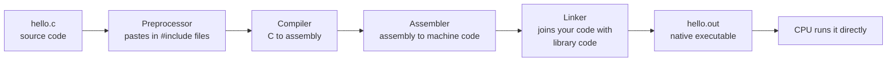
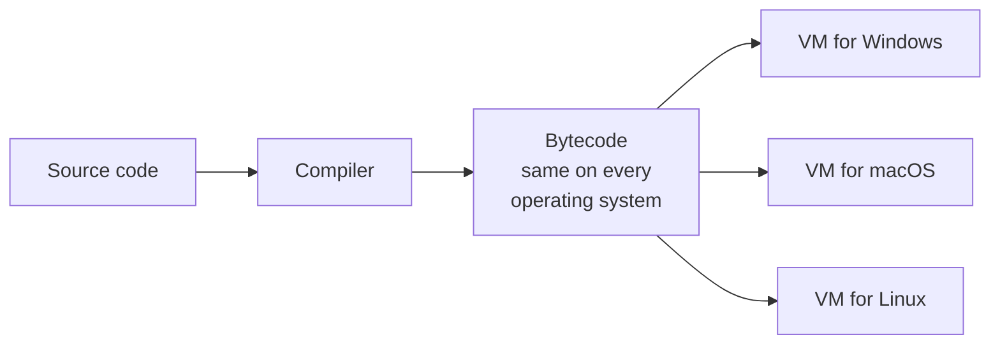
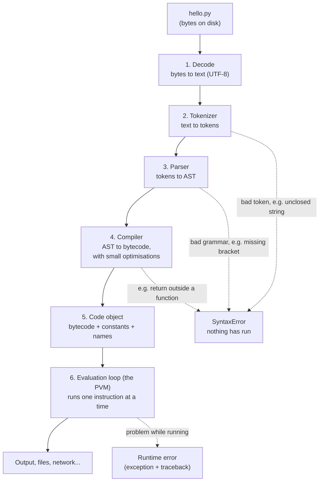

# Day 2 Lecture — Understanding Programming Languages in Depth

## A. Lecture information

| | |
| --- | --- |
| **Course part** | Part I — Programming Foundations |
| **Module** | 00 — Foundations |
| **Chapter** | 2 — Understanding Programming Languages in Depth |
| **Day** | 2 |
| **Lecture title** | How languages are classified, how code is translated, and what CPython really does with your file |
| **Prerequisites** | Day 1: running scripts and the REPL, `print()`, strings, comments, and the three kinds of error. Some Java from 4300COMP helps but is not required. |
| **Time** | About 2½ hours to read and run the examples, then the lab |
| **Code checked with** | Python 3.13.18 (main listings), Python 3.14.6, and a Python 3.15 pre-release build. Java 21 (`javac`, `javap`) and `gcc` for the comparisons. Outputs shown are real outputs. |

### Learning objectives

By the end of this lecture you will be able to:

1. Explain the difference between a language's **syntax**, its **semantics**, its **specification** and its **implementations**.
2. Classify a language by **level**, **translation model**, **type system**, **paradigm** and **memory management**, and place Python, Java, C and JavaScript in each category.
3. Describe in detail the three translation strategies: **ahead-of-time compilation**, **interpretation** and **bytecode with a virtual machine**, plus **just-in-time (JIT) compilation**.
4. Name and describe each stage of **CPython's pipeline**: tokenizer, parser, abstract syntax tree, compiler, code object and evaluation loop, and show each stage's output with a command.
5. Read simple **bytecode** produced by the `dis` module and explain how a **stack machine** runs it.
6. Explain what `.pyc` files and `__pycache__` folders are, when they are created and why they are tied to one Python version.
7. Predict whether an error will be caught at **compile time** or at **run time**, and explain why Java catches some mistakes that Python does not.
8. Explain the security consequences: bytecode is **not** a way to hide source code or secrets.

### Concepts covered

syntax · semantics · language specification · implementation · reference implementation · CPython · PyPy · MicroPython · ahead-of-time (AOT) compilation · native code · linker · interpreter · bytecode · virtual machine · just-in-time (JIT) compilation · portability · static and dynamic typing · strong and weak typing · paradigm · garbage collection · tokenizer · token · parser · abstract syntax tree (AST) · compiler · constant folding · code object · evaluation loop · stack machine · instruction (opcode) · disassembler · `.pyc` file · `__pycache__` · magic number · compile time · run time · module · `import` · decompiler

---

## B. Introduction

Yesterday you learned the short version: you write Python, Python compiles it to bytecode, and the Python Virtual Machine runs the bytecode. Today we open that box.

Why should a programmer care how a language is translated? Four reasons, all practical:

1. **Errors.** Knowing *when* each check happens tells you which mistakes the language will catch before your program runs and which ones will wait to surprise you halfway through.
2. **Speed.** The translation model largely explains why a C program can be tens of times faster than the same Python program, and why that often does not matter.
3. **Portability.** It explains why a Python script runs unchanged on Windows, macOS and Linux, while a compiled C program has to be rebuilt for each one.
4. **Security.** Malware analysts, penetration testers and forensic investigators deal with compiled programs, bytecode files and scripts every day. If you know what each one contains, you know what can be recovered from it. Today you will prove that a "compiled" Python file still contains its secrets in readable form.

Today is also the first day you use Python to look at Python. Python comes with tools that show you each stage of its own translation. By the end of the lab you will be able to take a listing of bytecode and work out the source code that produced it, which is the beginning of reverse engineering.

> **New tool today: `import`.** Python ships with a large library of extra tools, grouped into **modules**. A line such as `import dis` loads the module called `dis` so you can use the tools inside it, for example `dis.dis(...)`. Read the dot as "the `dis` tool from the `dis` module". That is all you need today. Modules get a whole chapter later (Chapter 50).

---

## C. Detailed theoretical explanation

### C.1 What a programming language actually is

When people say "Python", they can mean two different things, and it matters to separate them.

**The language** is a set of rules:

- **Syntax** is the grammar: which arrangements of characters are allowed. `print("Hi")` is valid syntax; `print("Hi"` is not.
- **Semantics** is the meaning: what a valid piece of code actually does. The semantics of `print("Hi")` are "display the text Hi followed by a new line".

These rules are written down in a **language specification**. For Python, that is *The Python Language Reference* on docs.python.org.

**An implementation** is a real program that reads code written in the language and carries it out. One language can have many implementations:

| Implementation | Written in | Main idea | Where you meet it |
| --- | --- | --- | --- |
| **CPython** | C | The original. Compiles to bytecode, runs it in a virtual machine | python.org downloads, Linux distributions, this course |
| **PyPy** | RPython (a restricted Python) | Has a JIT compiler, often much faster for long-running pure-Python code | Performance-sensitive services |
| **MicroPython** | C | A small Python 3 for microcontrollers with kilobytes of memory | Raspberry Pi Pico, ESP32, IoT devices |
| **GraalPy** | Java | Runs on the GraalVM, can mix with Java code | Java-based systems |
| **Pyodide** | CPython compiled to WebAssembly | Runs Python inside a web browser | Online notebooks and teaching sites |

CPython is the **reference implementation**: when the specification is unclear, what CPython does is usually treated as the correct behaviour. Everything this course says about bytecode, `.pyc` files and the `dis` module is about **CPython specifically**. PyPy or MicroPython do these things differently, and that is allowed, because they are implementation details, not part of the language.

> **Java comparison.** It is the same with Java. The *Java Language Specification* defines the language, and OpenJDK's `javac` and HotSpot JVM are one implementation of it.

### C.2 Five ways to classify a language

There are hundreds of programming languages. Five questions sort most of them.

#### 1. What level is it?

You met this yesterday. **Low-level** languages (machine code, assembly) map directly onto one CPU's instructions. **High-level** languages (Python, Java, JavaScript) let you describe what you want without mentioning registers or memory addresses. C sits in between. It is high-level in syntax, but it lets you work directly with memory addresses, which is why it is called a "systems" language and why so many security vulnerabilities (buffer overflows, use-after-free) come from C code.

#### 2. How is it translated?

This is the big one, covered in C.3. The short version:

- **Compiled ahead of time to native code:** C, C++, Rust, Go
- **Compiled to bytecode, run on a virtual machine:** Java, C#, Python (CPython)
- **Interpreted directly from source:** Bash and other shell languages (in the simplest model)
- **JIT-compiled while running:** JavaScript in browsers, Java on HotSpot, PyPy

#### 3. How does it handle types?

Every value has a **type**: text, whole number, decimal number and so on. (Types get their own chapter. For now you know two: strings and numbers.) Languages differ in *when* they check types and *how strictly*.

**Static or dynamic: when are types checked?**

- **Static typing:** types are checked by the compiler *before* the program runs. In Java you must write `int count = 5;`, and if you later try to store text in `count`, `javac` refuses to compile.
- **Dynamic typing:** types belong to the values, and are checked *while the program runs*. Python is dynamically typed: nothing checks types until a line actually runs.

**Strong or weak: how strict are the checks?**

- **Strong typing:** the language refuses to quietly mix incompatible types. You saw this yesterday: in Python, `"Age: " + 21` is a `TypeError`.
- **Weak typing:** the language converts types automatically to make the operation work. In JavaScript, `"Age: " + 21` quietly produces `"Age: 21"`, and `"5" - 2` produces `3`.

These are two separate questions, so you get four combinations:

| | **Strong** (no quiet conversions) | **Weak** (quiet conversions) |
| --- | --- | --- |
| **Static** (checked before running) | Java, Rust | C (allows many implicit conversions) |
| **Dynamic** (checked while running) | **Python** | JavaScript, PHP |

Remember this sentence: **Python is dynamically and strongly typed.** It checks late, but it checks strictly.

#### 4. What paradigm does it encourage?

A **paradigm** is a style of organising a program:

- **Procedural:** a sequence of steps and procedures (functions). C is mainly procedural.
- **Object-oriented:** programs built from objects that hold data and behaviour. Java is strongly object-oriented. You saw that every Java program needs a class.
- **Functional:** programs built from functions that transform values without changing state. Haskell is purely functional.

Python is **multi-paradigm**: you can write procedural, object-oriented or functional code, and you will learn all three in this course (Parts IV, VI and VII).

#### 5. Who manages memory?

Programs need memory for their data, and that memory must be given back when it is no longer needed.

- **Manual:** the programmer asks for memory and must free it. In C this is `malloc` and `free`. Forgetting to free memory causes leaks, and freeing it twice or using it after freeing causes crashes and security holes.
- **Automatic (garbage collection):** the language tracks which data is still in use and frees the rest. Java and Python do this. CPython uses **reference counting** (each object counts how many things refer to it, and is freed when the count reaches zero) plus a cycle-detecting garbage collector. Part VII covers this.
- **Ownership rules checked by the compiler:** Rust's approach. Memory is freed automatically, but without a garbage collector, because the compiler proves when each piece of data can no longer be used.

#### Putting it together

| | Python (CPython) | Java | C | JavaScript |
| --- | --- | --- | --- | --- |
| Level | High | High | Middle | High |
| Translation | Bytecode + VM | Bytecode + VM with JIT | AOT to native code | JIT in the browser or Node.js |
| Typing | Dynamic, strong | Static, strong | Static, weak | Dynamic, weak |
| Paradigm | Multi-paradigm | Object-oriented | Procedural | Multi-paradigm |
| Memory | Automatic | Automatic | Manual | Automatic |

#### Not everything is a programming language

**HTML** describes the structure of a web page and **CSS** describes how it looks. Neither can make a decision or repeat a step on its own, so they are **markup** and **style** languages, not programming languages. **SQL** is a **domain-specific language** for databases: very powerful inside its domain, but not designed for writing general programs. Python, Java and C are **general-purpose** languages.

### C.3 Translation in depth

#### Strategy 1: ahead-of-time (AOT) compilation to native code

C is the classic example. Building a C program happens in four steps, which the `gcc` command normally does for you in one go:



The result is an **executable** containing **native code**: machine code for one CPU family and one operating system. An executable built for x86-64 Linux will not run on an ARM Mac or on Windows. You must compile again on, or for, each target.

| Advantages | Disadvantages |
| --- | --- |
| Very fast, because the CPU runs the instructions directly | Must be rebuilt for every CPU and operating system |
| The compiler can catch many errors before anything runs | Slower development cycle: edit, compile, link, run |
| No interpreter needs to be installed to run the program | Source code is not shipped, but the machine code can still be reverse engineered |

#### Strategy 2: pure interpretation

A pure **interpreter** reads source code and carries it out directly, statement by statement, with no separate translated form. The simplest shells work roughly like this. Bash reads a line of a script, works out what it means, runs it, and moves to the next line. That is why a Bash script with a broken last line will happily run every line before it.

| Advantages | Disadvantages |
| --- | --- |
| Instant start: edit and run | Slow, because the work of understanding each line is repeated every time it runs |
| Runs anywhere the interpreter runs | Many mistakes are only found when the faulty line is reached |

#### Strategy 3: bytecode and a virtual machine

This is the middle path used by Java, C# and CPython.

1. A compiler translates the source into **bytecode**: simple instructions for an imaginary computer, not for any real CPU.
2. A **virtual machine** (VM) is a program, already compiled for your real CPU, that reads bytecode instructions one at a time and carries each one out.



The bytecode is the same everywhere. Only the VM is different on each platform, and someone else has already built that for you. This is how Java achieved its old slogan, "write once, run anywhere", and it is why your Python scripts run unchanged on Windows, macOS and Linux.

Running bytecode is faster than re-reading source text, because the hard work of understanding the grammar has already been done. But it is still slower than native code, because every bytecode instruction has to be decoded and dispatched by the VM's own code.

#### Strategy 4: just-in-time (JIT) compilation

A **JIT compiler** watches the program while it runs, finds the parts that run most often ("hot" code), and compiles those parts into native machine code on the spot. The program starts like an interpreted one and speeds up as it runs.

- Java's HotSpot VM starts by interpreting bytecode, then JIT-compiles hot methods. This is why Java servers get faster after they "warm up".
- JavaScript engines such as V8 (in Chrome and Node.js) JIT-compile JavaScript.
- PyPy JIT-compiles Python.
- CPython itself has had an **experimental** JIT compiler since 3.13, and Python 3.15 significantly upgraded it. It is still experimental, and you do not need it for this course. It shows where CPython is heading.

#### The four strategies side by side

| | AOT native | Pure interpreter | Bytecode + VM | JIT |
| --- | --- | --- | --- | --- |
| Translated when? | Before running, all at once | Never, read as it goes | Before running, to bytecode | While running, hot parts only |
| What you ship | Native executable | Source | Bytecode (or source) | Bytecode or source |
| Speed | Fastest | Slowest | Middle | Close to native after warm-up |
| Portability | Rebuild for each platform | Anywhere with the interpreter | Anywhere with the VM | Anywhere with the VM |
| Examples | C, C++, Rust, Go | Simple shells | CPython, Java, C# | V8, HotSpot, PyPy |

> **"Compiled" and "interpreted" describe implementations, not languages.** There are C interpreters, and there are tools that compile Python to native code. When someone calls Python "an interpreted language", they mean "the usual implementation, CPython, compiles to bytecode behind the scenes and interprets that". Now you know the precise version.

### C.4 Inside CPython: the pipeline

Here is what really happens between typing `python3 hello.py` and seeing output. Every stage is a real part of CPython, and you can look at the output of most of them yourself.



Stages 1 to 5 are **compile time**. Stage 6 is **run time**. Let us walk through each stage using this one-line program:

```python
print("Scan", "complete", sep=": ")
```

#### Stage 1 — Decoding

A file on disk is just bytes. Python 3 reads source files as **UTF-8** text by default, which is why you can put `"café"` or `"£5"` in a string.

#### Stage 2 — The tokenizer

The **tokenizer** (also called the *lexer*) chops the text into **tokens**, the "words" and "punctuation" of Python: names, operators, strings, numbers, newlines. It does not understand grammar yet. It only recognises pieces.

You can watch it with `python3 -m tokenize` (the `-m` option means "run this module as a program"):

```text
$ python3 -m tokenize ex07_pipeline_target.py
...
3,0-3,5:            NAME           'print'
3,5-3,6:            OP             '('
3,6-3,12:           STRING         '"Scan"'
3,12-3,13:          OP             ','
3,14-3,24:          STRING         '"complete"'
3,24-3,25:          OP             ','
3,26-3,29:          NAME           'sep'
3,29-3,30:          OP             '='
3,30-3,34:          STRING         '": "'
3,34-3,35:          OP             ')'
3,35-3,36:          NEWLINE        '\n'
4,0-4,0:            ENDMARKER      ''
```

Each line is one token: its position (line, column), its kind and its exact text. Earlier in the full output you will also see `COMMENT` tokens for the comment lines. **This is the last stage that sees your comments.** The parser ignores them, so comments cost nothing when the program runs.

An **unterminated string**, such as `print("hi)`, fails at this stage, because the tokenizer cannot find where the string token ends.

#### Stage 3 — The parser and the AST

The **parser** checks the tokens against Python's grammar and builds an **abstract syntax tree (AST)**: a tree that records the *structure* of the code, with punctuation thrown away. Since Python 3.9, CPython uses a so-called PEG parser, generated from a grammar file in CPython's source.

```text
$ python3 -m ast ex07_pipeline_target.py
Module(
   body=[
      Expr(
         value=Call(
            func=Name(id='print', ctx=Load()),
            args=[
               Constant(value='Scan'),
               Constant(value='complete')],
            keywords=[
               keyword(
                  arg='sep',
                  value=Constant(value=': '))]))])
```

Read it from the outside in. The module's body is one expression. That expression is a **call**. The thing being called is the name `print`. It has two positional arguments (both constants) and one keyword argument, `sep`, whose value is the constant `": "`. Notice there are no brackets, commas or quote marks any more. They did their job, which was to tell the parser the structure, and now the tree records that structure directly.

A **missing bracket**, such as `print("hi"`, fails at this stage. Every token is fine, but they do not fit the grammar.

#### Stage 4 — The compiler

The **compiler** walks the AST and produces bytecode instructions. Along the way it makes a few small optimisations. The one you can see most easily is **constant folding**: if an expression only involves fixed values, the compiler works out the answer now, so it never has to be worked out at run time. `60 * 60 * 24` goes into the bytecode as the single number `86400`.

A few errors are found here rather than by the parser, because they need knowledge of the surrounding code. For example, `return` is only allowed inside a function. A file containing just `return 5` is grammatically shaped like a statement, but the compiler rejects it with `SyntaxError: 'return' outside function`. You will meet functions in Part IV.

#### Stage 5 — The code object

The compiler's output is a **code object**, a package containing:

- the **bytecode** itself (a sequence of instructions),
- the **constants** the code uses (`'Scan'`, `'complete'`, `': '`),
- the **names** it refers to (`print`),
- information for tracebacks, such as which bytecode came from which source line.

When a module is imported, this code object can be saved to a `.pyc` file so the work need not be repeated (C.7).

#### Stage 6 — The evaluation loop

Finally the **evaluation loop**, which is what we have been calling the Python Virtual Machine, runs the bytecode. It is a large C function in a CPython source file called `ceval.c`. In spirit, it does this:

```text
repeat:
    fetch the next instruction
    look at its operation code (opcode)
    run the piece of C code for that opcode
until the code object returns
```

Since Python 3.11, this loop is **specialising** and **adaptive**: when it notices an instruction always sees the same kind of data (for example, always adding two whole numbers), it quietly swaps in a faster specialised version of that instruction. That change, part of the "Faster CPython" project, made 3.11 noticeably faster than 3.10. You do not have to do anything to benefit from it.

### C.5 Reading bytecode: CPython is a stack machine

The `dis` module (short for **disassembler**) shows bytecode in human-readable form. A disassembler turns machine-readable instructions back into readable names, which is the opposite of what an assembler does.

```python
import dis

dis.dis('print("Hi")')
```

Output on Python 3.13:

```text
  0           RESUME                   0

  1           LOAD_NAME                0 (print)
              PUSH_NULL
              LOAD_CONST               0 ('Hi')
              CALL                     1
              RETURN_VALUE
```

How to read each column:

| Column | Example | Meaning |
| --- | --- | --- |
| Source line | `1` | Which line of source these instructions came from. Shown only where a new line starts. `0` is a setup line before your code |
| Instruction name | `LOAD_CONST` | The operation (its **opcode** name) |
| Argument | `0` | A number the instruction needs, often a position in a table of constants or names |
| Meaning of the argument | `('Hi')` | `dis` helpfully shows what that position refers to |

CPython's VM is a **stack machine**. It keeps a **stack**, a pile of values where you can only add to the top (*push*) or take from the top (*pop*), like a stack of plates. Most instructions push values onto the stack or pop values off and use them.

The instructions above mean:

| Instruction | What it does |
| --- | --- |
| `RESUME` | A marker at the start of every code object. CPython uses it internally. You can ignore it |
| `LOAD_NAME 0 (print)` | Look up the name `print` and push the function it refers to |
| `PUSH_NULL` | Push an empty placeholder that `CALL` expects to find. You can ignore it too |
| `LOAD_CONST 0 ('Hi')` | Push constant number 0, the string `'Hi'` |
| `CALL 1` | Call a function with **1** argument: pop the argument and the function, run it, push its result |
| `RETURN_VALUE` | Finish, returning the value on top of the stack |

Here is the same thing as an **execution trace**: the stack after each instruction (top of the stack on the right):

| Step | Instruction | Stack afterwards | Visible effect |
| --- | --- | --- | --- |
| 1 | `LOAD_NAME print` | `[print]` | |
| 2 | `PUSH_NULL` | `[print, NULL]` | |
| 3 | `LOAD_CONST 'Hi'` | `[print, NULL, 'Hi']` | |
| 4 | `CALL 1` | `[None]` | `Hi` appears on screen |
| 5 | `RETURN_VALUE` | `[]` | |

`print()` does its job (displaying text) and then hands back a "nothing" value called `None`. That is why `None` is what's left on the stack. You will see `None` again in today's common mistakes.

When you disassemble a whole **file** rather than one expression, each `print` line ends with `POP_TOP`: the result of `print()` is not needed, so it is popped off and thrown away. The file ends by returning `None`.

#### Calls with keyword arguments

```text
$ python3 -m dis ex07_pipeline_target.py
  0           RESUME                   0

  3           LOAD_NAME                0 (print)
              PUSH_NULL
              LOAD_CONST               0 ('Scan')
              LOAD_CONST               1 ('complete')
              LOAD_CONST               2 (': ')
              LOAD_CONST               3 (('sep',))
              CALL_KW                  3
              POP_TOP
              RETURN_CONST             4 (None)
```

Three values are pushed, then a fourth constant, `('sep',)`, which lists the *names* of the keyword arguments. `CALL_KW 3` means "call with 3 arguments in total, and the last ones are named by that list". So the final value pushed, `': '`, is matched with the name `sep`.

#### Bytecode belongs to one CPython version

Bytecode is an internal detail of CPython. The `dis` documentation warns that it can change between versions, and it does. Here is `dis.dis("2 + 3")` on two versions:

```text
Python 3.13                                   Python 3.14
  0     RESUME           0                      0     RESUME           0

  1     RETURN_CONST     0 (5)                  1     LOAD_SMALL_INT   5
                                                      RETURN_VALUE
```

Both have folded `2 + 3` into `5`, but 3.14 removed the `RETURN_CONST` instruction and added `LOAD_SMALL_INT` for small whole numbers. (The listings are squeezed together here; real `dis` output has wider columns.) The Python *language* did not change, and `2 + 3` still means 5. Only the *implementation* changed. This is C.1 in action.

> In this lecture, listings come from Python 3.13. If you run a newer version, expect small differences such as `LOAD_SMALL_INT`, `LOAD_CONST 1 (...)` followed by `RETURN_VALUE`, or `LOAD_COMMON_CONSTANT` at the end of a file. The ideas are identical.

### C.6 Compile time and run time

The most useful idea today is the split between **compile time** (stages 1 to 5) and **run time** (stage 6).

| Mistake | Example | Caught when? | Why |
| --- | --- | --- | --- |
| Unterminated string | `print("hi)` | Compile time (tokenizer) | No valid token can be made |
| Missing bracket | `print("hi"` | Compile time (parser) | Tokens do not fit the grammar |
| Unexpected indentation | `   print("x")` at the start of a file | Compile time (parser) | Indentation is part of Python's grammar |
| `return` outside a function | `return 5` | Compile time (compiler) | Needs knowledge of the surrounding code |
| Misspelt name | `prnt("x")` or `Print("x")` | **Run time** | Names are looked up only when the line runs |
| Wrong types | `print("a" + 1)` | **Run time** | Python is dynamically typed |
| Division by zero | `print(1 / 0)` | **Run time** | The division is only attempted when the line runs |
| Wrong formula | `print(3 + 4)` for an area | **Never** | It is valid code that does the wrong thing: a logic error |

A key consequence: **compiling code does not run it.** `dis.dis("print(undefined_name)")` works perfectly, because `dis` only compiles the text. No `NameError` appears, because the name is never looked up. That also makes `dis` a safe way to inspect suspicious code: compiling and disassembling never runs the code. Running (`exec()`, or `python3 file.py`) does.

#### Why Java catches more

Consider the same typo in both languages:

```java
System.out.println("Line 1");
System.out.println("Line 2");
System.out.printn("Line 3");     // typo
```

```python
print("Line 1")
print("Line 2")
prnt("Line 3")                   # typo
```

`javac` refuses to compile the Java file at all, because static typing means it knows exactly which methods `System.out` has:

```text
Broken.java:7: error: cannot find symbol
        System.out.printn("Line 3");
                  ^
  symbol:   method printn(String)
  location: variable out of type PrintStream
1 error
```

Python compiles its file without complaint, starts running, prints two lines, and only fails when it reaches line 3:

```text
Line 1
Line 2
Traceback (most recent call last):
  File ".../ex09_runtime_error_later.py", line 7, in <module>
    prnt("Line 3")
    ^^^^
NameError: name 'prnt' is not defined. Did you mean: 'print'?
```

This is the trade-off of dynamic typing. Python is quicker to write and more flexible, but you must *run* (and later, *test*) your code to find this kind of mistake. Professional Python developers close the gap with automated tests (Part VIII) and optional type checkers (Part VII).

### C.7 `.pyc` files and `__pycache__`

Compiling takes time. For a big program made of hundreds of files, recompiling everything on every run would be wasteful. So when a module is **imported**, CPython saves its code object to a **`.pyc` file** ("compiled Python") in a folder called `__pycache__`, next to the source file.

A `.pyc` filename tells you exactly which interpreter made it:

```text
__pycache__/greet.cpython-313.pyc
            │     │       │
            │     │       └── Python version 3.13
            │     └────────── implementation: CPython
            └──────────────── the module it came from: greet.py
```

The middle part, `cpython-313`, is called the **cache tag**. You can print it with `sys.implementation.cache_tag`.

Inside, a `.pyc` file is a 16-byte header followed by the code object, saved in a binary format:

| Bytes | Contents |
| --- | --- |
| 1–4 | The **magic number**, which identifies the exact bytecode format. It changes when the bytecode format changes |
| 5–8 | Flags |
| 9–16 | Information about the source file (normally its modification time and size), so Python can tell whether the `.pyc` is out of date |
| 17 onwards | The code object: bytecode, constants, names and more |

Rules worth knowing:

1. **Only imported modules are cached.** Running `python3 main.py` does not save a `.pyc` for `main.py` itself. If `main.py` imports `greet.py`, then `greet.py` is cached.
2. **Python checks freshness.** On the next import, Python compares the source file's time and size with the header. If the source has changed, it recompiles and overwrites the `.pyc`.
3. **A `.pyc` belongs to one version.** Python 3.15 never uses a 3.13 `.pyc`. When it imports a module, it looks for its own `cpython-315` file and compiles from source if there is none. If you run a 3.13 `.pyc` directly with 3.15, it stops with `RuntimeError: Bad magic number in .pyc file`.
4. **You can run a `.pyc` without its source.** `python3 __pycache__/greet.cpython-313.pyc` works, as long as the version matches. This is important for security (C.9).
5. **You can switch caching off** with `python3 -B main.py`. Nothing is written.
6. **Never commit `.pyc` files or `__pycache__` to Git.** They are generated and version-specific. This repository's `.gitignore` already excludes them.
7. **It is safe to delete `__pycache__`.** Python simply rebuilds it.

You can also create a `.pyc` deliberately, without running the file, with `python3 -m py_compile greet.py`. This is also a quick way to check a file for syntax errors without running it.

### C.8 Speed, and why it usually does not matter

For a CPU-heavy loop written in pure Python, a C version is often tens of times faster. The reasons follow from today's lecture:

1. Every bytecode instruction must be fetched, decoded and dispatched by the evaluation loop, which is extra work that native code does not do.
2. Because Python is dynamically typed, operations such as `+` must check at run time what kinds of value they have been given. A C compiler knew that in advance.
3. Every value in CPython is a full object with bookkeeping (its type, its reference count), not just a raw number in a CPU register.

So why is Python used for so much serious work?

- **Most programs spend their time waiting**, for the network, the disk or the user, not calculating. A port scanner spends almost all its time waiting for replies.
- **Heavy lifting is done in C anyway.** Popular libraries for maths, data and cryptography are largely written in C or Rust, and Python just directs them.
- **Developer time is expensive.** A tool that takes an hour to write in Python and one second to run is usually better than one that takes a week to write in C and a hundredth of a second to run.
- **CPython keeps getting faster:** the specialising interpreter since 3.11, the experimental JIT, and a **free-threaded** build that can run Python code on several CPU cores at once (experimental in 3.13, officially supported as an option since 3.14).

Constant folding is a small example of moving work from run time to compile time. In the lab you will measure it: `"=" * 20` is folded and costs almost nothing to "run", while `"=" * 5000` is too big to fold and must be built every time.

### C.9 The security angle

Translation models have direct consequences in cybersecurity.

**Bytecode is not encryption.** A `.pyc` file contains the constants of your program, including every string, in readable form. If a developer hard-codes a password in a Python script and ships only the `.pyc`, the password is still there for anyone who looks. You will prove this in the lab. Tools called **decompilers** go further and rebuild something close to the original source from bytecode. How well they work depends on the Python version, but you should always assume they work.

**Packaged Python programs can be unpacked.** Tools such as PyInstaller bundle a Python interpreter and a program's `.pyc` files into one `.exe`. Some malware is distributed like this. Analysts routinely extract the `.pyc` files and disassemble or decompile them, using exactly the ideas in this lecture.

**Native code is harder to read, but not secret.** Compiled C has no variable names and no tidy instructions, but disassemblers and decompilers such as Ghidra (free, released by the US National Security Agency) turn it back into readable code. "It is compiled, so nobody can see it" is never a security control.

**Inspect, do not run.** When you meet an unknown script, compiling and disassembling it, or simply reading it, does not execute it. Running it does. A safe analyst's habit is to read first, and to run only inside an isolated lab machine.

**The rule that follows:** secrets (passwords, API keys, private keys) never belong in source code, bytecode or executables. Later chapters show the correct places: environment variables and secret stores. This repository's `.gitignore` already blocks common secret files.

---

## D. Syntax and programming rules for today

| Rule | Example | Notes |
| --- | --- | --- |
| Load a module with `import` | `import dis` | Put imports at the top of the file, one per line |
| Use a tool from a module with a dot | `dis.dis("2 + 3")` | Read as "the `dis` function from the `dis` module" |
| Disassemble a piece of code | `dis.dis('print("Hi")')` | The code goes in **as a string**. Use single quotes outside if the code contains double quotes |
| `dis.dis()` prints by itself | `dis.dis("2 + 3")` | Do **not** write `print(dis.dis(...))`, which prints an extra `None` |
| Compile text into a code object | `compile(source, filename, "exec")` | `filename` is just a label used in error messages, such as `"<my-code>"` |
| Run a code object | `exec(compile(...))` | The inner call runs first; its result is passed to `exec()` |
| Run a module as a program | `python3 -m dis file.py` | Also `-m tokenize`, `-m ast`, `-m py_compile` |
| Run one line from the terminal | `python3 -c 'print("Hi")'` | On Windows PowerShell, `py -c "print('Hi')"` is easier |
| Do not write `.pyc` files | `python3 -B main.py` | |
| Windows users | `py` instead of `python3` | `py -m dis file.py`, `py -0` lists your installed versions |

> **Quotes inside quotes.** To disassemble `print("Hi")`, the whole thing must be a string. Wrap it in single quotes: `dis.dis('print("Hi")')`. You practised quotes inside quotes on Day 1.

---

## E. Code demonstrations

All demos are in `Examples/Lecture-02/`. Type them yourself first. Run each one from inside that folder.

### Demo 1 — Ask Python about itself (`ex01_which_python.py`)

```python
# ex01_which_python.py
# Ask the running interpreter to describe itself.
# "import" loads a module (a toolbox of ready-made code). Chapter 50 covers it fully.

import sys
import platform

print("Version:       ", sys.version)
print("Implementation:", platform.python_implementation())
print("Built with:    ", platform.python_compiler())
print("Cache tag:     ", sys.implementation.cache_tag)
print("Program file:  ", sys.executable)
```

**Line by line**

- `import sys` loads the `sys` module, which holds information about the running interpreter.
- `import platform` loads the `platform` module, which describes the computer and the build.
- Each `print` shows a label and one piece of information. `sys.version` and `sys.executable` are *values*, not functions, so they have no brackets. `platform.python_implementation()` is a function call, so it does.

**Output** (on the machine used to check this lecture):

```text
Version:        3.13.18 (main, Oct 26 2026, 14:08:19) [Clang 23.1.3 ]
Implementation: CPython
Built with:     Clang 23.1.3 
Cache tag:      cpython-313
Program file:   /usr/local/bin/python3
```

**Why this matters.** "Built with: Clang" is the C compiler that compiled CPython itself. Your Python interpreter is a C program that someone ran through an AOT compiler, so every strategy in C.3 is working together on your machine. On Windows you will see something like `MSC v.19xx`, Microsoft's C compiler, and a path such as `C:\...\python.exe`.

**Common mistake:** writing `sys.version()` with brackets gives `TypeError: 'str' object is not callable`, because `sys.version` is text, not a function.

### Demo 2 — Your first disassembly (`ex02_disassemble_print.py`)

```python
# ex02_disassemble_print.py
# Show the bytecode that one line of Python turns into.
# dis.dis() compiles the text you give it and prints the instructions. It does not run them.

import dis

dis.dis('print("Hi")')
```

**Output** (Python 3.13):

```text
  0           RESUME                   0

  1           LOAD_NAME                0 (print)
              PUSH_NULL
              LOAD_CONST               0 ('Hi')
              CALL                     1
              RETURN_VALUE
```

**Notice** that `Hi` never appears on its own line. The code was compiled and shown, not run. See C.5 for the stack trace of these instructions.

### Demo 3 — Compiling is not running (`ex03_compile_is_not_run.py`)

```python
# ex03_compile_is_not_run.py
# Compiling and running are separate steps.
# None of these lines would work if they were RUN, but they all COMPILE without complaint.

import dis

print("--- a name that does not exist ---")
dis.dis("print(undefined_name)")

print("--- dividing by zero ---")
dis.dis("1 / 0")

print("Finished. No error, because nothing above was run.")
```

**Output** (Python 3.13):

```text
--- a name that does not exist ---
  0           RESUME                   0

  1           LOAD_NAME                0 (print)
              PUSH_NULL
              LOAD_NAME                1 (undefined_name)
              CALL                     1
              RETURN_VALUE
--- dividing by zero ---
  0           RESUME                   0

  1           LOAD_CONST               0 (1)
              LOAD_CONST               1 (0)
              BINARY_OP               11 (/)
              RETURN_VALUE
Finished. No error, because nothing above was run.
```

**Why:** the compiler only checks *shape*. `undefined_name` is a perfectly well-formed name. Whether it exists is a run-time question. Look at `1 / 0`: the compiler did **not** fold it, because folding would cause an error during compilation. It leaves the division for run time, where the error belongs. `BINARY_OP 11 (/)` is the division instruction.

### Demo 4 — Constant folding (`ex04_constant_folding.py`)

```python
# ex04_constant_folding.py
# The compiler works out some calculations in advance. This is called constant folding.

import dis

print("--- 60 * 60 * 24 ---")
dis.dis("60 * 60 * 24")

print('--- "Cyber" + "Security" ---')
dis.dis('"Cyber" + "Security"')

print('--- "=" * 20 ---')
dis.dis('"=" * 20')

print('--- "-" * 5000  (too long to fold) ---')
dis.dis('"-" * 5000')
```

**Output** (Python 3.13):

```text
--- 60 * 60 * 24 ---
  0           RESUME                   0

  1           RETURN_CONST             0 (86400)
--- "Cyber" + "Security" ---
  0           RESUME                   0

  1           RETURN_CONST             0 ('CyberSecurity')
--- "=" * 20 ---
  0           RESUME                   0

  1           RETURN_CONST             0 ('====================')
--- "-" * 5000  (too long to fold) ---
  0           RESUME                   0

  1           LOAD_CONST               0 ('-')
              LOAD_CONST               1 (5000)
              BINARY_OP                5 (*)
              RETURN_VALUE
```

**Why:** the first three expressions use only fixed values, so the compiler calculates them once and stores the answer. The last one is not folded, because CPython has a size limit on folded results. Storing a 5000-character string in every `.pyc` would waste space, so the multiplication is left for run time (`BINARY_OP 5 (*)`).

**On Python 3.14 and later** the folded results appear as `LOAD_CONST` (or `LOAD_SMALL_INT` for small numbers) followed by `RETURN_VALUE`. Same idea, different instructions.

### Demo 5 — Compile, then run, by hand (`ex05_compile_then_exec.py`)

```python
# ex05_compile_then_exec.py
# Do the two steps by hand: compile() makes a code object, exec() runs it.
# The inner call, compile(...), happens first. Its result is handed to exec().

print("Step 1: about to compile and run some code")

exec(compile('print("Hello from a code object")', "<my-code>", "exec"))

print("Step 2: about to compile code with a syntax error")

exec(compile('print("This never runs"', "<broken-code>", "exec"))

print("Step 3: this line is never reached")
```

**Output:**

```text
Step 1: about to compile and run some code
Hello from a code object
Step 2: about to compile code with a syntax error
Traceback (most recent call last):
  File ".../ex05_compile_then_exec.py", line 11, in <module>
    exec(compile('print("This never runs"', "<broken-code>", "exec"))
         ~~~~~~~^^^^^^^^^^^^^^^^^^^^^^^^^^^^^^^^^^^^^^^^^^^^^^^^^^^^
  File "<broken-code>", line 1
    print("This never runs"
         ^
SyntaxError: '(' was never closed
```

**Line by line**

- `compile(source, filename, mode)` runs stages 2 to 5 on the text and returns a code object. `"<my-code>"` is just a label. Look for it in the traceback. `"exec"` means "compile this as statements".
- `exec(...)` hands the code object to the evaluation loop: stage 6.
- The second `compile()` fails, so `exec()` is never reached.

**The surprising part:** this file *does* contain a syntax error, inside a string, but Step 1 and Step 2 still ran. Why? The outer file is perfectly valid Python, because the broken code is only *text* inside a string. The broken text was compiled only when `compile()` ran, at **run time of the outer file**. Compare this with Day 1, where a syntax error in the file itself stopped every line. The traceback shows both levels: line 11 of the real file, then line 1 of `<broken-code>`.

### Demo 6 — The stray `None` (`ex06_print_dis_mistake.py`)

```python
# ex06_print_dis_mistake.py
# DELIBERATE MISTAKE: dis.dis() already prints. Wrapping it in print() adds a stray "None".

import dis

print(dis.dis("2 + 3"))
```

**Output** (Python 3.13):

```text
  0           RESUME                   0

  1           RETURN_CONST             0 (5)
None
```

**Why:** `dis.dis()` does its printing itself, then hands back `None`, Python's "nothing" value, just like `print()` does. The outer `print()` then displays that `None`. **Fix:** remove the outer `print()`.

### Demo 7 — Every stage of the pipeline (`ex07_pipeline_target.py`)

```python
# ex07_pipeline_target.py
# A tiny program to feed through each stage of CPython's pipeline.
print("Scan", "complete", sep=": ")
```

Run these four commands from the `Examples/Lecture-02` folder, one after another:

```bash
python3 ex07_pipeline_target.py              # stage 6: just run it
python3 -m tokenize ex07_pipeline_target.py  # stage 2: tokens
python3 -m ast ex07_pipeline_target.py       # stage 3: the AST
python3 -m dis ex07_pipeline_target.py       # stage 4-5: bytecode
```

The outputs are shown in C.4 and C.5. **Compare them.** The comment lines appear as `COMMENT` tokens, then vanish from the AST and the bytecode. The quote marks around `"Scan"` are in the token, gone from the AST. The keyword `sep` becomes a `keyword(...)` node in the AST and the tuple `('sep',)` in the bytecode. The bytecode says line `3`, because lines 1 and 2 are comments and produce nothing.

### Demo 8 — Importing creates a cache (`ex08_import_cache/`)

```python
# greet.py
# A module. When another file imports it, Python caches its bytecode in __pycache__.
print("greet.py is running")
```

```python
# main.py
# Imports greet.py. Run this, then look for a new __pycache__ folder.
print("main.py starting")
import greet
print("main.py finished")
```

Run from inside `Examples/Lecture-02/ex08_import_cache`:

```text
$ python3 main.py
main.py starting
greet.py is running
main.py finished
$ ls __pycache__
greet.cpython-313.pyc
```

**What to notice**

1. `import greet` **runs** `greet.py`, so its `print` appears in the middle. (Normally you put imports at the top. This one is in the middle so you can see when it happens.)
2. Only `greet` was cached. There is no `main.cpython-313.pyc`, because `main.py` was run, not imported.
3. Run `python3 main.py` again. The output is identical, but this time Python loaded the bytecode from the `.pyc` instead of recompiling `greet.py`.
4. Run `python3 __pycache__/greet.cpython-313.pyc` (use your own version number). It prints `greet.py is running`, so bytecode runs without its source.
5. Delete `__pycache__` and run `python3 -B main.py`. No `__pycache__` is created.

### Demo 9 — Java refuses, Python runs (`ex09_runtime_error_later.py`, `java/Broken.java`)

The Python file:

```python
# ex09_runtime_error_later.py
# DELIBERATE ERROR on line 7. The compiler accepts the file, so lines 5 and 6 run first.
# Compare with java/Broken.java, where the Java compiler refuses the whole program.

print("Line 1")
print("Line 2")
prnt("Line 3")
```

The Java file:

```java
// Broken.java
// DELIBERATE ERROR on line 7: printn is not a method. javac refuses to compile the file.
public class Broken {
    public static void main(String[] args) {
        System.out.println("Line 1");
        System.out.println("Line 2");
        System.out.printn("Line 3");
    }
}
```

Both outputs are shown in C.6. Also try `python3 -m py_compile ex09_runtime_error_later.py`: it prints nothing at all, because as far as the compiler is concerned, the file is fine.

### Demo 10 — Python bytecode versus Java bytecode (`java/Hello.java`)

```java
// Hello.java
// Compile with:  javac Hello.java      Run with:  java Hello
// See the JVM bytecode with:  javap -c Hello
public class Hello {
    public static void main(String[] args) {
        System.out.println("Hello from Java");
    }
}
```

```text
$ javac Hello.java
$ java Hello
Hello from Java
$ javap -c Hello
Compiled from "Hello.java"
public class Hello {
  public Hello();
    Code:
       0: aload_0
       1: invokespecial #1                  // Method java/lang/Object."<init>":()V
       4: return

  public static void main(java.lang.String[]);
    Code:
       0: getstatic     #7                  // Field java/lang/System.out:Ljava/io/PrintStream;
       3: ldc           #13                 // String Hello from Java
       5: invokevirtual #15                 // Method java/io/PrintStream.println:(Ljava/lang/String;)V
       8: return
}
```

Look at `main`. It has the same shape as Python's bytecode for `print("Hi")`. `getstatic` pushes `System.out` (like `LOAD_NAME print`). `ldc` pushes a constant string (like `LOAD_CONST`). `invokevirtual` calls the method (like `CALL`). The JVM is a stack machine too. The difference: `javac` wrote this into a `.class` file you can see, and the JVM will JIT-compile it if it runs often. Python wrote it to memory, and to a `.pyc` only if the file was imported. (The first block, `public Hello()`, is a constructor Java adds automatically to every class.)

### Demo 11 — A true native compile (`c/hello.c`)

```c
/* hello.c
   Compile with:  gcc hello.c -o hello.out      Run with:  ./hello.out
   The result is native machine code for your CPU. No interpreter is needed to run it. */
#include <stdio.h>

int main(void) {
    printf("Hello from C\n");
    return 0;
}
```

```text
$ gcc hello.c -o hello.out
$ ./hello.out
Hello from C
$ file hello.out
hello.out: ELF 64-bit LSB pie executable, x86-64, ...
```

`file` reports an **ELF 64-bit x86-64 executable**, native Linux machine code for one CPU family. Copy it to a Windows PC or an ARM Mac and it will not run. Your `.py` file would. (If you do not have `gcc`, use an LJMU lab machine, WSL on Windows, or just read this demo. It is not required for the lab's main path.)

### Demo 12 — Secrets survive compilation (`ex10_fake_secret.py`)

```python
# ex10_fake_secret.py
# A FAKE configuration file with a hard-coded "password". Never do this with a real one.
# Compile it to a .pyc, then look inside the .pyc: the text is still there.
print("Connecting with password: NOT-A-REAL-PASSWORD-123")
```

```bash
python3 -m py_compile ex10_fake_secret.py
python3 -c "print(open('__pycache__/ex10_fake_secret.cpython-313.pyc', 'rb').read())"
```

The second command is a **tool line** for today: it opens the file in binary mode and prints its raw bytes. You will learn every part of it in Part V. Use your own version number in the filename. Output (shortened here; your bytes will differ):

```text
b'\xf3\r\r\n\x00\x00\x00\x00 ... z1Connecting with password: NOT-A-REAL-PASSWORD-123N)\x01\xda\x05print ...'
```

Among the unreadable bytes, the "secret" is in plain sight, and so is the name `print`. **Compiling is not hiding.**

---

## F. Visual summary

### The whole journey of one line

```text
  print("Hi")                         you write this
       │
       ▼  tokenizer
  NAME 'print'  OP '('  STRING '"Hi"'  OP ')'  NEWLINE
       │
       ▼  parser
  Call(func=Name('print'), args=[Constant('Hi')])
       │
       ▼  compiler
  LOAD_NAME print · PUSH_NULL · LOAD_CONST 'Hi' · CALL 1 · ...
       │
       ▼  evaluation loop (C code in ceval.c, itself compiled to machine code)
  Hi                                  appears on screen
```

### Which translation model, which tool to look inside

| You have... | It contains... | Look inside with... |
| --- | --- | --- |
| `program.py` | Source code | Any text editor |
| `__pycache__/program.cpython-313.pyc` | CPython bytecode + constants | `dis` (via Python), a hex viewer, decompilers |
| `Program.class` | JVM bytecode + constants | `javap -c` |
| `program.exe` / ELF file | Native machine code | Disassemblers and decompilers such as Ghidra |
| A PyInstaller `.exe` | A Python interpreter + `.pyc` files | Extraction tools, then `dis` |

---

## G. Common mistakes

| Mistake | What you see | Why it happens | Fix |
| --- | --- | --- | --- |
| `print(dis.dis("..."))` | An extra `None` at the end | `dis.dis()` prints by itself and returns `None` | Call `dis.dis(...)` on its own |
| `dis.dis(print("Hi"))` without quotes around the code | `Hi` is printed, then `RuntimeError: no last traceback to disassemble` | `print("Hi")` runs first and `dis` gets its result, `None`, instead of the code | Put the code in a string: `dis.dis('print("Hi")')` |
| Forgetting `import dis` | `NameError: name 'dis' is not defined` | The module was never loaded | Add `import dis` at the top |
| Expecting `main.cpython-313.pyc` after running `main.py` | No `.pyc` for the main script | Only imported modules are cached | Import it, or use `python3 -m py_compile main.py` |
| Running a `.pyc` with a different Python version | `RuntimeError: Bad magic number in .pyc file` | Bytecode format is version-specific | Run it with the version in its filename, or run the `.py` |
| Comparing your `dis` output with the lecture and panicking | Different instruction names | Your Python version differs | Check the version. The *ideas* match even when the names differ |
| "Python is interpreted, so it has no compiler" | Confusion about `SyntaxError` stopping everything | The bytecode compiler runs first, on the whole file | Remember the pipeline: compile, then run |
| Committing `__pycache__/` | Binary junk in Git | Generated files are not source | Keep the `.gitignore` entry. Delete the folder freely |
| Believing a `.pyc` or `.exe` hides a password | A "secure" program that leaks secrets | Constants are stored readably | Never put secrets in code at all |

---

## H. Best practices

1. **Know your interpreter.** When something behaves oddly, first check `python3 --version`. Half of all "it works on my machine" problems are version differences.
2. **Use `python3 -m py_compile file.py` as a quick syntax check** before running a script that might do something slow or risky.
3. **Read error messages for their stage.** `SyntaxError` and `IndentationError` mean "fix the shape, nothing ran". Any other error means "the program was running, and everything before this line has already happened".
4. **Do not rely on bytecode details in your programs.** Use `dis` to learn and to investigate, never to make your code depend on a particular instruction. They change between versions.
5. **Treat generated files as disposable.** `__pycache__`, `.class` files and compiled executables can be rebuilt. Source code is what you protect and commit.
6. **Never hard-code secrets.** Not in `.py`, not in `.pyc`, not in a compiled `.exe`.
7. **Inspect unknown code before running it**, and run it only in an isolated lab environment.

---

## I. Lecture summary

- A language is a set of rules (**syntax** and **semantics**, written in a **specification**). An **implementation** is a program that runs that language. **CPython** is Python's reference implementation, and bytecode, `.pyc` files and `dis` are CPython details.
- Languages can be classified by **level**, **translation model**, **typing** (static or dynamic, strong or weak), **paradigm** and **memory management**. Python is high-level, compiled to bytecode, **dynamically and strongly typed**, multi-paradigm and garbage-collected.
- The four translation strategies are **AOT native compilation** (C), **pure interpretation** (simple shells), **bytecode with a VM** (CPython, Java) and **JIT compilation** (HotSpot, V8, PyPy, experimental in CPython).
- CPython's pipeline is **decode, tokenize, parse to an AST, compile to bytecode, build a code object, then run in the evaluation loop**. `python3 -m tokenize`, `-m ast` and `-m dis` show stages 2, 3 and 4.
- The CPython VM is a **stack machine**: instructions push values onto a stack and pop them off.
- The compiler performs **constant folding**, working out fixed calculations ahead of time.
- **Compile time** catches problems of shape (`SyntaxError`). **Run time** catches problems of meaning (`NameError`, `TypeError`, `ZeroDivisionError`). Compiling code never runs it.
- Imported modules are cached as **`.pyc`** files in **`__pycache__`**, tagged with the implementation and version, and identified by a **magic number**.
- Bytecode and native code can both be read and reverse engineered. **Compilation hides nothing.**

### Glossary

| Term | Meaning |
| --- | --- |
| **Abstract syntax tree (AST)** | A tree representing the structure of code, built by the parser, with punctuation removed |
| **Ahead-of-time (AOT) compilation** | Translating a whole program to native code before it is run |
| **Bytecode** | Simple instructions for a virtual machine rather than a real CPU |
| **Cache tag** | The part of a `.pyc` filename that names the implementation and version, such as `cpython-313` |
| **Code object** | CPython's package of bytecode, constants, names and line information |
| **Compile time** | The stages before a program starts running: tokenizing, parsing, compiling |
| **Constant folding** | A compiler optimisation that calculates fixed expressions, such as `60 * 60`, in advance |
| **CPython** | The standard implementation of Python, written in C |
| **Decompiler** | A tool that rebuilds source-like code from bytecode or machine code |
| **Disassembler** | A tool that shows machine code or bytecode as readable instruction names |
| **Dynamic typing** | Types are checked while the program runs |
| **Evaluation loop** | The part of CPython that runs bytecode one instruction at a time; the "Python Virtual Machine" |
| **Garbage collection** | Automatic freeing of memory a program no longer uses |
| **Implementation** | A real program that runs code written in a language |
| **JIT compilation** | Compiling frequently used parts of a program to native code while it runs |
| **Language specification** | The official written rules of a language |
| **Linker** | The tool that joins compiled pieces and libraries into one executable |
| **Magic number** | The first 4 bytes of a `.pyc` file, identifying its bytecode format |
| **Module** | A file of Python code that other code can `import` |
| **Native code** | Machine code for a specific CPU family and operating system |
| **Opcode** | The operation part of an instruction, such as `LOAD_CONST` |
| **Paradigm** | A style of programming: procedural, object-oriented, functional |
| **Parser** | The stage that checks tokens against the grammar and builds the AST |
| **`.pyc` file** | A file holding a cached code object for one module and one Python version |
| **Reference implementation** | The implementation treated as the standard, as CPython is for Python |
| **Run time** | While the program is running |
| **Semantics** | What valid code means: what it does |
| **Stack machine** | A machine whose instructions work by pushing values onto, and popping them off, a stack |
| **Static typing** | Types are checked by the compiler before the program runs |
| **Strong typing** | Incompatible types are not mixed silently |
| **Syntax** | The grammar rules saying which code is valid |
| **Token** | One "word" or "symbol" of source code: a name, operator, string, number or newline |
| **Tokenizer** | The stage that splits source text into tokens |
| **Weak typing** | The language converts types automatically to make operations work |

---

## J. Knowledge check

Answer these in `My-Solutions/Lab-02/knowledge_check.md` **before** starting the lab. Write in your own words. Short answers are fine.

1. What is the difference between Python the language and CPython? Name two other implementations and say what each is for.
2. Python is described as "dynamically and strongly typed". Explain both words, using `"Age: " + 21` as an example, and say what JavaScript does with the same expression.
3. Put these in order and say what each produces: compiler, evaluation loop, tokenizer, parser.
4. A file has a missing bracket on its **last** line. Why does its **first** line not run? Which pipeline stage stops it?
5. A file has `Print("x")` on its last line. Why do all the earlier lines run? Why can Java catch the equivalent mistake before running?
6. What is constant folding? Give an example that is folded and one that is not, and explain why the second is not.
7. In `dis` output, what do `LOAD_CONST` and `CALL 1` do? Use the word "stack".
8. You run `python3 main.py`, and `main.py` imports `tools.py`. Which `.pyc` file(s) appear, where, and what is in each part of the filename?
9. Why can Python 3.15 not run a `.pyc` made by Python 3.13? What error do you see if you try to run it directly?
10. Why does `print(dis.dis("2 + 3"))` print `None` at the end?
11. Compare an AOT-compiled C program with a CPython script on speed, portability and the error-checking you get before running.
12. A developer says: "Our licence key is safe, because we only ship the `.pyc` files." Explain, as a security analyst, why this is wrong.
