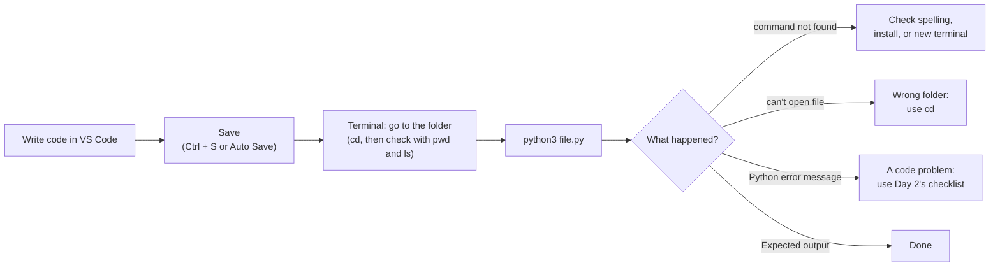

# Day 3 Lecture — Installing Python and Setting Up Your Environment

## A. Lecture information

| | |
| --- | --- |
| **Course part** | Part I — Programming Foundations |
| **Module** | 00 — Foundations |
| **Chapter** | 3 — Installing Python and Setting Up the Development Environment |
| **Day** | 3 |
| **Today's one skill** | Using your programming setup confidently: Python, the **terminal** and **VS Code** |
| **Prerequisites** | Days 1 and 2: writing `print()` programs and understanding error messages |
| **Time** | About 1 hour to read, plus installation time, then the lab |
| **Checked on** | Python 3.13 and 3.14, VS Code, Windows PowerShell, macOS Terminal and Ubuntu Linux |

### What you will be able to do by the end

1. Explain what "installing Python" actually puts on your computer.
2. Install Python on Windows, macOS or Linux, and check that it works.
3. Use the **terminal** to see where you are, list files, make folders and move between them.
4. Explain what **PATH** is, and fix the "command not found" problem.
5. Install **VS Code** and its **Python extension**, open a folder, create a file and run it in two ways.
6. Recognise and fix the most common setup problems.

### What today does NOT cover

No new Python code. Every program today is a `print()` program like Days 1 and 2. Today is about the **tools around** your code.

### New words today

install · interpreter · version · terminal · command · prompt · folder (directory) · current folder · path · PATH · editor · IDE · VS Code · extension · integrated terminal · auto save

---

## B. Introduction

A carpenter needs a workbench and tools before building anything. A programmer is the same. Your **development environment** is the set of tools you use every day:

| Tool | Job | Everyday comparison |
| --- | --- | --- |
| **Python** | Reads and runs your `.py` files | The engine |
| **Terminal** | Lets you type commands to the computer, including "run this file" | The control panel |
| **Code editor (VS Code)** | Where you write and save your code | The notebook |

On Days 1 and 2 you may have used an LJMU lab machine where everything was already set up. Today you set it up on **your own** computer, and learn to use it without guessing. Good programmers are fast with their tools. That speed comes from practice, which is what today's lab is for.

---

## C. Explanation

### C.1 What does "installing Python" mean?

Python is itself a program. Its job is to read your `.py` files and run them. That program is called the **Python interpreter**. (On Day 2 you learned that it checks your file and then runs it.)

Installing Python puts three things on your computer:

1. **The interpreter program**: on Windows, a file called `python.exe`. On macOS and Linux, a file called `python3`.
2. **The standard library**: thousands of ready-made tools that come with Python. You will use these from Part IV.
3. **A way to start it from the terminal**, so that typing `python` or `python3` works.

Python comes in **versions**, such as 3.13, 3.14 and 3.15. The first number, **3**, means Python 3. The second number is the release. Any recent Python 3 is fine for this course.

### C.2 Installing Python

#### Windows

Python's official tool for Windows is the **Python install manager**. The easiest way to get it is from the **Microsoft Store**: search for "Python install manager" and click **Install**. You can also download it from https://www.python.org/downloads/. Both give you the same thing.

When it has finished:

1. Open a **new** terminal (see C.3). A terminal that was already open will not know about the new install.
2. Type `python --version` and press Enter.
3. You should see something like `Python 3.15.0`. The first time, the install manager may ask you a few setup questions. Accept the recommended answers.

On Windows you can use either `python` or `py` to start Python.

> **The Microsoft Store surprise:** on a Windows computer **without** Python, typing `python` may open the Microsoft Store instead of giving an error. That just means Python is not installed yet.

> **Older guides** show an installer with a tick box labelled **"Add python.exe to PATH"**. That is the older Windows installer, which is being retired. If you do use it, **tick that box**. C.6 explains why.

#### macOS

1. Go to https://www.python.org/downloads/ and download the macOS installer.
2. Open the downloaded `.pkg` file and click through the installer.
3. Open a **new** Terminal window and type `python3 --version`.

On a Mac, always type **`python3`**, not `python`.

#### Linux (Ubuntu)

Ubuntu already includes Python 3. Open a terminal and type `python3 --version`. If it is missing, install it with:

```bash
sudo apt update
sudo apt install python3
```

`sudo` means "run this as an administrator". It will ask for your password. Nothing appears on the screen as you type the password. That is normal.

#### LJMU lab machines

Python is already installed. Check with `python --version` (Windows) or `python3 --version` (Linux), just as above.

> **In this course,** commands are written as `python3`. If you are on Windows, type `python` instead (or `py` if `python` does not work).

### C.3 The terminal

The **terminal** is a window where you type **commands** instead of clicking. It looks old-fashioned, but programmers, system administrators and security professionals use it all day, because it is fast, exact and easy to automate.

How to open one:

| System | How |
| --- | --- |
| Windows | Press the Start key, type **Terminal** (or **PowerShell**) and press Enter |
| macOS | Press Cmd + Space, type **Terminal** and press Enter |
| Ubuntu Linux | Press Ctrl + Alt + T |

You will see a **prompt**, a short line showing the terminal is waiting for you. It usually ends with `>` (Windows) or `$` (macOS and Linux):

```text
PS C:\Users\afaq>                          (Windows PowerShell)
afaq@laptop ~ %                            (macOS)
afaq@laptop:~$                             (Ubuntu)
```

You type a command after the prompt and press **Enter**. The terminal runs it, shows any output, and shows a new prompt.

### C.4 Folders and where you are

Your files live in **folders**. (Programmers also call them **directories**. The words mean the same thing.) Folders can contain other folders, like boxes inside boxes.

The terminal is always "standing" in one folder at a time. This is called the **current folder** (or *working directory*). When you type `python3 hello.py`, Python looks for `hello.py` **in the current folder**. This is the number one cause of "it can't find my file".

The full address of a file or folder is called its **path**:

```text
C:\Users\afaq\Documents\python\hello.py        (Windows: backslashes \ )
/Users/afaq/Documents/python/hello.py          (macOS: forward slashes / )
/home/afaq/Documents/python/hello.py           (Linux: forward slashes / )
```

### C.5 Six commands you need

These commands work in **Windows PowerShell**, **macOS Terminal** and **Linux**:

| Command | Meaning | Example |
| --- | --- | --- |
| `pwd` | **P**rint **w**orking **d**irectory: "where am I?" | `pwd` |
| `ls` | **L**i**s**t what is in the current folder | `ls` |
| `mkdir name` | **M**a**k**e a new **dir**ectory (folder) | `mkdir python-labs` |
| `cd name` | **C**hange **d**irectory: move into a folder | `cd python-labs` |
| `cd ..` | Move **up** one level, to the folder that contains this one | `cd ..` |
| `clear` | Clear the screen (your files are not affected) | `clear` |

A typical session looks like this (macOS shown; Windows looks very similar):

```text
afaq@laptop ~ % pwd
/Users/afaq
afaq@laptop ~ % mkdir python-labs
afaq@laptop ~ % cd python-labs
afaq@laptop python-labs % pwd
/Users/afaq/python-labs
afaq@laptop python-labs % ls
afaq@laptop python-labs % cd ..
afaq@laptop ~ % pwd
/Users/afaq
```

`ls` showed nothing because the new folder is empty.

Three keyboard tricks save a lot of typing:

| Key | What it does |
| --- | --- |
| **Tab** | Finishes a file or folder name for you. Type `cd pyt` then press Tab |
| **Up arrow** | Brings back the previous command, so you can run it again |
| **Ctrl + C** | Stops whatever is running and gives you back the prompt |

> **Folder names with spaces** need quotes: `cd "My Documents"`. To avoid this, give your own folders names without spaces, such as `python-labs`.

### C.6 How the terminal finds Python: PATH

When you type `python3`, how does the terminal know where the Python program is? It looks through a list of folders, one by one, for a program with that name. That list is called **PATH**.

- If Python's folder **is** on the PATH, the terminal finds it, and Python starts.
- If it is **not**, the terminal gives up with an error like:

```text
bash: pyhton: command not found                        (macOS / Linux)
pyhton: The term 'pyhton' is not recognized as ...      (Windows PowerShell)
```

You can see that message by misspelling the command, which is the most common cause. The other common causes are that Python is not installed, or that you are using a terminal that was opened **before** you installed Python.

To see **where** the terminal finds Python:

| System | Command |
| --- | --- |
| macOS / Linux | `which python3` |
| Windows | `where.exe python` |

```text
afaq@laptop ~ % which python3
/Library/Frameworks/Python.framework/Versions/3.15/bin/python3
```

Your path will be different. That is fine.

You do not need to change PATH by hand in this course. If `python3 --version` works, your PATH is fine.

### C.7 Running files from the terminal: the current folder matters

Suppose `hello.py` is in a folder called `python-labs`:

```text
afaq@laptop ~ % python3 hello.py
python3: can't open file '/Users/afaq/hello.py': [Errno 2] No such file or directory
afaq@laptop ~ % cd python-labs
afaq@laptop python-labs % python3 hello.py
Hello, world!
```

The first attempt failed because the terminal was standing in the wrong folder. Look at the message: it even shows **where** it looked (`/Users/afaq/hello.py`). The fix is to `cd` into the right folder first.

You can also run a file in another folder by giving its path:

```text
afaq@laptop ~ % python3 python-labs/hello.py
Hello, world!
```

> **Not to be confused with Day 2.** This message is **not** a Python syntax or runtime error. Python never even opened your file, because it could not find it. It is a problem with your **environment**, not your code.

### C.8 VS Code: your code editor

A **code editor** is a program for writing code. Unlike Word, it saves plain text, uses straight quotes, colours your code so it is easier to read, and can run your programs. **VS Code** (Visual Studio Code) is free, works on Windows, macOS and Linux, and is the most popular editor for Python.

Some people use an **IDE** (integrated development environment), such as PyCharm. An IDE is a bigger editor with more tools built in. VS Code with the Python extension does most of what an IDE does.

#### Install VS Code and the Python extension

1. Download VS Code from https://code.visualstudio.com/ and install it.
2. Open VS Code. Click the **Extensions** icon on the left (four small squares), or press Ctrl + Shift + X (Cmd + Shift + X on a Mac).
3. Search for **Python**. Install the one published by **Microsoft**.

An **extension** is an add-on that teaches VS Code new skills. The Python extension adds colouring, error highlighting and a Run button for Python files.

#### Open a folder, not just a file

Always open the **folder** you are working in: **File → Open Folder...**, then choose your folder (for example `python-labs`). The folder's files appear in the **Explorer** panel on the left. Opening a folder means VS Code and its terminal both "stand" in the right place.

#### Create and save a file

1. In the Explorer panel, click the **New File** icon and type a name ending in `.py`, such as `hello.py`.
2. Type your code.
3. Save with **Ctrl + S** (Cmd + S on a Mac).

A **white dot** on the file's tab means "not saved yet". Turn on **File → Auto Save** so you never run an old version by mistake.

#### Two ways to run a file

**Way 1: the integrated terminal.** VS Code has a terminal built in. Open it with **Terminal → New Terminal**, or press **Ctrl + `** (the backtick key, usually below Esc). It opens already in your folder. Type `python3 hello.py` as usual.

**Way 2: the Run button.** With a `.py` file open, click the **▷** (Run Python File) button at the top right. VS Code types the run command into the terminal for you.

Both ways do the same thing. Learn **Way 1** properly, because you will need the terminal for many things later. Use Way 2 for speed once you are comfortable.

#### Choosing which Python VS Code uses

If you have more than one Python installed, VS Code needs to know which one to use. Press **Ctrl + Shift + P** (Cmd + Shift + P on a Mac), type **Python: Select Interpreter** and pick the newest version. The chosen version is shown at the bottom right of the window.

### C.9 Where to keep your lab work

Keep all your course files in one folder, organised by day:

```text
python-labs/
├── Lab-01/
│   ├── ex01_hello.py
│   └── ...
├── Lab-02/
├── Lab-03/
└── ...
```

If you work inside your copy of the course repository, use the `My-Solutions/Lab-NN/` folders instead. Either way: **one folder per lab, one file per exercise.**

### C.10 Why this matters for cyber security

Most security work happens in a terminal, often on Linux machines with no mouse at all: servers, virtual machines and tools such as Kali Linux. Commands like `pwd`, `ls` and `cd` are the first things you will type when you log into a system. Being comfortable in the terminal now will make your later modules much easier.

---

## D. Rules for today

1. After installing anything, **open a new terminal** before testing it.
2. Before running a file, check **where you are** (`pwd`) and **what is there** (`ls`).
3. In VS Code, open the **folder**, not a single file.
4. Turn on **Auto Save**, or press Ctrl + S before every run.
5. Name folders and files **without spaces**: `python-labs`, `ex01_hello.py`.
6. If a command is "not found", check the spelling first.

---

## E. Examples

These examples are terminal sessions, not Python files. The only Python file is `hello.py` from Day 1, in [`Examples/Lecture-03/`](../Examples/Lecture-03/).

### Example 1 — Checking your setup

```text
$ python3 --version
Python 3.13.18
```

**Why:** `--version` asks Python to report its version and stop. If you see a version number starting with 3, Python is installed and on your PATH.

### Example 2 — Making a lab folder and moving into it

```text
$ pwd
/home/afaq
$ mkdir python-labs
$ cd python-labs
$ mkdir Lab-03
$ cd Lab-03
$ pwd
/home/afaq/python-labs/Lab-03
```

**Why:** each `mkdir` makes a folder **inside** the current folder. Each `cd` moves you into it. `pwd` confirms where you ended up.

### Example 3 — Wrong folder, right folder

```text
$ cd /home/afaq
$ python3 hello.py
python3: can't open file '/home/afaq/hello.py': [Errno 2] No such file or directory
$ cd python-labs/Lab-03
$ python3 hello.py
Hello, world!
```

**Why:** the first time, Python looked in `/home/afaq`, but the file is in `python-labs/Lab-03`.

### Example 4 — Moving up with `cd ..`

```text
$ pwd
/home/afaq/python-labs/Lab-03
$ cd ..
$ pwd
/home/afaq/python-labs
$ cd ..
$ pwd
/home/afaq
```

**Why:** `..` always means "the folder one level up". Each `cd ..` climbs one level.

### Example 5 — A misspelt command

```text
$ pyhton --version
bash: pyhton: command not found
$ python3 --version
Python 3.13.18
```

**Why:** the terminal searched every folder on the PATH for a program called `pyhton` and found nothing. This is not a Python error. Python never started.

### Example 6 — Finding where Python is

```text
$ which python3
/usr/local/bin/python3
```

**Why:** `which` shows the exact program the terminal will run when you type `python3`. On Windows, use `where.exe python`.

### Example 7 — Accidentally starting Python on its own

```text
$ python3
Python 3.13.18 (main, ...) on linux
Type "help", "copyright", "credits" or "license" for more information.
>>> python3 hello.py
  File "<python-input-0>", line 1
    python3 hello.py
            ^^^^^
SyntaxError: invalid syntax
>>> exit()
$ python3 hello.py
Hello, world!
```

**Why:** typing `python3` **without** a file name starts Python's interactive mode, shown by the `>>>` prompt. (Day 4 covers it properly.) Inside it, you are talking to **Python**, not to the terminal, so terminal commands are syntax errors. Type `exit()` to get back to the terminal prompt.

---

## F. Picture: from writing to running



---

## G. Common setup problems

| What you see | What it means | Fix |
| --- | --- | --- |
| `command not found` / `is not recognized` | The terminal cannot find the program | Check spelling. Check Python is installed. Open a **new** terminal |
| Typing `python` opens the Microsoft Store | Python is not installed on this Windows PC | Install the Python install manager (C.2) |
| `can't open file ... No such file or directory` | You are in the wrong folder, or the file name is wrong | `pwd`, `ls`, then `cd` to the right folder |
| A `>>>` prompt appears | You started Python with no file name | Type `exit()` |
| Old output after you changed the file | The file was not saved | Ctrl + S, or turn on Auto Save |
| The file is called `hello.py.txt` | It was saved by a text editor that added `.txt` | Rename it, and use VS Code to create `.py` files |
| `cd: no such file or directory` | That folder does not exist here | `ls` to see the folder names, and check spelling |
| `cd My Documents` fails | The space splits it into two words | Use quotes: `cd "My Documents"` |
| On a Mac, `python` is not found | Macs use `python3` | Type `python3` |
| VS Code's Run button uses an old Python | The wrong interpreter is selected | **Python: Select Interpreter** (C.8) |

---

## H. Good habits

1. **Check before you run:** `pwd` and `ls` take one second and save many minutes.
2. **Use Tab completion** for file and folder names. It also catches spelling mistakes.
3. **Use the up arrow** to rerun a command instead of retyping it.
4. **Keep one folder per lab** and one file per exercise.
5. **Read the whole message.** Terminal messages tell you whether the problem is your environment (command not found, can't open file) or your code (a Python error).
6. **Learn the keyboard shortcuts** in VS Code: save, new terminal, command palette.

---

## I. Summary

- Your **development environment** is Python, a **terminal** and a **code editor**.
- Installing Python puts the **interpreter** program on your computer. Check it with `python3 --version` (or `python --version` on Windows).
- On Windows, use the **Python install manager** (Microsoft Store or python.org). On macOS, use the python.org installer. Ubuntu already has Python 3.
- The terminal always stands in a **current folder**. `pwd` shows it, `ls` lists it, `cd` moves, `cd ..` goes up, and `mkdir` makes a new folder.
- **PATH** is the list of folders the terminal searches for programs. "Command not found" means it could not find one.
- "Can't open file" means you are in the wrong folder or typed the wrong name. It is not a code error.
- **VS Code** with the **Python extension** is where you write, save and run code. Open the **folder**, turn on **Auto Save**, and run with the **integrated terminal** or the **▷** button.

### Glossary

| Word | Meaning |
| --- | --- |
| Auto Save | A VS Code setting that saves your file automatically |
| Command | An instruction typed into the terminal, such as `ls` |
| Current folder | The folder the terminal is "standing" in right now |
| Development environment | The set of tools you use to write and run code |
| Extension | An add-on that gives VS Code new features |
| Folder (directory) | A container for files and other folders |
| IDE | Integrated development environment: a large editor with many built-in tools |
| Install | To put a program on your computer so you can use it |
| Integrated terminal | The terminal built into VS Code |
| Interpreter | The Python program that reads and runs your `.py` files |
| Path | The full address of a file or folder, such as `/home/afaq/hello.py` |
| PATH | The list of folders the terminal searches when you type a command |
| Prompt | The text the terminal shows when it is waiting for a command |
| Terminal | A window where you type commands to the computer |
| Version | A numbered release of a program, such as Python 3.14 |
| VS Code | A free, popular code editor from Microsoft |

---

## J. Knowledge check

Answer these in your own words **before** you start the lab. Write your answers in `knowledge_check.md` in your Lab-03 folder (`python-labs/Lab-03`, or `My-Solutions/Lab-03` if you work inside the course repository).

1. What does installing Python put on your computer?
2. Why should you open a **new** terminal after installing Python?
3. What do `pwd`, `ls`, `cd` and `mkdir` do? Give an example of each.
4. You are in `/home/afaq/python-labs/Lab-03`. Where are you after typing `cd ..` twice?
5. What is PATH, and what does "command not found" usually mean?
6. You type `python3 ex01.py` and get `can't open file ... No such file or directory`. Give two possible reasons, and the commands you would use to check.
7. Is the message in question 6 a syntax error, a runtime error, or something else? Explain.
8. Why should you open a **folder** in VS Code, rather than just a file?
9. What does a white dot on a VS Code tab mean, and why does it matter?
10. You see `>>>` in your terminal. What happened, and how do you get back?

When you have answered them, open [Lab 3](../Labs/Lab-03-Installing-Python-and-Setting-Up-Your-Environment-Hands-on-Workbook.md).
